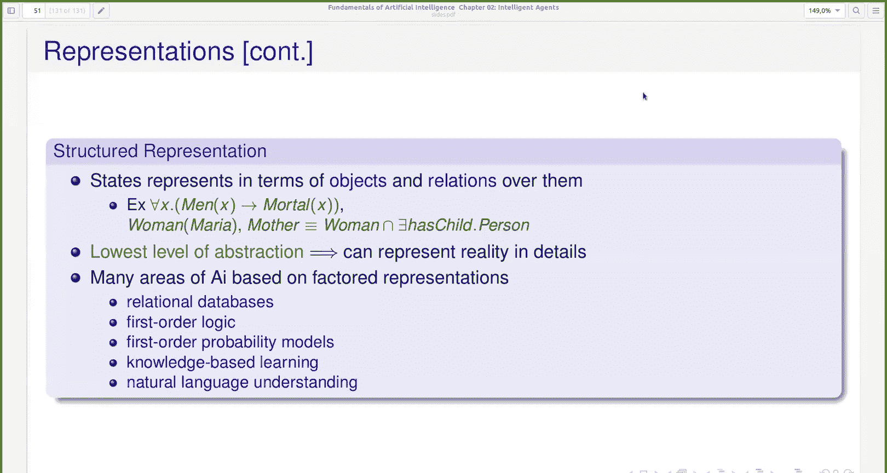

#  007：理性智能体


## 概述
在本节课中，我们将学习理性智能体的核心概念、不同类型及其架构。我们将探讨智能体如何通过感知、内部状态和行动来与环境互动，并理解从简单的反射型智能体到更复杂的基于目标或效用的智能体的演进过程。

---

## 任务环境与知识状态

上一节我们介绍了不同类型的任务环境。本节中，我们来看看另一个关键特征：智能体对环境的**知识状态**。

知识状态指的是智能体对环境规则的了解程度，这与环境的可观察性是不同的概念。

*   **已知环境**：智能体完全了解环境的所有规则和行动结果。例如，在棋盘游戏中，规则是明确的。
*   **未知环境**：智能体不了解环境规则，需要通过探索和学习来获取知识。例如，一个初次进入房间的扫地机器人。

需要注意的是，环境“已知”与“完全可观察”是正交的概念。一个已知环境可能并非完全可观察（例如，你知道扑克牌规则，但不知道对手的手牌）；同样，一个未知环境也可能是完全可观察的（例如，你第一次看到一个游戏的所有组件，但还不知道规则）。

---

## 智能体的构成

理解了环境后，我们来看看智能体本身是如何构成的。一个智能体通常由**架构**和**智能体程序**组成。

*   **架构**：指智能体运行的物理或软件平台（例如，机器人硬件或聊天软件的运行环境）。
*   **智能体程序**：这是人工智能设计的核心，它根据感知历史来决定执行什么行动。

这里需要区分两个概念：
*   **智能体函数**：一个抽象的数学概念，将**完整的感知历史**映射到行动。
*   **智能体程序**：一个具体的实现，它在每一步通常只处理**当前感知**。为了考虑历史信息，程序需要维护一个**内部状态**（即记忆）。

一个最基础的例子是**基于表格的智能体**，它直接将每一个可能的感知序列通过查表对应到一个行动。这只在理论上有意义。

---

## 智能体类型（一）：简单反射型智能体

现在，我们来具体看看几种主要的智能体程序类型。首先是最简单的：**简单反射型智能体**。

这类智能体没有记忆，其行动仅基于**最新的感知**。它的工作原理是“感知-反应”。

**架构公式**：
```
行动 = 条件-行动规则集合(当前感知到的世界状态)
```

以下是其工作流程：
1.  传感器从环境获取感知信息。
2.  感知信息被转化为对当前世界状态的描述（这要求环境是**完全可观察**的，或者至少智能体认为感知包含了决策所需的全部信息）。
3.  智能体根据一组预设的“条件-行动”规则（例如 if-then 语句），直接选择与当前状态匹配的行动。

**优点**：实现简单，计算高效。
**缺点**：功能有限，严重依赖于“完全可观察”这一强假设，无法处理部分可观察的环境。

---

## 智能体类型（二）：基于模型的反射型智能体

当环境是**部分可观察**时，简单反射型智能体就失效了。这时我们需要更强大的智能体：**基于模型的反射型智能体**。

这类智能体的核心是拥有一个**内部状态**，用于维护一个**世界模型**，以追踪那些无法直接感知的信息。

**架构公式**：
```
内部状态 = 更新函数(上一内部状态， 当前感知， 上一行动)
行动 = 条件-行动规则集合(内部状态)
```

以下是其工作流程：
1.  传感器获取部分感知信息。
2.  智能体结合**当前的内部状态**、**最新的感知**以及**它自己上次执行的动作**，利用内部模型来预测世界如何演化，从而**更新其内部状态**。这个内部状态代表了它对完整世界状况的最佳估计。
3.  与简单反射型智能体类似，它根据更新后的内部状态，通过规则匹配来决定行动。

**关键点**：智能体通过模型和记忆来弥补部分可观察性带来的信息缺失。例如，司机转头看后视镜时，大脑会基于记忆和模型假设正前方的路况短时间内不会突变。

---

## 智能体类型（三）：基于目标的智能体

前面两种智能体主要关注“生存”或对环境的即时反应。而**基于目标的智能体**则拥有明确的**目标**，其行动旨在实现这些目标。

这类智能体在基于模型的基础上，增加了**目标信息**。决策不再仅仅是“对当前状态做出反应”，而是需要寻找能达成目标的行动序列。

**核心机制**：这涉及到**规划**或**搜索**。智能体需要：
1.  考虑未来的状态，而不仅仅是下一步。
2.  生成一个能达到目标的**行动序列（即规划）**。
3.  执行时，按计划采取行动，并根据实际感知到的状态与预期是否一致，来决定是继续执行计划还是重新规划。

**优点**：更加通用和灵活。不需要为所有可能情况预先编写规则，而是能针对不同目标自动生成计划。
**缺点**：规划过程通常计算量非常大（在计算复杂性上属于 PSPACE 完全问题，甚至比 NP 难问题更复杂）。

---

## 智能体类型（四）：基于效用的智能体

基于目标的智能体有时会遇到问题：目标可能相互冲突，或者目标本身不是简单的“是/否”达成，而是有完成度的区别。这时，**基于效用的智能体**提供了更优的解决方案。

这类智能体使用一个**效用函数**来衡量状态或状态序列的“好坏”，该函数将状态映射到一个实数值。

**决策原则**：选择能**最大化期望效用**的行动。效用函数本质上是智能体内部实现的**性能度量**。

**与基于目标智能体的关系**：两者并非严格割裂。许多规划系统本身就包含了效用优化。基于效用的方法能更好地处理目标冲突和折衷（例如帕累托最优），但实现起来也更复杂。

---

## 所有智能体的增强：学习型智能体

学习能力与上述所有智能体类型都是正交的，可以叠加在任何一种架构之上，形成**学习型智能体**。

其核心思想是：智能体的知识（如规则、模型参数）并非完全由程序员预先设定，而是可以通过与环境的互动来自我改进。

**学习型智能体架构包含四个主要部分**：
1.  **性能元件**：即之前提到的任一种智能体（反射型、基于模型、基于目标等），它负责选择行动。
2.  **评价元件**：将环境反馈（实际结果与预期的对比）转化为对性能元件表现的评价（好或坏）。
3.  **学习元件**：根据评价元件的反馈，修改性能元件（例如，调整规则、改变参数）。
4.  **问题生成器**：负责提出新的、有探索性的行动建议，以获取新信息，从而促进学习。它解决了“负面反馈只告诉你什么不好，但没告诉你怎么做才好”的问题。

这种通过试错和反馈进行学习的方式，使得智能体更加**鲁棒**，能更好地适应真实环境。现代人工智能，尤其是机器学习，很大程度上就建立在这种学习范式之上。

---

## 状态表示方法

在讨论智能体时，“状态”是一个核心概念。状态有三种主要的表示方法，其表达能力和计算复杂度依次增加：

1.  **原子表示**：每个状态都是一个不可分割的整体，用一个标签（如“状态A”、“状态B”）表示。只能区分状态是否相同，无法表达相似性。表达能力最弱，但有时用于抽象分析。
    *   **示例**：用“在特伦托”、“在维罗纳”表示位置状态。

2.  **要素表示**：状态由一组**状态变量**（属性）的值构成，就像一个记录或结构体。
    *   **公式**：`状态 = {变量1: 值1, 变量2: 值2, ... , 变量N: 值N}`
    *   **示例**：`{位置: 特伦托, 速度: 50km/h, 天气: 晴}`。
    *   **特点**：可以表示部分信息（某些变量未知），可以计算状态间的相似度（如汉明距离）。这是最常用、最直观的表示方法，命题逻辑、贝叶斯网络、大多数机器学习都基于此。

3.  **结构化表示**：状态中包含**对象**以及对象之间的**关系**，通常使用一阶逻辑等知识表示语言。
    *   **示例**：“所有凡人都会死”可以表示为：`∀x (人(x) → 会死(x))`。
    *   **特点**：表达能力最强，可以非常紧凑地表示复杂关系和抽象概念。常用于知识库、自然语言理解等领域。推理复杂度也最高。

**一般规律**：表示语言的表达能力越强，在其上的推理计算通常就越复杂。

---



## 总结
本节课中，我们一起学习了理性智能体的核心框架。我们从对任务环境和知识状态的分类开始，逐步深入探讨了四种主要的智能体类型：从仅对环境做出即时反应的**简单反射型智能体**，到通过内部模型处理部分可观察性的**基于模型的反射型智能体**，再到拥有明确目的并能进行规划的**基于目标的智能体**，以及能通过效用函数处理复杂偏好和权衡的**基于效用的智能体**。我们还了解到，**学习能力**可以增强任何类型的智能体，使其通过经验自我改进。最后，我们介绍了**原子**、**要素**和**结构化**这三种状态表示方法，理解了它们在表达能力和计算成本上的权衡。这些概念为我们后续深入学习搜索、规划等具体人工智能技术奠定了坚实的基础。