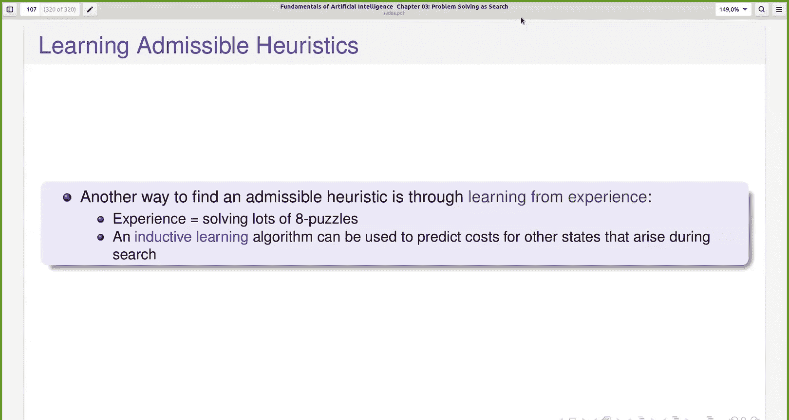

#  010：A*搜索与启发式函数 🧭

在本节课中，我们将学习如何利用领域知识或启发式信息来引导搜索过程。我们将重点介绍A*搜索算法，这是一种结合了代价和启发式信息的强大且流行的算法，广泛应用于规划等领域。

## 概述

上一节我们介绍了最佳优先搜索和一致代价搜索。本节中，我们将看看如何将这两种策略的优点结合起来，形成A*搜索算法。其核心思想是：在选择下一个要扩展的节点时，不仅要考虑从起点到达该节点的实际代价，还要考虑从该节点到目标的**估计代价**。

## A*搜索算法

A*搜索算法的核心是定义一个评估函数 **f(n)**，用于为每个节点 **n** 打分。该函数是以下两项之和：
*   **g(n)**：从起始节点到节点 **n** 的**实际路径代价**。
*   **h(n)**：从节点 ** n** 到目标节点的**估计代价**（即启发式函数）。

因此，评估函数定义为：
`f(n) = g(n) + h(n)`

**f(n)** 代表了通过节点 **n** 到达目标的**估计总路径代价**。A*算法总是优先扩展 **f(n)** 值最小的节点。

### 算法实现

A*算法的实现与一致代价搜索（UCS）几乎完全相同，唯一的区别在于计算节点优先级时使用的值。在UCS中，我们使用 **g(n)**；在A*中，我们使用 **f(n) = g(n) + h(n)**。

以下是算法的简要描述：
1.  将起始节点放入优先队列（前沿）。
2.  当队列不为空时：
    *   弹出 **f(n)** 值最小的节点 **n**。
    *   如果 **n** 是目标节点，则成功返回路径。
    *   否则，扩展节点 **n**，生成其后继节点。
    *   对于每个后继节点 **n'**：
        *   计算 `g(n') = g(n) + cost(n, n')`。
        *   计算 `f(n') = g(n') + h(n')`。
        *   如果节点 **n'** 的状态是首次遇到，或找到了到达该状态的更低 **g(n')** 值，则将其（或更新后的节点）加入优先队列。

## 算法示例与比较

为了理解A*的优势，我们将其与一致代价搜索（UCS）和贪婪最佳优先搜索进行比较。

考虑一个简单的图搜索问题。图中标有行动代价，不同算法会做出不同选择。

*   **一致代价搜索（UCS）**：只考虑到达节点的实际代价 **g(n)**。它可能会探索一些虽然到达代价低，但离目标很远的路径，导致搜索不够高效。
*   **贪婪最佳优先搜索**：只考虑启发式估计 **h(n)**，即节点到目标的“接近程度”。它可能会选择那些看起来离目标很近，但到达代价极高的节点，从而找到次优甚至代价很高的解。
*   **A*搜索**：结合 **g(n)** 和 **h(n)**。它能够避免上述两种极端。例如，一个节点可能 **h(n)** 很小（离目标近），但 **g(n)** 很大（到达它很费劲），其 **f(n)** 值可能反而比另一个 **h(n)** 稍大但 **g(n)** 小很多的节点更大。A*会选择后者，实现更好的折中。

通过罗马尼亚地图问题的具体演算可以看到，A*在每一步都选择 **f(n)** 最小的节点，最终高效地找到了最优路径。

## 启发式函数的质量

并非所有启发式函数都是好的。为了保证A*算法能找到最优解，并对搜索进行有效剪枝，启发式函数需要满足一些性质。

### 可采纳性（乐观性）

一个启发式函数 **h(n)** 是**可采纳的**（或称**乐观的**），如果它**永远不会高估**从节点 **n** 到达目标的实际最小代价 **h*(n)**。即：
`h(n) ≤ h*(n)` 对所有节点 **n** 成立。

例如，两点间的直线距离就是一个可采纳的启发式，因为直线是最短路径。

### 一致性（单调性）

一个启发式函数 **h(n)** 是**一致的**（或称**单调的**），如果对于每个节点 **n** 及其任意后继节点 **n'**（通过行动 **a** 产生，代价为 **c(n, a, n')**），满足以下三角不等式：
`h(n) ≤ c(n, a, n') + h(n')`

这意味着从节点 **n** 到目标的估计代价，不会大于走一步到 **n'** 的代价加上从 **n'** 到目标的估计代价。一致性是可采纳性的一个更强条件。如果 **h(n)** 是一致的，那么它必然是可采纳的。

一致性带来一个关键性质：沿着任何路径，**f(n)** 的值是**非递减**的。随着搜索向目标推进，我们获得的信息越多，**f(n)** 的估计就越来越接近（但不超过）真实代价。

## A*算法的性质

基于启发式函数的可采纳性和一致性，A*算法拥有以下重要性质：

*   **最优性**：如果启发式函数 **h(n)** 是可采纳的，那么树搜索版本的A*算法是最优的（能找到代价最小的解）。如果 **h(n)** 是一致的，那么图搜索版本的A*算法也是最优的。
*   **完备性**：如果所有行动代价都为正，且启发式函数满足一定条件，A*算法是完备的（只要解存在，就一定能找到）。
*   **效率**：A*算法的效率高度依赖于启发式函数的质量。启发式函数越好（越接近真实代价 **h*(n)**），算法需要扩展的节点就越少。

### 有效分支因子

我们使用**有效分支因子**来衡量启发式函数的质量。它表示为了达到相同的搜索效果，一个均匀搜索树所需要的平均分支数。完美启发式（**h(n) = h*(n)**）的有效分支因子为1，意味着搜索沿一条直线进行。启发式越差，有效分支因子越接近问题的真实分支因子，搜索复杂度也越高。

## 如何设计启发式函数

设计一个好的启发式函数是应用A*算法的关键。以下是几种常见方法：

### 基于问题知识

利用对特定问题的深入理解来设计。例如，在国际象棋中，可以根据棋子类型和位置赋予不同价值来评估棋局。

### 松弛问题法

这是一个系统化生成可采纳启发式的通用方法。其核心思想是：通过**放松原问题的某些约束**，得到一个更容易求解的“松弛问题”。松弛问题的最优解代价，可以作为原问题的一个可采纳启发式。

例如，在八数码问题中：
*   **松弛1**：允许将任何棋子移动到任何相邻位置（忽略空白格条件）。这对应着**曼哈顿距离**启发式。
*   **松弛2**：允许将任何棋子直接移动到其目标位置。这对应着**错位棋子数**启发式。

由于松弛问题有更少的限制，其最优解代价一定不大于原问题的最优解代价，因此由此得到的启发式函数是可采纳的。通常，松弛程度越低，得到的启发式越准确，但计算可能也越复杂。

### 机器学习方法

现代人工智能中，常使用机器学习（特别是深度学习）来从数据中学习启发式函数。例如，AlphaGo等程序就结合了搜索和神经网络学到的局面评估函数。

## 总结

本节课中我们一起学习了A*搜索算法及其核心——启发式函数。
*   A*算法通过结合路径实际代价 **g(n)** 和到目标的估计代价 **h(n)**（即 `f(n)=g(n)+h(n)`），有效地引导搜索方向。
*   为了保证找到最优解，启发式函数 **h(n)** 需要满足**可采纳性**（不超估）和更强的**一致性**（单调性）。
*   A*算法的最优性、完备性和效率都依赖于启发式函数的质量。
*   设计启发式函数的有效方法包括利用领域知识、构造**松弛问题**，以及使用**机器学习**。

A*算法因其简洁性和强大性能，至今仍是解决许多组合搜索问题的基石算法。理解其原理和启发式函数的设计，是掌握人工智能搜索技术的关键一步。