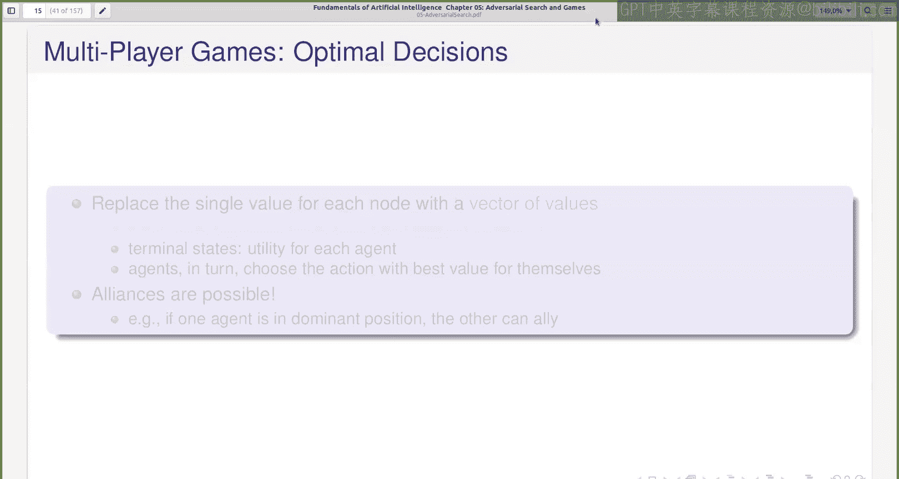

#  014：对抗搜索


在本节课中，我们将要学习一个超越传统搜索的新主题：对抗搜索。当环境中存在目标与我们相冲突的其他智能体（即对手）时，我们就进入了对抗搜索的领域。这不仅是游戏（如国际象棋、围棋）的核心，也是经济学、军事策略、体育竞技等众多领域的模型基础。

上一节我们介绍了单智能体环境下的搜索问题，本节中我们来看看当存在对手时，情况会发生怎样的变化。

## 对抗搜索概述

对抗搜索处理的是多智能体环境，尤其关注其中存在对手的情况。对手是指其目标在某种程度上与我们自身目标相冲突的其他智能体。这与随机环境不同，随机环境的行为并非针对我们，而对手则会主动采取行动来阻碍我们达成目标。

为什么对抗搜索如此重要？首先，许多现实场景（如市场竞争、策略博弈）都涉及对手。其次，即便是规则简单的游戏（如井字棋），其搜索空间也可能变得极其庞大和计算困难。例如，国际象棋的平均分支因子约为35，可能的棋局数量是一个天文数字。

## 游戏的形式化定义

一个游戏可以形式化定义为以下组成部分：

*   **初始状态**：`S0`，描述游戏开始时的设置。
*   **玩家函数**：`Player(s)`，定义在状态`s`下该哪位玩家行动。
*   **行动集合**：`Actions(s)`，给出在状态`s`下所有合法的行动。
*   **转移模型**：`Result(s, a)`，描述在状态`s`采取行动`a`后到达的新状态。
*   **终止测试**：`Terminal-Test(s)`，判断状态`s`是否为游戏结束状态。
*   **效用函数**：`Utility(s, p)`，对玩家`p`而言，在终止状态`s`的得分（或收益）。

初始状态、行动集合和转移模型递归地定义了整个**游戏树**，其中节点是状态，边是行动。

## 游戏类型与假设

游戏可以根据多个维度进行分类：

*   **确定性 vs 随机性**：确定性游戏（如国际象棋）的行动结果确定；随机性游戏（如大富翁）包含掷骰子等随机成分。
*   **完全信息 vs 不完全信息**：完全信息游戏（如围棋）所有玩家都知道完整游戏状态；不完全信息游戏（如扑克）存在隐藏信息（如对手的手牌）。
*   **零和 vs 非零和**：在零和游戏中，所有玩家的收益之和为常数（通常为0），一方的收益即另一方的损失。非零和游戏则不然（如足球联赛的积分制）。

在本课程中，我们首先关注**确定性、完全信息、零和、双人、回合制**的游戏。为了简化，我们将两位玩家分别称为 **MAX**（先手，试图最大化自身效用）和 **MIN**（后手，试图最小化MAX的效用）。

这里有一个关键假设：**双方玩家都是理性且最优的**。即，MAX总是选择能使自己最终效用最大的行动，而MIN总是选择能使MAX最终效用最小的行动。这意味着我们不能寄希望于对手犯错。

## 极小化极大算法

在对抗搜索中，最优策略被称为**极小化极大策略**。其核心思想是：MAX在选择行动时，必须考虑MIN会如何最优地回应，并在这个前提下选择对自己最有利的行动。

以下是该策略的递归定义：

*   如果状态`s`是终止状态，返回其效用值 `Utility(s)`。
*   如果当前玩家是 **MAX**，则返回所有可能行动结果中的**最大值**：
    `value = max( Min-Value(Result(s, a)) )`，对所有 `a` 属于 `Actions(s)`。
*   如果当前玩家是 **MIN**，则返回所有可能行动结果中的**最小值**：
    `value = min( Max-Value(Result(s, a)) )`，对所有 `a` 属于 `Actions(s)`。

### 算法伪代码

以下是该算法的伪代码实现：

```python
function MinMax-Decision(state):
    # 选择能带来最大最小值的行动
    return argmax( Min-Value(Result(state, a)) ) for a in Actions(state)

function Max-Value(state):
    if Terminal-Test(state):
        return Utility(state)
    v = -∞
    for each a in Actions(state):
        v = max(v, Min-Value(Result(state, a)))
    return v

function Min-Value(state):
    if Terminal-Test(state):
        return Utility(state)
    v = +∞
    for each a in Actions(state):
        v = min(v, Max-Value(Result(state, a)))
    return v
```

### 图解示例

考虑一个简单的游戏树片段。矩形节点代表MAX的回合，倒三角节点代表MIN的回合，叶子节点数字代表对MAX的效用值。

1.  在叶子节点层，效用值已知（例如3， 12， 8...）。
2.  在MIN节点（倒三角），MIN会选择子节点中**最小值**作为该节点的值（例如，在3，12，8中选择3）。
3.  在MAX节点（矩形），MAX会选择子节点中**最大值**作为该节点的值。
4.  从根节点（MAX）开始，递归地执行此过程。最终，MAX会选择能导致最大“最小保证效用”的行动路径。

这个算法本质上是**自底向上**的：计算从叶子节点的效用值开始，逐层向上传播，直到根节点。

## 总结



本节课中我们一起学习了对抗搜索的基本概念。我们首先了解了对抗搜索与单智能体搜索的区别，以及它在模拟竞争环境中的重要性。接着，我们学习了如何形式化定义一个游戏，并介绍了不同的游戏分类。最后，我们深入探讨了解决确定性零和双人游戏的核心算法——极小化极大算法。该算法基于双方玩家都绝对理性的假设，通过递归计算，为MAX玩家找到一个即使在MIN玩家最优应对下也能最大化自身收益的策略。在接下来的课程中，我们将看到如何优化这个基础算法以提高搜索效率。