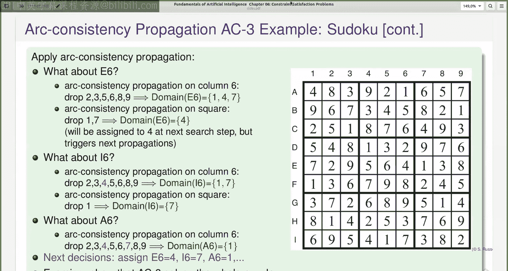

#  017：约束满足问题（CSPs）🧩

在本节课中，我们将要学习**约束满足问题**。这是一种非常重要的问题表示和求解范式，它利用状态的结构化表示和通用启发式方法，能够高效地解决从数独到调度等众多实际问题。

---

## 状态表示与CSP的核心思想

在之前的章节中，我们介绍了状态的不同表示方法。我们通常将状态视为一个不可分割的原子标签，或者一个简单的索引。然而，在约束满足问题中，我们采用一种**因子化表示**。

在这种表示中，一个状态由一组**状态变量**及其赋值构成。这些变量可以是布尔型、有界整数等不同类型。目标测试则是一组**约束**，只有当所有约束都被满足时，当前状态才是一个目标状态。

CSP搜索算法与之前看到的搜索算法有根本不同。之前的算法（如盲目搜索）将状态视为一个整体，只关注状态之间的转移关系，而不探究状态内部的结构。CSP算法则充分利用状态的内部结构，特别是变量的**部分赋值**。其核心思想在于，它们依赖于通用的启发式方法，而不是针对特定问题的启发式。你可以将具体问题编码为CSP，然后使用通用算法进行求解。主要思路是逐步**消除变量的候选值**。

---

## CSP的基本定义

一个约束满足问题是一个三元组 **<X, D, C>**：
*   **X** 是一组变量 {X1, X2, ..., Xn}。
*   **D** 是一组非空域 {D1, D2, ..., Dn}，其中 Di 是变量 Xi 可以取值的集合。我们通常假设域是有限的。
*   **C** 是一组约束 {C1, C2, ..., Cm}。每个约束限制了一个或多个变量可以取值的组合。

每个约束 **C** 包含两个部分：
1.  **作用域**：该约束涉及的变量集合。
2.  **关系**：定义了这些变量被允许的取值组合。关系可以显式列出所有合法元组，也可以通过算术表达式等声明式语言来描述。一个约束关系应该能够测试一个赋值是否满足它，并且在域有限时，能够枚举所有可能的解。

---

## 赋值、解与问题变体

给定一个CSP，一个**状态**就是给变量赋值。我们有以下术语：
*   **完全（或全部）赋值**：为每个变量都赋予了一个值。
*   **部分赋值**：只给一个变量子集赋予了值。
*   如果一个（完全或部分的）赋值不违反任何约束，则称其为**一致的**或**合法的**。
*   一个满足所有约束的完全赋值，称为该CSP的一个**解**。

CSP的基本问题是找到至少一个解。此外还有两个重要的变体：
1.  **找到所有解**。
2.  **约束优化问题**：除了找到满足约束的解，还要优化某个目标函数（通常是关于变量值的函数），找到最优解。

---

## CSP实例：数独与地图着色

为了更具体地理解CSP，我们来看两个经典例子。

**数独**是一个典型的CSP：
*   **变量**：81个方格，每个是一个变量 Xij。
*   **域**：每个变量的域是 {1, 2, ..., 9}。
*   **约束**：每行、每列、每个3x3宫内的所有数字必须互不相同。这可以表示为27个“所有不同”的全局约束，也可以表示为大量两两不相等的二元约束。

**地图着色**是另一个经典问题，它是许多更复杂问题（如频率分配、课程安排）的隐喻：
*   **变量**：地图上的每个区域（例如澳大利亚的各个州）。
*   **域**：一组颜色，例如 {红， 绿， 蓝}。
*   **约束**：任何两个相邻的区域不能着相同的颜色。

地图着色问题可以自然地用**约束图**来表示：
*   节点代表变量。
*   边连接两个存在约束（即相邻）的变量。
利用约束图的结构信息，可以极大地提升求解效率。例如，孤立节点（如塔斯马尼亚州）的赋值不会影响其他变量，可以单独处理。

---

## CSP的类型与编码的重要性

CSP可以根据变量的类型进行分类：
*   **离散变量**：这是我们主要关注的类型。
    *   **有限域**：例如布尔可满足性问题（SAT），域大小为2。这是AI中极其重要的子领域。
    *   **无限域**：例如使用整数表示作业开始时间，约束为线性算术不等式。
*   **连续变量**：例如实数域上的线性规划问题。

**为问题找到一个好的CSP编码至关重要**，它直接决定了求解效率。以N皇后问题为例：
*   **较差编码**：为NxN棋盘的每个格子设置一个布尔变量，表示是否有皇后。这需要N²个变量和大量约束。
*   **较好编码**：为每一行设置一个变量，其值表示皇后在该行的列位置。这只需要N个变量，约束也更紧凑（列不冲突、对角线不冲突）。

---

## 约束的类型

约束可以根据其涉及变量的数量进行分类：
*   **一元约束**：只涉及一个变量。
*   **二元约束**：涉及两个变量。许多算法假设约束是二元的，因为任何高阶约束理论上都可以转化为二元约束。
*   **高阶约束**：涉及三个或更多变量，需要用超图表示。
*   **全局约束**：涉及任意数量变量，但具有共同结构。例如“所有不同”约束、“恰好K个为真”约束等。求解器通常有针对全局约束的专用高效算法。

此外，约束还可分为：
*   **硬约束**：必须被满足。
*   **软约束**：表示偏好，不一定必须满足，但满足它会带来奖励或避免惩罚。包含软约束的优化问题称为约束优化问题。

---

## CSP求解：搜索与约束传播

CSP的求解范式与我们之前学过的搜索有本质区别。之前是从一个**完全状态**转移到另一个**完全状态**。而在CSP求解中，我们在**部分赋值**的空间中进行搜索，并交织进行**约束传播**。

**搜索步骤**：非确定性地选择一个变量并为其赋值。如果沿着当前路径无法找到解，则进行**回溯**，撤销之前的某些赋值。

**约束传播（推理）步骤**：利用当前的部分赋值和约束，来**推导**并**缩小**未赋值变量的域。如果某个变量的域被缩小为空，则触发回溯；如果被缩小为单个值，则可以立即进行确定性赋值。

一个通用的元启发式规则是：**优先进行确定性步骤，推迟非确定性选择**。这通常能减少搜索分支，提升效率。

约束传播是CSP求解的新颖且核心的部分。它通过在每一步削减搜索空间，避免了许多徒劳的搜索分支。约束传播有多种技术，需要在**效果**（能多大幅度削减域）和**效率**（计算开销）之间进行权衡。

---

## 局部一致性与传播算法

约束传播的核心是建立并维护某种**局部一致性**。我们主要关注两种：

**1. 节点一致性**
一个变量是节点一致的，当且仅当其域中的所有值都满足所有作用于它的一元约束。使整个CSP节点一致，只需遍历所有变量，移除违反一元约束的值即可。这通常在搜索开始前完成。

**2. 弧一致性**
对于二元约束，变量 Xi 相对于 Xj 是弧一致的，当且仅当对于 Xi 域中的**每一个**值，在 Xj 的域中都存在**至少一个**值，使得这对值满足 Xi 和 Xj 之间的所有约束。如果某个值找不到这样的“支持”，它就可以被安全地从 Xi 的域中移除。
整个CSP是弧一致的，当且仅当每一对相邻变量都相互满足弧一致性。

以下是两种重要的传播算法：

**前向检查**
这是最简单、最廉价的传播形式。
*   **操作**：当一个变量被赋值后，检查所有与之相邻的**未赋值**变量，从它们的域中删除与当前赋值冲突的值。
*   **局限**：它只保证了从**已赋值**变量到**未赋值**变量的弧的一致性，而不处理未赋值变量之间的弧。因此，前向检查后的CSP可能不是弧一致的。

**AC-3算法**
这是一种建立完全弧一致性的算法。
*   **操作**：维护一个待检查弧的队列。每次从队列中取出一条弧 (Xi, Xj)，检查 Xi 的每个值在 Xj 中是否有支持。如果没有，则删除该值。**如果 Xi 的域被修改了**，那么所有指向 Xi 的弧（除了刚检查过的 Xj）都需要重新加入队列进行检查。
*   **效果**：算法运行直到队列为空，此时整个CSP达到弧一致。
*   **对比**：AC-3比前向检查更强大，能更早地发现不一致，从而减少搜索，但每次传播的计算成本也更高。

一个关键区别在于如何处理**域被缩小到单个值的未赋值变量**：
*   在前向检查中，它被视为未赋值变量，不会触发对其邻居的检查。
*   在AC-3中，域的任何缩小都会触发对其所有邻居的重新检查，从而可能引发连锁推理，实现更多确定性赋值。

---

## 本节课总结

在本节课中，我们一起学习了约束满足问题的基础知识。我们首先了解了CSP如何利用因子化状态表示和通用启发式。然后，我们掌握了CSP的形式化定义、相关术语（变量、域、约束、赋值、解）以及各种问题变体（如约束优化）。通过数独和地图着色等实例，我们加深了对CSP建模的理解，并认识到好的问题编码至关重要。

我们详细探讨了CSP求解的核心范式：在部分赋值的空间中进行搜索，并交织进行约束传播。我们重点学习了两种局部一致性（节点一致性和弧一致性）以及对应的传播算法（前向检查和AC-3），理解了它们在效果和效率上的权衡。

CSP是一个强大的框架，能够建模并解决从逻辑谜题到工业调度等广泛领域的问题。掌握其基本原理是学习更高级人工智能技术的重要一步。