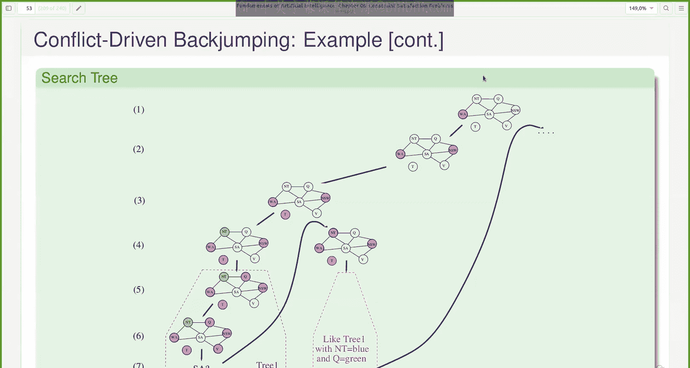

#  018：CSP搜索


在本节课中，我们将要学习约束满足问题中的搜索算法。我们将探讨如何通过选择变量和值来逐步构建解，以及如何利用一致性传播来减少搜索空间。我们还将介绍一种更智能的回溯方法，以显著提高搜索效率。

## 搜索与传播

上一节我们介绍了CSP的基本概念，本节中我们来看看解决CSP的两个核心组件：搜索和传播。

搜索意味着选择变量并为其赋值。这与之前的状态空间搜索有根本区别：你不是在选择一个完整的状态，而是在构建一个逐步扩展的部分赋值。你选择一个变量，赋予它一个值，然后选择另一个变量，如此反复，直到找到一个满足所有约束的完整赋值，或者发现当前部分赋值违反了约束。

传播（也称为一致性传播或值传播）是另一个核心组件。其基本思想是：一旦你通过搜索为变量赋值，就可以根据约束来减少其他变量的可能取值（即缩小其值域）。这可以提前发现不一致性，从而剪枝掉大量无效的搜索分支。

传播的强度各有不同。以下是两种主要方式：

*   **前向检查**：这是最简单的形式。当一个变量被赋值后，检查所有与其有约束关系的未赋值变量，并删除那些与当前赋值不兼容的值。这种方法非常快，但不够强大，因为它不考虑未赋值变量之间的约束关系，结果可能不是全局弧一致的。
*   **弧一致性传播（如AC3算法）**：这种方法更强大。当一个变量的值域被缩减后，它会递归地检查并缩减其邻居变量的值域，直到没有变化为止。这能更有效地缩减值域，但计算成本也更高。

这里存在效率与效果之间的权衡。前向检查更快但剪枝能力弱；弧一致性传播更有效但更昂贵。在实际应用中，需要根据问题特点进行选择。

一个重要的区别是：**一个被明确赋值的变量**与**一个值域被缩减到只剩一个值但尚未被正式“赋值”的变量**是不同的。后者很可能在下一步搜索中被赋值，但在前向检查中，它不会触发对其邻居的检查，而弧一致性传播则会处理这种情况。

## 一致性概念

我们可以将弧一致性的概念推广到更高级的一致性，例如路径一致性和K一致性。

**路径一致性**：对于任意三个变量Xi, Xj, Xk，如果对于Xi和Xj的每一个相容赋值组合，都能在Xk中找到至少一个值，使得涉及这三个变量的所有约束都得到满足，那么这对变量关于第三个变量是路径一致的。以数独为例，有时你会发现两个格子只能填两个特定的数字（比如1和2），那么你就可以从它们共同邻居的候选值中排除1和2。

**K一致性**：一个CSP是K一致的，如果对于任意一组K-1个变量和它们的一个相容赋值，总能为第K个变量找到一个相容的值。当K=1时是节点一致，K=2时是弧一致，K=3时是路径一致。

问题在于，确保K一致性的计算成本随K值呈指数增长。因此，在搜索中，我们需要权衡传播的强度（效果）与其计算开销。通常，结合智能的搜索启发式方法，可能不需要非常强的传播也能高效地解决问题。

## 回溯搜索

现在，我们重点讨论搜索部分，特别是**回溯搜索**。这与之前的状态空间搜索不同，它是在部分赋值上进行推理，逐步将其细化。

基本思想是每次选择一个变量并为其赋值。为了简化，我们最初可以假设一个固定的变量顺序。每次引入新变量时，只选择那些与当前部分赋值不冲突的值。这相当于一种增量式目标测试：一旦部分赋值违反了任何约束，就立即回溯，避免了继续扩展无效分支的搜索。

标准的回溯搜索算法框架如下（这是一个算法族，具体实现取决于其中的子过程）：

```
function BACKTRACKING-SEARCH(csp, assignment) returns solution or failure
    if assignment is complete then return assignment
    var ← SELECT-UNASSIGNED-VARIABLE(csp, assignment)
    for each value in ORDER-DOMAIN-VALUES(var, assignment, csp) do
        if value is consistent with assignment then
            add {var = value} to assignment
            inferences ← INFERENCE(csp, var, value)
            if inferences ≠ failure then
                add inferences to csp
                result ← BACKTRACKING-SEARCH(csp, assignment)
                if result ≠ failure then return result
                remove inferences from csp
        remove {var = value} from assignment
    return failure
```

这个框架是通用的，可用于任何编码为CSP的问题。其性能关键取决于几个子过程的实现：
1.  `SELECT-UNASSIGNED-VARIABLE`: 选择下一个要赋值的变量的策略。
2.  `ORDER-DOMAIN-VALUES`: 为选定变量尝试赋值的顺序。
3.  `INFERENCE`: 进行值传播（如前向检查或弧一致性传播）的强度。

## 变量与值选择启发式

为了提高搜索效率，我们使用启发式方法来指导变量和值的选择。

**变量选择启发式**：
以下是选择下一个变量的常用策略：

*   **最少剩余值（MRV）启发式**：选择合法值最少的变量（即值域最小的变量）。这能最早导致失败（如果值域为空），从而尽快剪枝。如果某个变量值域只剩一个值，它实际上变成了一个确定性选择，应优先处理。这遵循了搜索的一个基本原则：**优先处理确定性选择，推迟非确定性选择**。
*   **度启发式**：选择涉及最多约束的未赋值变量。这通常作为MRV的平局决胜规则使用。约束越多的变量，其赋值对后续搜索的影响越大，优先处理可以更有效地通过约束传播缩减搜索空间。

**值选择启发式**：
一旦选定变量，按什么顺序尝试其值也很重要。

*   **最少约束值（LCV）启发式**：优先尝试那个能给邻居变量留下最多选择的值。其理念是保留更大的灵活性，以增加找到解的机会。

通常，组合使用MRV（配合度启发式打破平局）选择变量，再使用LCV选择值，能取得良好效果。

## 智能回溯：冲突导向的回溯

标准的时序回溯（遇到失败就回溯到最近的一个决策点）可能非常低效，因为它会重复大量相似的失败搜索。

考虑一个例子：早期做出了一个错误决策（例如，将两个相邻区域都赋值为红色），但直到很晚才检测到失败。在回溯时，如果仅仅回溯到最近的决策点（比如塔斯马尼亚的颜色），而该决策与导致失败的冲突完全无关，那么你会为塔斯马尼亚的每个颜色值重复几乎相同的失败搜索过程，浪费大量时间。

解决方案是**冲突导向的回溯**。其核心思想是识别导致失败的根源——一个“不良集”。

*   **不良集**：一个部分赋值，它本身（无论如何扩展）都不可能成为任何解的一部分。
*   **冲突集/解释**：导致某个变量值域（特别是变为空）的一组赋值。通过分析冲突集，并递归地将其中因传播而被迫产生的确定性赋值替换为导致它们的原始决策，我们可以追溯到一个由早期关键决策构成的不良集。

智能回溯的步骤：
1.  当检测到失败（如某个变量值域为空）时，识别出导致该失败的不良集（冲突集）。
2.  回溯时，不是回到最近的决策点，而是**弹出搜索栈中的赋值，直到弹出不良集中的一个元素**。然后为该变量尝试另一个值。
3.  这通常允许我们跳过多层无关的决策，直接回到导致问题的关键决策点。

为了实现这一点，算法需要记录：每次值域缩减是由哪个（些）赋值导致的。当发生失败时，就可以从当前空值域变量出发，逆向替换，最终得到一个由原始决策构成的不良集。

通过使用冲突导向的回溯，可以避免大量无用搜索，使CSP求解器的性能得到数量级的提升。



本节课中我们一起学习了CSP的搜索策略。我们了解了如何通过结合搜索（变量/值选择）和传播（一致性检查）来求解CSP，并比较了不同强度传播的利弊。我们重点介绍了回溯搜索框架，以及MRV、度、LCV等启发式方法。最后，我们探讨了标准时序回溯的低效性，并引入了强大的冲突导向回溯技术，它通过分析失败原因并直接回溯到冲突根源，极大地提升了搜索效率。