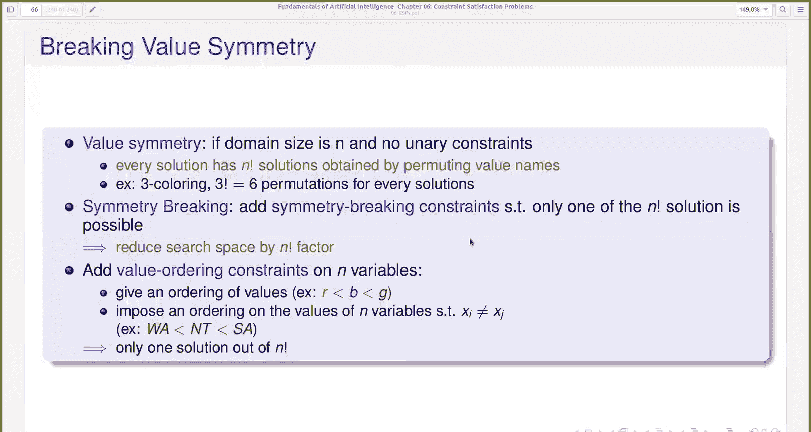

#  019：CSP局部搜索与结构化


在本节课中，我们将学习约束满足问题的最后两个重要子主题：局部搜索和利用问题结构来提升求解效率。我们将看到如何将随机局部搜索技术应用于CSP，以及如何通过识别问题的树状结构或割集来将指数级复杂度问题转化为多项式级问题，从而大幅提升性能。

上一节我们介绍了冲突导向回溯搜索，它是一种能极大提升CSP求解效率的智能搜索方法。本节中，我们来看看如何将局部搜索技术应用于CSP，以及如何利用CSP的结构来进一步优化求解过程。

## 局部搜索在CSP中的应用

局部搜索的核心思想是从一个状态跳转到其“邻居”状态。在CSP中，一个最直接的邻居状态定义是：**改变一个变量的赋值**。也就是说，我们从某个完全赋值（可能是随机或启发式生成的）开始，然后每次通过改变一个变量的值来移动到相邻状态。

其基本直觉是**为违反的约束赋予惩罚值**。我们的目标是找到一个惩罚值为0的状态，即所有约束都得到满足的解。这可以归结为一种“最小冲突”启发式方法。

以下是实现该思想的一种简单爬山算法伪代码：

```
function MIN-CONFLICTS(csp, max_steps):
    current = 一个csp的完全赋值（随机或启发式生成）
    for i = 1 to max_steps:
        if current 是csp的解:
            return current
        从违反约束的变量中随机选择一个变量 var
        为变量 var 选择一个能最小化冲突数量的值 value
        将 current 中 var 的值设置为 value
    return failure
```

当然，你可以采用更复杂的策略，例如：
*   选择导致最多冲突的变量进行修改。
*   根据约束违反的频率为其赋予不同权重。
*   结合模拟退火、随机游走或禁忌搜索等随机局部搜索技术来避免陷入局部最优。

在20世纪90年代，随机局部搜索（如模拟退火）在解决像N皇后这样的大规模、明显可满足的CSP问题时，表现出了远超传统搜索技术的效率，尤其是在规划等编码为CSP的问题中。

## 利用CSP的结构

### 分治法：识别独立子问题

如果一个CSP的约束图可以分解为几个互不连接的连通分量（即独立子问题），那么我们可以分别求解每个子问题。这能带来性能的极大提升。

**复杂度分析**：假设原问题有 `N` 个变量，域大小为 `D`，最坏情况复杂度为 `O(D^N)`。如果能将其分解为 `k` 个大小约为 `N/k` 的独立子问题，则总复杂度变为 `k * O(D^(N/k))`，这是指数级的降低。

**操作方法**：使用Tarjan等线性时间算法识别图的强连通分量，每个分量即为一个独立子问题。

### 树结构CSP的高效算法

如果CSP的约束图是一棵树（无环图），那么存在一个 `O(n * d^2)` 的算法可以求解，其中 `n` 是变量数，`d` 是最大域大小。这相当于从指数复杂度降到了线性复杂度。

**算法步骤（定向弧相容 + 赋值）**：
1.  **选择根节点并排序**：任选一个变量作为根，对变量进行从根到叶的拓扑排序（父节点在子节点之前）。
2.  **后向传播（从叶到根）**：从最后一个变量开始向前（即从叶向根）处理。对每个变量，使其值域与其所有子节点的值域保持弧相容（即删除父节点中与某个子节点所有值都不相容的值）。如果任何变量的值域变为空，则问题无解。
3.  **前向赋值（从根到叶）**：如果步骤2未发现不一致，则从第一个变量（根）开始向后（即从根向叶）赋值。为每个变量赋予一个与其父节点赋值相容的值。由于步骤2已保证相容性，这一步总能成功。

这个算法之所以高效，是因为树结构保证了信息（约束）可以无环地单向传播。

### 割集调节

对于许多非树的CSP，我们可能找到一个**割集**：一个变量集合，如果从图中移除这些变量，剩余部分将形成一棵树（或多个独立子树）。

**求解思路**：
1.  找到一个小规模的割集 `S`（寻找最小割集是NP难的，但存在高效的近似算法）。
2.  枚举割集 `S` 中所有可能的相容赋值组合。假设割集大小为 `c`，域大小为 `d`，则有最多 `d^c` 种组合。
3.  对于割集的每一种赋值，将其代入原问题。由于剩余部分是一棵树，我们可以用 `O(n * d^2)` 的高效树算法来求解这个简化后的CSP。

**复杂度分析**：总复杂度从 `O(d^n)` 降低到 `O(d^c * (n-c) * d^2)`。当割集 `c` 远小于总变量数 `n` 时，性能提升是巨大的。

## 对称性破缺

在许多CSP中，值域是对称的（例如图形着色问题中的颜色）。这会导致搜索空间中存在大量本质上相同的解（通过置换值即可得到），从而使得搜索算法浪费大量时间重复探索等价的失败路径。

**对称性破缺**通过添加额外的约束来排除对称解，从而缩减搜索空间。一个常见的方法是**引入值的顺序**。

**操作方法**：
假设有 `n` 个变量，值域是对称的。我们可以规定：分配给变量的第一个“不同值”必须遵循某种顺序。
例如，在着色问题中，我们可以添加约束：如果 `i < j`，那么变量 `V_i` 的赋值必须小于或等于变量 `V_j` 的赋值（这里“小于”是基于值的一个任意但固定的顺序，例如红<蓝<绿）。这确保了在所有等价的着色方案中，只有一种满足这个顺序的会被找到。

识别和利用对称性可以带来数量级的性能提升，是设计高效CSP求解器时需要考虑的一个重要方面。

---



本节课中我们一起学习了约束满足问题的最后两个关键技巧。我们了解了如何将局部搜索的随机优化思想应用于CSP，通过定义邻居状态和最小冲突启发式来寻找解。更重要的是，我们探讨了如何通过分析CSP的结构来设计高效算法：通过分治处理独立子问题；利用树结构实现线性时间算法；以及通过识别割集将复杂问题分解为树结构子问题来求解。最后，我们还介绍了对称性破缺技术，通过消除搜索空间中的冗余来提升效率。这些结构化方法能带来性能的极大提升，是解决实际大规模CSP问题的有力工具。