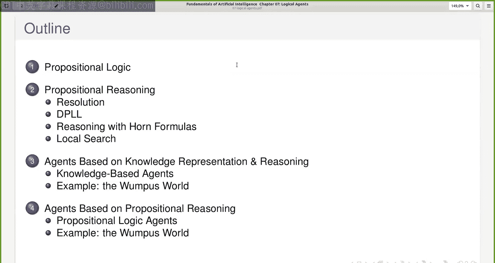
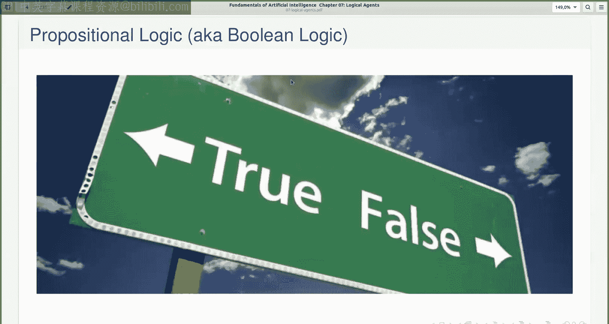
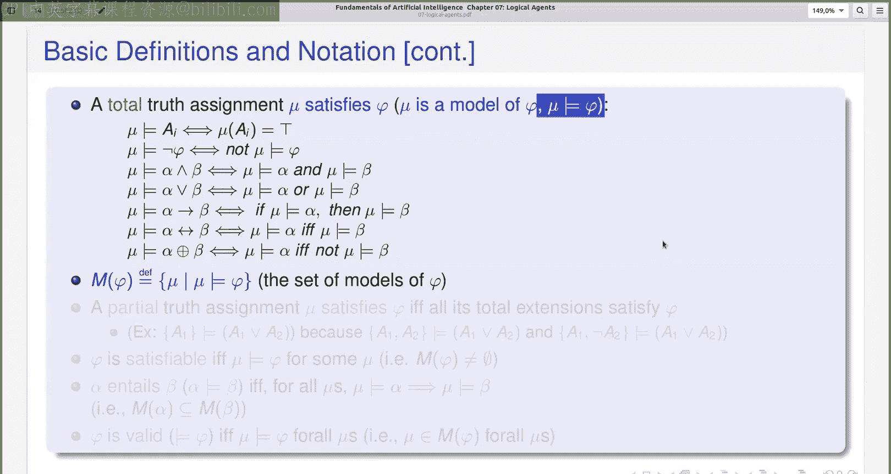

#  020：布尔逻辑

在本节课中，我们将要学习命题逻辑，也称为布尔逻辑。这是人工智能中用于表示和推理知识的基础工具。我们将从基本概念开始，逐步深入到公式表示、语义解释以及一些重要的实用技巧。

## 概述

布尔逻辑是处理真（True）和假（False）两种值的逻辑系统。它构成了许多计算和推理系统的基础。本节我们将学习其语法、语义以及如何有效地表示逻辑公式。

---

## 布尔逻辑的语法 🧱

上一节我们介绍了布尔逻辑的基本概念，本节中我们来看看如何构建布尔逻辑公式。

一个**命题公式**、**布尔公式**或**句子**由以下成分构成：
*   符号 **True** 和 **False**（有时写作 ⊤ 和 ⊥）是公式，它们是布尔常量。
*   **命题原子**。我将使用大写字母（可能带下标）来表示原子，例如 `A1`, `B`。
*   任何布尔公式的布尔组合本身也是一个布尔公式。

布尔组合由以下运算符定义：
*   **否定**: `¬` (not)
*   **合取**: `∧` (and)
*   **析取**: `∨` (or)
*   **蕴含**: `→` (implies)
*   **反蕴含**: `←` (implied by)
*   **双条件**（当且仅当）: `↔` (if and only if)
*   **异或**: `⊕` (exclusive or)

例如，`(¬A1 → (A2 ∧ A3)) ∧ (¬A1 ∨ ¬A4)` 是一个布尔公式。

给定一个公式 `φ`，我们称出现在 `φ` 中的原子集合为 `φ` 的**原子集**。

另一个重要概念是**文字**：
*   一个文字要么是一个命题原子（称为**正文字**），要么是一个原子的否定（称为**负文字**）。
*   我们约定，如果一个文字已经是负的（如 `¬A`），那么它的否定（`¬¬A`）就简化为原子 `A`。

以下是基于文字构建的两个结构：
*   一个**子句**是若干文字的析取，例如 `(A1 ∨ ¬A2 ∨ A3)`。
*   一个**立方**是若干文字的合取，例如 `(A1 ∧ ¬A2 ∧ A3)`。

---

## 布尔运算符的语义 📖

上一节我们学习了如何构建公式，本节中我们来看看这些公式的含义，即它们的真值。

布尔运算符的含义由以下真值表定义。假设 `α` 和 `β` 是公式：

| α | β | ¬α | α ∧ β | α ∨ β | α → β | α ↔ β | α ⊕ β |
|---|---|----|-------|-------|-------|-------|-------|
| T | T | F  | T     | T     | T     | T     | F     |
| T | F | F  | F     | T     | F     | F     | T     |
| F | T | T  | F     | T     | T     | F     | T     |
| F | F | T  | F     | F     | T     | T     | F     |

核心概念解释：
*   **否定 (`¬`)**：翻转真值。
*   **合取 (`∧`)**：仅当两者都为真时为真。
*   **析取 (`∨`)**：至少一个为真时为真。
*   **蕴含 (`α → β`)**：如果前件 `α` 为假，或者后件 `β` 为真，则为真。**特别注意**：当前件 `α` 为假时，无论 `β` 是什么，蕴含式都为真。
*   **双条件 (`↔`)**：当两者真值相同时为真。
*   **异或 (`⊕`)**：当两者真值不同时为真。

关于自然语言与逻辑蕴含的注意事项：
在自然语言中，“如果…那么…”常常暗示因果关系或时间顺序。但在逻辑中，`α → β` 仅表示一种真值关系，不要求 `α` 和 `β` 之间有实际关联。例如，“5是奇数 → 东京是日本的首都”在逻辑上为真（因为两者都为真），尽管两者没有因果关系。同样，“5是偶数 → 萨姆很聪明”也为真（因为前件为假）。理解这一点对于用逻辑准确建模至关重要。

---

## 运算符的性质与等价关系 🔄

布尔运算符具有一些基本性质，并且它们之间可以相互表达。

以下是运算符的基本性质：
*   `∧`, `∨`, `↔`, `⊕` 满足**交换律**和**结合律**。因此，在书写时可以省略括号，例如 `A ∧ B ∧ C`。
*   `→` 和 `←` **既不满足交换律也不满足结合律**。`α → β` 与 `β → α` 不同，`(α → β) → γ` 与 `α → (β → γ)` 也不同。

不同运算符之间可以通过等价关系相互转换，这使得它们在逻辑上是冗余的，但使用起来很方便。

以下是一些关键的等价关系：
*   **双重否定**：`¬¬α ≡ α`
*   **德摩根定律**：
    *   `¬(α ∧ β) ≡ (¬α ∨ ¬β)`
    *   `¬(α ∨ β) ≡ (¬α ∧ ¬β)`
*   **蕴含的转化**：`(α → β) ≡ (¬α ∨ β)`。**这是一个极其重要的等价式**，将蕴含转化为析取，常常能简化推理。
*   **蕴含的否定**：`¬(α → β) ≡ (α ∧ ¬β)`
*   **双条件的表达**：`(α ↔ β) ≡ (α → β) ∧ (β → α)`
*   **异或的表达**：`(α ⊕ β) ≡ ¬(α ↔ β)`

从这些等价关系可以看出，实际上只需要**否定 (`¬`)** 和**合取 (`∧`)**（或者否定和析取）就可以表达所有其他布尔运算符。其他运算符可以看作是为了方便而引入的“语法糖”。

---

## 公式的内部表示（树与DAG）🌳➡️🕸️

在计算机中表示逻辑公式时，选择不同的数据结构对效率有巨大影响。

最直观的表示方式是**语法树**：
*   内部节点和根节点标记为布尔运算符。
*   叶子节点标记为布尔原子。
*   例如，公式 `(A ∧ B) ∨ (C ∧ D)` 可以表示为一棵树。

然而，在实现自动推理工具时，我们通常使用**有向无环图**：
*   DAG 允许共享相同的子公式。
*   这可以**指数级地减少表示所需的空间**，特别是当公式中包含大量 `↔`（双条件）或 `⊕`（异或）运算时。

考虑以下例子：
`(A1 ↔ (A2 ↔ (A3 ↔ A4)))`
如果将其展开为只使用 `∧`, `∨`, `¬` 的表达式（通过 `(P ↔ Q) ≡ (P → Q) ∧ (Q → P)`），子公式 `A2 ↔ (A3 ↔ A4)` 会被重复。随着链的加长，重复会呈指数增长。使用 DAG 表示可以避免这种重复，所有相同的子公式只存储一次。

实现 DAG 表示的一种常用算法是**哈希消元**算法，它自底向上遍历表达式，并在哈希表中缓存每个唯一的子表达式。

---

## 真值指派与语义（续）🎯

上一节我们讨论了公式的语法和基本语义，本节我们更正式地定义真值指派及其满足关系。

一个**全真值指派** `μ` 是一个函数，它为公式中出现的每个原子分配一个真值（True 或 False）。
*   在计算机中，世界的状态（或问题的相关部分）可以用一个巨大的全真值指派来表示，其中每个比特对应一个布尔变量。

一个**部分真值指派** `η` 只为一**部分**原子分配真值。
*   一个部分指派 `η` **隐式地代表了一组**全真值指派，即所有与 `η` 已分配值一致的全指派。
*   如果 `η` 为 `n` 个变量中的 `n-k` 个分配了值，那么它隐式代表了 `2^k` 个可能的全指派。

为了方便，我们常用文字的**集合**或**立方**（合取式）来表示真值指派。
*   例如，指派 `{A1, ¬A2}` 或立方 `(A1 ∧ ¬A2)` 表示原子 `A1` 为真，`A2` 为假。
*   这与公式 `(A1 ∧ ¬A2)` 被满足的概念是一致的：任何满足该公式的全指派都必须使 `A1` 为真，`A2` 为假。

我们定义全真值指派 `μ` **满足**一个公式 `φ`（记作 `μ ⊨ φ`）如下：
*   `μ ⊨ A`（原子）当且仅当 `μ(A) = True`。
*   `μ ⊨ ¬φ` 当且仅当 `μ ⊭ φ`（即 `μ` 不满足 `φ`）。
*   `μ ⊨ (φ ∧ ψ)` 当且仅当 `μ ⊨ φ` 且 `μ ⊨ ψ`。
*   `μ ⊨ (φ ∨ ψ)` 当且仅当 `μ ⊨ φ` 或 `μ ⊨ ψ`（或两者）。
*   `μ ⊨ (φ → ψ)` 当且仅当如果 `μ ⊨ φ` 则 `μ ⊨ ψ`。根据真值表，这等价于 `μ ⊨ ¬φ` 或 `μ ⊨ ψ`。
*   `μ ⊨ (φ ↔ ψ)` 当且仅当 `μ ⊨ φ` 和 `μ ⊨ ψ` 的真值相同。
*   `μ ⊨ (φ ⊕ ψ)` 当且仅当 `μ ⊨ φ` 和 `μ ⊨ ψ` 的真值不同。

我们用 `M(φ)` 表示所有满足公式 `φ` 的全真值指派的集合。

关于部分指派 `η` 的满足关系，我们将在后续课程中详细讨论。

---

## 总结

本节课中我们一起学习了布尔逻辑的核心内容：
1.  **语法**：我们学习了如何用原子、常量和运算符（`¬`, `∧`, `∨`, `→`, `↔`, `⊕`）构建布尔公式，并了解了文字、子句和立方的概念。
2.  **语义**：我们通过真值表明确了每个运算符的含义，并特别强调了逻辑蕴含（`→`）与自然语言中“如果…那么…”的区别，指出它不表示因果关系。
3.  **性质与等价**：我们回顾了运算符的交换律、结合律，以及一系列重要的逻辑等价式，特别是 `(α → β) ≡ (¬α ∨ β)`，这是简化推理的关键。
4.  **公式表示**：我们比较了公式的树表示和DAG表示，指出在实现自动推理系统时，使用DAG可以避免子公式的指数级重复，极大地提升效率。
5.  **真值指派**：我们定义了全指派和部分指派，以及指派满足公式的归纳定义，并介绍了用文字集合或立方来表示指派的简便方法。

布尔逻辑是人工智能中知识表示与推理的基石，掌握其基本概念和细节对后续学习至关重要。