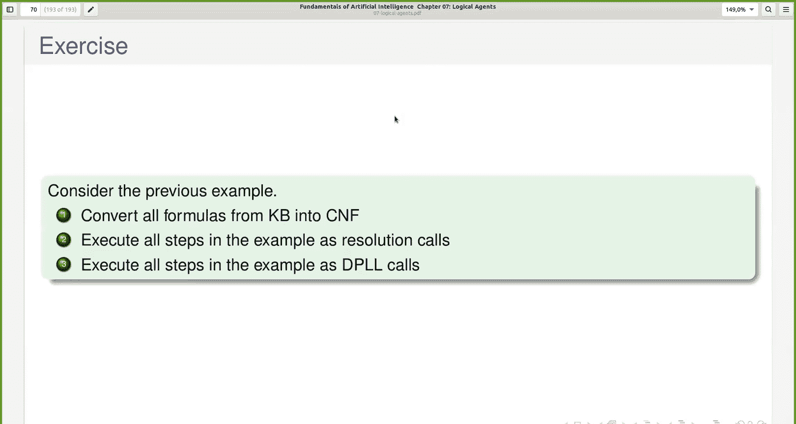
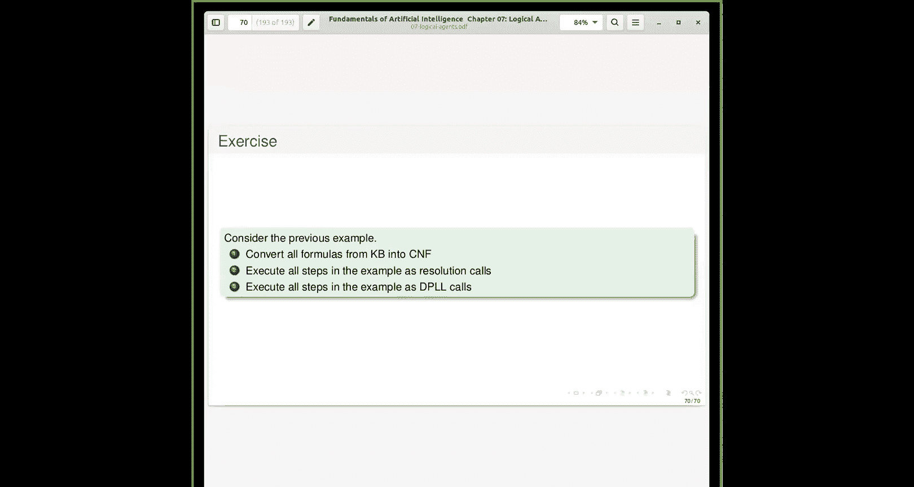

#  022：基于布尔逻辑的智能体

在本节课中，我们将学习如何将逻辑推理能力赋予智能体，使其能够基于知识进行决策。我们将从智能体的基本概念出发，探讨知识表示与推理的重要性，并重点介绍如何使用**布尔逻辑**来构建一个简单的逻辑智能体。

---

## 概述：逻辑智能体与知识库

上一章我们讨论了命题逻辑本身。本节中，我们来看看如何将其应用于智能体。具备逻辑推理能力的智能体，在许多场景下都至关重要。

人工智能的发展经历了不同阶段。早期（直到20世纪90年代末）主要是符号人工智能，专注于自动推理、知识表示与规划。如今，我们见证了神经人工智能（如深度学习、生成式AI）的繁荣。当前的研究趋势是尝试将两者融合。因此，将推理能力融入智能体上下文变得非常重要。

知识表示与推理是人工智能的一个完整领域，致力于让计算机系统能够表示知识，并利用它来推断新知识以完成任务。这构成了**基于知识的系统**的核心。此类智能体维护一个**知识库**，用以表示世界（或与之相关的部分）的状态。知识使用**形式化语言**（如逻辑）进行表示，以确保语义清晰、无歧义。

知识库包含**背景知识**（智能体初始拥有的或从以往经验中学到的知识），并随着智能体通过感知获取新信息而不断更新。推理的基本概念是**逻辑蕴涵**，即从已有知识和感知到的事实中推导出新结论。为此，智能体需要一个**推理引擎**。

推理引擎的关键特性是**领域无关性**。这意味着引擎本身并不了解你正在解决的具体问题；领域特定的信息被**编码**到某种形式化语言（如CSP、布尔逻辑、一阶逻辑）中，然后引擎基于这些形式化表示进行推理。

---

## 什么是推理？

推理是对代表一系列信念的符号进行形式化操作，以根据给定的语义产生新的信念表示。通常，我们使用逻辑或可归结为逻辑的系统。

一个基本步骤是**逻辑蕴涵**或**逻辑演绎**。这是一个非常古老的概念。例如：
*   已知：病人X对药物M过敏。
*   已知：任何对药物M过敏的人，也对药物M‘过敏。
*   可推出：病人X对药物M’过敏。
*   因此，医生知道不应给病人X开药物M‘。

这个演绎步骤的有趣之处在于：如果你推断所依据的表达式真实地反映了现实世界，那么你推断出的结论在现实世界中同样成立。这是因为逻辑规则符合表达式的语义。这与数学推理非常相似。会计师相信计算出的现金余额是准确的，正是因为数学运算符合现实世界的语义。

智能体可能进行的查询是：“我应该给X开药M‘吗？”，答案是“否”。这就是逻辑蕴涵推理。此外，还有**概率推理**（在不能100%确定时，以一定概率推断事实）和**溯因推理**（根据观察结果推断最可能的原因，如诊断），但本课程不涵盖后者。

---

## 逻辑智能体如何工作？

一个逻辑智能体将领域知识与当前感知结合起来，以推断它无法直接评估的现实方面（因为我们通常不能假设环境是完全可观察的）。

知识库需要能够：
1.  表示状态和动作。
2.  获取新的感知。
3.  更新其对世界的内部表示。
4.  从其他事实中推断出新事实。
5.  推断隐藏属性（例如，病人也对药物M‘过敏），从而推导出适当的动作（例如，不开M‘这个药）。

---

## 一个实例：Wumpus世界

为了直观理解，我们使用一个简化版的Wumpus世界游戏作为例子。这是一个简单的视频游戏环境：
*   **智能体目标**：找到金子。
*   **移动方式**：每次可水平或垂直移动一格。
*   **危险**：陷阱（掉入则死亡）和怪兽Wumpus（遇到则被杀死）。
*   **感知**：在陷阱相邻格会感到“微风”；在Wumpus相邻格会闻到“恶臭”。
*   **限制**：智能体只能感知当前所在格的情况，视野受限。

假设我们的英雄（智能体）从位置(1,1)开始，感知到“无微风，无恶臭”。根据规则，他可以推断(1,2)和(2,1)既没有陷阱也没有Wumpus，因此可以安全向上或向右移动。

他选择向上移动到(1,2)，感知到“有微风，无恶臭”。根据规则，微风意味着相邻格(1,1), (1,3), (2,2)中至少有一个是陷阱。但已知(1,1)没有陷阱，所以陷阱在(1,3)或(2,2)中。这是一个危险情况，因此他选择返回(1,1)。

接着，他向右移动到(2,1)，感知到“无微风，无恶臭”。现在他可以推断：
*   关于陷阱：之前知道陷阱在(1,3)或(2,2)。现在(2,1)无微风，意味着其相邻格(2,2)和(3,1)没有陷阱。因此，陷阱一定在(1,3)。
*   关于Wumpus：在(1,2)时感知到“无恶臭”，意味着其相邻格(1,1), (1,3), (2,2)没有Wumpus。结合已知信息，可以推断Wumpus在(2,3)或(3,2)（具体位置需进一步探索）。

通过这种基本的命题逻辑推理（例如，知道“A或B”并且“非B”，则可推出“A”），智能体逐步构建了对世界的认知，并做出安全移动的决策。在更复杂的情况下（例如，在两个位置都感到微风），可能需要概率推理来评估最安全的移动方向。

---

## 知识表示的形式化

我们可以使用不同复杂度的逻辑来构建知识库：
1.  **霍恩逻辑**：非常基础，推理高效但表达能力有限。
2.  **布尔逻辑（命题逻辑）**：更通用，是本节课的重点。
3.  **一阶逻辑**：能够表达对象及其关系，更强大。
4.  **模态逻辑**：可以处理“可能”、“必然”、“知道”等概念。
5.  **时序逻辑**：可以处理与时间相关的概念（如“最终”、“始终”）。
6.  **描述逻辑**：用于表示概念、分类和本体。

让我们聚焦于最简单的形式之一：**布尔逻辑**。

---

## 基于布尔逻辑的智能体 🧠

一个逻辑智能体使用某种逻辑语言作为形式化基础，并利用逻辑演绎进行推理。其思想是：
*   将知识库表示为一组命题公式。
*   将感知和动作表示为命题原子或它们的集合。
*   在实践中，由于我们通常使用合取范式进行推理，这意味着我们将所有知识收集为一组**子句**。
*   然后执行命题逻辑推理（如蕴涵、模型检查）。现代技术主要使用**SAT求解器**（尤其是支持增量添加/删除公式的求解器）。

逻辑作为世界的表示，其句子与现实世界之间的联系是**语义**。语义将逻辑符号映射到现实世界的对象和关系。如果推理规则在语义上是可靠的，并且初始句子真实地反映了世界，那么所有推断出的结论也必然在现实世界中成立。这类似于我们信任数学计算的结果，因为数学运算符合现实世界的语义。这种保证是抽象推理能够应用于具体问题的基石。

---

## 用布尔逻辑形式化Wumpus世界

让我们用布尔逻辑原子来形式化之前的例子：
*   `P_{i,j}`：表示位置(i, j)有陷阱。
*   `W_{i,j}`：表示位置(i, j)有Wumpus。
*   `B_{i,j}`：表示在位置(i, j)感知到微风。
*   `S_{i,j}`：表示在位置(i, j)感知到恶臭。
*   `OK_{i,j}`：表示位置(i, j)是安全的（即没有陷阱也没有Wumpus）。这是一个语法糖，定义为 `OK_{i,j} ⇔ ¬P_{i,j} ∧ ¬W_{i,j}`。

我们有一些全局知识规则（已转换为CNF形式）：
1.  微风规则：`B_{i,j} ⇔ (P_{i-1,j} ∨ P_{i+1,j} ∨ P_{i,j-1} ∨ P_{i,j+1})`
2.  恶臭规则：`S_{i,j} ⇔ (W_{i-1,j} ∨ W_{i+1,j} ∨ W_{i,j-1} ∨ W_{i,j+1})`
3.  安全定义：`OK_{i,j} ⇔ ¬P_{i,j} ∧ ¬W_{i,j}`

**初始状态 (1,1)**：
*   已知事实：`¬P_{1,1}`, `¬W_{1,1}`
*   感知事实：`¬B_{1,1}`, `¬S_{1,1}`（初始感知）
*   推理：通过单元传播，可以立即推断出 `OK_{1,1}`，进而根据微风和恶臭规则，推断出 `¬W_{1,2}`, `¬W_{2,1}`, `¬P_{1,2}`, `¬P_{2,1}`，从而得到 `OK_{1,2}` 和 `OK_{2,1}`。

**移动到 (1,2) 后**：
*   感知事实：`B_{1,2}`, `¬S_{1,2}`
*   推理：结合微风规则和已知的 `¬P_{1,1}`，可以推断出子句 `P_{1,3} ∨ P_{2,2}`。同时，根据恶臭规则和 `¬S_{1,2}`，可以推断出 `¬W_{1,1}`, `¬W_{1,3}`, `¬W_{2,2}`（有些已知，有些是新信息）。

**返回并移动到 (2,1) 后**：
*   感知事实：`¬B_{2,1}`, `¬S_{2,1}`
*   推理：
    *   无微风意味着 `¬P_{2,2}`, `¬P_{3,1}`。
    *   结合之前推断出的子句 `P_{1,3} ∨ P_{2,2}` 和新的 `¬P_{2,2}`，通过单元传播（解析）可以推断出 `P_{1,3}`。
    *   无恶臭意味着 `¬W_{2,2}`, `¬W_{3,1}`。
    *   结合之前关于Wumpus位置的信息，可以逐步缩小范围。
*   最终，可以推断出 `OK_{2,2}` 等事实，从而安全移动。

通过将环境知识和感知编码为布尔子句，并应用**单元传播**和**解析**等推理规则，智能体可以自动推导出隐藏信息，指导其行动。

---

## 总结

本节课中，我们一起学习了如何构建基于逻辑的智能体。我们首先了解了知识表示与推理在人工智能中的核心地位，以及逻辑智能体的基本架构。然后，我们通过Wumpus世界的例子，直观地展示了智能体如何通过逻辑推理在部分可观察的环境中做出决策。最后，我们深入探讨了如何使用**布尔逻辑**来形式化这个世界，将知识、感知和推理步骤转化为命题公式和子句，并利用自动推理技术（如SAT求解器）来模拟智能体的思考过程。

布尔逻辑是逻辑推理中最基础的形式，为我们理解更复杂的一阶逻辑及其他知识表示方法奠定了坚实的基础。