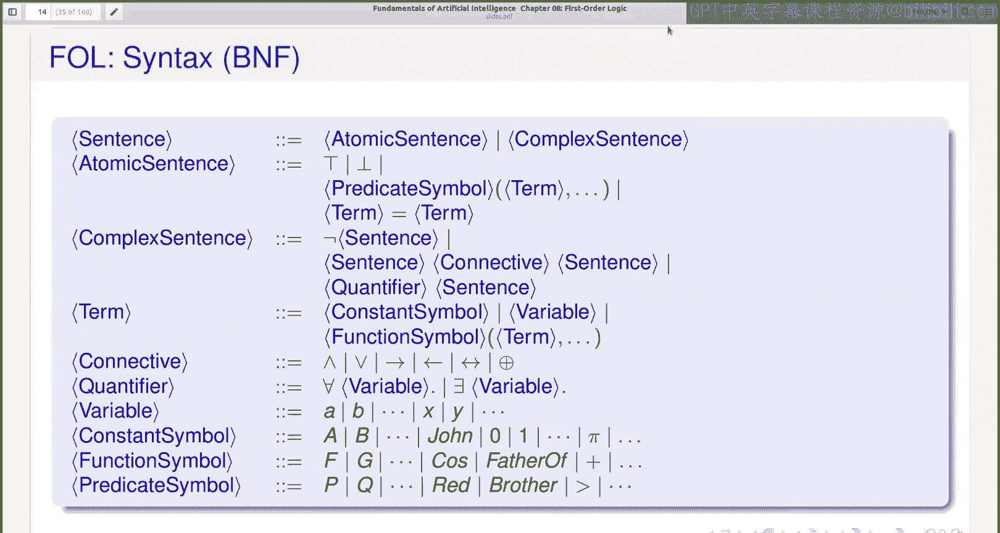

#  023：一阶逻辑

## 概述
在本节课中，我们将要学习一阶逻辑。一阶逻辑是一种结构化的知识表示方法，它允许我们表示对象、对象的属性以及对象之间的关系，并能对对象进行量化。我们将从一阶逻辑的基本概念开始，逐步深入到其语法和语义，并探讨其在人工智能代理中的应用。

## 一阶逻辑简介
上一节我们介绍了命题逻辑，它是一种强大的形式化语言，具有清晰的语义和独立的推理机制。然而，命题逻辑的表达能力有限，每个事实都需要一个独立的原子命题来表示，这在实际应用中非常不便。

本节中我们来看看一阶逻辑。一阶逻辑通过引入对象、谓词、函数和量词，极大地增强了表达能力。它允许我们表示诸如“所有人都是会死的”或“存在一个数是素数”这样的通用陈述。

## 逻辑的一般定义
逻辑通常被定义为一个三元组，包含语言、语义和推理系统。

以下是逻辑的三个核心组成部分：
*   **语言**：一组符号和构建合法句子的语法规则。
*   **语义**：一种形式化的规范，用于为每个句子在现实世界中赋予意义。
*   **推理系统**：一组形式化的推导规则或算法，用于从已知句子推导出新句子。

## 一阶逻辑的核心要素
一阶逻辑是一种结构化表示。我们假设世界由对象组成，这些对象具有属性和相互关系。

以下是构成一阶逻辑世界的基本要素：
*   **对象**：可以是具体或抽象的实体，如人、房子、数字、理论。
*   **关系**：描述对象之间的联系。例如，“兄弟”是一个二元关系，“黑色”是一个一元关系（描述属性）。
*   **函数**：将对象映射到另一个对象。例如，“父亲”是一个函数。
*   **量词**：允许我们对对象进行量化陈述，如“对于所有对象”或“存在某个对象”。

## 一阶逻辑的语法
现在，我们开始详细学习一阶逻辑的语法，即如何构建合法的表达式。

### 基本符号
一阶逻辑的语法包含多种符号。

以下是构建一阶逻辑表达式所需的基本符号类型：
*   **常量符号**：表示特定的对象。例如：`KingJohn`， `2`， `Trento`。
*   **谓词符号**：表示关系或属性。它们可以是一元、二元或n元的。例如：`Brother`（二元）， `Black`（一元）， `>`（二元）。
*   **函数符号**：表示函数。例如：`leftLeg`， `motherOf`， `+`。
*   **变量符号**：表示泛指的对象。例如：`x`， `y`。
*   **逻辑连接词**：与命题逻辑相同，包括 `¬`（非）， `∧`（与）， `∨`（或）， `⇒`（蕴含）， `⇔`（当且仅当）。
*   **量词**：`∀`（全称量词，“对于所有”）和 `∃`（存在量词，“存在”）。
*   **等词**：一个特殊的二元谓词 `=`，表示相等。

### 项
项用于指代世界中的对象。

以下是项的递归定义：
*   常量是项。
*   变量是项。
*   任何n元函数符号应用于n个项的结果也是项。

例如：
*   `KingJohn` 是一个项（常量）。
*   `x` 是一个项（变量）。
*   `leftLeg(Richard)` 是一个项（函数应用）。
*   `2 * log(2)` 也是一个项（嵌套的函数应用）。

### 原子公式
原子公式是构成更复杂公式的基本构件，其值为真或假。

以下是原子公式的构成方式：
*   命题常量 `True` 和 `False`。
*   将n元谓词符号应用于n个项。例如：`Brother(Richard, John)`。
*   项之间的相等关系。例如：`leftLeg(Richard) = rightLeg(John)`。

### 公式
公式通过组合原子公式和逻辑连接词来构建。

以下是公式的归纳定义：
*   每个原子公式都是一个公式。
*   如果 `φ` 和 `ψ` 是公式，那么 `¬φ`， `φ ∧ ψ`， `φ ∨ ψ`， `φ ⇒ ψ`， `φ ⇔ ψ` 也是公式。
*   如果 `φ` 是一个公式，`x` 是一个变量，那么 `∀x φ` 和 `∃x φ` 也是公式。

### 闭公式与基公式
理解公式中变量的作用范围很重要。

以下是两个关键概念：
*   **基公式**：不包含任何变量的公式。例如：`Brother(Richard, John)`。
*   **闭公式**：所有变量都被量词绑定的公式。例如：`∀x ∃y (x > y)`。闭公式在给定解释后可以直接判断真假。

## 总结
本节课中我们一起学习了一阶逻辑的基础知识。我们首先了解了为什么需要比命题逻辑更具表达能力的工具。然后，我们探讨了逻辑的一般定义。接着，我们深入分析了一阶逻辑的语法，包括常量、谓词、函数、变量等基本符号，并学习了如何递归地构建项和公式。最后，我们区分了基公式和闭公式。一阶逻辑为表示具有结构和关系的复杂知识提供了强大的框架，是人工智能中知识表示和推理的重要基础。在接下来的课程中，我们将学习一阶逻辑的语义及其推理方法。