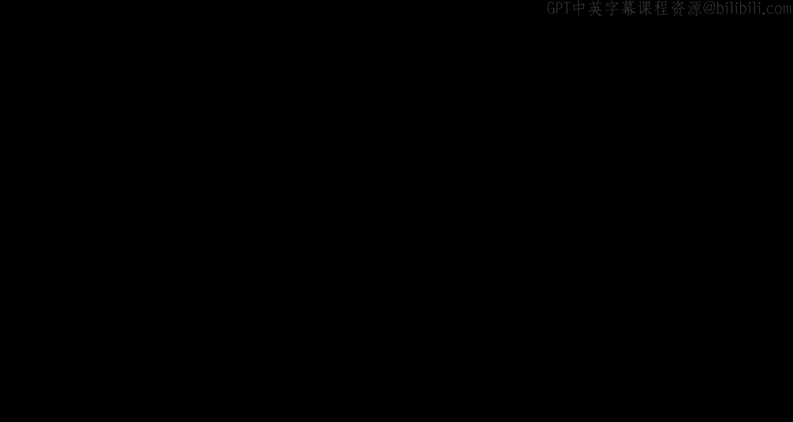
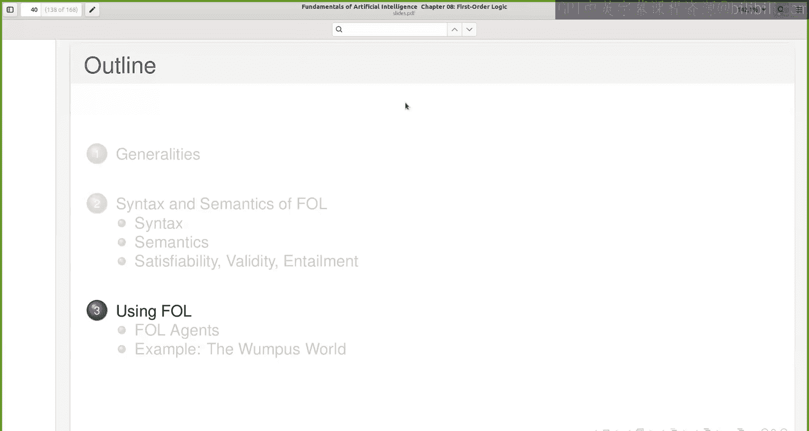

#  024：一阶逻辑

## 概述
在本节课中，我们将学习一阶逻辑的语法和语义。我们将介绍一阶逻辑的基本构成元素，包括项、原子公式、逻辑连接词和量词。此外，我们还将探讨公式的极性概念，并详细解释一阶逻辑的语义解释，即模型和解释。最后，我们将了解一阶逻辑的一些基本性质及其局限性。

## 语法回顾
上一节我们开始介绍一阶逻辑。到目前为止，我们已经基本介绍了其语法。除了这里展示的语法规则外，我们还有项的概念。

项可以是常量、变量，或者是应用于任何项的任何函数。这是一个递归定义。

然后我们有原子公式，它可能是应用于某些项的谓词。

项和公式的区别在于，项代表一个对象，例如“理查德国王的母亲”或“国王理查德”或数字“三”，或者“三乘以x的对数”。而谓词则陈述关于某些项的某种属性或事实。它代表一个真值，根据解释的不同，它可能为真或为假。

当然，原子公式可以使用逻辑连接词进行组合，其含义与命题逻辑完全相同。

此外，我们还有量词。我们有全称量词∀x，表示属性P(x)对所有可能的项实例都成立；以及存在量词∃x，表示属性P(x)对某些实例成立。我们将详细讨论这一点。

在此之前，我想介绍另一个非常重要的语法定义，即一阶推理中的极性概念。我不确定之前上过逻辑课程的人是否见过这个概念。这是一个在逻辑课程中经常被忽视的概念，所以请大家注意。

每个公式都有一些子公式。对于每个子公式的实例，我们可以说它是正极性出现、负极性出现，或者同时具有正负极性。本质上，极性的直觉是子公式出现所在作用域内的否定数量的模2。

这是一个递归定义：一个公式在自身中出现时是正极性的。否定会切换极性：如果ψ在φ中出现是正极性，那么¬ψ中的ψ就是负极性的。合取（∧）和析取（∨）会保留子公式的极性。

有点棘手的是蕴含（→）：如果蕴含式在φ中是正极性出现，那么蕴含式的前件（ψ1）是负极性出现，后件（ψ2）是正极性出现。这可能听起来很奇怪，但如果你记得ψ1 → ψ2等价于¬ψ1 ∨ ψ2，然后你将其代入定义，你就会明白。

双条件（↔）的奇怪之处在于，无论它在φ中的极性如何，ψ1和ψ2都同时以正极性和负极性出现。为什么会这样？这不应该奇怪，因为如果你记得ψ1 ↔ ψ2等价于(ψ1 → ψ2) ∧ (ψ2 → ψ1)。这只是两个方向相反的蕴含式的合取的简写，然后你可以递归地应用定义。

同样，全称量词（∀）和存在量词（∃）会复制子公式的极性。

那么极性的作用是什么？这个递归定义的意义何在？如果你尝试展开公式，将蕴含式转换为否定和析取，极性本质上就是子公式出现所在作用域内的嵌套否定数量的模2。你知道双重否定会相互抵消。因此，极性告诉你：正极性意味着子公式的满足对主公式的满足有正面贡献。子公式满足得越多，主公式满足的可能性就越大。相反，如果一个公式是负极性出现，子公式满足得越多，主公式满足的可能性就越小。

你可以将其类比为数学表达式中的符号。考虑一个只有加号和减号的算术表达式。如果你看子表达式，并且增加一个子表达式的值，如果该子表达式出现在偶数个负号的作用域内，那么增加它会增加整个表达式的值；如果它出现在奇数个负号的作用域内，增加它会减少整个表达式的值。这非常相似，只不过我们这里说的“值”是指真值。增加正极性子公式满足的可能性，实质上会增加满足主公式的模型集合；反之则会减少。

极性对于自动定理证明者来说非常重要，尽管许多数理逻辑学家对此不太感兴趣，因此在许多逻辑课程中你不会找到这个概念，但它对自动化工具至关重要。

## 一阶逻辑的语义
好了，关于一阶逻辑的语法就讲到这里，现在我们来谈谈语义。在开始之前，我想说明一下术语。你可能会在不同的书籍中遇到模型、解释等概念，它们的含义可能略有不同。我将采用你们教材中的概念。

本质上，当你有一个句子时，关键是要根据你赋予符号的某种内在含义的解释，来确定这个句子是真还是假。语义的基本要素是所谓的模型，它由论域和解释组合而成。

论域是一个元素集合，我们将一阶逻辑中的对象映射到这个集合。虽然看起来显而易见，但从数学上讲，我们假设论域是非空的。无论怎样，论域至少包含一个元素。论域包含一些对象以及这些对象上的关系和函数。你可以把论域想象成任意的领域，比如数学领域、数字领域、人的领域等等。你可以将符号与你头脑中的对象关联起来。

解释则将句子中的符号映射到论域中的某些东西。具体来说，它将变量映射到对象，将常量符号映射到对象，将谓词符号映射到对象之间的关系，将函数符号映射到函数关系。

本质上，一个原子谓词P(t1, ..., tn)在一个解释下为真，当且仅当由项t1, ..., tn所指称的对象满足关系P。

例如，句子“兄弟（约翰国王，理查德国王）”为真，如果在论域中，由常量项“约翰国王”和“理查德国王”所指称的对象满足“兄弟”关系。

这是高层次、直观层面的解释。让我们更形式化一些。

一个模型M是一个对偶（论域，解释），其中论域D是一个非空的对象集合，称为论域元素。解释I是一个映射（注意，它不一定是单射，所以多个符号可以映射到同一个对象），它将常量符号映射到元素。我们使用方括号加下标I来表示指称。例如，常量符号“理查德国王”被映射到论域中我们称为“狮心王理查”的特定对象。

谓词符号将谓词符号P映射到具有相同元数的论域关系P^I ⊆ D^k。记住，关系是一个子集。k元关系是D^k的一个子集。这是关系的数学定义，与逻辑无关。例如，谓词“兄弟”被映射到“兄弟”的概念，或者更准确地说，映射到所有是兄弟的对象对（或动物对等）的集合。

函数符号被关联到论域函数。一个k元函数符号f被映射到一个论域函数f^I: D^k → D。我们假设f是全函数，所以每个输入值集合都有对应的输出值。

这是基本的要素。在此基础上，我们可以理解如何为变量、项和公式分配论域值。变量值被映射到论域元素。区别在于，这个值可能会根据某些特征而变化，它不是固定的。

现在我们有一个如何映射项的递归定义。项f(t1, ..., tk)在解释I下的指称值，记作 [f(t1, ..., tk)]^I，是通过将f对应的论域函数f^I应用于项t1, ..., tk在I下的值[t1]^I, ..., [tk]^I而得到的结果。即 [f(t1, ..., tk)]^I = f^I([t1]^I, ..., [tk]^I)。这看起来有些复杂，但相当直观。

另一个例子是“+”、“-”、“×”被视为二元函数符号，“0”、“1”、“2”、“3”等被解释为通常的数字。那么，表达式“(3 - 1) × (0 + 2)”会被递归解释。注意，函数“×”应用于两个项，这两个项本身分别是函数“-”应用于常量“3”和“1”，以及函数“+”应用于“0”和“2”的结果。这与算术无关，这是逻辑。在给定的解释下，它被解释为算术运算。假设这个解释，我将其解释为3，这个解释为1，减法解释为减法运算，所以这部分解释为数字2。同样，这部分解释为0和2的和，即2。因此整体上，这部分是2，这部分也是2。由于我将“×”解释为乘积函数，我将乘积函数应用于值2和2，得到值4。

不要被它看起来很像代数表达式所误导。这是逻辑，而我赋予它的解释使其看起来像算术表达式。

一旦定义了项的解释，我就可以定义公式的解释，特别是原子公式。原子公式P(t1, ..., tk)在给定解释I下为真，当且仅当项t1, ..., tk在I下映射到的对象满足P所映射到的关系。即P(t1, ..., tk)在I下为真，当且仅当 ([t1]^I, ..., [tk]^I) ∈ P^I。这看起来又有些复杂，但非常直观。

例如，“已婚（我的母亲，我的父亲）”在通常的解释下为真（就我而言）。对于某些人来说，这可能不为真。

另一个例子，使用之前的解释，但增加谓词“>”（严格大于），它被解释为算术上的“严格大于”关系。那么表达式“4 - 0 > 1 + 2”被解释为真。因为“4 - 0”解释为4，“1 + 2”解释为3。由于“>”被解释为“严格大于”的谓词关系，元素4和3满足“大于”关系。

我说过，有一个在所有上下文中通用的谓词，即等词“=”。t1 = t2在解释I下为真，当且仅当项t1和t2映射到同一个论域元素。例如，如果“母亲”按通常解释，“理查德”和“约翰”是兄弟，那么“母亲（理查德）= 母亲（约翰）”解释为真。同样，如果“+”、“-”按通常解释，“4 - 1 = 1 + 2”解释为真，因为两边都计算为3，这个有序对(3,3)属于等词关系。

所以现在这是逻辑。解释允许你表示许多非常不同的东西。

布尔运算符的解释方式与命题逻辑完全相同。

## 示例与注意事项
好了，这是一个来自你们教材的例子。论域由这些人表示：理查德和约翰。理查德是狮心王理查，约翰是他的兄弟约翰国王（无地王约翰）。他们分别是兄弟。每人有一条左腿，目前约翰是国王，他头上戴着王冠。

从语义上看，这是真的。关于这个例子有趣的是，狮心王理查在故事中常被描绘成好人，而无地王约翰则常被描绘成坏人。想想罗宾汉的故事。但有趣的是，狮心王理查本质上是个十字军战士，屠杀了许多人，而无地王约翰却是历史上第一个制定宪法的人。小说与历史的对比很有趣。

这是一个重要的备注。记住函数是全函数的假设。这意味着你应该为函数的每次应用提供一个输出值。那么“王冠的左腿”呢？人们用两种方式解决了这个问题。首先，在一种称为“空值”的通用逻辑中，为无意义的东西分配一个通用值。实际上，有一个更复杂、更有效的版本，称为“排序逻辑”的概念。排序非常类似于编程中的类型概念，可以为每个常量、变量、函数和谓词定义论域类型，以连贯的方式为每个函数和谓词指定精确的定义域和值域。它们被称为排序逻辑，是一阶逻辑的一个重要分支，但我们这里不讨论它们，因为它们更复杂。我只是想告诉你们这个问题是可以解决的。

## 量词
现在来到一阶逻辑最有趣的部分。全称量词和存在量词。

∀x α(x, ...) 的含义是“对于所有x，α成立”。例如，∀x (King(x) → Person(x)) 表示“所有国王都是人”。这给出了一个粗略的“国王”概念（狮子王可能不同意，但无论如何）。

本质上，∀x α(x) 在给定模型M下为真，当且仅当对于x可能被映射到的每个可能的论域值，α在M下都为真。所以如果你说∀x (King(x) → Person(x))，意味着你映射x到的每个对象，要么不是国王，要么是人。

我给你们一个关于全称量词的直觉，因为这能帮助我们理解很多事情。你可以把∀看作是一个可能无限多的公式实例的合取。例如，这里的表达式可以看作是 (King(John) → Person(John)) ∧ (King(Richard) → Person(Richard)) ∧ (King(Crown) → Person(Crown)) ∧ ... 的合取。非常重要的因素是，这是一个无限的合取。因此，它的行为就像一个合取。如果你记住全称量词隐含着一个无限的合取，这将允许你理解许多其他事情。

顺便注意，这意味着一阶逻辑表达能力极强，因为它允许你用一个小小的句子表达涉及大量（甚至是无限多）命题逻辑句子才能编码的概念。

让我们考虑对偶量词。我忘了说一点。通常，单独的∀x P(x)没有太多应用，因为很难找到一个对所有你想到的对象都成立的属性。所以，典型的用法是，当你使用全称量词时，通常会使用多次，或者你想限制论域。所以你希望说，某个给定子论域的所有元素都满足某个属性。因此，最终有一种方法可以做到这一点，典型的模式是你说 ∀x (P(x) → ...)，其中P(x)是你想要限制的论域。典型的，我想说99%的全称量词使用都是这种形式：∀x (谓词于x或谓词的组合 → 你想要陈述的实际属性)。我们倾向于理解为：所有属于P(x)所表示类别的x元素都满足属性α。所以P(x)可以是King(x)，Integer(x)等等。你也可以说更多，比如∀x∀y (Integer(x) ∧ Integer(y) → 关于x和y的某个属性)。

注意，不要犯错误。你不应该写 ∀x (King(x) ∧ Person(x))。这意味着每个人既是国王又是人，这不是真的。∀x (King(x) → Person(x)) 意味着每个是国王的人也是人，而不是说所有人都是国王。记住，对于不满足前件的元素，蕴含式自动为真。所以它不影响公式。

一个重要因素。我忘了说，在你们的教材中，要注意符号表示。因为我想使用全称量词的表示法，即∀x (公式)。你们的教材倾向于写∀x P(x)，而不带括号，将全称量词与限制论域的谓词隐含地关联起来。我认为这是一种危险的做法，因为有时你不仅仅有一个简单的蕴含，它本身可能是更复杂公式的结果。所以我建议使用完整的括号，并且我假设在考试中你们使用完整的括号。

全称量词的一个基本性质是，它对于合取可分配，但对于析取不可分配。例如，∀x (P(x) ∧ Q(x)) 等价于 (∀x P(x)) ∧ (∀x Q(x))。例如，“每个人既是国王又是人”等同于说“每个人都是国王并且每个人都是人”。有一个简单的方法来记住这一点。如果你记得全称量词隐含着一个无限的合取，并且合取对于合取是可结合和可分配的，那么全称量词对于合取可分配。

记住，全称量词对于析取不可分配。∀x (P(x) ∨ Q(x)) 不等价于 (∀x P(x)) ∨ (∀x Q(x))。第一个弱得多。例如，“每个人是国王或是农民”比“每个人都是国王或者每个人都是农民”弱得多。后者说这两个完整句子中有一个为真。所以一般来说，(∀x P(x)) ∨ (∀x Q(x)) 蕴含 ∀x (P(x) ∨ Q(x))，但反之则不成立。因为如果前者为真，显然后者也为真，但反过来不一定，可能的情况是一些元素满足这个，一些元素满足那个，总体上每个元素都满足其中之一，但并非所有元素都满足同一方。

全称量词清楚了吗？有任何问题吗？好的，我们来看对偶量词存在量词。

∃x α(x, ...)。我忘了说一点，x当然要在α中出现。即使没有，本质上∃x α与α相同。这个量词读作“存在x使得”或“对于某个x”。这就是为什么我更喜欢“对于某个x”，因为翻译成英语时不需要复杂的“使得”。例如，∃x (King(x) ∧ Evil(x)) 可以表述为“对于某个x，x是国王并且x是邪恶的”，我不需要“使得”。如果你尝试用英语发音复杂的表达式，包含全称和存在量词，你可能会注意到区别。但这是我个人的偏好。你可以使用任何一种。

这表示∃x (King(x) ∧ Evil(x))，翻译成自然语言就是“存在一个邪恶的国王”，意思是存在某人既是国王又是邪恶的。

句法上，∃x α(x) 在模型M下为真，当且仅当存在至少一个x可能被映射到的论域值，使得α成立。你可能注意到∃x P(x) 本身通常信息量不大。

你可以把存在量词看作是一个无限的析取。所以你可以说 (King(Richard) ∧ Evil(Richard)) ∨ (King(John) ∧ Evil(John)) ∨ (King(Crown) ∧ Evil(Crown)) ∨ ... 的析取。根据罗宾汉故事，约翰国王是邪恶的，所以至少有一个实例满足。王冠当然不是邪恶的，无关紧要。

同样，如果你把存在量词看作隐含的无限析取，那么它允许你理解许多事情。同样，我们想限制论域，所以∃x something 通常是平凡的。存在一个实例，没有对象使得...这通常信息量不大。所以你想限制它。存在一个国王，存在一个数字，存在一个人，存在一个教授，等等。你如何用合取来做到这一点？典型的场景是，存在量词与∃x关联，然后是一些限制x论域的谓词，以及你想要陈述的实际内容。所以∃x (King(x) ∧ ...)，∃x (Integer(x) ∧ ...)。例如，∃x (Real(x) ∧ derivative(ln(x)) = 1/x) 是数学中的一个已知定理，这个数字是e（顺便说一下，e实际上是无理数）。

注意，一个典型的错误是不要使用蕴含而不是合取。∃x (King(x) → Evil(x)) 意味着存在某人不是国王或者是邪恶的，这没有意义。而∃x (King(x) ∧ Evil(x)) 意味着存在某个国王是邪恶的。所以字面意思是“某个国王是邪恶的”。

与全称量词对偶，存在量词对于析取可分配，但对于合取不可分配。原因与之前完全相同，因为∃x blah blah 是其实例的隐含的无限析取。所以存在量词对于析取可分配，但对于合取不可分配。例如，∃x (P(x) ∨ Q(x)) 等价于 (∃x P(x)) ∨ (∃x Q(x))。但∃x (P(x) ∧ Q(x)) 不等价于 (∃x P(x)) ∧ (∃x Q(x))。存在某物既是国王又是邪恶的，比存在一个国王并且存在一个邪恶的人要强得多。通常，国王并不都是邪恶的。所以前者通常不成立，而后者成立（因为肯定有国王，也肯定有邪恶的人）。

所以存在合取比合取存在要强。

## 更多示例
让我们举一些例子。“兄弟是兄弟姐妹”：∀x∀y (Brother(x, y) → Sibling(x, y))。这定义了兄弟关系比兄弟姐妹关系更强。我们没有意大利语的“兄弟姐妹”一词。在英语中，sibling指的是有相同父母的人，不分男女。我们说“兄弟姐妹是对称的”：∀x∀y (Sibling(x, y) ↔ Sibling(y, x))。在这种情况下，我们不需要限制论域，因为谓词Sibling和Brother已经隐含了论域限制。

“一个人的母亲是他的女性父母”：∀x∀y (Mother(x, y) ↔ (Female(x) ∧ Parent(x, y)))。注意，这是用已知谓词定义某个谓词的典型模式。你用Parent谓词和Female限制来定义Mother。在这种情况下，你不需要在全称量词中加限制，因为你从谓词继承了论域。

更复杂一点的：“定义堂/表兄弟”。FirstCousin(x1, x2)。这很有趣，因为在定义中你需要存在量词。你如何定义堂兄弟关系？你需要中间元素。FirstCousin(x1, x2) 成立当且仅当存在元素P1和P2，使得Sibling(P1, P2)，并且Parent(P1, x1)，Parent(P2, x2)。注意，这里的Parent是一个二元关系。你需要存在量词，因为你需要第三个元素来定义x1和x2之间的关系。堂兄弟的概念依赖于其他元素，即存在分别的父母是兄弟姐妹。所以有时你需要存在量词来定义某些东西。

“狗是哺乳动物”：∀x (Dog(x) → Mammal(x))。这是定义某个类别子类的典型蕴含。

一个特殊的子案例是等词。我们知道等词是一个谓词。注意等词。等词是一个特殊的谓词，使得项1 = 项2在解释下为真，当且仅当t1和t2指称同一个对象。这是非常令人惊讶的事情。

注意记住，要注意那些你倾向于赋予隐含解释的符号。“1 = 2”你说错了？它可以是可满足的。为什么？因为这取决于你赋予这个符号和这个符号的解释。在逻辑中，我们通常说我们给数字一个标准解释。我们简单地假设数学中使用的所有常量、谓词和函数都有一个标准解释，即我们在学校或大学学到的那种。我只是想提醒你们，逻辑或一阶逻辑最初是被构想为元数学的，所以古代哲学家称之为元数学，一种语言和解释框架，在此基础上推理数学事实。

所以我们有一个标准解释，通常我们隐含地假设数学符号的标准解释。但记住，我们有一个额外的假设。如果你没有这个假设，这是可满足的。相反，“x = x”是有效的，无论解释如何，因为两个表达式句法相同，所以它们自动映射到同一个对象。所以即使是在数学标准解释之外解释，这也是有效的。

注意，例如，等词允许我们做一些有趣的事情。如果我们想用Parent来定义Sibling，我们必须使用等词和否定。Sibling(x, y) 成立当且仅当 x ≠ y（即¬(x = y)）并且存在P1和P2，使得P1 ≠ P2，并且Parent(P1, x)，Parent(P2, x)，Parent(P1, y)，Parent(P2, y)。所以他们有父母1和父母2。我们需要这个，因为否则，如果我们不指定P1和P2不同以及x和y不同，我会是我自己的兄弟姐妹，这是无意义的。而且，如果P1等于P2，这将意味着他们有一个共同的父母，这是兄弟或连襟的定义，而不是兄弟姐妹。所以我们有时需要指定不等性，定义中经常使用不等性，所以当我们量化对象时，我们需要量化不同的对象。

## 量词的性质
好了，让我们休息一下。我们继续看文件。好了，我们继续上课，举一些例子。

这些是一些你可以建模的例子。例如，“没有人是自己的兄弟姐妹”。这很简单。所以兄弟姐妹关系不是自反的。∀x ¬Sibling(x, x)。这意味着每个人都不是自己的兄弟姐妹。记住，“没有人”意味着∀x ¬。当你说“从不”、“没有人”、“没有”等时，就像是说∀x ¬ something。

“姐妹是女性，兄弟是男性”：Sister(x, y) 意味着Female(x) ∧ Female(y)，而Brother(x, y) 意味着Male(x) ∧ Male(y)。每个已婚的人都有一个配偶。注意，这本质上是一个性质。有一些表达式通常定义某个谓词，而另一些则陈述性质。这是我们的性质，这不定义Sister或Brother。定义通常使用“当且仅当”。你说，谓词（参数）当且仅当用先前定义的谓词描述的公式组合。这通常是定义。然后你可以添加性质，比如姐妹都是女性，兄弟都是男性。

“每个已婚的人都有一个配偶”，这又是一个性质：∀x (Person(x) ∧ Married(x) → ∃y Spouse(x, y))。注意，在英语中，我们有完全相同的句子映射到两个不同的句子，但映射到相同的表达式。这里的趋势是，有时我们用“每个...”，有时我们用复数。“已婚的人”隐含地意味着每个已婚的人，这里有一个隐含的“所有”。所以要注意自然语言。自然语言非常模糊，不仅在这种情况下不是单射，而且有时不完全清楚，并不总是容易将英语表达式编码成公式。

举个例子，我教这门课的第一年，我给学生一些练习，给出一些意大利语/英语句子，让学生尝试编码。结果往往是学生能找到我没想到的表达式。这只是因为英语的措辞本质上是误导人的。一般来说，第一年我倾向于在考试中也出这样的题。然后我倾向于避免它们，因为用英语想出一个从逻辑角度看完全明确、完全清晰的非平凡英语句子真的非常困难。所以如果我给你们出题，会是我非常确定的表达式。

注意区别。“只有已婚的人才有配偶”与“已婚的人有配偶”非常不同。“只有已婚的人有配偶”意味着，如果你有配偶，你必须是已婚的。“人们不能与自己的兄弟姐妹结婚”意味着Spouse(x, y) → ¬Sibling(x, y)，这也等同于写Sibling(x, y) → ¬Spouse(x, y)，因为记住A → ¬B等价于B → ¬A。用析取的方式思考。

同样，“不是每个人都有配偶”可以看作“不是每个人都有配偶”。所以不是每个人都有配偶，即¬∀x (Person(x) → ∃y Spouse(x, y))。但常识也告诉你，不是每个人都有配偶意味着存在某人没有配偶，这与∃x (Person(x) ∧ ¬∃y Spouse(x, y))相同。所以存在某个没有配偶的人。

或者“每个人都有母亲”：∀x (Person(x) → ∃y Mother(y, x))。“每个人都有一个且仅有一个母亲”，哦，这很有趣。因为说“唯一性”意味着你必须使用更复杂的表达式。∀x (Person(x) → (∃y (Mother(y, x) ∧ ¬∃z (z ≠ y ∧ Mother(z, x)))))。你必须说唯一性意味着所有其他人都相等。所以没有不同的另一个。你明白吗？

英语句子的细微变化会导致非常不同的含义和非常不同的逻辑公式来表示它。

逻辑相对于语言的好消息是什么？是一旦你理解了逻辑，一旦你理解了语义，每个学过逻辑的人对所有句子都会给出完全相同的解释。即使来自不同文化、不同背景的人，对自然语言句子可能给出不同的解释，但对逻辑公式，只要他们有相应的背景知识，就会给出相同的解释。

## 量词的更多性质
再次强调量词的一些性质。首先，文献中可能有多种不同的符号表示。当你嵌套量词时，有时你可以写∀x (∀y ...)，或者你可以简单地写，没有歧义。我通常使用点号。有些人用逗号来分解量词：∀x, y α。其他人就写∀x y α，只要你假设变量名只有一个字符，这是可以的。否则，你使用逗号。所以你可能会遇到几种不同的符号表示。

一些事实，如我之前提到的，如果x不在φ中出现，∀x φ等价于φ，∃x φ也一样。所以本质上，x的出现是无关紧要的。全称量词和存在量词只有在x出现在公式内部时才有意义。否则，它们是无关紧要的。

相同类型的量词可以颠倒顺序。∀x∀y P(x, y) 等同于 ∀y∀x P(x, y)。所以如果量词类型相同，你可以颠倒量化变量的顺序。例如，∀x∀y (x > y) 等同于 ∀y∀x (x > y)。存在量词也一样。所以只要量化方式相同，你可以交换变量的顺序。为什么？因为全称量词是合取，你可以随意交换合取项的顺序；存在量词是析取，你可以随意交换析取项的顺序。合取和析取都是可结合和可交换的，对吧？

你不能做的是交换存在量词和全称量词的顺序。∃x∀y P(x, y) 不等价于 ∀y∃x P(x, y)。它们不等价。所以∀x∃y Father(x, y)（每个人都有一个父亲）比∃y∀x Father(x, y)（存在一个人是所有人的父亲）弱得多。在“父亲”的通常解释下，第一个是合理的（虽然并非总是已知），但第二个是错误的，除非你给“父亲”一种形而上的解释，比如上帝。所以从生理父亲的意义上讲，它们显然不等价。事实上，第一个（每个人都有一个父亲）是合理的，但每个人都有一个父亲并不意味着存在一个共同的父亲。如果这是一个定理，你可以将其视为证明上帝存在的尝试。如果你给“父亲”一个形而上学的解释，说每个人都有一个父亲，那么这很合理，这蕴含着存在上帝。所以这是上帝存在的一个证明。

再次强调，变量名是无关紧要的。∀x P(x) 等同于 ∀y P(y)，只要没有名称冲突。∀x∃y P(x, y) 不等同于 ∀y∃y P(y, y)。你看到，存在量词消除了变量的依赖性。所以如果你有像∀x P(x, y)这样的东西，这就变成了关于y的性质，因为y在这里是自由的。我可以给你一个类比，就像积分。你可以说f(y)定义为∫_0^1 f(x, y) dx。你可以把积分看作是一种量化，对吧？积分变量保留在积分内部。所以意味着，特别是当你量化一个变量时，这个表达式不再依赖于那个变量。这更清楚了吗？这非常类似于积分。

从语义陈述中你可能已经理解了这一点。∀和∃是对偶的。¬∀x α 等价于 ∃x ¬α。¬∃x α 等价于 ∀x ¬α。或者可能的组合。所以一般来说，存在量词和全称量词并非都是必需的。你可以只使用全称量词（或只使用存在量词）来写整个逻辑，并使用否定量词公式。但通常使用两者更方便，也更直观，更易读。你可能注意到，在逻辑中，没有冗余。在布尔逻辑中，你只需要“与非”或“或非”就可以表示一切，尽管使用所有符号非常方便。类似地，这里存在冗余，所以全称量词和存在量词是冗余的。但你可以只使用一个，但像数学中一样使用两者，因为方便。例如，“严格大于”是“不大于等于”的否定，但两者都使用，因为方便。

所以∀x Likes(x, IceCream) 等同于说 ¬∃x ¬Likes(x, IceCream)。当我说“每个人都喜欢冰淇淋”时，等同于说“不存在不喜欢冰淇淋的人”。注意，这很微妙，因为当你用自然语言写这个时，双重否定会削弱一些语气。在意大利语中，有一种称为“litote”的修辞形式，是双重否定，原则上逻辑上应该与肯定句相同，但实际上是一种弱化的表达。我猜英语中也有类似的逻辑含义。

还要注意否定量词。当你说∀x (P(x) → α)时，否定它，你得到¬∀x (P(x) → α) 等价于 ∃x (P(x) ∧ ¬α)。所以这告诉你，为什么当你限制论域时，对于全称量词你使用蕴含，对于存在量词你使用合取。这是一个明显的理由。所以你可能惊讶为什么会用不同的连接词，因为记住，蕴含门可以写成这种形式。这应该匹配你之前关于为什么对存在量词使用合取、对全称量词使用蕴含的理由。

例如，“并非所有国王都是邪恶的”等同于“有些国王不邪恶”。所以¬∀x (King(x) → Evil(x)) 等同于 ∃x (King(x) ∧ ¬Evil(x))。你明白吗？这再次不奇怪，因为∀和∃是对偶的。如果你记住这个表达式，这允许你理解关于量词的许多事情，无需记忆。

## 公式的基本性质
我希望通过给出一些基于所有这些语义定义的基本宏观性质来结束这部分。以下是这些性质。

我们说模型M满足φ，如果它的解释将φ映射为真。我们称M(φ)为满足φ的模型集合。注意，与布尔逻辑不同，M(φ)可以是无限的。我之前没提到，但某些领域的论域可以是无限的，比如整数域。

我们说φ是可满足的，如果存在某个模型满足它，或者换句话说，模型集合非空。我们说α蕴含β，记作α ⊨ β，如果所有满足α的模型也满足β，即α的模型集合是β的模型集合的子集。

我们说φ是有效的，如果所有模型（所有可能的解释对）都属于M(φ)，即每个可能的解释、每个可能的论域、每个可能的解释映射都使公式为真。

我们说α和β是等价的，如果α蕴含β且β蕴含α，或者换句话说，如果它们共享相同的模型集合。与布尔逻辑本质上相同，等价的公式是表示相同模型集合的不同方式。

有时我们表示一组公式而不是合取。我们说一组公式是可满足的（除非另有说明，我们隐含地将一组公式视为其公式的合取），意味着如果这组公式的合取是可满足的，那么存在一个解释使所有公式为真。同样，我们说一组公式蕴含一个公式，如果这组公式的合取蕴含该公式。我们说Γ是有效的，当且仅当这个合取是有效的。

让我看看你们是不是已经睡着了。我可以说一组公式是可满足的当且仅当其所有元素都是可满足的吗？不，为什么？注意，一组公式可满足并不意味着每个公式单独可满足。因为公式集合可满足意味着存在一个模型满足所有公式。说所有公式都是可满足的，并不意味着存在某个模型满足所有公式，这与说每个公式都有一个模型满足它是不同的。这又是我们之前见过的“存在∀”与“∀存在”的变体。所以不要犯错误，说一组公式可满足当且仅当每个公式可满足。不。

我们有一些基本性质，与布尔逻辑的性质完全相同。我们说一个性质是有效的，当且仅当它的否定不可满足。如果你看到这表示所有模型都满足，这表示没有模型满足否定，显然这是。

我怀疑我收到了消息，提示我们可能丢失了录音的部分内容。我可以重讲这节课。

再次，音频有问题。我们看看去年的资深版本。再次，我们有演绎定理。这是非常重要的，它说α ⊨ β 当且仅当 α → β 是有效的。这引出一个重要的推论：α ⊨ β 当且仅当 α ∧ ¬β 是不可满足的。这非常重要，因为再次，这告诉我们一种将蕴含归约为可满足性或不可满足性的方法。所以当我们想检验蕴含时，我们通常这样做。所以有效性检查和蕴含检查可以直接归约为不可满足性检查。

不幸的是，一切并不像布尔逻辑那样。这里有一些事情。那些是，我想说，直观的。为什么那些是可满足的？这是显然的，对吧？哪些是可满足的？“所有x都大于等于0”是可满足的吗？是的，例如在自然数域中，这是成立的。可满足意味着存在对符号的解释（包括变量和这里的符号）使句子为真。例如，在自然数中成立。

那些本质上是不可满足的。P(x) ∧ ¬P(x)，¬(x = x)，∀x∀y Q(x, y) ∧ ¬Q(a, b)（其中a, b是常量值），这说Q(x, y)总是对x, y为真，而这说对于某些实例a和b不为真，所以这显然不成立。

这显然是有效的。好的，所以这些，我相信这只是。这是有效的，这个蕴含，那个再次有效。这是本质不可满足的，但因为这是无效的，这个相同。

“一大于二”是可满足的，为什么？注意这类问题。“一大于二”我可以把这个符号解释为我，这个符号解释为我的兄弟，这个符号解释为“是...的兄弟”。这取决于你的解释，可满足意味着我给符号赋予解释。清楚了吗？

我留给你们一些练习。我想讲到某一点，所以我结束这节课。我能枚举模型吗？对于从1到无限的每个宇宙元素数量，记住你可能有无限多的解释。对于每个k元谓词P，在句子中，对于每个可能的k元关系对象；对于句子中的每个常量符号c，对于每个对象，c被映射到...等等。在监狱里，这是不可行的。但注意，即使你有一个有限论域，如果你上面还有函数，这也是不可行的，因为你有f(x)。所以如果你有f^1，例如，考虑一个只有后继函数和符号0的论域。我有项0，但我也有项后继(0)，后继(后继(0))，即0, 1, 2, 3, 4, 5, 6, ... 等等。所以我甚至有可数无限的元素。所以我可能有句子的可能实例的无限枚举。

这导致我们得出一些非常糟糕的结果。这就是图灵和丘奇已知的结果。图灵说，蕴含（即有效性、不可满足性）只是半可判定的。你可以检查，如果Γ蕴含某个公式，这可以在有限时间内检查。有限时间意味着你的计算机上运行的算法对于某些句子可以做到。但是，你不能保证在有限时间内检查出Γ不蕴含公式。因为可能的反例可能是无限的，所以你应该枚举所有反例，这是无限的。这是一阶逻辑的可怕部分。它只是半可判定的。所以你没有一阶逻辑的证明器，能保证找到蕴含或属性查询的解。你只能运行它并希望。

今天就到这里。我们周五见。非常感谢。

