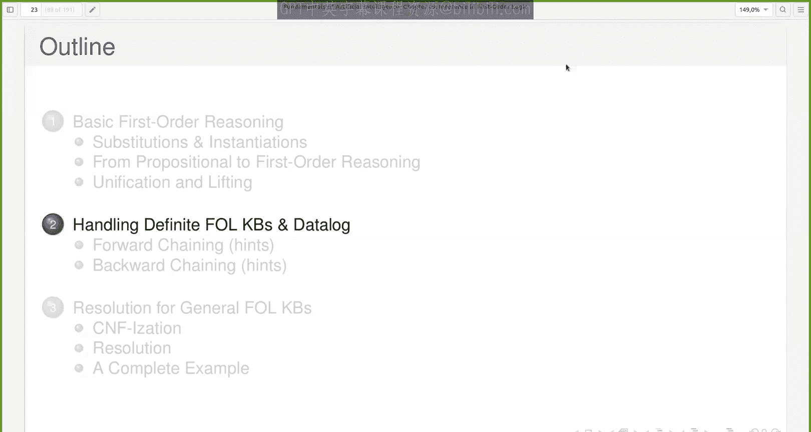

#  026：一阶逻辑推理

在本节课中，我们将要学习如何在一阶逻辑中进行自动推理。我们将从一些基本的推理步骤开始，然后讨论如何处理特定的子情况，最后介绍在一般情况下的核心推理方法——合一。

## 基本概念与替换

上一节我们介绍了推理的目标，本节中我们来看看推理的基础操作：替换。

替换是逻辑中的一个基本操作，记作 `E[a1/E2]` 或简写为 `E[a1/E2]`。给定一个表达式 `E`，将其中所有出现的 `a1` 同时替换为 `E2`，就得到了替换后的表达式。

替换有两种形式：
*   **项替换**：`a1` 和 `E2` 都是项。例如，表达式 `y+1 = 1+y`，将 `y` 替换为 `S(x)`，得到 `S(x)+1 = 1+S(x)`。
*   **公式替换**：`a1` 和 `E2` 都是子公式。例如，公式 `Even(x) ∨ Odd(x)`，将 `Even(x)` 替换为 `Odd(S(x))`，得到 `Odd(S(x)) ∨ Odd(x)`。

通常，替换可以同时进行多个。例如，在公式 `P(x, y) ⇒ Q(x, y)` 中，同时将 `x` 替换为 `1`，`y` 替换为 `2`，得到 `P(1, 2) ⇒ Q(1, 2)`。

**重要提示**：多个替换是**同时**进行的，没有先后顺序。这一点在处理共享元素时尤其关键。例如，在 `P(x) ∧ Q(y)` 中同时替换 `x` 为 `y`，`y` 为 `f(b)`，结果是 `P(y) ∧ Q(f(b))`，而不是先替换 `x` 得到 `P(y) ∧ Q(y)`，再替换 `y` 得到 `P(f(b)) ∧ Q(f(b))`。

## 基本推理规则

了解了替换之后，我们来看看基于替换的几个基本推理规则。

### 等价替换规则

如果已知两个项或公式等价，则可以在更大的表达式中自由替换它们。

*   **项等价替换**：如果 `t1 = t2` 是已知的，并且有公式 `α` 包含 `t1`，那么可以推出将 `α` 中 `t1` 替换为 `t2` 后的新公式 `α[t1/t2]`。例如，已知 `S(x) = x+1` 和 `0 ≠ S(x)`，可以推出 `0 ≠ x+1`。替换前后的公式在逻辑上是等价的。
*   **公式等价替换**：如果 `β1 ⇔ β2` 是已知的，并且有公式 `α` 包含 `β1`，那么可以推出将 `α` 中 `β1` 替换为 `β2` 后的新公式 `α[β1/β2]`。例如，已知 `Even(x) ⇔ ¬Odd(x)` 和公式 `Even(x) ∨ Odd(x)`，可以推出 `¬Odd(x) ∨ Odd(x)`。同样，替换保持逻辑等价。

### 全称实例化与存在实例化

以下是两个处理量词的核心规则。

*   **全称实例化 (Universal Instantiation, UI)**：如果有一个全称量词公式 `∀x α(x)`，那么对于任意项 `t`，都可以推出 `α(t)`（即 `α[x/t]`）。其含义是，如果某个性质对一切事物都成立，那么它对任何一个具体事物也成立。例如，从 `∀x (King(x) ∧ Greedy(x) ⇒ Evil(x))`，可以实例化得到 `King(John) ∧ Greedy(John) ⇒ Evil(John)`，或者 `King(Richard) ∧ Greedy(Richard) ⇒ Evil(Richard)`。这个规则是保真的（有效性保持）。
*   **存在实例化 (Existential Instantiation, EI)**：如果有一个存在量词公式 `∃x α(x)`，那么可以引入一个**新的**（即之前未出现过的）常元 `c`，并用 `α(c)` 替换原公式。其含义是，如果存在某个事物满足性质 `α`，我们就给它起个新名字 `c`。例如，从 `∃x (Crown(x) ∧ OnHead(x, John))`，可以引入新常元 `C1`，得到 `Crown(C1) ∧ OnHead(C1, John)`。这个规则不保真，但**保可满足性**。也就是说，原公式集可满足当且仅当新公式集可满足。这对于基于可满足性的推理（如验证蕴含）已经足够。

**关于存在实例化的注意事项**：
1.  对同一个存在量词公式只能应用一次。
2.  引入的常元必须是全新的（“新鲜的”）。
3.  该规则通常只适用于作为合取支出现的存在量化公式（即形如 `... ∧ ∃x α(x) ∧ ...`）。如果量词前有否定，需要先利用等价式 `¬∀x α(x) ≡ ∃x ¬α(x)` 和 `¬∃x α(x) ≡ ∀x ¬α(x)` 将其转化。

## 命题化与合一

我们曾希望将一阶逻辑问题转化为命题逻辑问题来解决，但这种方法存在局限性。

**命题化**的思想是：将知识库 `Γ` 和查询 `¬α` 中所有全称量词变量用所有可能的地面项（不含变量的项）实例化，生成所有地面原子，然后将每个不同的地面原子视为一个命题符号。这样，一阶逻辑问题就变成了一个（可能非常大的）命题逻辑问题。

然而，命题化有两个主要问题：
1.  **生成大量无关子句**：实例化会产生许多与当前证明目标无关的公式，导致搜索空间爆炸。
2.  **处理函数符号时可能无限**：如果知识库包含函数符号（如 `father(x)`），则会生成无限的地面项序列（`John`, `father(John)`, `father(father(John))`, ...）。根据 Herbrand 定理，如果查询确实被知识库蕴含，我们总能在某个有限的嵌套深度内找到证明；但如果查询不被蕴含，这个过程可能永不终止。这正反映了一阶逻辑是半可判定的。

因此，命题化并非通用的好方法。我们需要更高效的技术——**合一**。

### 广义肯定前件式

在介绍合一前，我们先看一个结合了全称实例化和命题推理的常用规则：**广义肯定前件式**。

假设我们有一条规则：`∀... (α1 ∧ α2 ∧ ... ∧ αk ⇒ β)`，并且我们有一些已知事实：`α1‘, α2‘, ..., αk‘`。如果存在一个替换 `θ`，使得对于所有 `i`，有 `αi‘θ = αiθ`（即应用替换 `θ` 后，事实与规则前提中的对应子公式变得完全相同），那么我们就可以推出 `βθ`。

**示例**：
*   规则：`∀x (King(x) ∧ Greedy(x) ⇒ Evil(x))`
*   事实：`King(John)`, `Greedy(John)`
*   替换：`θ = {x/John}`
*   应用规则后，前提变为 `King(John) ∧ Greedy(John)`，与事实匹配。
*   结论：推出 `Evil(John)`。

这个规则是许多早期专家系统和生产式规则系统的推理基础。

## 合一算法

合一是一阶逻辑自动推理的核心步骤。它要解决的问题是：给定两个表达式（项、原子公式或列表），是否存在一个替换，使得应用该替换后，两个表达式变得完全相同。

**定义**：一个替换 `θ` 是表达式 `α` 和 `β` 的**合一子**，当且仅当 `αθ = βθ`。如果存在这样的 `θ`，则称 `α` 和 `β` 是**可合一的**。

**示例**：
*   `Knows(John, x)` 和 `Knows(John, Jane)` 可合一，合一子为 `θ = {x/Jane}`。
*   `Knows(John, x)` 和 `Knows(y, OJ)` 可合一，合一子为 `θ = {y/John, x/OJ}`。
*   `Knows(John, x)` 和 `Knows(x, OJ)` 直接合一会失败，因为要求 `x` 同时等于 `John` 和 `OJ`。但**变量名可以标准化**以避免冲突。我们将第二个表达式重命名为 `Knows(z, OJ)`，然后就能合一：`θ = {z/John, x/OJ}`。

**最一般合一子**：合一子通常不唯一。例如，`Knows(John, x)` 和 `Knows(y, z)` 有多个合一子，如 `θ1 = {y/John, x/z}` 和 `θ2 = {y/John, x/John, z/John}`。我们说 `θ1` 比 `θ2` **更一般**，因为存在另一个替换 `σ = {z/John}`，使得 `θ2 = θ1σ`。更一般的合一子包含更少的约束（用变量替换变量比用具体项替换变量更一般），因此信息量更大。对于任意一对可合一的表达式，都存在一个**最一般合一子**，它比任何其他合一子都更一般（在变量重命名的意义下唯一）。

以下是合一算法的高层描述，它递归地寻找最一般合一子：

**算法 UNIFY(x, y, θ)**
*   **输入**：待合一的表达式 `x` 和 `y`，当前替换 `θ`（初始为空）。
*   **输出**：最一般合一子 `θ`，或失败。
*   **过程**：
    1.  如果 `θ` 已经是失败标志，则返回失败。
    2.  如果 `x` 和 `y` 完全相同，返回 `θ`。
    3.  如果 `x` 是一个变量，调用 `UNIFY-VAR(x, y, θ)`。
    4.  如果 `y` 是一个变量，调用 `UNIFY-VAR(y, x, θ)`。
    5.  如果 `x` 和 `y` 都是复合表达式（如 `P(args)` 或 `f(args)`）：
        *   检查运算符是否相同。如果不同，返回失败。
        *   递归调用 `UNIFY` 来合一参数列表（逐个合一第一个参数，然后将得到的替换用于剩余参数的合一）。
    6.  否则，返回失败。

**子过程 UNIFY-VAR(var, x, θ)**
*   如果 `θ` 中已包含替换 `var/val`，则递归调用 `UNIFY(val, x, θ)`。
*   如果 `θ` 中已包含替换 `x/val`，则递归调用 `UNIFY(var, val, θ)`。
*   如果 `var` 出现在 `x` 中（**出现检查**），返回失败（避免无限循环，如 `x` 与 `f(x)` 合一）。
*   否则，将替换 `var/x` 加入 `θ` 并返回。

## 总结

本节课中我们一起学习了一阶逻辑自动推理的基础。
1.  我们首先介绍了**替换**操作及其两种形式：项替换和公式替换。
2.  接着，我们学习了两个基本的量词推理规则：**全称实例化**和**存在实例化**，并了解了它们的性质和应用条件。
3.  然后，我们探讨了通过**命题化**将一阶问题转化为命题问题的思路，并指出了其在实际应用中的局限性（无关子句和无限域问题）。
4.  之后，我们介绍了结合实例化与命题推理的**广义肯定前件式**规则。
5.  最后，我们深入讲解了一阶逻辑推理的核心技术——**合一**。我们定义了合一子、最一般合一子，并概述了寻找最一般合一子的递归算法。合一算法通过变量替换、出现检查、递归处理复合表达式等步骤，高效地判断两个表达式是否可合一，并给出最一般的合一结果。

掌握这些基本概念和规则，是理解和设计更复杂的一阶逻辑自动定理证明器（如下节课将介绍的归结原理）的关键。