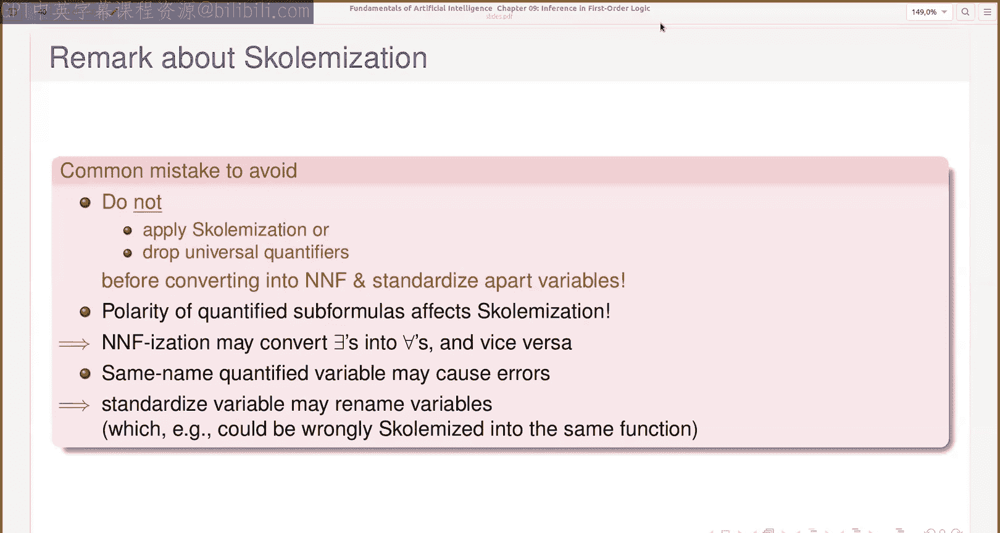

#  027：一阶逻辑推理

在本节课中，我们将学习一阶逻辑推理的核心技术。我们将从一些基础概念开始，逐步深入到更复杂的推理方法，特别是针对特定可判定子类的推理，以及通用的归结方法。

## 概述

我们将首先回顾一阶逻辑推理的基本步骤，包括代换、全称与存在实例化，以及广义假言推理。接着，我们会探讨如何将一阶逻辑命题化，并指出其局限性。然后，我们会介绍**合一**这一关键概念，它是自动推理的基础步骤。之后，我们将专注于两个可判定的逻辑子类：**Horn子句**和**Datalog**，并学习其对应的推理策略：**前向链接**和**后向链接**。最后，我们将学习如何通过**斯科伦化**将任意一阶逻辑公式转换为可进行归结推理的子句形式。

---

## 一阶逻辑推理基础

上一节我们介绍了推理的基本概念。本节中，我们来看看一阶逻辑推理的一些基本步骤。

我们提到了代换的概念，这引出了全称实例化和存在实例化等基本步骤。然后我们介绍了**广义假言推理**，它实质上是实例化与假言推理的结合。

我们还讨论了如何将一阶逻辑**命题化**，并指出除了极少数情况外，这通常是不可行的。

---

## 合一：自动推理的核心步骤

在进入主要的推理模块之前，我们需要理解一个关键元素：**合一**。

当你有两个公式或项时，合一的目标是找到一个共同的变量代换（称为**合一子**），使得应用这个代换后，两个项变得完全相同。这是大多数自动推理系统的基本步骤。

---

## 处理可判定的子类

由于一阶逻辑推理是半可判定的，人们将注意力集中在一些受限的子类上。本节中，我们来看看这些子类及其推理技术。

我们首先讨论**Horn子句**和**Datalog**的定义。我们特别关注两种技术：**前向链接**和**后向链接**，这里只给出其核心思想。

我们在此子类中假设没有函数符号，因为函数符号是导致不可判定的根源之一。同时，我们假设不存在在全称量词辖域内的存在量词，因为这本质上会引入函数。

### Horn子句与定子句

回忆一下**定子句**的概念：它是恰好有一个正文字的闭式。如果我们把子句看作蕴含式，那么唯一的正文字就是被蕴含的原子，而负文字是前提。

对于这类公式，我们可以省略全称量词，假设所有变量都是隐式全称量化的。我们通过存在实例化提前处理掉存在量词。

定子句倾向于表示原子公式之间的蕴含关系，是我们在布尔逻辑中看到的对应物。例如，公式 `∀x (King(x) ∧ Greedy(x) ⇒ Evil(x))` 可以写成子句 `¬King(x) ∨ ¬Greedy(x) ∨ Evil(x)`。正文字扮演被蕴含项的角色，负文字扮演前提的角色。

这很重要，因为这是**Datalog**中使用的形式。Datalog是一组没有函数符号的一阶定子句，最初用于在关系数据库上进行推理。如果限制在这个特定子类，推理会变得容易得多。

---

## 示例：形式化一个推理问题

为了理解如何应用这些概念，我们来看一个例子。

假设有以下陈述：
1.  向敌对国出售武器的美国人是罪犯。
2.  国家Nono是美国的敌人，拥有一些导弹。
3.  Nono所有的导弹都是由美国人Colonel West出售给它的。

目标：证明Colonel West是罪犯。

这是一个可以用逻辑形式化的法律推理案例。但需要注意，我们需要添加一些对人类显而易见但对机器并非立即可知的常识性假设，例如“犯下罪行的人是罪犯”。

以下是形式化过程：

1.  **规则1**：`∀x, y, z American(x) ∧ Weapon(y) ∧ Hostile(z) ∧ Sells(x, y, z) ⇒ Criminal(x)`
2.  **事实2a（Nono有导弹）**：`∃x Missile(x) ∧ Owns(Nono, x)`。通过存在实例化，引入新常量M1：`Missile(M1) ∧ Owns(Nono, M1)`
3.  **事实2b（Nono是敌人）**：`Enemy(Nono, America)`
4.  **事实3**：`∀x (Missile(x) ∧ Owns(Nono, x) ⇒ Sells(West, x, Nono))`
5.  **常识1（导弹是武器）**：`∀x (Missile(x) ⇒ Weapon(x))`
6.  **常识2（敌人是敌对国）**：`∀x (Enemy(x, America) ⇒ Hostile(x))`
7.  **事实4（West是美国人）**：`American(West)`

---

## 前向链接推理

上一节我们形式化了问题。本节中，我们来看看如何使用前向链接进行推理。

**前向链接**的直观思想是：你从已知的原子事实开始，尝试将它们与定子句（蕴含式）进行匹配。只要你能匹配一个子句的所有前提，你就可以推出其结论。这实质上是**广义假言推理**的迭代应用。

我们从已知的原子事实开始：
*   `American(West)`
*   `Missile(M1)`
*   `Owns(Nono, M1)`
*   `Enemy(Nono, America)`

以下是推理步骤：

1.  由 `Missile(M1)` 和常识1，推出 `Weapon(M1)`。
2.  由 `Missile(M1)`、`Owns(Nono, M1)` 和事实3，推出 `Sells(West, M1, Nono)`。
3.  由 `Enemy(Nono, America)` 和常识2，推出 `Hostile(Nono)`。

现在，我们有了应用主规则（规则1）所需的所有前提：
*   `American(West)` (X=West)
*   `Weapon(M1)` (Y=M1)
*   `Hostile(Nono)` (Z=Nono)
*   `Sells(West, M1, Nono)`

应用广义假言推理，我们得到结论：`Criminal(West)`。这就证明了目标。

这种技术是可靠的，因为每个推理步骤都是广义假言推理的应用。对于Datalog（无函数符号，无非全称量词辖域内的存在量词），该技术也是完备的，并且总能终止。其复杂度与谓词数量呈线性关系，与谓词元数呈指数关系，但在实际应用中，谓词元数通常很小（2或3），因此可以认为是高效的。

前向链接是一种从已知事实出发，逐步推导直到达到目标的搜索策略。

---

## 后向链接推理

除了从前提出发，我们也可以从目标出发进行推理，这就是后向链接。

**后向链接**沿相反方向工作。你从目标开始，检查是否有可以推出该目标的子句。如果有，则找出产生该目标所需的前提，然后尝试证明这些前提。这类似于人类制定计划时的逆向思维。

我们从目标 `Criminal(West)` 开始。

1.  如何推出 `Criminal(West)`？只能匹配规则1。我们需要匹配其前提：
    *   `American(West)` —— 已有。
    *   `Weapon(Y)` —— 新子目标。
    *   `Sells(West, Y, Z)` —— 新子目标。
    *   `Hostile(Z)` —— 新子目标。
    我们实例化变量：X=West。

2.  处理子目标 `Weapon(Y)`。匹配常识1，需要 `Missile(Y)`。我们记录 Y 可能被实例化为 M1（通过其他匹配）。
3.  处理子目标 `Sells(West, Y, Z)`。匹配事实3，需要 `Missile(Y) ∧ Owns(Nono, Y)`。我们记录 Z=Nono，并且需要 `Missile(Y)` 和 `Owns(Nono, Y)`。
4.  处理子目标 `Hostile(Z)`，其中 Z=Nono。匹配常识2，需要 `Enemy(Nono, America)` —— 已有。
5.  现在，检查为证明 `Sells` 而需要的子目标 `Missile(Y)` 和 `Owns(Nono, Y)`。结合步骤2，Y 被实例化为 M1。我们已有 `Missile(M1)` 和 `Owns(Nono, M1)`。

所有子目标均得到满足，因此原始目标 `Criminal(West)` 得证。

后向链接从目标开始，递归地将目标分解为子目标。其搜索空间与证明大小呈线性关系。但若存在函数符号，可能产生无限循环。解决方法包括缓存已证明的目标，这类似于图搜索与树搜索的区别。

后向链接是逻辑编程语言（如Prolog）所使用的核心机制。

---

## 归结：通用自动推理

前面我们讨论了受限子类的推理。本节中，我们来看看适用于一般一阶逻辑的通用自动推理方法：**归结**。

其核心思想是：我们将知识库和查询都转换为**合取范式**，然后应用归结规则。首要步骤是**斯科伦化**，以消除量词。

### 转换为合取范式

CNF是一组子句的合取，每个子句是文字（原子或其否定）的析取，且所有变量都是隐式全称量化的。处理通用一阶公式的步骤如下：

1.  **消除蕴含和双蕴含**：与命题逻辑相同，将 `A ⇒ B` 替换为 `¬A ∨ B`。
2.  **将否定内移，得到否定范式**：利用德摩根律和量词否定律（`¬∀x P(x)` 等价于 `∃x ¬P(x)`，`¬∃x P(x)` 等价于 `∀x ¬P(x)`），将否定符号直接移到原子公式前。最终公式只包含 `∧`、`∨`、`∀`、`∃`，且否定只出现在原子前。
3.  **标准化变量**：重命名量词变量，使得每个量词都使用不同的变量符号，避免后续步骤产生混淆。
4.  **斯科伦化：消除存在量词**：这是最关键的一步。对于每个存在量词 `∃y`：
    *   如果 `∃y` 不在任何全称量词 `∀x1...∀xn` 的辖域内，则用一个新的**常量**（斯科伦常量）替换 `y`。
    *   如果 `∃y` 在全称量词 `∀x1...∀xn` 的辖域内，则用一个新的**函数** `f(x1, ..., xn)`（斯科伦函数）替换 `y`。这个函数表示 `y` 依赖于 `x1, ..., xn` 的值。
    *   每次使用的斯科伦常量或函数必须是新的（未在公式中出现过的）。
5.  **删除全称量词**：此时公式中只剩下全称量词，且它们分布在所有变量上。我们可以删除它们，约定所有变量都是全称量化的。
6.  **转换为CNF**：使用分配律 `∨` over `∧`，将公式化为子句合取的形式。为了避免指数级膨胀，通常使用**命题化**技术（引入新命题变量标记子公式）。
7.  **标准化分离**（建议步骤）：在归结前，重命名每个子句中的变量，确保不同子句不使用相同的变量名。这可以避免归结时产生意外的变量统一。

### 斯科伦化的性质

斯科伦化**保持可满足性**，但不保持逻辑等价。因为引入的新函数符号限制了可能的模型。然而，对于推理（特别是证明不可满足性）来说，保持可满足性就足够了：
*   如果斯科伦化后的公式是可满足的，则原公式也是可满足的。
*   如果斯科伦化后的公式是不可满足的，则原公式也是不可满足的。
*   由于逻辑蕴涵 `KB ⊨ α` 等价于 `KB ∧ ¬α` 不可满足，因此斯科伦化也可用于证明蕴涵关系。

### 示例：斯科伦化

考虑句子：“所有爱动物的人都会被某人所爱。”
形式化为：`∀x [∀y (Animal(y) ⇒ Loves(x, y))] ⇒ [∃z Loves(z, x)]`

1.  消除蕴含：`∀x [¬∀y (¬Animal(y) ∨ Loves(x, y))] ∨ [∃z Loves(z, x)]`
2.  否定内移（`¬∀y` 变为 `∃y ¬`）：`∀x [∃y ¬(¬Animal(y) ∨ Loves(x, y))] ∨ [∃z Loves(z, x)]`
    = `∀x [∃y (Animal(y) ∧ ¬Loves(x, y))] ∨ [∃z Loves(z, x)]`
3.  标准化变量（已满足）。
4.  斯科伦化：
    *   第一个 `∃y` 在 `∀x` 辖域内：用 `F(x)` 替换 `y`。
    *   第二个 `∃z` 在 `∀x` 辖域内：用 `G(x)` 替换 `z`。
    得到：`∀x [(Animal(F(x)) ∧ ¬Loves(x, F(x))) ∨ Loves(G(x), x)]`
5.  删除全称量词：`(Animal(F(x)) ∧ ¬Loves(x, F(x))) ∨ Loves(G(x), x)`
6.  转换为CNF（分配律）：`[Animal(F(x)) ∨ Loves(G(x), x)] ∧ [¬Loves(x, F(x)) ∨ Loves(G(x), x)]`
7.  标准化分离（两个子句变量独立）：`[Animal(F(x1)) ∨ Loves(G(x1), x1)] ∧ [¬Loves(x2, F(x2)) ∨ Loves(G(x2), x2)]`

### 常见错误

务必遵循上述步骤顺序：
*   **不要**在转换为NNF和标准化变量之前进行斯科伦化或删除量词。因为量词的极性（正出现/负出现）在NNF中才完全确定，错误的极性会导致斯科伦化出错（例如，应将全称量词变为存在量词时却未变）。
*   **务必**在消除量词前进行标准化变量，否则可能错误地将本应不同的变量映射到同一个斯科伦函数。

---

## 总结

本节课中我们一起学习了一阶逻辑推理的完整路径。

我们首先回顾了推理的基本步骤，并引入了**合一**这一核心概念。接着，为了处理可判定的情况，我们聚焦于**Horn子句**和**Datalog**，并学习了对应的**前向链接**和**后向链接**算法，它们分别从事实出发和从目标出发进行高效推理。

最后，为了处理任意的一阶逻辑公式，我们学习了**归结**方法的前置步骤：将公式转换为**合取范式**。其中最关键的是**斯科伦化**过程，它通过引入新的函数或常量来消除存在量词，从而得到一个所有变量都是全称量化的子句集合，为后续的归结推理做好了准备。我们强调了转换步骤的顺序和常见错误，以确保推理的正确性。