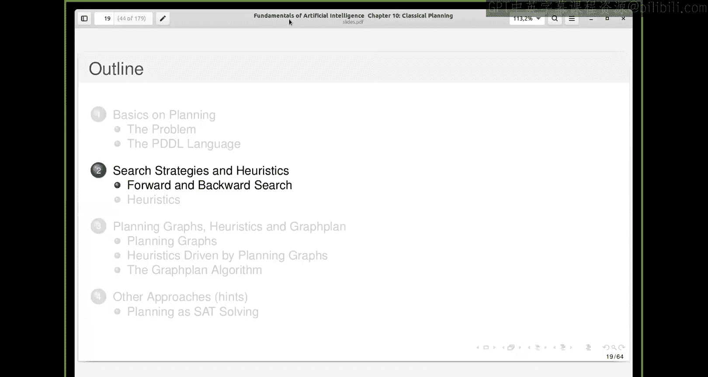
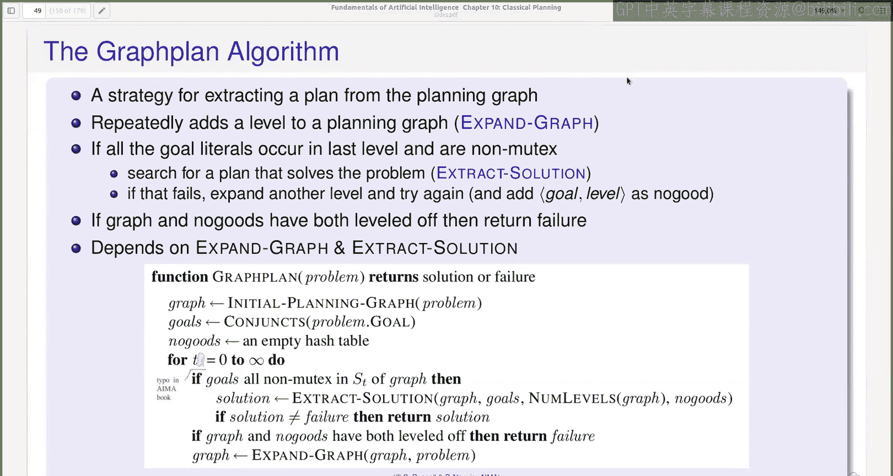

#  030：经典规划

## 概述
在本节课中，我们将学习经典规划中的核心搜索策略、启发式方法以及一种重要的数据结构——规划图。我们将探讨前向搜索与后向搜索的区别，如何构建有效的启发式函数来指导搜索，并深入了解规划图的构建原理及其在规划算法中的应用。

---

## 前向搜索与后向搜索
上一节我们介绍了规划问题的描述和PDDL语言，并指出规划本质上是一个搜索问题。本节中，我们来看看规划中两种主要的搜索策略。

规划主要有两种策略：
1.  **前向搜索**：从初始状态出发，通过不断应用动作，直到达到一个满足目标测试的状态。
2.  **后向搜索（回归）**：从目标状态（通常代表一组状态）出发，反向寻找哪些动作可能导致当前目标，并计算其前提条件作为新的子目标。

前向搜索是经典搜索技术（第三章）最直接的实例化。而后向搜索可以映射到标准搜索算法中。通常，我们使用深度优先或广度优先搜索，它们在不考虑函数符号的经典规划中，通过实现循环检查程序可以变得完备，并且只需要多项式内存。

盲目搜索的主要问题是分支因子巨大。因此，无论采用哪种策略，都需要一个好的启发式方法来指导搜索方向。

---

## 后向搜索详解
为了进行更好的后向搜索，我们需要反向选取候选动作。

假设目标 **G** 是应用动作 **A** 的结果。在什么条件下这是可能的？这意味着我们需要计算一个子目标 **G‘**，从该子目标应用动作 **A** 后，通常能达到当前目标 **G**。

我们需要区分目标中的正文字和负文字。新子目标 **G‘** 的正文字由当前目标 **G** 的正文字集合，去掉动作 **A** 的效果列表（add list）中的文字，再加上动作 **A** 的正前提条件构成。类似地，**G‘** 的负文字由 **G** 的负文字集合，去掉动作 **A** 的删除列表（delete list）中的文字（因为这些文字被动作设为假），再加上动作 **A** 的负前提条件构成。

这样计算的是最弱前提条件，即最一般、约束最少的子目标。这使我们有更高的机会在后续步骤中与初始状态或其他动作匹配。

**G** 和 **G‘** 都可能代表许多状态，它们只是一组文字，可能只给部分原子或流（fluent）赋值，而无关的文字则保持未指定状态。

### 实例说明
考虑一个目标：`At(C1, SanFrancisco) ∧ At(C2, JFK)`。

假设我们有一个具体动作（ground action）：`Unload(C1, P1, SanFrancisco)`。其前提条件是：`In(C1, P1)`, `At(P1, SanFrancisco)`, `Cargo(C1)`, `Plane(P1)`, `Airport(SanFrancisco)`。效果是：`At(C1, SanFrancisco)`, `¬In(C1, P1)`。

应用后向规则，子目标 **G‘** 的正文字包括所有前提条件，以及从原目标正文字中去掉已被该动作满足的 `At(C1, SanFrancisco)` 后剩下的 `At(C2, JFK)`。类型谓词（如 `Cargo`, `Plane`, `Airport`）是固定的。因此，子目标要求 `In(C1, P1)`, `At(P1, SanFrancisco)` 和 `At(C2, JFK)`。

### 保持一般性
在实际操作中，我们通常处理动作模式（schema），而非具体动作。我们应尽可能少地实例化变量，以保持子目标的一般性。

规则是：**只实例化必要的部分**。使用最一般合一子（most general unifier），在经典规划中，这意味着如果能保持变量为变量，就不要将其实例化为常量。必要时可以重命名变量以避免冲突。

在目标中，变量是存在量化的；在动作中，变量是全称量化的。因此，我们通常希望子目标表达为“存在某个飞机...”，而不是“必须是飞机P1...”，这样更弱，也更容易匹配。

保持目标尽可能一般，是后向搜索乃至所有从目标状态反向推理（如软件静态分析）的通用经验法则。

---

## 相关动作选取
在后向搜索中，我们需要一个标准来选取可能导出当前目标的动作。

一个动作被称为与目标 **G** **相关**，需要满足两个条件：
1.  **做有益的事**：该动作的至少一个正效果能与目标 **G** 中的某个文字合一。即，它必须产生了目标所需的某些东西。
2.  **不做有害的事**：该动作不能破坏（即其删除列表中的文字不能与）目标 **G** 中的任何期望文字冲突。

直观上，一个可能是最终步骤的动作，必须做了些好事（促成目标）且没做坏事（破坏目标）。仅满足条件2的动作称为**一致**的，但不一定是相关的。

### 实例说明
对于目标 `At(C1, SFO) ∧ At(C2, JFK)`：
*   `Unload(C1, P1, SFO)` 是相关的，因为它产生了 `At(C1, SFO)` 且不破坏任何目标。
*   `Load(C3, P1, SFO)` 是一致的（不破坏目标），但不是相关的，因为它对实现当前目标没有直接贡献。
*   `Load(C1, P1, JFK)` 是不一致的，因为它会破坏 `At(C1, SFO)` 这个目标。

后向搜索的优势在于，由于有“相关性”概念，其分支因子通常比前向搜索小，搜索更聚焦于目标。然而，现代规划器认识到启发式搜索的重要性，而前向搜索更适合与启发式结合，因此大多数现代规划器采用 **前向搜索 + 启发式** 的策略。

---

## 启发式方法
我们需要启发式函数 **h(s)** 来估计从状态 **s** 到达目标的乐观代价。标准方法是**放松**原规划问题。放松后的问题更容易解决，且原问题的解也是放松问题的解（反之不一定），因此得到的代价估计是乐观的（可采纳的）。

以下是几种常见的放松技术：

### 忽略某些前提条件
通过忽略一些前提条件，使得动作更容易执行，从而得到乐观的代价估计。如果忽略所有前提条件，会过于乐观（每个目标文字可能一步达成）。更实用的方法是忽略那些根据领域知识或结构分析判断为“次要”或“容易满足”的前提条件。

### 忽略删除列表启发式
假设目标和动作前提只包含正文字。通过忽略动作的删除列表，我们得到一个放松问题，其中动作只会增加（而不会删除）文字。这使得问题具有单调进展性，易于用贪心或局部搜索快速找到放松解，然后尝试在原问题中修复因忽略删除而引入的冲突。

### 状态抽象（聚类）
通过忽略一些不太相关的流（fluent），将多个具体状态聚类成抽象状态，在抽象空间中进行规划。一旦在抽象层面找到计划，再将其具体化。这依赖于领域知识：被忽略的流应该是容易实现的。

### 分治
将复杂问题分解为若干子问题，独立解决后再组合。

---

## 规划图
规划图是一种数据结构，它能提供丰富的启发信息，并能驱动一个称为 **Graphplan** 的算法家族。

规划图是一个有向图，按层级组织，交替包含状态层（命题文字）和动作层（具体动作）。
*   **层 S0**：包含初始状态中所有成立的基础文字（根据闭世界假设，未出现的文字取其否定）。
*   **层 A0**：包含所有前提条件能在 S0 中得到满足的具体动作。
*   **层 S1**：包含所有 A0 层动作的所有效果（正效果和负效果）。
*   以此类推，递归构建。

此外，规划图还包含 **互斥（mutex）** 关系，表示两个元素不能在同一层级同时成立。
1.  **动作间互斥**：如果两个动作满足以下任一条件，则它们互斥：
    *   **不一致的效果**：一个动作的效果与另一个动作的效果（或持久动作的效果）互斥。
    *   **不一致的前提**：一个动作的前提与另一个动作的前提互斥。
    *   **竞争需求**：一个动作破坏了（删除）另一个动作的前提。
2.  **文字间互斥**：如果所有能产生这两个文字的动作对都是互斥的，则这两个文字互斥。一个文字与其否定自然互斥。

规划图具有以下性质：
*   文字和动作集合随层级增加单调递增（由于持久动作的存在），并在有限步后达到固定点。
*   互斥关系随层级增加单调递减（因为产生文字的方式增多，可能打破互斥）。
*   规划图的大小是问题规模的多项式级别，构建速度很快。
*   规划图是原问题状态空间的一个**超集近似**。所有可行解路径都体现在规划图中，但图中的路径不一定是可行解。如果目标文字未出现在某层，或目标文字间在该层互斥，则问题在该层深度内无解。

### 启发式信息提取
规划图提供了宝贵的启发式信息：
*   **层级代价**：一个文字 **L** 首次出现的层级 **i**，是对从初始状态达到 **L** 所需最小步骤数的乐观估计。这是一个可采纳的启发式估计。
    *   例如，在“蛋糕问题”中，`HaveCake` 的层级代价为0（初始状态），`EatenCake` 的层级代价为1。
*   对于目标（一组文字的合取），有多种方式组合单个文字的层级代价：
    *   **最大层级启发式**：取所有目标文字层级代价的最大值。可采纳，但可能过于乐观。
    *   **求和层级启发式**：取所有目标文字层级代价之和。通常不可采纳，但实践中可能有效。
    *   **集合层级启发式**：目标文字集合首次共同出现且彼此不互斥的层级。这被认为是更准确的估计。

### Graphplan 算法框架
Graphplan 不只是一个算法，而是一个算法框架：
1.  **扩展图**：从初始状态开始，逐步构建规划图层级。
2.  **检查目标**：在最新的状态层中，检查所有目标文字是否都已出现且彼此不互斥。如果不是，则继续扩展图；如果是，则进入下一步。
3.  **解提取**：尝试从当前规划图中提取一个有效的计划。这是一个独立的搜索过程（如回溯搜索），利用规划图中的动作、效果和互斥关系进行约束。
4.  **循环**：如果在当前层提取解失败，则记录这个“失败”信息（称为“nogood”），然后要么继续扩展图（增加深度），要么回溯。
5.  **终止**：当图扩展到固定点（连续两层完全相同）仍未找到解，则判定问题无解。

该框架将多项式时间的规划图构建与一个可能是指数时间的解提取搜索过程分离，并通过记录“nogood”和增量式图扩展来避免重复搜索。

---

## 总结
本节课中，我们一起学习了经典规划中的核心高级技术。我们深入探讨了后向搜索的原理与优势，理解了通过放松问题来构建可采纳启发式函数的各种方法。重点介绍了**规划图**这一强大工具，它不仅能高效地提供优质的启发式估计，还构成了Graphplan算法系列的基础。规划图通过层级结构和互斥关系，对状态空间进行紧凑的多项式级近似，从而极大地优化了规划搜索过程。掌握这些概念对于理解和设计高效的自动规划系统至关重要。