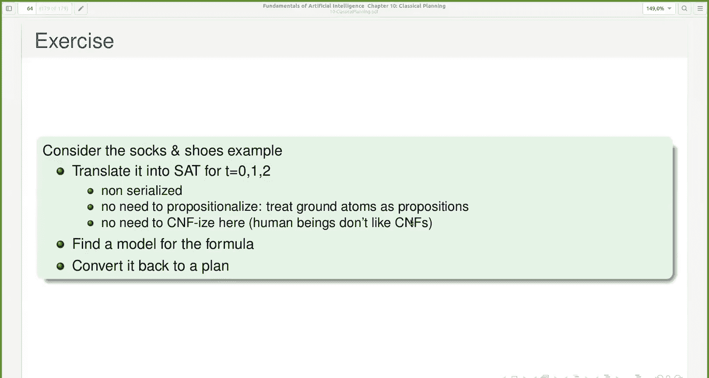

#  031：经典规划（下）

在本节课中，我们将继续学习经典规划，重点介绍规划图算法及其应用，特别是如何利用规划图进行启发式搜索，以及如何将规划问题编码为可满足性问题（SAT）来求解。

上一节我们介绍了规划图的基本概念。本节中，我们来看看如何利用规划图来高效地搜索解决方案。

## 规划图算法：Graphplan

规划图本身不是一个完整的算法，而是一个元算法或框架。它主要包含两个核心步骤：如何扩展规划图，以及如何在图中搜索解决方案（称为“提取解决方案”）。

以下是Graphplan算法的主要流程：

1.  **初始化**：从初始状态（第0层）开始构建规划图。同时初始化一个空的好表（记录目标首次出现的层数）。
2.  **迭代扩展与搜索**：
    *   检查当前最高层是否包含所有目标文字，并且这些目标文字之间不存在互斥关系。
    *   如果满足条件，则调用“提取解决方案”函数，尝试在当前规划图限制的范围内搜索一个可行的计划。
    *   如果找到了解决方案，算法成功结束。
    *   如果未找到解决方案，且规划图和好表都已达到“稳定点”（即无法再扩展出新信息），则算法返回失败。
    *   否则，为规划图添加一个新的动作层和状态层，然后重复此过程。

这个过程类似于迭代加深搜索，从较浅的层开始尝试，逐步增加深度，直到找到解或证明无解。

## 规划图示例：轮胎问题

让我们回顾一下轮胎问题的例子，以理解规划图如何工作。

*   **初始状态**：轮胎是瘪的，备胎在行李箱里。
*   **目标状态**：备胎装在车轴上。
*   **关键动作**：从行李箱取出备胎、从车轴上卸下瘪胎、将备胎装到车轴上。

在规划图中：
*   第0层包含初始状态文字，如 `at(spare, trunk)` 和 `flat(axle)`。目标 `at(spare, axle)` 不在这一层，因此需要扩展。
*   第1层引入了可执行的动作，如 `remove(spare, trunk)` 和 `remove(flat, axle)`，以及它们产生的效果，如 `at(spare, ground)` 和 `at(flat, ground)`。同时，互斥关系也被标记出来。
*   在第2层，由于有了 `at(spare, ground)`，动作 `put-on(spare, axle)` 变得可执行，其效果 `at(spare, axle)` 正是我们的目标。

此时，规划图包含了目标，且目标间无互斥，因此可以调用“提取解决方案”搜索。搜索过程会利用图中已有的动作和互斥约束，极大地剪枝无效的搜索分支，从而高效地找到计划序列：`remove(spare, trunk)` -> `remove(flat, axle)` -> `put-on(spare, axle)`。

规划图的核心优势在于它作为一种预处理，提前计算了可能的动作路径和大量的约束（互斥关系），从而使得后续的搜索过程更加高效。

## 串行与并行规划

规划可以分为串行规划和并行（偏序）规划。

*   **串行规划**：计划是一个严格的线性动作序列。例如，先做A，再做B，然后做C。
*   **偏序规划**：计划定义了一组动作间的偏序关系（先后约束），而不是一个完整的线性顺序。例如，动作A必须在动作C之前完成，动作B必须在动作D之前完成，但A和B之间可以任意顺序执行，甚至并行。

偏序规划通常更高效，因为它压缩了那些可以独立或并行执行的动作组，减少了规划图中的层数。一个经典的例子是“穿袜穿鞋”问题：左脚穿袜、右脚穿袜、左脚穿鞋、右脚穿鞋。其中，每只脚的“穿袜”必须在对应的“穿鞋”之前，但左右脚的动作可以任意交错执行。一个偏序规划只需要2层动作，而任何串行规划都需要至少4层动作。找到偏序规划后，可以很容易地将其转化为一个满足偏序约束的串行计划。

## 规划图的性质与SAT编码

规划图有两个重要性质：
1.  状态文字集随着层数增加单调递增（或保持不变），由于文字总数有限，最终会达到一个固定点。
2.  互斥关系和好表的大小单调递减，最终也会稳定。

当规划图和好表都达到固定点，而目标仍未（无互斥地）出现时，就可以安全地断定该问题在该深度下无解。

规划图的“提取解决方案”步骤可以借助多种搜索方法，其中一种非常有效的方法是将**有界规划问题**编码为**命题可满足性问题（SAT）**。

其基本思想是：给定一个最大步数 `T`，为每一步 `t` 中的每个基本动作和每个状态文字创建一个布尔变量。然后，构造一个庞大的布尔公式，这个公式由三部分组成：
1.  **初始状态编码**：描述第0步时哪些文字为真。
2.  **转移关系编码**：对于每一步 `t`，编码从状态 `t` 到状态 `t+1` 的所有合法转移。这包括：动作执行需满足其前提条件；动作执行会带来其效果；对于未受动作影响的文字，其值保持不变（框架公理）。
3.  **目标状态编码**：描述在第 `T` 步时，目标文字必须成立。

此外，规划图中计算出的**互斥关系**可以非常方便地编码为SAT子句（例如，`not Action_A_t OR not Action_B_t` 表示两个动作在步 `t` 不能同时执行）。这些互斥子句能在SAT求解过程中进行高效的单元传播，从而极大地减少搜索空间。

如果这个布尔公式是可满足的，那么满足赋值就对应了一个有效的计划（为真的动作变量序列即为计划）。如果公式不可满足，则说明在 `T` 步内无解。

## 总结

本节课中我们一起学习了经典规划的高级主题。
*   我们深入探讨了**Graphplan算法**，它通过迭代构建规划图并利用图中的约束来高效搜索计划。
*   我们比较了**串行规划**与**偏序规划**，认识到偏序规划在表示和效率上的优势。
*   最后，我们介绍了如何将**规划问题编码为SAT问题**来求解，特别是利用规划图提供的互斥约束来加速SAT求解过程。

规划图及其相关算法是经典规划中连接启发式搜索与逻辑推理的重要桥梁，它显著提升了规划器的求解能力。