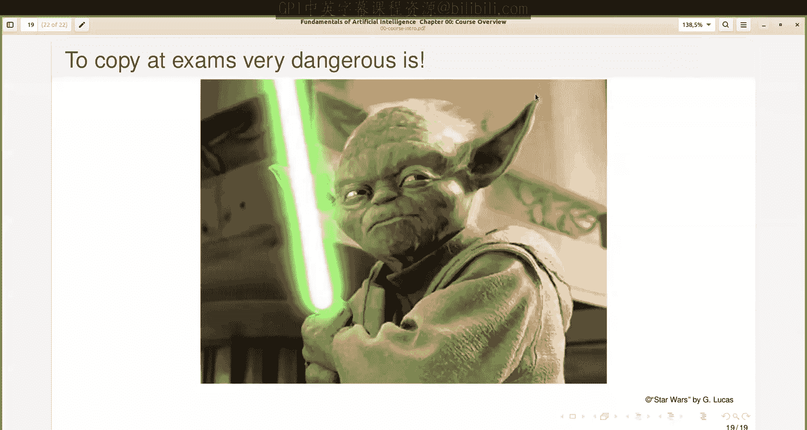
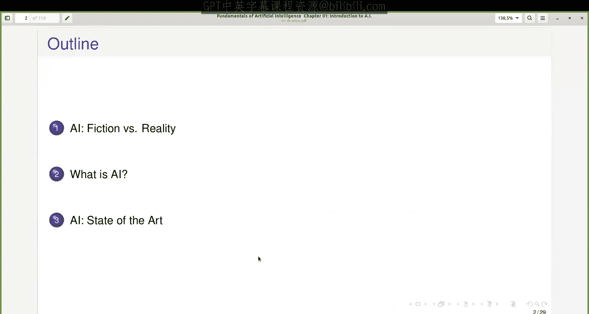
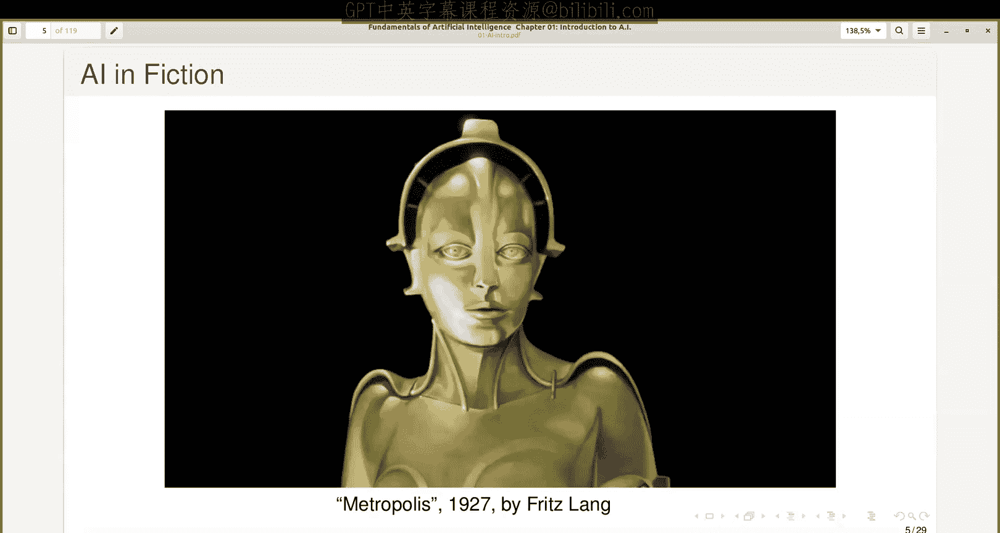
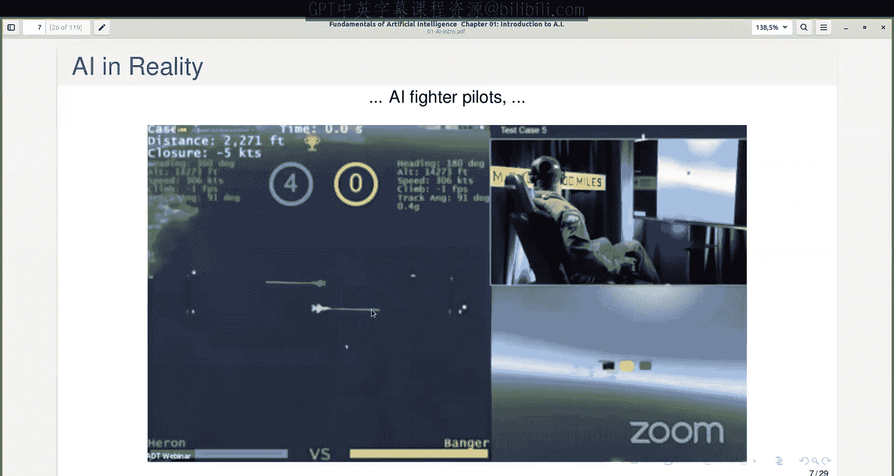
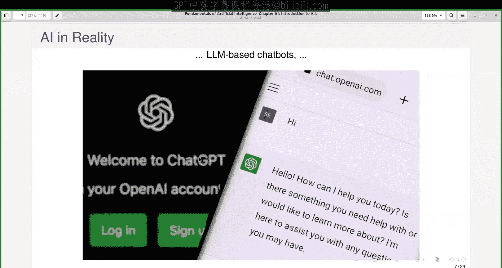
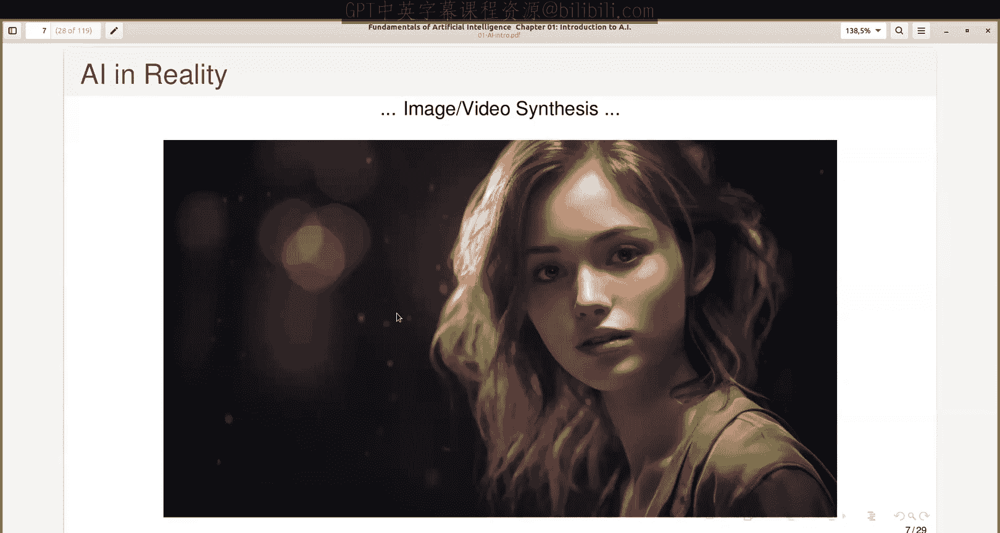
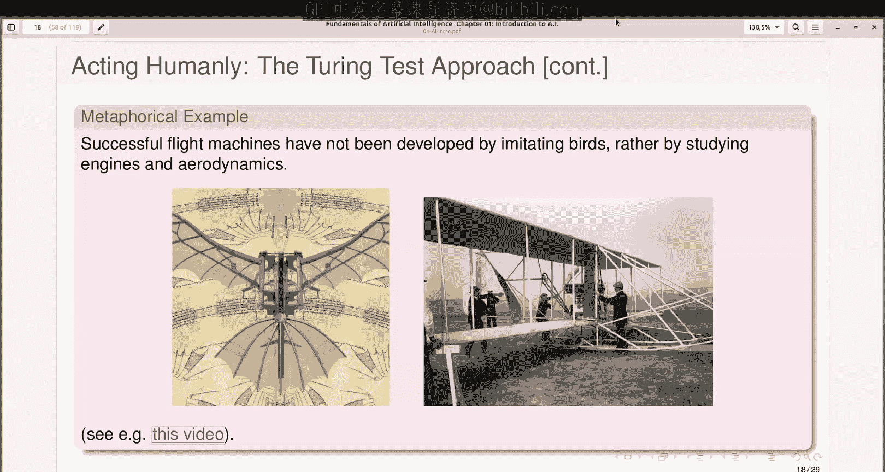
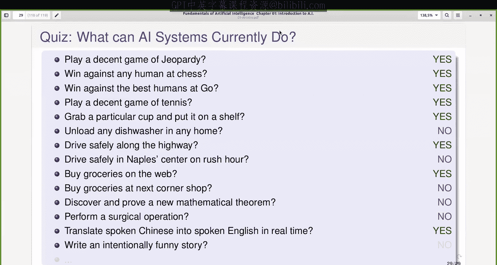
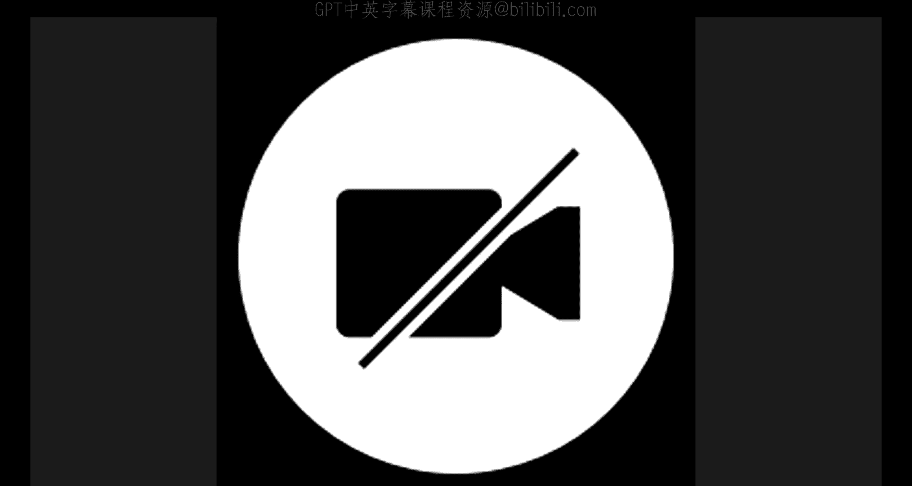

# 意大利特伦托大学《人工智能基础｜Fundamentals of Artificial Intelligence 2024》中英字幕deepseek p01 2024.09.09-CL01-1-CH00-0101-Introduction.zh_en -BV1uUkwYTEmf_p1-

Okay。So I heard， I'm Roberto Sebastianni and I will be the teacher of fundamentals of artificialificial intelligence。

🤧Which is the course of the first semester， I will start by introducing some。うう。Okay。

 what's going on here。嗯。I know he's sharing， okay。诶。

I'm saying this course will go on for the first semester。嗯。Just one tiny remark。In general。

 all the classes will start at the sharp time So 9，30。11，30。Sharp， okay。

 so we are taking this call 5 academical 15 hours，150 minutes at the end of the course or at the end of the class so that you can go to mainside to eat earlier。

 if you wish and so on， please come。嗯。Okay， so please。Be sure you are here on time。 Okay。

 so just to avoid exactly these kind of things。 Okay， during during the classes and also one。

Recommendation is when since this room is relatively small with the fact we the number of people。

Were expected to thank that。I recommend you to occupy the internal。

Part seats are the beginnings so that people coming in the second moment can paint without having people raise。

 okay？Everything is clear。Okay， so I。Okay， so during the course， we'll have not to not only with me。

 but also with Pao Martinin who is a teaching assistant。

 you will probably meet him next week and from time to time to Marco Dragonni。Okay。

 who are our teaching assistants？You， I will just start by giving you some。

Quick overview and practical information about this course。 Well， this is very inconvenient， okay。哦。

Okay。Okay， so just a a couple of facts。 The very first factor。

 you should be aware that all the classes are recorded。Okay。This means my audio is recorded。

 the slides are recorded and also your question。I have to say that by Li。

 So be aware that if you ask a question will be recorded。Okay， I have to tell you by legal notice。

 okay。Okay， so apart from that， well， the course will be given English， of course。

And you are more or less supposed to be a student of the first year of artificial intelligence system。

Master， okay， anyway， anybody else is welcome， Of course。 But just to be sure， is everybody is。

Is there anybody here who is not attending AAS course？

I've seen there are some Erasmus students who are picking a few courses around。

 that's perfectly fine， of course， but okay， I will assume that you will all be E course。啊。Okay。

 so date and time time， okay， the this course we covered the most semester till substantially Christmas。

Cl will be on Monday，930，11，30， this room。😊，The lab classes I will explain later what the lab means。

 they will be 1130， 1330 in room a 104 okay， you probably know that Po1 is this building and Po2 is the other building。

 the one across the bridge okay。😊，And there will be the third class will be Friday。Okay，9，30，12。

30 or。Even one third。 So I have allocated four hours depending， I will。Okay。

 it's up to me to decide whether I want to take eight class， eight hour。

 a week and finish earlier or seven hours a week and finish later in the course。I tend to。

Maybe seven hours。A week could just because four hours in a row on Friday are quite tiring for both you and me。

Sometimes， so the default will be that will end at 1230。Okay。

But be prepared on the fact that we may sometimes finish。Later， depending whether I。

 I have to complete some argument， whether we are late， if we have to， to get back。

So we are late on schedule or something like that。The course is given obsolete presence。 Okay。

 so there's no。Luckily， Covid is over。So we are not taking any remote class。

 however classes will be recorded。I just wanted to stress a fact about the recordings。

I want you want to prevent you from making a major mistake to consider classes recordings as alternative to attending classes。

 Okay， that's a very bad mistake the role of recording is to。Check so you see， okay。

 what the hell Sebastianni says here in this tunnel to ring。Re see again， something。

 though to just clarify what the class but。 I will strongly recommend you， not only for my class。

 but for everybody's class， to attend the classes。 I know that we waking up in the morning and taking the bus and blah。

 blah by， ti， blah， blah， blah， but it's。😊，Very。Much better for you for your learning to attend a class or take questions。

 interact with your colleagues and。Things like that。 I just。Have a remark about that。

 There are some people who。After a few weeks think， okay， we have the recording so I can not。

My standard， of course I will not I don't know your name Okay and so I don't say okay。

 this this guy did not attend so Ill give you a wolf mark no I will correct I don't look to names when I correct。

 but just a statistical。immediatelyte after I when during the exams。

 typically at the end when I'm recording the votes， I will look to faces on yesterday。

 and typically what I see is that。People who utter mar。

 which pass who pass the first rounds are just old faces I've ever seen。

And in the late exams where people all like September， July。

 September where people come for the end time to take an exam。

 blalah and people who don't pass it or to pass it on the very light。

 I just check in the old faces that have never seen before okay。This ought to say。If you can attend。

 do attend us。Okay， unless you have any serious reason not to do。Okay。啊。🤧嗯。

Something about the office hours。嗯。😊，Typically， people have all of you typically have a different schedules。

 Okay， so you attend different courses， blah， blah， blah， so I。I never give a fix。

Timeline for office hours。 Okay， so I don't say on say Wednesday at this time， office hours。

 office hours are typically free， but upon appointment only。Okay， so。

You can I typically answer question during interval immediately after if you have time。But。

If you need any more explanations。You can。Just come here， ask。

We fix an appointment and then you can okay so I don't have all to say I don't have a fixed time notice that office hours are only during class period。

 so only this semester。Okay。啊。There is a forum。I strongly recommend all of you to register on the Mo platformform for the course。

 You know what it is， Have you already done， So if you haven't done it yet， do it。

Why I'm saying because this will be the form of communication so if I have any communication for you。

I will。Put a message and I， okay， tomorrow we start 15 minutes later because of this this reason。

 we are doing this。 we will switch lab class with with the other classes for this of this reason。

 Okay， so be sure you are registered in in the in the Mo platform。 Okay， and also you。

 there is some forum。 You can ask a question， okay。So this is very， very important。哦。Okay， okay。

 just to say。Email， please。 I tend to receive some hundred， hundreds of emails per day。

So let's agree on some protocol on email sending， okay。When you have something to ask。Please是呃。

Signent to both me and the teaching assistants。 Okay， first of all。Second。

Clarify that from the subject that you。Are asking for the Scs， so please write fundamentals AI。

And then。TheThe topic， the subject， Okay， or something important。

You should email only from your official email address。You have all an official email address。

 which is name dot surname at today the dotunity n0， okay。

Use that if you we are not supposed to answer， reply to any male who comes from private inmates。Okay。

😊，Well， no need to say， I think please don't。Ask for relevant。Topics， okay。And of course。

 I think I don't need it， but I。At least for 99% of you， I don't need to say that， but be， of course。

 polite and respectful， not only with me， but also with each system。Oh， okay。If you wanted to。

 to see some something funny。Just to be aware that we are using social networks。

So social media and if you wanted to see something really funny who happened to to me with some students years ago。

 just take a look at this。To this one。Okay， so a few information about the course。Well， yeah I。Well。

 you probably mean some you may think that AI isonym of machine learning。Or a large language model。

 But okay， AI is a very， very complex， a very heterogeneous de thing。

 I would say that AI is a sort of umbrella terror， which covers a large amount of of topics。

 This includes。Problem solving noise presentation， reasoning planning reasons。

 learning pattern recognition， image recognition， many， many things。So this calls。啊。🤢。

Is providing a new version。I think in particular。Of some of disciplines in organic way。 So。

 so to say this course provides。As that I use the foundations on top of which you start。两嘅嘢。Okay。

 so all you need to know to start learning AI。Okay。诶。

We provide lots of examples and exercises during the course， of course。诶。

The course is organizing in a sequence of classes。Go to by myself。

And some lab classes don't mislead the meaning of a word lab。

You're not doing anything in the lab but you're not doing anything on the computer。

 you're not using tools do so these are sort of exercises okay。

 so it's one class per week starting from next week in which you will do exercises。Okay。

 I will teach that theory。😡，I'll go the content， then with powerlo， you will do exercises。

In in the class， okay。Okay， that's actually what I mean here。Okay。

I just want you to be warned on that this is。Quite the。Unusual as a cause。 And it sounds that。

This sort of horizontal course。 Okay， it's incredible。 It's very， very wide and very shallow。Okay。

 so you will will cover plenty many of topics。AndBut with neither of them， we will go in deep。Okay。

 so， and this exactly the reason is that you are building。You will learn。

ALo lott of stuff in either other course on top of that okay so。

Sometimes I wanted to change the name of these goals。

Instead of fundamentals of AI in the foundations of AI。 Okay， so the sort of your。

Building the foundation on top of which you are building the。Okay。😊，So that's the meaning。

 So essentially this course is very large， as I say。So， you have a baseline。Very shallow。

 Well on top of which you have you have many， many you learn in the future course and many。

 many topics， including multi system problem solving constant satisfaction， lots of other stuff。

 Okay， so be prepared on the facts that that will cover many， many topics。

And that we are not going any deeper， particularly deeper Okay， this is。By design。

 discuss is like out， okay。So。Okay。Just to， to give a list。

At least a topic that we are going to cover it doesn't matter that if you don't know what we are speaking about。

 if you don't know the meaning of these items。No problem。 Okay。

 so we are covered apart from an introduction to AI very quick。

We already introduced the notion of agent。Of intelligent relational agents。We are doing search。

 so explain search problem solving by search， okay all the various forms of search。

Crostline satisfaction。We cover lots of some will devote some classes to several forms of logic。

 how many of you have ever taken a course in logic？Many， well， many， but not everybody。

 but we are going to start from scratch。Okay， so we speak about logic and how to use logic in Asian reasoning。

 we'll do a few things about automatic inference， automatic reasoning。And automatic planning。

Knowge representation a reasoning under。Uncertain knowledge。Okay。

What we are not covering in this course are reforming topics。So we are not co machine learning。

Why there's obvious reason we are you are attending 12 credit course in parallel to this one， okay。

 explicit for machine learning。Okay， so we don't overlap。

You're not covering natural language of speech because you have adult courses。

 you are not covering image recognition and computer vision or robotics or AI in neuro science。

 why or ethics and AI because you have adult doc courses for them， okay。

Either this first semester in parallel to this or in the second semester， okay？

We are definitely not covering anything which is related to AI in philosophy and AY and psychology。

Well， firstly because I'm completely i orrant on the topic myself。Second。

 because this not intended to be part of your mandatory curriculum。

You will see something if you are attending them。What we call the Roto branch。

 so in the next years you'll have。To choose a branch and there is one dealing with the Robertator department or cognitiveogni science。

 which reason particularly in cognitive science， but it is up to you to choose it or not。Okay， so。

Where to study Well， I would expect you to take notes what I'm saying。

 so everything I say during the course is part of the potential part of the exam。Okay。

 so I expect you to take notes， as I say。诶。You are will be given， You are allowed given those slide。

 Yeah， so everything that that projector is。You can download from the webage of the course， yes。

 please。Well is not。No， no no， I ohsha you。Are we sure how to get it。Okay。呃。There are other material。

 So again， from the United of course， it can be there might be some other material。

 and then you have the textbook， I will recommend you。

To buy it or to get either in or in physical form， the Russell knowledge。

 I wanted to say that the Russell Nor is a sort of Bible。 Okay， so it's the book， the book。

 which is used。Ptly in。I would say 90% of a university reward for introductiontroductory to artificial intelligence is is a sort of。

Icon book， we are now the fourth edition so you can buy I will recommend you to buy it in the full。

 at least in Pf or whatever。Simply because it's the kind of book that if you are taking a career in AI。

 you need having on your from time to time also to read， okay， what is this about？

OhBecause it's very， very wide has。Cs many， many topics and gives you a basic background on a large amount of topics。

 So I will really， I know。Books， of course。I know， but if there is a book I would recommend to buy is this one。

Okay。呃。Okay， this is artificial intelligence and modern approach by Stuwarasen and Peter Norig hereafter simply AIMA。

诶。Also， interestingly， the the book， the URL or the book has a very。

As a website which with lots of interesting supplementary material there exercises。

 piece of software and whatever， so you may find lots of material there。Okay， so。Okay。

 so this is the picture of the third edition， the fourth edition is very similar with a slightly different color Okay。

 so as I say this book is a sort of Bible of AI teaching so it's used。

Large amount of university in courses。 also， so I will really re recommend also， if you。

If you don't like studying on paper， there are， of course， electronic versions available。Okay。

In general， I expect you to。Do question so you can ask question during my class。 Okay。

 so if you have any question， just raise a hand and ask okay。嗯。Okay， so。Just to say， okay。

 this is a disclaimer that Ive used some material during the class。

 according to all this these people。 many most of the picture I I。And schemema。

 I will present our for the third edition of the Emma a book about Okay， three time shall the same。

Okay， so what I'm expecting you in this very moment has a background to have。

I will expect that you have a basic notion of basic background in mathematics。 So if I。

I say something that is。I mentioned something exponential log reform or something like that。

 I would expect that you know what I'm speaking about。Okay。I will。

Expect in particularly the last part of the course when to have some background in probability theory。

If you don't have， I just mentioned that the book has an appendix。

At the end of the book with all the material background。

 mathematical and probability theory background you may need to understand this part。Okay。

 but I will assume that most of you I mean 1980% of you will have already。I would expect that you。

Have a background in algorithm that the statues。Basic algorithm that has lecture。 So if I。

 you can read up pseudo the code。Okay， if I make sure that we use a stack rather than a Q fi4 instead of LiOQ。

 I expect that you know what I'm speaking about。Okay， and this so a basic notion。

 not particularly sophisticated， but expect we have a basic notion on a basic data structures。

And algorithm。Well programming， I will expect that you have some basic。

Begrounding programming in the sense that you will not be asked。

To write any piece of code during this course。 But you are supposed to understand the absolute code。

If okay。And they with the standard conversion of the opposite code。Oh， okay。Oh。

Some background can be of help， but not speaking necessary。

 Some background in bullan logic on automa and formal languages and software engineer could be of help in some way。

 but。In particular for Boan logic， we are giving back。

 So I will make one class of summary of Boan logic。 So all you need to know about the bullan logic。

 understand the class。Okay。啊。Okay， as I say， there are some the ground。Okay。Ex some。

The exam will be script only， so it's a three hour script。

In which you will have to fill in some questions， so summer will be just two false questions。

Some will be theory questions in which you have to write something。

Small exercises or answer to some to some open question。 Okay， now you will have three hours to。

 to complete it。Okay。But we are going to。Discuss more about this later on in this course。Everything。

 just information that everything I'm explaining in class and every exercise that we are。

Doing it with the La class East Park。APo part of the example。Okay， so。Okay。

 the mod is that if there will be any change， I will notify you。Lookify you。

 just a one important remark。No matter what theson is in present only。There will be no remote exam。

Clear， something important。I've been frequently being asked whether there will be extra。Atentt。

 The answer is no。 You have five。For the exam for a year。January， February， June， July， September。

Okay。My attitude is that you can take all of them。😊，Okay， but if you seat。呃 you are。

If you take a direct exam， if you get sufficient， which means greater， well。

 I think that everybody is aware that。Votes are in 30s， okay。Yeah， everybody。Okay。

 so and 18 is the minimum or to be sufficient。Okay， so if it's sufficient。

You is up to you to accept it or not。Okay， if you don't accept it， you just。

 it is as if you didn't come and take it。 Okay， like if it's insufficient。

 it is as if you didn't come and take it。 Okay， so you have five times。Just okay。This is howvol。

 you have a fire times and then two but remember that when you have refused the one vote。

 was sufficient vote， you have lost it forever。Even though if the next board is you also okay。

Everybody。This is everything。Okay， well， apart from some obvious consideration， that is。

You should not。 we， I will。Make a lot of attempts to prevent you do to copying。

 And if I get you copying， I will retire。With your exam， okay？Okay， so is there any question？Yes。

 please。Yeah。Yes。Yeah， there are some， yeah， there are some example from from the website I will show you。

 there are some old previous exam。Previousview text。Okay。Any more question。 just to。Se。Proly。

Let me show。Okay。So。Okay， how to get the website。好了。Take the mouse。Okay。So this is my web page。

 you can Google me and you find it quickly。You get。Mater， the article of teaching material。Okay。

 and then you get the FIA foundation fundamental artificial artificial intelligence 2024。

You click there and you have the slide。Okay， the list of slides。And well， the video records。

 of course， you haven't yet， but I will update here。All the that， okay， that's。That's it。 start just。

Be sure that you are downloading。The latest version of this slide。

 So may be the case that one I will look go through this slide。

Before every class and they may occur that say， okay， well here I could add one more example， Okay。

 I could add one more remarks so。I may have some dining。There may be some small difference。

 so I may make some update to the slides from time to time。Very often do that。 Okay。

 so be sure that you updated。You download the the latest version of the of the slides。

 Not that the slides in the first， the first slide， there is the last update。Date。

 so which you can see whether it's you have the last one or not， okay。

But sometimes I simply correct thetypo， okay， sometimes I may have something significant。Okay。Okay。

 so。

啊，O。啊。

O。I will start today， to giving F。Very high level overview。On to AI， okay。

I anticipate which is sort of summary of the very first chapter of your book。

 just to mention today you will have nothing to study。Okay， it's just a chart。Okay。

 just a very high level introductiontroduct。 Okay， so nothing， no， no real concept。ok。

When is they will start。Describe some actual content。 Okay， today is just， I just choping。

 giving you some high idea， high level idea and blah， blah， blah。 Okay， so nothing particular fancy。

 Okay， so well。

Well， you probably one of the funniest thing of AI is that there。Very strong hype about that。

 And there are a lot of fantasies over AI。 And this is， in particular。

 also triggered by the father being lots of movies， lot of comics， a lot of books。

 And there's a lot of fantasy around the life。 So there's been lot of movies and cater to AI。

 So I just liked having a。 You may know that the first。😊，Movie about a eye。Was 1927。1。

 you may find this on Netflix or something like that。 Okay。

 then there are plenty of major you probably know space， all this say。

Star wars， of course， I'm pretty sure you know。Or this is very very inconvenient。Okay。啊，Okay。Ws well。

 you know， we probably big run inter termminate or AI artificial robot。

 this was mediocre one wall the Xmina playground last play run or another。 So there are many， many。

Movies， big Cha。要。If you hear the also， if you look read what the newspaper say by the eye。

You got a lots of confusion right， so it seems something like magic like like quantum computing right or something really。

Remediaally finding and sometimes。The borderline between AI and science fiction is not so clear to。

To the average person， Okay so。What's reality， Okay， Well， reality is that nowadays。

 reality is not very far from science theory， from what used to be science fiction。😊。

Se drink cuts do exist。And well。Prob the， the。The fact that you don't see around are more legal。

 social， ethical and political rather than technological。 Okay。

 the technology for driving self driving car do exist currently。 Okay。

 there are areas in California where recently where they are。Without driving， okay？诶。Well， okay。

 of course， you， you know， autos vacuum cleaners。 Well， you probably ever seen the movies of soccer。

 playing robots。 Okay， those are really interesting。 So if you ever happen。

 ever happen to to take a look。😊，To those Boston Dys videos。

 there are some of them which are really impressive。 Okay， so they。

 I don't know whether they will make the Olympic Game of robots。

 but they can do something really really impressive。But there are some also some other aspects。

 This scares me quite a lot because autonomous training boats exist and。They walk quite well。

 And the。In some cases， they cause a huge amount of profits。And which is scary， to some extent， okay。

 because there are of。They are completely based on theI， and can do。Really。Los。Of transaction for。

That is my transaction， so they have made lots of people very rich and lots of people very poor。Well。

 you probably know。Book assistance well。Alexa and so， are also lots of jokes about that， but。Well。

 well you know probably that face the commission is nowadays a reality， okay， you can easily。

Recognize people and recognize them very well and so theres definitely no more science fiction and also in video you can recognize lots of scenarios。

呃。But now there are， well， there were being， there's been some very shocking facts。

 One of the biggest shocks。嗯。Was when Deep Blue was able to defeat Gary Kasparrov in chess。G Kasel。

 he was very， very females。Chess player world a champion in in chess。

 And he was very badly defeated by an AI system years ago。 And this was。Got a really， really。See。

Yeah， coming。 Yeah， sure， coming， No problem。ok。Also。More recently。呃。Thisidal。

 who was the Go world champions， was badly beaten by Well， you probably don't know。

 but Go is considered a much， much harder game than than chess。 So this was by。呃。

This create a lots of surprise because the people， most people think that it was impossible for a computer to beat a world champions and go and that's what happened But now there have been。

Something really more impressive。This scares me a lot。In the。Co three years ago， they made。A test。

 a simulation of dog fight。 Do you know what a dog fight is。

Abra the flight and in a simulation and the eye。Pilot。Very badly defeated in a simulated dog fight。

A top gun of。US。Navavi， so this was quite， quite impressive and to me， quite scar。

Well， and then some reality that you know very well。 You know， in the last two years。

 we have been the hype of All Times， right， A chat GPT and and related。 So the。

 the automatic generational text on topic。😊，So there's。This。This was not completely new。 Okay。

 so something that it was around for quite a while， but。Not so massively and not so efficiently。Okay。

 and he got the news a lot。 Nowadays， everybody wants it。 everybody wants to learn it。

 Everybody wants to become a prompt engineer。 and blah， blah。 There is a lot of attention in。

The companies in the world， the journalists devoted this to and also。

Image video synthesis， so you probably haven seen seen nothing things before。

 but this is not real okay， this is completely generated automatically generated well you have probably seen many。

 many of them。Synthetic videos， synthetic pictures generate。

 I won't please create a picture of a nice red head girl with blue eyes doing this and this as magic and meal this way and doing this and this and this。

😊，You can have it， okay。

So。You don a lot。😡，Or things that have evolved a lot in the last five，6 years。

 So if you look to the newspaper， you have high chance to in a single day newspaper to find。

From five to 10 articles with AI， the word artificial intelligence Okay。

 so this is a lot of hype on on that okay so。The kind of AEI that people depicting the news is。

Particular kind。 So typically something。Rating machine learning。

 something related to large language model， also related to。Video synthesis or video recognition。

Only a tiny lies。What AI is like as I。AI is an umbrella term。

 which covers lots and lot of differents。In this course， you will see quite a different formula。

Topics yeah， for two good reason， those topics here will be core by other courses。Okay。

 so video generation， video recognition， language recognition， language generation， machine learning。

 as I say， that will be covered in other courses Okay， here I will。Try to give you a wider。

Idea of what AI is and what is AI is a。Founded upon。Okay。

So sometimes you have a difficulties in recognizing your idea of eye and what I'm going to to the chain。

Okay。😊，You probably will see。Next year。 So what is theI， Oh， This is $1 million question。 Okay。

 so it's not so obvious to answer。Well， the， there one。

The reason why it's not so easy to answer is that。It's not so easy to understand what intelligence means。

 Okay， so forget the artificial for a while。 Okay， what is intelligence。哦。There are many。

 many definitions around， but more or less， people agree on。On。

Im thinking is the I'm trying to understand how we think。 Okay， and this says。People started this。

Discussing this topic。Much early that computers were in。ok ， so嗯。So， for instance。Vdia， well。We have。

We have a brain， okay， we all have a brain， Okay， so which is we'll say handful of matters to say。

 well， I don't want。Ting aside religious， things like having a soul or not having a soul or whatever。

 Okay， just okay， we have a brain。 Okay， and say， how does this handful of matter can， First of all。

 Per。Okay， understandable。What is perceived？Predict。Okay。😊，And manipulate。

AOr which is by definition much louder than itself。Okay， so keep in mind of these four wallss， okay？

Perception。You perceive something。From if you don't perceive， you can lot reason。Understand。

 understandable。Give me what doesn't mean understanding being having a model what's happened。

Understand what's happening。I understand that in this very moment。

 I'm in my class and I'm teaching UAI because I see many of you around。But also to some extent。Also。

 predict。几。😊，If you， sorry。If you throw me a pen。Okay。😊，Okay， for me， Ben。Okay。What happens。

 I've perceived him from pen。Okay， I have understood him that he was from Mepan。

 and I predict my brain predicted that this band would have taken this trajectory and so that I could。

O。I could manipulate the reality by moving ahead。I manipulated the the reality。 I could grasp。Okay。

 rest up and giving him back。 Okay， so these are four。For the million dollar lot。

Intelligence dealss with。Lots of disciplines。Well， logic， reason doing deduction， psychology。

 because you don't。😡，Reason only by logic。Okay。Cognitive science。Neuralci。Philosophy， ethics。

linginguistic because it's very， very important， the fact that our way or reason is strongly related on our linguistic capabilities。

 or capability of understanding language and to produce language。Meaningful language， of course。

 So many， many。So you， you may understand that the notion is a multi once has lots of。

Lots of aspect involving， lots of possible talk。And so is deficient。So yeah I。哦。

Is the time an authority to understand intelligent。But also too， let me synthesize it。

To produce intelligence。To produce intelligent behavior。Okay。Again。At least。

Invoves a lot of other things。😡，Because if you want to design something。

 you want to produce something， you have to use all the。

Toolkit that science has in engineering means mathematics， Of course， Comp science， of course。

 engineering， of course。Also， economics in the well。No mislead the war。 economic is not。

Science involving only money。嗯。Okay。Economics also involves optimization， also resources。

 the handling of resources。 Okay， the smarter and optimal handling of resources。Okay。

Conl theory and cybernetics problem I don't know whether you know what this is。

 but if not it doesn't matter， okay， so special the way of controlling is a branch of engineerings which deals with mover and the control of physical devices。

 electronics， of course， and many Michigans。Okay， so。Okay， from Wikipedia。

 I got from the intelligent from Wikipedia and it can be described as the be to perceived and infer information。

 so perceive， as I say， infer， so the use reason on top of that。ToKeep。

We maintain this as a knowledge。And to apply towards adaptive behaviors with an environment overcome。

All these worlds have a role in our discussion。Okay， just consider this very tiny puzzle。ok。Oh。

What is the solution， Don't look in transparency， sorry， Okay， so you have this schema here。

 And the question is， what is the solution of this puzzle。 So which one of the6。

Parttters on the right， you would is said here。I think there's a general agreement， which is B。

 right？Okay， so why， but the point is not to test to whether we are going to surpa us。

 but to try to figure out what we have done in doing it。Okay。Okay， so I would say B。Okay。

 so it's resolved。Because it this result of a column by column clockwise rotation。

 you see that you rotate clockwise， and then you have the number， the 1 B， okay。Okay。

 but the key point is what we have done。You solid。First of all。First of all。You have a right。

 You have a take a look。 You have read both the problem and the candidate solutions。Okay， and。

And you have a recognized figure。 So you have perceived this information。Okay。

 so this is the first thing that you've done。But the second step you have done is to recognize pattern。

Okay， you have recognized that those are， look， those all three columns。

Come as a clockwise rotation of the same figure。One step provides rotation， okay。Okay。So。And also。

 if you have recognized。And you understood that the。So looking， so you have a retained knowledge。

Okay。😊，And then。You have chosen the solution。 You have done any influence。Okay， so what is the。

 So I would expect this to be。Blue against red with the two whites and the red on top the blue on bottom and the other white。

 so。I check and see this number B is the one。 So those are the mental。

Intelligent steps that you have performed。 Not this is purely logical deductive， like a puzzle。

 standard puzzle。 Okay， so theres lot more than that。In intelligent behavior， of course。

 but this is just an example of what what we are discussing so far， okay。Okay。

 in the understanding of intelligence， as I say today。

 we are just doing a high level picture of what's going on， right。

 so nothing particularly fancy or was smart。嗯。We have seen in history a four。

Possible attitude towards intelligence。Along Sata two distinct dimensions。

Thinking the first is thinking versus acting is intelligence something that's just a measure by the way you think or also as pro。

 also on the way you act？It's just a matter of thinking or just a matter of or it's also a matter of acting afterwards。

So， this is the first。They may a degree of freedom。And this is more interesting gets。What is。

 what is to be considered intelligent。Is this something that's。呃。Is something that's。

Intelligence should measure a according to human standards。

Or do we need a sort of ideal concept of intelligence regardless what we think？

Regardless of ourselves， Okay， so this has caused a distinction of two possible attitudes。

 human center approach， which means。Analyzing so it' a sort of。I presume， Is say。Not very modest。

 right。 So we human beings consider ourselves the most intelligent ones， right， So to say， right。

 So this means that we are， we consider ourselves the benchmark of intelligence。

I'm not sure that this is actually the case， but， but in general， you can。诶。

So we measure everything in terms of as a comparison with especially human beings。

 So this is the human center。 And then there was the rationalist approach in which involves a combination。

 So we say， what should be intelligence。What should intelligence be？Okay。

 so what should be considered intelligent， regardless human or not， okay？And this says。

Try to formalize the notion of it in terms of a mathematical logical concept。Oh。

I don't want to get into a discussion of history of I， okay。

 but there's been a lot of intelligence and artificial intelligence afterwards。

 but there's been lots a lot of discussion on on which。

Susatia could be a partition in four categories。Regarding these two possible。Dmens， so。

 so substantialtan the thinking humanly。Okay， intelligentteger is capital of thinking and thinking as。

As well as a human can be， Okay， so these are the similar historical quotes from famous people。

Thinking rationally。So， intelligent is the capability of。Thinking。

But thinking according to a rational。Notion of intelligence。 Okay， not necessarily human centric。

Okay。Acting humanly。So the fact that being able to behave as a human。😡，And acting rationally。

 So the cpability of。Acting。In the smartest possible way。

 according to a rational formalized notion of of intelligence， or what should be。As marked way。Okay。

And the philosopher， AI people， knowledge representation presentation people， blah， blah。

Discuss a lot along with this four possible attitudes。 I just recall a few ones。啊。Oh。

I think we can have okay， do you， would you want me to have a break， I think it is nothing party。

 Okay， I'm always taking a break。During classes， because I don't think that a concentration of people last more than 45 minutes。

 Okay， well， in my past experience says that when I I'm teaching for more than 451 hour that I'm losing people using concentration。

 Okay， so I typically。Make a break after 45 minutes， okay？So please。

 if you see that 45 minutes have passed since the beginning of the class， just tell me。

And make the standard sign I just propose you to make an accession for this class because there is nothing particularly。

Attention demanding here。 Okay， so you just。Let's say this is just a intro conversation。

 You have to study nothing out of that。 Okay， so it's okay if I go ahead。For today only okay。

 next times we will always celebrate and you will， you'll be in charge to。

Ask for a break during the classes， okay。If I forget to do that。Okay， so。

One of the first attempts was to try to create a theory of bound。Okay。What， how do people think。

 okay， this is the， as I say， the thinking humanly so。😡，Intelligence is thinking， and think as。

More as similar as possible to what human beings do。Okay。😊，呃。Try to figure out how human beings walk。

 think and what。😡，Well。Newwell Simons well two very famous scientists。Developed sort of a theory of。

A theory of mind。And also they use these two。Wr their first prototype。Of General Peru and Suva。

In 1961， not only you weren't born， but neither I was born when things happened， okay？So， just the。

Keep in mind that computers of the time were bads。 Okay， so there are huge things with big vs， Okay。

 so。And。Which weren't able。To solve a computing power， which was way inferior than your cell phone。

 but way， way inferior。So the idea。Is to try to figure out how。People think and out reason。

 and they develop a very， very nice model。Oh。The interesting part of that is that this gave birth to a wall discipline。

 which is the world of cognitive science。Which is not。Which currently doesn't it。Analy study。Study。

How。Human reason and behave。Which is not always purely logical human things so typically。😊。

Well in a nutshell， typically， they came to the conclusion that people tend to build a model of reality。

 and the reason is not a logical reason， but is a matching we is to。Try。😡，To in something。

 which is compliant with the model of reality。We build， which is not logical reason。Okay。

 logically you do the deductions。 Okay， we'll see about a logical deduction。 will dev。

Several classes to logical manufacturing。 Okay， here is。I build a model or reality。

And then I check for。What when I try to in sound I check of something which is complyant with that model or it and when I realize that it's not possible I change my model。

So that's more or less。Well， very， very。Rothly。How we tend to reason。Okay， now you wantt being toism。

 okay？This is an traditional field， which has involves a lot of psychology， lot of logic， lot of。

Also neural role the studies of neural sciences， just to say there is a here in University of Toronto。

 there is a wall。Degee course， which is Robertator on cognitive science。

 And if you are particularly interested in this topic， you have a branch of these。

Of these EAS callss。In collaboration with with this department。 And that's a close。

 I just to point out that AI and knowledge cognitive science are nowadays considered to be distinct。

 although strongly。Interacting。D shipping so AI is not cognitive exactly。

 see there there's a lot of relation between the two， but they are not the same。Okay。The attitude。

 the acting。 So how do you say that we are acting in human。 Okay， so the seconder。Csization。

 Remember the four。The format schema。And here， the master of。

The mastermind of this approach was Alan Turing， which I'm pretty sure you ever heard about。Okay。

 is one consider one of the father or computer scientists and one of the father of artificial intelligence？

And he developed。😊，This is called Turing test， which I' am pretty sure that you have heard about。So。

Okay， so the。So you have an attitude you say， okay， what？What kind of operation can you do。

 And you propose what is called the。The touring test。Okay。

 so if you are I don't know whether you ever seen this movie。

 but this is very a nice movie about the story of Alan Turing。呃。So the well is well no， right。

 So you have a human， you have a computer。And and you have an interrogator in a different room。 Okay。

 so that you cannot see。 So the interrogtor cannot see who， who is answering。

 So whether he the interrogtor does not know whether it's the human and the computer or the computer that he is answering。

And can the computer mislead the interrogator and be classified as a human？

So if the computer is able to convince the interrogator that he's human， okay， then he。

He is considered to be intelligent， okay？Okay。So this means that it gives the。

The idea that behaving acting intelligent means acting humanly。Which wellow。But it was。

The last century and so well， Of course， people have evolved since then。 but， but of course。

 that we have。This is interesting， although nobody thinks anymore that artificial Italians should be passing the twin test。

 but however， this has involves a lot of things because in order to pass，To test。

 you need many capabilities。 So first of all， you have natural language processing so you can。

You must be able to understand natural language， which is by far not easy。Okay。

 so natural language is very ambiguous。Italian in particular， okay。

 but not also English is's very ambiguous。And it's very difficult for a machine。

 So it doesn't really follow exact。Semantical rules like using a programming language。Okay。

 so understanding natural language is very complicated。 Okay， and requires lot of。

Skis and is a world branch artificial artificial intelligence。

 language language processing and natural language synthesis， of course， prosequently。Okay。

 to pass the doing test， you need the natural language processes。

 You need knowledge representation to store what。Or to store and to represent internally the questions that the interrogator makes。

 and to make connections。Okay， you needs automatic reason because a smart interrog interrogator ask question which requires reasoning。

Okay。😊，If I'm interrogator and I'm interrogating you because I don't know whether you are a computer or a robot。

 Okay， I will。Make questions。Not only。To say what you know。But also， what， what。Can you feel。

Or can you grasp what can you represent， okay？Song， and so forth。啊。

Machine learning So that capacity to adapt to new。To to to learn。

 So to learn new new things and learn。Understand to to。Learn by examples。Okay。

 even though there are can be billions of examples， okay in practice。And many other the feature。Okay。

 if you have a physical interaction on the show， you also need a computer vision。You。

 you need the computer speeches of the Cap P and also manipulate robotic。 So if I。啊。

I dis symbolmb it there on there the first one。The first edition of the movie。Now come on。

 you should， you should， I mean， this is absolute the masterpiece。诶。Dear。

 which is the main character at the very beginning of the movie。 Sorry， I'm doing it Chinese polling。

 but this is is。Is doing a sort of a general tool test to。八什。To a person。

Were supposed to be a pair of somebody in order to check whether this is a rep or not， okay。Okay。

 and this actually he is doing actually a general to test。Okay， so it's a physical。Yes， in front of。

He， what？Looks like a lady。Okay， and he is trying to figure out whether she is an actual human being or a very well designed robot or replicant。

Okay。You master see。This movie， if you haven't。 I mean， this is。Is a fundamentalment a in the。Okay。

Okay， so to say that during test。Is still relevant in a eye。

 although this is not considered a matter。A key point in in in eye just to say that。Nowadays。

Nowadays， many， many machines can can。Pass deco test。 Well， there have been very famous examples。

 but well， if you， if you look some texture generated by by some LLM or some video。

Some video or some picture generated by same email I mean you have very serious problems to recognize I from a real one。

 okay？啊啊。Well。There are a lot of limitations。 So why the to test is no more consider center in AI。

 many wealth。It's not is very empirical， Okay， so it's very heuristic。

 It's not something that you can formalize scientifically。So to say right。Of。

People do not make any any significant。 So it was not passing to test It was not one of the make although the AI researcher。

 And if they obtained that， it was just a byproduct。Of them， right。Well。

 one question is that do we pass the doing task。Okay， just to see these a very nice。

jokeoke by my dear B about that， I can point it to you。呃。But the key point。

The key point that people ask the EI people ask the。is。It still， it is really。

In order to achieve intelligence， should we really imitating humans？Or should we do something else？

Try to formalize what intelligent should be should be。And that's the fundamental。😊。

Shouldn't we try to get what are the the fundamental principles of intelligence and。

Design our system， according to those principles。 So this is what people asked in a years ago。

 And this is a very simple example for that。Well， one of the best achievements of U andBs is how we learn to fly。

Okay， but did we learn to fly。Imit by imitating birds。No， you didn't that。 Okay， so well。

 learnard to try that。Okay， Leonardo and many others， okay， try to do thatonard Leonardo。

 sorry for for non Italians， Leonardo da Vinci was a very。

 very famous sized scientist of the 15th century in Italy okay。

 and it was very well known to be genes。Okay， no。Right。😊，Okay， if you think the right。

 the right brothers， okay， who were the first were obtain。That。First airplane， Okay。

 they did not imitate。It was not based on imitation of。Of of birds。Okay。Just do。There is。

Video I like a lot， sorry。给你。Okay。This is across。And okay， let's just to know， okay。

 go be sharing you。Okay， sorry。

Okay。Okay， so。诶。This me shot again。

So this apart from jokes， this is。Just to convince that it was not by imitating humans。

That we have built our the humans have built the most intelligent， the most effective tool。

 So think about cars， Okay， we don't have wheels。Okay。😊。

So wes are typically more effective than legs。Apart from some exceptional scenarios。 Okay。

 so it's not that imitating nature is always the right。The right attitude。In particular。

 also for intelligence。Okay。So the first was thinking rationally。 Okay。

 so how can we think rationally， And then there was everybody perceivedd as a basic。

There an no answer。Think logically。 So logic was the。Way the right way。

 the right rational way of thinking， which allowed by construction to infer correct inferences from correct data。

Is guaranteed to be correct。Semantically correct。But starting， well， the very first。啊。哦。

Proposer of this was Aristotle。Ito himself， right？I don't know whether you have any study Western philosophy in at all。

 maybe you don't even know who restart started it was， but I mean they your si。

Thinking as logic as the formalization of corrective thinking。Okay， so this was。For thement。

 that logical and logical。Inflence， AI has a very， very， very stronger tradition of logical reason。

Okay。呃。It was led by the hope of create intelligent system using a logical based inference。

It was a famous par by Robert Kovaski， which says that an algorithm， reason algorithm。

 should be given by logic。Plus control， for meaning some control algorithm which decides which logical inference steps to apply。

To given scenario， given amount of facts， okay？Log programming， automatic industrial systems。

 planning is absolute， Well you may not know but。Database。So computer science owns a lot in logic。

Okay， so the theoretical database is completely based on office start logic reasoning。Nowadays。

 there is a lot of tools。In also formal verification in in the many， many。

Application which use logical reason as subines。Okay。呃。A， this has two main limitation。First of all。

 it's not easy to。🤧Map。Informing knowledge into formality is not so easy to formalize。

Our daily experience。Okay， these requires a lot of skills， lots of thought， lots of training。Okay。

And the worst part is tractability， and。First of the logic。

 I don't know whether youre speaking know what I'm speaking about or not。Is not even decidable。

 So deduing。So you cannot， there is exist no， there cannot exist a universal algorithm。

 which is able to state if some logical expression for startological expression is a cons of some others or not。

Okay。😊，This was a you。A resulted due to doing himself， by the way， and others。Okay。

 but even in the sub branches of logic， which are de， they are typically intractable。

So they may block exponential in time or immune space reason。So there are N be hard， so harder than。

A question。 If I say NP hard， how many of you do not know what NP hard means。Everybody， you NP。

 that means problems which do not are not。I'm not guaranteed that to have any polynomial size polynomial time algorithm to solve it。

 Well， this of course grain definition， but。Substantily。No no algorithm exists。

 polynomial time algorithm exists for that， and most people believe that there will never be。Okay。

 for some reason。ok。That's。A very short summary what or NP harder means。

I will frequently use these expression， so just to be sure that you are not。Okay。

 so nowas so logic has dominated AI。 logic based reason has dominated AI for many， many in us。

 Nowadays， people have realize that is not。Sufficient。Not that is bad。 logicic is bad， or useless。

But it' not sufficient。On the opposite started from 2015， it was a completely opposite。😊。

Tangle of thinking everything in terms of machine learning， learning numerical。

 substantially application numerical of a numerical algorithm， forget to logic。😊，Nowadays， people。

Are trying that the current trend of research is to merge the two approaches。Okay。

 so try to get the efficiency of numerical algorithms。Neural neuralural algorithms， machine learning。

 deep learning， say with the。Re girlsals。And the。The certainty。Given biological， logical risk。

This is called neuro symbolymbolic approaches， Okay， which is the current of research in E eye。啊。

Okay。Okay， but in jail， and that's last week， we get where we wanted to go。Nowadays。

 the leading attitude at was what AI means is is that of do a rational agent approaches。

 So acting ir rationally。So an intelligent system is something which should act。Intelligently。

 where intelligently it does not mean like a human would be to do。

 but means according to some criterion。Or what I mean， which we'll discuss。In the next class。Okay。U。

An agent， so the key point is the notion is a rational agent。

 which on top of which is based on substantially every AI system。

 an agent is an entity that pers andducts。Is in。Has to deal with an environment where things happen。

Can perceive what is going on， can perceive the state of the environment or the relevant part of it。

Okay。Can do things internally， and then it can hack。Not that。

 but acne can also modify the environment itself。So I can also perceive its own acts。Okay。😊。

A rational agent。Achievees to a in order to achieve the best outcome。

According to some notion of some outcomes of best。 So maximize， So I have some may have some goals。

 can you want to improve with some scenario。According to some criterion。It has， okay。诶。

Or to achieve the best expected， because sometimes you cannot be sure that you achieved， but you。

 you are raising terms of probability。It's this action is more likely to， I don't。

 I cannot have a certainty about the consequence of my actions。

 but I will say that doing this most likely gets a better scenario than doing that。Okay。So， this is。

Well， of course， the needle the skills that we have mentioned before。Of course。

 we say this dichotomy of thinking of us acting。But the thinking。Is typically a subcase。

 a subpart of acting。 So you need to think。Except for。Very speed。Special cases， typically。

Thinking rationally is an in part of acting rational。So you should perceive think act。So to say。

 right？好。啊。For instance， by planning is some action， or sometimes there are some steps。

Wch do need thinking， and this is particularly the case where you need very fast reactions。

Have you realized that yourself that？You have learned during your life。

To react without thinking to some stimuli。Okay， there are some when you are a child。

 you learn to react to do something without thinking， Okay， a sort of。

So there' are some of the flexes。Which you do without。

Without it thinking like good effects and just that because you have learned as a baby and as a child。

 you have learned to react。Without involving the higher level of her brain。Okay。

This is something that you learn and is a part of being a smart as well。 And this is a typically。

The point is that typically。😡，Thinking requires resources， in particular， requires time。

And sometimes you don't have time enough to answer。

 so sometimes you can do some ref for some lower basis。Basic actions。

 you may reason the reason part can be based on your reflexes。 Okay， on a new thinking。And is Russia。

 okay， because the fact that you you stop when a car isn' in cominging so when you so you are about to cross the road。

 okay？But then suddenly， you realize that with a part of your eye that a car is coming very fast。

You are not thinking of that。😡，Okay， you just stop a reflect。Okay。

 this is something that you don't think because you didn't， you wouldn't have the time to think。

 okay， if I go there， then the car knocks me down so it's better than I don't， okay。You just。

React by instinct。 So to say you don't think because you have learned。Okay， some reactive。AcAction。

 how to perform some re actions， Okay， without thinking， requiring thinking。Okay。

 so sometimes the intelligence does not。So even though most time involves thinking rationally。

 sometimes it doesn't simply because you don't have the time to。Okay。😊，Okay。

 so why this is more or less considered the the main leading approach of the eye。

 So there's several advantages， but。1 is。Is more general。So reasoning is only one part of the game。

 okay？think is。Is more general which you。Most timing involves also reason， but not only that。But。

 also。It通说。Mora。I mean， about two do scientific reasons because one of the problem that we had with AI for a long time。

Is that he was not able？People were not able to， really。Apply science to it。 The scientific method。

 It was very heuristic。 I remember in the in the 90s when I started studying that。

 there are plenty of papers， which。Where there is not from the viewpoint of the scientific analysis。

 Okay， we， we conjector that this frame will be very nice to represent this and this and this and this。

 Okay， but。😊，You really need acting is something that you can measure the facts。 Okay。

 you can measure the the changes of the environment。 You can measure some。

Features of the environment， you can measure the effects of your reactions and you can apply all the scientific method。

 the scientific measure method that we know from science engineering blah， blah。

 blah and that is very， very important nowadays。So EJL。The key point is that AI。

 along with this approach， AI is something then。Whose quality we can on a scientific measure？

And that's very， very important， evaluate and measure。Okay， and this is very， very， very。

 very important in order to guarantee development and improvements of the search。Okay。Okay。

 they to say。Is that this course is based on following the approach of them。Are they in my book。

Which is substantially the approach， which is adopted， I would say。

 95% of artificial intelligence process so we are。Adopting these approaches or the。

We try to understand the general。Pncal rational agents。And all the components for constructive data。

 so this is the idea for the approach which has been proposed by the authors。

Just I've couple of remarks that you cannot。Hope to achieve a perfect rationality， okay？Why， well。

 first of all。Computation resources。In particular， the logical part of reasoning is computation very demand。

Not only in terms of CPU time， but also in terms of memory， I mean， if you look around here。

And you would like to gather all the information。Which I so if I try to formalize all the information I have in just looking at this class。

Will be a huge amount。And it depends on the level of details I want to gather us of course I see many people here。

 they seem to be listening to me， but if I want to look at first each of you I will need tons of information to alls sorry gigabytes of information regarding each of you and there will be many。

 many。Information， which I don't know。 So I always。

 an AI system always has to deal with the partial information to some extent okay。

So under the capability of dealing with partial information is one of fundamental elements of intelligence。

😊，So and you are dealing with the limited resource， reason resources， limited information。

 limited memory resources。ok。😊，So this is something that you have to do your best you can according to the limitation。

You have a。Okay。诶。Okay， there is another okay， there are two other elements of classification AI。

 The first is weak AI with respect to stronger AI。Is it possible Wiki I， is it possible？

To build a system that acts。As if they were eaten。So that they look inent。They look smart。What。To me。

 my personal opinion， this is exactly the case for of Ls。Large language model， chart GT and related。

Okay， so。It looks like the text that has been synthesized is something's mark。But do really say。

Because this was based on some statistical analysis A walls and blah， blah， blah， blah， blah， okay。

Ititalian we have a war for that， which is very similar。Okay。诶 don。I don't know if there is。

An English word， which really matches the exactly。This world， very similar。

 something which looks through。Which reasonably looks through， but sorry。Yes。App approximatelyrimate。

 but not exactly so。Okay， however， so the point is something which。

Looks true and it makes it best to look true and it looks true to most people。

 but we have no idea whether it's true or not。Okay， something but well， well designed all。

 And it's very hard to verify that。 But you have no clue well is's true or not， okay。

Or even a picture， right， so a synthesized picture。Okay， you have this very， very beautiful。

 very particular figure。 And you， you re look that， okay， is this something real， So real means。😊。

Okay。Really take it from the actual word or not。So you do not know whether。😡，Some text。

 which was generated by Cha G。You don't know the the line of thought was generated it。 Okay。

 because just a statistical analysis performed by some by some。Neural network。 Okay。

 well trained in neural network。 Okay， so that's the problem。 So stronger eye。

 is it possible to build system data are intelligence， And that's very。

 very hard test because you don't really know。And。What does it mean to have a conscience？

Be conscious， well。What does it mean to have a sentiment， What does it mean to have wheels？

So is there a system which always produce true facts？And not only。Apparentlyly true facts。

 reasonably true facts。Italian vio。Not very similar。😡，Okay， that's a fundamental thought。Okay。

 there are also to the other cl of AI， general AI versus narrow AI。

 So general AI refers to the system which is targets。All possible task one， Okay。

 so a sort of robot which can do everything and interact like for reason， like a human in all。Dusask。

Which can speak， read the understanding C blah， blah， I wrote ask out instead。Bootts or tools。

 which are able to are the very goodonny， highly specialized tasks。

Like your G interface in your cell phone， for instance， okay。

So something which has all is very good in synthesizing and nice I speeches， Okay。

 or is very good to understand what to translate。In a meaningful way and understand your speech。Okay。

 something very narrow and very specialized。Okay。Okay。

 here are the general picture of AI researcher in the late year。So for years， many， many years。

 decades， I would say the leading approach was the symbolic approach。Top down。

 so based on representation， not a symbolic representation of the knowledge。So， logics， so。

Rather that。The Lion share was played by and logical reason。Okay， so logic ontologies， rub systems。

 thelar architecture， so everything。Manipulate。Manimulate expression with a logical meaning and deduced new expressions with according to some specified semantics。

Applying forms of logical inference。ok。😊，Very good， very efficient， very precise。Strong limitation。

There require a lot of resources， and in many cases they are even undecidable。Okay。😊，Oppposite。

 a this top down approach。Opposite approach of this so called the commissionist approach or neural network approach was the leading approach in the。

Started from 2015 and up more or less to now。 So the connection is machine learning based。

 So you train a neural network， deep neural network to do something。Okay， so actually。嗯。A soul。呃。

KNorge is not symbolic， but is encoded into a huge amount of numbers， problematic。

 which you are a Ukraine。A network， by just。Toggal tiny values of a large amount of values in such a way to represent some decision function。

 so to say。Very good。And this is learned， this is training is done by learning huge amount of of a huge training sets or billions of。

Aut test cases， okay。Very good。 but with lots of limitations。 First of all。

 nobody really knows what's going there。So you have no idea whether this in your leg tells you。

 whether this is a cat or not。So you can in most cases or recognize a picture if it contains a cat or not。

But you haven't defined this idea why you recognize that。Okay， and you have no real guarantee。

Garantee for sure， apart from Sta， you have only a statistical guarantee。

 but not a guarantee for sure that this network will recognize the next picture。

 the next cat picture that you give it。 So you have a real of up to。Given probability。

But you don't have the 100%。You haveWhi logic gives you。Okay。

Those have their advantage that are incredibly fast and efficient。Once you spent the。

Youe amount of thean sorry。forgot it to switch。Sorry。读呃。

Once it just spent a huge amount of CPU cycles to train them。Yeah。I would say。

The current trend of a I search is trying to get the best of the two to merge of these two approaches。

 So this are called a neuro symbolmbolic AI。 So try to get the best of the rigorous。诶。

Semantics and the semantically well founded。Capability of the logic based reasoning tools with the efficiency。

Of the neural。So that paint in many， many forms is to merge to things， so give some logical。

Feature to neural or integrate neural networks with some logical devices in order to get the best out of the tool。

So this is the bigger challenger。So for whether of you who is planning to do research in his or her life。

 this is probably the current thread。What。In a di。I just wanted to say。

I am not going to speak about the history of AI， but in in your book， there is a。A section。

Which tells you the story of AI， I think is a nice reading。 Okay。

 you will see that AI has gone lots of up and downs。

 lots of enthusiastic periods and with lots of delusion and frustration and so that's why I will be very careful in currently I'm I would be very careful to be too enthusiastic with respect to the current hyps of the lens and and also not to be to be too depressed for the next Okay。

 so try to realize so I think this gives you。😊，This reading gives you a good perspective。

 so on the fact don't take too seriously neither the enthusiastic periods nor the depressing ones。

Because you see Easter or theI has gone really up and downs， but very big hubs and big downs。啊。Okay。

 just to say quickly。A couple of things。A i二。Takes a lot for many discipline。Okay。

 life is very complex and takes a lot of。Philosophy， mathematics， economics in the sense I mentioned。

 so are the science of optimizing resources， okay。Neuroscience， of course， psychology， of course。

 a lion share from computer science and engineering， of course。

 together with so the lion share what we say mathematics and computer science and engineering。

And control theory， linguistic， you may not understand how important is a language theory and linguistic for for AI。

 Language is fundamental for for AI。Okay， just to say on this list of major resources in AI。

 so if fundamental journal artificial intelligence journals， computational intelligence。

 journal artificial intelligence research， so if youre going to your research， try to publish that。

AI conference G WI。And then there are some associations where just conclude that the state of the art。

AI is everywhere and can do lots of interesting things。Starting from filtering emails。

 predict start price evolution and this again， there are a few things which scare me a lot。

Understand your writing starting to learn that where this is a fundamental the interaction with the。

 Okay， be prepared in your。Professional career of。For the chance of。B。Somebody who does XX AI。

 Well XX， you can put somebody in there。Bio AI， medicine， AI。Physical chemistry， AI。

 So to be some somebody who does AI for some given discipline。

 This is probably one of the most promising。And。Well， for sure， biology is one。

For sure engineering is one， for sure physics or chemicals is one。 So something which you can AI。

 what you have learn what do you So apply what you have learn in AI。To some specific vehicle。

 this is a very， very important economics。Of course。

 So something which in which you can play a role there。Okay， agree with us later。Predicctor well。

 writing automatically。Captions figure， well such triangle cars， of course。

 the robots and the fight and and the picture。 Okay， so here from your book is a list of things。

 example thing that。Currently， your system can do and some cannot。Okay， as I say。

 I conclude for today。There will not be nothing to study whatever I shown you。 Okay。

 so next time we start to discuss， introduce real account。To to our。

 So let's say that the course starts。Okay， but I would suggest you to take a look to this chapter。

 so this corresponds to a chapter， the first chapter of the book take a look to that very relaxingly。

 okay。You learn something about and you give you a weight of the relative importance of things。

Which may be useful for you。 Okay， so this say the see you on this question Yeah， please。D。Sorry， no。

 I'm not plane to do any major changes with the spectrosity。心。Minor changes for sure， yes。

 but not major ones。Okay。Okay， so'll see you。Yes。

