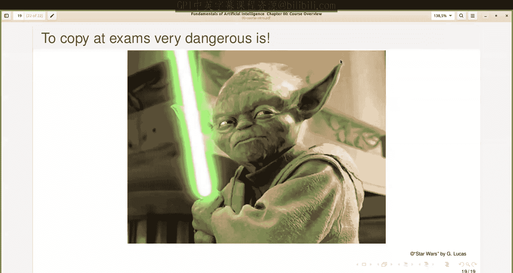
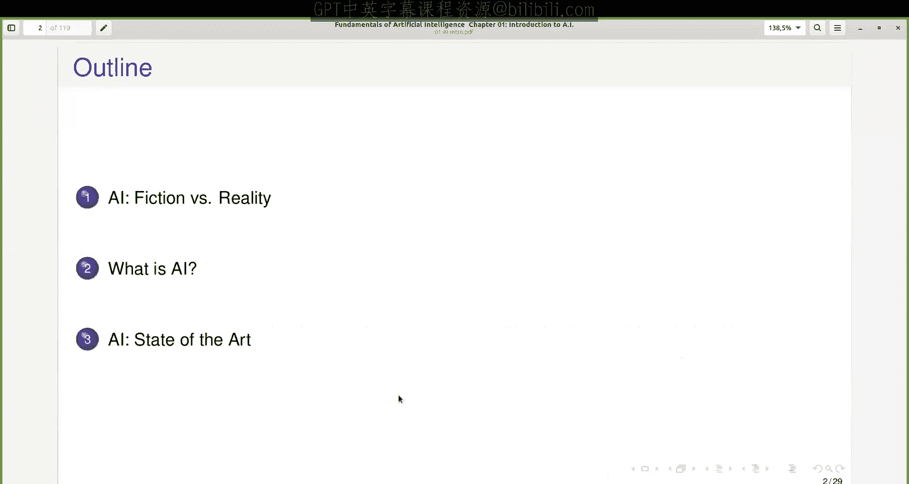
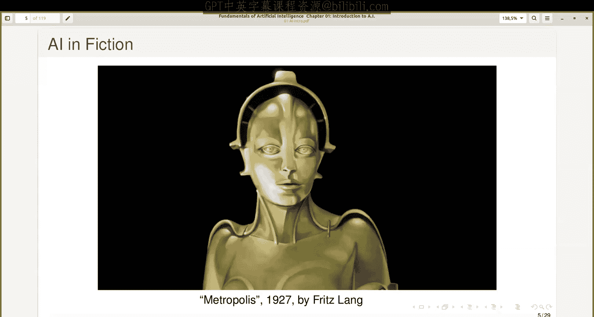
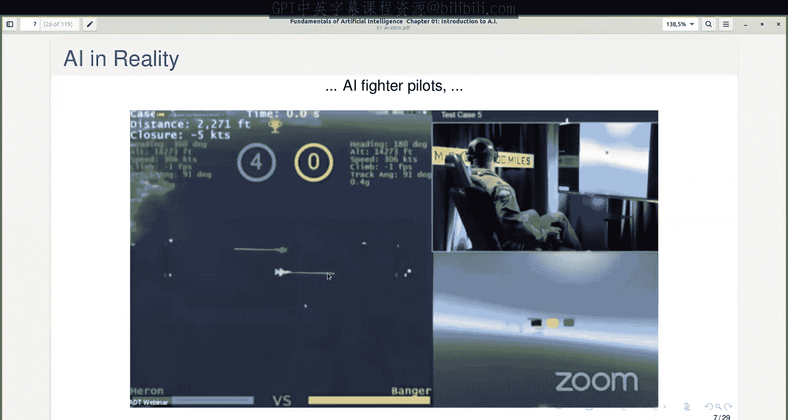
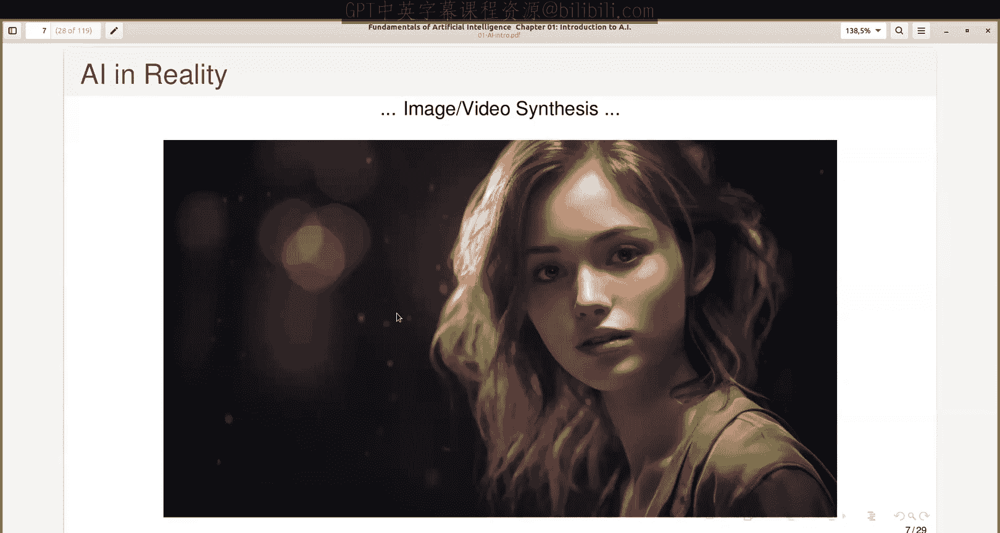
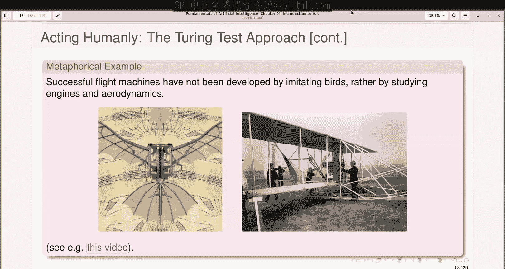
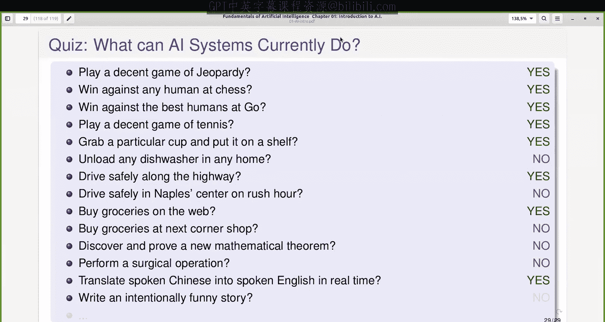

# 人工智能基础：1：课程介绍与人工智能概述

在本节课中，我们将学习本课程的基本信息和人工智能的宏观概述。课程将涵盖时间安排、考核方式、学习资源，并对人工智能的定义、历史视角和当前研究趋势进行初步探讨。

## 课程基本信息

我是Roberto Sebastiani，我将担任本学期的《人工智能基础》课程教师。课程将在第一学期进行。

**课程时间与地点**
*   **理论课**：每周一 9:30 - 11:30，在本教室进行。
*   **实验课**：每周一 11:30 - 13:30，在A104教室进行。请注意，“实验课”指的是习题练习课，而非上机操作。
*   **附加课**：每周五 9:30 - 12:30（或可能延长至13:30），具体时长将根据教学进度灵活调整。

**课堂与考勤**
所有课程均为线下授课，但会被录音。录音内容包含教师的音频、幻灯片以及学生的提问。请注意，录音仅作为课后复习的辅助工具，**强烈建议**亲自到场听课。课堂互动和与同学的交流对学习至关重要。

**办公时间**
办公时间不固定，需要通过预约安排。通常可以在课间或课后直接提问，如需更深入的讨论，请提前与我或助教预约。办公时间仅在本学期授课期间有效。

**沟通平台**
所有学生**必须**在课程Moodle平台上注册。这将是我们发布通知、课程资料和进行论坛讨论的主要渠道。

**邮件沟通规范**
为避免邮件被忽略，请遵守以下规范：
*   发送邮件时，请同时抄送给我和助教。
*   邮件主题请注明 `[Fundamentals AI]` 及相关具体事项。
*   请使用学校的官方邮箱（`name.surname@unitn.it`）发送邮件。
*   请保持礼貌与尊重。

## 课程概述与目标

本课程旨在为人工智能领域的学习打下广泛的基础。人工智能是一个涵盖众多子领域的“伞式术语”，包括问题求解、知识表示、推理、规划、学习、模式识别等。

本课程的特点在于其**广度而非深度**。我们将快速浏览人工智能的多个核心主题，为你后续的专业课程构建知识框架。你可以将其视为建造摩天大楼前打下的地基。

**课程涵盖主题**
我们将学习以下主题：
*   智能体与理性智能体
*   搜索与问题求解
*   约束满足问题
*   逻辑（命题逻辑、一阶逻辑）及其在推理中的应用
*   自动推理与规划
*   不确定知识下的表示与推理

**课程不涵盖主题**
以下主题将在其他专门课程中学习，因此本课程不予涉及：
*   机器学习
*   自然语言处理
*   计算机视觉与机器人学
*   人工智能伦理
*   人工智能哲学与心理学

## 学习资料与背景要求

**主要学习资料**
*   **课堂笔记**：课堂上讲授的所有内容都可能成为考试范围，因此认真记笔记至关重要。
*   **课程幻灯片**：可以从课程网站下载。请注意，幻灯片可能会更新，请确保下载最新版本。
*   **教科书**：强烈推荐 Stuart Russell 和 Peter Norvig 所著的《人工智能：现代方法》（Artificial Intelligence: A Modern Approach，简称AIMA）。这本书是人工智能领域的经典教材，其网站也提供了丰富的补充材料。

**所需背景知识**
学习本课程，你需要具备以下基础：
*   **数学基础**：包括指数、对数等基本概念。课程后半部分需要一些概率论知识，教科书附录提供了相关复习材料。
*   **算法与数据结构**：需要理解栈、队列等基本数据结构，并能阅读伪代码。
*   **编程基础**：虽然不要求编写代码，但需要能理解算法伪代码。
*   **布尔逻辑**：课程会包含相关复习内容。

## 考核方式

考核方式为**闭卷笔试**，时长为3小时。试卷可能包含判断题、理论问答题和小型计算题。

考试每年有五次机会：一月、二月、六月、七月、九月。如果对成绩不满意，可以拒绝接受并参加下一次考试，但请注意，一旦拒绝，该次成绩将永久作废。

考试**仅限线下进行**，无远程考试选项。严禁作弊，一旦发现将取消考试资格。

## 什么是人工智能？

上一节我们介绍了课程的具体安排，本节中我们来看看人工智能这个宏观领域。对人工智能的定义充满挑战，因为这涉及到对“智能”本身的理解。智能通常涉及感知、理解、预测和操纵环境的能力。

历史上，人们从两个维度来思考人工智能：

**1. 思维与行动**
*   **思维**：关注智能系统如何像人一样“思考”。
*   **行动**：关注智能系统如何像人一样“行动”或做出理性行为。

**2. 人类标准与理性标准**
*   **人类中心**：以人类的表现作为智能的衡量基准（如通过图灵测试）。
*   **理性中心**：追求一种理想的、形式化的理性标准，而不局限于模仿人类。

这两个维度组合产生了四种研究途径：

**四种研究途径**
以下是四种主要的研究视角：
*   **像人一样思考**：通过认知科学等方法研究人类思维过程，并尝试在计算机上模拟。
*   **理性地思考**：利用逻辑等工具，实现可证明正确的形式化推理。
*   **像人一样行动**：目标是让计算机的行为无法与人类区分，如图灵测试所设想的。
*   **理性地行动**：这是当前的主流范式。它关注于构建**理性智能体**，即在给定感知、目标和环境背景下，能够选择期望收益最大化的行动的实体。

理性智能体方法更具一般性，它将“思考”作为“行动”的一个子部分。同时，它更符合科学方法，因为智能体的表现可以被客观衡量和评估。当然，完全的“完美理性”难以实现，因为智能体总是面临计算资源、信息不完备等限制。

## 人工智能的分类与现状

除了研究途径，人工智能还可以从其他角度分类。

**强弱人工智能**
*   **弱人工智能**：指专门用于处理特定任务的智能系统，它们可能表现得非常智能，但并非真正拥有意识或理解力。例如，下棋程序、聊天机器人。
*   **强人工智能**：指具有自我意识、真正理解能力、能在各方面媲美甚至超越人类智能的系统。这仍是远未实现的科学愿景。

**通用与专用人工智能**
*   **通用人工智能**：指能够执行任何智力任务的系统，类似于人类的全能智能。
*   **专用人工智能**：指在特定领域表现卓越的系统，如人脸识别、机器翻译。目前所有实用AI系统都属于此类。

**当前研究趋势：符号主义与连接主义的融合**
人工智能研究历史上主要有两种范式：
*   **符号主义**：基于逻辑和符号表示，进行显式的知识推理。优点是可解释、严谨；缺点是难以处理不确定性和大规模问题，且计算复杂度高。
*   **连接主义**：基于神经网络和机器学习，从数据中学习模式。优点是处理高维数据（如图像、语音）能力强、效率高；缺点是模型像“黑箱”，缺乏可解释性，且依赖大量数据。

当前的研究前沿是尝试将两者的优势结合，发展**神经符号人工智能**，旨在获得连接主义的高效性和符号主义的可解释性与推理能力。

人工智能是一门高度交叉的学科，融合了哲学、数学、经济学、神经科学、心理学、计算机科学、工程学、控制论和语言学等多个领域的知识。如今，AI技术已广泛应用于邮件过滤、股票预测、自动驾驶、游戏、内容生成等众多领域。未来的一个重要方向是将AI技术与生物、医药、物理、化学等具体学科深度结合。

## 总结

本节课我们一起学习了《人工智能基础》课程的基本规则、学习目标和考核方式。我们对人工智能进行了高层次的概述，探讨了其定义、不同的研究视角（思维vs行动，人类vs理性）以及当前主流的理性智能体范式。我们还简要了解了AI的分类（强弱AI，通用专用AI）和符号主义与连接主义两大技术流派的融合趋势。下节课，我们将开始深入探讨具体的概念和内容。