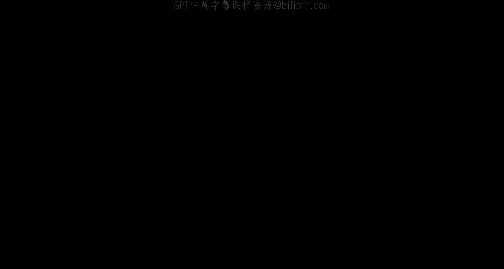
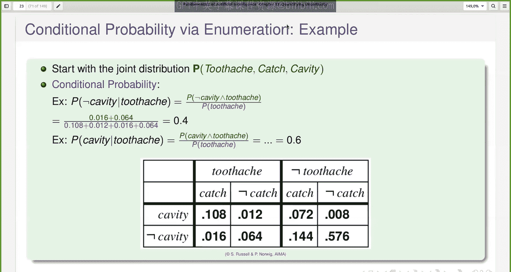

# 意大利特伦托大学《人工智能基础｜Fundamentals of Artificial Intelligence 2024》中英字幕deepseek p02 2024.09.11-CL02-1-CH13-Probability.zh_en -BV1uUkwYTEmf_p2-

So if you don't have a according， his， he。 Okay， not mind。 No， from no， okay。

Okay。So guys， please， I've started。And after I have started。I won't sign。ok。Okay， so。

As I anticipated today， we start reasoning or discussing about reasoning and as sent， which is。

A way to say probabilistic reason， okay？诶。I'm guess first to start to give you some general motivations。

Okay， so。We're in an agent， regardless an artificial or a natural one。

 asks for is supposed to take a decision sometimes it has。Incomplete information， okay。

So you cannot take some decision with the full information。

So you have two reason in terms under uncertainty， you're not 100% sure about the information that you have of the necessary information take the decision。

 okay？So well。You ignore know， there are other techniques in part to see which are based on belief states and this is something that well see in next classes。

 however。Okay， and those are some at least of drawbacks。Okay。

 so if you don't know what you don't know yet what the belief state is。

 but you want to find out taking a few weeks from now， okay？The key point。In general。

 you are not sure that you can guarantee a successful outcome for a action so you can。If。

Give a sort of degree of belief in the success of what you are doing。 Okay， and the the way。

Instrument that mathematics gives us。To represent， to formalize what we call this degree of belief is probability theory。

😡，Okay， so we reason in times of probabilities。Okay。So。The point is that so a rational decision。

 so depends on both the relatively imports of the goals that we want to achieve so they。

The revenue or the avoidance of costs。The of of every action。

 but also with the likelihood that we we can。Achieve that goal or not goal， okay？

And so is a trade off between costs and benefits， okay？

And the obvious instrument that science gives us to represent this notion degree of belief or if you prefer likelihood is probably the theoretical。

不。Okay， so。I will start。With a classic example， which probably I don't know whether you are frequent traveler or fly or not。

 but this a typical problem that everybody encounters that。 So how earlier。Shall we。

Leave when we have to reach an airport。P。With much in advance。Okay， so okay。

 here they make the case of a San Francisco airport because they are the authors are located in California。

 but so the point is， so let's call so。😊，Let's call apoic action 80。That is leave for a airport。

With the team minutes in advance。 Okay， so a 1000 means the living with 1000 minutes in advance and so so forth。

 okay。How can we be sure， So how early shall we leave for the app。Okay。

 well suppose you are driving okay， well here the scenario is you're in San Francisco you are flying to you are flying from San Francisco airportport。

Okay， so there are lots of sources uncertainty。 Okay， so you may have traffic。 Well， first of all。

 you don't know the road state。 you don't， you don't know how other the planes or other drivers。

You don't know， yeah， you can have some problems with the car or if you are taking a train。

 you can you are not 100% sure trains on time or if a train breaks or whatever。Okay， well。

 well while you don't have the full knowledge to that， yeah， you can look at the Google maps and say。

 okay， it seems everything is blue or oh there's some orange or red road or so。But okay。

 this is not 100% reliable， okay？And this very， you， we know that。Predicting traffic is very complex。

 so it gives something that cannot read done deterministically， okay。

It's very difficult to apply a purely logical approach doing that。

 So you have to think in terms of auristic， also typically based on increased experience。Okay。

 so you're saying。8，25。Living with。25 minutes is。Quite risky， okay。

Even though you think that 2 minutes could be read。Ordinarily reasonable to reach the airport， okay。

嗯ん。😊，Okay， you could have accidents， you can have traffic， you could have a problem with your car。

 not finding a park， a parking lot or whatever。Okay， on the other hand。Overca。😡。

Choices could be not advisable。Okay， so if you take if you wait 1000 for 140 minutes，你忘死我。

It looks like overcautcious， okay， you have nearly you probably have 99% of probability。

Of achieving the goal。ButOkay， you can stay。 So 1000 minutes is more than one day。

 So that's you have to stay overnight。 Okay， so was sleeping fine to take。So it's not very practical。

Okay。And so this was one example， but another example。😊，Is very， very practical。 And is typically。

Done by everybody who needs performing assignment diagnosis。But typical doctors。

 but also mechanical engineers。So diagnosis may mean to your body， but also to a car。

 to an engine to an industrial client， okay？And say， okay。So the key point。

 the typical diagnosis problem is that giving a symptom or a list of symptoms， okay。

 try to figure out the cause。Okay。And with a reasonable probability。Resally likelihood， okay？Well。

 and in law empirical pure logic， Okay， this is very difficult called。Okay， I assume sorry。

 we haven't yet touched the logic so far， but。I assume you know what implication mean and or implement。

Means， right， everybody。 So do everybody have at least a very basic。Theground in Boolean logic。

At the least thing。To understand an expression like that。So well， if I say toothage implies cavity。

Means if you have a twoth station， this means that you have a cavity Car and Italian Okay， well。

 this not really true there are many， many reasons why you can have。Toothage， okay。On the other hand。

 you could say， well， if you have a toothache， this means that either you have a cavity or you have a go problem or you have an access。

 Go means Jva Italian or you have an access or Yola。

 but you can have if you have two list the a longer。

You may have a least a very longer list of possible， so also many of them can be very， very。

 very unlikely。Okay。So， also， okay， so this is。What we call a diagnostic role。Okay。Giving the factor。

 try to fair the disjunction of possible causes。Okay， but also you may have， you may try to。En code。

The opposite sort of cows up。Ne France。Okay， you say， well， a cavity applies tooth page。 Well。

 not necessarily so。Tically big ca。Gs you a toothh button， not necessarily so。

Cavity and something else may may imply。Toph， where there something gas， maybe well？Caavity is big。

 for instance， or the cavity has touched the internal part of the teeth。And songs， okay。

So you see that it's very， very difficult to represent this in a deterministic way。

 this problem a deterministic way。What up so。In trying to specify this with the logical rules of in this case。

 bulloleion logic has many drawbacks， so first of all， it's complexity。We see we may have many。

 too many possible sources， too many possible effects。We don't have a complete theory of the domain。

 okay， so we don't know everything。😡，And。We don't have a natural knowledge of the patient in front of it。

 Okay， so， so typically this a good reason why。To a。Use a。And uncertainty。 so try to figure out。

Let's say， probability of the degree on confidence。Of one statement， of one possible diagnosis。

 for instance， or one possible outcome of some inference。Okay， and this there is a world degree。

 the world part of artificial intelligence， not only artificial intelligence。

 I study the fact of what I'm going to explain。😊，Was developed many of the things that I'm going to explain were developed much earlier that AEI was conceived。

 Okay， so is many of the things I。Be developed a much engineering in physics and in many scientific fields。

 much earlier than A yearI wasn't that。ok。呃。Okay， so probability is the typical instrument that people uses in order to。

First of all。To cope with some the uncertainty， which can do either to the fact we lazy in the sense that we cannot do everything。

 Okay， not that we are lazy in the sixth science that is simply okay it's too expensive to have a complete quite a complete knowledge。

Spense in the computational sense of that。And also that in general， we are imrant。

 we don't know everything， we are not omnicient， okay。

 so we try to get as much as possible information with respect whats the limitation of our knowledge。

Okay， where do we can derive the probability from， where typically statistical data。啊。

Doctors join since。In the sense of physicians are。Have lots of exercise to lots of statistical information。

About diseases， about the cause effect。So these， this combination of of causes causes this effect with。

85% probability， meaning。Over 1 million cases， these 850，000。Tur out to have this scenario， okay。

Don't confuse probability with the statistics， right。

 but substantially consider statistics as the best approximation one has of probability。

Statistic information as， so I know that in 80% of cases。Gene rate these a scenario。As long as I can。

The best thing I can do is consider this as a pro zero of eight。Okay。Is this clear？

Statistics is not probability。 Pro theory is a mathematical theory。

 very well fund very well structured statistics is。诶。

A way to use a probability theory to apply to the actual data we have。Okay。

 and more accurate the more data we have， the more accurate case。Okay。

 if you have a if you have a 80% probability or over one other samples。

 this is not a good approximational probability。 If you have a 80% of1 million sample。Well。

 that's more reliable。ok。So typically， we have statistical data from which we can assume probabilities。

 so 80%， we assume dot0 dot H probability。Some knowledge and this is heuristic so and here。

Is actually where what we mean by the experience of the the doctor。 Okay。

 so he or she knows that most of the case and she heurically quantifies this as。80%， 70%。

 50% of this scenario gives this lot information。And then combination off， okay。Okay。

Another important factor， which we。 So probability are not in terms in absurd terms。

But based on some state of knowledge。What in the probability theory is called evidence。Okay。

 so you don't。The probability that a patient has a cavity。Okay。G them the fact that she has a。

he or she has too such。Okay， so。Under the assumption that。This， this， this this， this happened。

 the probability of having this other thing is。Okay。😊，So what does it mean， So we arrive these。

The sort of logical expression， like the probability of a has cavity patient given as to phage patient is 0。

8。Or well， is this notation clear？Its a very first logic like， so we haven't yet seen first logic。

 but I think its reasonably intuitive okay。Even though we haven't yet seen the first of our logic。

Okay。So very， very important。 So typical。Or most of the time， pro is given under some evidence。

For a bit， blah， blah， blah， give blah， blah。Given that article and assumption by。Okay。😊，And。

 of course。With different science， you have a very different probability。Okay。

 so the probability that I have a toothage。Sorry， the probability data avo cavity in January is reasonably low。

But if Ive。AVery， very strong toothage。The probability that either cavities is much higher。Okay。

 okay， a perpeator interruptted。😊，Interform the back， please during if a classes has start， okay。

 and try not to disturb the rest of the class， Thank you。Okay， so is this there。ok。Well。

 of course the probabilities and proposition change within new evidence， okay。

 so the probability that a patient has a cavity， given that she has a toothage and the history of gun disease is 0 to4。

And that's actually the reason why you should when you go to the doctor。

 you should always give all the information to you。You have， okay。Oh。

 I forgot to say that I had a long story of gun disease。 Why didnt you tell me。Okay。

 so now that's important hiding information to anybody who has to make a diagnosis this is a very。

 very valid mistake and why， and that's the reason why because。Not knowing some assumptions。

 some backgroundground evidence may completely change the。The probability of a diagnosis， okay？

Thought the probability that somebody has okay。As a cavity。

Given the fact that has tooth age is in Ja quite high？But if my。A patient has a long story。

Of gum diseases。Then this probability becomes very low and it' is much more likely that you still have a committee problem。

 sorry， the gum problem。ok。Okay。How do you make a decision on？Well， typically it a compromise。Okay。

 so suppose you have this heuristic information that the probability of getting in time if you start 25 minutes in advance。

 well it' very very low， it's 4%。It gets to 70% if you start 90 min 90 meters in the mass。

If you start two hours， you get 95。But then you notice that they're increasing up2。

A ridiculous amount of time， so 1000 gets near to the certainty，You never know sapath。

 So you can have a correctionax in yourself， of course， but。But no。But so which action to choose？

And the depends。Depends on often cost and benefits。Well。

 I'm pretty sure by experience that if you have。To take。A train to Verona。Okay， from here。

 or if you have to take a flight to Australia。You take a very different attitudet right because the cost of missing a train to Verona is limited okay well I is I'm not taking a bus because I know I can take it the next train well so I take a reasonable amount of advance but not so much。

 but if you have a flight to Australia which cost a you 2000 euros。Okay。

 I'm pretty sure that you get that。Much earlier。And you even consider the cases， well。

 you may fail the train soul。When I by work， I frequently take intercontinental flights， I typically。

So my target is getting to the airport three hours in advance and I typically target four hours in advance。

 okay， in particular if you visit at a place like Mi or what I have which there are my many sources of concern。

But again， the point。Is the cost function， is the cost is the trade off between the likelihood and the cost。

Or the revenue or the missed the revenues in in one case or the other， right。

 So if what you lose is little well， you can take a decision with a higher probability with lower probability if the cost。

Is very high。 So you can take much in advance and。So is's it trade off for that。Okay， so typically。

You to do u you utility function。So how does it？What is the revenue you're getting on time or what is the cost of not getting there on time？

😡，Okay， so what is the。The cost of missing。And if you have any alternatives。

 what is the cost of choosing？During the course， we see。Decisions， so games。

And there are uncertainty。 Okay， so how to play。Strategies to play games with the some random component are eized。

Okay， and youval wait。The scenario scenario and this is。There is aity。

 The only difference that you don't have anyity here is just the or you can pretend the aity is the environment is the bed lucker。

Okay， so you have a combined。There is a whole discipline plane， which is， of course， decision theory。

 so how to make the right decision， which and this is also starting not only in myI。

 but for the recent in economics。In engineering， in physics， and also in biology。

That tells you the right criteria to decide a given。Sstananttiial combination to facts。

The likelihood of the different outcomes。And the cost benefits。😡，Of every outcome。And typically。

 what you're trying to do is a combination of it。Okay。

So what you are trying to figure out is the maximum specivity。So an agent is ir rational， if and all。

 if it chooses the action that yet the maximum expected utility averageveraging over the possible。

The possible cost。Beware that some utilities are not so。Obviously， utility。

 So you have to to really fund some utility function， which is really linear。

The sense of mathematical term， okay， with respect to your actual benefit。Okay。

 Ill give you an example， do you think that money is a good utility， Jad？Most of you will say yes。

 okay， and we are tend youre tended to say yes， but beware。Beware。That's typically money。

Has a utility which is not linear with a special amount。To give you an example。Support， I give you。

Two choices。Okay。U。You have a choice in which in I have no idea how rich you are personally。

You are a lucky man or a woman， and you can choose。You have two doors。 in the one， you get。

And you know that you can try。Do。Throwroid dies。And you should have to choose between two scenarios。

In one case。诶。If you get you flip it coin， okay？In one case， if you。Have had。YouYou win nothing。

And the the other key， and if you had the the what is cross， I don't remember the name， you get。

fi million년到 five million。Okay。In the other case。Okay。If you get head， you get $1 million。

And if you get the other， you get $2 million。So zero against the five。With a coin against one。

Bsses to。What would you decide， So which option， which game would you play the0 against the 51 of the one versus 2。

1。You want this to and notice that overall， you consider the average if you consider money as an average venue avenue。

It was more like0 do 5 was more theoretically more advantagedous。 But why is the case。

 the point is that。The gap。Passing from $1 million to $2 million。Or to $5 million dollars or euros。

The actual revenue passing from one to two is much lower than passing from zero to1。Okay， so I mean。

For me。I would be I would have a significant increase of quality of my life is if I earn a $1 million。

 I guess everybody of you right， but probably if you already own 1 million dollar。

The revenue having one more billion dollar will be much lower。Then from zero to 1， you agree？

So beware of money as a revenue because it's not linear typically。Okay。

 I can play you several other examples。Is it clear。

 and this is something which police is very well known to economists？做。Okay， so。

Be careful what is your way of completing the expected routine team。Okay， this say。啊。

I questions to you。How many of you have。Never studied。Any probability theory。So， you have all。

Started a little probability theory。Your life。A little much more。

 so probably I want to recall some basics Okay， so if you are bored to death and the next half an hour well。

Sometimes it happens， okay？I will just recall some。Basic notion of the probability theory。 Okay。

 so okay。So the idea is that when you have a prota session， you want to say how some。Fucks。😡。

Or if you prefer a possible word or state of a possible state of war， how likely this is， okay？嗯。Oh。

 notice。When you we say state of the world， state of the war is something that involves a lot of parameters。

 huge amount of information， right？We are implicitly restricteded to the。Information。

 which is relevant for you in this problem Okay， I'm not depicting the state of the world including every possible events in the world。

 including。Some people in Australia doing something driving his or her car or some strange anymore in Africa going left over right。

 Okay， so we are the war means restricting the notion of war that would the。

The parameters of interest， okay？What is relevant for our problem。Okay。

 so there is an implic assumption Okay， we are this coming as word， a state of the world。

The set of the values parameters or facts，Which are in some way relevant。

For the problem we are targeting。Okay， sorry if this is on。To you。

 But this is something that I have to say。So。😡，Under this description， let's say that。

What the sample space is the set of possible events， okay， the possible state of the world。

Regarding the。The part of the world， which is of transform from my problem， okay？And we call。Omega。

 small small cap omega， one possible word or a sample point or atomic event。

 So depending on the on the kind of literature you are looking at。

 you may find several different definition or different expressions to call it okay。So for instance。

 if your problem is analyzing the outcome of the two dies， okay， dice roll。

So the value one possible state of the world is a di in which the first dice is one and the second dice is four。

Okay。啊。The key point is that Mu rewards are state of the world。😡，The state of the universe。

 so are mutual exclusive。Look quantum东。No quantum theory here， okay？No shroddding earcuts。Okay。

Physical warm in the sense of classic war， okay。Shouldll I get this out of this notion？ok。

So for instance， the case of dice。We have a 36 possible words， okay。Two guys。1，1， one， two， one。

 three， blah， blah， blah， okay， 36 possible outcomes。

Note that every representation of the state is an abstraction is just restricted to the。

Relevant part of the relevant information runs。Okay。

 so I don't matter whether the dies the dye is the position of the dye or whatever， okay。

 or the location of the rotation is。What is the number he shows， he shows。

 and that's all the information I need。ok。So substantially。A probability model。Also。

 we call the probability space。Is a sample space。With a probability likelihood assigned to every possible state of the work。

Okay。😊，So。In the case for instance of one di old， I forgot to say， well。

 I assume you know what a probability is， probability is a number in between01。Okay。Extreme included。

Such that。The sun。Of the probabilities。Of all events， all possible elements in all samples is one。

Okay。Again， I apologize if I'm saying something which is absolutely known and obvious to everybody。

 but I。Need you knowing that。 So I will spend a。Ha an hour to recall those because I have to be absolutely sure that you know everything about that。

 okay？So the obvious assuming they die。Is not tricked then you can assume。

 for instance the uniform distribution P1，2，3，4，5，6 is one。

6 for each possible outcome state of the world okay。Okay。This comes。To the notion of event。

 which is not， which is different from the notion of a possible word or sample point。 Okay。

 an event is any subset。OhOkay， so in some way， I group。Possible samples， possible war。

 the possible state of the world， according to some feature of interest to me。Okay， well。

 for instance。The total of many games doesn't matter the value of dice， it matters the sound of dice。

😡，Okay， so if the value of interest to me is the sum， the total， the sum of the dies。Okay。

 then this is an event， so event is the sum is 11。Okay。Which has two possible。

 which goes one to two possible what。Okay。If I have seven， if my event is a daughter is a seven。

 okay？This correspond to six possible。Thanks。So any。

 any person who used to play board games knows very well that silent is the maximum likelihood and then 6。

8 the second maximum6，8 and then。And then9，9，5 and so as so all。 And that 12 and the two are very。

 very unlikely okay。So this is something that if you don mathematics in no experience in playing okay。

 so also for instance， an event is having a double。Okay， they hold the monopoly。

 if you have a double， you can read from the die。Okay， so is an event which has its own dignity Okay。

 and the probability， the sum or the sum of the probability of the events。

Which belonged to this sorry or the sample which belonged to the rent。Okay。Okay。

 so in this case it one it second case it is 16， okay。Okay。

 we haven't yet seen this notion of factor representation。Sstantially their representation here。

 the representation state is given as a。A combination of some variables and values to those variables。

 Okay， we see there are different ways of representing states and with the reward， but。

The key point is。That we have。 we typically use random variable， also called stochastic variables。

 okay so。And the following bottom。Randomva。 But we typically give a domain。Okay。

 the set of possible values。Qu one， two， three， four， five， six in case of dyes in case of weather。

 we can well。Say sunny rain cloud is no， Okay， well， of course these are obs， Okay。

 so there are different levels of rainy， different levels of sunny but。

Sa the fact all is so some variables is all the falses or the two falses。

 something are thes they can have two or false values。And so on， okay。

And then they may have a probability， typically a random variable as a probability distribution associated。

Okay， so probability distribution gives the probabilities of all possible values。😡，Okay。

And we typically market with capital B， okay so。AProbative of X of x for all possible values。

 which for all possible value is given by the sum of the probabilities of all samples。Okay。

 which match that value？Okay， so the distribution probability of two dies over the summer two dies is a essentially well you probably well known that's two is two is one of 36 and also so going until you grow out of7 which is16 and then you go down the one to 3 so this is a probability distribution this looks like as a segmented be。

Okay。So that's it。Of course， the sum of probability。Of all the values is one。

 all the values for a random value is one， okay。Okay， so the sum of what possible values for。Is one。

 And remember this fact that the probability of x giving a value X is the sum of probability for all。

The event， which give that。W match that value。Okay。😊。

If I say something that is not clear as user interrupt， but I think that so far。

I should have said nothing new to you。Okay。Okay， okay。

 and here is the sort of nature with a boal logic Again， we haven't yet seen bo logic。

 but I think that you more or less have an intuition of what the proposition is。

 which is something which you。Is either to a fault substantially Okay， and can I assume that。

 you know the basic boolean operators or and or implication， even a leaf everybody。Okay。So呃。

We have a proposition a。We associate to an event you can associate to events an event to something which is as a rough。

 some proposition a， okay， here I mean following the notation of your book。

And which uses capitalized letters to represent events。

And locate like this represent the boolean variables associated with the event with intended meaning that。

Sly。Means is a boulevard， which means capital A is true。Okay， this is just notation。

 I'm adopting you there。The notation of your book。Okay。OrI use a capital locate order。

With it for a booleion variable。And ODD， capitalize ODD， represent the event。

 we've been intending the ODD is true。Okay。Which also means that not a means capital A is false。😡。

Okay。And so on and say A or B means small K or small KB means that either either capital A is true or sorry that capital A is true or none this gentlety way capital B is true。

Okay。Clear out， everybody。Okay， yes， this is actually what I just say， right？Saw them。Okay。

 you may have。 Okay， I forgot to say。You may sometimes think an event as sort of a function over the space of the land。

 Okay， so assumption assumption which maps some state of the world into two or folds。

We typically drop this functional mutation。 We drop the omega part of that。

 So we shortcut the big as a of omega。ok。But to remember that a is。

A function of the state of the world of the state of of the samples of the state of the worlds。

 which are currently true。ok。Okay， or whoever knows about the logical or sample points can represent as Boolean models。

In the Boa sense， okay， so there's one to one correspondence to that， okay。So。In咯。

Could this just saying that you can say any boolean， when you have a complex event。

 which you can represent as the Boolean combination， a Boolean formula。

 which is of some event variable。You can think as the thisjunction。Okay。

 of the scenarios of the possible points in which this is true。So when you have them。A or B。

This is either not A A is false and B is true。Or a is true And B is false。 Or A And B are more true。

Okay。Which means that since those are discrete events。Remember imp probability。When do events。

Do not share any sample。They probability sums so okay the or of these two events is the sum of the probability of those events。

Okay。So the probability of a or B can be seen as the probability and not A and b plus the probability of a having a both a and not B and both any。

 okay， so we have three cases， you have the sum of three probabilities。Okay。

 some where no facts about probability theory is that the probability of the ne is the component of versus one of the probability。

 okay。And the probability of the or is the probabilityb n of a plus the probability of B minus the probability d of A and B。

Okay， this comes to from the definition。嗯。Everybody， clear， everybody。Okay， so。

Let's see probability distributions， okay， I will say that probability distribution is something which it tells so when you have more than one possible values。

 okay you have a probability distribution， so you have a description how the probability matches applies to all the possible value that this random value can apply。

So for instance。The case of weather。Sunny rainy cloud is new。 Okay。

 you may have in jail a probability saying which distributed by an array once you have decided the ordering of the values。

 okay。You can represent this array of values。 Okay， we any mean that。

The probability of being Sun is 06， the probabilityor rain is 0 to1。

 the probability of B cloud is 029， the probability doesn't O win is0 being1， okay。Remember。

 and we represent。Probability distribution as capitalized letters with。

B bold capitalize letters again， I'm just following the notation from the book in a book。

Another fundamental notion is the joint probability distribution。

So you have more than one random viable。😡，And in general， the value of the some of some may。

Pain or not。From the values of some other and variable。Okay， and that's from done。

May depend or may not depend。Okay， in general， you can provide information of more than one random bar together。

Display what's called there。joint probability distribution。😡，Okay。

 so substantially you give a probability to all possible combination of values of the variable。Okay。

 so you have two variables like a weather and cavity。Okay， so what is the weather？Outside。

 and the fact that may have a cavity or not I in general， have。Enjoy probability distribution。Okay。

 which gives how what are the probability for？Any possible combination。Other values， in this case。

 I have four values。Or whatever and two values for cavity， cavity is a bo， okay。

 so this means I have eight values。Okay， the problem with having is a distributed。

And so with giant probability distribution is that they tend to grow。

Exponentially with the number of variables you are considering。Okay。

 there's a measure problem in in the。Is the problem in a probabilistic reason， Okay， so for instance。

 if you have paying bull variables， the joint distribution probability has two to 10% values。

Actually。The kind of information it required is two to the time。-1。Y minus-1？Can anybody see。

 So in general， if I joined this with probability。I need don't need all possible very for all possible combinations。

But I need only all values except one， why。Those people accept action。Yes。In general。

 the sum all of those valuess is one。😡，So you need。And my all values so indicate2 to then minus1。

 so which is not very relevant when you have it。Big numbers， okay。

 but when we have small distributions。Less informationally can explore this file。

And you we see that in many cases， we exploit this one。Okay。嗯。Okay， so in jail sometimes。

We have the information which is provided by as a。Joint distributioner。

 which is typically bad because there's lots of big table and's lots of information is very hard。

So one of the key point。😡，Other probability reason is try to decompose。

And try to figure out if you can't decompose this information in a way that requires us to reason you on much less information。

And we see。Pechniques and instrument mathematically instrument answer tool。To do that， in particular。

 one of the fundamental instruments is based in networks。

 which is the topic of the chapter number 14。啊。Okay。

 I just to mention at the point of continuous probability is that we are not going through that。

 we are not used， but sometimes we have continuous variables。Okay， so and we have a density function。

A density function is a function of which co is a01， which in general。

If you have a continuous volume about the value。Is from my to to plus unit。 Okay。

 and we have the sum function。Which represents the probability with the constraint that the integral or this over the wall。

Aes。Is one。Okay。😊，So for instance， we have a union， you could have a union density。

A uniform density between 18 and 26。 So we have。Aectangle here。Such that the value。

 any value in between 18 and 26 is0 125， you notice that the area of this is one。Okay。😊。

He a much more famous distribution than the Gosian distribution is。A substantial。

Everywhere in in probabilistic theory and this very strange function as a feature。

Which is parametermetric in some parameter sigma and mu， which is the mean and sigma is the variance。

Okay， but no matter what this function as an integralte， which is one。Okay。So。😡，In general。

 the probability， so you don't say a probability to having one single value because one single value has。

What's called nu measure。It is 0。 Okay， if I。I say so suppose I put this object here on the table。

And I save the probability that I。P this by ex move this point。😡，你这样。

Which may sound a counterinitive， but at this point。Its something we just do dimension mention。ok。So。

 as a。So the ratio between all the possibility and that point is infinite， okay。

 so zero one over infinite， which is zero。Okay， so what's called probability theory is called the null value or the null sun。

😊，Okay， so in order to reason in terms of probability， you need an interval。

 So the probability that I put this object in between here and here。Okay， that's。

And knows the probability。Okay。Okay， so the probability Sutia is the integral between the integral of this function。

😊，You can also discuss about the density， which is substantially the value there of the function which can be seen as the limit of dx over zero of the probability of the probability within an interval。

诶。Over the size of the talent。Bought to brought it to the limit to zero substantially in this case this point here。

 in this case the are those points here， Okay， I'm just mentioning this because we are not really using。

Okay。Just know that you exist。Okay， I think I can have a。

 let's have a 10 minutes break and then you go， okay。Let's resume at 40， okay。Pak。呃。

What made be address。Instead that this room is bigger is big enough for you guys。

It may be the case that well， I double about it last time I read the chair。

So then from next week Wednesday， you have a lot of classes。

But could be a good idea that explained over last year if you' just statement in this part。

For two who leave， so you。I tend to be on the right box， but I don't want to。

But here you have also the the light is here， the light is。Okay， so I think you can be going this。

Okay， so my suggestion is that you need。真的可以。那是。Yes you。How are are you？They say some。what仲 say。

So zero drugs。嗯。比说。你可以啊。分な。喂。可的。は。Okay。Thank。😊，Down here， we are going this stuff。你。Okay guys。

 let's restart started。Sorry， guys。When I say we are going to start， I mean it。Okay。

So we are going to restart meaning， meaning shut up。Okay。😊，Okay。So。😡，呃。Another。

 fundamental factor which matches what we have previously said。Is the notion of condition problems。

 Okay， Okay， first of all。Standard probabilities are also known as the unconditional probability or prior probabilities。

Just。Represent degrees of belief in proposition。In absence of evidence， Okay， in general。

 the probability I have two。So among all millions case。Of people having a to feature。

 regardless what other conditions may be I the。Over 2 million cases。诶。16600 people at a tooth page。

 okay， so all these probilities blah， blah， okay。So this is absolute unconditional or jargon prior probability。

Okay， so the problem of cavity is 02。 the the problem of total is。

Is 1/18th so total is 11 is 1/18th and the paral and a double with ice is one over6。

 so nothing particularly fancy okay。啊。Very important instead， is conditional probability。

 very often or most often in prim theory， we deal with conditional probability or probabilities。

Under some evidence or under some assumptions。Okay， so。Which is also called the B over a。呃马。

Byer beef。Okay。So。Which read prohibit bit of a given B or under under the or assuming A B or under the evidence of B。

Okay， where B can itself， some A and B can either。Bing would part were awesome。

Complicate description of some events。 Okay， they can be some also some mu combinations of variables or whatever arbitrary complex ones。

Okay， so the evidence is represents of the B part here。Represent the information that we already。

So under the fact that we already know all we or weas， we know。Okay。

 so under the assumption that the B holds， then the probabilitybative A is blah， blah， blah。Okay。

So the pro of cavity given to ph is 0。6。Which is， of course。

 typically much bigger than a probabilitybioc cavity。Un surprisinglyurprisingly， right， because well。

 probably is a source。So probably so the cavity is one very likely source of a toothage。

Or cause of toothphaage。Okay。呃。Notice that this also means yeah， when you have a list。

 this means also what is not there， so we assume that no other information is there。So we don't。

 or at least we don't， well， we don't have any information on anything else。😡。

Because it's sort of like。We said the problem of total lot。😡，Is 11， okay？

But the problem total given the fact that die one is five。Is 1，6， because the only possible event。

 the only possible， sorry， sample。That gives us is the fat die2 is six。Okay。So。

So notice that this increased this case。Typically， the。

The condition probability increases if the condition is related， positively related to the event。

 it decreases if it is negatively related。Okay。😊，诶。So what is the point here， You restrict。

The sample space。To all and only， the cases where。The condition， the B part holds。

 and then you analyze the fraction of events。Of these reduce the sample space。

 So you reason want to reduce the sample space so to say。ok。😊。

So youre take the set of possible wars or events or whatever samples， however。

 you want to call it to where that is。There are some obvious facts。😡，So， if。

The condition is that a conjunction in which you have also itself， then obviously probability is one。

The fact that you have。A， given the fact that you have blah， blah。

 blah and a is always one A causes deterministically a。The fact that you have a， given blah。

 blah blah， n， and not a is obvious zero。Because not a he's incompatible with it。Okay。Again。

 sorry if I say something which is absolutely obvious a lot， I want to be sure that this is obvious。

Okay。诶。Okay， so these are obvious some cases， okay。So notice that。If I say， okay， peak cavity0。2。

 so I know。At the beginning， I know this for statisticsistic。

 the probability that one sample pair peak cavity means that the probability that I。

Take any person in the world by by chance forbid that in this moment， he or she has a cavity easelah。

Well，0 to2 exercise is a little pessimistic， but however。However。

 so I know for reasons that if I pick anybody the world by random and he or she has a cavity is 02。

等呢。I。I have the extra information that the person I pick also has suffered a tooth page。

Then of course， the probability is much higher。Because cavity is a very typical source of of a toothache。

 okay。But notice that the fact that high quality this information。

Does not affect this information here。Okay。So remember that when you want to say something about a probability。

 you have to really clarify what is on the left of the bar or what is right on the right on the bar。

Okay。There is an implicit fact that the API probability is the same ever。Probity of a given through。

True is something it is obvious true。 So this is the non informative event。T is or withdraw， okay？

Now， sometimes there is some external inform， oh oh， sometimes we represent with the commas。诶。

As a listed event with an implicit assumption that is considered as a end。

So if I say peak cavity given2thH comma 49 as win means that peak is the same as peak cavity given2thH and the 49 win。

 okay， so also this is just a notation。So sometimes。

Some information that we will discuss this detail later is completely irrelevant。

So you probably understand that the probability of having coveredve in given a toothage。

 given the fact toothage。The David Du and well the 49s are famous was San Francisco。Football team。

 Okay， everyone one。Its very it's very unlikely that he has。Cause me。A cavity， Okay。

 this is somewhere relatable cavity。 so it's reasonable to assume that it is the same that P cavity given to age。

Okay， so that this。Potiins had no role。In my cavity。Okay。

 this is what we call conditional independence and we'll analyze this later on detail。Is okay so far。

고。Okay。Now we have a definition， okay， we have just given a newtuition of conditional probability。

 and now we have a formal mathematical definition。Conditional probability is defined。

Of a given B as the probability of having。A， the event A and B， so that in both event。😡。

Divided or under the assumption that the probability of B is a noze zero。

 otherwise this is not defined。Okay。😊，The probability of having a given B is given as the probability of having both A and B divided by the probability of having B。

Okay。诶。Notice， by the way， that。This means that the condition probability PA and B is always greater regarded than the conditional probability PA。

Be of giving me。Of very given B， because remember that POB is always greater equal is more equal than one。

ok，所。Is this obvious？The B of， B of A， given B。Is over greater of equal than P of a。诶。Giv B。

 because this denominator is smaller equal than one。Okay， but definition finish is appropriate。Okay。

 one E for B is absolutely sure。Okay， notice that this prohibit can be written in a different form。

As a multiplication。Wwhich is actually the source of the problem okay so many people use this but the original one so the one mathematical the well funded one is this。

 so the P of having A and B is can be seen as the probabilityal A given B times P of B or equivalent。

Remember that the A And B doesn't matter the order of A And B， Okay， or the the probability O P。

 B given A times P of A， okay。Not these of this and the assumption of the POB and POA are these are the same correction。

ok。Okay， so this is single probability， but this works for wall probability distributions and this is very important and invite you to pay a little attention。

We say。A giant distribution。OfP of X and Y， where X and Y are to random variables。 Remember。

 they may have multiple values。Okay， is given by a special form of product which I'm describing now。

 which is the pro of x。 So the joint distribution of P， sorry of the conditional distribution P X。

 Remember that you have conditional distributions。😊，Okay， given so for all possible。Values here。

Okay of x and y times B of y。Okay。😊，What is this product， Beware this product is not a matter。 Okay。

 in general， remember that it is。It's the Bush our tables。Okay， I to beware。Those。

Prob is not the matrix multiplication。Rather， is the combination of all pairwise combination of all values。

Okay， so what is the point here is that every。Value for every value of x in every value O I。

The element。Of a P X， Y is given by the single product of the P of value of x divided by given value Y times probability bit of that value of Y。

This is not a matrix multiplication。ok。just pairwise multiplication of elements。

Its a matrix in which every element of the is a table， sorry。

 in which every element of the table is the parawise multiplication of the value of the probability of their values。

Okay， so for instance。B weather cavity the。The joint distribution of weatherath and Car。Okay。

Can be seen as the product of the distribution where the given cavity times a cavity。 What is this？

Remember that。Its simply air。4 by 2。tableable。In which every element。So the coordinates。

 so suppose that x so the vertical x is given by the cavity values and the horizontal value is the weather values。

 okay， so cavity times value every element。Is given by that。So for instance。

 say the element in which cavity is true and weather is run rain， sorry。Okay， is the product？

Of the probability， of the joint probability of rain given cavity true。Times are probably located。

Okay， again， don't mislea this with the。Mathes multiplications。ok。😊，Okay。

 so we have all the possible eight combinations。Okay。

 be careful because now we are enteringning something， which is very， very important。

 which we use several times。Which is this so called chain rule。Chain rule， okay， so。

We have a suppose we have a distribution some n variables。X 1， X 2， X 3， X 1， where X。And in general。

 every X can have a given a given domain， not a necessary bull。 sometimes it will。

Typically use Boan variable because this is typically simpler。

 but you can have arbitrary amount of values。Provided they are fixed and discrete， okay？ok。

If we apply the。The previous rule。Yeah。😊，You have that， the John Dis Xa X。1， okay， we factor out。

Ex one sign， well， we see X X as at the end of one single。If fact okay。So， we factor out。This。

 and this can be written as probability of the x1 until x1 n -1。

Time times probability of x n given x1 x and minus1。Are we okay with that？Okay， we just okay。

 this is just embedded in order。 But remember， the the product here is。Is is symmetric， okay。

 so it doesn't matter which， which order you write it。And with that so far。

Is the first row clear everybody？Okay， so substantially。

 this says that the joint institution probability is given by the joint mis。😡，Over the other Bible。

 so with the probability of ex， given the values。Of those times。

 the probability are having every combination of those values。Okay。

 four have any possible communication。Are with that so far？Okay。

 but then now we can apply the S processor acus。Okay。

 we have this one here and we can apply the very same。Approach this part。 Okay。

 so we substitute P of X1 X minus1 to P of X1 X minus2。 So we eliminate。X1， X minus-1。但系 x n minus y。

Given x1 and X M -2。And so on and so forth。And we applied this iteratively。😊，And think we have。

The product。So I going from one to n。Of the probability of Xi given all these predecessors。

Not is the very last one。😡，Okay， sorry I equal one and will be happy。Will be a prior probability。

So it will be a P of distribution P of x1 times P of x2 given x1。Times give X 3， give x2， X1 times。

 Okay， blah blah blah blah bla。This is called the chain rule。😡。

A joint distribution probability can be written in this form here。What is the advantage of that？

I' notice that this does not depend on the order of the variables。 So can I use。 So all this。

The probito X1x Comx2 is the same of Probi x2 Com1， okay。

 so it doesn't matter the order or the variable。And you can choose yeah。

Smart ordering of those variables。Well， apparently this does not cause any advantage。Okay。

 but in may。Make a lot of difference if sum of those probability。

Do not really depend on some of this part。😡，The case or we see the case before， like the 49 as。

And this is the main idea which is based on which the Bay network is based upon。

Which is something that we see probably next week。Okay。熟。😡，Is this clear？This can be see us B of x1。

Times P on of X2 give us X1。Times P of x 2，3， given x2 X1。Thanks， blah， blah， blah， blah， okay。

with her in the order you may like。Everything's fine with this。Just that one。Fuck。

You can see Boolean basic Boolean logic as a particular subcase of probability theory。

 this may sound shocking。But is a subca of probability theory in which you have either probability zeros or probability ones。

 probability zero is。Something is false， probability B1 is something is true。Well。

 you may or not be familiar with the。With these information aid， not daily。A implies B。

This is modest tolerances， Arrisots mod tolerances， if a and a implies Christ B you have B。

 this is mod， modus toleranceance， Aristotles， not B and a implies B， you can A。

This is transitivity to your implication。 if a implies B and B implies to C。

 then you can say that A implies C。Okay。If you say a。You substitute a with B of a equals one。😡。

And not a as b of a equals0。Then you notice that this boil down to the application。

Or other previous rules。Youve seen。 Okay， so this can be seen that sorry。

 I forgot to say that A implies B can be considered as B given A。Equal one， Think about it。

A implies B， what does it mean？That the probability of。B of having B， given A is one。😡。

So if that is a， if a is true， then B is true for sure。Okay。

 and then you can see is this either this？All those im here are nothing else that instances are the of the property that we' have seen before。

 or the popular conditional problems that we've seen before。Okay。Actually。

 most people believe that reason in terms of probability is computationally harder。

T that reasonable logic。Do you know when I already call you， you know what NP hard means， right？

And I guess you know what an MP complete means。So the case of MP complete。

 which are the border line between MPN andR okay， so bilogies were known to be NP complete actually is the NP complete problem。

Reasoning probiities believed to be isn't be hard。 There is no known upper bound。

 but most people believe this is hard， potentially hard。跟唔掂。Okay。不给。They said， how can we。Reason。

 there are many ways of doing so is very important when we have probabilities。

 how can we when we have a distribution of probabilities？What can we do， How can we do reasoning。

 How can we compute probabilities from other probabilities。

 How can we compute a complex probability from less a combination or less complex or conditional probabilities and so on and so forth。

Okay。嗯。We start that we'll see。Bns of a reason from the simplest the most sophisticated。

 So we start from very enough forms， and then we get progressively to more sophisticated ones。Okay。

This is the very， very basic is enumeration。😡，Enummererate values make sense over these values。

So you start from suppose you have a joint institution in some form。Remember。

 drug distribution is the table which gives a forever combination of values。

 what is the relative probability？For any proposition5， which is an arbitrary combination。

Can think a arbitrary combination of the boolean or the variables that you are seeking， okay？

Arbitrally complex one。Just make the sum of all possible。😡，ASample which gives you which matches。

With with the property， So this is the very， very na form of computing the probability of this fact。

 okay so。Supposeer。We have this joint distribution of。P of tooth toothage catch cavity okay。

 so what is this toothache well I have a toothache catch means that do you know what the catch is is this device that the dentist puts you to check whether whether there is a cavity or not right so it puts you and then it detects whether you have an o in your in your。

Youre tooth or not， okay？So catch means the catcher seal。Detect something okay。And cavki。

 you indeed you indeed have a calf。Ever。I would like you to notice something before you go either with this example。

Cavity。Is a cause。To future is a symptom。Even catching is a symptom。

 it's not something that hurts you， but it is something that is a consequence， okay？

Its something that you use to detect， but is an evidence， okay？

Try always to distinguish between these events， between causes and the candidate effectss。Okay。Okay。

 so I have a joint distribution of these three facts。 So suppose somebody gives me this distribution。

 Okay， Okay， since we have。enna here we have three billion variables so since we have only two dimensions。

 we are forced to use this three in whichever we make a columns which we partition according to the possible combination。

 okay， because we don't have n dimensions。Okay， well， I think the semantic of this is quite clear。

 like for instance， this value here refers to the fact that two stages is through a catches false and cavities falses okay。

 is the probability of these three combination events clear。Okay。Okay， so the idea， as I say。

 is that for every proposition， sum the atatomic event where Phi is through。Okay。

 so if I want to say， what is the probability here that either a cavity or I have a toothage？Okay。😊。

Well， how do I say this？I take the sum of all elements in which either of this value is true。Okay。

 to page， all those four values。To phase through。 So those are part of the game。

 but also those in which two phase4ities through are part of the game。 So I saw。All these six value。

Okay。And theres a result I get these， this sum here。 Okay， this is， of course。

 you see this it very na way reason。 Okay， but if I don't have anything better， sometimes say。

I just want to stress the fact that in complex systems， you really don't have a joint distribution。

 okay， because a joint is to or a joint distribution is something which is a exponential bit because the size grows as。

Doomain science timed as the product of the domain sizes， which is。Blows up。

 assume that every variable has at least。To value to possible values。

 okay then this means that it blows up exponential in the number of variables。That's the。

The measure problem that you we have to face when we do probability reasoning， okay。

 joint distribution are in general， exponentially bigger。ok。Are we our。Okay， now。

We get to something which is very， very important， which is marginalization。Or also known as sainga。

Okay， when， okay。We want to compute some distributions。Okay。In general。

 we want to compute the distribution of some variables。Regardless less of some of variables。Okay。😊。

So for instance。Suppose that y is only part。Or the variables。ok。😊，So suppose that in general。

 the variables can be in a partition to a group Y and a group Z。Or again， notation wise is。

 big y we represent all possible values of y， and the small capital ones are those which represent the values。

Okay， now if I wanted to find the compute distribution relative to only some variables。

I have to sum out。Marginalize or the other。What does it mean？

That I to make the sum for all possible values of the remaining variables。😡。

Of the value of given the given value why。And。The index value here are the remaining variables。

For example。If I want to compute the distribution of the toothage given the previous joint distribution。

How are dis， what is the probability of having a toothageion。

 what is the probability of not having a tooth edge？😡，Okay。😊，But the pro having a toothage。

Is the sum for all the possible combination value catching cavity？

I use capitalizeizer here to mean the possible combination values， okay？Of a peak of age， given。Okay。

Yes， please。Ks is a capital citizen。 Cats are not。See， yes。

 for all possible value of catching up catch here our event catches an。Yes， execute the point。

 so I will show you in the next slide。this means that you are considering all possible value of catch。

 H through catch falls， cav through K falls。In general， if you have variables which are not bullant。

 then you have to consider all possible values， so if you have a weather。

 you have procedures or sunny rain and cloudy。ok。😊，From there。

So you notice that those some can grow very fast。Okay。

I will first gr marginalization condition and let me show you some a couple of examples。

The same thing。Can be done by by when when we but。Rather than using so it can be done。

 but using a conditional probability rather than the joint probability。 and this is。

What we'll actually do when well see Belesian networks。Because many of them。

 we don't have information。In terms of joint distribution。

 But we have any information saying in terms of。A site over。Conal distributions。

Which for many reasons is much more convenient we see them in the next classes。In this case。

 so rather than using a P of y given inside we give the P of y given Z times Pide。

Sometimes we have the information this form rather than this form。And there's an evidence about that。

 so this is exponentially big。This is something which in many cases can be c reduced。Okay。

So for instance。The probaal I too。Can be seen as the probability for all the po combination of catch and cavity。

 so catching the true catch false and cavity through capicle， so four possible values。O。

Probity of twoage given。Catch through catch and cavity through。 catch and cavity falls。

 catch through cavity force。 catch force， cavity through。

 So 8 is four person times probability of catch through falls。 blah， blah blah， Okay。

 let's see this example。In particular。Margiinnalization， well we have this value here。Okay。呃。Okay。

 so。Pro me you， why？Is given by the sum of possible values here。

 So the probability of having a toothage。Is given by the probability of all possible combination catching cavity of toothh and then。

 but what are those value are those four values here。😊，You see that。

So the probability of2h is these four values。Catchching cavity through。

 not cavity through catch forces， cavity force， catch through， catching cavity ball falls。Okay。

 so we have these four valuess。We came since we are completing the distribution。Of course。

 we can do the opposite and be of not to H is you have to compute。Okay， you could say， okay。

 I can do the same and do the sum of those。Is this something smart to do？

But you can do that and is correct。I made the sum of those four values。

But I already know this value here and they know that the probability distribution， the sum is one。

So it makes sense instead to cool， given the fact that I already know this zero to two。

It's just to do1 minus0 to two。Okay。Ive said， I make one difference rather than。Then then for sons。

Not this is sometimes right here we have four， but you can have the two to the end。Okay。

So P toth H is 0 to0 to8。Is an outcome， okay？Okay， now we don't have the notion of cavity potential so we can。

 Okay， so pretend that we we are given。两 ok 。So now our problem is given in this form here。 Okay。

 but suppose instead people give us terms of joint of condition condition distribution。

 So let's compute this condition distribution。 Okay， so P， not cavity to ph。Okay。So ok  so诶。

We can have， for instance， we can compute。The condition probability of having P of not cavity toothh as a P。

 not caity tooth times toothh。So we came sorry， no。In this moment。

 we don't have the way of computing this by marginalization， okay？In general， how can we。

Compute condition probability by inumerations。 Well， for instance， we can。Do we want to compute。

 for instance， the distribution probability of cavity given to F？😡，Which is very important to do。

 right？Why is very important is what an dentist will do。😡，I have an evidence。a decision。Okay。

 what is the probability that my patient has a cavity？

This is the typical thing that a doctor wants to do。Given。

The evidence given the symptoms as evidence。Okay。😊，Try to figure out the probability of the cause。

Give them a symptom to page。What is the cause with the probability of cavity？ok。Well， here， and here。

 you computed the distribution， so for instance。Probably of not canvity toothage。Is given by the。

P of caity2 such， given the probability of two such。Okay， what is the pro of cavity and toothage？😊。

Well， rabital cavity intofi is this green value here。The sum of these given here， right？啊要。

So I use marginalization。To compute this value here。What is the probability of toothage， again。

 I use marginalization？😡，So in this case， I marginalize only on one value。On on catch。In this case。

I marginalize only on， okay， only on on four value。Catching a cage cavity in cavity。Okay。

 so I use two meization。To compute the numerator and denominator。He wasn't get there。

Heres a question。What is instead， caity toothage。Well。

 you can do obviously can you can redo the same or just do the。

Explore the fact that the complement that this is the negation of the negated event。

 so you just subbottract。This two one。Okay， which is more efficient， of course。Okay。Okay。

 I think I can stop here for today。 And so I see you on Friday 830， okay。I have a question。

 sorry for you。How many of you have already seen everything I screen？

Everything you do that the distributional imization and。Okay， most of you。 Okay， that's fine。

