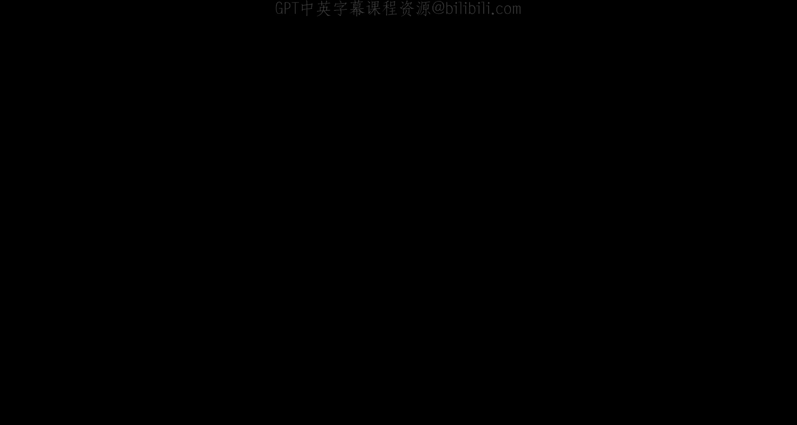
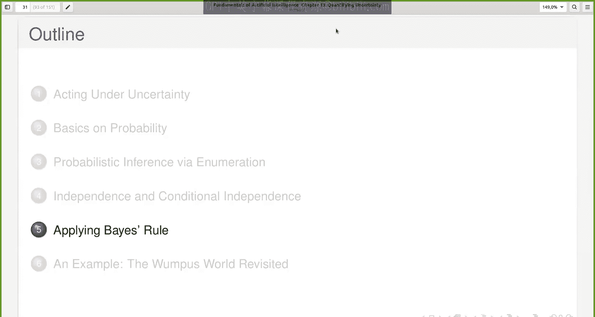
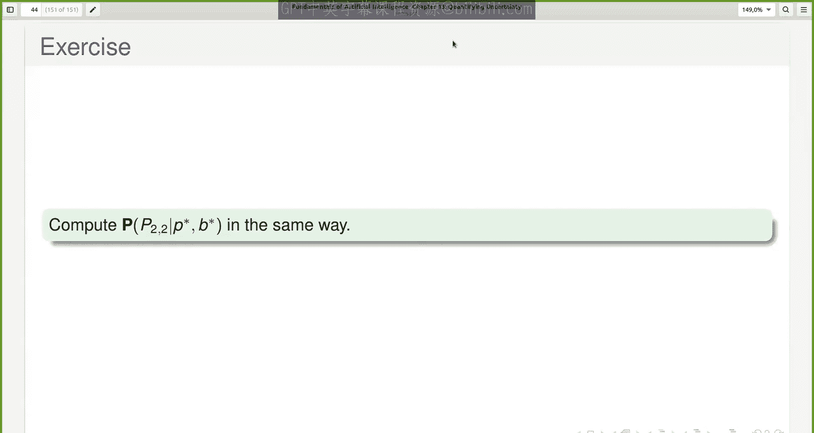

# 意大利特伦托大学《人工智能基础｜Fundamentals of Artificial Intelligence 2024》中英字幕deepseek p03 2024.09.13-CL03-1-CH14-ProbabilityReasoning.zh_en -BV1uUkwYTEmf_p3-

Okay， I think the last time we got here just let me just recall a couple things that I say。

Last this time。So。啊。We didt no， we didn't do normalization Oh， okay， so okay。Okay。

 last time instead we say we spoke about marginalization， right Okay， so I just recall it。

 so something important is marginalization。 So when you want to compute the distribution we are typically speaking about distributions。

 okay， probability distributions， which means both the probability for all values of of the given variables。

 Okay， in general， we。We are represented by capital bold arrays of a stochastic variable。

 I'm using the notation of your book so you'll find it one to one in the text of your book。Okay， so。

啊。The idea of marginalization is that you when you want to compute the sum。

The the distribution related。SomeSo a subset of bos。With respect。

Instead of all the possible variables。😡，Then what you end up is that you sum。

 you make the sum with all the possible combination of values of the remaining variables。

 they are also called hidden violence。Okay， so in general， if you have a distribution over y and Z。

 okay。They are not you。And you want to complete the distribution relate the statistical distribution。

to casting this sorry。Related to only why you sum up。Okay。

 actually some out technically is the world over all the possible combination of values of the remaining violence okay。

Which means that， for instance， again， when you have。Then the distribution toothage， catch caity。

 So you have the three variable， stochastic variables here。

 and you want to compute the distribution relating all to toothage。Okay。

 so the mean probabilityto having a toothache and probabilityto have of not having a toothache， Okay。

 what you do is do you。You sum for all possible values of a catching cavity means catch cavity through。

 through， through， through false， false， through false false in this case。

 of the distribution applied to the distribution of toothage and S notice that this is。In this case。

 this equation corresponds to two ari equations， one for two stage2 and the other for two phase falses。

Remember when you're dealing with distributions。Okay， you not。

 you are evaluating the values for the value of all possible values。Okay。😊。

And remember that in general， you need all computing all values minus1。

Because the sum of all possible values in distribution is one。

 you need to so you can obtain the last one as a subtraction one minus of the values of the previous combination of bias。

Is this clear？ok。唉。Similarly， you can do if instead of having the the food distribution。

 you have the conditional distribution。 of course。 So this is something that very often happens。

 for instance we think we see with the Bay networks。

That you don't have the distribution in form of a complete distribution because typically the joint distribution is。

🤢，Requires an exponential amount of data。But sometimes you have them in these smarter forms okay if so remember by the previous equation that this P of website side can be written conditional distribution。

 y given Z time time periodide and remember that these separations。A。

A not the metric separation and just pairwise product for all the possible venues。Over there。Okay。

And well last time we saw this example of reason in this case here。

 if we want to compute the sum over catch and cavity of P2thh。

 well four value2h and not2h okay so we compute the value for all those four variables here。

 we sum up all those variables here and if you want to compute for not2thh， we have two alternatives。

 one is of course we sum all these four variables here okay but you can do some this matter。

 since we know a distribution we not compute only one value。

1 minus one value of the distribution and the values are two。Okay。

 so this value here can be obtained by normalization。

 so by difference with respect to one or the previous one， okay。

I believe I didn't say anything particularly fancy， okay？So， we typically。

We typically represent valuess of distribution with these angular brackets okay。

 so this means P2th h min， which P2th H equals is true 0。2 and P not2thh means 0 to a。Okay。Again。

 this mutation is also explained in the yourbook。Okay， similarly for instance。

 if you want computer conditional probability。😊，So say。The probability of not not having a cavity。

 given the fact that you you have a toothache。 Okay， what you do is。

You by the definition of a conditional probability。

 you have a P of not having a cavity and having a toothache divided by the probability of having a toothache。

 And again， by sumooing out， you can have， you can compute both of them， right sorry。You can compute。

 the green part so not cveted with action。having not cavity。

 you sum out over the possible combination of catchching catch because this is the hidden variable。

variable， which is not part in either of the query。I forgot to say this is called T the query。

And these were quite variables， and these called the evidence variables。

And all variables in the distribution that are neither query nor evidence are called hidden variables。

😊，Well， this's quite intuitive， right？Cach in this case， catch。Okay， so for Eastern here。Okay。

 in red what we have already computed before right so so the peer2thh and in green we have the peer K toothh so by dividing them we have 0。

4。If you want to compute a p ca tooth nature， you can do in again。

 two ways or reduce the very same reason or do simply subtract 120 to4 minus04 okay。Okay， so that's。

That's a。So yesterday， I seem to remember that we got here， right， It's not yesterday Wednesday。

Am I correct？Okay， now I'm introducing something which is very， very important。

And for some strange reason， I've never understood most students don't。Don't feel like you。

Which is very， very useful and allows you to save a lot of。😊，啊。Steps， if you understand it。 So I。

 I really。Push you to use it as long as possible because it really is something which really many situations saves you a lot a lot of those steps。

It is normalization。😡，Oh okay， suppose， okay， let's say that the typical query。Okay， enjoy。

 suppose x Na x is the set of all variables and suppose this is divided into three groups。

 as typically the case， the query variables， the evidence variables and the hidden variables。

 okay which you represent respectively as y the query E， the evidence and the H， the hidden。Okay。

The typical query is something in the form probability of the sorry the typical problem is to compute。

The probability of sorry， the distribution probability member bold face means the wall distribution。

Of some query why， given some the evidence， some evidence， okay。Okay。

So compute distribution of having a cavity given the faster that you don't have a toothage。

 so it means toothage is false。Okay。Okay， so。Well。We know how to do that， okay。You apply。

B of y E given E equals E and no e。Is one over P E equal E times the food distribution。 So you the。

The first step is typically always to bring in terms of the full distribution。Okay。

But now we do something strange。We。Give a name to the numerator。嗯。So the denominator， sorry。

Let's call it alpha。 So let's call one over P E equals E。 Let's call it alpha。

Notice that in general this is not only one value， but it may be an array of values because depending on the values of E。

 so if you have only one value E，And you have one alpha， if you have many values。

 so this is more on array array。So you have one alpha for everybody you vehicles course。

That was there？Okay， now。And， let's。Take Arthur with us。Now you have the P of y e equal E。And then。

 okay， you expand by summing out this part here。 Okay， so there are some hidden variables。 So we。

 we make the sum over value hidden variables。 Okay， so overall， you have the the joint distribution。

😊，Or y given e equals E。Equals some parameter alpha。Times， the summ。TheThe suming out all the full。

 all the full。Distribution over， over the hidden variables。Okay。What about Alsa？And that's a point。

You don't need the key point。 The interesting part of that is that you don't need to compute alpha。喂。

😮，So you compute this expression。Remember， this is a distribution。

 so you will have it for all possible value of Y。You computed， okay， you do this on。

At the end of the day。Okay， but the result is not correct。He's。

Something which should be divided by alpha。But then the point is that you use the information that should be normal。

Okay， so what you get here is a distribution of value。Which whoses the sum is not one。Okay。So。

 complete sum。And divide the value。In such a way。That it will make one。

And that's called normalization。 So you compute the alpha。Not by computing some fancy probability。

 So this may take some time to compute， right？But you don't need it。 You just have to。

You don't need computers in as a probability。Okay， why。

 because you compute what is called a non normalized distribution。😡，Okay， a distribution。

 which is not normal。😡，So such that the sum is not one。

And then when you have done all the complex calculations。You have this non normalized distribution。

 and at the end of the day， you just normalize it when normalizing is easy， right， take the sum。

And divide or vegetable by the sun。Are we there。So why this is the case？😊，Sos档实业。You think to reason。

On is very， very frequent when we do。A probabilistic reasoning。

To make a complex comp to compute non normalized distributions。And not only other。

At the end of the day。When we have doneno， so we go ahead computing no non normalized distribution。

 Well， if you think no normalized distribution。So the further distributions should be normalized just a convention。

What is really important is the relative。6。Value of the the values combination。 So if I say。

The probability of them。Of running or having a sunny day tomorrow。Is 0。5。

And the fact of not having sunny day is 0 to5。All I say is 50%。And the other is 50% or simply saying。

Tomorrow， it will be sunny for。1000。 and will not sum for 1000。There's a matter， okay。

The point is that the relative proportion of the values。

The fact that the sum is what is just a convention。Of the probability theory。So the key point。

 and that's the。The a common practice of the。Of people doing a complex computation in probability theory。

Is going go ahead the reason you not normalized distributions。😡，Remember。

 a normalized distribution is completely informative。😡。

Because what is really important is the relative value。

Or the probability of the values of the variables， the combination of variables， okay？Not that day。

 the sun is one。 And then earlier day the other day。You make it one。You normalize it to one。Okay。

We see at the end of this chapter a complex example in which this will be quite useful。

Notice that in general， however， we have always。The problem。

 which is an intrinsic problem in probability reasoning that we have an exponential amount of data。

And distribute the probability。D distribution is typically requires an exponential amount data。

 exponential in the number of variables。Well， this is not surprising。

Reasoning in hoistic reasoning in Ja and NPhar。We see。How to cope in part。

those part with the several tricks， However， I just wanted to know。

 is normal the geo normalmalization clear。So， you should stand。So drop。

You drop the one over P of evidence valuable。Having value。 Okay。

 you drop it and just call it the alpha。You don't really need to compute this。

 notice that in general。😡，Compututer these may require themselves some complex summarization。Okay。

 maybe very， very long。 So， I mean， you should something out to all values， which are either。

 which are either the query or the。Or the hidden。 So it may take a longer sum to compute this。

 but you don't need it。You just compute at the end， you just name it alpha。

But name it's inverse alpha。Okay， and go ahead。That's very important。 That saves you a lot。😡。

Of steps。Keep this in mind。 I've very often seen people at exam taking。Forever。

 to compute this value here with very very longer complex sumizations。Instead of applying alpha。

The typical fact is， you。You normalize who respect one。Okay， so let's me。Consider the remember the。呃。

The previous example， okay？Okay， so suppose that the previous example， okay。

The distribution of P a cavity given too H， not that cavity is a capital。😡。

Laterter this means that I want and this is a distributioner。

 so I want to compute a both for a bit of of cavity given2 the equal through and probably a bit of not cavity given to the equal true。

Okay。😊，Which are actually the two values， which we have compute in the previous example。😊，Okay。😊。

Now we see how that we don't need to compute the denominator。Remember last time we did a simple sum。

 then we had the four sum of four elements in a denominator， okay？Okay， so be okay with toothage。

Let's rewrite this。😡，As a non conditional distribution。P cavity N toothage。

 or if you prefer cavity comma toothage， you cease to use the notation you like。单是阿法。

So you very often when you pass for a conditional distribution to a probability distribution。

 you just add one alpha parameter， which you compute in the second moment。Okay， and then。

And then reason in terms of the food distribution。Full distribution， peak cavity toothache。 Well。

 but that's easy。To compute， right？This is。The probability of you sum up with the catch。Okay。

 it's just two sums for every value。Okay， so is distribute the pro of caveVt tooth edge with catch and P of caveVt tooth edge not catch。

These are distribute， okay？So how do we compute this well。So。This is。You make the。

Use sum people cavity tooth edge catch and peak cavity tooth edge not catch。 Okay。

 so 10 and8 so this distribution is。Is this one， right？This distribution is this one。Okay。Remember。

 cavity here is capital letter。 So it means both radio cavity。So is the distribution is a tool。

Is a too tu。 Hes a pair， okay。Okay， now just to be。

I want you to familiarize with this notation of there this a distribution。 Okay。

 so represented this and this。 Okay， okay， then you。Then you sum up over capture。

This gives you0 to 12， so 1，2，0， okay。And gives you this gives you。0 dot age 64 plus 16 is 80。

 So 0 dot H， okay。0， sorry，0 dot 0，8， sorry。Okay。So what do you have computed here。

Is a non normalizedized distribution。But notice that this is a very thing。

So the fact that you have a。Conventional1。 So this means that substantially。The proportion of having。

A cavity， with respect of not having a cavity， is 3 to 2。And that's important information， right。

 the fact that you is normalized or not normalized is just a convention。Okay， are we there？

Then at the end of the day you normalize it， so when you have done all the relevant steps。

 so you have computed the distribution。The non normalized distribution， that is the interesting part。

The informative part。Then you say okay I'm done， you just need by convention to assume they are normal okay so well to normalize you just make the sum okay if you sum these two values here you have a02 so the ver of0 to2 is five so you have to multiply everything by five。

But I don't think I need to go when you want to normalize， right？This is quite obvious， I we say。

 right？Over there。Is this fair？So not if you compare to the way you have computed this previously。

Okay， you notice this that we substantially did not。

Need computing this fraction one divided by2 edgech。ok。😊，Yeah。Of course， if you wanted to compute。

By exercise， I leave you to do this opposite， not that this is a different distribution， right？

Cavity given enough to ancient。Okay， and least uses01 and09， okay。

I leave you by exercise to complete this。Are we there。So to sum up sorry if I will sometimes I will。

I will repeat myself， Okay， but I just a。It's just in the temp of a hammer。

TheSome some points your mind into your mind， right， So the point is。

Very often when you do you compute conditional distributions in particular with an evidence with a pointwise evidence。

Or twicewise means with evidence equals some given value you。Okay， you can normalize。

So you don't really need， well， the obvious thing is the typical thing that you do is to apply the definition of a condition probability and then raise。

😡，Divide by the probability of the evidence， okay。But the probability of the evidence is something that you don't need to compute。

 That's the point。😡，So the inverse of the probability of the evidence is something that you don't need to compute。

Okay， because it may take a lots of sums to do that。Okay， and you don't need to。

You just compute because they are just a normal factor， the normalization factor。😡。

So you compute the distribution as if。Take you this constant with you。Okay。

 and then at the end of the day。When you have done all the sumals。

Only then you compute and no normal distribution。And only when you have done it。

 you can normalize at the end。So it's like。How many of you have studied physics？

Your life at least once。Okay， so sometimes。Your problem is to， to deal with no no standard measures。

 Okay， so you， you may。Use kilometers rather than mes， you can use whatever。

Hards power rather than kilowats or whatever， right。

 So whats the first ruling in solving a physical problem。Convert everything in standard measures。

Units， okay， and then only you do everything in standard units。

And only the very last step you convert back in the or origins。Okay。I think that's。

Every physics professor have told you this very same thing that I just said， right， Okay。

 this is very similar。 So you go ahead in reason with a low normalized distribution because this is convenient。

😊，It typically allows you to save a lot of steps， a lot of computation。

And the only other because so conventions say， I so your problem is I need probabilities。

 something that sum up to one。Okay。So I will go ahead in doing complex computations。

Releasing this convention。And all at the very end of the day。I normalize。was there。Okay。

 we see at the end of this chapter a very， very complex exercise。

In which you see that you will benefit a lot of this fact。Okay。Okay， so far， any questions？嗯。

I have a question for you。How many of you。系。So was it okay， So what is。

Is any of you who has never seen some of the things that Ive explained？😡，So you know。

 you knew everything。No， no。 how many of you。For how many of you， there was something that。

That wasn't you。も死れ。Okay， so so it was not for many of you this class was not completely useless。

 okay， that's point okay。Probably you knew something。😡，But not everything， right， that's a point。

Okay。And the key point is that I need to be sure that at the end of this class。

 everybody knows all this stuff。Okay， you all come from different。The grounds。 Okay， so let me。

 let me give just a statistical check。证明。How many you come from a computer science？Degrreee， so yes。

B， not， well， even though you have not yet finished it。 I mean， B。

 how many how many computer scientists。How many computer engineering。ok对 ok so啦。Fine。😊。

How many mathematicians。😮，No multiple my here。W， that's bad。How many physics。Engineering。

Any other form of engineering， which is not computer science engineering。Okay。

 which kind of N just you us？Sorry。Management。Then。😊，What measurement is well？I'm a factory， yeah。

Yes。Does engineering。Automation， okay， any other degree， which I haven mentioned。Okay。😊。

Data analytics the data analytics。 Okay， so this something completely obvious to you， right。y o 好，系。

You can sleep you can sleep for next hour， Okay， so no mathematician， no physic。😊，Okay。Okay， again。

 let's go ahead and present other two milestones for probabil reasoning。

 One is the notion of independence， which is quite obvious and the conditional independence。

 which is a little less obvious。And then bi rules， which is very， very simple， but very。

 very important。🤧ok 。What is independent？Okay， so far。

 we have given this example here with a full distribution without。

Giving an intuition of the relative role of Alios。But。We say the two variables are independent。Okay。

 if they don't distribute， the probability is given。Equals the product of the single probabilities。

 okay。Susstial， they mean that they don't really interact with each other。

So the value of the probabilitybate of xx is just depends similarly on the probability of these values。

 okay？Okay， so。诶。The probability was in cavity and having a bad weather drought， really。

Have any interaction。Okay， or the fact that you have a cavity and that the San Francisco 149 minus everyone1。

 they match doesn't have really any relation， okay？诶。Okay， this is the definition。

 but probably the most interesting definition， I mean at least from my perspective， is this one。

So you said that P of x given y is the equals p of x。手术档案设历。The probability of X is。

For the probability of the valuess of x， the values of y are completely irrelevant。Okay。

 they have no role and the same fors。This aint for X and why。Okay。3at to body。

 I think this is quite well known。Notion， right。So everybody。Okay， so for instance。

 if take the joint distribution probabilitybitto tooth fetch catch cav weather。我 weather。Okay， well。

 it's not surprising if this can be seen as the product of toothh catch cavity and the pure weather there's not much relation between the fact that this is sunny and the fact that you in this moment have a cavity。

Okay。Nothing fancy， I think so far， right？Okay， and typically we。

 when we establish we formalize the problems， this comes from domain knowledge as well。

Sometimes dependencies are a little more less obvious than one may think。

 there are some dependencies which are subtle， okay， but in general， typically when you formalize。

 you establish that they should not be relevant。What is independent and what is not？Okay。😊，ok 啊。

Very good use。Why is important to establish in independence is very。

 very important because of dividing and conquer So to say。

 So I'm pretty sure that at least computer science and computer engineer have heard about the divide and conquer expression。

 right so。You have a problem。 You divide the problem into。Some problems。

 which can be solved independently。See， if。The amount of time taken to show each problem is worse than linear。

 theres always an advantage， and if is exponential， like in this case， this a huge advantage。Okay。

 we're there。Everybody。So。For instance。If we want to represent the joint distribution of these four variables。

 we have。To to the42 to the four so 32 elements。Okay， yeah。

 one is the game was it derives from the others， okay， fine， but we need just we need a 32 elements。

If you want to represent。If we know that this is an independent， we need。Actually。

 there's two values here and。Eight values here， actually only one here and seven here。

 so 31 value here。They game to seven plus one。value6。You see the huge advantage。So， trying to。

Understand that when you formalize a problem trying to partition the problem into sub problems。

By exploiting， the notion of independence， which is typically comes from domain knowledge， is very。

 very important。Okay， with there。This is the good news。

 the bad news its typical that absolutely dependence is quite rare。Okay。

 so apart and typically you solve a priority in an obvious way right so typically in depends you already start with the problem which you have already partitioned your problem into independent。

SSubite of variables。 So the problem as it's given to you， T does not contain variables。

 which are mutual independently because simply the people who have formulated it has already a partition。

 okay。So this is Ryan， as I said。What is instead more common and。

Important to explore it is what is called conditional independence。Okay， we say。That given Z。

 given okay， when I say x and y， given some set of variable z。We say that's valuable x and Y。

Are condition are independent condition， dependent give z， or also called the model Z。

Or if you want to say in the opposite day， given that。Ex and Y are condition dependent？If。P of X。

 Y Z given z equals P of X given z times P， Y， given z。Or written another way， so equivalently。😊，And。

😊，Okay， so this is the formal definition， but this is probably the one I use most。Is that。Given that。

 if you compare the facts which have a died as in the evidence， okay？The condition， sorry。Be of exit。

 given why indeed。Equals P of x Z。And beer。And P of y given z given x and Z equals P Y given that。

So叔tan actually。U。You呃。The probability of X given that is does not depend on the fact that are the values are y。

And the condition probability of y given that does not depend on the value of x。😊。

Notice that this does not mean that X and Y are independent。😡，But are independent given value that。😡。

Over there。This definitioner。Okay， consider for example， the case of a toothage cavity catch。Okay。

 do you say what the catch means means that I I use this catch and this instrument that catches in the so I reveal a hole in my in okay？

ok。So if I have a cavity。That the probability that the probe catches in it doesn't depend on whether I have a tooth edge。

Okay。The toothage is a consequence of the fact。That I have a cavity or not， Okay。

 but not of the fact that I'm able to catch in or not。Okay。

And also the fact that I have a whole is a consequent of the fact that have a cavity。😊，Okay。

So the probability of having catch given too fetch in cavity。Does not depend on toothage。Okay。

 so is it the same that P catchch cavity？Okay， and the same applies， of course。

 if I don't have a cavity， Okay， the be of catch。Toth such not cavity is equivalent of beer catch。

 not cavity。And of course， this does not depend on not too nature， of course， okay。

So we say the catch is conditional dependent of2ph given cavtive。

That is T of now let's see in terms of distributions。

 so here Ive written this in terms of probabilities， let's see this in terms of distributions。

So the distribution of catch not this variables or capital given two threat and cavity capital。

 so this means in all possible combination。Is it the same as the distribution of catch given cupivity？

And or that the P tooth edge catch caity is the same a tooth edge given cavity。😊。

Or P of tooth edge catch given cavities with two the cavity times P of catch cavity。Okay。

Is this clear？What is the point here， what is the typical scenario when this happens？

The scenario are。The case that two fetch and catch are to mutual independent effects of the same code。

So ever course。Which is the cavity， which has to。Co sequences。Well。

 one consequence is that you may have a tooth fetchch。

One con sequencer is that if you have a cavity and the probe can reveal it。Okay。

But these are the independent。So a typical scenario like that。

Of a conditional independence is the causal， the cause effect。Where you have independent effects。

Of the cavity， I cool。I cause effect1 and I cause effect two on I cause effect 3 as well。Okay。

 and in this case， they are moto independent。Model of the code。😡，Can they say。

The catch and cavity are independent。No。Not in general。They are independent。

Given the father that I have a ca。Okay。So if I don't speak a ca。

 the fact that I have a holding in the teeth and the fact that I have the two stage are related。Okay。

 because probably is that whole。Well， the。For sure， the proal have tooage。

Is higher if I have a hole in the teeth， right， But the point is。

 and that's important in reasoning in general。 The important is that that hole is not the problem。

 is a consequence of a problem。Yeah。Okay。Is this clear。So even when you analyze promises。

 you should always think what is the cause and what is the factors and very often we。

Even in practical problems， we tend to confuse the the cause with the effect。 Okay。

 and the the relation。The relation of the facts。Of course， in general。

 cavity and catch are not independent。Because of the probability of having a tooth sorry。Sorry。

 toothache and ca and pro and catch are not independent。That's important to understand。Right。

 because of course。It's much more likely that I have a toothtch if the cavity。

 if there is a hole in your teeth。B there's not。Okay， the point is that。

The whole technical SP is not your cause， is a consequence sequence of your cause， which relates。

the fact。With the fact that that you you have a cavity， which is the actual cause。哦。Okay。

 so it's like saying the fact that if you feel bad with the fact that that you're thermometer。

Shows 38 degrees。They are， obviously。Related。They're obviously not independent。Okay。

But the fact that they feel bad。And the fat that your thermometer reveals a 38 are both consequences。

 both effect of the fat that you have a fever that you have some sickness。Okay。

 the moment is just a a。Deterministic measure。Of the fact that you have failure。

 so don't confuse the symptom with the cause。It's very， very often。 So if you。Reader。

Discussion argument from people， even journalists or even politicians or even people that express opinions。

You very easily realize that many people。Do not distinguish a fat cause。😡。

And it puts relation the wrong order， so it's very important for you if you want to analyze the problem。

If you wanted to analyze you。If you will in charge to model some problems so that to be solved by AI systems。

 which is likely very likely something that you will have to do in your life after coming out of here is very。

 very important when you analyze a problem， you formalize a problem to understand this distinction。

ok。😊，Which we' see quite clearly when in the next chapter when we see Bay networks。Any question？Okay。

Well， the fact of exploiting a condition independence is very。

 very useful because it allows you to us to reduce very often lots of computations。😊，Well。

 not all the computation of the， the kind of information we need and the con the the。

The the size of the computation they before。Even from exponential to linear。Really。Oh really， well。

 some case， yes， let's see。😊，ok。I know， now。That catch， and。The catch and what it said， its name。

So cats in tooth each are independently around。Statistic condition， independent model。

Can I explore this fact？Well， what is this distribution P2h catch cavity？Okay， if I expand this。

 remember the chain rule。I can write these。😊，P tooth stage given catch and cavity。

Times P catch cavity， given cavity， times P cavity。But。Toothage given cavity is not。

 does not depend on catch。So this is P too fetch cavity， given peak catch cavity， peak cavity。Okay。

 are we there？So not surprising， right？Is the P of two edge given cavity because too edge depends on your cavity times P of catch given cavity times the source information which which a probability of the source information。

 which is cavity。Prob probability of effect one given cause。

 times probability of effect two given cause。Times a distribution probability of the course。Okay。

And we are。Okay， so how much information you need here well is an eight table。

 but remember by normalization， we need seven values， right？How much information do we need here？

Okay。This distribution， okay， but remember we need only one value。

We need the P2 edge given cavity and the P2 edge given not cavity。Okay。

 because the other be not too HR just the complement。Okay， so we need two values here。

Because the other comes from a complement。Okay。How many information we need here。2。s。

How many information we needed here， one bag， again。

 we need the probability of cavity because the probability of not cavities comes from complement。啊。

5 values overall， instead of 7。Any fact that if you check。I originally gave you this matrix。

 this table or the three components。 But if you look at them。

 you can easily see that they come actually from to。From these two metricses are just the product。

Of this。You can see a posterri in the fact that as you receive the next exercise， okay？Is this clear？

Why is say seven？Do one。Okay， now keep in mind that these are toy examples。In real life。

 you have problems， which you have。Tth of thousands or hundreds of thousands values。 Okay。

 so that you， you have a Bayes networks， which are maybe huge。Okay。

 and so you have to cope with that。Okay， so these kinds of reduction are dramatic。

So exploiting condition dependence is very important。

 also because conditional dependence is much more frequent than independent。Okay。

And even though it's more subject to reveal a priorityi， you understand the priorityi。

That some variables or the typical person understands a prior that some facts are substantially independent。

 but understanding condition dependent， a priori is way more subtle。Okay。So in jail。

Suppose you have one cause and n effects， independent effects。Okay， if you have， okay。

 suppose that all of them are abu， right so？😡，You have a。distributionist of course， effect  one。

 effect 1。can be computed as the probability of co times the conditional so the distribution probability of course of the cause times the product of the distribution of effects given the cause。

Oh was there。How much how big is this？😡，Well， this is 2 to1 plus one minus the user minus1 by normalization。

 okay？How big is this？This is one。And this is two times n。

So you pass from2 to the n minus plus  one minus1。To 2 n plus 1。Okay。

 so this is why when you model things it iss very， very important to understand what causes what。

 what is a cause， what is effect。😡，Okay， and we see this particularly in the next chapter with the Bayesian networks。

Which I bid exactly for that。Tear everybody。哦。Okay， I give you this exercise。

In which you recompute the very same thing in different ways and the check at the end of that you have the same。

Consider the joint prohibit motion described the prison section， to such to catch cavity。Okay。

 consider the example in previous case in which you have reduced the distribution of the product to fetch cavity times catch cavity times pure cavity。

 okay？I want you to compute separately。😡，By summarization， Okay， with some gap。Okay， compute， P2 H。

 catch cavity， pitchach catch cavity， Pach cavity， PO cavity， a P2 H cavity。佢边佢咪诶。So my sum up。Okay。

 well， it takes of time， but you can do that， okay。Then。

You have to recompute from those here to recompute a P of voltaget catch cavity in two ways。

Either is just applying the chain rule。And then， by applying。They really reduce the rule。

The simplified rule and check Comp the result。Compare the result between them and compare。

 and you see， if you have done everything fine。You see that this and this and this will be the same distribution。

Okay。😊，So yes， please。This difference。that's the point。

 this a verification of course this is obviously identical by what we say before I just asking you to compute them separately in the na way and check out that this is the case just an exercise。

 of course you say if I give you an oh， but they are obviously the same yes， of course。

 Okay but what I'm doing I'm asking you as an exercise to compute all this the element separately in the na way。

为 something up。Do that。Naive computation。And verify that they indeed are the same and they indeed are the same as this。

Okay， is the exercise there， Obviously， you would， this would be stupid to do if if I gave you an exercise to actually solve this。

 okay。But I just want you to do the knife thing just to check at the end of that。

The three ways of the two the naF and the smart array of computing leads you to the origin。Okay。Yeah。

Okay， so I think we kind of have a break now。And so let's resume at 45。Yes。我。一。嗯。有。Whats。啊。有我有。不道。系得。

是吧。Okay。你睇。😊，が 진짜。明白は。No。不会。It。哎。他是把这个也可以。嗯。

じ。2。嗯。Okay。Yes。Okay。因个我都发咧佢。是这样的。OkayI'm going some you know。W go。Okay， okay。

The weather weather with。Because a。This。M。But。你发人了。I love that but the name pure。呃，哎老你这里我是买意。嗯。Okay。

Firstt。诶司长师嘅佢率。C是我。どか。我。Of。By拜。hellello。Okay， but， can I mean the from a single。你 quarter quarterral。

So on。If shouldn okay。ぱ kept channel。ok ，唔 sell你你都 sell嘛小么嘅人啊。Hello。Re。Oh。

ok。Restock。ok。We。We see the last topic of the chapter， which is bias rules。

 which per se is very stle word， but has very， very important consequences。🤧。Okay。

We know the definition of a。So basically is's nothing else that applying some basic algebra。

To the definition our composition probability。Okay， it's very very straightforward， this says。

The condition probability of A， given B。We know， is a P of A and B or if you prefer a comma B？

Divided by P O B， Well， nothing fancy so far。 Okay， but then we， we know。That also。This。Okay。

 we know that this is also P can be seen as P or B of a given be of A， okay。

So if you apply two times the definition condition probability and just change the denominator。

You apply some basic algebra， but we see something which may sound quite surprising。

B of a given B is the same as B assume that PB is non zero， okay， but if b is0， the problem per se3。

EOkay， so I say B of A B equals P of B given a times P of very divided by P of B。

So it's a new version of the dependency。If you know the prior probability of A and B。

 you can compute there。Invertted dependency between two variable。

Which may send seems straightforward4， but this has huge consequences。Okay。

 in this distribution for well remember the distribution have nothing else that tables in which every point is is one of the prohibits below with the different values。

 then you have that P or Y given x equals。P of x given y times P given Y given given P of X。

And if you normalize it。See， previous case， you have alpha P of x given y times sp Y。

Keep in mind that。Depending if you have one single alpha only for one single value of the y。

 if you have more than one possible value of the y， you have an array of alphas okay。

They have a different alpha row have a different value of y。Okay。Okay， yes。

 different alphas from different edges of Y， of course， okay。Okay， of course。

 then can be also some version and there are some background evidence E。

 so you can generalize this P of Y X E is given by this P given Y and D times P of y given e times divided by P x given E okay。

So what is the this is just the same but under the conditional evidence okay， nothing fine。

 I think this nothing fancy right is quite intuitive this comes as a basic giic step。

Out of the definition of conditional probability。Are we there。

But there any question about this because this is where from the main belt？Okay。

 so what is the consequence of this， How can we exploit this one。Well。

This is one fundamental application in many， many application， which is converting。

Diagnostic problem。So is deriv diagnostic probability？From cow of Proly。So the typical you would。

Is the following。When are you diagnoses， when you' are doing some diagnosis？Either you are a doctor。

😡，Or you are an engineer or you are something which is。😡，Trying to see。

Why trying to figure out some effects due to some causes the fundamental。

Fuck information that you see an effect。And you want to compute a。

 the probability of a given cause being its core， okay？

So what is the probability of the cause given the fact that you see？In general。

 these can be a cause and effect can be arbitarily complex events。Okay。But。Tpically。

The problem is that typically， you don't have。This information。

The typical information that you have is the reverse。😊。

The is you have what is called a Ca probability， So you have typically what you have information。

 the fatigue information that you have is the probability of having some effect given a cause。Okay。

The you have statistical data of the probability of having fever。

 given the fat that you have in malaria is very high。Okay。哦。Okay。

So you can the mental application cause effect of various rules is that you can compute the probability or more generally the distribution or probabilities of some cause given some effect as the product of effect given cause times the probability of cause divided by probability effect。

Where that this typical information comes from， okay。

 peace cause effect goes from effect cause and these diagnosiss。

What is the probal cause giving this effect？You have。 you see the fact that you want to。

Try to figure out with width probability you have a given cause。

 what is the highest probability cause？😡，Of that。Right。😊，The effect。

The parameter effect goes from coast to effect and this is typically what you have。And。

Because a peer factor singularly， typically is something that you know by statistical data。C a啲信样有。

You have anex doctor， so in a hospital or whatever。Is much。It has good chances。Do。

Have causal and knowledge。 So to have knowledge of symptoms。Given a disease。

Which is a fact a given cause。Either by personal experience or because I have he or she has access to large database statistical databases。

 doctors have access to wireless statistical databases of cause given disease。Information， okay。

And they also have larger statistical。Database on cause of symptoms in Jara and of all the diseases in Jara。

Okay。😊，But the typical thought to that。A doctor has to say he's producing the opposite。

Thats to produce diagnostic information， statistical information， so he needs producing。

The probability or the distribution probability of having a given disease given the symptoms。

 so he sees the symptoms of the patient。How likely。Does the guy has disease。

 I think he is obvious why， right， because given。Cs， medicines。Puck。

The cause and not the symptoms are typically。Okay， so you want to cure a person。

 you have to attack the cause， not the symptom。Okay。

So you have to figure out what the symptom is in order to get the right。Medication， the right cureR。

 right？So， suppose。You have the following case， let Emma be shot for menitis。

It's a very valid danger sickchronous。Okay， well it's potentially very dangerous if it taken from the。

 it can be completely secure， but can have a devastating effect if you don't get it。Okay。

And as stiff is something that。Not apparently， not so alarming symptom， right？😡，So。😡，You see。

 Minitis is quite rare， so for statistics。The doctor knows that one over 50，000 people have men。

 so it's quite rare。Sickignalness， okay？And so this and a P， and well。

 instead of S is very quite frequent one overall。1000。Or has stiff neck， okay。哦哦。And。We know。

 so he knows for that least from personal experience or whatever。Look。Man G thesis。Has a very how。系。

Charles。Of course， Ivi。Stiff fact。So 70%，0 to7 probability again。

 notice information here is given not in form of probability form of statistics。

 I know15010000 cases out over 2 million70 okay so we have to convert into international。

Rs in this probability， okay， in fraction zero， the fact that we use fraction values in between one and zero is just a convention。

Okay， it's just a convenient go。Okay， so it's obvious you can have these as a percentages as fractions。

 okay， I have 152 cases out of 1 million75 okay。嗯。So， this means that。

The probabilitying of a stiff a given mening is the0 of7， which is very， very。Okay。😊，However。

If you compute the opposite。They say， what is the probability of having meningitis giving the fact that you have？

Okay， you do apply base rules。And you have07 times1 over 50，0050，000 divided by zero to10。

 so we C is very low。So you have。1 dot for0 dot 14% probably it。So this should not be surprising。

 even though in one direction。The probability is very high in the opposite direction is the probability is very low why。

 because the prior probaal of the two things is。Are order magnitude different。So， overall。So。Yeah。

Under the state the difference between diagnosis causal effect is fundamental。Because to say， oh。

 sorry。 So many people tend to compute it to to。To mislead this。 So not understand this decision。

 Okay， so you say， okay， oh， I have a picnic。 I've heard that 70% of people who have a mini duty has stick。

 So can be worried。 Okay， I' on relax。It's。It goes in Del as way， okay？

Is it clear cause on the effect， the implication goes in the opposite way。 Okay。

 so cause and the effects are two different things。 and you have when you analyze a problem。

You have to be very， very clear to you what is the cause， what is the effect。

What is the sickness and what is the symptom？Which very often we tend to confuse when we heal ourselves。

Many people。Very often you take pills。But that the system。

Because this is what the syn is what you make the。So far。Okay。😊。

One of the problems that we have that we tend to many parents tend to fill their children with the palace atammal。

You know， I keep it now。你家人 okay。But tuypona is something which attack the symptoms of the causes。

 which is okay， you feel better。But you don't attach the cause of it。Of problem， Okay。

 so one other the problem was self healing。Is that you tend to attack directly。

The symptoms which is what causes you suffer。Rather than trying to attack。Attack the cause。

Which is what the expert should try to do well maybe in the meantime also I also give you a parasitum also you feel better well that makes sense。

 but only provided that I also attack the my main goal is to attack the cause。Okay， at the end。

 of course， while doing that， I also try you to。To save your， your pain。 Okay。

 to give you some pain he in the meantime。But that's not the cure。ok。That。That that is just。So。

 you have to。Is very important when not only if you wanted to become a doctor。

 which is not your case here， but if you wanted to become an analyst。

 so somebody who who build a model。Of a given context or given problem。

In order to have it solved by some AI system。对。To understand， clearly。The causal depend。

 the chain of causal dependencies。All the facts and and the relative facts， okay。

If you don't want to to try to to solve the the。The effects are rather than the cause。So you have to。

 if you have an expert， you' are supposed to attack that。Ca is not the simple。

Maybey be also the心动 gave吧。But that's not your main goal。Okay， so。This is something。

Sometimes stat model is do， which is what is called a naiveva。Base model。A new based model。😡。

Is a pro model。That assume that the facts are conditionally dependent， given a cause。嗯。

That is that P Cos affect one effect is given by POs product of PF given codes， okay。Okay， so。

This says a。Okay， sometimes this is a simplified model。 sometimes this is not really true。

 but very often this is used when we assume that the actual dependencies are very minor。

So that's the difference between these。Two values here are really minimal minor。Ne okay， so。

So assuming that。The interdependencies of the effects are less than zero to 1%。Okay， so that's very。

 very rare that they have any。 there is some tiny dependencies button。Not really fundamental ones。

 Okay， so one of the。And the model is so complicated that we have to make an approximate reason。

 So a typical form approximation is assuming this model。Which may not be perfect， but in many。

 many cases， this is very near to perfect。Okay， so if this this。Saavves you a lot of competition。

Okay， why because he， because that。They join the distribution。If you don't use this can be huge。

Because this exponential isn't the number of the causal and effects。

And that is becomes linear instead， in the number of。Of the effect。

Something which is exponential in the number of effects。对。It becomes linear。Well， divide and conquer。

 right？And once you have this。Well， you can compute all things in the opposite direction。

 using bias rules。I just want to stress the fact that bias rules allows you to invert the order of reasoning。

Okay， from cause to effect to affect to cause。Okay， which means？

That remember that once you have the complete distribution。

 then you can use all the tricks that we know。All the steps we know。Which means。

That not only we the this is not only used to to compute the distribution。

 but it can be used in computing also a probability of。Of。Ca giving the effects。Okay。

Even that apparently this goes into the opposite direction。Because why。

 because we can have exploited mys so you can。Once you know an easy way of computing the complete distribution。

Then you can use this in all the direction we want。Okay。Okay， so suppose I want to。

Computer P of course， given the list of effects。😡，So like， for instance。

 probably to having cavity given too fetch and catch。Okay。ok。How can they do that？Apply by rules。

 So I have the probability of cavity to such in action。And now here I， I rer the。 I do the。

 the usual。They apply bias rules， okay？But then I know the trick。And I eliminated the denominator。

Okay。So， I have these。This probability bit of tooth edgeger and catch are the denominator。

Let me get rid of it。Okay， alpha。Normalization。Guys， use normalization。 It saves you a lot of of。

AFor。Okay， reason in terms of non normalized distribution as long as you can。Okay。

 and then on the normal the very last step。Okay。Okay， so alpha appear tooth and catch， given cavity。

Okay， times P of a cavity。Okay， but now。Oh。You have you can write this as peer toothache seas tooth and catch are mutual independent。

 okay， you can compare this as smooth tooth edge and cavity。Tooothache and the catch and the cavity。

 time catch given caity time cavity， but we have already seen that you can drop the catch here。Okay。

Okay。We don't compute Al。Okay。In general。When I want to compute， Okay。

 so you see the we have already seen in another way that this is much cheaper。This。

 if we want to computefuse cause， give in a combination of some effects。😡，Okay， what if I。

 what is the probability that I have a malaria， given the fact that I， I have a fever。诶。

I have a vomit， but I don't have a headache。Okay， which can be some。Possible symptomsts of malaria。

I have two， but not only the third。Use it。Use this， assume independent。😡，诶。😊，Assume bias models。

 So I assume that the effects are sort mutual independent given given the cause。Okay。

And then you compute if this， and this is。In many cases， a reasonable assumption。

Meaning is not a perfect assumption， but。Before there or you introducing doing that is relatively minor in many situations。

Okay。Then， what you have。Is that。This transform in the computational of probability of cos。白色 least。

Fuck here。Which is。Linear instead of explanation。So this is why the by model is very often used because well。

 up to a reasoning， at least as the first step as an approximate formal of reasoning。Right。😊。

Because it allows you to simplify usually。The computation and the kind of information you can you need to acquire。

Okay。All those things are collected together。In a particular probabilistic model。

 which is the source， the main argument of the next chapter。Which are by easier networks。

From the name of the biases a very few zone。Scientist， the mathematician。

 who was the inventor of most of those the stuff。And in particular， of Bayus roads。Okay。I wish。

To make a complex example。The example is taken from your book。

 so you if there is any that you can read much more this， you can read it much more ver boly than I。

Then the way I explained to you， okay， I I want to explain this， not to be well。Not because I will。

I expect that you are able to solve a problem this difficulty。Right now， okay， this is very。

 very complex， but just as an to showcase as an example of how to use all those tricks that I told you。

😊，You can， really。Dramatically simplify one problem。

By just using all the tricks of them and a few algebra， essentially， you can manipulate thes。

In such a way that。You can compute with a relatively。Few steps， Sir。

A problem which in which you would require a huge amount of steps， if computed。你那一回。Okay。😊。

My proposal is that we take a 10 minutes to break now。So I just， okay。I will I tend to。

If possible to organize the classes in the synthetic， they contain。An argument as a whole， right。

 So not to break in the middle some some discussion。 So。

 so I propose to we take a second quick second break here， 10 minutes。 then at 25。

 will resume our class。 Okay， so that we I conclude this。Work here。对。嗯。If not。嗯。It对 lot。B speak。Oh。

Great。Please。这。YesLet' see。对。就是可。这个。It。对。so good。你听到到 h a a or something呢份。Thank you。

W did you哇 go on other catch。Prima tell me me Facebook。頑답張ります。对。一。

You cause a completely catching the newspaper。ま。谢谢自接写关关我哋看下。電気て。好了，啊一。Wful。可如说哎来哎。😊，The。全ち。不回了方式不对。

It was。Yeah。P。Sure。这三で。Right。对不。被把0的。Thank。麦当劳出着出着。No， never because you'。咁就都会发直家都为我咧。Okay。Okay。

诶我得你佢得嘢。接下冇。嗯。好。Okay。Okay。あの。诶有嘅。まあカビティよりまフおしべにります。不说那把话啊。不 up不 screen call。B a Bと stage。那老爸。

Cat meansか vehicle times catch。Okay。Whatクト要的 name。I。It's like full sale。おし。Okay。但是把这个没了。bus。

all you Im。知いてなコメントあと言います。No I。佢佢速佢都嘅啦。So then。支持收 ok继上未就系 eleven。あのも立てま海発。them。食 you系。

It's so importantly we just given。Just属一个。Rely。我我。Yes。Yeah。几分。就你不通的别人发给我这开。Okay， we。不过先系。Okay。

You start。Hello。Okay。So just one clarification coming from so many questions that people are asking me。

When I say I just to insist on the fact that when I say write operations on distribution and I use upper letter or low letter。

It's just that this is just a compact way of representing a given number of equations。Okay。

 so for instance。This。This equality here represented two equation because we have a capital cavity which means both values of cavity two or false。

 so we have two equation， one for cavity true and one for cavity falses。Okay， so in general。

 when you have a equation which we say product and operate qualities between distribution。

 you just have its an amount of equations。In which the cooperation for every index of the value。

 for every value of the variable。Proof false for the combination of wages are available。Okay。

 so here is， for instance two product， so it's a quality between two。

Wehich should represent two qualities。1。For pe toothache through。

 catch through given cavity through times P or cavity through。Okay。

 equals this2th h for cavity through p catch cavity through p cavity through and one for cavity folds。

 okay， so p2th h and the catch through given caity falses times p cavity falses equals p2th h given cavity false times a P of catch given cavity force times a p of cavity folds。

Okay。It's just this notation， it just a compact way represent。A given amount， let me say an array of。

 Okay， so a given amount of equal is all in one equality， Okay。

 isn't a equality between arrays rather than equality。

 You just have to remember that these products here are nothing there product some are just perwise right So for the same combination of index and products。

 you have to multiply the element with the same values of the variables。

With catch through or catch force with cavity through or cavity force with a toothage through or with the tooth stage force。

Clear， everybody。Okay。Okay， let me introduce this。Example， which is a very complex。

 I would not expect anybody you be able to in this smart way。

 I mean probably you could be able to sort in the na way。

 but is just to showcase how you can dramatically improve performances and the effort on doing that by just using the right trick and the writer the right algebraic manipulations。

Whats the womus okay， as I said this is the last chapter。

 so we have adopted this again simplified the game the wopus word several times in our course so what is this so it's our hero here。

😊，Who has to look for some gold？Okay， and in doing that。He doesn't see。

 so there are four by four location and you don't see what is in the next， so you cannot know。

There are some pits here， very dangerous， so there are some dangers。

 there are some pits and if you if he hate us the pit he dies。Okay。😊，Oh。

 so there is some very bad monster， which is the womus and they also heent us where the womus here in nice。

So it doesn't want to that， of course。🤧呵。U。Okay， the good news。 So these are the bad news。

 The good news is that there is some evidence。😊，Of the nearby presence of the pit of the wopus in this example。

 in this case here， we ignore the wus and consider the pits。嗯。If there is a bit， you feel a breeze。

In the nearby， so in the borderline system， Okay， so which what does it mean？

It means that is if you don't feel a breeze。Or your neighbor please are safe from peace。

If you feel a breeze one of your neighbors or one or more of your neighbors。😡，Have a beat。

 but you don't know which one。Okay， that's the problem。Okay， so that's in general。

 you may have some statistical node。Information about how many pits are there。ok。😊，And in particular。

 in this example that we take。😊，We assume that you have。An average of repeats。Okay， apart from okay。

 so you know for sure that the first place is safe。And we know that on average， we have repeat。

 meaning that we know that we have a zero to two probability of a repeat for each。Independently。

 so having a pizza in all places， are right。Is an independent Okay。

 so the rule of the game that he the guy who has designed this game has placed in any place with probability 02 and in a completely independent way。

Okay， forget the w push， Okay， assume we are not considered。Okay， now the game has started。

And after a while， after。2， three attempts。Our hero knows the following。😡，Notowes that this three。

Please here are fine。So he has this blood， he has root taken a risk， but he was good。

 so he was lucky and so he didn't die， okay， so there is no so he knows there is no pit here。Okay。

Good。But。He know in this place， theres no breeze， Well， of course， because you don't have a other。

And but there is breeze in both。😡，嗯。Okay。Question。So you can go either so suppose our hero cannot so is a hero so he has to do something right so he cannot simply go ahead and sleep right so he has to accomplish so but of course he has to take the least risk。

Okay， so this breeze here， he feels breeze here， his breathe here。

You can have an arbitrary amount of beats here with the condition that is place in every place。

 there is a pit with a probability 0。2。Okay， my question is。Where would you go。Yes。😊，Yeah。

Veryty good。Yes。😊，So the point is the following。Why you have to， you have to do diagnostic reasoning。

You have an evidence？No pits here and and breathe here。

 so you have effects and you have to figure out the probability of the causes pits here or here here。

Well， what are the possible scenarios which cause all of this debris breathing？What。

You could have all these。All these have a。Okay， very unlikely， okay， but this possible， okay。

This has a peak。Or these two separately have a beat。Well， you understand that yes， please。Okay。Yeah。

 or these two are a and these two are a， yes， of course， yes。In both cases， the most likely。

So if you consider all those those in that， Okay， so consider the these， okay， first of all。

 one easy consideration。You understand that there is a perfect symmetry of the problem。

So you have to wonder whether you take one of these two， okay。

 and so theres no difference on taking this on this statistically okay， do you agree on that？Okay。

So the point is。Intuitively， the chances。That the pities is generated by one higher chances by one this guy are much higher than the other combinations Okay so one choice。

 he is right。Saying， well， I would go in one of those because I have other times。

 but this is because you choose the best choice。So you just have a computer that one is greater than the other。

But now I ask you something more difficult。Okay， so yes， you correctly answered。

I asked you something harder。Which is the following。

 can you compute exactly the probability of it here and the or the probability of being having it here？

Oh， and that's complicated。Okay， let's see how we go。

 so the task is compute the probability of having a peak here given this evidence。

Is it diagnostic probability， right？Daragon is given evidence。

Cause compute pro cause given evidence and the computer the proor with this bit here given this。

 okay。Okay。Let's see how to do。 Okay， first of all， we need variables。😡，What are the variables。

 So we need the two groups of random variables， which are the probability of having in a position I J。

 Okay， so we have a 16 such。Weval yesterday。Itto casting variable and the probability of having a breeze。

😊，Okay， I mean， you see so these are the causes。The potential causes。And B are the potential effects。

The fact to have been is location， everyone。You have one information。So yeah a very okay。

Note is that the only effect which are relevant here。

 the first thing that you can drastically simplify the problem is so okay， in principle。

A very incredibly naive。Wait， we see， okay， let's have a 32 billion variables。W two to the 32。

More than the3 is about 4 billion。Combinminations， okay。Yes。Okay。Not very good okay， well。

 a first obvious consideration is that the fact the only relevant effects in this probably are quality。

😊，The facts here， right？Because I just have to decide the next position。

 so the only effect is that I'm taking considerationc of this string。Which is better。

 so it says 19 variables， so 16 pe variables。Against class three three br variables，192 to the 19。

Is about 500，000。Do you know how to quickly compute this to the ends？Okay， two to the time。

I's about 1000。1024。Okay。嗯。Okay， let's approximate 1024 to 1000。Okay。

 this means that2 to the so2 to the tiny is 1000，2 to the 20 is 1 million。

To do the 30 is 1 billion and so on。 So you deciding things。Decide which length are are you？

And then see the remaining part， so if I give you 1919， this is 9 plus 10。

 so this is 1 thousand9 minus 500。So once， you know the the first。10 hours or two。

 Then you can approximately know。Very quickly estimate the amount of every power or two。Okay。

 most of you are computer scientist or however， even if you're not computer scientist。

 you have to do a lot with binary thinking， so this is a trick which will be useful for you in many situations okay。

Okay， so。9219， 500000 combinations， well actually one because we already know that this is safe okay。

 so 18， so 200，000 something， okay， still too many。Too many combinations， right？Now， okay。

 so we have to compute the join distribution， which is 19 variable。😡，So we failed to compute that。😊。

Would be really， as I said， So when you said。This really joint distribution really grew up very quickly。

You see， this is a do example， right？And it's 500。Thousand。Entries in the table。Okay， so you see。

It's something that you need to reason on。Okay， now。What is what we know， What is our evidence。Well。

 the way first that we know。That。We are safe in number one，2，3。You know， sorry it will one to one。

 two and2 one， okay？So we know let's call it P star that not P11， not P12 and not P21。Okay。

We know we are safe。 sorry， we know we don't have a reasonable one。

 but we have a reasonable one with two。 Okay， so this is our evidence。So what are queries。

What is our problem you want to compute， We want to prove。To compute the probability。

Of having a picture。Kia。Okay， given our evidence and the probability of having a peak here。

 given our evidence。Okay， so we have a P1，3。Given a bi star and pi star。And P22， given bi star。

 bi star。I with her。Okay。And order的。Okay， of course we don't。 sorry。

 we don't have to computer P31 Vita because this is obviously the some value symmetry okay。Okay。

So how what we want to do。 Well， we have a。Conditional probability。 So we have to。

Apply the definition condition probability。😊，诶。Okay， so what do we have now。What do we have， Well。

 the key point here is to manipulate。で。The rules apply bias rules by applying the definitions notice that the bias rule is just applying the definition condition probability twice。

 right so apply。The initial condition probability plus the fixed we know plus a little algebra in such a way。

😊，Of rewriting the problem in a form which contains things that we know。

From the discretion of the problem。Okay， well。How can we write。

The first obvious the things is that we。We don't know a priority of this distribution here。😡。

But we can see this as the probability as the probability of having breeze given the pizza。

The configuration of the pit times the probability distribution of the all possible configuration of the pits。

😊，Well， the good news is that we have those information。Or well， not that we have。

 we know how to compute this information， Okay， why because we know the rule of the game。😡，Hey。Well。

 what is this？This is the probability how having breezes in the given places。😡，Given。That。

Given the location of the pits。But these are deterministic rules。Okay。

 we have a rule which data ministerally。Says which。Pit， which square has a breeze。Given。

The location given the location of the bit。Tlls deterministically and notice that the good news is that those probabilities here are all zeros and ones。

Ofm deterministic。 Okay， so one is one。The probability if。One peak is adjacent to breeze。

And0 otherwise。 So if I ask you。So。If I ask you。What is the probabilityal of having0。One，1。

 which is actually our configuration given。Given a distribution of the probabilities of the pizza。

 you choose one， okay。Okay，Then you look where they are。 So for every， for every。Value。Of of B1， P1。

4。Okay， so oh notice pizza pizza are brilliant variable here， not probabilities。 Okay。

 so I think that's the choice of the name of this。The book was not very， very good， but okay。

 remember P， the Ps here are Bo variables， not probabilities。Okay。

 so given the boolean variables of this， you have one answer， okay。Theterministic one answer。

 The problem is。W， you have500 500000 of such they use。

And justSo you can feel this as a table of Boolean values。But these whose size is 500000。Elements。ok。

够了。😡，What is this？冇得自线。We know about the rules， right？Is the pre probability of pit configuration。

 So given a pit configuration， what is the the probability， Well， we know。We know by definition。

 well the definition of the problem。That the pizzas are random place with the pan probability 02 in each square except the0 and11。

 which is 0 because we know by sure that we don't have a peak there okay。诶。Okay。

 so assume pits are randomly placed with independent probability Okay。

 so this means that we have the product over 15 values except so if IJ is different from11。

 have the probability we have zero because the probability or element such that we have another which is0 which is0。

Okay， so substantial means that every configuration。

 which11 is supposed to be a pit has zero probability。All the others have one probability。

 which is the product or the probability of our configuration。Notice that the more pit there are。

 the least likely is。😡，The less likely is the configuration。Okay。

 because since zero or two is smaller than five， so the problem of having a pit in a place is much more than not having a pit。

 the more pits you have。The least， the less the less likely is this configuration。 Okay。

 but that's good because that's easy to compute， right， It's just a product of independent values。

So when I say I want to have。Im look into this scenario and take random take some pit configuration。

 it's very easy to compute just you multiply you have a 0。

2 for every repeat and a 0 do eight for every known pit okay and that's the probability of this particular configuration。

So it's very easy to compute。Okay， very easy to compute those， but it's huge。Okay， so。Okay。

 so please the case where you have exactly three repeat you have a configuration of this， right？😊。

There are one， three elements which have a 02 and 15 elements which have a sorry。

 12 elements we have a 0 to8 okay。Okay， so each combination is。Relatively easy to compute。

 The problem is that they have a huge amount of combinations。So you have to make it。

It's a relatively easy problem， but the point is that you have to make a huge。

AU quantity of the way a huge quantity of that。😊，Can you do better？They do better。

 you can do much better on this。Okay， so first of all， let's see the。The naval way of sort。

I would expect that。You could after you have studied the previous chapter。

You could get at least this solution。Okay。This is just the naive application of our problem。

 which is the foing。What is our problem， Okay， we want the compute there。

Something giving the pro of something giving of one fact。 So having a bit there。

Or in given some evidence， okay， the fact we know we have a breezes in some places and we don't have bit in other places。

 okay？Okay。Normally， okay， so。Standric normalization。But last thing that we do two normalizations。

 so we will show you how。Really normalizing pay off。We have alpha， and。Oh sorry。

 this is supposed to be copy A。Sorry， this is supposed to be a boldic pe。Okay， this is type of here。

 Okay， we normalize and we write the full distribution over E and the evidence。But this is still。

Very little part of us。 Okay， so this is the value of the the single bit。Which are B13。One body。

 and this is just。6 billion variables， okay， the place where we have information。

So we need this we have cover seven variables。Means that we have 12 variables left。

 remember 19 variables， minus7， 12 variables。So if we apply these。

 so we apply the idea here we have seen， so it just sum up all the H variables。

Which are substantially all the pizza in all the other places， except the one of interests for us。

Okay。Okay， cool， we know how to do that？Okay， because then when we apply this。

 we have already seen that this property here can be decompposedant to into the product of a conditioner。

Of a conditional probability plus and prior probability， which we know how to compute。Okay， cool。

 We have solve of the problem。Yes， but how much。Computations shall we do too many。Okay。

 because now a case。We are in this scenario here， right？Okay， suppose now， okay。

 in the rest of the exercise we suppose we want to compute the probabilitybabil。Okay。

 then I leave you by exercise to do exactly the same but with the center one。🤧啊。Sorry。Okay。

 so you apply this and you apply over the variables。So I thought， whatever it is。

Be a one three given the evidence， be star be star。Plus， all knows。😡，Oh， what are their noses？😮。

The norms are all the B variables。Which are not this and not this， Okay， so we have 2 P variables。

So we have a two to the 12， so we have a sum of 4000。4000。Submissions。Okay。

 you say a computer can easily do for thousands ofs， okay？Yeah， but okay。

 suppose I give you a game with one other by one other pizza。Then you're in trouble。Okay。

And if I want to。To find to solve my hand， so this is supposed to be a toy example so something that some person like you and me could solve by a paper and pencil。

 okay well。I don't think you want to make 4000 sum。Okay。So you have to think something is smarter。😊。

あ。So the point is， as usual， this growth exponential in the number of hidden variables。

 we have 12 hidden variables。😊，And so you have two next sum to do over two to the22。Bine ofviibles。

Too bad， okay。The obvious thing is， can we do better？Okay。

 we can try to do some smart thing by exploiting some。Fs， some evidence。

 some facts of the structure of a problem， and in particular， by exploiting conditional independence。

Okay。1信不。AF about that。So the problem is we have breeze here， right？Who are。The relevant piece。

So given the evidence。B。What are the relevant piece。The only relevant piece are blue。Okay。

Given the evidence。You have a conditional probability conditional independence So so the problem。

 the probability of this is conditional independent on those variable degree gray variables here。😊。

Okay。So the basic remarkable insight here is given， okay， let's distinguish。

 We are assuming this is our query， okay。This is all our query。We call this the fringe。

 the frontierier。Fkey are values so those which interact with the remaining part。

 so those are those which interact with the action okay。Cool， so。啊。

So B star is conditional dependent on the other Indian squares。

So the intuition is condition dependent。All the others。Given the frontier。

Given the fromierier variables。Okay， who cares about the damages of the others？Okay。Yeah。🤧So。😡，She。

What does it mean that's the。If I had to compute a disksque， so an important information。

 I have that。Bees。Are conditionally independent。A there there all the other' measurementss？Okay。

Do you see this。So all their no contains a fringee and the others。

So the bees are conned once you know。Once you know the P so the the values of the P' and。Okay。

 and the variable of them。Or the the fringes， then is completely dependent on the others。

Are we there？U yeah， this is not what I want to compute。 I I don't want to compute this。 Okay， Yes。

 but I want。 I want to compute something different。Okay， yes， but the king reduce。The trick is。

 I can reduce my problem。In such a way that I can use this so that instead of using this。

 I can use this。So how big is this？😡，this is okay， given the father， these are fixed， okay？

This is 213。Okay。Okay， if I fix the value to positive this， this is two to the 12。

How big is this this you took to before？So I bus from 4000 to4。

Representation of each of these two for all both values of P positively negative。Okay。

 but since I'm assuming be negative， pre positive， I pass for a method a table which contains 4000 values。

 a table which contains。播。Okay， the point is how can I exploit this one？

This is not what I want to do。 This is not what I want to compute。

 but I can use this manipulate algebra giically my query in such a way that I。In terms of this。

 so that I can make this important step here。Okay。he。That's the point。

Manipulate in order to use this fundamental equation here。Okay， and here comes the steps。Okay。

 that's quite complicated right， but none of these so overall this require a complicated process。😊。

You see that each stepper is relatively simple。So this is our starting point， okay。

 so we want to compute the probability of P13 given P standard。We star our original problem。

 which is very different from these， right？But we can try to manipulate in order to get this。Okay。

 we easily notice that。Here we have a P 13 here and a pi star bi star on on the on the conditional size。

 This is。SB is on the prior part and P star and P13 is on the other side。

 so we understand that sooner or later well use bias rule。ok。Somewhere somehow。Okay。Okay。

 let's go for it。Okay。First of all， okay， so this is something that we have already seen。

 this is the description and then this。Playing normalization。 Okay， so this is very basic。

 We have already done this。 Okay， so we write this in terms of the distribution of per P star with an alpha。

Okay。We compute this later on。Yeah。Let's go ahead。Now what is art then， okay， we sum up。

And we do that all their unknowns。ok。Well， unfortunately， I know the unknowns are very， very many。ok。

😊，So what shall I do here。 Well， what you have already， Okay， well， just one more step up。

 we re write。As in。The the distribution of the vista， okay。

We need factorizing B with respect of the rest right in order to be able to exploit it。

This equation here， right？Okay， now this that。We wanted to get to this point here so that we can simplify from here to here。

Okay， so okay， well， but yeah， once we have the sorry what is it， once we have the full distribution。

 we can factorize whatever we want。By the definition of。Of a condition。

 So we decide that the B star is our element and all the others are our conditions。O是否。

Oh but now we have then so we have a beast， we start given those fact。

 because times is the product of those。Okay。Then we know that unknown can be partition infringnge other。

😡，Okay。So we part the nodes to infringnge other， okay， okay。

 so this is just the sum are made two combination of two sums， okay。And then ha。

 that's where the big advantage is。Performed。We do the previous step。

 so we explore to the observation that we have done in the previous step。You see。😊，Wow。😮，Okay。

 so now， but we still we have to compute things for each other， but now we can play a little algebra。

😊，Okay， okay， now first we have to look at this probability。We。Pro bit of having P 13。

We have a P star。 we know is a particular combination of the P B11，1。

 We have the probability P in the fringe and the probability the in the others， okay。

But the probability， remember， the distribution of a probability of them。

Or the pizza is just independent。ZSo iss just sorry， okay。

 now first we do I forgot to say we make first one algebra step here。

So this thing here does not depend on another。So we factor that out of the other sum， okay。

 just algebra step before。Actually， we could invert it in the orders。 it doesn't matter， okay。Now。

 look at this。Here this is we know they are independent。

 so we can write this as a product of or independent probability remember our first hypothesis。

 you see this。Everybody。Okay。But now that's you have only one term， which depends on another， Okay。

 so we can take everything out。Of other。This。A plane， a gibraic step。Okay。😊，What is this？Anybody？one。

This is one。Prob of all possible combination of value。Okay， there's one。Okay。😊，そ有。Okay。

 so you factor this out。Yeah。Good news。You have completed the move。

12 billion variables from the question。You see。😊，Or the yes， please。Okay， so what does this mean？😡。

Substantially other is all the possible combinational。

 so you probably do understand the meaning of this expression here。

This is sum for over all the possible boolean combination。😡，Of the other variables。Okay。

Of the probi of the other variables。Of the configuration of the variables。Sustasha， you are。

 so you have 12 variablesleys。And you are performing a sum over two to the2 possible combinations。

Of the probability of having that combination。That configuration， okay。But regardless。

So we are taking a sum over all possible configurations。

Of the probability of given a configuration configuration。

 But since those configuration are all possible configurations。

The probability they cover all possible。Scennas， this means that probably these one。This is clear。

 so there are 12 variables。Okay， corresponding to all the variables which are not in the fringe we are。

 so in the upper all the variables which are in the upper side。

 the upper right side of the square okay。So here this means。A sum over the all possible。

Configuration means all possible configuration， which either one has a pit there or there is a pit。

So consider all possible ways by which those variables could be covered by piece or not。

Every such a matter can ever be there or not。There are 12 variables。

 so we have a two to the2 possible configurations。Okay， so imagine。

2 to the 12 possible square tables in which you have all the possible combination which you have a pit there or not。

Okay。😊，They are es， so they are two to the 12， okay， so 4000。But they cover all the possibilities。

 right， for those animals。😡，For those 12 variables。😡，This sa Cor is all possible。

All possible values the argument。Okay。😊，This means that it is one because by the definition probability。

 the sum probability for all the possible values of the variables。Is one。Okay。So take。

 so imagine you have the 4000，4000 possible combinations。Okay， well you have a peak0。

 you don't have a peak0， okay？Okay， and you have the probability of each of them。Okay。

 this conversation， which not I have a repeat is probability， blah， blah。But of course。

 since they cover all possible combination， the sum of probability by definition probability must be one。

Is it kid？Okay。ok。Do you do have anybody。Okay， small。Notice。Here。

 that here is the place where we have gotten rid of a sun over。4000 elements。Okay。

 now we have a sum over。To to the two， we have two fringe variables。😮，T over 4。Bar was。Okay。

So we are reduced。From a sum， which had。For the 160016000 terms were sum with four terms。

They're using this trick。Okay。呃。Okay， here there is something more。

Because we have a peer of a pi star。😡，The probability of a P star。Which is a number。s a fix， okay。

 remember P star was the fact that we have no pizza in the three lower partnerss。ok。

So these are fixed values， particular0 dot 8 to the third to3， Okay， but this is a constant。Okay。😊。

So what shall we do with the constant， We take it out and they add to alpha。Every time we encounter。

Even even if we didn't know how to compute it。😡，Well we know how to compute。

 its a 0 to  eight times to the third， okay， but。Even if we didn't know how to compute it。

 we know this is a constant。Okay， so just acal value。Okay， so we can just say， okay。

 this is part of the alpha， but let's go it alpha prime。You see two normalizations。Stch。You see。

 we are reasoning in terms of。Distrie， a known sorry。

A no normalized distribution and we go ahead the reason no normalized distribution until at the very end we willll normalize it。

And here we have explore this， even twice。Not only once as we but even twice。Okay， good。Now here。

 okay， so we have updated this okay， I just copyied into the laster rule here。Now。

 so what shall we do， Okay， now do we have this okay。

We know that this joint the distribution probability of having a peak in one3 is0 one you know having one peak in one place is for every place is02 so in particular for 13 okay so yeah have 02 if we have it 08 if you don't have it okay that's easy。

Okay， so we have these。 We have these。 Now we have sum other four。I say， four values。Okay。

 and what is this， Why we know this is deterministic， okay。What to have bizarre given the pit。

 the fact given the four configuration， the pit is deterministic。

Depending on the location or the distribution of the location。

 we have that whether P star is zero or not。ItDemins in the science that those value here are either  zero one。

😡，And the probability of the fringe is very easy to compute， right because they are independent Okay。

 so if have two pizza is0 to2 square， if you have one p。It has a 0 to2 times a0 to8。

 and you have no ps， iss  zero to h in the square。Right。😊，Okay。

 so we know that it's very easy to compute。Okay， so。

Substantially for the fringes we have this four a possible combination， whose values are。

Either  zero2 to the square or 0 to2 times 08。Okay， or 0 do 64。 If none is there。 Okay， very。

 very easy。 So this is the way we have。Of the four possible combination of reffrnge。What is this。

What is this？This is deterministic is zero ones。Okay。Okay， so okay this is a distribution。

 so we have to compute for both P13 and for not P13。But then。We have to compute those。Here。

 which are okay， we have。 So these， these ones， we have computed here。 So there are four elements。

 in here， we have four elements。 and for each of them。It just。😔，Computute the deter。

 but there are four of them。Given the combination of the piece we see whether is the zero true。😊。

If we deterministically have a pit or deterministically。

 so if the probability of having that is zero or is one。😊，And that's very st forward。

You can see these four simpler combinations here。 Okay， so for instance。

 over here if with the0 to four combination， Okay， so we have the case。If P13 is okay。

 we report here all the positive one， the one with a probability1。Okay。

 so the deliver and the output put probability 0， I'm not here。

 So if we know that this a pit the case where we have a pit here， Okay， and we we remember。

 we have a breeze here。 So we have these possible combinations， okay。

We cannot have an empty MP here because otherwise we will not have breeze here。Okay， so this typepho。

 right， So in any case you see you have four cases。

8 actually because four times due two possible combinations， okay。

 and you see in each of them whether this。This is one or zero。

D if this possible in these three cases is possible1。

11 in these are the cases the case well there are both false。

 this is not amissible so there's probability zero。Okay， so you make this sum and you get 0 0 to 36。

😊，The probability of having B star giving not P 13。 Okay， you have to compute two of them， right。413。

 so the case where you don't have 13， okay， here， you have only two possible scenarios。

 this one and this one。So all two scenarios in which we have one。

And the probability0 that form zero and two scenarios where the probability zero。

And the result is you not two。We have computed。They no， normalized。呃。

Prob all the element of the non normal probability。 Then now we have to to multiply this。

You have to make a multiplication because now we have a deal 36。

So we have the remember that we have this probability here。Okay，0 to2，0 to H。ok。With。

The probability- now we have completed the probability 03601。

Which is I make the very wise the product we have。And no normal has probability。

Not that is all we need to do because what is important for us is the comparison is having a way of comparing the case where we have a with other one we don't have a pit。

Okay。But since we are dealing with probabilities， then we normalize and normalization with trade and we have 0。

 31，0。 69。Okay。You see how many steps we did， so it actually eight steps rather than2 to the2 typeyson。

2 to the 19。Steps。Okay。And what is more interesting of this example is that substantially contains everything that we have seen。

Nmalizational break。 And what is the fundamental step here is。Exploiting condition independence。

 remember when you have a problem。You have two things to do。Try to identify independence first。Okay。

 they are very， but it's fundamental fine。Second， try to identify condition dependence Fun enough that you have a condition dependence。

 which is not your query。Okay， you are not computing B of B stars and given the rest， okay。

 so you're not computing this。Okay。But you can reduce your query。😡，Two， first。

 you can reduce your credit to the general distribution。Typical first steps。And then you decide。

Which one， which condition， which groups of bar to make as a condition， condition probability。

And the， and of course， you do， you do those， you do those in such a way that you can apply。

This dramatic reduction here。Okay。But exercise， I like you。Do。The one with P22。Its very， very same。

 the only difference that your you have to deal with the Frnger will not be the last given by these two variables。

 but will be given by this two variables。So let me put it。

 So the fringe will not be those two variabless， but it will be those two variabless and will do。

To take around okay and so you'll have to have a similar well。

 you will get to a situation like this with only the fringe will be slightly different than the P2 here。

And then you have to do a slightly different analysis here because you have。

And you see that the probability at the end will be higher。Okay， so indeed， choosing one。

3 is a better choice。And choosing to do。Okay。Yeah。Okay， let me clarify。

 I'm not expecting that any of you will be able to perceive this from the beginning， right？

But a good professional person who has practice on that has the attitude of。I have a problem。

But first， identify the problem as it is， so I encode。

I encode the problem and I encode all the information which the rule of the game gave me into a probabilistic factor so that I encode everything in terms of the information I have。

To solve the problem， like the rules of the game， right。

 the way the pizza are distributed and like that。This gives me a knifeive away of the solvinging gate。

😡，Okay， so in principle， I could solve it without doing all this reason。

 but I would need doing thousands of a sum of operations。Then I do think smartly。 Well。

 remember that in natural problems that you may。Have professional twin。 You don't have。4000 Psals。

You may have billions or thousands of billions problems。

 So something that you can take weeks of a superine， Okay， so or even being in tractable。

Those guys are in factcticable problems or NP hard so it may be the case that you bump into problems which simply cannot be soldd in one month if time。

 so what the hell are you doing that if this happens？

You have to do these things like that as long as you can。Try to。

Find the right representation which you can exploit fundamental properties， in particular。

 the a natural candidate is condition independence。So。You have to apply your intuition。

Try to figure out some equation， which guarantee some。Simplification。

 exploiting condition in independence and then rewrite the reformulate the problem。

In such a way to be able to exploit that。That formula that you found。Well。

 that's relatively easy because typically the typical step is first。

 you're formte in terms of general distributor probability。And then after that。

 once you have a genetic distributionability， you factor out so you apply your condition。😊。

You make this as a conditional probability using gas condition those which allow you to exploit the information。

That you have gathered。 So the one you you know， you can further simplify due to the problem that you are previously seeing。

 So that's the。We。You should。又是 doing翻。Is this Korea？Okay guys。

 it's time to go lunch and see you on Monday。And next time we will see Bay network so again。

We have started from there in all the calls。 Okay， and then we'll get back to。

Two agents and all these sort of things。Excellent。Yeah。

