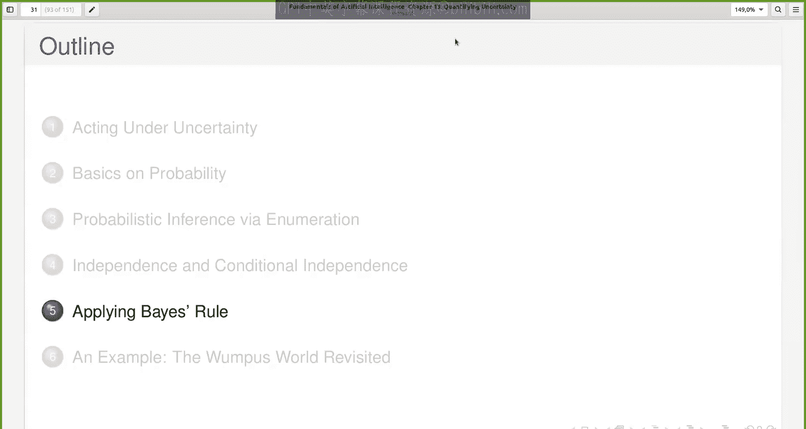
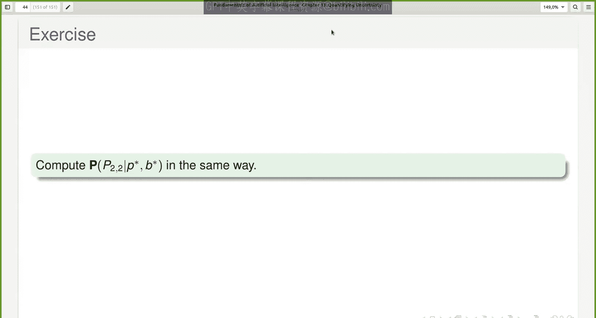

# 人工智能基础：CL03-1-CH14：概率推理 🧮

在本节课中，我们将要学习概率推理中的核心概念，包括边缘化、归一化、独立性、条件独立性以及贝叶斯规则。这些工具对于在不确定性下进行推理至关重要，并能帮助我们简化复杂的计算。

---

## 边缘化与归一化 📊

上一节我们介绍了概率分布的基本概念，本节中我们来看看如何通过边缘化和归一化来操作这些分布。

### 边缘化

边缘化是指当我们想计算一个变量子集的分布时，需要对所有剩余变量（也称为隐藏变量）的可能取值进行求和。

**公式**：
如果有一个关于变量 **Y** 和 **Z** 的联合分布 \( P(\textbf{Y}, \textbf{Z}) \)，而我们想得到 **Y** 的边缘分布，公式如下：
\[
P(\textbf{Y}) = \sum_{\textbf{z}} P(\textbf{Y}, \textbf{Z} = \textbf{z})
\]
这意味着，对于 **Y** 的每一个可能取值，我们都要对 **Z** 的所有可能组合进行求和。

例如，在牙痛、蛀牙和探针卡住的例子中，要计算牙痛的分布 \( P(Toothache) \)，我们需要对蛀牙和探针卡住的所有可能组合进行求和。

### 归一化

归一化是一种非常有用的技巧，它允许我们在计算条件概率时，避免直接计算分母（即证据的概率）。

**核心思想**：
当我们计算条件分布 \( P(\textbf{Y} | \textbf{E} = \textbf{e}) \) 时，根据定义：
\[
P(\textbf{Y} | \textbf{E} = \textbf{e}) = \frac{1}{P(\textbf{E} = \textbf{e})} P(\textbf{Y}, \textbf{E} = \textbf{e})
\]
我们通常将 \( \frac{1}{P(\textbf{E} = \textbf{e})} \) 记作一个归一化常数 \( \alpha \)。关键在于，我们**不需要显式计算** \( \alpha \) 的值。

**步骤**：
1.  计算非归一化的联合概率 \( P(\textbf{Y}, \textbf{E} = \textbf{e}) \)。
2.  对这个非归一化分布进行求和，得到总和 \( S \)。
3.  将非归一化分布中的每个值除以 \( S \)，即可得到归一化的条件概率分布。

**优势**：
计算 \( P(\textbf{E} = \textbf{e}) \) 本身可能涉及复杂的求和（边缘化）。通过归一化技巧，我们推迟了这部分计算，直到最后一步，而最后一步的除法非常简单。这在处理复杂问题时可以节省大量计算步骤。

**示例**：
计算 \( P(Cavity | Toothache) \)。
1.  计算非归一化的 \( P(Cavity, Toothache) \)（通过对探针卡住变量求和得到）。
2.  得到非归一化向量：`<0.12, 0.08>`（分别对应 Cavity=true 和 Cavity=false）。
3.  总和为 0.2。归一化后得到：`<0.6, 0.4>`。
这比先计算 \( P(Toothache) = 0.2 \)，再相除得到的结果相同，但思路更清晰。

---

## 独立性与条件独立性 🔗

理解了如何操作分布后，我们来看看变量间的关系如何帮助我们简化问题。

### 独立性

如果两个变量 **X** 和 **Y** 相互独立，那么知道其中一个变量的值不会影响另一个变量的概率分布。

**公式**：
\[
P(\textbf{X}, \textbf{Y}) = P(\textbf{X}) P(\textbf{Y})
\]
等价于：
\[
P(\textbf{X} | \textbf{Y}) = P(\textbf{X}) \quad \text{且} \quad P(\textbf{Y} | \textbf{X}) = P(\textbf{Y})
\]

**意义**：
独立性允许我们将联合分布分解为更小的因子乘积，从而指数级地减少存储和计算量。例如，如果32个变量完全独立，我们只需要存储32个单变量分布，而不是2^32个组合的联合分布。

### 条件独立性

条件独立性更为常见和有用。它指的是，在给定第三个变量 **Z** 的条件下，两个变量 **X** 和 **Y** 相互独立。

**公式**：
\[
P(\textbf{X}, \textbf{Y} | \textbf{Z}) = P(\textbf{X} | \textbf{Z}) P(\textbf{Y} | \textbf{Z})
\]
等价于：
\[
P(\textbf{X} | \textbf{Y}, \textbf{Z}) = P(\textbf{X} | \textbf{Z})
\]

**意义与示例**：
考虑牙痛(Toothache)、蛀牙(Cavity)和探针卡住(Catch)的例子。牙痛和探针卡住都依赖于是否蛀牙，但**在给定是否蛀牙的条件下**，牙痛和探针卡住是独立的。知道一个人牙痛，并不会改变在已知蛀牙情况下探针卡住的概率。
这反映了一个典型的“因果模型”：一个原因（蛀牙）可以导致多个独立的效应（牙痛、探针卡住）。

**重要性**：
利用条件独立性可以极大地简化联合分布的表示和计算。对于1个原因和n个独立效应的情况，联合分布可以从需要约 \(2^n\) 个参数，简化为只需要 \(2n+1\) 个参数（每个效应给定原因的条件分布有2个参数，加上原因的先验分布1个参数）。

---

## 贝叶斯规则及其应用 🔄

最后，我们学习一个强大的规则，它允许我们将因果推理转换为诊断推理。

### 贝叶斯规则

贝叶斯规则是条件概率定义的一个简单代数变形。

**公式**：
\[
P(\textbf{Y} | \textbf{X}) = \frac{P(\textbf{X} | \textbf{Y}) P(\textbf{Y})}{P(\textbf{X})}
\]
在应用中，我们常使用归一化形式：
\[
P(\textbf{Y} | \textbf{X}) = \alpha P(\textbf{X} | \textbf{Y}) P(\textbf{Y})
\]
其中 \( \alpha \) 是归一化常数。

### 应用：从因果推理到诊断推理

这是贝叶斯规则最重要的应用之一。通常，我们容易获得“因果”知识，即给定原因时出现某种证据的概率 \( P(Effect | Cause) \)。但我们需要的是“诊断”知识，即观察到证据时推断原因的概率 \( P(Cause | Effect) \)。

**示例**：
假设：
*   脑膜炎(M)的先验概率 \( P(M) = 1/50,000 \)。
*   脖子僵硬(S)的先验概率 \( P(S) = 1/1000 \)。
*   已知患脑膜炎时脖子僵硬的概率 \( P(S | M) = 0.7 \)。
那么，当观察到脖子僵硬时，患脑膜炎的概率为：
\[
P(M | S) = \alpha P(S | M) P(M) = \alpha \times 0.7 \times (1/50,000)
\]
归一化后（与 \( P(\neg M | S) \) 比较），这个概率仍然非常低（约0.0014）。这说明了因果概率和诊断概率可能有巨大差异，原因在于先验概率的不同。

### 朴素贝叶斯模型

这是一个基于条件独立性假设的实用模型。它假设所有观测证据（效应）在给定原因的条件下都是相互独立的。

**公式**：
\[
P(Cause | Effect_1, ..., Effect_n) = \alpha P(Cause) \prod_{i=1}^{n} P(Effect_i | Cause)
\]

**优势**：
该模型将复杂的联合概率计算简化为多个简单因子的乘积，使计算从指数级复杂度降至线性复杂度。尽管独立性假设在现实中可能不完全成立，但它常常是一个有效的近似，广泛应用于分类、诊断等任务。

---

## 综合示例：Wumpus世界中的概率推理 🎯

为了展示上述所有技巧如何协同工作来解决复杂问题，我们分析一个来自教材的“Wumpus世界”变体示例。

**问题设定**：
*   在一个4x4网格中，智能体探索环境。
*   每个格子可能有一个陷阱(Pit)，概率为0.2，且格子间独立。
*   智能体进入一个格子后，能感知到相邻格子（东西南北）是否有微风(Breeze)，有陷阱的格子必然在其所有相邻格子产生微风。
*   已知：智能体从(1,1)出发，已访问(1,1), (1,2), (2,1)，这些格子安全（无陷阱），且(1,2)和(2,1)有微风。
*   查询：智能体下一步应该去(1,3)还是(2,2)？需要计算 \( P(P_{1,3} | 已知证据) \) 和 \( P(P_{2,2} | 已知证据) \)。

**解决思路（以计算 \( P(P_{1,3} | evidence) \) 为例）**：

1.  **定义变量**：共有16个Pit变量和13个Breeze变量，但只有与当前证据和查询相关的变量是重要的。
2.  **应用贝叶斯规则与归一化**：
    \[
    P(P_{1,3} | evidence) = \alpha P(P_{1,3}, evidence)
    \]
3.  **边缘化隐藏变量**：需要对其他所有未知的Pit变量求和，这最初看起来需要求和2^12 ≈ 4000项。
4.  **利用条件独立性简化**：关键洞察是，在给定“边界”变量（即与已知有微风的格子相邻的未知格子，本例中是(1,3)和(2,2)）的条件下，已知的微风证据与地图上其他遥远格子的陷阱状态独立。
5.  **重新表述问题**：通过代数变换，将求和项分解，使得对“其他”遥远格子的庞大求和变成了一个概率和为1的项，从而被消去。
    \[
    P(P_{1,3}, evidence) = \alpha' P(P_{1,3}) \sum_{fringe} P(evidence | P_{1,3}, fringe) P(fringe)
    \]
6.  **计算简化后的问题**：现在求和只针对“边界”变量（(1,3)和(2,2)），只有2^2=4种组合。对于每种组合：
    *   \( P(fringe) \) 很容易计算（独立概率的乘积）。
    *   \( P(evidence | P_{1,3}, fringe) \) 是确定性的（0或1），取决于该组合是否能产生观察到的微风模式。
7.  **得到结果**：计算这4项的和，再进行归一化，最终得到 \( P(P_{1,3} = true | evidence) \approx 0.31 \)。类似地，可以计算出 \( P(P_{2,2} = true | evidence) \) 更高，因此选择去(1,3)更安全。

**总结技巧**：
这个例子综合运用了：
*   **归一化**：避免直接计算证据概率。
*   **贝叶斯规则**：将问题转化为联合概率的计算。
*   **条件独立性**：识别出给定边界变量后，证据与远方变量的独立性，从而实现了从求和4000项到仅求和4项的戏剧性简化。

---

## 总结 📝

本节课中我们一起学习了概率推理的核心工具：
1.  **边缘化**：通过对隐藏变量求和来获取变量子集的分布。
2.  **归一化**：一种通过最后一步缩放来计算条件分布的高效技巧，避免了复杂的分母计算。
3.  **（条件）独立性**：识别变量间的独立关系，可以指数级地简化概率模型的表示和计算。条件独立性在因果模型中尤为常见。
4.  **贝叶斯规则**：一个简单的公式，却是连接因果知识与诊断知识、实现反向推理的桥梁。
5.  **综合应用**：通过Wumpus世界的复杂例子，我们看到了如何将这些技巧结合起来，通过智能地利用条件独立性和代数变换，将原本难以处理的计算问题变得可解。

掌握这些概念是理解后续更高级主题（如贝叶斯网络）的基础，它们构成了在不确定性环境下进行理性推理的数学核心。