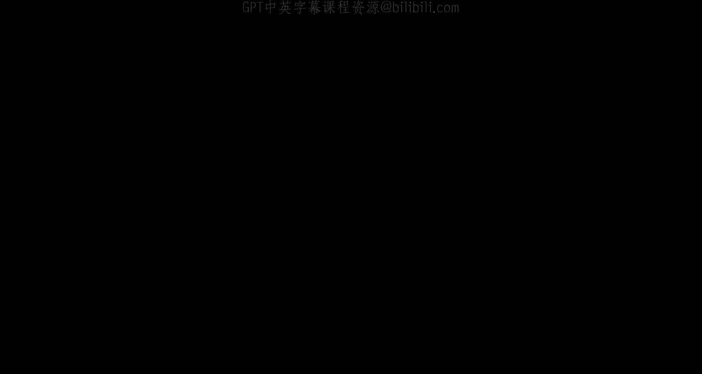
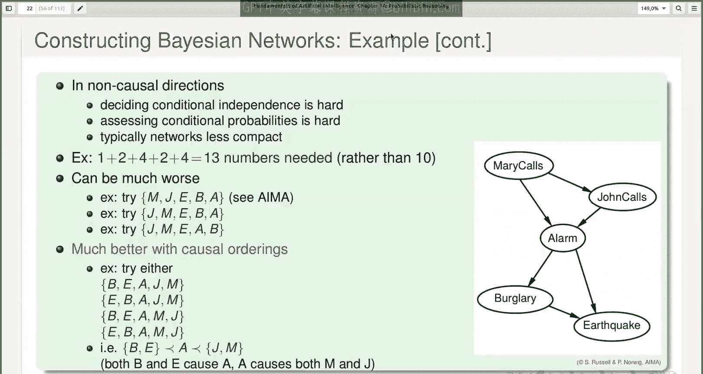

# 意大利特伦托大学《人工智能基础｜Fundamentals of Artificial Intelligence 2024》中英字幕deepseek p04 2024.09.16-CL04-1-CH14-BaysianNetworks.zh_en -BV1uUkwYTEmf_p4-

Okay。Go today。We start new chapter 14。Prob。 And we analyze what is the main instrument。Which is not。

 which is used nowadays for performing probabilistic reasoning， which is by networks。

 So this whole chapter is devoted to。To easy networks。I just recall。

That you may find so for those who may have missed。

That I'm starting from the very very last part of the the calls。 So chapters 13 and 14。

 just because I've been asked to do that by。Professor Paserinni。

 who is going to teach you Michel learning。And he asked me to anticipate this part so that he can use。

All this part for his own course。Okay， so。啊。We started dealing with bayesian networks。

 and particularly we give some basic ideas the semantics。From a global perspective。

 from a local perspective。 and， then some properties。 So this is， will dev the first part。

 Then we see how people。Users saw builds by networks。For。To model probabilistic systems。

And then we see some techniques toism。On with the bay network2。

 So the idea is to see how bay networks can be exploited。For efficiently。

Or at least more efficiently than a naively performing probabilistic hearing inference France。

To do probabilistic inference， I just recall that probabilistic inference is intrinsically an NP program。

Okay， so at least as hard。As MP complete problems。 so， but。Many people believe he's further higher。P。

And there are no known upper bound or other complexity。So far。Okay， so first some basic。

 I start with some basic information。What is Bay network？Well basic neck substantially is a dog。

Dtic a psychicgraph。 I assume that everybody knows what I mean。 So is a graph。Without cycles。

 and directed without cycle， and each node represents a random variable。Can be discrete。

 can be continuous， can be。Buulion binary or can be binary。

 whatever will deal only with the discrete variables you know。你哪玩啊。In this chapter。

And most often will deal with binary variables。 But although this is not restrict to that。

 So we could use arbitrary arbitrary domain variables。

 the issue we use mostly billion variables is just for convenience。 Okay。

 for practical convenience of finding nice。Nice examples， but we can do whatever。Okay。

 so we say every node darkness present。Random variable。

And there are directed arcs which connects pairs of nodes。 So let's say X Y。 And if there is an arc。

 notice that all the arts are directed。If there is an artery which connects node x to node y。

 we say that x is apparent of y。By notation convention。😊，Will。Go top down。 So from top to bottom。

 the direction of our arts are top bottom。 So that parents are higher than than children。

 But this is just a convention， of course。 Okay， its just for convenience。Okay。

 really adopt the convention of putting parents above children。Okay， so this is Stany。

 if you remember the example。We have seen。 We have weather， which is isolated node cavity。

 which is apparent of toothache and catch。😊，Remember。

And there is no relation between toothage and capture。Oh。And then那呃。

We have some numerical information， which is associated。Do ever know that。And， in particular。

We have a conditional distribution。B of。 So if forever every know the X。

We associate a condition distribution of Xi given the values of its parts。So， for instance，2。

With intended mean that if a node has no parents， that he has a prior distribution。

As a prior distribution， distribution without conditions。And conditional the probability。

 So the list of the list of parent is empty。 So that's id。 So we know that probably。

A prior probability can be seen as a probability conditional programming with an empty list of conditions。

Okay。Over there。Okay。So， so for instance answer。With cavity， we just。Pro cavity。

 we will simply associate a distribution a prior distribution， the same for weather。

To tooth edge will will associate a distribution of tooth edge given cavity。

And the same for catch will be associated at distribution of catch given cavity。Okay。

 if one has more than one parent， then you will have a abitarily complex distribution。Oh yes， please。

Yeah家。Yes。😊，对。No， no， no。 The only information is with direct。Direct points。 Okay， no answer。

So that's the point， Okay， just wait one second and we see some example， okay。So however。

 the important fact is that。We hardly have distributions。Which relates a node with its direct planet。

 no ancestors， no songs， no other。 Okay， so the only information is associated today。嗯。

From node to its own parts， That's it， okay。哦。Well。

 conditional distribution are typically represented as a conditional probability table。

 which is called CPT。So it's a distribution over exc for each combination of parent values， social。

 you see a list of parents， So parent through false， parent through false， parent one through false。

 parent one through false， parent one through false， parent through false， and we see the。

For mobilityability。For X to be true。Why don't we need？The formation will probably be false。玉虎。Yeah。

 it can be completed by complement by 1 minus probability。 Okay。

 so CPT condition probability table is just8。Table， which for every combination of values。Of the。

 the parents， you get the probability of the node。You get the probability of the negation of the node by complement。

Okay。😊，Cl要说 far。Okay， we see that。诶。Basing networks allow a complete。And very compact。

 relatively compact specification of all the joint distributions， we'll see how。

The key point is that this represent explicitly the conditional dependencies among variables。

The intended meaning is that we have an a from x to Y that has。It means that。

Xa has a direct influence over y。Okay。That。Well， substantially。呃。

We say that x is the typical scenario is that x is a cause of y。Okay， so typically the most typical。

Semantic or imp use of Bayesian networks is that they represent a causal influence。 Okay。

 so X is a cause for y。ok。Well， notice that what we have here is what we have already seen in the previous chapter in this example。

Toothet and catch are conventionally independent， given cavity。Okay。So theyR。呃。

Toth and catch it depend on cavity， so cavity causes。

 toothage cavity causes is a cause for the fact that the dentist feels。

The tool catches in in the whole of your teeth。And where it iss completely independent on the。 Okay。

 so this， these three。Statement which we have seen in the previous chapter。

 map into this graphical representation。With there。Okay。😊。

Remember that we don't if we don't have any arc between notes， we don't have assault。

If an isolate node is something that depends on nothing。Okay。诶。

During this chapter we'll use the following running example。This is due to Ju Pierre。

 who is one of the。Most the main event also amazing networks。

 but the way Ju the appear as got for this work got to the Turingga Award years ago。Okay。

 and suppose we have the form scenario。😊，Off。That是 burger呃。

Some family has in the house as a burglly alarm， which goes off so rings。Very likely， on burgly。

And occasionally on her wakes， okay。You may find that only your example of the book are very California California scientificientric。

 right， So all those guys well there are right so。Okay。

 both the Ju Pire and the authors of the book make very often examples which are related to California。

John and Mary are neighbors。Who agreed to call when the alarm goes off。

 So awful of people walking leaving this house walk。Okay， but they have a nice。

Nice neighbors who agreed to call and work if there are Marines， okay。

Although those two guys are not really。As much as reliable and as one， they may think。Okay。

 so this is the scenario， this is the basin。Okay， so notice on the top there are the two possible events which cause the alarm to ring。

 That is a burglary， okay， a earthquake。ok 诶。They don't have parents because in our scenario。😡。

They are they do not depend on anything else， okay so。

Earthquake are events which do not depend on anything of interest for us and the same other bugger is coming in。

Okay， you say that the probability of。Having a burglary within a given amount of time specify is one over 1000。

 so 00 dot0 do001 and the probability of having earthquake is dot 0002 okay for which you understand they are in California right so Italy we will have a much higher probability having a burglary。

 much less。Okay。They both the cause and alarm。They may cause an alarm how， okay。

 and here are an example of CP。This is the probability of a， oh。

 everything is aggreavated with the the first letter， okay， so the probability of having an arm。

Given B And D， the possible combination of burglar or earthquake are， if both are true。

The armings with notified enzyme， sorry。With the。With the burglary and no earthquake is not 95%。

Rs if you are very professional burglary， they may be able not to make it all marine。

With a earthquake， well， sometimes it runs with a earthquake。Well。

 let's suppose the alarm is not specifically designed to during on earthquake。

 so with the D29 probability earrings on earthquake。And the probability that you the false alarm。

 So the maybe be the false alarms。 So the case is where。Neither is you have a burgary nor。

You have an earthquake， but the anyway is one over 1000。Okay， is this the scenario clear？喂。John。

Is reasonably reliable because so the distributor probability of John Rs， John calls。

 given that the alarm of rings is 90% well， maybe out of reliability means that it may not been necessary at home or whatever maybe he's sleeping or whatever。

So， 90%。And。The probability that he may ring call even if it's false， but because of his other。

Sounds or that he misleads for the alarm is 0。05。Similarly， the same for Mary。

 with different numbers， probability the Mary rings with given the lama is 0。7。

The probability that he rings even with without ringing the larma getting off is001。 guys， sorry。

 I just want to recall everybody that the classes starts at 930 sharp。Okay。She。

Not there's no 15 me academic 15 minutes or better there at the end of a class， not at the beginning。

Okay， so please， you are kindly invited to。Arr on time， thank you。啊。O ok so。

Is this description of the scenario clear？Ex， because it will use this example in the chapter。Okay。

 so。🤧呵。The topologist of the topologist of this。The graph substantially regardless of the values。

Reflects the causal knowledge。 So the fact that aburger can set up the alarm off and the health can set the alarm off。

With any meaning that they are independent consider sort of independent events。They don't。

 We are not analyzing here why you ever a earthquake and why you you may have a burden coming to you。

 Okay， so this is not part of the scenario that we are all the our contents。 Okay。

 the alarm so the alarm can cause me to call and the alarm can cause John to call。 So the our。

Os here represent the cousin。Cows and knowledge， okay， with some probability associated， okay。Okay。

 so and the C represent the the probability that。诶嗯。That or identify。Okay， just a recall that。

 as I previously mentioned， that the CP is represent only the positive。

 the probability of the positive event， why because of。

The probability of the negating event can be obtained by complement。Okay。ok 熟。嗯。This is just what。

What's a。But using that or ease。诶。We typically have can be can see the semantics either globally or locally and。

A few says that the perspective are a pre。Let's see what is intended to be a global semantics of Bayian networks。

U。Yeah。Well， first of all， why we have？😡，Bise in the box。Well。

They come from the empirical observation that in many situations or in most situations。

Every random variable。Does not depend directly， depend。On all the other variables。 But you have a。

A data dependence of from a limited amount of other。 Okay， so you are sort of。Of depend of。Of depend。

 a limited depends。 So the alarm depends on， on。By and。Or an earthquake。

The fact that miracles depends on the lab， the fact that same for Johnnless， but。The fact。

That Mary calls given a burglary。That's skip point。Yeah， of course。

 there is a dependence so they're not independent。But they are not directly。Depenent on that， okay。

So there are not a。 There is not a direct cause， a direct relation between the fact that。

A burglarlar set off， and John calls。It's not a dark one。

 It's an indirect one because they intermediate。Nottion is the fact that the lambs at all John does not call it because he sees the burglar。

😡，Because because I hear they alive。Okay。Is this three。So the， if you're represented。

The five valuable。Model with a distributed probability。You have something to do the five。

So you have a five moon variables， and you have to to the five table， okay？Which is， I would say。

 quite inconvenient。 So is will 32，32 elements is quite inconvenient because you don't。Of course。

 everything depends on that。Okay。Everything depends in general on the other。

 but it does not depend directly on that。And the thought of being able to separate the direct dependency。

From a general dependency allows to a much， much more compact representation of a model。Okay。Which。

Is one of the reason of the huge success that the Bay I will have in every many， many contexts。Okay。

 and the。The fact that the variable is darking here only small number。

 let's say KI of other variables， we call them the patterns。Okay， so we represent present。

The direct influencers。As a parent in the network。If you remember。

 this's actually I already mentioned last time and it is very。

 very important when you analyze a system。That you are exactly able to figure out what。First of all。

 the consequences for the factor from the them。The causes from the consequences， but also the direct。

Implication iss very important that although in some way。

 the fact that John calls is a consequence of the fact that you have a burglary。

 it's not a direct consequence。 and you。Goho the guy who is in charge。

Or the lady who is in charge of modeling the system。You should be able to make this decision。😡，Okay。

In general ECPT。For a bullolean， for a bullion， Okay。

 for simplicity will make a bullolean variable but。In general。

 you may have a Bayesian networks with arbitrary values and even with the continuous variables。

 but then you have the functions rather than than tables okay so a CP for a boolean variable x with the K1 Boolean parent has due to the K1 rules for the combination of parent value。

 so substantially you have a value。For every combination each of the two to decay possible combination of values of the parents。

 well， two to the K is exponential Asia， yes， but typically relatively limited。The key point is that。

K why with the the。With the Bayesian network， typically there are a limit on。

 even though you may have Bayes network of hundred of thousands。Nots， okay。Typically， the。Size。

TheThe number of parents is limit very limited。 So you directly depend on limited amount of factors。

 Okay， and that's why this they are so convenient。Again。

 each true requires only one number in the boolean case because the other。

 the false value is given by implementation， similar if you if you generalize this basic networks to multiple values if you have say M values for your node value。

 you need the M minus1 rows and。You get the answer by con。

The reason why we use Boole variable here because we want to keep tables or reasonably small right and we don to use multi dimensional tables or things like that。

 okay。嗯。🤧So。Suppose that。Let's key。Be the pro bound of the number of parents。Of notes in our network。

 okay。So let's call K the maximum number of parents also in the road， okay。What happens。

This means that。So this means that they're the biggest CPP in the network。As due to the key。呃。

As two to the Ks， okay。Okay， so what does it mean。The the， the complete network。

Requires a specification of all the， which is upper bounded by n times2 to the K。

Where K typically is reasonably small。Number。ok。Okay， what。好美丽。

Values will require if you want to represent each state of the whole join distribution。

2 to the n was minus one， okay， because as's usual， but we need2 to the n numbers。Okay。

 so we pass from two to the end。To n times to the K， where K is。Rereasonably small。

Just try to imagine a basic network of 1000 nodes。Okay。Passing from 2 to D with the 1000。

 And suppose that。the mo says Ben。T0 parents。Which is reasonable， okay？

It's very difficult to have more than 10 that causes。Or or node。 So you pass from。Due to the 1000。

Two10 times sorry， from 1000 times to the1。Because the time with about 1000 or 1 million。Well。

Can you imagine how big is2 to the 1000。哦。Using the usual trick。The user trick of 10 is is110。

 so you have a 10 to the 300。So we have a number with a more or less a 300 zeros。

A number of 300 zeros。 Okay， you pass for a number， which has 300 zeros。Do what咩人。More or less， okay。

 well makes a huge difference， don't you？Okay， here you see that， okay。

So guess something we linear assuming that K is considered K to be a constant， okay？

Ler versus exponential。不是喂。Barling example is。Of course， is a tall example， right。

 So here we have 10 numbers rather than 2 to the 5 by -1 to the 31。

 then is So this is not even a huge difference， but。If you really start to building complex。

A bayesian netroine blows up very quickly。So。the fundamental fact of Bayian networks is that they are very compact。

Representation of potentially huge。Or incredibly huge joint probability joint probability distributions。

 and you do that by exploiting the direct。Depenances rather than generic dependances。Okay。Okay。

And here comes global semantics。😊，Global semantics says the following。How can you get。

Complete join distribution。O by Asian network。Well， you can have it Well you don't。

 you never compute this explicitly， of course， because otherwise you will lose the advantage of of having the。

The compact representation of that。The joint， the full given by Asian network。

 the full joint distribution。呃。Is， can be seen as the product of the local condition distribution。

 So P of。X1 and X1 is given the product of the。Of the the local joint distribution described by the CPTs。

Remember that effects has no parent than they are prior。The elements are prime。 Remember by product。

 we mean the usual definition of product。 right So pairwise product for the pay index。 So you say。

 can you see why this is the case。Anybody。So， yes。It's just an association of the chain rule， yes。

Here we are。Okay， with it well。😊，Suppose。Okay， with the chain rule and the fact that you order。

 you give an ordering。Of the variables。 Okay， you go， you give an note of the from the。

Parents to to children in the following size， parents to children。Definines a partial。

 do you know the difference between a partial order and a total order。A partial order just a essay。

A set of binary。Of bi depend， say he comes before him。He's on my left to respect to him。Okay。😊。

But in general， they don't。Its not necessarily the case。That okay， so for instance。

 from my perspective， being on the left of another person is a partial order， why， because he。

There is a binary dependency between the them iss a partial order。

 There is no binary dependency from him to her， for instance， Okay。

 so she's not on the left or the right。Okay。From any partial order， you can。

Big arbitrary total order is an order which either if two elements are different。

 either one is smaller comes before the other or the other comes before the one okay。

This is totally all so I'm just coming。From any partial order。

 you can take arbitrary total order with respect。The partial order， okay？Okay， you so balance。1是80楼的。

Okay。If I'm parent， if I'm his parent， I can。 I precede him， but not。

If you take any two arbitrary person， there is not necessarily parent relationship， okay？Okay。

 I can take whatever order。😡，Whatever total order I wish total order is a standard order way you order。

 You can take an arbitrary order， provided that he respect Val so that。

A parent comes before the children。Okay。😊，There was a。Yes。There least， of course。Yeah， no。

 you don't know the center。 okay， now no， the total load is expensive。No， in Ja， yes。

 but you don't call this apart。Okay， so we couldn have announcement them。Okay， let answer and stop。

 sorry。Okay， so the point the point here is very， very simple because doesn use。

Simply take whatever order， give whatever order you may like to the variables。😡。

Provide that you respect parent too， provide that the parent can always come before irre your children。

Are we there？Okay， so if this is the case。As Court pointed out， by Che rule。有孩子。You have the。

You apply the chain rule， Remember the rule。 But now we assume that parent comes before。The children。

 okay， we have all the X， such where the every parent comes in before the children。So。Here are。

The part remember that exerciseise small but next thing。So， you have。by condition dependence。

Allright are。Okay， everything depends only。On balance。Okay， so you don't depend。

On all the numbers which proceed。Which are not your parents。Okay。

 the fact that you order is necessarily because you are sure that all your parents are there， right。

 the fact that you need an ordering。Is necessary because you need all your parent。

Should be in this list here。Okay。That's actually。Due to the condition independence。Are we there。W。😮。

This is incredibly powerful， right？😡，Because we have a very competent way。Overrepresenting something。

Which is for which you need an exponential amount provided that we have a limited number of pilot for every node。

 which is a reasonable assumption。Okay。Or well， better， I would say better。

 provide that you consider a constant。You have a constant value。

 which is the upperband of the demand of。Of the amount of the maximum amount of patterns for every node。

Then， you。You have something which is术上 linear。You have a representation which is a very complex representation。

 which is linearing science。Okay， which represents the full distributor？😡，The full distributions。

Yeah， you may say yeah， but if I want to compute the full distribution。

 then we have to expand it and need an exponential amount of steps， yes。

But the key point is that you。You don't need the。To compute this explicitly， Okay， typically。

 you have queries。 and we see how you can perform a queries without。Compute in the full distribution。

Okay。Yeah。A with there， everybody。Okay， let's make an example。Recall the example here of a Px。

 Y XN is P of X XN。Okay， suppose that。I want to compute the probability。😡，That both John and Mar。

The lamb shut off。But no bar， really no earthquake。Okay。So。嗯。Okay， so this is。Again， we shortened。

We got a events。The probablybate of John and Mariold。Positive， the lamb set of a。Not be。

 not the burglary and not earthquake。Okay。Good， okay， if we had to compute。Explicitly， there。Product。

We need the wall。The will expansion， right？Again。We make， we always make when were in computer。

 we always make。Impoing order in which parent pre water the property have say that is parents come before children。

Okay， yes， please。Sorry。What you。No， no， wait a moment。No， these。This is not yet a by network。

 or let's make it two steps。Okay， yeah， this is just application of the chain rule。

So far as just the application of chain rule， I just a next step I would show out okay。

 don't go too hard， okay。So this is just the chain road Okay。

 without exploiting the properties of the。😊，Of the Bay network。But we do a slight。

So we know this a few thoughts， okay。That。John。John course depends on your lab。Okay。

 so it does not depend on medical， does not depend of the of bodily。

 it does not depend on earthquake。呃。Then。M， which is very， same foreign code depends only on that。

 not onburgerlary， not on me。Okay。😊，Alarm the alarm does depend on both burg and the earthquake。

 so this is not simplified。Burglary burgergen does not depend on the earthquake。Okay。

Notice that this simplification may depend。 Okay， this one may depend on。

On the order you make because you may have several possible total order out of the partial order。

Okay， but then when you simplify。The is result will be the same modo possible reordering of the products。

 okay？Are we there。Okay， so we have seen the our the actual。The actual formula。

 which is we simplifyified a that， okay？We are。So。Probbit of John giving alarm。

Times probability bit of Mary given alarm。 times probability bit of alarm， given not B not T。

 times probability bit of B， not B times probability of not T。Okay。So哇。John， give it alarm。

John Ko Guillaan is at the time。Mary calls is 0 to7。Probal alarm。 Okay。

 that's the pro the main source of。Problem。 So the pro of alarm， given that both the force is very。

 very low，0，0，0，01， okay。The probability of not having a burglary is very near to one， so 0。9999。

 same for the probability of z0。998。Okay。So， overall。You have a very。

 very tiny probability Not that this is quite an unusual call because this is an absolute probability I'm call in。

 I'm saying it right。The query here is an absolute probability。Is uncoming is a prior probability。B。

Well， and this is mostly due to the fact that its very it's very low because it's mostly due to the fact that it's very very unlikely that we have a false alarm。

把 you个会 bo。Okay， yes。Good。No no。那为好。We are computing。We are in this case here we are like so。This is。

 this is the。であ。This is the chain rule。But if we applied the Qing rule。

 we would be in trouble because we don't have those values。Pre simply you don't have this value。ok。

We will probably need to do some complicated computation to do that。

But then we apply the global semantics or Bay networks。😊，And we have this。Okay， is it clear？

Everybody。Again， this quite an unusual。Kind of query， right， Because the typically。

 the typical query is， what is the probability that we have this event given this other event。Okay。

 but then we'll get to that。ok。Is the steer？Now， this is just to say。😡，Why we make this example。

 because one by one， we can compute。In principle。Oh。Element in the。Global joint table。

All the 32 elements。In the global distributed table， okay？Just to say that， okay， this。

 this is an example just to confirm that the plot that the information we have on the Bay network allows us to compute。

If you wish， similarly， each element in the joint distribution。And this is one of such an element。

 This is clear， but this is not the typical the result typical we use it typicaly。

 we are not really interested in computer the joint probabilities。 Okay， we typically are。

Are interested in computingbil like condition probabilities like？Probably a given event。

 given some other event。Okay。And with everybody， this is just to show you that the giant probability table is。

Can be computed one by one in this way。 So there is an equivalance in between。呃。

Bas a network and the global jointt distributed public。Okay， everybody。

I leave you some exercises to do。Given the joint will be ablela blah， blah， blah。Computer。

The probability that John Co and Mary does not。 the Lama is not set on with a burglar entering during an earthquake。

The probabilityion that John Co and Mary does not given a burglar entering the house where， okay。

 here are。Okay， if you want to have this， this is no more a joint。😡。

They interve ont because you also have to say the you also have to say the case whether the alarm sets off or not。

Okay， but so this means is the sum of the two cases， but。This comes to be as a sum of two cases。

 Okay， if you wanted to compute this as an entry of the is the probability user have to assume either the alarm set off or it doesn't。

 okay。The probability of a earthquakebreak even the fat that John has called。Again。

 this is a query guys in no mor injury， you have to do。Sum up summing up。 This is。

 you probably in this moment， you don't have the full。

The full instrument to compute this efficiently。Okay。

 but you have the instrument to compute them using the standard， the standard。诶十个十个。

Of all the possible combinations。 Okay， but again。You have a few the order you have a。

A joint the distribution which is the order 32 elements， so I you'll have to do few sum， okay？

To do that。Okay， so far。Any question？No。Okay， so。I think we can have a break now。

 and we resume at 30 okay。I just think so。什么。好的好。Look。Yes。2多分钟内行。はい。知道。n。可以。嗯。Yeah。Yeah。嗯。Okay。Yes。嗯。

对。Okay。嗯。嗯。It。嗯。嗯。嗯。你看。对。🤧So。We also， okay， so we have seen the definition of busy networks and the semantics。

 also known as global semantics。 Well see some some local property。 You should imagine that in。

InRe modeling， in real probabilistic modeling， you may have huge。Baian networks， Okay， so very。

 very complicated with lot of notes。Again， we play the convention that we put depend penencies from。

Downwards， okay， but this is just a convenience。Yeah。But we should also also like， try to understand。

The local dependencies。 So how。Pie， sub pieces of a Bayesian network work。

 And this is very important because very， very often you may have a knowledge。ThePro knowledge。

 which may involve a large amount。Of elements valuable。 But then when you have two reason。

 you just should focus on small pieces of it。 So how can we reason locally。So with base and networks。

 that's a key point。So and there are a few properties that come into play。One is look at semantics。

 look at semantics say the following。啊。Each node is a property we are not approving theoremence okay so if you wanted you can take a look on your book or and also to the bibliography。

 your book has something very good which is not only he much more detailed than my explanations。

 of course but also it has lots of extra material has lots of biber references。

 lots of indication of how to where to find material。

 so if you are particularly interesting in some topic that you can use your book as a main reference to find a lot of userable information for the specific topic。

🤧Okay， sorry。They said。You haveA local semantics property is the following。

 so every node for is an X in this case。Is conditional independent， independent。On his non thehamant。

Given its part。Okay， so let's reor the same。Eold， given its parents。Okay。

 given the truth value of his parents is conditionally independent of every known ashameds。

 What are the known ashameds。2。It's children。 It's children of these children It's children or these children。

 Its children。 It's children or children is children。 Okay， so the trans closure of childhood。Okay。

 in relation。Which means。Notice that this is a fundamental factor。That's no theants。

Include also ancestors。So the father of the father。是不 say。To know if a America calls， okay。

You only need to analyze alarm， not earthquake。Or bo。That's the point。 Okay， so graphically。

 you can take a look to this picture here， which gives you。😊，Okay， so。啊。s当实力。The proto Aa。

 giving everything else。Okay。Everything else included the Okay， so notice that we here we represent。

 sorry。Giv it。The probability of X giving all is known theants。Okay。So excluding the disments。

 So excluding the children and the children， the children。

 the children of the children of the children and the children， blah， blah， blah， okay。

Depends only on the parents。Okay。😊，Every probability。Which。These effects， independently。O X given。

The user。So use are the parents， the very relevant ones。 The deaths are everything， which is not。

Which are known the Shehandants。Okay。Provided that this does not include the defendants。 Okay。

 that's a different story。Okay。Then it just depends on。Just depends on the diet。呃 balanceance。

So everything which deals。Every probability which is with everything else except the sh。

Depends only on the parents。Okay。And just end there's a theorem which says that。

Look at some is a equivalent Google。Okay， so the property of global semantics depends on substantial every。

 which means that since we have used global semantics as a sort of definition of them。

Of the semantics of the Bayesian network。 This means that every Bayian network。For every basin。

 I to look at semantic holdss。Okay。呃。Stanally， you say that everything which is important。

Which you really characterize or， which causes， which influence。对。Which influenced the value。

Of of the node is。Fss from the bonds。Remember that the sort of influence indirectly influence。

 so the idea of what a value influence are the value is something which goes up to down okay？

It follows the direction of the acts， But the point that the parents are a sort of a fe it， okay。

On that。 So everything。Yeah。It is collected only it depends only on that then of course your parents will depend themselves or your ancestors and the other stuff。

 okay？Okay， but but thats you only need to look at your parents if you are not considering your descendants。

Well， why you do why。This does not involve thedants。

 where the Shadantsants do have a direct relationship， right， remember due to bayes and bay or rules。

Okay， the probability。Of your theant， of you， depending your designers can be computed in terms of your probability versus the condition probability of your ashameders but irrespect you。

Okay， so so they， of course you have in it。When you broke the， if you do not consider the the。

 since you can compute the probability of causes through effects just reversing the the cause dependency。

 then， of course， you should not consider the dis。Okay。And in fact。

 sometimes we have to compute the probability of a node given the value of the hand dance。😊，Okay。

So remember that sometimes。The kind of queries that you may have to cope with that can be of many。

 many forms。 Okay， but the key point here is that if you don't consider your descend。Okay。

Then the probability of X。If you don if you don't consider the dependency of your descendants。

 the probability of your node depends on impact of your parents。

Depends only on the value of your clients or direct bond。 So even。The pond feeds everything， okay。

Are we there。Everybody。Okay， so let's see an example。For that。Again， usual example。That。John code。

 the pro， John code。Is in the completely independent depends only on alarm。Okay， here。

 John Col has no the Sha dance。Okay。😊，So John code depends only on alarm。Okay。

Is completely independent is conditionally independent。Once you have a set alarm， the。

For a bit of John Co given alarmburg health miracles。

 iss just distributed for a bit of John Co given alarm。Okay。

 not that you cannot say anything about the probal alarm movies。

 but we are because we have junkco and Maryole here， right which are the Sha dances。Over there。Okay。

😊，嗯。Another form of independence property。Okay， so this notice that the lookca semantics does not consider。

The shhandl。Okay。😊，诶。There is a property which is called a Markov blanket。

 another which can be useful sometimes。Which is the following again。The only， okay。

 what about if you want to consider also the sheandans， okay。Well， the sense that。We are。

WeWe have some information the query we want to ask。We involve also of the shaandans， to some extent。

 okay。Another property is what is called the property of the Marco blanket。

Which is the follow in the Bay network。Every node is conditional dependent on all others。

 given its marker blanket。What is the markco blanket？Is the union of the set of his parents。

The fact the sector of its direct children。And the。This sector of the parents of。Of its own children。

Okay， so they sort of blanket here， which。A sort of feeder which surrounds every mode。

 which is given by its parents。His children and the pulses of his children。Once they are given。

You are completely dependent on everything else。 So once a you have， you know the values of those。

 it's the value of x depends only on the on those。Okay， let's call。With the you， the parents。

With the wise， the children and with the zs。The parents of the children。Okay。And with Ws。

 everything else。Everything which is not in the blank of market。the mark of black in this world。诶。

Okay， so X。Depends， so。The distributor probably joint sorry， the condition distribution of x。

 depending everything else。Is restricteded。Equals。Conditional distribution of X given。His parents。

Is children and the the， the parents are his children。This is called the Markov blanketlan theory。

Okay。😊，And there's a fear I'm saying。Yeah。Okay， so。So why this important， Because we notice。Okay。

 look at semantics gives you a notion of locality or everything。As far as you are going。😡。

Down with depend only going down with dependencies。Okay。All the parents matter。

If you are going in either directions， so so if your because it also depends on your children。

 which are not directed okay， you should not think of dependencies。

Only in terms of cause on a cause effect， but also individual。

 also causes dependent on their effect are not independent on their effects because it may be the case that you know something about the effects。

If you。Well， let me make this point because this can be counterinitive。You say well， of course。

 effectively depends of course。Okay， but you are doing。Computs here。Okay， so what is also the cause。

When computing the probability of causes。😡，If you have some information on effects。

 this affects the possible value of the causes。Okay。But affect not in the physical science。

 but in the mathematical science。Okay， theyre not independent。

If you know something about the we action。Of one possible action。So。

If you don't know the probability by which some action has occurred。Okay， and you know that some。

 this action has some consequences。And you know that the probability of those consequences。😊。

Then you can estimate the the probability of the of the course。

 which is actually what we have said about the。The diagnosis is right？

So we cannot say that the cause is independent or its effect。Is a mathematical independent。

 don't mislead the independence in sense of physical。Co affect。Is the mathematical independence。Okay。

 if you know something about defect， this affects your knowledge about your。Okay， you know these。

If you'。The fact that you have a。Let's say something that you know very or we know very well。

 the fact that you may have COVID or not。Okay。Okay。

 the probabilityion that the person in front of you has a COI， but go back to four years， okay？

The pro of a guy in front of you has COviID。😊，If you know nothing about him you can estimate the probability in general statistical way。

 but if you know he has a 38 temperature， he has a blood ratio of dot1 93 okay he doesn't feel it doesn't taste flavors at all and all the known symptoms of COVID okay。

 you can give a very high probability that he has COVID okay so in this sense。

You depend also on your effect， a course may depend on their effect， not in the physical science。

 but in the mathematical science。😡，Okay， because it。The sense of flow of information， okay。

 you can extract information from the cause given the effect。Okay。

 regardless of fact the one is the cause and one is the fact。Okay。

 you should also keep in mind this distinction that the notion of mathematical dependency or values is different from the physical。

Physical one goes in one direction， Maematic can go in the opposite direction as well， right？

B rules is that。In the mental way of inverting this direction。Are we there。Okay。

 so that's actually the distinction in some way between the two fundamental far about about Bay local fat。

 local properties about Bay one is。Maintaining if we stick to information。

 which flows from top to down。Okay， then everything depends only on your parents。Why。

 because you are not considered your children， because youre under assumption and you're going down。

If you instead are assuming that information going can go in either direction。

Then Marco blanketlant is a sort of。Hello。It's a sort of blank ca which covers you。Okay。

 and it makes a filter of all information。 So all you need to know are。Your parents。

 your children and the parents of your children。But你 mean say我 there are a lot。Well。

 you may have the well， let's say， suppose you have 10 of them， well， 20 of them。

Remember that by using EO， you can have under thousands。Yes， please。一话。Given though what。

They know the yes， they know yes。あ。我。The bucket that。Yeah， in the same yes， of course。 Yeah， yeah。

 yeah wait wait a moment。 This is a property。 Okay， then， of course。

If some notes are not given the micro， then you may have make as because remember that your always apply some gout。

You can compute for the case where so suppose you have a all button one element or the mark black and node。

 Okay， you can estimate make the no， you can exploit this property by considered by cases。Okay。

 the case where the one is true， the case where they have there sports。Okay。I it clear啊。

So when you know， summing out the fundamental operation that we have seen so far。

 when you want to compute something also exceed they need the variables。Okay。

 means when you don't have any information about the def variables。

 you consider the possible values and sum them out。Okay， similar here。You can， is there one variable。

 two variable， three variables in the Mark blanket， which are not considered？😡，Okay， well。

What you do is you smoothoo them out。And image， summer。In each addendum。

 you can exploit the Marcoblca road。The same you have a for。The sign you have for local semantics。

 Okay， may the case that you don't know something about the the parents。 Okay， if so。

 you will sum out and with respect to all the possible candidate values of the parents。

 but we'll get to that， okay。So this is a picture。😡，The problem， okay。You should distinguish。

Between the properties and how you use it。The property says that。This is a mathematical template。

 Okay， it says that the。The distribution。The distribution of one variable given。

Sstantially all possible values of the of in the。嗯诶。The bias Bay network。

Restricts is given by the value of value given only its micro blood。This is what the property says。

Okay， then it's up to you when you actually are applying and doing calculation to。

Remanipulate the formula in yourlogy in such a way that you can exploit it。

If you remember the Womus war example。哎。It was actually an exercise to manipulate。

hYour original formula through algebraic properties and by application of base rules and algebraic simplification in such a way to bring the problem。

Into a form in which you could apply conditional independence。

 and this allowed you to drop 4000 submissions。Remember。And that's actually the point。

 so it's up to you to find out how to exploit this。Okay。But this is what the property says。😡。

These are what is sort of。I'm giving here the sort of the tools。Which then when you do computation。

 you can exploit it saving， D saving a lot of computations。Okay。I see the point is。Okay。

 let's write them where I give this to my computer and then the computer， yes。When you have to deal。

😡，With complete MP hard problems in Java iss not simply， okay， I feel this to my computer， that's it。

Okay， because it may take you a computer geological error to compute some problems， okay？

Its something that it grows exponentially in number of size then。有了呃。You have no choice。

But if you you have tricks， you can exploit its nice ideas and tricks and properties。

 such a way that you can drastically reduce the computation time。 Then what is unfeasible。

 Comp and feasible becomes feasible。😊，A typical case that we see。

Is a provision of thisfi bo reasoning？But reason isn't talked about by definition is themp complete problem。

So in principle， you could not solve something more than a few hundreds variables， think to。

 because the worst cases due to the number of variables。But current are over。

Can solve industrial problems in the order of 1 million billion valuable。1 million billion variables。

And in principle of the state space， the search space of these problems are2 to the1 million。Okay。

 so。How is this possible its possible because you exploit？😮，Properties。You exploit tricks。

 exploit to the value dependence in between environments。Okay， and with very， very smart algorithm。

And this is something that we will see in part in this course and in part to automatic reason course if for anybody who will take it。

Okay。But that's， okay， I want you to do。都。Separate， distinguish between the tools。

 the mathematical tools I give you and the ways you will exploit it。Its。W。Yes。😊，Yeah。So。Okay， yeah。

 I mean， this we'll see some example of computations later， but I first need to give you the tools。

Okay， the my。 okay。Okay， so this marker blanket。 Okay， just if I make an example， okay。It a burglary。

 Okay， remember， look at semantics。 I made you an example of information of the fact that one consequence was dependent on the dependent cause。

But then if you have a diagnosis properly。The diagnosis query。Okay， you may say oh。

You may want to guess the probability of burglary given something has happened。Okay。

 and you say okay burgly is independent on junk calls and medicals given alarm and heart。So， you see。

As far as Bur is concerned。John calls。And a。And Mari is completely independent。You see。😊，Okay。

 I anticipate something that we'll see at the end of this chapter， another property。Which says。

 so imagine you have a huge。B using network。Okay。😊，If you have the typical query is， you have a。

So the typical problem that you have is the joint distribution probability of some query。

 which may involve some variables， give them some evidence or some giving them some other variables。

Okay。Scially。That query builds only with the。Ft。Of the Bayes a。

 which is the union of the ancestors of the query variables and of the of the。Dvidence variables。

Meaning。If I  query， I ask you。😡，A query involving to alarmment earthquake。Everything which below。

 everything which is below。😡，The query and。And。The evidence is irrelevant for the computation。

Which makes sense， right？So imagine。You can imagine a huge。

A huge base it as part of a knowledge base or something that you know。On which you。

 you need to leave some， okay。So when you are solving a problem related to a math。

Who have to solve a math problem， okay？You probably don't need getting from your brain all your experience due to the psychology of us and our children。

Which is part of your knowledge base， but is completely relevant for the problem you are solving。

 right？Okay， so deals only。 So the relevant part。Of。Given， given。A problem， the meaning。

 giving acquiring and giving the heaviness。The part of the basinnet， which is of interest for you。

 is everything which is above。All of them。Okay， so you can， this is the part which is of interest。

The part of your knowledge that is going interest for you， okay。

 we'll just anticipate something that we will see at the end of this chapter。Are we there。Okay。Okay。

 so。So substantial here， the probial bugger given everything else is just the probital burglar given alarm and the earthquake。

This is Mark Blalan。Okay， depends on that。A with there。Okay。😊，啊。Okay， so。Thank。

In the previous example， verify numerically the so okay。

 I may use two example one of the micro of the of the local semantics and the other of the。

And the other other the a Markov blanket， okay， saying that two are questions， okay。

Compfuseute the two， the two elements of the。Or the question separately in check they are identical。

Okay， the tool compute them with the tools that you know。

 so we use the global semitic to compete the Brala。Given the value。

 and you will find out that they're identical。Okay。😊，ok。Here is a fundamental okay。

 so this is all you need to know as the background about ma。So。Then呢。We do two things。things。

 first of all， we need to。How to build laser networks。Okay。

 so what does it mean to build Ma networks， it means you have， you have us knowledge。😡。

And we have to model this knowledge。😡，The knowledge that you have using this instrument。

 which is based in networks。Okay， this is a step which is called modeling。Okay。

 so you as an engineer， as an analyst， as an expert of AI。Okay， you should be required。 Okay。

 I'm your customer， and I we， I have this very complicated system dealing with some bank related。

Problem。Say dealing with payments， background probability， provision， stock markets。

 whatever you may want to。 Okay， and they want I。I have a thisband of statistical information。Okay。

 and I want you to build the model。Okay， based on a b network， out of which I can do some inferences。

So we have two steps， first of all， build a Bay network。So， modeling。Okay， second。You。

 once you have your base network， you do inferences。 So given some。Some list of queries in the form。

 probability of query variable given values of evidence variables， okay。

How to compute efficiently Not that this is not a trigger thing。

Because this last problem is MP art problem。So， you have to。Cope with this in a smart way。

 And the way you design the Ba network is fundamental。Okay， because we have seen that。

You see from the previous example that。computing嘅。Using a basin I is dramatically more。

Compact way then computing the wall distributed the wall joint probability distribution。Okay。But。

 of course， there are good modelings of， But reason， I thought are bad modelings。Okay。

 and if you beat the bad， the model only it， you have a two big。

You are not able to fully represent the conditional independence。

The fundamental factor of network is a very smart way or a very natural way， if you think。

To explore the condition independence of。啊。Run the models。Okay。

 and if you are really able to explore this conditional independence， then your computation is much。

 much cheaper。😊，Okay。You have seen several times。So for example。

 imagine you have a a system with under the thousand the v。Again。

 dealing with something which is exponentially or something which is just linear times or exponential only in the number of parents makes a huge difference。

Okay。So build a good model is fundamental。😡，So which is actually step number two。Step number3 is。

 once you have a base network， how can US person tricks to。Make every query more efficient。Okay。😊。

Okay， so。A Bay has to components。The topology， so the graph structure and the CPs。

 so the numerical numerical information associated that so the probabilities associated to every parent chi relationship。

Okay。😊，Oh。The very first step。Is choose an organ of valuable。And here there is a universal rule。

No matter what。F local casual， cow， not casual， C C， A US。Okay。Follow cause effect or relationship。

Exploit your domain knowledge。Or as anybody of you。Ever attend a software engineering course。

 How many of you have attended a software engineering course in your life。 Okay， so， you know。

 the the phase of analysis。Okay， so all those know the analysis part。Okay， so you。And you。Or Dr the。

Interdependencies between the object， direct dependencies and transitive dependencies etctera in the form of the of interrelationship between the elements of of your domain So you exploit the knowledge of your domain。

To make。A model。Or the system that will be used then to build the software and to drive the design of your software。

 okay？It's clear， do you match this scenario， basically the point you exploited your knowledge of the domain。

To understand there。Cause affect the relationships。Of your。

Of the object of the system you want to design。Or your domain， okay？And this is fundamental。😊。

There is a fundamental rule， which says。A cause。In the order they choose。

 a cause must proceed in the effect。That is a ruler which should be carbon installed。Your design。

 okay？Okay。So substantially how you build the graph the saw， you start from from one to one the saw。

 so start from the earlier notes to the later node and。嗯。You should。Draw。

 so for every know that you added you should choose the parts。And。The intended meaning here is that。

Try to figure out which nose depends on what。Notice directly depends on what。Okay。

And that's there's no universe， so you should choose a subsetseter of the notes that you have already introduced in such a way they say。

 okay， those are my parents in the sign that my node is caused by those directly directly caused by。

Okay。Here， the main difficulties here is to distinguish between direct code and one of the main difficulties is distinguish between my direct code and indirect cause。

 Okay， so you may say， well， of course， if John calls one of the causes of John cause is that you have a burggerary。

Well this are an undirect clause。The actual call is the alarm， thanks。And this is。

Also a matter of experience， right of really understanding is see likeking software engineering。

 right in software engineering， you know， that it's not a universal recipient， okay so。

Really depends on on。Your understanding， but the better you are able to exploit。

The those depend panencies， the smart the the more compact will be the。

The Bayesian network and the either will be to do inencing within this Bayian network。Okay。

 you to say bycon。Okay， it we guarantee。That the global semantics by construction， so if you do that。

Yes， I'm coming。You have， you have by construction。 So by this equality here。You have问的。

The semantics of the user networks， yes， please。Butance function is used。

Into the orange fashion definition itself。你是级的。I sure。So。这个这个催收。No， no， no， wait， wait a moment。

Now I'll wait a moment， no， this is not true。Those here are all。

Volleys that you have previously introduced。Jose a set。Okay， if you wish to。No， no， as parents。 Okay。

 or let me rephrase the sentence here。 Choose a subset。Of X1， x same by1。

 X1 and x and 1 are those are all the notess that you introduced so far。

 You are You are introducing the new node， which is X， X， I， okay。Choose as parent of Xi。Some subset。

Of the previous introducing nodes， there is some subset of X1 X plus1。Okay。We suspect that。

The joint distribution probability。Of X given this subset is the same。

As the joint distribute the probability of x given all the previous variables substantially。

Do not consider those which are conditioning me。In the background。

So all we just sorry exit is conditionally independent， given the balance。

So drop substantially the key point here is。Which of of those variables you are not considered as parent。

This is the set of all variables that you enter re。 So you start being your graph from top to bottom。

 okay。Every time in。 So some far， we have introduced X1 to X I plus 1。Now you are ID the XI。

X I iss say。呃 alarm。Okay。And then you're saying， okay， which。

 so in this step you have to decide which variables of the previous introduced variables am I considering as parent？

And this comes。And this is the only。The only element that it comes to you。Is your domain knowledge。

I know that。X does not depend on this other variable directly。

 so those variable these are variable will not be part of my parents。Okay。

 and this is something that either， you know by domain knowledge or if you have a very。Big data。

Data tools， okay。By which you can estimate that this probability is the same as this probability。

So the。You're not parent is just that this is just a representation， there is no function here， okay。

 is it just a representation colleague parent is a member is the name of a set。😡。

P of X is name of it is just a name， it is not function things， Okay。

 it's just the name of a site here。Okay。😊，Okay， do you agree that if this is the case。

 then by construction， what you have is a basin network， okay。

 because the global semantics property is verified。wither。Okay。Well， for the same reason。

 take the chain rule and apply these quality step， and then you have the global sematics。ok。

Over with there。Okay。Okay。In principle， you could do。Build any basin network。 Okay。

 according to what。 But the point is that。So you could， in principle。

 even be the basinate which in which the depend do not follow。The cows are a relationship。

The bad news is that this basin that will blow up very quickly。So we will not be able to exploit。😡。

That you have to add so many arts。That the benefit of having a bi that will decay very quickly， okay？

You will be semantically correct。😊，But not very much of use。😡，Okay， so。Suppose I。

 I choose a very stupid。Okay， stupid ordering， which is medical， John calls， alarm。

 burglary and earthquake。Which is actually the opposite of water you should do， right？

And then you have a problem to do that， because you see that。Okay， so how can I， okay。

 you are okay well， okay， introduce medicals， well the first node you do nothing， okay？Second order。

 shall I draw an arc from Maryco to John Col？Does John Co give me is there statistical related？Yes。

 they are statistical related。They are conditional independent， but they are not independent。Okay。

It's very likely if well， you can check in the other way it。

 about the fact that the me Col and ju calls are not mo independent。Okay。

 because they are typically both dependent on the on the same fathered alarm code。 So theyre not。

 they are condition independent， but not independent。 Okay， I since theyre not independent。

 You have to draw。They are， and that's bad。Okay， you already seen that you have a dependency that you should not have。

Okay。and remember， the more acts you have， the more harder the computation。

 the harder will be then when you will use the base network to do computation on。Then， alarm。啊，sor。

 that's a。The fact that Alma rings depends on and given John M depends on only John or depends on only him。

诶。Is there a dependency of on John， Is there a dependency of Mary， Is there a depend on both？ Yes。

 there is a dependency on both。 Okay， you cannot。It cannot。Okay。So， okay。

 you have to add those two art， okay。Okay， lets me， sorry， I just went too hard。

Lets burglary come into play。Okay。Thus the fact the burglary runs， depends on。Alarm only。

 it does that the the fact that burgary depends on burglary only。 Well， of course。

 this is obviously no， right， obviouslyburgary does not depend。This one， Okay， O， sorry。

 This one is the does depends only on alarm。 Okay， for the burglary。嗯。Alarm feed us。

 so to say the dependency on genre and Maryorn。So the fact that the burggery has occurred depends on whether the alarm has run or not。

 not on the fact that Mary and John has realized that。Think of that， okay。Theres no relationship。

 there is no direct relationship between Jon and given the fact that alarm rang。

There's no foreign dependency on Marine John。Okay， so this is。Something that alarm。

This alarm in this case is able to filter this out， okay。Does。Earthquake it became。Depend only on。

Alarm， unfortunately no， it depends only on your health burglary。Okay， oh， sorry。

 does depends on alarm andburg。 Yes， it does not depend on John and Mary。Okay。So we are at the end。

 You see that we have。Well， let me say two dependencies to me， a couple dependencies to me here。Okay。

 and why is that？Because we haven't exploited causalanity。Okay， here you say， well。

 this's not that bad， okay， two normal， yes， but this is a really example。Okay， if we are building。

Other dependencies， then this blows up。😡，Okay。So in no cause of detection。

 the side condition dependence is hard， okay？Acessive condition probability is hard。

 typical net are less compact。But for instance， you need in this case， Okay， how big are those。 Okay。

 this is request one number。 Okay， is a probability。 This requires two numbers。

Depending on the two values of my called。This display needs four numbers。This needs two numbers。

To values of alarm。This depends for members。Okay， so it。It is 13。

 remember that we had the time before， it is not that big but big difference。

 but this is a really example。Right。If you making this blow up， then you increase the size and。

Lissome。Okay。There are some example。 Try。To play with the same as the same exercise。

 Try those orders。Okay， the the book they are analyzed in detail。Okay。Instead。

If you do any ordering which matches causal ordering， what does it mean？Remember。

 the causal ordering is a partial ordering。Okay， so essentially every。Total order with respect。

A partial order is fine。Okay， at the end， it will have the same the same dependencies。

 just mod ordering the products， okay。So if you try all those combinations here。

Then you see that they are fine。 What does those four combinations are。The burgly and earthquake。

Can be independently switched， Okay， doesn't matter the order between a border and earthquake。

 Similarly， it doesn't matter whether John and May， the order between Mary Cole and John Col。

 the very important fact is that both those two should proceed alarm and alarm should proceed both of them。

Okay， which is actually the case of this four order I is here。 You see that those four orders are。

Both fine and will modular reoring will we will give you the same vision network。Oh。呃呃。Okay。

 I think we can close it here。Wednesday， you have your first lab class lab again。

Is an it can be leading as a war。 is just a exercise。 Plus， okay， no computers， no programs， no。

 no finger like that。 It's just。Exercise glass with the polymero team。Okay。笑。反那估计呃。

Do you have a class here now？No。

I'm coming in just one。