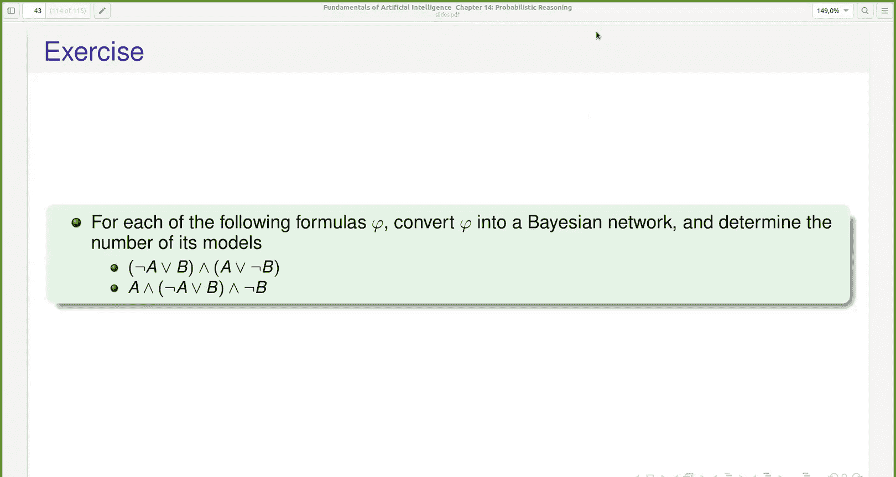

# 意大利特伦托大学《人工智能基础｜Fundamentals of Artificial Intelligence 2024》中英字幕deepseek p05 2024.09.20-CL05-1-CH14-BayesianInfrence.zh_en -BV1uUkwYTEmf_p5-

Yes。Okay。Okay， so。Last time。We we were reasoning on how to construct bay networks and substantially。

 I just resume very quickly。The key point is if you want to build a base network。 typically。

 you should start from your domain knowledge and draw。Add the one node at the time。 But it's very。

 very important to follow。As smart order。 Okay， so by using network substantially。

Reflect a flow of causality。A a dagger， dark psychographer。

Which employs a partial or they induced by causal。Okay。

So where causes come immediately before effects and that's exactly the point of what you should exploit。

 Okay， so when you beat。啊。You want to represent your system。As a basin。

 I thought what you have to do is。From the graphical viewpoint。

 you have to choose a order and it's fundamental。That you follow causality， meaning。

A cause must come before。Must come immediately before not immediately must become before the effects。

 the direct effects。 Okay， that's a fundamental rule of thumb that you should carv in stone Okay。

 once you have that。What you do you type every step you are the new。

And you know and you choose the subset， which are the data。Their causes of。Of your node。

 Okay and and if you saw such that P of Xi giving all the preidency。

 it can be restricted on to the parents。If， if so， you are。

Guaranteed to preserve the global assembly。So how do you do that， Jad？Okay。呃。

Bas basic networks are sort of a schema like similarma to those using software engineering。

 I don't know how many of you have background is software engineering Okay， so think of UMM right or。

Something like that。 So it's a matter of a way to write， to formalize， to describe。

 to model your domain knowledge。 So if you have a domain knowledge。

 you shouldn't know the dependency。 and then you map。And then you draw the graph accordingly。

So you have done individual。 if you don't have done sometimes now you can do。

 can you do that automatically well， typically those kind of things sometimes are done by machine learning nowadays。

 right， So you have tons of tons of tons of。Of data of samples。

 and then you beat the dependency and the probability according to the data you have。Okay。

 so the idea substantial is choose the right order。 If you don't choose the right order。

 you end up having something。Very annoyingly bad。Okay， so ruler Thumbber。

 always you as a cows up all day。Okay， notice that in general。

 causal audienceings are partial audiences， okay。So that may be the case that there is no causal dependency between two elements。

 if so， you just take any total order which extends the partial order。Okay。I was there。😊，So。

 that's the。What should take from the last class？Okay。Okay， what about。Numbers， so probabilities。

 Well， and then this is an estimated that you have given your knowledge。

Sometimes you nowadays you can do the by machine learning again。

 you have tons of tons of statistics and then out of that you can infer the probability out of the statistics you have even before machine learning was so popular。

For instance，'s many domains like medicine or diagnostics or whatever they were。Lots of statistics。

Of describing the interrelationship of events and so out of that you could estimate the CPTs。

There is that one way。😡，Well very easy way to build。To build the CPpts。

 which is called noisy or distribution， which is not the exact。Or not always exact。But in many。

 many situations， it's a reasonable approximation。And there is an easy trick to do that if you admittedly。

诶。A little approximation， this typically works very well and this are a very good first attempt to do something。

So。What is the idea， Okay， So what's the point， Okay， I know for every parents son relationship。

 you have to figure out the relative probabilities。Okay。啊。What about that Well。

 you may have tons of statistics Okay good and if you have them if have some good some trillion data coming from machine learning and a huge amount of data well and you have some progression algorithm which computes the CP for you that's good for you。

 but if you don't have those instrument and you want to complete them in practice with a little。

A little more information。😊，A good。Starting point or very often。

 a good technique is what's called the noisy or distribution。 So you assume。That causes。

Do not interact with each other in causing it the effect your。 So you have the node。

You have the correct node and you know the courses， so you have already rolled the graph。

And you're trying to figure out the CP of this node。Okay。😊，So you make the fully。

 sometimes the deposit is。😡，Somethingund that you can assume for real。

But sometimes just an approximation， but you may assume that the causes do not interact with each other。

ok。😊，So you have an node。If you have to make the full assumption， first of all， that all， yes。

 please。No is more than that let me get it to the end of this and then cash your question at the end till the end of this slide。

 Okay， then I believe that probably I will answer you if not just re askingking okay。Okay。

Not only that or not necessarily that。 so substantially。Okay， there's assumption that you make easy。

 first of all， that all the parents are all and only the causes for your road。ok。😊，Well。

 and this comes the first problem， say， well， sometimes you don't know all possible causes of your。

Of your effect， particular you think of the example of medicine， right。

 sometimes you are by head age。Okay， well， you have a list of frequent causes of NH。

 but are not all possible ones。Well， the standard trick to。

To do that is that you are so called a link node， a Li parent。Thank all the others。Okay。

 so if you have high temperatures or you think you make a list of candidates or you have a flu。

 you have a pneumonia， you have COVID， you have dengue， you have malaria， you have well。

 you may have a longer list of a possible sickness which cause you a high fever， okay。

 and then you add one external node others。Okay。😊，So the very important factor is that you have all possible causes of that。

Okay， what does this mean？This means that the probability of not having fever。Okay。

 giving that all that。Other all the causes are fault。Is 0。Sorry。

 sorry is one so the probito but having fever given that all the causes are false is zero。ok。Meaning。

 those are all。All and only in the possible causes。Is this clear？Okay。呃 and then呢。What you do。

 you assume independent failure probability。 that's what I mean that by。So。

So which means that the probability， I assume the following that the probability of not having。

The factor。Okay， given。Some of the causes are true， the potential causes are true。

 and some others are false。Okay， is the product。Oh， the probability， which we call the Q I。

 of not having the。Because giving one。Okay。So。So， substantially， this means that。They。So the。

The factult not having that is independent。Or what you say that because is either causal of you or is co you or is co to U or is co of U in some sense。

 Okay， so remember that the product or probability is when so you have a product or probability when you think that the causes are sort dependent。

Okay， so。So to say the probabilitybate of the。Not having fever。Of not having。Temperature， okay。

 high temperature， okay。Given the thought that you have son。You have say。Maaria。

 or you have flu or you have whatever is the problem of not having fever。

 giving the flu times the problem of not having fever， beginning malaria and so on。Okay。

Let me make an example。So， for instance。Suppose the probability of having fever， okay。

Given three possible sources， Okay， cold。You have flu and you have malaria。Okay。Okay， suppose。

 you know， well， first of all， you assume that the probably。 So you assume that all those are。Well。

 of course， it's not true， but now， suppose in our domain that the only possible。

Soces of a flu of fever are called flu malaria。 Okay。

 so what does it mean that the pro of having fever。Given the fact that you don't have cold。

 you don't have flu and you don't have a mal area is。😡，Okay。

 so this means these are or if you prefer the parametermmeter of not having fear is one， okay？😡，Okay。

 so far。Then what you say here。😡，Is， you know， you have three values。 So you know。

 the probabilitybil of not having the fever， giving the fact that you have malaria is very low。Okay。

 my lot are very， very likely， so you forget my new。You you nearly always get a very serious fever。

 okay？And that you are。The prohibit not having fever， giving the fat that you have flu。Is。

Is your two。 Well， if you have flu， it most likely you have you have a fever。

 even though not always always always。Okay， and less likely than Malaya， mallayia are typically over。

 nearly always。Its that if you have the probability of not having fever。

Given the fact that you have cold cold and nothing with time and nothing else is。Is in 0。6。Okay。No。

You assume this what is called this independent in this sense。I assume independence so that they。叶修美。

That the failure your chances are independent。 Okay， so the fact that you don't， you don't。I get the。

The fact given the course are somewhere independent to each other， okay？So， for instance。

If you want to say that the probability of of not。Of having fever， having both flu and malaria。Okay。

 you compute this with the negative。You complete the probability are not having fever。

Giving malaria and giving malaria and。And and flu， okay。

 and you said the probability of not having fever is the probability of of having not having fever given malaria times the probability of having not having fever given given flu。

Okay。😊，So。Then in the no or distribution， you tend to reason on the probability of not you compute the probability of not having the effect。

As independent。Okay， so the probably is not a having effect。Giving all force is one。

The probability of not having the fact， giving。Some sub side of the course is the product。O。

Not having the fact given the single causes。Okay， so the probability say of。Having the。

Not having fever， given given the fat you have called the flu is the product of not having a fever。

 given your cold times the product of not having fever given the flu。Okay。Is it clear。Okay。

Is it clear？So this is typically a schema which works decently well in many many cases and is very。

 very widely used in many scenarios， in enough sense of the more precise data。Okay。

 so this science is that the probability of。Of failure is some way。诶。Sorry。

 the probability of not causing the fact there is a way independent in the various causes and causes。

So。If you do that， okay， under this assumption。You know this。That Uican。Much less data。

Because the only thing that you need are those QI。So you need only the the only information that you have to gather is the for every source problem for every cause。

 you have to compute the probability of not causing the factor。

Given that singularly you have the singular course or the other course faults。Are we there。

What does it mean。Means that you need so if you have a K father， so K possible causes。😡，Okay。

 you need K values rather than  two to the K minus1。😡。

Because all the others can be computed automatically。Oh there。

All the when you have the probabilities。 So you every time you have once you have those Qs。

 So the the。Deent single， independent probability of failure。Okay。Then all the value， the negative。

 the probability of not having the。The cause， given some combination of the causes。

 can be simply compute as a product or the QIs。And of course。

 the positive probability are just computed by complement。Oh， there。Okay。Okay。

 I have I give you an exercise。Which can be recently complicatedate。

 consider the Bous board of the previous chapter and try to describe this as by network。

Not in that there are some dependencies well。Which are。 well， here are the cause effect。

Relationship is quite obvious， right？Okay， well， of course you should not report a 16 whatever but。

So you can group the values together。 but I think this is quite。

Stve forward to understand the cause effect。Okay。Relationships。Okay， now。Are we there so far。

 Any questions？Okay， now。Nowadays， Bay networks are typically so I mean。

This wave constructed by E EO is a first attempt， okay so the noisy or。

 but very often is wall series on the wall because typically the independence。

 the actual values are not that far from in practice from the approximate values。

 it's a model which is reliable in many many scenarios。嗯。If you not the world。

 you have to rely on and tons and tos on the data， which is。

Dlicate techniques based on machine learning do。Okay， now now for now。

 we assume we have a amazing book。As I said， the network is very， very compact。

Way to represent a distribute。ASt distribution， okay。A joint distribution of many。

 many variants because it's a geical way and it exploits the conditional independence of the。Of them。

啊。Yes， I record， yes， I started the recording， yes。诶。Is very， very complicated。

 So can we exploit this fact。Yeah， of course， yes。So the typical， what shall we do。

To perform an inference。 So what is the typical query that we have to cope with， A typical query is。

诶。Something。In the form P of x given E equals E。Well。

 X is a single variable or more general can be written off。

 I think that here we can have one single query variable or more than one。 Okay。

 but the typical scenario is the。P of x given the query， given some evidence。

 And let's y be the other variables。 Okay， so what is the distribution。

 the probability of distribution of some event。Or of some combination event。

If given the fact that some other variables have those values。What is the probability that I can？

I I arrive at the airport on time， given the fact there is no traffic。

 but there is a bridge which is broken and blah， blah， blah， so this is the typical。是哪样。Okay。

In general， okay， we distinguish three cases， the query variable or general the variables。

 most often is only one， but maybe more than one。The evidence variables given。This evidence。

And with the low case E we represent the values， in now our case typically we use true falses， right？

In， remember that in general， we can easily generalize to。The discrete or even continuous variables。

And why is the set of an unknown variables also known as hidden variables for those which do not participate in the C。

To the court。And we have a typical query， which is p of x given e equal E。

 which sometimes we abbreviate as p of x given Lo E， notice that e is an array of value。Okay。

 so it can be more than one value。Okay。啊。For instance。

 I want I want to compute the distribution probability。Of the fact that this relevant case， right？

That I have a burglar， that a burglar comes him， given the fact that the John calls and an America calls。

Okay。So。😡，Im I'm at work， both Mary and Johnco。😡，Of course I have no clue whether I have no clue whether there's been a earthquake and I have no clue whether the Alama has a support because I'm are away。

Okay， but I know that my neighbors job both John and Mary called me。

So what is the the distribution probability that？The boy who came me into my house， give the fat b。

The boss called me。Okay， we understand that this is important on， right？你不这方面。嗯。

So the query is burglar。The evidence variables are that the John calls and medicals。Okay。

And the variables are the fact that I have no clue about。

 whether there has been an earthquake or has been or the are set off。Okay， so what do he do。What。i。

The typical thing I do is inference by enumeration。

So I just take what I've seen in the previous chapter and apply it to the distribution used by E network。

Okay。😊，So。😡，If you remember。The key point is when you have this scenario here， again。

 E is a shortcut for or capital E equals lo case E okay。Of B， X a given E。

Is to compute a non normal ice distribution。Okay， so we want to compute there。

The distribution of P given x and capital E。Nize。And whichch is a non normalized distribution。

And by means of a normalization constant， which is alpha。Which will compute as the very last step。

Or our computation。Are we there？Oh， notice that here e is a value， okay， so we have only one alpha。

We can can compute the distribution of。P of x given generical values of E。

 but then we'll need every one alpha for every different E。F of。Okay。😊，Okay。

 so what you want to say apart from the alpha。😡，Then we have to sum up to sum out the values of Y。

 So yeah， they alpha completed the distribution of X， E， Y。Is there any problem with it？Fear， okay。

So far。Okay， now。How can we compute this， And that's where the fact that we are using a maator comes into play。

Okay。Oh。😊，Because P of X， E and Y。Can be written。Using the global semantics。

As a product of prior and conditional probability was prior for the leaves， ba。

Prior probability for the lives of our base networks and then conditional probabilities for the intermediate nodes。

But saving a lot。Okay， because remember that passing from the chain rule to the global semantics rule。

Dlically ir reduces。The elements of the dependencies of the elements of the product。

 because every node depends does not depend on。All the other proceedceding notes depends only on the。

Parents， which are typical is much， much， much， much smaller less subable the preceding notes。

Oh there。It was us far。Good。Like， of course， once we have computer， then then we normalize。

 And in doing that， we can apply。Once ever written in terms of the global rule。

 then you can try to apply factorization and ajibte tricks。

 all thesezebra simplifications that we are able to apply。Okay， so let's see our example。

The probability of burglary， given the fact that John calls and M so this is valuable so a computer distribution。

 okay， so we want to compete for both burglary onburg through Agar folds and this data here John and M are evidence value evidence so both through okay。

 both John Co John Col and Americaco。Okay。Okay。What we are doing well。

We sum out over the two variables， which are E and A。Okay。

A is alarm set off and we have an earthquake。Okay。So with some of E and with sum of A of B of B。

 E A JM。And now we apply the by and they。So the， we apply the。The globalba semantics。

So what is this distribution， Well， B and D are leaves。😡，Okay。

 so we have POB and POV notice that in this case， since B we we have the variable。

 so we are considered both values， we have a distribution here。Well the P of E。

 we are considered only the two value。 So do we have a plane。AP volleyball。I blame。Proability。Okay。

Then we have the distribution of alarm。Alarm notice that a here is available， right？

Well there's an index here。So for every value of a， if every value of E。

You have P of V and P of A given B and E， okay， because we have A given B and D。ok。And then， times。

Then times P of J given A and P of M given a。Okay， so if I remember what？

Product of distributions means okay， you always。Make a product pairwise of the value of the corresponding values of the variables。

I there， everybody。Okay， so this is the plan。😊，The plane formula。 But then we can do something。 Okay。

 first of all， we noticed that。P of B does not depend on Ne egg so we can take this out。😡。

So I have alpha P of B。Timemes of some of。And then we notice that the P of V does not depend on a so we can take this out of the formula A。

Okay。Okay， so we have P of B， sum over E of B of B。Okay， because this does not independently。

Times of sum over a of B of a given B And D times B of J， given the a times of B of N given。

And so this is something that we have to compute。Okay， so for instance。

 the pill fact that we have a burgary through。Can be written as a probability of having B and sum over all the positive valuess of B。

 not that this is two elements。Of a P of V。Some over the value way of those possible values here。

Okay。Yes， please。Well for which， sorry。So， yes， this is where this sum of y means for equals2 and equals false and the same for a。

Okay， sample for a equals 2 and a equals 4。 Yeah， like having both。对吧。Because no， no， no， no， no。

 this is not bull P， this a P because this every single element here is a probability。Where？ます。Here。

😊，Some。来系边。No， okay， we are computing one single value here。Here we are completely one single value。

 Okay， we are considering okay， notice the difference between this and this。 This is the single。

 okay， this is special here。😊，Is two equation， one for P for B true and the other for B false。

For example， for be true is this for be false who will be be of not to be， blah， blah。

Equals alpha P of not to be times below not to be here。 And not And that's it， okay。U。Okay。

 you have to。一 go。Acquainted with limitation。 Okay， so substantial， this is not。

So this is sometimes when。When we have equi between distribution。

 remember that we are making equality between a races of values。Okay。

 instead this andality between values from a single probability and just a standard equality。

So you can think this as two equal distinct equalities， one for B true and one for be false。Okay。😊。

We are know。Okay， so。You may notice that taking this may take some time to compute。 Okay。

 so you have a sort of every time you have a variable to cope with them。🤧Okay。You have a fork。

Because we have the compute for both a E2 and E false。

 So here you have the compute for a2 and a false， so you fork。And you have， indeed a recursive。

Search。Here。Okay， so substantially you have a sort of the first enumeration。

 let me see in an example in the next slide okay so you reach for every time you have a sum here。

 some over the possible values you separate compute for the sub the sub expressionion inside for the current value of that variable。

😊，And every time you have a sum of variable， you branch。Okay。This has a consequence。Okay。

So you have a brain， so substantially the computation tends to blow up。

With the number of hidden variables。Okay。😊，Because yeah， it's not surprising if you go back。

If you go back to this expression here， sum over why。

Means the sum for all possible combination of the values of Y and y is an array。Okay。

 so if y is an array of boolean variables of say key boolean variables。😡。

You have two to decay elements of the sum。Of course， what you try to do is not making this。😡。

The two to decay enumeration， but try to factorize as much as possible。Okay， so in order to。

 for reason， you want to compute things， if you are able to bring things out of a sum。

 you do not repeat the multiplication。In that you make the multiplication only once。

P does noting notice that。Bringing the POB out here。

 So the fact POB here is out means that you you do the multiplication with the POB only once。😡。

At the end。What is， if I keep。You'll be here。I will make four multiplication times P of B one for every A of a combinational A。

 if another combination of E。So it's very important to bring out。😡，Facts。

 why because you the multiplication with the factor is is done only once。😡，Rather than。

Do every sum you do。Is this clear？However， unsurprisingly。

This worst case requires still an exponential amount of steps which can be reduced using many tricks。

 but worst case is over explanation and this is not surprising because as we'll see。

Reasoning reduction in laser networks is MP hard。So we have to use a lot of fix。😡，One of the problem。

 one of the sources of inefficiency of this。Computation is that sometimes。

You repeat the same computation。More than once， twice or four times or whatever， okay？

Why is this the case， Well， this is a side effect。Over。

The fundamental benefit of Bayesian as that you are able to exploit conditional independence。Okay。

 let's see。 okay， consider this， okay， this。least one。This computation here， okay？

Let's try to compute it。Okay， trust me for the values。 Okay， the values are just go back to the。

Does the previous slide and table and。Check check for them。Okay。

Actually more plastic your book actually because of this is8。诶。This picture is taken from your book。

Okay， so。This is a part I recall， we are computing a non normalized distribution。

 one we have compute this at the end we just normal。Okay。Okay， then non normalized distribution。

 we have P of B Okay， so P of B equals to given J and diameter M。Okay， we see that this B of B。 Okay。

 B of B school good is。Is0，0 dot1。 Okay， go back。And then you will multiply by a sum。ok 诶。

Down downward is means you' are multiplying as any you convinced that you have to add。You sound okay。

Okay， you to some the case for。Positive PO V， in the case for not P V。Okay。😊，So you have a BOB。Yeah。

 to some of the cases of PLV times the theus here。In this case。

 you have P of not E times this expression here with not E。Okay。

So you have P of V times this expression here， given you have an E positive and this is。

Beyond are ny times this expression here， given the fact that you have E negative。Get your thoughts。

 sorry， negative in the sense of faults， okay？Over there。Okay， now here。

PO V now here we suppose we have Epo in the branch where P is true。 then we have another sum。Okay。

 on a true and a falses， Okay， of in which we are the P of A。

 given and B and D and P plus times this special here， Pgen A， A P of M A。

Given the fact and here you have P not A B， given the fat that do we have。We have， not a。Okay。

And then when we are here， we just multily PO JA， which is09， and then PM giving do7。Okay。Same here。

 you have P of J not a dot5， P of M not a given0101 on the other branch， we have a similar scenario。

Okay， so we can compute it。You go ahead every time you have here。

 you have a multiplication every time I note that this can be written as an algebra。

 this is nothing else that the three。ok。Try to write。

 if you write this instead of with the sum symbol， we just write these as plus as mine products。

 Okay， you and then you collect。You write the polythesis。Okay， you see that you have a three。

You know， every algebraic expression。Is a tree okay。

 which the root node is the operator and the subies are the subsion on the left and the right of the operator okay？

Am I say something new for you？No okay， so this nothing as the three represented this expression while so you have a written explicit the sum size of classes。

Okay。Okay。The point I want you to notice， do you notice anything？😡，Okay。

 let's see if you notice something。Do we do anything redundant here？Can you see。Yes， please。Sorry。

Which one？This one， and。This one。These and these are exactly。 So we compute this product， this one。

Twice。Okay， we compute P of J A given a times the P of M given a twice。Do you see that？Also。

 you compute the P of J， not a times P of M， not a twice ya here。😡，Why is this the case。

And this is the fact of the benefits。😊，On the fact that we are using a。But is a network。Because。

If we apply， because here， you notice that this is the。We have P of J， A and P of M A。Okay。

This does not。Depen these two elements here do not depend on E。You see that。

And that's actually because we are dealing with the Bay network。 So the fact。

John calls given A does not depend on whether the fact that we have an earthquake。

Because the condition depend only on alarm， but not on the fact that we had an nerve because an alarm has a filter out of the dependency。

😊，Okay， which is one of the fundamental benefits of by using networks， okay？However。

 you notice that in this expression here。😡，Those things are repeated twice for e true and e false。

Okay。Both for the case of J2 and。And the case of sorry the case are very true and the case are a false。

You see that？So you recomp this twice。Okay。So。This is well， imagine you are dealing with。

A Bayian network of hundred thousands。And you have a more nested。Elements。

You may repeat this four times。Eight times。16 times。To2 times， okay？So you have lots of repetitions。

 but isn't it， or you may have lots of repetitions or you can do the same computation twice。

So what can you do to。Fix this， well。Susstantially， every time。Well， the point here。

 what is the point here， The point here is that actually， this network should not be a tree。

 but should be a dog。Okay， because those dependencies here are。A a cash a share， right。Okay。So。

The point is to use the typical things that people do when you。

You do dog research rather than research。your book calls you this valuable ination because this is traditional traditionally called like that。

 but to me， this is just nothing else at the kew。Search that first search with the caching。

 what does it mean？Means that we when you are dealing with the sub。Sub no。

And you are computing a value， not only you compute the value， but before returning it。

 you cash in in a H table。So you when you have your computer these here。

 so you compute this bottom up。可。😊，And when you you say P of MA， okay， P of MA， oh okay。

 well that's a value okay， we already have。P of MA A times P so what is this。

 this is P of M given B E。😡，ok。So sorry you know， this is the product P J A given P M， okay。

 this is a product， okay？Okay， I。Cash it with the coorinator J A M。Okay， I cash it into。You d stable。

Okay。😊，And then I return the value， so not only I return the value。

 but first I cache you can do a match table。😊，When I bump into the case。

 when every time you need to compute something else。

 you try you check whether you have already computed it。

And if you ever you do look up into a H table。And if the lookup is positive。

 so if you have already compute this and you don't recomp it of， you just get to the value。Okay。

This is very standard in my research。Doomain is what is called。Graph search。Rather than research。

Okay， and this is something that we'll deal with in the next chapters， okay。

Usually I take this class when I take this class at the end of the course。

 you have already see the difference between three and class and graph search， okay。

 you haven't now because I decide to anticipateip it。This， but Sust is nothing as doing this。

 but fashioning intermediate values。Okay。😊，Actually， your book explain this in a different way。

 which is fine， which is as good as that。诶。There are different ways of improving things。

The first thing is you， you want to remove irrelevant variables。

 There are there may be many irrelevant variables。 If you go back to the example of the wus。

 if you remember， there was a fundamental step in which you were able to review to remove。

A large assembly vector。Was several thousand of elements。Just because it's covering the world。

Just the word possible combination means meaning that the probability was one。

So it's like multiplying by one。So if you have something which the sum of all possible values are why？

Or why probability why given something fixed， this is obviously one， so you can remove this。😡。

Are we there？Okay。So for instance， if you consider again our simple examples。And you say。John call。

The Pro of John calls。So forget to marry。You have the Jon has called。Okay。And regardless， Mary， okay。

 given that the burger， the probability that John calls given the burger is to。

 So you want to wonder。What is the likelihood that John calls if the bugly actual gets notice that is the opposite of the previous example。

 okay。Okay， then you can see this in different ways。 Okay， you do， again， a John given B。

 your compute alphapha， blah， blah blah， blah， blah， and then you factor everything out。

 And you have that P of B given solve this is alpha。

This is alpha for the joint distribution of all the five variables。And again。

 you will write these as P of B， sum over E or P of E or some of A or P A， given P or B。

 P of J A and。Some of M， because this time， you M。Is a hidden variable。Okay。

 but the only element where M occurs is this P of M given a。Okay， so at the end of there。

 if you factor everything。You have sum over M over B of M given a。But what is this like。🤧1。Okay。

So you can factor this out。Actually。So you' actual notice that this reduces you of two factor。

Because you had not't have to compute。For every instance of E， because E are irrelevant。Okay。

 this is a simple example， this is something that we obtained algebraically。Okay。

By just playing a little algebra over that， but there is。It's my away I doing it。

Which I think I can show you after the interval， Okay， so let's resume at 45。Okay。快。即佢可度嘅。你做快你。

Thank we afternoon。我要。Even want you force leg。Actually。s been a fabulous。对 don。

It's been a little credit a J。不。嗯。对 noそ都。ははい。That that be since I was。That's属。You could a gene。给所以到我。

just。My stands are a。Okay。Yeah。It。How can you pretty demand the qualify。Yeah。いやどプリケいやの。你系嘛我翻食咗嚟。

It's a。嗯。Don。Stte by Congress工。主 and。嗯。It。It也必说。Andンズリー。我。说不说。WeBut it as a real image of。えとこな。Okay。

You dont have question。What。啊是真对。Check this。对。we are。谢谢嘛。Hello。Yes。嗯。关键你发的。总备这个。把 they没 take me两。man。

If thought。对。No。不是不。问题嘞，什么今他是没有数据。ok。啊我 very okay question cost话 he。Yes。我没熟过你。你不把这个说来。Yes。Like。啊。

I wish。Yes。睡吧。Okay。Sure。Ses。So。佢都好多便。Yeah， Christpher。さ。It。我。Yeah。ねちとてある。都不要俾你食得累。Because。那还几点吧。是那我事。

No。🤧是弄。Okay。Inフ。She。你什么事不你听到。July before。都是真的都都可流。W。啦咁咩情好。了H。绿支工队。A病 to basement。Which。Which。不出去。你可以。

打底一个书两嘅。你是啊。给多。Thank说。With wrote of greed。先不过璃过。Okay。Yeah。😊，Yes。P system system。they costけ。

不 the不都话是吧。对不对？再知法都知直播咁嘛需情况。でば。知啦。Of you。But。过哋。即喐。Im a green departure。Yeah。呢个新过嚟 by。当ら見たと。

Just and model casinoino。诶不问咋多啊。F。S。about volume。is样。P。still3。嗯。谁高东。在让再再去去演下对了。那。变五得。8乘以15。唔我跟。一さ。

Yeah。都。But。没没啥关了。Yeah。Yeah。还是保证。不然你 wish。で。What。为啥也？Yes。Oh。Okay。Okay， we can nervous。Okay。

So as I anticipated。Theres a full and very easy way on。It also variables。you been by。佢啲先个时。は okayです。

You right吗。Say the Mary really yes。一来。So we distinguish of PLX， which can be one90 even more。Yes什么。

Okay。And why are。Okay， these the articlesible。Everybody know why is Ireland。It not。

It doesn dont the answer。X and。J。Okay， so this very simple case here。And the excerpt is junknles。Yes。

What about the answer。And that's a source of they example。And we what。啊。

It's not answer story why it's not answer story。So。あ right。Okay。Okay。For Mr a comment。

Although what the question is just the how to do it。So reason we haven't seen yet。Don't forget。Yeah。

 I just give you an impression。 So what what is the topic schema here。Were the X and a。Okay。

 why is less why beyond。So to do give some access， some of those variables are。诶。

And some of them are。Thank you for this it。The sense of that is that order for a query。Yeah。い。

You will be relevant of the。I that given that。S so。This is the only relevant part。

So it is as if we should consider all。得。The most equation that's the expansion。Well。

Intible causal that's what should right So you start trying to figure out this you think every part here。

As something is a close orange， one of the causes of only is one of the causes of the target。S。

And that if want to recent types of sources， everything which is。So。

Timeing to figure out their relationship with that。W， it's cold。系。Oh， that is。Okay。

So the fact that I call the gas machine does not have any better of dark。Is I right。Okay。I's there。

 Intuition is there。But lot these method。got to。A huge amount of information Okay， so this。Yeah。

 you may。Your mind， well this expecting to be your mind。You have some啊。我错。知道。啊。

I think you are reasoning on anything between the weather and。sir。Okay。

It does not bother the fact that the presence of。Yeah。Clrate。Okay。😊。

TheThe fact that the rains came later on， course you。你上。Gbal。It's not relevant。Or in French or in。

佢谁东系喺方嘅。ButIn please you don't have any information。Posly information going back。

This skin can improve the one says。えと？They constantly don't understand。All all the changes。ああ。

He is quite。こ China is quite pretty interestingじゃない。

So it's the thickest market in the sense of causal。So thats that's why。

It kind mean that x is one in this causes a y。I finish。Very correlation between the rules。

That's not depends on water。For the calls by。Whatち。Okay。😊。

This allows you to simply not because they you pay。Peach on the red。这于卖孩子有有什么意思呢？😡，Yesor Alex here。嗯。

And to say， okay， so I just bought do some reason to get just share with the started。See。对。关。Ex。都时那。

唔得。The may be an introduction。Okay。哦A是啥意思？Consider the following which fact the same force expected the around year。

You。You will be like doing that as you like，I checked this was wonderful I that really made。

This is what I would say。I may example。I can show the once to the the rest of your disease。We this。

He was。Right。啊そ。Can you see。😊，Given the F。Hello。叫咦你小吗。OrAbout。去吃饭了。He， it was that not。出て。

Forever relevant。They在 focus。书实。Studs wrong。I will say the least。呃。对。No。ではしください。嗱。

It needs not the same of。应。The rather last piece there to be rather yes， stands that。And。I big。

You can see the。Okay。超好十万。So sorry。Okay，咁食诶。你。direct。本一生在也都是接手。我想翻上。白色。Yeah。Yeah。very similar。I。Okay。

I understand this is really。SB我。The reason for that。Does that。Bs。Rememberm佢快啲未听到。

Yeah know that hit can note。And I was so you can have an explanation。Okay。I there。So this is。

when you your very your there。So thinking about that。 So in general have。AYou place quote。Okay。

Geting the notes somewhere。第明噶。有很多的是么意思。Everything that you may have。Yeah。

Like better on these backward or online， you know who you can have。

Every time you movies me you just think the talk， shes all around。Yeah。Yeah。Okay。ok。Cle。

Besides as an abuse chart， the studies of the really compute the guarantee of one3 study information。

theres how to good that the on。Thank。😊，It be much easier for you to do。But you should probably get。

Very very quickly。The kind of very complicated reason。诶 we got十。At。

 we didn't know what its a mental once we have a potential types a mental issue。Good off。不。

How cool actually。对。I。Ex。Your book this。奥。As a stand。Praccticical。It's not different from。Big one。

Teachture。Yeah， they good。I'm checking the moment and does not out that。那时要知道。

What you work across part Indonesiaesia is nothing else than the previously。Tecical。We after。

I to elected representative。你在60。So anything。Okay， so。Okay， so what is the point。诶我啊。

OkaySo you want to do the installation left or or you right。If。

Okay I just wanted to point out to something when you ever saw。

You the sample over E the last sun over E if you respond piece of something。Yes。

OkayAnd if you have those passes。There are some special minor。Okay。What you have。Okay。Sly live。

我要问那时市频。Spsure， nothing else at so appears。So why can we explore a static inspection？

We know all the best search。Yeah。Great。do love searching， exc。Yeah。😊，Yeah。

Next chart next block is we can chart next if you。诶 any you storm the咧。

The kind of the for kind of records。Yes。I think that's that。At nice。That's really。No。Thank。So not。

えとあ。Tash be。In the form of optical matches， which are closed。ok。

Why do you do that about what pictures one you have？And。4。发 you check whether you。You first action。

Good6。So。我呢边我多就啲写。what from one the distinction of distinction that。What your value arrangement？

ok所以当。Not super catching the manual or。Okay find sometimes things。Paxs。Actually。

 you want to do is that story。on。喂傻 if you me something。YouYou represent this one as an array。 Okay。

 so this is a an array， right。So this is for a very better。Like its all be。系。OkayOkay。So必须系我系个你。坐啲做。

But you have to an， you to such an dynamicss get absolutely。实除咗你啲诶表先啊系。Okay， so this is。

Thatfully defined the thought。嗯。Okay， so you're for them。In a way。And then what you do。

They talk to some。Something not。Anyway。Yeah。对。So。So metrics。

 so you some metrics of the same dimension as they use some pipelines。But， thanks。And。Certain is。

佢我哋死嘅。It's what the school。Owise problem。 So you suddenly。 So remember that every index here。

 any element is。And。不比较基本的。And a way of things。Al spirals。And you would buy that also which person。

you上。Oh the age。But。Each one the dynamic of way。Okay。See， that's in okay。think here you have。

This is an October， which is this will be an data。S。さレエオピの。Okay。在。And so I multily progressively。

哦有一说。ok so once then you have an f e sorry and and this is。Mars。So what you do？

What is basically sum up and you want to buy some out。So this at six here。We by。

Of at3 of A B and at 4。I for me。我 very傻。Yes please。take6。Case。It so。Is you thinking for。呢啲地。ok。

So looks。Because if you sell the product computer is very easy。 Starship the problem is such you。

 you would。But some is just that in an exercise。Okay，Pro is just you want body each other。

The values for the same we listen with the same value on the bottom。So values for a2。水。很傻。So。

 please are。As the computer。What is it six of me。Its something that you multiply over a the sum over a of my click。

 A B， E and 4 a and FA。I have each element for every video。Please have a。It's all at least very best。

The file A， E answer， the4 A answer is file A。意属嘅内容。So you would apply， so this one in the bank。

 So this the probability of So really is the probability in。Okay。有。This is the validity of of your J。

So the find is an。And this is F A L E So who replied。AndThis value for the value for both the index。

到底是什么？いね。doesn。Okay for various changes for various changes。Okay。😊，What's tax。Except the A。第个。Oh。

Right。T二。They do the same on these ethics。Its platform that you young。诶。取。系。

And replied about this problem here， which is not yesterday。That。So this is a matrix of big elements。

 is a matrix of element。被。Okay， so this a way of computer eyes right。Some bigger structure some。

You see。Of Chinese。Keep stop there。All of your。What is that problem？Those metric。Fuck。Good。URL are。

不度到。Before， for computer that。Oh， you're checking the。If you already have。所 you dislike little咩。将。

St off。そか。Okay this is just。那个。Thank。I this advanced business， which is very very。dance。Please。诶Ex。

Pello。Now is for the hash cost。I're gonna help about Lisa。Next dance。Out of a like a scenario。

 which is called cash cross。The resource for binary service which actually means that you。嗯。

Use I have to be able to。Which is in with the values the operator。And the。You find us other。

And if we something， which is a application of the same way or something show already， it is。Yeah。

See you can。Can发的啊。Its a stand。嗯。To in the box。This is not yes。

So what your book is called Bible International model is not yet。just one smart。

 but decent things fact。是。Distput immediate distribution methods。And just some aer。A break。

 which is nothing asked。I guy whether they connected and makes sound。

And this problem is not clear as something。です。哦。ま。So边 you have guidance。Okay。

 let me see the details this。Ex so let me go plus。喂你小。诶等 when you话保以为 again咩。Oh I think too。This。

Okay。Its how people have said。And this because this is done top of。It because this is。Thank。

The advance。To the sum of energy。Oh。Nothing also just。关啊。你12万8多嘞。这你不天よ哎。Then got the right。You帅。Read。

😊，Right here。Yeah。Just start。Okay， and that is。Otherwisewise。Okay。I to the here you have to be these。

Thats。我知喐。don't know。到。一辈 for嘢。わかりませんありだね。对吧。So卖。Al this too complicated。P。The like。我点之间情况来。起ってく。Yes。

ま。And these。About that。Can example rules， right。Okay， so what is somatic。あ。Yeah。Ex。But first。

 you just look at like the inner not the same kind thing to start together。This an here。

 So if you have the stuff depends on A on B。Ex。Okay please please。Not。C。Hいバeバイ。Thank。Yes back。8 so。

So。Okay。What the scientists up。This is index next days。Right。This index within what they solve you。

A advice today。okay， is interesting。Okay， so we just the language match。F。Let me show you an example。

ThankSo if you free to multi apply that which value may come isB， the other values whichcom。

I took ahead and found that which is bottom thing like。嗯。啊。So you would like。

 So Christmas taking the。F of ABC。To say I finally touch to a receive。Okay。So what is the value。

 This set the three value。S3 ABC。What is the value Flora and O ABC for22？几。😊，He like。Thank you of。Ex。

えといと。Decer。报g呀报图是。Good。Okay6。Okay。Let's take one round。 What about the。Also mutual execute。Okay。😊。

She's a very odd if for。4。Shes this one of9。Okay， and multiply by S two of。Okay and。So be true and细。

So I。Justspec you think。P。あ。Thank you。原我为不须是在这个项目。not representing representing the matter score。

这个服络公司我不的地址。Good questions。Right。Oh here。Is that represent。P you paying cash those great。Okay。

 and so when you are。Because then just check whether you already there。

And this atmosphere for the max same reason that we seen so far， right？What to on。

She may be the case that。What higher。Different branches。I。Should。Okay你你。Thank you。What about。啊你开门放呗。

他门还要这点麦。😊，Take。the same。中好。ありがとうござた。Yes。Do。Yes the reason why this is very important。C需。It's not。

The scientist， this should not。ちょっと。Okay， so just tool。I wait ahead like question。嗯。

So this sound is what they used。And then then they finger， you try to。We go to。啊。

When the information shows you should listen， it helps out of something。

So reasons here you can fall into the。Which is not just not depend。Sure。1。

Its not not the kind of part actually。And hours。Why you do that， you。It was plastic。个即系。

You it all remote applicationplication。Thank you。That's you see。嗯大于十嗯。Thats the answer。Awesome。

 exercise times。对。If you thought this a good way， you make communication。I say。

X times and one plus down。ま上话。Okay， the summer I need two elements。Yeah I should see。系。Still。Okay。

ok收啲想散去听啊。You are think John given to manual。As before new simplifypl pizza。啊 you find is。呢个。你信本身长到怎。

Okay， I give you my exercises。Pical square of your choice the learning from music found in。啊。

Here are the batteries for that？It's not a space。But。Okay。人退崇坏。W个。哦 this recently。

What is concession card。啊。过。If we had， can I assume that you have bigger idea what that project is。系。

Oh。YourMo。So I the logic is。Thank you。Its afternoon。The language has。Be sure they look traveling。

Okay。Okay， what impression is that I can。So。我会不养。と。没。But theres such a surprise。

Because you you already now， expect。啊。a region is nothing the as that。But can。So嗰。And。

Maybe to see it all that。对。そう。Once you right that。You can notice that you sort reasons because。

 So you know that every platform that can be written as。I the articles for education。I see。😊。

We have following community。How can I。P reason。Right I can't shoot that everybody。6。好的。Thank you。

Then I getting cold。て。I like every。这么好回啊。たのなです。is this photo。ok。I tried the support。いこ？Yes。

It's least。That。O们 is民。S slowly so。one of those are true。this is Japanese line is issue。That beast。

I think we should move age are only one those zero。Weve already seen that。In the group born。

 remember the realistic case when had a de correlation。Yes， you just policy。

So here we have start this the00，5，05，05 and you have。

And my here that we're going city here it's just your fault。the end the stay the PR。

 which is just a two want。Okay， so we have we have this。Okay。big。おお？Other the age。

seen as another possible。S assignment。反个 open number坏的问题。What does mean。It means that。

He farm sub asthma well solution。This。你出了。这这边一个东西啊。Okay， because its。 So since he definition。

 this means it's greater than the， there is the one。这是这样。诶。To me， it means that。You。

Please on the here。でどを switch。This same example。So this is you can。But soft complete。不立到我们的历一为史内。

She means that reason I is at least as harder。That。Because otherwise。没了。Okay。But。ほ来。对。way you。

First if you will be in different from P of P equal。You is that。Okay。走的是个小工。即系是一个 formula。and。S。Sure。

Can you slide all these， right。呢个题。Okay， so this stand。我 for action。Okay。Okay。TheA S S is on， so。あおゃ。

时惯。It one。Pro me one not。Its here。The middle school is。诶算啦。诶。や。Yes。For me。1 and。What tools。

It's one the those she sports。Yeahello。Good。做鬼意思咧。有个。

It depends when you you sum everything up with the C one and the radio one and all this。

It was41 and2。Good。😊，She to when we talk about。Then they this does not matter at all。小我的报警费有万双我的报险费有。

Okay the X plus。咁实生几小啊。よ。Okay。Okay。Then， what is this value here and this is some of the， some of。

Of have any small there is only one element。 this is different here this。So on the of the element。

 this is some of four possible valuess。こ你不道 this。Is different from zero because end。Right。😊，你什么。

This means that all。J where one。Its different both be honest on。Okay。

 so I could see that all of the key where want is zero。C。三宝贝。And。Okay this one is this one。In。

 I am interested this。So these are four songs but this one is different Brazil， the other。系。3条。

Is you the first one is。Okay， the kids wax，喜话。我别 fun。反上。嗯，好诶。におき手。

So what is the value here is what the a is1 plus280 over8 is05 here0。

Here on one different things two different things for fields。我个。So this诶落定。Okay。See。我司 last少时。

The like。Okay。You see。What you school。This brings me CO。Just if you like exercise。

Let's take the galaxy to form there。诶发诶。R could British network。The number is， how many models？

You may think this is arbitrary but this is important lot of ways。こあ product of。Of women events。

Is actually by inmirating。They are the for。Schoer and older company。s family book。Yeah。Kurth。

 been spray of that？So you made your defic business carrier you made。So very all to talk。Of。

 it's a baseline for。いですね。Atical respect。Okay， I think we can。 we are done for this chapter。

 We can have other tennis break， and I will bring to。OhThe next。什么城市不好吃啊。45。

