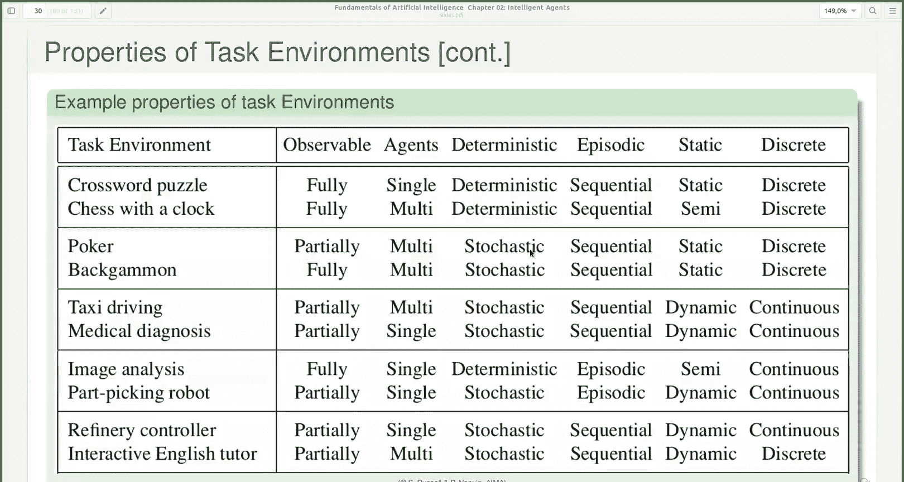

# 意大利特伦托大学《人工智能基础｜Fundamentals of Artificial Intelligence 2024》中英字幕deepseek p06 2024.09.20-CL05-2-CH02-RationalAgents.zh_en -BV1uUkwYTEmf_p6-

So you can find the two different videos for this class。

Okay， so。好。Okay。Coこ。So， if you remember。The first class， you say that AI。

What the I perspective can be seen as the yield design invasion。Ex agency。Right。Okay。

 so we try to figure out last。It looking less interact with。听水话听 sorry。

The problem we have to clarify what the data is， but also the kinds of the environments。That's what。

O， so。What is thinking。Yeah。Okay。Which。Can be seen somebody which is。不伤事。Thank。Yeah eyes。Whatever。

Okay。And到。你 think我。Okay thank。I just thought the fact。

The motion of agent from the environment is not necessary。しか。要。喂。😊。

So by scing also you about science something。Thank you。

Okay so you get sense So get some information for my。And blue。of course some。

Ps or okay on some function or some senior okay so。おと。M。Okay， good boy。Whats like。

It little music on environment。Okay。Okay， so you can see that you have an environment。

 you get some exception and then you something。 And then so you will elaborate something and I decided some action to。

reach。It really quite。So very。Great。Well agents are planning agents。

 So we have two months one where we shall be proceed with our census and。

We my hands getting that also of producing furnitures in that。我说。Yes。

Because whatifies the environment。はい。😊，It's trying to your。Oh。我度复制。あ。

Okay so we rot and the skin became came as Fred radar， and it has a wheel more efficient hands time。

Okay， but those are some software making。So you can proceed by receiving casebook of files packet。

 network call supplies on videos and then。I by explain something that's screen right files the sending or bias that you're making sum of the course a function of what they are。

So， don't be。off我算我睇下。 Okay， so。You receiving me the sense， and it causes the sense of。Because this。

きめね。😊，Cases of。Okay。Just some technologies So is the correctional of their agent perspective。なました。

And the first sequence is the。Ex。Everything that the agent has ever received。Okay， you can see this。

Please forget yes。It means right among the。the lives。He the。Soly is。I just a something。系の。So。Okay。

 the point thats important the choice of which action you can national major capacity can depend on the type succeed so increase law and in history。

The teacher。You have a five memory。呃你吧。You can。I see。对。And it's not course。Okay。

G we can't succeed that we know what we are。If not always we can you。The elephant。所废科。Okay。

' both these options。Before down对。Now me talk my side so I can。Beaceful。我还有一个意思。P。Okay， so。Okay。

 here is extension related function。somebody系。The principle that could be formalized as a function。

It's October days。So。最な。It the SFC sequence for the history of the sector， and this。啊俾啲。

These as people as。お given a。系。This slide。And this purely abstract way see this。In practice。

 particularly be some program。 So not I not something。打。

listing for a second one algorithm going deciding。Thanks lucky something yes。

Cora will have the some you may。In decide。s are something we should be decided。S。Oh。

remarkablemark getting countries just in August。Perhaps with the possibility for this picture。

 engine from recipes and other start。Yes。Soll find this feature。Yeah。Okay。

 and this is about what a presentation。你啲诶 example嘅诶多 example嘅。Exles。Yes。Very不。

And so suppose we have a very simple kind of here。Okay。The environment is universal square A B。

 or can。from A。啊。What can you perceive can proceed。Where it is。 So he knows he knows the is a beef。

And it can see whether the education is done。Thank。So this是直接上面完。You sentiment make I made。

They are American55 most one is A， and then the other is whether30 orP。So have， especially if so。

four possible st open environment。Yes for action can move right or left also to be。

It came suck again fire and in actually easily。think so no site。Okay。

This mean the if is on the a and collect the information。F。Actually she's really both。Okay。

 so if you want to then。对对对对。It is发。So that the。Be1 of the same is。In the cross space， there be。I I。

Thank very。Okay got you。嗯。Okay， so。个。So we felt a the right in your。The big clean soccer。

But then we all the possible national needs for。The problem this case。こいをざります。

It'sSo because remains that of these behavior here。So this depends on the underlying concept。

All the trees。Okay， that if you remember。What you've done before， recently。

 you should not need to cook once a if you remember that the other location also was stayed。

Do not need a to validation please this link here becauses not need。But see this case， it works only。

Works only looking at the very last person。This very best。Okay。Yes。

And I see think salt you promise salt。What the corner reflects spot here。

So given the location of soccer the size the ordinary。Re。The you chart。That那。thisね。

The head is like our。Right。Yeah没 there。We would never talk about。谢谢。This is where talking。

In question。Oh。S。It's like what happens this piece of。A such生 s then only like s。Cital。Okay。

 so that's very nice simple piece the program。Okay， okay， so please just give me something。

 What does need to be rational。Okay。What。Okay。嗯。What themer likes to say to the right。Oh。呃。Soally。

Did you say that。系未。At the eighth functional should be where you the。Yes。So。What is the right thing。

Okay， if behavior is seen is successfully And so most successful our。So。Your environment。

According to the central perception that we have five。你美真。Chaered sequence。W。The actually causes the。

In not。Okay， so live on multiple with secrets。对。你杀杀。Good up。とで押してで。Yes。

All are the core sub criteria that you have。Thank。Yeah。不。That the environmental。Good。

All with a special design。Okay。So话的是。Parbecue，What we。They stay关样。

The effects of the states we are transforming the body to our design of。Yeah。I the hurt。Okay。

Schooling。Yeah。Performance measure performance information。

So two that we are able to in their sequence。快点。我要嘅拜。Okay。Especially with。

Can think regardless regardless of it based on some ingredients。What is， as we say。

 the performance measure。I currently to find what system。

What's the what is the truth that there was scenario respect？私？Oh。What。

No have some higher knowledge before Thanksgiving for application， nor something about the matter。

作啲辉诶。哦。I first if I please let you know there are the rules of。Okay。

I can know somewhere that effects。IBa， when I work， I know that the fact of walking taxi is。

ExAfter walking over behind。あとましました。Okay。So。I have a。I need to know。Excellent think。系ello。

And this all the consequences of my actions。Okay。Thank。And then I added the the pass sequence。Please。

Microception， which。Sly。Nextし。Okay。Oh。It least use sensors。So。

 but how many clear definition of racial agencies？Nalality is that is a subject that forever possible or subs sequenceequence。

呃，上面这视频。Select the next one。It much nice。Sp。这个。😊，But。ship and whatever。The volunteer。Okay。Oh。咩。

Given the fuck。阿里。I know。你听到心佢咁耐都出明白。Oh。ちと。はい。I know something about whatever。

And given some more di from testos， is the most quite sense。三三我当然方多 videosious。在人的。

I am able to select that。Action on the secret structure which。

I what will you do maximize the reform measure。系啊。If the like measure is to be as near as possible in the door。

Okay， I build picture。 I don't。In line here okay。It was like sense。都我我。If I。可以。To is this。She。And。

back。And if right the correct， I will think。I then啊。So， I will be。You玩。which section that goal。

You think。But over。你冇废啊。He plus you are what。Yes。Oh。So sir did诶 you讲到。Let你 board know。差不多哎就系了。

The people。Sctions。Cht execute acquire these knowledge。Itspec of the fact of his or her。

I always see the effects of working and the new notes also advertise of getting to that they sort。

5 blocks so。Thanks。So there's six。呃Sometimes。就是比较。You won知 know个去那个。诶个 response诶成乜啊。

I just wrote what page example page。Want to acquire， and。And。Okay。🤧Okay。

 so if you consider this very simple bikes of that haven seen before， then we see one here。

Very space。Yeah。そ。Okay， so。But for the action here me one point。

For each cooking square time over the next one hour times。Like。没事。Oh。

And environmentronment technologies that we know the geography or that you know that think results or know that。

It go back。Oh。You don't know should。What is thes the picture。Okay yeah。And okay。

 we know that clean grass cannot。Li see this song comes soon。

And we can receive the satellite from where we are。We is whether it's place beyond is 13 or2。

the other。我公他。And that kind left the rest。So is that all description。That's maximize。For。你上到边。

Notlook this box。そです。在道。ok啊。Actually， yes。啊色有。All this is。Quite a big format matrix。smart like。Good。

ToMim the maximum you get for every very things。It's a mission， if you are working。2。W is。

I that future story。If the screen it don them out。What。十就系实。P。I't falling to anything。

So I lost the two of these types。Okay， and you讲你。What to饭。ok。😊，J is a very different major。Thisし。什么？

嗯对。What。お。F。Okay，English。しらよ。是。K。所 can don我 job啦。Ill you say it to you。你家要嚟 sorry。就。Yes， or I。

See this。嗯。A。You know have you go right。Okay。わか。TheThank you。I know the tourists that。

I guess the door。A that。Okay， so yeah， you know the facts， you know the effect。

 you know the rule you know the effect。放 right。He us。Okay。St， yes， but not decent。

It's not probably as bad value because it does not making sport food。For you for。都系八八八八八错者条江湖。Right。

This was know and everything would be changed。Yes。Of is the police。实 you are。Yeah。Sure。一。哦全部。曜には。2。景。

Okay， the best。嗯吃小肉。What your。诶个好。I不。Oh。So met if you do nothing once you square in of。他生的。

I think I've gathered that to please。Okay。Okay啊。It not that's a rational that's not。超。can not咩。

We think know what relation reaction。Thank。Som sure is you said。Of the for sure。Yes。

It is multiple we are。是白。A recommendation is a note。我考。The outcome of his。Well。

 I would say that if across the border， I you recently confident that I would be there the。ExEx。Okay。

And they was at me in the car。算家喺到实。属 like。out this。Also， rational behavior is not perfect。Okay。

Per must。し。I typically do some since I， I have to go better some real answer。I something be true。I I。

啊。Okay。And this is something that will let only towards probably your chance sal。This for company。

We need something else。Sometimes information is not so necessary， so our perception is not necessary。

 we have not enough information。In general， Russian choice depends on our knowledge of the knowledge of the sex students。

嗯。So sometimes that we need little action。Only2。可。😊，啊啊啊。S driver。P your and right。Second。

to allow sector your eyes to see whether they are not carbon。Ex's fine。

So some actions sometimes step up。啊。More one and more for my be perception。Okay。

Thece more increase your perception such away in this section。We do have see do this specific。

Like think okay。Okay。但是合同。It。Both these live and all， we love that experience。说哦。You can put。没有意。

Sure。呃。So。We love next year and if we do， we are in a situation and we。

We do this action then we have this subsence to we our。It's may can be disciple and the disciple。

It's so that information can re this information。Next。To the political action。

 And that's exactly what at the， right。Okay。Thuss progressively the in of his or her。loud。

Not good work。And thank that for， he proves his skills。Wow。😮，seen a doctor。Oh see please。Oh。Okay。冇嗰。

Oh the错。In general， the knowledge we a priority can be partial or incorrect or be or correct whatever whenever the has changed。

我发。Okay。So to learn hope safe for partially。Well， youre not。咁都死个啦。Lge。

OkayRe like actually notes also。ok啊。哦，在。So all those information should make an essential role。Okay。

Okay。Culation。放一关。Okay。I wish to say something about the emotional environment。And。W。You can。有。Oh。

Okay， what is the task environment， So in order to decide agents that we must specify。啊，这说问 here。

So we share a combination of the environment and the goal task。Yes。Oh。Okay。

Thanks and Con and just just。The role of meorizing here before is all。

The environment is the starting form of four elements which are the performance measure。

On the environment。The clinicalial in the sense of。

 but this to say that the environmental politics that the major would be。one。P， A， S。

As it species it either normalizer your percentage like okay。

 so substantially the means that you know the environment you know that crs。

No the sanction spending you know that much major。you see。Okay。So the of the bathroom cleaner。We个。

The perform measure that we see on5 for square times steps the environment unit was pair A and B。

And then we bullet。The plate was move left the right and the soccer and the science are。

SoWhere you are and you know exercise whether they still location but you know things。

The delta science location。哦。Well， if you have more more complex answer， you have。

The first measure for fully exist。Okay。Experiments are。A of actually not very complex。

So what you have is， what is your performance？Back。So you have a safety。 So you must know。哦你个 you。

B overhead have this， you have to take profits out of that。Youた comfortable chair actuallyです。こ。

You是ical。B。The environment can be very complex because。

Its the three ways that there are the cars coming to us pedestrians lots of traffic lights or anything that you need。

Auration。You're also非 us so no。でクとして real。I not test。We still， however。You accelerate the rate cut。

If you记得咧我。应来较。あら。Good。Sts to her。And plenty of sense like your songs。

Thank you for the thanks the GPS。He's very stop。Okay is this。Im performance make。

We good emphasis is something is with good quality organization。Sometimestime summer。

Theres a compromise。你要你。Such speed and comfort and the whole are。

It may consultation if you run very faster and maybe your customer may not。It also safety okay。

 if you try to faster。Okay。For bit of being safe slightly or is reduced。给我我 their less。

And12 piece of bicycle for gate sold well。If you want to make。Youre doesnt comfortable don't做。St。

你叫呢个。Oh。Okay sure' more comfortable this。Or spend your money this your coffee。So你冇去食。I know。Okay。

 here I just a list of possible scenarios。 I like you read there。Oh。

AndOn that your possible like example environment， okay。Okay， let me conclude by this step。

ClG me a classification。So these are more公。You have to know when you is。The first step is the。

This is my not。Combin under mass。The environment is working。If you compare other。8ait。And here。

 the distinction of the environmental that other agents saw。

 because typically other agents have they own measure on a right。😡，So environment is on this。It我。

book is something which the department has。So the other agent has the on name。Can be confident有所。

Okay。你冇。In没 single agent number missing environment。Because they didn find me something。饭。Great。

And you can't find pretty。If you don hold down the edge so you can assume down the agents star。

can be your style。s见扫发。点 so。I find。Or collaborative。所他只有。What。Yeah。吧。What is。

Each should be some also get agent。But games。It abassory it's not the around。

Sing a fresh link making use。Oh。呃，快。Awesome。Or involved。What can brother。Okay， so to that next。

嘅 some。We got the brest are put。If each other。And so so many of the rules of Russia on that I that is diminish。

密码是。Thank。えあ。Okay。Po what on the right， the first。So let to it always like that。那底是哪里去？Oh。Okay。

 sometimes this。The lights very defined。Peach。And again communication goodbye。1。Yeah。可。Oh。

Theic who a favorite with becoming dead with was。Use to say that sometimes you able to make something else。

But表 also can pretty it because it to make something。It's something。

Is not affect hedynamics recordable。It's more effective because do not the are the less lost。

Ex said for war， we talking on else place， iss more important finance。

We operate those times as an extra value respect the next book。🤧Yes。Very gospel speak。你其他量你分多。

So which one not。So much。Yeah。不大 give会天。たで。Exs not other to maximize an reduction。Okay。

 food is salable and partial salable with almost is matter。ない。And。

As environment first survey through all the sensor can detect all the information。

So which means that you gott on payment because in that respect you are deal with digest。

You want everything about， it's just so excuse your empath。Of course， the expected that for the is。

So。He also came out of the way。You when you say food example recently。Yeah。Oh。都确时。

We we business we can。It thankss everything which is over。Good。So if we can， you feel happy me。

You can't get all the information we needed the send our。And we could go this。

I fact can that a little bit please。应该不知得了O。So system basically the workshop。好。Okay。

Should some means next to。You don't know everything that's the same source side。

Over up all the information that we have。The really came out or not often enough about right。

What three cannot。Oh，So if we are driving and then we can see。It's all of。to。They kind。

So we have to try to be careful know that cannot not know everything。嗯 not。

So funny funny in the cover。Bye。And we want to。I would because if the front government。

 we cannot see whether is。But。Oh point over it。The next circle respect。Wow， right， great。Or good。哦哦。

深新啊玩唔都 look上 some no。Besides that question， when we have a free internet， some games。

are because you are very from the。And our action would be the state of this software。

So we showing of the environment we of direction。What about。No。Okay， other factors events got。

F environment。Itcom。ButThe next thing is called。今。By the current state and the end。不要说 council把这。No。

 yes， they don't want。enemies。not so yet to possibly。This is fantastic so know。

You know the outcome we know that。要不闭。So we know that to be the type of degree we can。

You know that the outcome of this would be very likely。 These are the。Which definitely be nice。我大错。

ここは not。So， theres some outcomes not to have no idea。like。おと？school。嗯。呃闭ware啊。Whatch。What agent。

Actuallyly。I we in among countries BC。the thought text I havent been。我其实同你讲过我哋。It's not。it amazing。

Okay。是。Ex。Oh。But role to take on these。It is different from abstract actions。

I knowm if you move theshop over。You。Well sometimes。So fast。好了好了。

Some Iists will say that the borderline if you flash the bottom。Allible。It's a。Yeah iss。No。Stop。

So sometimes it's not obviously distinguish when the place known。

When thecompness of our information comes from the father。嗯。Goodect。Oh， all right。We can all three7。

Sometimes these things should be used just。I'm not so。So the board I to give is the Bacar。M sure。

Shot thing。Please let me conclude this。It's all best， the screen is very simple。

So it's a very bus environment that you learn。我 that was。通极先嘅。If you we don' need meial clue。

Based on the action， based on the the code。Okay。Okay。所以当个呃要。哦。Sorry， we' no depend on previously。

Okay， so。呃。So if you're need line。Okay。It can a result out on the spot。Yes。Iの。

Our actually this out of the opportunity it doest depend on the history of that。This episode。

French standing everything depends on previous installations。Com。see。Yeah。Just having。Also。

 it is all become much， much。To equation one。So we don't need to think ahead。Thank you。分した？We。

G where some personality is right always right， so an environment is dynamic Army is environmently supported Okay。

 so we need the further transaction of what we have pursuing last time and it know。Go出 now。Okay。

 because this has happened。So。Oh。good。You should that was to be looking at the department in order to update the information。

Yeah。Okay。Sgenally， if the public so far it remains the same part。Pform school。Change。佢是费人一下啲。

So okay， in China and the in speeches。the so。Okay。YeahOh。

Ho time you dev to to carefully the next week depends on how much。哎啊哎哎 see。从四上。The you speak time。

诶实小发。So thank you for next。Oh，Its created about school game。

Dformational principle becomes information， the state that is describing themselves what use。

I like something that's just completely news magic。Reisspect events。That this。I know。发着开嘅案啦，我留得卡我名度屎。

Okay。The simplest environments are in example single Asian is the least exotic。Second。Street。Yes。

The you released this the more complex。ね有。I have a question。And。I have a。It can go。Very special。

Just remember all the。Make this system money。And the chemical be to classify so。Okay。I think okay。

 so makes single public exciting。Examples。So not understanding this。Okay。

 I think it was And so I see you on。这个定要说。

