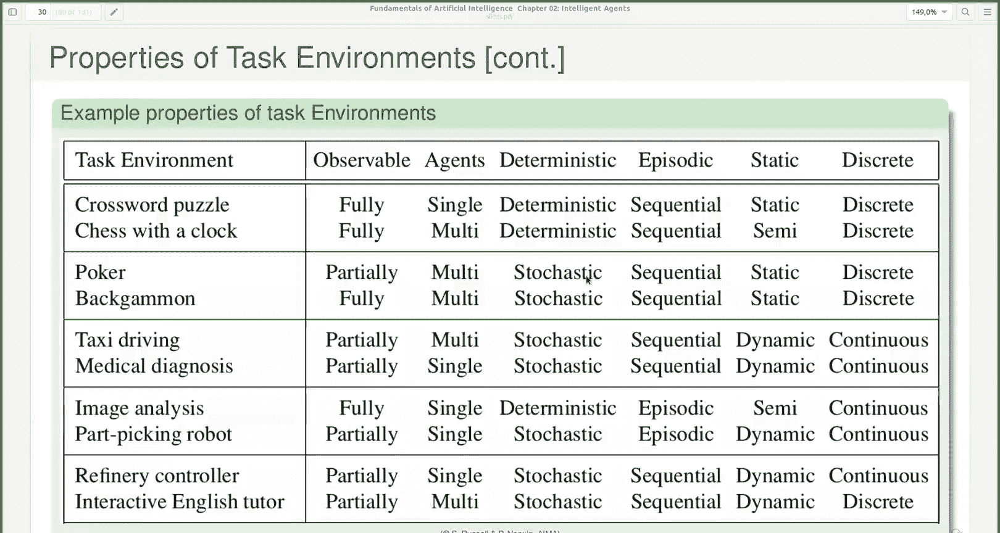

# 人工智能基础：02：理性智能体

在本节课中，我们将学习人工智能的核心概念之一：理性智能体。我们将探讨智能体的定义、它与环境的交互方式，以及如何评估其行为的理性。

## 概述

智能体可以被视为一个通过传感器感知环境，并通过执行器对环境施加影响的系统。其核心目标是基于感知序列，选择能够最大化其性能度量的行动。理解智能体的结构和工作原理是设计有效人工智能系统的第一步。

## 智能体与环境的交互

上一节我们介绍了人工智能的宏观视角，本节中我们来看看智能体的具体模型。

一个智能体可以被形式化地定义为一个函数，它将感知序列映射到行动。

**公式**：`行动 = 智能体函数(感知序列)`

在实践中，这个函数通常由一个程序或算法来实现。智能体通过传感器接收环境信息（感知），经过内部处理（可能是基于程序或算法），然后决定并执行一个行动，旨在达成某个目标。

## 理性智能体的定义

理解了智能体的基本交互模型后，我们需要明确什么是“理性”的智能体。

理性智能体是指对于每一个可能的感知序列，它都会选择那个能使其性能度量最大化的行动。这里的性能度量是由设计者预先定义的，用于衡量智能体在环境中成功程度的客观标准。

理性取决于四件事：
1.  性能度量：定义成功的标准。
2.  智能体对环境的先验知识。
3.  智能体可以执行的动作。
4.  智能体到当前为止的完整感知序列。

理性智能体并非全知全能，它只能根据已获得的感知信息来行动。同时，理性行为也不一定是完美或最优的，因为它可能受到信息不完整或计算资源有限的限制。

## 任务环境规范（PEAS）

为了设计一个理性智能体，我们必须首先明确其任务环境。这可以通过PEAS描述来系统化地定义。

PEAS代表：
*   **P**erformance（性能度量）
*   **E**nvironment（环境）
*   **A**ctuators（执行器）
*   **S**ensors（传感器）

以下是几个任务环境的PEAS描述示例：

**吸尘器世界**
*   **性能度量**：每单位时间清洁的方格数。
*   **环境**：由方格A和B组成的房间。
*   **执行器**：向左移动、向右移动、吸尘、关闭电源。
*   **传感器**：位置传感器、污垢传感器。

**自动驾驶汽车**
*   **性能度量**：安全性、行程时间、舒适度、交通规则遵守度、燃油效率。
*   **环境**：城市道路、高速公路、包含其他车辆、行人、交通灯、天气变化的复杂场景。
*   **执行器**：方向盘、油门、刹车、信号灯、喇叭。
*   **传感器**：摄像头、激光雷达、雷达、GPS、惯性测量单元。

## 环境性质分类

不同的任务环境具有不同的性质，这些性质直接影响智能体的设计复杂度。我们可以从以下几个维度对环境进行分类：

以下是主要的环境分类维度：
*   **完全可观察 vs. 部分可观察**：智能体的传感器是否能获取环境状态的全部信息。
*   **单智能体 vs. 多智能体**：环境中是否存在其他也作为决策者的智能体（可能是协作的或竞争的）。
*   **确定性 vs. 随机性**：下一个环境状态是否完全由当前状态和智能体的行动决定。
*   **片段式 vs. 延续式**：智能体的行动是否被划分为独立的“片段”，当前行动不影响未来片段。
*   **静态 vs. 动态**：环境在智能体思考时是否会自行改变。
*   **离散 vs. 连续**：环境的状态、时间和感知值是否是离散且有限的。

最简单的环境是完全可观察、确定性的、片段式的、静态的、离散的单智能体环境。现实世界中的环境（如自动驾驶）则通常是部分可观察、随机的、延续式的、动态的、连续的多智能体环境，这给智能体设计带来了巨大挑战。

## 总结

本节课中我们一起学习了理性智能体的核心概念。我们首先将智能体定义为一个将感知映射到行动的函数。然后，我们探讨了理性智能体的含义，即它旨在基于给定的感知序列最大化其性能度量。为了系统化地设计智能体，我们引入了PEAS框架来描述任务环境。最后，我们学习了从多个维度（如可观察性、确定性、动态性等）对环境进行分类，这些性质决定了智能体设计的复杂度和适用算法。理解这些基础概念是构建更高级人工智能系统的基石。