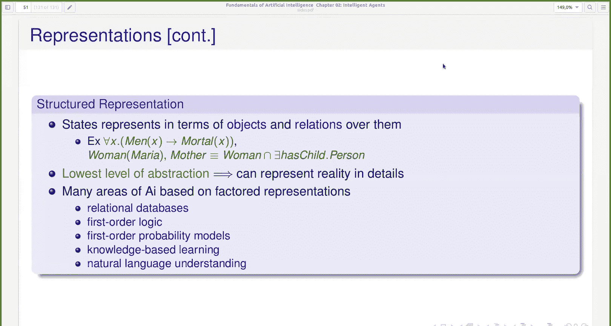

# 意大利特伦托大学《人工智能基础｜Fundamentals of Artificial Intelligence 2024》中英字幕deepseek p07 2024.09.23-CL06-1-CH02-RationalAgents.zh_en -BV1uUkwYTEmf_p7-

Okay。と。As I anticipated last time， we are going to have。AQu boring couple of classes。

 And then I am afraid， I will。Also today's one will be quite boring。

But I think you need an overview of the main terminology and the main issues about agent reasoning。

 then you have。You can choose an adultocc course and multi agent systems in the next semesters。Okay。

 so last time I anticipated。All the kind of task environments that we may have。

So I don't want to list them anymore。 And here， there is your book makes a list of。

Over possible scenarios and possible example。 I just to conclude that part， I will。😀呵哼。

independently on the kind of task environments， there is also one。

Something which characterizes one scenario in which develop an agent is the fact that you have。

The state of knowledge， if the state of， what is the state of knowledge of of an agent so。😀。

Whether the signalol is known or unknown。So if the environment is known to the another key difference is whether the environment is known to the agent and when it's not known or more typically。

 what is the degree of knowledge of the environment？So if everything is known。 So if you have a。

WellWhatever game or whatever typically the the environment is known so you， you don't。

 you know the all the rules of the game and that and and then you can。

You can guess the agent can understand the possible outcome。 So if the environment is known。

 then the the outcome of all the actions are given。 Okay。

 so you know what will be the outcome mod lo must or。The outcome probabilities。

 if the system is stochastic software if you have a board game， Okay， then it's known， if not。

Then the agent will have to learn about。Okay， so first。

 if you think you have a robot who is exploring。Some flat。

 So suppose you are antiterrorist unit and you have an autonomous robot who is exploring some someplace he has to learn。

 Or if you have a vacuum cleaning robot in your house， maybe some of you have okay。

 the very first time the robot has to learn about the environment。

 So he will go on and run run around and be into its mind to say， sort of map of the environment。

Okay， notice。Yeah。This in general， orthogon with respect to independent with respect to the task environment properties notice that is different from known from fully observable okay。

A known environment。Can B， yes， please。Sorry。In general， you So this says known。 Okay。

 the state of knowledge is a state which can change iss a state of knowledge。

 So currently my knowledge of this environment is unknown， but then eventually after exploring。

After exploring my， I came progressively past a known state。Okay。😊，Well see， search。

Well see search in an unknown number。Okay， so there are adopt techniques in which you can do search for。

Under the condition that you don't know an environment。 Okay， so notice that known does not mean。

 as I say， this is dependent on the task environment。Kown is something that you know in environment。

But the America not part yourself。 so you know the， for instance， you know the game。Okay。

But you know the real rules of the game， but there is still some information that you cannot gather。

Okay， he's on deck。A circular game game， you don't know。 So you prefer know how you works， Okay。

 but this means that that's some information that you cannot gather。Okay， so the deck。For instance。

 okay。And also a unknown environment can be fully observable。 So again， I don't know the rules。 Okay。

 if you are， if youre supposed to play。A game and you are invited by your friends to play a game for the first time。

 then you will have in the very moment you see before your friends explain you the real games。

 everything is fully observable。Okay， but you don't need to ignore。The outcome of of the actions。

 Okay， so just to say that known environment and。And they all the properties that all of the task environments are something different。

Okay。Okay， so let's go okay， I know that this part was very， very boring。

 but just a sort of classification， just introduces you some terminology。

 youll bump we'll bump into okay， in particular when we see planning， but also search。Oh。

 so we have to。You have to understand what makes an agent okay。

 so you may have different kinds of agent and how you are organizing destruction of what are the main features of an agent how they are organized。

Okay， so in general。Agent， you can think that an agent has some architecture plus some agent program。

 you have already seen what an agent program is。And I。😊，啊。AI is about designing。agent program。

 so something which solve some artificial intelligence。Task， okay， fashion， if you prefer。

but the agent runs over some computing device。 I keep you just to always keep in mind that an agent is not necessarily physical device。

 Okay， so isn' even a bot。A chaable is is a device。 However， it must have a some。Architecture。

Maybe possibly only soft architecture。 Okay， so some layers a softer on top of which it's running or also physical one。

 If you are actually designing a natural robot， physical robot， okay， but you you have a。

Something which has。For cs and actuas， which do not necessarily mean。Arular device， Okay， software。

 same sort just。May in， in for a chat board， the sensor may just。Be primitive soft primitive。

 which is science which are received some inputs and actuaators are simply some primitives which allows you to output some messages or output to some command okay。

Don't be stuck to the physical。Deevvicice image when you are thinking of an artificial intelligent agent。

So substantially the idea is that every agent， whatever it is， have an input。

 which are the percept again gather information from the environment， whatever environment means。

You have the。The action， which again， do not mean necessary physical action。

 may also mean producing a message or producing a call to some function， some sort of primitive。Okay。

 and and the problem， the problem which decides an action as a con sequence of the percept history。😊。

Okay， but we know what with the program。Okay。诶。🤧。Okay。

 keep in mind also the following that an agent function in general。

 remember an agent function is an abustock mathematical concept， okay。

 takes an input of the whole concept history。Okay。Instead。

 an agent program at every step it takes the current percent。Okay， so what does it mean？

It means that when you need。Part of the history of perception。 you have to remember the perception。

 You have to maintain a state。 You have a。An agent for long needs some memory。Okay， do remember。

Remember the information。 Okay， Remember， the after all remember。

A representation of the state of the world， which allows it or him to get to produce the next action。

 which represented the interesting part of the the Poette history。Oh was there。Okay so。Okay。

Most stupid example of agent that you can think is the table based agent。

Which is not that different from this very simple vacuum cleaner device that we have seen the last time。

 So substantially。The table representative basically the agent function， Okay。

 so the idea is that you have the persistent set of perceptioncept so。A sequence of perception。 Okay。

 and the table， which is a table of of action。 So you just have an action which associate any percept sequence。

Associative action。 and what it just does is。When whenever he gets the newer。

 he paints it to the list and then makes a look up to the table and the size which actually in general。

 remember that the the agent problem is something which takes an input。😊，Epercept and reance。

An action。Okay， with intended meaning that。Keep it may remember。

Either a perception least of perception or。Some information which is useful out of the percenttic story。

Okay。Well， this is obviously a pure theoretical thing， right， is theory to I think。

 which has no practical meaning。There are。4 basic kinds of of agents， agents program。

 The simple Refx， model base ref。And then goal based the which actually is and the utility based agent。

 which are both evolution of the model Reflex agent。

 some authors call them model based goal based agent so you should you should imp add the model here also tell us two ones okay。

But however， you don't want to a depression let long。Okay。

 so the simples is the purely and also or in a completely orthogonal way。😊。

You may have agent which are able to learn。You have a learned device which can be associated to every possible form of agent。

诶。Okay， so。Let's take this the simplest possible agent at what is called the reflex。

Reflex is substantially。Reflxes agent are those which act are memoryless ones。

 so which act depending only on the very last percent。So they' are sort of percept action。Devices。

 okay。Well， we have a seen example。 This toy example over the vacuum cleaning is a simple reflex agent。

 It doesn't remember anything。Okay， so。嗯。So you have well， this is a general architecture。

 so you all have the sensorensus。You see from the environment， the the perceptioncept。And then you。

 which gives you the notion of what the world is like one。 So the per。Yeah。

 you perceive and you have a picture。Of the world and now of the environment。

 actually of the relevant part of the environment。Okay， and then based on that。有。Oh。You just react。

 Okay， you just react looking for instance from a set of condition action rules。 So if this is true。

 then do this。 Otherwise， if this is this， you do that， if this happens to that。

 So you have a sort of if the nails。Program here， which you can write down as a list of rules which you may match and then based on that。

 you decide what to do。诶。So if the car in front is breaking， I mean you can start breaking。

 for instance， okay。This can be implemented for eastern if then air or some boul circuitus。Okay。

 so there is a memoryless device。Okay， so it's stimulus。Rereaction。Pure stimulus reaction。

 for instance。诶。But you may think this is quite。Nfe， right。

 But there was a whole thread of an AI in the 90s brought by Rodmi Brooks， who is very famous。 Well。

 you may not know who the guy he is， but he's the father of the vacuum cleaner devices。

 So you probably his father of much more， much more， but probably。

He became rich by me because he started he with he is a student to start a Roomba and these tools which were able to drive autonomous and they were。

Book idea of。Insect， autonomous insect。Sort of device with legs and， which were very basic。

 did not take much time in room doing complicated reason， but just reacted。Autonomously， from。

 from Suli。And this was。Came out quite famous because this was a sort of。诶。诶。

Exception to the the general thread at the time in AI in which everybody thought that。

Autonmous system should have a heavy component of reasoning。 So there are pretty reasonably less。

 even meant nearly memoryably less， but just reacting to stuli。Okay。Well。

 what is the good news of that is that this is very immediate， very efficient， right。

 so it's does not require very does not require。Complicate computational thought。 Okay， well。

 you understand that it is quite limited。 what you can do having a memory less device is quite limited。

ok。And also。This also has an implicit。😡，Assumption that you can the perceptioncept contain you can achieve by by perceptioncept all the information you need。

From environment。So。You assume principle the full observability or whatever。

Defined as a practical relevant。 So the capability of observ all the， all the information from。

 from the system that you in you need。Which is。Very often unrealistic， very optimistic。

 so you don't know always how you not always has have the possibility to gather all the information from your environment。

Okay。Okay， okay， so。Of course， implementation well， I think that。Now I can't we conclude clue。没的。

Okay， where the implementation of that is quite trivial， Right， So gains。

 and you have a set So isn' a set of rules and then。You。

 get the perspective that you interpret the input and you you produce representation of the state of the world。

 So remember， we are in the assumption here that we have a。The fact of full cability。

Or practically full of ceability。Okay， so then and then once you you know your state。

 then you can match the state with the rule and deciding an section just looking to your program Okay sorry to the。

To the set of rules which can be implemented same by Bo and C if its or combator if then else or a database or whatever。

Something memoryless。Something purely convenient yet， okay， no state， no memory。Yeah。ok 啊。That's。

 as I say， the good news is that it' is very simple。

 it requires very little computational and thought。

 so it's very easy to implement relatively easy to implement depending on of course what do you mean by representation of your world。

 what your environment is。That， well。The main drawback is that it's based on a very strong assumption。

That is the environment is pre observable。Okay。So you should know everything。

 So the information that you gather through the percept should be complete。

 so is should be provided all the information you need in order to decide the next section。Otherwise。

 this is not feasible。Okay， so this is the。The simplest possible agent schema of an agent that you can conceive。

Okay。Model based reflectslex agent。 So let's add the something more。 So what if we don't have。

Full observability。We notice that this is something that will。

Will devote a whole chapter to his under under a partial partial perception， Okay so。Let's go。

Let's anticipate and give a high level idea of that。 So the。When you have a partial of salable。

The key point is that。You should。 you need the memory to keep track of a model of reality。

Which fulfill the information that you cannot。Thanks。What does it mean。

 So you maintain an internal state and you predict what。呃。From the。

Your memory from the state that you had and from from what you gather。Okay。

 you predict the missing information。Note is that this is something that we do。Continuously。

 we as a human。Beings do continuously。So。Our scienceors。Are not instantaneously omnishaed。Okay。

 so for instance， our eyes are directional。 Okay， so I'm looking there， but I don't。

 I cannot see what。What's there。But for instance， I can assume。While I'm looking at you。

 so for instance。Im speaking to you now。And I， in my mind， I have the implicit assumption that is li。

Who is currently projected on the screen is the one I left。So I'm speaking over。

And the the assumption that you， you have a model based slide。 Why is the case。

 Where can I afford doing that。Because last time I looked at the screen， I saw there wasn the slide。

And then， I。Memmoirize this fact， I in my mind。 and I did nothing to change。 And I assume that this。

Did not change。 Okay， but in particular， I did not push。The bottom here。

 so this slide did not change。So， I。I have a situation of partialability in the sense that I don't have an eye looking there。

Myself， but I assume。If I remember。That the state or that board or that screen represented the model based。

Lide。Okay， why， because I， I I remember that I have no reason to believe that this has changed。

And okay， see in particular because I deterministally know that this changes only if I push the bottom here。

Okay。Is this clear？Okay， so what you do in doing that。 So you see， if you compare this picture。

 sorry。This picture， this is。All the word。 Now， what the word is like now。

 So the the representation of the word is something that you completely have from sensorensors in the previous case。

 In this case， this is not the case。And you have them。From that。

You have to gather a representation of the state of the world。

Which you can you must memorize so you need the memory。Okay， elaborate。And a reason。Okay。

 you should be able to。Elaborate。え。A possible evolution of the world。So， you should。

Store information。 and you should have internally something which predicts。How the war is evolving。😡。

Okay， this includes also。This includes two things， how the words evolve in terms of what what the status。

 so how the missing information。Evol may have evolved。 But also。

 what is the outcome of my Pris actions。So if part of the information don't have。意思。

Touchched is changed is depends on the on my own previous actions。

 I should be able to elaborate what。The outcome of my action would have been。Okay。

 so thinking of yourself driving。Okay。You are driving。 And again， your eyes are not。 You are not fly。

 You are not flies。 Okay， so， so our。Our eyes site has a sort of comb。

But sometimes you need when you are driving， particularly in traffic。You well。

 sometimes we say we should have 10 eyes， right， So you should look what if a car is coming。

 if you should take a look to your back back car coming。 blah， blah， blah， right， so。

We continuously switch sight from one。Okay， but how can we。Ford。Switching site。Because， okay。

 so I'm driving。And they see no obstacle， no， no pedestrian， no other car within。30 meters， Okay。

 and Im driving reason is low， okay。So I want to take one second or have a second to look if a car is coming on my right on my left。

Why can I afford it。Safely for， because my brain is implicitly calculating that。If no car。

 no car is coming， I have no obstacle within 30 m from now， okay and。I'm going。Reasonably is no。Okay。

The time I take to take a look on my right or on my left。During that time。

 nothing particular danger is going to happen， so the rest of the environment and of my actions the fact that Im。

I'm。And moving on will not change significantly。In such a way to put me in danger if I move my side on the left of one right。

Okay， we continuously do these sort of thing so priestton you may common life when driving。

 when even when you're riding a bicycle or whatever。ok。😊，So。But also。

 you should be able to predict your own。 But if you turn your steam wheel， then you expect。

You expect to turn right， which begins is that you expect that your side changes because what。

 if you turn right， you expect that what previous going on right， then you are in front。

 what previous is going in front now is on your left。But your brain does this automatically。

There's a sort of prediction。To do automatic， Well。

 you don't know you don't have this capability the from birth。

It'sSomething as a child that you learn to do。I suspect that。When， okay。

 what happens I started teaching this course three years ago。And what they've noticed out of that。

Is that since then I look， I observe toddlers in a different way。

I'm since I started teaching this course， I when I happen to to see some。

Some baby moving you know what a toddler is in English， right， Okay， when I I see a toddler。

 I tended to look at them in a different way I'm trying to。

In in the learning and exactly in in the agent perspective。 And I see many of the things that I， I。

 I seen in， you can see in。In the second or third chapter of your book applied to a baby child， okay。

Okay， and here again， I mean， this is just。Pud sorry code of this architectural an media straightforward forward code representation of this schema Okay so again。

 you have what is very important now that you have a state。You need memory。Okay。

 its not simple reaction。 You need memory。 Okay， you and you need a model。

So you need in your mind building a model which allow you to predict your next state according to the action and what you know about the environment。

Okay。And then， okay， and the last part is the very same as before。 What changes。

Is that in order to produce。The representation of the state of the world。

 you don't have it for free from the sense of all。Okay。

 because you don't have full observability and then you have to compensate。

The lack of full the partial survivability with the model and your capability of building a model。

 keeping the memory of the state and being able to predict how the information evolves。Okay， so。

So substantially the difference is that you have update state。

 so this the the state is not something that you simply have。Outer of。The perfect。Okay。

 but you essentially that you to elaborate in more complex way。The remaining part is just identical。

 other system is identical。Once you have acquired the state。

All the information which are needed to then that the match of action is， is the same。哦。Okay。So far。

We have seen an agent there something which you seem to need to let me say that， survive。Okay。

 so does not have an name and objective。 So you just a reactor。In the first case。

 just to react to the environment。In the second case。

 since he doesn't have a full knowledge of the of the environment。

 it just needs to do more in order to acquire the missing information。 but in any case， just。

Survivor， right， Dec the next action。Without a specific goal。

But simply as what is the best move to do given the environment is a sort of survival model， right？

ok。Or if you prefer。Rather than having goal， you have a goal which is implicit， right。

 So go straight drivingiv。Okay， so how to survive given the fact that you have an implicit goal。

 just to try to to survive。 Okay， now let's have a goal。嗱唔讲了， you have a goal。 So action have a goal。

 sometimes you have more more than one。Okay， so taxi driver needs they can the customer to the airport。

Okay， when I'm moving and doing something， my goal here is reason to go there， right。

 so I have to do some actions to go there。 Okay， I my goal is to take a coffee。

 I have to do some actions。 I execute this door， go into the front of the copy machine put a coin or just take my cellphone and click a few buttons and do some action in order to achieve the previous coffee。

 the coffee， the precious coffee， okay。So。😡，The key point here is that you have to combine a goal with the model in order to choose actions。

😡，So the next action is not only something which。Allows me to survive。不多说。To go into the direction。

of achieving嘅果。In that。What is called planning or search。And we devote a lot of。

Discussion discourse to this。And by the way， you will have a food course。In the second semester。

Which I will suggest you to take。Which is a planninging。我 not我 my。

But personal opinion is that of this of this courses that there are a couple of courses which should be mandatory one is automatic reasoning in one and is planning for an AI background they are not for some reason。

 but I will strongly recommend well for automatic reasoning。

 of course I advised because I am teaching it but the planning course by Professor Ro that Roary is。

Also， I think a course that an AI person should the ground that an AI person should acquire。是代的。

So guys， artificial changes is not only machine there。AndOr large language models。Okay， they aid。嗯。

Vaddia。Is that you don't produce an action。You don need So when you have a gold。

 you should not seem produce the next。Good action。You should produce your mind， a sequence。Of action。

Okay， so as I said， if I want to。To go for coffee， I have to。Search and produce。

 anticipate a list of action。 And then。I store this sequence of action。

 what is called typically a plane。Okay， and I next step， next step， I can simply gather a plane。

 gather the next action plane。Or check。Sometimes its more sophisticated than that to check whether I'm still in the state that would have respect and if so。

 I just keep the next action entertain， otherwise I need replying。Okay。傻。

You need storing a sequence of action， not only produce an action and the action you produce is sometimes it's just pickingtting the next in line。

Okay。😊，Very simple。So， the key point is that。You take into account the future it's not simply。

 so the pressurer to scheme us your future is just the next step。Okay， nothing more than that。

In the goal。Oriented， one is that you need。Elaorrate your future in order look from here to the point where you get a goal。

 achieve a goal。So you not only produce it。One action， but a sequence of action。

And I did the next step。You just try to comply with this plan or readada it if you see that the state is not what the one you expected。

 which。Can be very well the case。切。Okay， so the point is that the rules in the previous cases。

 are just condition action pairs， Okay， they non look at the future。Hereia he said you have blame。

Okay。So you have to decide a list of action， depending on your goal， not simply on route。

 So this part here is substantially the same as before， but now you have something different。

 The choice of reaction is not simply。The choice of exception survive， but just a planning。Meaning。

 if you have no plan so far， you just plan the end action， which allows you to achieve a goal。

If you have already elaborated the plane， you can retrieve it。If for the current state matches。

From what are your。Action， what your plan provides。Ber。Pick the next。

 the next section that you have in the list。Okay， and so。So what is？So they are more flexible。So。

You have explicit representation， the information which support your decision。Okay。

 keep in mind the difference the rule base。In the previous cases， your decision is sort of unwired。

So you are programmed。Sort of to。To you have a pre program device set of rules， Bu， whatever。

 which should always take you from。A priority， what is the next section you have to do depending on your overall future。

On sorry， depending on your state， sorry。Now you are， instead， you have。Some search device， which。

 depending on what your goal is， I'm coming。 I'm coming。 I see I see you。 Okay。

 depending on your goal。Okay， you design， you produce a secret of action。

 What is the difference that a plan in general。Is something which is completely dependent on the kind of environment。

Okay， so is a general search。So if you take a plan， we see that one and we see planning but。嗯。😊。

A plane era is something which。May work， regardless the kind of problems you are targeting。

 It may be something which allows you to plan a trip from here to， to Verona。

 or it can be used for an industrial plant to， to plan a list of actions， a list of or to。

To a doctor to plan a list of acts in the or。Of steps in order to heal a person or whatever。

 So it's completely dependent of the environment and the action something。 you simply give。In input。

 a list of action， you give a goal， you give a representation of the state， and it returns a plan。

Unsurprisingly this very computational。Demanding planning is very， very。Its even worse than it be。

Okay， the worst question。This is just incredible。Excellent question excellent question there are yeah。

 okay， oh yeah， the very basic version of planning is the deter planning so。😊。

When we see planninging， we see？There are many categories of planning。

 The simply deterministic planning。Okay， so the one in which you。

 you know whether an action is the exactly the outcome of an action given the current state。

 Then there is a non deterministic。Planning， there is stochastic planning， there are many。

 many variations on that conformant planning。And there。All those categories。

So we feel exactly what you say so of the different scenarios that you are。

 whether of the different condition of your task environment is in。Okay。

 there are world categories of planning depending exactly on the kind of task environment we have that to give us the。

😊，Fuul of several vessel special several vessels noserv at all。 stochastic environment。

 a non stochastic environment， continuous environment there better continuous environment。 Okay。

 yeah， however， yes， you got the point。 Okay， so but planning。Blending drown is a value。

Umbrella award。 Okay， so。Takes a lot of disciplines with the very。

 very different levels of complexity。 complexityplexity is very high。Is a。

Isn't the word of his space complete？You know what if a S space complete or the meaning of a space complete harder than any okay？

Okay， is even harder than the P。 So is the equivalent of。So in quantify the billion formula。

With the for all I， however， this doesn't matter。ok呃。Very computationally dynamic okay。

 and then you have very different levels of time depending the easy case where everything is deterministic less easier when you don't have than then you have to fulfill with the observability。

 partial observability， whatever。😊，Okay。啊。Okay。So， the。

The key point is that you But the key difference here is that this is much more versatile。

 So you don't need having a day。Everything program。Okay。

 so you need to have something that automatically reprograms in itself， okay。Okay， and the。

You can think as a plan as a program， okay， as a recipe。Okay。

 so it builds so significant piece over the。Or the program is computer automatically internally。Okay。

Bd。哦。Okay。So and you can reprogram that your the programmer can be。The plan air can be。

A combination of blending and sensing so that depending on the fact that you can sense the state that it can readadduct。

Replan readap the plan depending or maybe changes of the。嗯。The key point。

Is that we don't need to write the rules from scratch， That's the point。

 so it's much more of a satire。You don't have。 So if you think the previous schema。

 you see something which doest act a thing。 and that's it。 Okay。

 so you have something may work for a very。Specific。

Devices which only know that and you the rules have to comply with all possible scenarios or situation where this device。

Can can walk。 Okay， here instead is the planner who decides， given this the scenario。

 the kind of task decides the rule。 The sort decides the rule， Right， decides action， depending on。

 on the rule， okay。Much harder to implement and what is most probably may require。Comp不得了。

Expensive planning is expensive。Youll see， we see this in our our course with the。Two well， three。

 four lessons planning。And as I say， there is a wall of course in the second semester。

 which unfortunately course is not mandatory。A plenty one。Okay， so the key point here is。诶。Okay。

 so that's more or less the steamma。诶。Okay， there is one very sound。But。In alternative to say cool。

TheP， although a planning and so goal based and utility basis， some can be inter。

 So rather than ever something that you say， okay， you have a goal and you have to reach that goal。

Let's add utility。 You don't have gold， but you have a direction。You can do as much。

As possible in that direction。Okay， so you have a twin and this is what is called utility based agent。

Okay。哦。The third point is that sometimes goals can be reaching in several in different ways。

 Okay so there are many possible alternative paths to which is so it maybe you don't know really a priority what is the best path。

So go basically say every， every sequence is okay。 which a goal is okay。 Okay。

 utilityity means instead means， okay， you have a way of measuring your performance。Okay。

 and you see whether you are going the right direction and then you say the point is。Take the action。

 which allows you to。Improve， increase your your scores， say。

Increase your utility measure in order to go in that direction， okay？H。

So the key point is to add utility function。To drive the choice of addiction。

The best action is the one which improves。But more than the utility function。哦， okay。

The key point is that it maps a state or a sequence of state into a real number。

And actions are chosen with maxim defectction。If you are an a entity。

Maybe maximize the expectedity function， Okay， the key fashion on average。

Like if you are playing games or something like that， okay？So， here。Rather a goal of utility。

So if I apply this action， what will be？My best outcome。 And what is。

And the notice that utility functions is nothing else what the。

Of implementation inside an agent of what we have called the performance measure。Okay。Let me say。

That you think budget agent can be some way。A not a real alternative to goals goal based in the sense that this can be interved。

 Okay， so first of all， you can not always。Taking the next back section is the good idea。

 but you could find the best next sequence of action， which overall give you the best outcome。Okay。

 so and notice， by the way。That in planning， which of lots of planning part based on utility functions。

 So inside the plane that sometimes you get， you see a goal。

 you see a plane as a result of an analysis of through something which is a utility function。Okay。

 so there。哦。The distinction between gold blazed and utility base is not so clear cut。Okay。So。Well。

 this is quite a。Approximateimate， so， so I'm taking this from your book。 But in my personal opinion。

 that that's。啊。This is not so clear cut。 distinction is not so clear cut。 So in general。

 the principle， the advantage of a utility based is that you don't have you can handle conflicting goals because sometimes you have conflicting goals Okay。

 and what you do when you have conflicting goals， why。That's a problem。

Sometimes the goals are at the end of the two goals and sometimes those goals are not。I'm not。

Not easy to handle contemporaryly， but also。Sometimes the goal is not something bullolean。

That you achieve it or you don't， you just have you achieve it in part or achieve the best you can in this goal。

 So Bo and goal is， I take you to the airport。Okay， another goal， goal is， I produce。

As much revenues as they can。I this is release， which is not an absolute God。Okay。

 what is a Google revenue。 Well， maybe it' more than I would aspect。

 Maybe is is less than I one aspect。 I try to produce as much as I I can。So， sometimes。

Utillitistic producer is able to guarantee you some good trade offs。Have you ever heard about。

So I have a question for you。 How many of you have ever done taken any optimization course。

Operational research course。Yeah， okay， so have you have a heard about the so called Parreto Parreto frontronier。

Yeah， okay。 So palto forier is the art of compromise。 So to say right。

 So he's looking for the best compromise for two。Partly conflicting。Goals or objectives， okay？

Sometimestime you you can。What。If you don't know what this is， this is the way of studying。

When you have a multiple cost functions or revenue function or objectiveing functions。

 sometimes how do to get the best compromise and there are some conflicting。 Okay。

 so you get to a point where improving one worsens the other。

Is to detect the point where the shoes stop。This is called prop pal from when stop when you stop when so that you don't worsen one we to improve the first of each of us okay。

 so it's the art of compromise so to say。Is a mathematical perspective of the art of compromise。Okay。

呵。Okay， it is quite a complicated implement There requires sophisticated perception reasoning。

And again， it very require expensive computation。 I， let me add my personal consideration。

Which you probably will not find in the book。Goal based approach and utility based approach are not。

Separated。Okay。There's a lot of interle on that。 So don't more than a plan。

 So plan is what is gold based。 the reason is， right？ Sometimes in the ancient time in AI。

 planning was considered gold based reason was called Okay， gold based reasoning and。

And utilityucli Bay reasoning you have a lot in common。 and very often the。

What the solution you have is a combination of the two。Okay， in particular。

 some planning devices have a lot。You use a lot of thermal analogy coming from optimization。

And you think it is a reason， you see that。Okay。Something which is completely orthogonal is learning。

 okay so far。呃。How much do we have。Okay， let me。ok 。Let's have a break。And I resume。Well。

 can we do you mind if we resume at 40， Okay， so that we can。Good。嗯。But。Okay。你别。当你那个话打到几手嘅。Okay。Oh。不。

Okay， we can assume。Okay， there is a sort of ortho with respect to all the schemas that we have seen。

 there is a orthogonal element which may match with all the previous cases， which is learning。Okay。

Okay。So the point is， okay the。Regardless， we have planning， we have a rules blah， blah。

 What makes us writing the rules。 Okay， what makes us writing the knowledge， What is the。

 What does the knowledge come from。Okay。So think of in particular to the first two cases。

There is an implicit。Knowledge base。Of。Action rule reaction， okay。Sorry，cept percept the action rule。

So who tells？You。Always， what is the right action？Giving， giving act。Given and。呃。A state of the war。

Well， again， for those who have attended knowledge software engineering course is' a very similar scenario。

 so it's just the interviewing your stakeholders and say， well， okay。

 what are you interested in blah bh blah bh blah and try to meet the model？Well， that's very hard to。

Achieve this from the beginning。So。Typically， and this is。In particular。

 important in the last let's say， 10， 15 years， many of the behaviors and of the rules。Are learned。

Okay， what。啊。So。The point here is， Okay， so consider the form schema here in which the performance element。

 So we have a sign。 So we have a performance element。

 which is nothing else that the agent that we have mentioned before。 Okay。

 so and here you can put it any of the schema that on the full schema schemata。

 which we have analyzed before。 but then we， we need the。We need some feedback。Okay。

So we need in particularly a learning element。Which it takes to input some knowledge and it。

Proposes some changes for instance changes or root or some variation of parameter。

Remember that the rules sometimes are not simply boolean， but I may say they contain parameters。

 so make a contain numbers， say move turner 45 degrees。45 may be changing in 43 or 47。Okay。

 so you can have numbers。Then it can have can be discrete choices or even continuous choices。Okay。

Then you have some feedback loop。😡，Your book of course is critic。

The something which analyze the state and checks whether this is in line on what with respect to what is expected。

Okay， and provides feedback。Okay， and then there's。Sory to。A problem generator， which can stimulate。

Some actually in order to acquire the necessary information。To learn the necessary information。

To improve the signal。The performances。 so let me。Its going home here。Why this locked。

So it seems that you got。第嗯。Okay， sorry。Does it work。哦。What's happening here？Just one second， sorry。

Does it seem to work。对。Okay。ItSeem some problem with my pointer here， okay。呃。

Let me check it as this work。Does this work。Okay， this works， okay， so。嗯。Okay， sorry。诶知。

The schema that we have seen so far。Require some issue of a selecting election。 Okay。

 so where is the criterion。So how do you program that。Okay， as I said。

 you can program this in terms of a priorityi interviewing your stakeholders and find a general program。

TheT armor more complicated with this， so you cannot predict a priori everything that you will need。

So。AndSo programming a priority is veryefficient and ineffective。

Do you know the difference between efficiency and effectiveness？Everybody knows。

So is there anybody who doesn't know the difference？Between efficiency and effectiveness。Don beshop。

 everybody knows。Okay。Because we used it several times。Okay。The key point is that。Other for feedback。

Or from the beginning， sometimes without the choice。

The writing of those rules and then on the contal choice is the fact of learning。Recently。

 so in the recent years， or after 15 years by mushing learnings。Okay。So， but also。

You may start from some initial。writingt think so from initial test， of initial set rule。

 and then you progressively improve them by learning and feedback。

The key point is like typically everything which is based on adaptive systems and the learning system is robustness。

Okay， so you are you produce something which is more robust to the actual reality。

 to the actual environment。That your agent has to cope with。做。Okay， is it same？

This is now the schema。Again， you have this block here。

 which is nothing else that the previousview agent。And then if this is inserted into some。

Other elements suitable elements here。One is the critic I use again， the terminology from your book。

 I would say the feedback book。The Fiback calendar， so something which loops。诶。

Look the sciences provide the representation of the one。And from the environment。

You can analyze where the。The facts that you have had on the environment is the one we have expected or not。

 So if the status of the world is the one， you would have expecteded or not。Okay， if I。Well。

 we continuously do that。 Okay， so you have a term。We have turned our wheel driving。

And we adapt our turning depending the trajectory we are taking。But if we are。

Taking a very shower well if you're driving on the mountains。Well。

 I don't know whether you have a experience in driving in the mountains。 Okay。

 and you are driving in a。In a road with very sharp。And theyre although you don't know a priorityi。

 you haven't haven't driven a priorityi， you have continuously。You are from the beginning。

 You're taking very narrow turn。 Sometimes you， you cannot calibrate from the very beginning how much it from your will。

 Okay， but then you adapt， you， you start from。From a third， and then you adopt。

By observing whether your actual trajectory is in line on what you expected or if you prefer。

 since you don't know exactly what the remaining of your turn will be。So you。

You are you notice that you probably need the turning even more because the curve is a sharper than you at the predictor of veryi。

 okay。That's it。That's actually it。 is a feedback。Your eyes perceive your trajectory。And。

And decide that， probably。The automatic rules So， I mean， when you start entering a curve。

 you have a sort of automatic。Turning， right， you don't think I have a to 45 degrees。 Okay。

 you have a sort of automatic turning。 Okay， but then your brain tells you that probably this turn is sharper than you are used to。

Okay， and so they expected the usual turning of such a。Kerb。

 where you have a fund from the from the imp rule that you have is not enough。 You should。

 You should term it even more。Okay， and then exactly， this is。

Why the critic provides feedback and tell you， okay， look， when you have this kind of。

Cbs that you should shop at mall。Okay， so this is the kind probability the foot when you learn the driving。

Probably somebody had you。Brought to you in some mountain road， at least here in Tranttino we do。

Okay。as a part of the training is， you take a prepant to drive in the mountain。 Okay。

 and this is kind of。Learning， so is， is something different from standard driving， Okay。

 and you learn by by。But error or mistake， you realize that the first time you get typically you have to correct yourself okay and then sometimes you realize that probably taking this larger when you have a right turns。

 you have to take it larger and then make the stricter at the end rather than turn it to early。

 for instance。These is actually the kind of things。You have。Okay。😊，So this is the critic。

So the learning elements introduce improvement， user feedback for the creative。诶。To determineize。

Rule， extra rules or to modest slightly modify the rules that you have typically defined exception to the general rules that you had your mind before in order to improve the performances。

You said you learned the hard way that's， okay， when I have a very sharper。Right a turn on。

 on a mountain。 I should take it larger from the beginning and then make it stricter。At the end。

 rather than the individual visual asset， Okay， rather than the visual asset。

 how would be automatic to do。外卖。When I am。I。When you learn in the user way。

I'm saying this by experience because I had to teach my son Friday。

 so Ive noticed this is an example that I got from there。Okay， so you learn from and and you modify。

 Sometimes you also provide。Proble generator。 So you。

 you generate scenarios you want to try in order to， you realize that， okay， I need more knowledge。

 So I do some actions。In order in such a way to acquire some extra knowledge in order to improve my skills。

 I have to try this。Okay， let me try if I， let me try if what happens if I the next curve， I turn。

Initially I turn I take it larger at the beginning and then to narrow it at the end rather than which else。

 Okay， I try to generate some sort of new scenario。In order to learn how to let's。

This is what I would say， let's try and see what happens。Okay。Is a sphere。

 So these are typically component。 This is very important them。 So in AI。In particular。

 and in theI of the latest 15 years， learning is fundamental。

What is called machine learning and also a deeper learning and whatever else。 Okay。

 so theres a continuous。Lot of information is taken by learning information， learning behaviors。买诶。

Instructing some for， the typical case， Instructing some neural network to do something。 And notice。

 this is very， very similar to。To。machine she learning a deep learning。

 if you know what I'm speaking about， if not you learn， you'll see that。What you learn。

 pine driving is not something which remains at your caution level。It remains on your back level。

Your。Again， Chev later， don't remember the English name for that， Okay， so is something。

And this is very， very similar to deep learning。 Okay。

 so you learn some behaviors in which will come after automatically after that after a while。

 So the next time you， maybe the the next time you drive， you say， okay， I have to remember。

 So if you are a principal that you say， okay， I have to remember that I have to take it longer。

 Okay， But then after a while， they will， these behaviors will be moved from the higher。

Knowledge levels to the lower knowledge levels。Your brain。 So they you learn。

 youll do that automatically。So to say， right， and this is very similar to what。For instance。

 deeper learning。你度。Okay。Okay， all to say。Okay， so well， okay， so this is example taxi driving。

For example， when you。You okay， there is also。When you read an American textbook， you have always。

To keep in mind that Americans teacher always tend to put in some humor。我。

Whi sometimes is not the typical humor that we European。

 I know that not everybody here is European but it's very different from the kind of European humor so sometimes so this was supposed to be funny I will get。

 I guess in the book， but however。The point is。呃。Many textbooks， you will find some。

Some joke or some something which is supposed to be a joke and which will interleave the view of the text sometimes like。

And if you don't get the joke sometimes serious say okay， this is quite absurd。

 So what is the meaning of that， Well， this was simply because it was supposed to be a joke and probably we that European Europeans we don't have the same kind of humor Okay。

 and I guess that this was supposed be a joke in the original book， but however， so they say let's。

So after the taxi makes a quick turn。The critic sell the shocking languages and user to other drivers so they will throw you every possible blasphemy and I will say。

So you learn element formula who say that it was not bad action。

 So you learned my by the fact that people yell you， right， and then。

The performance element is modified by adding a new rule and the problemmo generator might identify。

Somemer。Some other behaviors suggest you some other to try some some other alternatives。

Because the point is， are they sorry， or the problem generator is sometimes you don't have。

 So you have a feedback button。A feedbackedback can be a negative feedback。 So don't do this。

But not necessarily positive feedbacker， they don't try this otherwise。

So they tell that this was bad。But they don't tell you what it was。Good is an alternative， right。

 So the the idea of the。All these beastes here。Problem generator。Is okay。

 I got some negative feedback from my behavior。What should do now。jo诶 ok  yeah嗰点。

The negative feedback that's me。Don't do that。😡，But it doesn't tell me。What to do otherwise。

 what to do otherwise。Okay， so you should try。So and that's the pro generator something that to say。

 okay， let's try to see what happens if I do this。Instead。Okay。😊，Learn by experience。Okay。Last part。

Is there any question about that as I say that this is just a。

This stuff is probably meant to be the high level or is very abstract， okay。So。

Is supposed to give you the basic terminology， the basic high。

 very high level idea what the kind of province of agent reason design is。

 of course you don't get much into the details。Oh。Let me make a very last distinction of。

Of a notion of state， what we mean by state。Because this is quite soft。

There is no universal notion of state。Okay， so it depends you may have several ways of representing the state。

Which we could more or less divide into three categories。One is atomic， factored and structured。Okay。

Okay， up week。Atomicica estate is a state block。State you are in state  one or in state 2 or state 3。

 So it's not something thats。It tells you you are in that state。If not。

 so every state has a label as a name。 And the only distinction is why。

 whether you are in that state or in that state on that other state。 Okay， you see this is a very。

Course way of representing states， okay？So you are passed from state B to state C。

This is sometimes to use for instance informal method， this is called explicit state representation。

 and this is typically an abstract way of representing the notionional state。But sometimes you。

Ma be useful in some scenario， but at dis goes of very course grain。

The most popular one is the so called factored representation of the state。Where a estate is given。

By a set of values to a set of variables， the state variables。 and probably if you are if you are。

A computer scientist or a computers engineer， this is the your implic notion of state。Okay。

 so this is the notion of the statement that you have typically， okay。哦。

We are speaking in netonal physics， so is there any physicss here？No， okay。

 look quantum to notionional states， Okay， so you are only in one state only no superpositional states here。

 okay。诶。So factor is is。 this state is represented as a。By means of a set of state variables。

 which can be of very different nature， okay。And and。

And you are new state if you are in a given set of。They use。嗯。Or notice that these souls also for。

In computer sciences， sometimes this causes some confusion。

 but we typically a piece of software is in a factor state。But you say。

ma you are you'd also have a label of saying that I'm in this position of this position， Okay。

 we have an in computer science we have an implicit variable。Which is the program counter。Okay。

 which substantially can be seen as the line of the piece of golden where you are。Csely speaking。

 okay so。In software engineering in the。When we are speaking of system or software， we。

We typically refer to a factor representation。 So a set of values of variables。Okay。Is this clear？

Something。More sophisticated。Instead is a structure。 And this is something that we have inso logics。

 logical representations in which we not only we have object。 So we have a。Object。

We have a relationship。Over object。We have the。Functions apply to objects。

So the are not simply the representation state is not simply given by values。

 but also about the interrelations。麻白。This is typically something which is provided by logics。

Knowledge basis represented by logic。Is anybody or you will see that but I have。

Has anybody you seen first of all logic before？Okay， we'll see that。 Okay。

 so don't worry if you haven't。This is the typical。

Snnateality when you represent a knowledge base by first over logic formula。Or description logic。

Which are very strongly related first startup。And the key point is that。呃。

Those are of incredibly specific power so。A factor representation is more expressive than atomic representation。

 A structural representation is more expressive than factor one， and of course。

 reasoning on them is as increasing complexity。Okay， there are rule of thumb。

The more expressive is a language that you can use to reason on the more computational expensiveans is reason top。

a universal。R。Okay。So the key point is that all are used to represent reality， but they represent。

 they are represented at different levels of abstractstruction。 So if the only。

Think of interest for you is a。Saying that you are in this particular scenario mode， this mode， this。

 for instance， if you are driving。You at the very abstract level， let you say， okay。

 you are driving through Italy and you say I， I'm in Torontoto approximately or I'm in Robertto or I'm in Roona or I'm in Rome。

 Okay， and this is the only。Information that you have。 So the only。Distinguisher。

 the only thing which distinguishes one state from the other is the fact that I'm in trained or with respect to Im overto。

 I'm in Verona。 Okay， so these are very close grain。Representational state， then probably the。

Atomic one is wolf。Okay。😊，Is it is is enough。And if you need instead of having a more sophisticatedistic。

 So you， So the point is what。The key point of a representation is what allows you to distinguish one state formula okay。

You just have a， in factor in in the atomic， you have just a list of possible values of possible states in the same。

 I mean in this state rather than this state in this state and this state。 Yeah， Okay。

 notice very quickly that you cannot。Represent everything into。So this is very lowly expressive。

 okay？Factor instead， you say， okay， I can express everything in terms of values， I'm。

I'm in this position。 Okay， I'm here in this room。 There are。Let's say。52 people。The I。The room。

 the heat of this room is 45 degrees and 2 45 I wouldn't say that 22 degrees or whatever， Okay。

 so this kind of information。IJust stress the fact。

The dis representation is way more compact than this。In the following science。ok。supposeose。

 for instance， that the kind of variables just  bulloleions， let's simplify everything， okay。

 the simplest case。If you end， if you have N bull。In order to represent the same scenario in which you need and building variables。

 you will need two n possible states。Goooo the end。Okay， so。The same。10 variables。

 a state represented by 100 billion variables。Is a very。Low number。This is most。ok。

But 102 to the 100。Is 10 to the 33。Okay， so imagine a one with 33 zeros。After， okay。

So you understand the difference。Between the。And this is， okay。

 but that just allows you to represent states。Not a relation this state。 This also allows you to。

Gaing some knowledge。 So they will gain some interrelation about states。 for instance， postal logic。

 model logic， description logics。Okay， so atomic presentation。

The key point is that each state or the water is in cannot be divided。 Okay。

 you cannot have any other information that you are in that state so you。

So notice that inatomic representation。There is no state which is similar to the other。

I that I'm here。 I am here。Okay。In factor one， there are states which are similar。

 so you have a sort of distance。Okay， so for instance。

 these two states differ only on the fact that we have one billion variable。

When different values all。Or other sorry you have a notion of a similar state rather than a very。

 very different state。Okay， which is not。The case。So。

The only property that the atomic representation is。We are different or we are identical。No other。

Okay。So this is very high level classroom。Sometimes this used in search and very basic game playing or some im mark processes。

 sometimes in formal verification they're used but as an abstraction of something more sophisticated as a first step abstraction。

Of something more sophisticated。Also in Markhammal this is sometimes there you use the bo to just。

Because。Just a demonstration of something was。Okay。So。Let's keep point to solve。These distinctions。

 they work with a only distinction， or I would say better they treat it as such to simplify things or in first step。

To make at the beginning think as simple as possible。ok。Factured。

Factual representation that's actually what they say So you represent is a set of。A vector。 Well。

 I could better say astruct。E vector implicitly means that we have the same kind variables of the same kind。

 right， So if anybody is familiar with C or record or structure。

 depending on the the terminology of the program language that you are used， okay。

 something which tells a collection of a thegene variables， Okay。So you have a zone。

 you have a state to dirty clean or town speed。And every state is a combination of the attribute values。

 so a dirty or you are entrained or your speed is 40 kilometer per hour and so called。

 some values can be continuous， some can be discrete， some other can be booleion。It's very。

 very similar to the concept of record orstruct that you have in computer science。Right。呃呃。嗯。

He point is that the distinguished states may share the values of some attributes。

 so you may be trained on them going to 40 km per hour or being trained and then you're going to 47 k per hour。

And states are identical if and only with all attributes are the same value。Okay。

Notice that this implicitly mean。That you have states which are more near to others。And others， Okay。

 so you may have a notion of a similarity or or nearness。Or states。

But I think you all know what a hemming distance is， right？Heming distance is the number。

 so if you have an array to arrays or of bits， the he distance is the number of bits or the difference which are different okay。

Okay。So。Well， for instance， you can have a also different notion of ignorances about that so you can know some attributes for sure or not know some in。

Some other attributes， what means we have a partial model， we have a partial assignment。

We have a partial state。So we know something about the state， some attributes， we know the location。

 but not the speed。Okay。诶要。And this insert the notion of partial models or partial assignment。

In particular， logic is very， very important because it allows you to exploit to improve。

Improve efficiency or reasoning a lot， reasoning with the partial states。There are many areas。 Okay。

 so as I said， obviously， this lower level direction。 and then so you did you。Ignore less details。

Okay， and there are many sub fieldss of AI based on this representation。

Proroppositionational logic for instant cons satisfaction。Blaming。Baian networks， race。

Most of machine learning。Is based on just a set of attribute thing。Attri values of the estate。

More sophisticated is a stresser representation。In which states are representing in terms of objects and relationships or relations between them or among them。

ok。The typical case is first start logic。All men are mortal。The famous。Aristotle's centers。🤧我。

Can militants forx。Main x implies mortal x， and this does not attribute only。State。

 but you also can categorize。Complex sites of the state。You one very compact expressions。

Why because the fact that you can represent a relationship。Between objects。It last。

 relation is some way or representinging a state of possible values。Okay， and in this way。

 you are able to represent come to complex sites。Of states。Or objects， well。

 the notion of state here is some way。Or you can say that Maria is a warm man。The mother means that。

The concept the mother is given by the concept woman and a particular relation that。

He has triedied the past something so。A mother is a woman who has at least one child。

Where such that exists one person。Entity who is in their relation has a child with respect to her。

 Okay， so you can represent this is the case this is first of the logic。This is the logic。Okay。

 and this is received both。And this as a sophisticated way not only to represent states or aggregates of states。

 but also relationship between states。啊。Many also well study for relation databases first logic。

 first order probability models， knowledge based learning。

 natural layer understanding all have this kind of。Std representative。嗯。

Which I think is all for today。On Wednesday。😮，Oh。Iレく。Ior， yes。I didn' I didn't remember。

 I don't remember the moment when you switch I switches the recording。 Okay。

 on Wednesday we start speaking about search。And remember Wednesday。Theory class weapon。ok， so师要。

Okay。啊，系。

