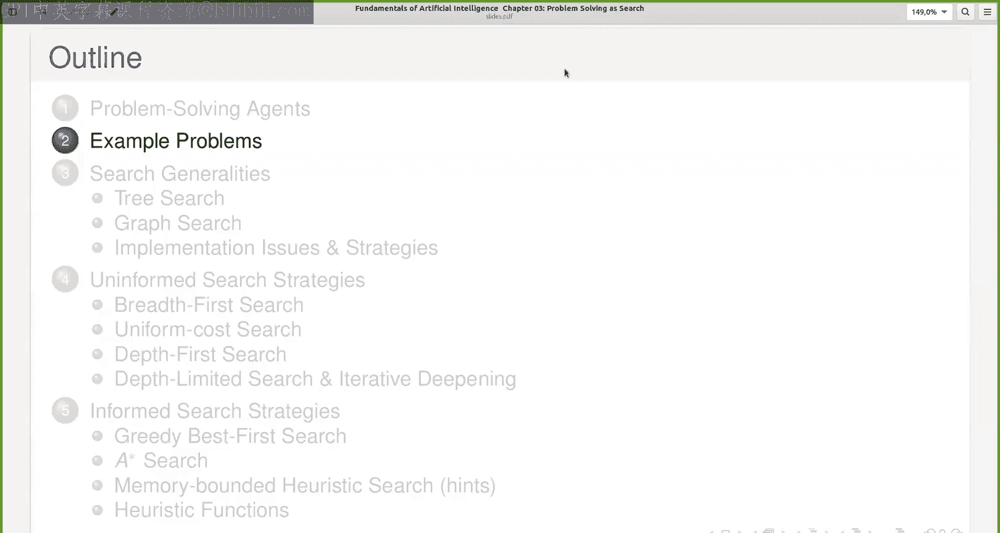
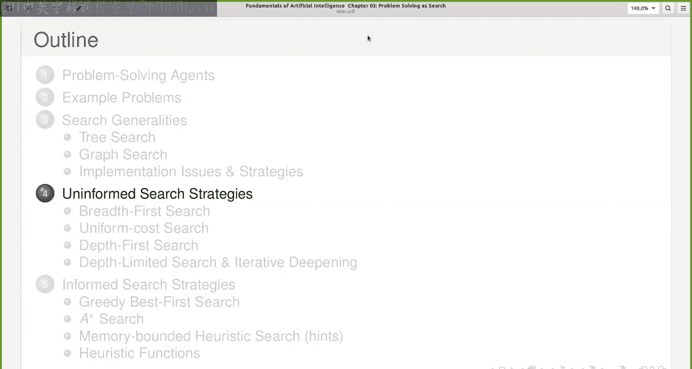

# 意大利特伦托大学《人工智能基础｜Fundamentals of Artificial Intelligence 2024》中英字幕deepseek p08 2024.09.25-CL07-1-CH03-SearchAgents.zh_en -BV1uUkwYTEmf_p8-

Okay， so today we start a new chapter， which will。Involve us for least three classes。

 please enter from the end when glasses started at this。And don't pass in front of me。 Thank you。

And don have the people raised。Sorry， guys， I would like。You should that the protocol。

If a class has started， it has started。Okay。Which means you enter from the bottom。

 you do nothing to disturb the class， and don't you pass in front on me。😡，Okay。Okay。Okay， so。Today。

 we start a new。🤧。A new chapter in which will involve us more or less a three classes。

Dealing with the problem， so the enter from the back， please。Okay。And don't pass it。

Because I said there yeah， okay， stop。是 shut打。Okay。😊，I open this to the last one。Okay， I。And please。

 Sir。The start， the class starts at time sharp。 Okay， so be on time。Okay。

So which is with problems solving as search， which is a fundamental component。

 search based reasoning is a fundamental part of AI。It may be the case。 Okay。

 so this will involve a lot of lot of。啊，topics。Which is say will cover more or less three classes I wish you to remark something important because this course something misleading in the past。

Some of the topics that we cover。Have probably some overlapping。

With the topics that we have you may have covered in the past in algorithm theory， okay。

I just want to stress the fact。That this is not。A repetition。Of topics in in algorithm theory。

 This is search here is seen from a different perspective。

 It's not that you're looking in a graph in a graph。You don't have a graph。You have a problem。

The fact that sometimes we use graphs as examples just because I need an example which fits in the slide。

😊，Okay， but search here is something which it dealss with a problem with some arbitrary representation of the problem and the fact that we deal with the uniform conservatives but with pres。

 the def of search is not or can be seen as a generalization of what we have seen in algorithm theory。

ok。Okay， so what is the point here？🤧。So one of the key。

Issues when of AI is the key problem is you have to formulate a problem or if you wish a task。

As a search in， in a space of states。Okay， not， not in a graph。Graph is a it。

Representation that sometimes we use， Okay， but we are dealing with the search space。Okay。

 a possible state of。A space of states of our system。Of翻 environment。

So the idea is based on the fact that we formulate first a goal。Okay， guys， sorry。During the class。

 you don't make people race， okay， sit anywhere else。😡，诶就走你。And I don't mind if you take use。

 you need your stuff， okay？😡，Classes started， you don't have people raised during the class。😡。

Am I clear。Enough。Okay。So you need formulating goal。😡，Okay， so which is typically。

Other explicit set of states。Or with some expression which whose possible interpretation are the set of states that we are in。

 So we have some way of representing a set of goal states。Then we have a formulation of problem。

We define it well， first of all， we define this a speech。

 so we define the representation of the search space。Okay。

And then we defined what are the legal actions。Or also， a transition function。

The can be defined in several possible ways as a list of possible action。

 or as a former representative transition from state or possible transition from state of state。

 there are many ways for doing that Okay， but which you represent the way。

How you move from one state。To another state。Okay， and then we have the interesting part。

 which is once we have set up this， we have that we have a cert。

So we have to find a solution by of a search process， which uses some algorithm。

And typically the outcome is a social are sequences of actions or sequences of standard transitions。

 whatever you have a representation or whatever representation of transition function you have。

 with initial relation you better say。😊，Okay。😊，And then， okay， so this is something that you do。

You stay your brain。Okay， once you have elaborate。A sequence of actions。

 then you feed these to the awaals， and then you execute those actions。Okay。

 but this has done in your mind。Search， very importantly， is a perform your mind。Okay。

 it's not something that you do by trial Alice and errorss， this is a completely different story。

Okay。😊，There are scenarios when we do that， but at least a completely different cohort order that we'll see in future chapters。

Okay。Well， to this extent， we see that the province from the agents are a sort of goldbys agents。

 okay， so if you remember the paradigmdigma of goldbys so we have a goal you have to plan formulate a plan and then you。

You are。Okay， so your book。Uses an example。Of traveling to Romania。 Okay， well， they assume。

 is there any Romanian here？Yes， okay， so you will probably the one who understand a little less to the problem in the sense that pretend you are not。

Okay， so when you they're looking at a sample。In reading your book， pretend you're not。Okay。🤧So， so。

The policy assumption of the bookaz is that people are not very familiar with the Romanian。

With traveling in Romania， Okay， so suppose you are in holiday in Romania and currently you are in Arad。

Your flight leaves from Bucharest。Tomorrow， and then you have a goat from later。

You should be in Buuchcharest。By tomorrow， okay？And then you have a。States。

 here is the one of the possible simplest possible representation of states。

 which is the atomic representation。Okay， we are seeing， so we simplify Rob oversimpl this problem。

In the sense that to us， the only other part is I'm in Bucharest， I'm in Ar， I'm in whatever place。

 okay。And all the action is you drive between one atomic action is I drive from city1 to C2 number two。

And initially， super are in。ok。And search for a solution is a sequence of cities primarily Bu。

Seeing sequence of transitions， which leads you from aat Buarest， which is notice that in this case。

 this boil is down to the standard algorithm。In you have seen probably in， I guess it。

Shall I assume that everybody has seen minimum path algorithms？Once in a life。Okay。😊，啊。

So substantially your solution will be the sequence of cities before we adding to bookers。

And and explore a search tree。Or what about this photograph？Oh。This is where you are an exception。

 so you are assuming that you have no youish knowledge about star Romania at this large okay。

 so the only information that you have is a map。But this is something。

 a place which is completely unexplored to you。So this is simplified。Roadmark of part of the Romania。

 which we use in the future。 So every know there is a town and you have the distance。

 probably driving distances between both。 So very well similar path like any tool is doing。ok。

In general。What kind of assumption that we。Well， first of all。We have a very， very secret。诶。The。

States are just。Okay， just names of。Okay， so。These you can be seen as the name of the town as just shortcuts of the fact I'm in Ar。

 I'm in CBU and' in Bucharest。Okay。啊。The environment is forget at the sluberg。

So I always know where I am。Okay。Well the assumption is that you have science or you are driving and you know that you are the book or whatever or in between each of them。

Oh， the environment is discrete。😊，In the sense that okay。

 you don't consider intermediate scenario when I'm 20 kilometers to Bucharest。

 I just consider as discreteet states the ones when I'm in the town， I'm in next town blah， blah。

 blah， and that you have only finding many actions so。From Ar you can only go to CBU or Torido Tiura。

Look at the map。In the production。We refer to the map that I have shown you and which is in your book。

Okay。The environment is no。嗯。The agent knows which states are reached to by injection that is for of the agent has a map。

 I would say that probably this is something that has caused a little。Mislea。

Misunderstanding with the students， so in general， you don't have a graph。Re searcharch problem。

 And that's a fundamental factor that we distinguish these kinds of reasoning from。Let's say。

 what is the minimum path procedures in。你哪个子么？In algorithm calls in general。

 you don't have a math in the center that you don't have a graph。

 The graph typically is too big to be represented。 Okay， you simply have an information。

 which tells you。For every state， what are your candidate' successes？

What you are the possible next state to the next thing。 So it is as if。Rather than。

Having really having a mapper， you had some sort of computer program。

 which every time you point to an node。You say， okay。

 your next successors are there and present days， and these are respect to different。

 So instead of having a map， or you can imagine you have a table。With that。呃。

With a list of of towns in which for every time you have all the possible nearest towns within this town program okay？

The says that you don't have a global picture。Or simply cannot afford the being picture because this is a toy problem because it has to fit into a slide。

 okay， but in general， you may a search problem can have two to the end。

Possible states where end users and thousands。Okay， so anything。

Which cannot be actually really represented as a graph。😡，Yes， please。I mean。

 don't mislea this example for the general case， okay in this case you can pretend for reason here that rather than having the global picture。

 you have a sort of list of towns for every town you have a table in which for every town you have the next successors okay and and the distance to on your success the nearest the direct connection of each town and with is every distance for instance。

Okay。😊，Now。I'm saying that because I've seen the past that this has caused some misunderstanding of the students。

 Okay， so I'm not this is not a course algorithm and graph graph search okay， is just an example。

That's an example we are using this。Okay。Okay， some fundamental fact。

Keep in mind that this search is something performed inside the brain of the agent。

Or the CPU of the agent okay so inside the CPU of the agent is there will be some data structure in which you generate this path bla bh b only when you have analyzed and found a plan then you will execute so it's not that you will search by tense okay like a toddler does right it' not that you okay you try to go to long go back go see no go back okay so you are doing everything the search is performed within the CPU or the brain of the agent。

Okay， and then when the plane is。Elaorrated the next action is fed to the operators。Every time。Okay。

So this is different from searching the world， we see searching the world。

Let's say a few weeks from now。Okay。😊，So substantial images is given a description of what to achieve。

 but in this fundamental， you don't have another wide algorithm。Thechievous。

So it's not the case that your agent has a hardwired algorithm。To solve that specific problem。Okay。

 you have a representation that。Okay。😊，And then you have some search algorithm， which will produce。

A sort of a。But this gives a very simple a sequence。Of algorithm。

 but there are very sophisticated forms of planning for in which you can produce plants with loops。

Or conditions。We see them。Not in this case， not in this simplified example。

 but well see the next chapters that we may have。More sophisticated forms of search。

In which the outcome is a plane with the if analysis with the conditions and looks。

So the fact a program。You know， probably a foundations of computer science that。

If the nas and the loops is all you needed to define every probability。It's a program。Okay。

So you sort of synthesize your target。And the kind of algorithm is the sophistication of the algorithm that you are generating depends on the kind of problem。

 how sophisticated research problem you're looking at。Okay。

 we start from the very simple ones and then progressively we get to increasingly more record more complicated ones。

😊，ok， so诶。I wish just to point out。I have a forgot to say this chapter all day， so these are very。

 very simplified assumptions， okay。Those are for only this chapter。

 so for the interactive chapter to search。Then， we progressively release。Those assumptions。Okay， and。

Which will lead us to increasingly more sophisticated forms of reasoning and forms of problem solving。

Okay。Oh， I forgot， I forgot one。Which was implicit， single agent。Okay， well。Okay。

 so this simplicity this is a single agent， we'll see cases where well have known multiple agents as well in the next chapters。

Okay。What is the draw Okay， So this is fantastic。 So you synthesize your algorithm rather than having a R。

 Oh， this great。 So we have a sort of universal tooling machine to do that。 Okay， great。 Well。

 what's the。😊，There's no freelance， what is the cost of that， this computational very in demand。

So searching in jail can be。MP hard。Ne the search speak。Okay。😊，Okay。Then it can。😡。

In order to cope with this， it can be driven with benefits by by knowingging the problem。

 So if you have direct's experience of driving into Romania。

So this may drive you for the best choice。 Okay， Oh， I know what this is。Apparently shorter。

 but I know this is very trafficking。Okay， so is met that other way。Okay。

 oh I know this is not a good idea I know for I already have done it and I know order to go to Bucharest it better to avoid the Timmiso Arabra and going into that other direction Okay。

 so my preview experience。I have a heuristic information， Okay。

 so this is the case that you are right， you probably will have okay。啊。And these a completely。

So so far咧。We speak of a non informedform search okay so something which you also known as blind search so we don't know we have no heuristic information about that。

 so it doesn't drive so the only thing that we can try is standard search algorithms which are generalization to the basic algorithms in graph。

Graphs that you can have。 you probably have studied in。诶。In the course or algorithm course。

Or I have a question to you。How many of you have seen search problems in algorithm for graphs。

In algorithms。In previous courses。Okay， how many of you haven't have never。能。So you well， so。

I will be able to go a little fast we okay。Okay。系。So so far this an informal blind search。

 then there is a completely different category of search。

 which is informal searches so how can you can benefit from extra information that you have。

And this is fundamental， so experience。Knowledge。And completely different forms of algorithm can be elaborated this case this Okay。

 so in general， very high level schema of an algorithm is the progress of the agent。

 which is very similar to the goal based agent so substantially。

So you wanted to you need a sequence of action， which is you need producing。

 you have some discretion of state， so the current state。

 you have a goal which you need and a formulation of the problem and the idea is that。

You receive at every time you， you receive a perception。Okay。呃，王石说。

You update your state according to the perception that you receive。And then。

If you haven't elaborate the plans or se structure your plan。Okay。

 if you haven't yet elaborate your plan。Then you formulate， okay， you go。

You formulate the goal out of the current state。Then。You format the problem， state goal。 So you say。

 okay， describe your goal， describe your problem， and then you search。Search。

Produces your plan or your sequence of actions， okay？And then， if。

Secreence is failure not is it not always you may find a solution， okay。

So if fail then you don Russia， so there's nothing you can do。

Or you can return some error function or something that informs your。This with thearrow scenario。

 okay？Then if the sequence is not empty。Okay。Okay， if the sequence is then you do， Okay， this said。

In any case， either that you have elaborateerd in your sequence for scratch or if you just remember the the。

The sequence from before， from previous date， then you take the first action in line and you update the the sequence dropping the rest。

 You know， first arrest， right， the least。Whenever y sequence， first is the first element。

 rest is all the world east except the first。This is standard。There me know。Okay。

So you take the first your data and then you done the action that you have picked， Okay。

 so substantial means。If you know what to do。If you don't know what to do， elaborate a plane。Okay。😊。

In any case， take your current plan， either that you have just elaborated or coming from previous iterations and take the next action in line。

And drop it and go ahead， okay so。Okay， notice that。诶。

Under the simplified assumption that we are doing， so the environment is is actually is deterministic。

 okay， we can ignore the perceptioncept。If you have full determinationmins。Okay。

 we know exactly the we know exactly what is the outcome of our execution。

So we can ignore the perception at the intermediate date。

We can ignore the perspective this is a very simplifying assumption。In jail。

 we never system never have a full incondition determinations。 Okay， so we need to check。

We need something more sophisticated in order to check the fact that if we are expert in this state。

 we would expect to be。But in jail， we don't need it。Because。Okay。Oh。So what is in general， the okay。

 I will explain now what is a formulation and I also use this to introduce term terminology and the notation。

So what are the ingredients of a problem formulation？First of all， we need an initial state。Okay。

 in this case， we have an atomic representation， so it's just。Which dominanta I mean？

In the most generic case， I will have some complex description。

Deling me what are other the candidate？State of what is the candidate state I mean。啊。Okay。

 and then this terminology。 we use action of X， where S is a state。

Will I introduce this predicate action of dysfunction actually， action of pass。

Which returns to the list of Canada actions。Which are available， which can be applied in the current。

So suppose you have a function which tellss you。😡，There's your university to what are the possible actions that you can apply？

In the case。This map is automatically given from your take the Mac over Romania， okay。

Because you basically say wherever you are， you can go this and this and into this and this and the other town。

 but in general， this is more sophisticated。Okay， given some。In some state。

 I can do some action or I can not do some other actions。😡，Okay， so。If啊。If my state。

 this pointer is on the table。One possible action is raise。Okay， but if it's on the table。

 I cannot push it down。Okay。Or if it's blocked in between these two objects。Okay。

 and it's covered by something else。I cannot raise it。I first have to raise my cell phone。Okay。

 so you see in every state there are some action which are applicable in some other which are not。

 so there are some possible upcoming transition and some other which are which are not possible。

This is given in Europe by this action of us。So for instance， if S is Im inad。

 then the applicable actions are， go to CB， go to Kibi， during the C previous map。Okay。Okay。

 another important component is a description is what's called the transition model。

So is the description or the fact。Of every action given the current state and the action。 So Santa。

 which takes an action。Okay。Take a state and take an action and returns you the state。

 the upcoming state。This is possible why this is a function， why because of this。

 we have a sense assumed that actions are deterministic。

 so we have only one possible upcoming state from any state action。We there， everybody。哦的。

So for instance。Re of inra go the wind is an in the。ok。Quite obvious。The goal。We need a gold test。

Something which the whether you are in goal state， notice that you may have more than one goal state。

Okay， now a simple example， the only goal state is I'm in Bucharest。Okay。

 but maybe you may have many possible。States。Possible at goal states， which fulfill the typical。

Scennaario is that a goal is a condition， not a particular state。

 which can be mentioned by several states， possibly exponential to many states。Okay。

 so you have a typical two ways of。Displaying that。

Describing that either as an explicit list of goal states。Okay， in this case it is the case。

 so in Bucharest we have only one stage that's easy but in general。We may have the many， many some。

Set of predicates or some formula or some expression， which describes。

Whose vin interpretation at all and only the possible goal states？For instance。

 if you are playing chess。Your goal is checkmate your aia that you have。Exponiential many。

would say billionions or trillions or I have no idea how many， but a huge amount of possible。

Gal state， So state。In the scenario， Okay， so you have some conditions。

 you have to describe this implicitly by some description。

 So you say the Cchmate is when the king is under attack and all the possible moves of the king maintain will maintain the king under attack。

Okay。😊，Now， this is。This is a condition， which is not。

Cannot be described reasonably described as a list of possible scenarios because in niche as it will be。

A huge amount of possible such statess。was there。Okay。And then there's another component。

 which is the bath copse。😊，So every move of it is a cost。

So substantially is a function which examines numerical cost to path。Most typically。

 you assign a course to each action and the total cost of a pass is the sum of the cost。

 but it's not always。That。So in this chapter， the sum of the cost is the action is the cost of each action on the path。

 is the sum or the cost of each action along the path。As long as this chapter is concerned。

 it may be the case that this is more complicated。Oh。Okay， why this lies is very important， why。

 because this defines。A terminology， like action as result goals days。

 which are sort of universal in will use in many， many chapters from now。ok。Okay。Okay， so。

What we have seen so initial state action and translation model implies to define the state space of the problem。

So this is basic。Implicitly， sorry， I will underline 10 times this。

Adjective simplicitylicity defines a state space， a state graph。

But not this dome me is LED by the Romanian map example。

I would say please it because typically this graph is simply。Too big to be represented， okay？

Something if you have a state space represented by one other variable。And this is a small。Problem。

One under billion variable is a small AI problem。😡，ok。😊。

This means that you have to to the 100 states。Okay， which is about the。33，0，00 to the 30 something。

Okay， so something that the wall。Mickey Way。Should not be able。

She's not big enough that to represent， okay？Are we there。So do again。

 dobe is misled by the fact that we are dealing with the to example， which for convenience。

 we represent as graphs。Okay， so we have an implicit。Direct a graph。

In the simple toy example in the Romania， we have an explicitive graph， okay。

 but this is because this is a to example。诶。states occur only once in every state that。

 and a path is a sequence of states connected by actions。

 Okay you pass from one state to internationally pass from another state。 So I wish you to。

Make an effort， Men effort to think。Use a graph all as an abstraction in your program。Okay。

So your state is some combination of of variables and some scenario。

 And you pass from international from one state to another state。Okay。

The fact that we use graphs is just a convenience。A matter of convenience。

 because we can apply there。Algorithm has schema， which we have learned from graph theory。Okay。

 but don't confuse them with the algorithm。😡，On graph theory。Okay。

So a path is a sequence of a state going where actual a solution is a path from Ven initial state to a growth state and an optimal solution。

你是是个兄弟。The lowest bus cost。Okay， so you cannot have a smaller。Theres no one coastta。Okay。

So for instance， from here， you may have some path for instance。

 you probably will see that the best path course is this one。Okay。😊。

You may have more than one solution， but you may also have an opt solution。

 the one which minimizes the cost。Okay， so far， nothing fat。Okay， so for instance， practical。

 so suppose you have a delivery robotbo internal delivery robotbo and so the idea is that the delivery robo must be move from all 113 to our 123 where there's a rooms and positions within a building。

Okay。😊，So。😡，Okay， so this map。 and then you perform an abstractstruction。So okay， so well， okay。

 so this is the initial state I there， the goal state is there。And then， I， implicitly。

Repeid abstract this map in。Okay。😊，Meaning that they all the possible， because in doing that。

 I abstract。I weigh some information for instance then。I first of all。

 I discretized the scenarios okay， so I don't consider states where you are in between for instance from here to here。

 okay so I give some discrete locations。Okay， I measure the distance between the them and so I computed I represent this as a graph。

Once I've made this graph。Okay， I can。Find a blending problem。Which allows me to to find that。

The solution or the opt solution， in this case， we have only one solution， but some others here。

 you may have more than one。And which can be achieved。Okay。So， the。This is。Yes。Okay。

 I feel I mentioned a word here， a magic world， which is abstraction。

Every time we formulate a problem as a search problem or similar problem。

 we always do some abstraction。Why， because simply the representational reality is simply too informativeal。

Just take a picture of this in this room。There are lots of。How detailed I need。

A representationpresent of the room in order to achieve my problem， okay。

 if my goal is to walk there， okay， I cannot stack away lots of information for。

 even that you are here。You all guys are here okay， I just need to say， okay。

 I can move from there to there and there is a path from there to there there。

 but if it may go easy to ask to wonder how many students are there。

Then I will have to start away the information of。Well for instance， the color of your your faces。

 so the information regarding your faces， whether you are male female。

 whether you are tall or your physical characteristic， can just say I just can't ahead。Okay。

 if I need to know to make an analogy of the gender balance of this class with at least for Eastern distinguish between male and female。

Okay。😊，Okay， or if I need asking you how many of you come from a given have a given background as some others。

 I will acquire some more information。 Okay， so I always need when I so the global。

The environment has simply too many information to be fully representative。

So every time I need to abstract away the information that I don't need to those which is right about for mine。

From my goal， my problem to solve， right？傻。Gerald。Whenne， you are。And the。Sometimes。

 this information is not。Technically irrelevant， but it is simply some to that。

You are confident that you can acquire in second moment。Okay。

 in order to drive if you have to turn right， the amount of degrees where you you should turn the。

The student we is relevant。Technical， because you have to turn over a given amount。

 but you are confident enough。😡，That you can get it automatically。😡，Okay。

 what the kind of information they deploy is that I have to turn right and then I have to do left after 50 minute as that。

 I don't say I will have to turn the steering wheel over 45 degrees because you are confident that since youre a trained driver that when you are turn right。

 you know how much to turn your steering wheel。Still real， okay。Okay。

 so the process we call a abstract of the process of removing details from a representation in such of the way。

The A states represent the many real states， okay。Depending on the information that you distinguishing。

 okay， if I abstract away any information about you， but just I just know how many of you are here。阿。

This represent a huge amount of possible states。Those in which I let's suppose you are。

 say 42 in this room， okay？で。All possible states in which there are 42 students here in my room。

Very different people with very different characteristics placed in different ways and blah。

 blah blah， okay。So you have many。 So the key point is that you have to a whoay。

Really un information about keeping。But keeping the right information。

 the information which is necessary to maintain your information。

 notice that the also an action is abstracted okay。If I can'。The students here。

This is accounted is an abustr。Because for instance。

 this is something which does not keep into consideration your physical characteristics。

 whether you are a female male or whatever or whatever or even your position。I just cut one， two。

 three， four， five， blah， blah，h， okay， so it's a anotherstar。

Vter because it's a pair is an action which you represent a pair。Of abstract states。Okay。

 every action can be seen as a direct pair of the states from one state to another state。So。

 avoid this session。第十。And that actually in reach。I keep maintain enough that I maintain the relevant。

They maintain the relevant information， which allows me to solve the problem。Okay， because。

If I'm interested in knowing the the gender balance of this rule。Okay。

 if I abstract away the fact that each of you is male or female， okay。

 this is not a valid abstraction， okay， because I lose some fundamental information。

 if I'm interested in instead in knowing just how many people attend us of this room。

 then it is abstract away your gender is okay。Okay， everybody。Okay。A useful abstract。

Us is the one in which you throw away enough information to make the solution easier to solve than the original problem。

 If I'm distracted by by your physical characteristic in counting， if I need only counting you， okay。

 I will take。It takes me more time and more reasoning than just looking at how many heads。

 so to me if I'm counting you it is as if you wear black shadows， right？Some extent I say one， two。

 or three， four， I just to you the shapes， okay， this looks the shape of a human being and then I count them okay。

 so I abstract completely abstract away your faces。

 your characteristics and your the color of your T shirts and whatever。Okay。

The choice of the goodha version is always fundamental in solving a problem。

Its means removing as much as it taste as possible by retaining the validity and then ensuring that the abstract are easy to carry out。

 So there's a compromise of。Of simplification， but maintaining the relevant。Okay，Can we have a。

Shall we have a very tweaking table。 So let's say resume at the 35， okay。Okay。家。好。8。But。嗯。

Yeah misspat guarantee score。オッケ。谢谢。我不是。接穿。그래。没有是。a lot of。まそれだけし。Re。我你。嗯。Okay。回来我这次能。嗯。是啊。might be。

す。그。不个。可以。再我。发。不。Yeah。Every。Yeah。你应该上来。嗯。那 sorry。喋べる。我。And你你我 to you啊。でうで。那个功能。It little that。こ要さ。

And。嗯对。don't any。这比方说新の呃原色都。但所有很多。大でた。Okay。就是从过一开始玩个个。嗯。嗯。都不。嗯。就讲一下那个的。你个不。好的嗯谢。你。这个就是。咋会就想明听。当我这样的。

叮当当。这个这个。嗯其便地方搭个地方。没。这个未来就要。你你整嚟。嗯，好。啊嗯好。谢谢。所以我下呃。有。嗯。嗯。想问题。たでま。他。嗯对。好的。Okay。不那就行。嗯。Yeah。我的就是一个。不。

你觉可。这规。Yes。Oh。ますさい。使分先够。啊，没有。这能你可。嗯们是我们政的。来你。嗯，唔家搞。嗯，系。嗯，对。な。は。

はい。あ。でしたありがとうございます。我这呀。Okay。

I've just been informed by some of you that there are some。

All the video recording whose audio has been correcting I apologize for that。

 but I have no no clue what was the problem， as I previously said that I。

I cannot bring up in the position to guarantee the toilet of the recordings。

 I just just to say that I leave available more the recordings of last year course so that you should bump me into some corrected。

Video where you can take a look to last year which。Very likened。不 be嗰你 c啦。Okay。

 so let's go ahead just。In order before to introduce some general concept about the research。

 I just make some possible examples just to give you which sometimes we use it as a examples search Okay。

 we have already seen。The case of these are very simple button cleaner。Okay。

So since in this case we have a two location and there were one one binary viable in D。

 this means that we have eight states in possible states， okay， initial states ist any。

 we have three actions left right to second， okay？And so the transition model is the fact。

For instance that。So if you're left and A， then you are didn go to be and the source of， right？

For instance， good test would be all both press are clean。There so clean A B and for yourself。

 about those who could be the step course one。So a number of steps to before， which is some。

Very frequently， Okay， if so， you can see that you can please or represent this graph。Okay。

In the office that would be very natural right the graph。Okay， so yeah， I can do that。

 but it's very easy to know， okay， both of this is very。And convene。

 okay because they like clear representation on this next state could be given the kind of action in the current state。

 okay？So。Just to say that again， the graph idea is just an abstraction that you have in mind in knowledge。

 which makes us easy to explain how to use some algorithm well known algorithm than graph theory and apply them to our scenarios。

 but this is not really。Something what your room。Okay， now the kind of a simple example the doesnt。

 I don't know whether they well。I don't know whether you haven' ever played this game。

 which was a team。When I was a child and was at least 15 and then you became reassemble then the timess here moving a time in that space in such a way to have a pattern running a single signature pattern。

 don't know whether you them signal。Maybe are from younger but you see this okay。

 so Su this is the states have the inger location on each tile you can easily see that you have a nine factoria times two which phrase the timeframe is that we have only one so we cannot inver so if this is correct。

Product a possible scenario， the one in which you invert。

To all families not defeat feasible so you can not be reached。Okay。

 so this is by this new the two one。Mi you can have any possible states the action is left right up down meaning that you move up down the display space so so move up means moving number two down so that result。

The goal tag is that checks stage correspond with the goal configuration。

 you can set that goal configurations in sequence， which is no than left aligned。没。

The bus course is number the number of posts， the number of steps so every move one。

Other so as an example execution so you can again， you can think of a possibilities of front here for Eastern。

 you can pass to the scenario where you move down this four down then here you have a three possible so here you have two possible tens move four downs so move five right okay which correspond to these two states then here you have a three possible tenities move four up。

 move six right and move three down and so you have three ten。OkaySo again。

 a graphic or representation of this date will not be very convenientient。This excuse， okay。哦。

Another one。8 this was very popular the early days of AI。

Sospecially you have we have just order and you have eight things of。

Is anybody the way everybody here knows？Those the very basic rules of ches。Is anybody who doesn？O。So。

Essentially states any origin of。0 to8 wins on the board in such a way that no win attacks the other。

The all that green ducks。DeAnd then di or horizontal of activity， okay？

So this person plays a sign of we severe ending。Currently， but none of them are other。Oh， no， no。

 that is sorry。Okay。Okay， so this is not by anyone because of this execution。哎。

So there actually is other variables。Progressively。

And the position mode is just one the other queen the every time and the gold test is such that eight pointss on the ball and none attacks。

有。Okay， you can think of this is very this is an interesting problem because if you general to NPs。

 it can be computational demanding some extent or very easy programs。

So this is a problem which can be dramatically harder for many extras and dramatically easy for。

SoSo this wife was very popular the some of the。哦。Okay， there is a variation of that。Same problem。

 but to with a different formulation。 and this is interesting because you can see that you can。

Al the same problem in different ways and if you and depending on the way you in it。

 this may think can change in particular they have competition。

So if you don notice this scenario here。You have a huge amount of possible sequences。对。

Thank you you the for being。喂。They formulated the same。Thinkaking exploring the roots。

 can think of the assignment say， okay， look at。You are the one queen forever column。

Re place anything in every economy？そう。You please suggest the fact that if you want to verify the rule。

 which means thats no。You can have on your own in record device okay？

So and you you place eight means in every one in every column， okay， in this way。一发。Much， much。

 much theres positive sequences。Okay， because you automatically drop。All those。

We'll reach your place。Qus in different positions in the same cause。So these dramatic ability are be。

So the key point is sold here and actually is at the queen2 square in the left was the empty column so that is not attacked by any other queen so you can start from the left to right and okay I place in one queen name in this column then I place a queen in this column in such a way that is not attacked in screens then I place this in this column。

 I place this in column， I place this in column and so on okay。So I can go ahead in this direction。

So note why is this interesting because you note that with the very same problem。

 with the very same goal， the way you formulate it。Can change drastically their computational course。

Okay， the number of scenarios， so in this formulation， you auto drop。

A huge amount of illegal scenarios in impossible。我个理。

And then you can come into a real un warm problems， so for instance， if you have a robotic hand。

 this has many degrees of freedom like angle an angle here， an angle here or taking this bark and。

Extend or compress we have another angle here， another rotating angle here another rotating angle here and so on so you whenever you have an end a robotic areas many degrees of freedom and which represent the state okay and changing those values。

 I don't see is something that changes those values so it rotates a designer or it extends bar water okay。

So actually， is it unclear these company use so not great or maybe you can discretize as surface have。

You can discrerutize the emotions， for one/10th of NA two and for instance the goal test is that you have completed assembly and the pathcode is time executed for instance so this you see that is much。

 much morecomp I think is a computation demanding object。Proble。So those are toy problems say the。

你 back上有有装。教错。Build the minds。And you have several many of those problems like planning who travel to Col。

If we assign layout progress or completely place an organized layout out of the summer very large scale integration circuits navigation。

 but I this whatever so there are many many huge amount that you can reduce search problem and with a very huge search phase。

Okay， okay， let me give before we enter into an inform search strategies and inform search strategies。

 which will be the topics of the best access， I wanted to give you some general context。

Concept about search， which will the user in the United States。The first distinction， okay。

We need searches that generate a sequence of actions， or sometimes you may there。

 you may call these transitions， as some author call them transitions。可错。

Butly a transition is a pair state state when you order based state states from one state you state。

Okay， so then， a key concept is that of expansion， so what we are understand。

And then you try to figure out what are your possible success of。そ。Meaning， I'm mistake state。

I a of remember that I have a list of action， the fact action of a state gives me the least of possible action that I can perform here。

 but given the possible action that I can perform here。By me all the result father。

T me what are the states which where I will go from this state going if I applied the action。So。

The combination of the action function really not that way。With the result function。

As me the success。Of the states， so given。One thing， I can compute。The possible next stage。

 which I can reach in last time from my own state by just。Pickking one action and apply it。Okay。😊。

Which the graph the be you can go through an arc， okay， but these are much more complex。

Operation okay in， you may not be eye catching for your you have continued or to this loose and able to cap or make summer computation。

To understand what I do， so it's not immediate。So not always it brings more immediate。

To know what that your successor are giving your。And that's。Fundamental differences。

 for isa from with respect to the graph search problems that you have seen in algorithm theory。Okay。

 so。St a search。Strategy is。Search can be done by different strategies or going proceed and the is define a criterion by which at every point of the search you decide which。

啊。Which statement should have found。Thanks， so I'm here。

Which is the state I'm expanding to see what the boss candidate successors？

And this is from the night。Giv the several strategies you can learn。嗯嗯嗯嗯。

Also there's a fundamental distinction， which we are already encountered with。

 which is the distinction between search3 and search down here。そ。

We produce wireless spa we can produce simplicity to me， okay？

But obviously the of success of others we respond。But not that is from time to time。

 imagine the case that we end up， but in different parts， we end up in the same state。

That's for diamonds or conlus， okay？If we are able to realize that。We can avoid redoing some steps。

What is the cost of that is that we should keep fight。哦，播。Which。Sp re already exp have。So there a可。

We save time， but we will need extra。Space memory to store somewhere on the listing that we haven already explored。

Okay， so in this case we speak and we see that in details， we speak the first case， no memory。

 no memorizing the state， we do a research， so as if were。

Possibly repeating a part of this structure the second case is called graph search。

 I would like to using the terminology of your book I would like to go it。呃，大不是。O开了。

It's going to graph search the that you can read。Reformulate。And in general。

 the lease of the current three value represents either the state respond or solution or the or something else。

Sometimes you embark into the， the events or embark into some place which in that you cannot expand anymore。

I that because simply has no successors。Or in the case of a bug search or graph search in the fact that you have already found previously。

 all its suppressor。嗯。喂。😊，Okay， let's see general what the research is。Okay。

Remember that we are thinking you search that we are always performing something ofline。手亚。Sulating。

In our own spirit。因即も。Scennas which our actuatorators inbank in， okay？Remember。

 search is something which happens in our CPU before you react。

We build a model of all possible actions so to predict what the outcome of our physical action will be。

So we start from obviously from niche states。And we pick order。And Julie the boy successes。As we say。

 this is called expansion。给。Here is some termin。Record the current， the second current in。Fron K。

 some other authorss call this fringe， some other called the open lister， okay。

And this is the current unexpfounded。No。Initially， therup at least initially。

When we found the initial state， all the sub become the frontier and we drop the initial state of the frontier every time we。

We said to spa animal， we drop it from the frontier and yet the fronts very are very special。Okay。

The strategy for picking with the next node good founder is Sunnarada。And it's called the strategy。

The search strategy， you may see some of most the common then search strategies were their proing links。

Besidess when either of those states is reached or no more candidates to handle。对。😊。

In practice there is a third evolution。Keep in mind that in the general case。

 the search problems not anything even。But exist scenario， which is work sources。就是大。我买了。嗯。

Well you can think these as bad when all this happens very frequently。When you're doing such。

 so sometimes when you have to deal with a without progress。

 you typically set up a maximum amount of time or amount and a maximum level of memory that you want to consume。

W。And so yeah， the third scenario， we keep see big of one。So but this is quite simple。

 very high level of representation， Okay， if you have a representation we what。

You initialize the frontier using the initial rate， okay？And then if the frontier at every step。

 if the frontier is empty， then you thumb failure because you have no have。Yeah， true。

Then you choose a integral grow node， thearrow from the frontier， okay， two。

 if the nu contains single state， then return the corresponding from the solution。Then， if not okay。

 there is in as here， right， since we have a red here。Okay， there is an increasing as。没有。Okay。If not。

 you expand that yout know the abbey version most the。

There is a variation that so this is the very high level area and there are two another variant of this is that you check these。

Whether you check the ghost date when you pick me from the frontier or the new standard。

You could do the gold test， no when you pick from the frontier but on all the states that you are span。

 this allows you to get to the goal earlier， but it may have some dx that recci later depending on the strategies。

 sometimes you do that sometimes you don't。Okay。Just give you the notion of the research。

 your start note that there is status， so you originally your start a combination code。

 you have already explored some notes。Then you are currently your current node span those。

This is the frontier and then there are the node which you stream so this it gives you a portfolio view of the notion of frontier of an explore nodes and other exp node。

You have su。Okay始 far。Yes。呃，O。Keepep in mind okay I recall what the example is so for instance。

Originally state around okay， so you notice that from you can have success out during the studio and so on。

Okay。😊，So your spa mission aid with this Israel。Okay， so you drop around from the current year and。

you are those big ice here。But then you expand the CD Okay。

 C has more success a rather for Gal or there wrinkle be chair， Okay sorry for an conversationun。

 Okay， not that you still have a r yeah of course you can go back。Roads and most roads are at always。

So notice that so now the frontier is arounda or the check Not that you have already already around。

O。但手呢。So beware。Oh the fact that James you pick game around， then you get into a loop。Okay。😊。

Which may enter into infinite loop because it can increase or repeat even offered if many times this。

Okay。Well， you may say okay I this， we have already seen this in my graph graph algorithm yes。

 but in graph it's obviously graph algorithm because you have a picture of the graph for me。

But all these can come out as。Elaborating the successor of some state through some actions or some transition leisure。

 which is not eye catching as in ground ser。It's not don't have in general that bo idea up of a gr。

Or your graph or something that you don't have a priority simply because it's too weak in general。

 but also because it's not a million。see okay。So it's obvious are post， but not a。Okay， so。

So what possible sorts of problems that you can immediately see is， you can have read down that path。

Well， first of all， you may have。More than one way to get from one statement。

So this means that the some state sub can restore more than once， okay？So I allowed to show you。

V are their CB， okay， where is it？Around the two CPUU。

Bes around the radar ofU or basses around the Mi Lego。

 Moria and Roberta Kiova in CollegeU okay so you can have several ways of which she， okay？

So this is what called redundment， okay？But then if you fail to repeat or repeat the space。

 you can cause you if it looks。 Okay， so as I say， you can go to from S to A then B and B A， B A。

 B A， B， A， B A， B， A B A， B A B for。 Okay need and not an idiot well Okay。

 you're you're an idiot you're not an idiot if you're dealing with。

S simple high touching graph problems like that， but if this is some state。

Complex two complex representation state， whatever this is not immediately verify。

And the also Ken even though if it cause infinite looks， can turn a linear problem explanation。

Of you have this scenario？You have two ways of getting to to be。

 and you have two ways to get to be to see。 They have two ways to get to see to be as long as the form。

How many lots you have？Go to A one，2， three。One， two， three。1，1，2， three， one the shop。

 you can have a two to the end possible。As guarantees or bus do everything the very same thing。Okay。

O。是。As a parahes is a irononic colonist。A statement。

Although very a much more thing as a state mentor， algorithm that forget the history are deeply。

so if we don't remember our history， we may repeat the past and we observe of redundant search or even get in loop。

Okay， so that's that。The Dlemma Ging and and graph search。Which means that's we。As lookeddown。

 you can perform a kind of search。This is the seventh of these research but we the data structure。

 which is remember every experiment we done。哦。Known as explore sector。

 regional sector close to the east of America。TP VCs represent as a H book。

Which you know that if you properly divide design need to be sense across so what cases does the sense okay？

呃。And the idea is very simple， the principle is very simple。

 do not expand it already occurs in the external set。

So what's the difference of graph search with respect to three research？

You you take you are the explorer site。You keep track of a data structure representing explore site。

 which initialize it beneath to。And then。で。The is absolutely identical。Except that if you okay。

 again， you pick anything。Youre more if the quo is also1 you are9 at you done the assumption。If not。

You have no to。Hey， Ly then you found it。As you could use things。

The key point is that when you pick the nodes resulting in form an expansion。

 you add then to the frontier only if they are not。Already different here on this。Okay， so you。

You red volume the front。我也是当不好意思就是。Okay。书法。Nothing different from graph exploration， okay？そうであドですね。

じど们啊こ自。Okay， so the idea is that if you take the pictures or without the names， okay？

So initially you bundle straight here， okay， then。There is that you span those you add those。

 you span this node here and this node here you add in this one and you are these node here and then you for expand here you notice that here you don't expand this anymore。

 you don't expand this anymore and you don't span this anymore。Because we have way there。

 or the success you are following。Okay， so you you have no， when you're here for instance。

 you don't have any the success of this because you have already hit。The ball。

 they're very extraordinary。Okay， nothing particularly friends。This is a fundamental property。

 which's called the separation product which will use later on。

The frontier separates the state space graph into the set of Exp region and the unexpled region。

You know what the separation said is something。The border， so everything。

Every node into the an exhaust site in order is linked that node in the nonroll sector by passing through。

Okay， this might the we。But the we was问。呢就我。Any questions？I think as so far。

 there's nothing but very fancy。Okay， I just want to conclude just telling something how this is implemented。

 what are the ingredients that we needed to implement the search？And I ended you seein。Okay。

 we say the first very important thing that we will say is that we have to distinguish between search and NA。

Well， sorry if you become less steep in not sorry。State is a representation of re configuration of the environment configuration fieration here in physical potomy。

Even if further the environment is not physical， even if a chatbot meaning or the environment the state of the。

喂。😊，And all is a data structure our agent？有先。To represent and know the representative state。

 but also sign information which is needed from search。Important distinguish it。Inぱのそしてほ。

Eテ by point to some data structure。Okay。Butど the。The action which the action that has calledd。Okay。

 the parents。And the Bauff coast and the Ba coast。Okay。So you need some extra foundational to know。

How do they get that？😮，Okay， the search， so it's a data structure which says， okay。

 I have obtained that's no order coming from so I need this information to do。

Do you basically be the graph。Please。跟住 don do啲会。嗯用意这。Yeah。

A fundamental fact is that within a given problem， it should be easy to complete the child mode from its parents and action to form。

Okay， sure then。Result function。Should be easy to compute。Okay， this is from担 done。我来管了。ok。

So child loan， which is not interested in the result function， okay。

 it something in which you given the problem the parent is action， you aton in older。

In which the state is the result of bringingation to the parent state。

 the parent is becomes the parent the action becomes the action。

 and so every time you complete the success you label you level the you create and note and you label with the current pattern yourself the cost you cremate。

The current cost to by the the staff force of the political and。

And you level the action Okay so something very Dr this is important to distinguish this by this allows you to distinguish this from standard graph algorithms because in general you don't have the success in medium so the successor the set of successor states that you may have。

 but is the result of integration， first of all understanding which action that can apply then。

Find me after what your children are。there is also of such action。Oh there。Yes。Okay。

 fundamentalist in， which mix which describes all the variants of the search strategies that you may。

 is how you play。Break。Depending their access timing。

The sites you give to the kind of access you give to the measure changes completely the kind of search。

If you are sexy， first to start。我就是一个美工的居民。便我水呼。呃。This will give us at one kind of a search。

 which is forful search， as you see。Last year for out。我是么 stacker。

Accessor plus these really what is from depth first。呃。If we have a priority queue。So。

According to some value， begin with cost of the current clusterster will give you the best person。

Okay， and this usingology I assume you know what。You second and priority is。Right。Okay。

 and I just recall that their success。The key point of those separation is that they are very cheap。

The first two cases， they require common worst case constant time in the second case。

 there required worst case and look at it in the time， which is not that bad。嗯。

You need in general for the bringing please。Is anti？Okay， I don't like this very much。

 but you need post cu already。So you his news was just that calling God， they second。

Okay this is just an okay， I just adapting with a the termological image Okay。

 so design I means your term through if there is no more elements。

Its the h an output you just remove thes the first time in the queue and it certain element is insert that okay those operations should be extremely typically all around or or at the multi ability。

What about the law at， okay， the typical is implemented as a H people。

8 or one test with two primitive in there and a the hashel or we sort of through if the a is already the hashhe and you serve the element in the hashes so in。

Just to recall from aural theory that the choice of ash functions is in  the90 there's a long bibographyy of literature of building a smart fresh sha and sun。

Roman representative state during representation。Okay， nothing thanks， they saying this is very。

 very similar to but then the notion we have signal in our area。Okay， this translates or overall。

 this translates the standard algorithm elements。一du。

We do a more general representation so we can take the tree search and the graph search schema。

And we the previous schema are just general， they don't depend on they could be seen as just standard graph of the three and。

The three and graphic representation graph youtu something related to this problem。

With NA search problem in a data structure representing your environment。

Which is nothing in particular fancy， but just the application of the previous human。

To the data structure that you are using and the premium is that you are using。Okay， so in general。

 research takes a problem and the current presentation the fringe and it does a solution of failure。

And the idea is that。一nitially。You shall I诶。で。Fringer。To I note notice that the fringe is packed。

A set of notes， not a set of st。Okay， so what the initial art。

 you be the initial states of the initial state of the problem。

 make it an older and you add this in the fridge okay？

And then you look by which is empty and your term failure。有。

You take the next node we are dealing with notes。Derastructure very not secret the states you pick the first one。

If given the program that the state referring to to that node is a goal， then you return node。

 you return the node， otherwise you expand the node。You stand the norm of given the problem， okay。

 you and said all them the future。Okay。😊，What is this span again。

 this expand is just to make of the success issue the successor is being to and then for each action a result。

In the successive function of the of the no。Okay you need a successful function， okay。

 then for each actual result， you compute a new node。

 you and you substantially up the expansion the central the good right？Why these？

A overcomplicates when we respect to the previous one。

 just to remind everybody that this is not rough search。Okay， blame graph。

 which is something different and something which is。Inbed is applying many years from graph search。

But in本地的 in the洲。You that get the。Okay。Same for graph search， the only difference is that again。

 you had to initialize and was it can close this or empty decided it time is to accomplish okay in the booking may find it you're booking a final relationship。

Very， very similar。 The only difference is that。You do this function， the in。

 only if the state respond to the co is not imp。Okay。And。And if you do that。

 your attitude with the central respond。Okay。😊，A， remember the time when that we sold。

The implementation of viable immination with Bay networks。

Vibleuation is nothing else that agree and get adopt a structure to represent those intermediate distributions。

And pass from three very search。The graph me is the script。Nothing that in effect。

We could call this some fascinating fascinatings， but there's nothing else notice this。

Just to mention。没。We are distinguished by graph search and search。Theyre inter。Okay。

 good user of graph search。So be the user of the research。You can have bumping loops and。

And they blow up unless blow up these sort of stuff。

B user graph search may require expansion and difficulty。And not。

 the explanation of microspace may also be that also the maintain maintenance of that data structure of computation。

 not only。The fact that you this is just a memory is not that you simply have a huge amount of huge amount of gigabytes of memory。

 that's okay when you can know the problem iss just you some overheadide infection overide might。

There are interities。They're开始。So you don't store all。楽 you store。Somen， the most frequent。

Do your cash memory？Computers。Okay。😊，Fish memories are。

Amount of men which you don't save everything that is completed， but you temporarily save。

Information and from time to time， you draw it from it。Depending on how frequently youre sex。😡，那是个。

This is very very common。So sometimes graph searches is something that you cannot really form。

 but you use some intermediate form in which you have someake。Which works very often works。Okay。

 let me conclude today's class。Just this too possible。Fs of search。对。

You have known inform strategies， also known as blind strategies。

 and this is what we've seen so just apply。Bathth theory but research search the for。AndSo great。

 so you don't have any green knowledge。And you just use exhaust research。

 the one that we have a lot English algorithm， okay？For some it iss not very practical。

 sometimes you know something， you have some heuristic information okay。

 you know you cant predict a priority that if you go that way you cost speak so I mean if I can search and like okay。

 if I'm going to Verona and find a path to Verona。Okay， I can try all the possible direction。

But I really try first something which goes south rather than looking for something which goes north or east or west。

I of course I will have the direction I have to take in， so I usually take a try first。

If I have to choose， I will try first to go to Romanitto。Rather than to some Cal or so。喂。😊，Orま。

我 do感じ。Okay， why because I know that there only areas is some knowledge。

You recently orderies that the way。Okay， so I will try first steps that in that direction so this is the equation of informed sta in which you exploit and if you are able to exploit this information you typically save a lot computation。

Which is sorry for today？是由我们法律呃那法律那时说。Thanks a lot to everybody。う。嗯。不个。嗯。

