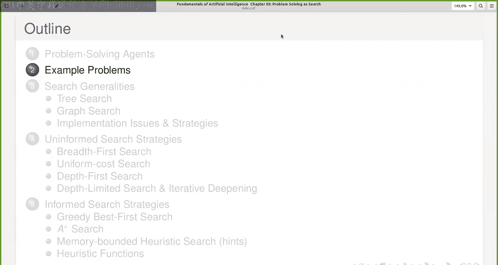

# 人工智能基础：03：搜索智能体


## 概述
在本节课中，我们将要学习人工智能中的一个核心组成部分：基于搜索的推理。我们将探讨如何将一个问题或任务形式化为在状态空间中的搜索，并介绍搜索智能体的基本框架和关键概念。

## 问题求解即搜索
上一节我们介绍了人工智能的基本范式，本节中我们来看看一个具体且核心的推理方法：搜索。基于搜索的推理是人工智能的基础部分。这并非对算法理论中图搜索的简单重复，而是从一个不同的视角看待问题。我们并非在一个现成的图中搜索，而是处理一个具有任意表示形式的问题。搜索空间是系统或环境可能状态的集合，图只是一种有时为了方便说明而使用的表示形式。

## 搜索智能体的基本框架
以下是构建一个搜索问题所需的核心要素：

*   **目标**：首先需要明确目标。目标通常可以表示为一组明确的状态，或者是一个表达式，其可能的解释就是我们所期望的状态集合。
*   **问题形式化**：我们需要定义搜索空间的表示形式，以及合法的行动（或称为转移函数）。这定义了如何从一个状态转移到另一个状态。
*   **搜索过程**：一旦问题被形式化，我们就通过某种搜索算法来寻找解决方案。结果通常是一个行动序列或状态转移序列。
*   **计划执行**：在头脑（或智能体的CPU）中制定好计划后，再将行动序列交给执行器去执行。搜索是在执行前离线完成的思维过程，这与通过试错在现实世界中探索有本质区别。

## 一个简化示例：罗马尼亚旅行问题
为了理解这些概念，我们来看一个经典的简化例子。假设你正在罗马尼亚度假，当前在阿拉德，而你的航班明天将从布加勒斯特起飞。你的目标是明天到达布加勒斯特。

在这个例子中，我们做了以下简化假设：
*   **原子状态表示**：状态就是城市的名称（例如“我在阿拉德”）。
*   **确定性环境**：你总是知道自己在哪里。
*   **离散环境**：只考虑到达城市时的状态，不考虑途中。
*   **有限行动**：从每个城市，你只能开车前往与之直接相连的邻近城市。
*   **已知环境**：智能体通过某种方式（例如一张地图或一个查询表）知道从每个状态可以到达哪些后继状态。

**关键点**：这个例子用图来表示是为了教学方便。在真实的人工智能问题中，状态空间可能极其庞大（例如有 2^100 个状态），无法显式地构建出整个图。我们通常只有一种方法，给定一个状态，能计算出它的可能后继状态。这是AI中的搜索与经典图算法搜索的根本区别之一。

## 问题形式化的要素与术语
现在，我们正式定义问题形式化的组成部分，并引入标准术语和符号。

*   **初始状态**：搜索开始的状态。在罗马尼亚例子中，就是 `In(Arad)`。
*   **行动函数**：`ACTIONS(s)` 返回在状态 `s` 下可以应用的行动列表。例如，`ACTIONS(In(Arad))` 可能返回 `{GoTo(Sibiu), GoTo(Timisoara), GoTo(Zerind)}`。
*   **转移模型**：`RESULT(s, a)` 函数，给定状态 `s` 和行动 `a`，返回执行行动后到达的新状态。这假设行动是确定性的。例如，`RESULT(In(Arad), GoTo(Sibiu)) = In(Sibiu)`。
*   **目标测试**：一个函数或条件，用于检查给定的状态是否是目标状态。目标可以是一个单一状态（如 `In(Bucharest)`），也可以是一个描述一组状态的复杂条件（如国际象棋中的“将死”状态）。
*   **路径耗散**：为每条路径分配一个数值成本。通常，每个行动有一个成本，路径的总成本是路径上各行动成本之和。最优解就是具有最小路径成本的解。




这些要素共同隐式地定义了问题的**状态空间**（可以想象成一个图）。再次强调，这个图通常太大而无法显式构建，它只是我们思维中的一个抽象。

## 抽象的重要性
每当我们将一个问题形式化为搜索问题时，我们总是在进行**抽象**。现实世界包含太多信息，我们需要忽略掉与当前目标无关的细节，只保留解决所必需的信息。

例如，如果目标只是统计房间人数，那么抽象掉每个人的性别、衣着等细节是有效的。但如果目标是分析性别比例，那么抽象掉性别信息就是无效的。一个好的抽象应该在简化问题的同时，保留解决它所需的关键信息。

## 搜索过程详解
搜索是在智能体内部（大脑或CPU）模拟执行的过程。其核心操作是**扩展**一个节点：给定一个状态，找出所有可应用的行动，并计算出所有可能的后继状态。

以下是搜索过程涉及的概念：
*   **边界**：当前已生成但尚未扩展的节点集合。
*   **探索集**：已经扩展过的节点集合（在图搜索中使用）。
*   **搜索策略**：决定从边界中选择哪个节点进行扩展的规则。不同的策略（如深度优先、广度优先、代价优先）构成了不同的搜索算法。

搜索算法的一般结构（树搜索）可以用以下伪代码描述：
```
function TREE-SEARCH(problem) returns solution or failure
    frontier ← {Node(problem.INITIAL)}
    loop
        if frontier is empty then return failure
        node ← POP(frontier) // 根据策略选择节点
        if problem.GOAL-TEST(node.STATE) then return node
        frontier ← frontier ∪ EXPAND(node, problem)
```
其中 `EXPAND` 函数生成当前节点的所有后继节点。

## 树搜索 vs 图搜索
一个重要的区分是**树搜索**和**图搜索**：
*   **树搜索**：不记录已访问的状态，可能会多次探索同一状态，导致冗余甚至无限循环。优点是内存占用小。
*   **图搜索**：维护一个**探索集**（通常称为 `closed set`），避免重新扩展已经遇到过的状态。这避免了循环和冗余，但需要额外的内存来存储探索集。

图搜索的修改体现在：在扩展节点并将后继节点加入边界前，检查该后继节点对应的状态是否已经在探索集中。如果是，则忽略它。

## 实现注意事项
在实现时，需要区分：
*   **状态**：世界配置的表示。
*   **节点**：搜索树中的一个数据结构，用于记录状态、父节点、行动、路径成本等信息，是搜索算法的内部构造。

边界通常用特定的数据结构实现，不同的数据结构对应不同的搜索策略：
*   **栈** → 深度优先搜索
*   **队列** → 广度优先搜索
*   **优先队列** → 代价优先搜索等


## 总结
本节课中我们一起学习了人工智能中基于搜索的问题求解方法。我们了解到，搜索是将一个目标形式化为在状态空间中的寻找路径的过程。我们介绍了问题形式化的关键要素：初始状态、行动、转移模型、目标测试和路径耗散。我们通过罗马尼亚旅行问题这个例子说明了这些概念，并强调了抽象在问题形式化中的核心作用。最后，我们探讨了搜索的基本过程，区分了树搜索和图搜索，并简要提及了实现上的考虑。搜索是智能体在行动前进行离线规划的核心能力，是后续学习更复杂推理方法的基础。