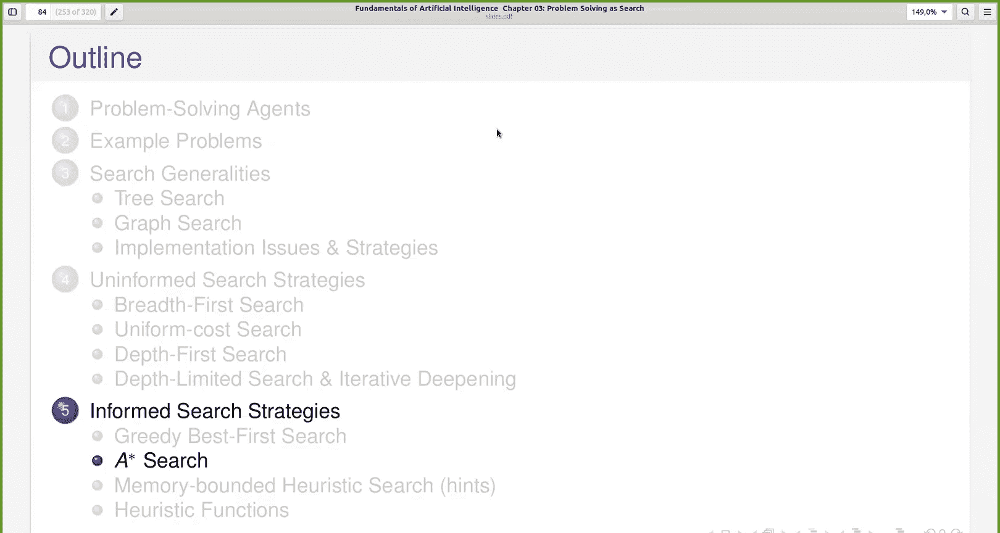

# 意大利特伦托大学《人工智能基础｜Fundamentals of Artificial Intelligence 2024》中英字幕deepseek p09 2024.09.27-CL08-1-CH03-BlindSearch.zh_en -BV1uUkwYTEmf_p9-

Okay， so。Today we are going to cover with started discussing about the search。😔，And we are color。

domainomain， which is the one of a blind search or an informedal search engine， which is probably。

The least AI one。 So you may find these similar topics in other course。

 like algorithm course or or graph course or whatever。 But with some peculiarity。

 which make them AI specific。Okay， so probably you'll find a lot of similarities to what to something that you have already seen in your in your past courses。

 in particularly algorithm courses Okay so。And then next class or maybe even today。

 we started speaking of what is more。Intelligent forms。Of search。This is E the search。

In which US exploiting knowledge to drive a better the search。But。

Let's start with inform an informal search first Okay， first of all。

 we have to introduce some evaluation parameters， Okay。

 so the different strategies that we are looking for looking to are evaluating through somedo parameters。

Well and features in particular one is completeness， so when you are looking to a blind searcher。

 you have to wonder a few things first of all， if your strategy is complete。In the science that。

Is it guaranteed to find a solution if this solution exists？😡。

But you may find the scenarios which is is not obvious in particular if you have infinite infinite state scenarios。

 remember that in general。We may have the scenarios in each of the state space is a finite。Okay。

Or is so big that not is practical equivalent to if in the sense that is so big that you cannot even guess。

🤢，Even their hope to cover all of it。Okay， then of course， the user time complexity。

 So how many steps you need to find a solution。Another important factor。

 which is how much memory or space complexity， how much memory is required。

How much information you need？To store cont。Without dropping it in order to maintain the status of the algorithm。

And then of commodity， if you have a notion of cost， whatever the cost is。

 is this guarantee to find the best solution， so the minimum cost solution。Unless general， unless。

Otherwise specified， we assume that our optimization problems are minimization problems。

 so our cost is is a cost so a negative a penalty， so we have to minimize minimize for maxization problem of course。

 you just you just invert the design sign of the。Of the courses function。Okay。Okay。

 looking at the time and space complexityity， you have to evaluate them in terms of practice and here is a fundamental difference with respect what you have probably seen in a graph search algorithm because。

When in G search， you have a graph。In which you have the number of nodes and number of acts and they all way to the time of search in terms of this number of nodes and number acts。

Even in this case theoretical you have a number of nodes okay but this is simply too big so which is states but this is simply too big okay is's not the real size of it so your probe not does not present itself as a set of state possible states okay so。

Typically present itself as a set of state variables and then then you have to find the successor set of values。

 the successor states or variable。The successful array of valuess of the state so that which can be directly assessed okay so the key point is the maximum branching factor of the search tree。

 what is this， it's the maximum number of success one state。Okay。So in general state。

 you can have at the most we suppose we have at themost be。哦。Be a success。Okay。

 not yet this is a maximum and what we are looking here。Is a worst case analysis。Okay。B is the depth。

Of a least cost sum function， what is the depth is the number of steps you need to reach。

 So the minimum number of steps that you need to reach， which of course you don't know a priori。Okay。

 but is something that you have in the problem。Yeah。M instead。

 is the maximum depth of the state space。Okay， not even that in some scenarios。

 this is there's no such that。But which we assume that M is plus infinite。In general。

 how many nodes do we have Okay， again， we are speaking worst case scenario， well。

 you I believe you know that how to compute the number of nodes of a complete graph of complete three。

 sorry is one for the first layer B for the second layer be square for the。嗯For third sorry。

One for the root B for the first layer we typically count' from zero， Okay， two for the second layer。

Blah， blah， blah， blah。BM in general， the m layer， you have a BM B to the M。

 which means that overall you know that this is something which is smaller than a constant time a BM the the number of leaves so this of BM so there is an order of is upper bound by a constant time B to the M。

Okay， so this is the way the the。Eas domain mains。That you have。

That you have to evaluate those kinds of algorithms。Okay， and here we have substantially。

I would say four， five strategies。Depending on some fact。

 so substantially we have three strategies plus a couple of variants of them。Breakfa search。

 uniform course search， Def search。And something which is not very interesting。

 which is depth limited search or very limited interest。

 but which is the main component of something which is very， very important state。

 which is iterly deepening search。Most of them are different。Deeffinine in terms of the access。

Strategy to that from DR。Oh friinger， however you want to call it， okay？诶。And also。

 they may differ from how to place the gold test strategy。 We see them。啊。Again。

 you probably have already seen birth research， death。😡，Maybe uniform course search in graph theory。

 in graph algorithms。Of course， they are the same principle。

 but remember that there's a basic difference。 You are not exploring a graph here。So in particular。

 you are exploring sand。😡，Notion of state in which every time you can compute the successors so you don't have an eye catching view of the graphic priorityi。

Okay， and what is most important。The set stage， so let's say graph of state is， in this case is huge。

Because not， really the state， what is is not what you see is not the state it's not the graph。

You have a set of variables by which you can decide every time what your successors are。Don't be mis。

 I will use a graphical representation just for convenience， just to fit， make。Example feet。

Into slide。 Okay， but remember， those are states。And then the as are actually successes arch of a state into another state。

Okay。啊啊。So for instance， if you are familiar with the Sudoku game。😡，A state is a given placement。

Of numbers into the board， and you can have one success state for given one state。

 you have a success state， the one in which you add one a valid number in a valid place without conflicting with some other previous name。

Okay。So this is a valid successor。You see this is something very different from notion of an arc。

So you have a capacity from， one configuration， one state of a Sudoku from one valid state to another valid state。

So simply adding。Adding one number legally， one legal number inside the board。Okay。Or in checks。

 you pass it from one state by move， by move in one state， passing given configuration。

 you pass it by making one move。One legal move， Okay， so this is one successor。State。Okay。

Let's start with probably the simplest one， which is a Brad search。呃。And the idea is that。性你诶。へ。

The deficit is to expand always expand the shallowest next state。

 you should always keep in mind that in general search you have the frontier icon may contain many states。

Okay， so yeah。One， why is that because apart from the initial state when you start？

You always had all the successes。Of one state at every step， you are the oldest success of one state。

 which are typically more than one。They may be many， of。

Think how many successor you can have in a Sudoku player or in his chestes。Okay。😊。

So this means that you have to。You are the many states every time， potentially。Okay。

 which means that a different ti is can be。Reasonably big。

 So you have to decide a curriculum by which to。The next element from the frontier。

So the key idea about that first is to take the shallowest。Next state。

Meaning the one with the least distance from the route。

So how do you do that by implementing the frontier as a queue or a FiA Q Okay。

 first in first out so you take。From the frontier， the one which。The oldest one in the frontier。

 So the one who was the least recent Lucr one， we assume that notice that it is may vary because you may put the successors insert the successor once take in different order。

 okay but assuming some order， you take the oldest。The oldest there， okay？

And then so remember that another one you pick one state after doing some checks。

 then you add all these processorors to the frontier。Which means that。This guarantees you that。

They you have always chosen the shallowest solution。 So let's make an example。 I you start。

 in this case， you start from a。Then this means that you add to B and C to the。This was B and C。

Then you analyze is B， which means that you add the DN D。Okay。Oh， sorry。

 I forgot to say when you say a， suppose you insert the B and C and suppose you insert the the。

The chief don of an order in order for left to right， okay？In this case。It's just a convention。

 thank。In reality， you can use the order you like， okay？So， this means that now。

So you drop a and then the oldest one in is B。Okay。😊，So you expand D and D。

 but notice that the D and the E。I been added more recently than C， so your next choice is C。Okay。

 then you expand the sea。But then the oldest ones is the。Okay。

 then suppose you don't have any children。 So you can it's faster than E and then F and then G and so on。

 Okay， so what is。I catching the fact about。About a breakfast。Is that you proceed by layerss。Okay。So。

 you first。The zero is the root， then you're taking in order all the children on the route。

Then he taking order all the chder on the cher on the root。Then so Sutan， you will start from the。

Matterfaamiia。Then you take all the children and there you turn to all the grandchildren and then you taking in order all the grand grandchildren and so on and so forth。

 okay？Clear， probably something that youve already， you have already seen in the past。

 at least at a graphical level。 But just remember that the children here are not arcs。

 So the fat representss arc is just。For convenience。You are the successor states。Okay。

 something which it can。The candidate states， which can happen if I choose an action from that state。

Okay， so here is the general episode code of。Of breakfast。Again。

Remember that we can always have two versions of every strategy。

A tree based one and a graph based one or a dagger based one。 Okay。

 so the one in in which you keep track of the states that you have already explored。

With this back to those in which you don't take。Remember， the drawback one。

The three bays you can have get into if loop， you can get lots of repetition。

The drawback of a graph is that you must keep a data structure which can be up to grow up to this。

Sometimes you're going to have a compromise like like a cash。

Some form of caching for representing the explode， so an incomp test structure。Okay。

 so how this work， so this is the graph version。😊，You obtain the de tri version of gation。

 you just drop。Any reference to explosions and any access to the explore data structure， okay？Okay。

 so。Okay， initially， you have a node， okay。嗯。Remember the distinction of nodeA state。

 nodeD is a data structure which contains a pointer of a state plus some extra information okay。😀Oh。

Okay。So， you know the。Initial is the initial state whose path cost is said to be zero。Okay。And then。

 you check。If the first no is a God。Well， it may be the case that you may have the very lucky sooner。

 in which is the initial state。😊，Can fulfill your goal， well。You have to consider this case，So if so。

 okay， done， you're done， okay， you can return the solution。Okay， otherwise。

 this is the the key point。 The frontier is implemented as a fee4 Q。

And initially is initialized that we by pushing in the。The initial state。

The node of where sometimes we say the initial data meaning the node of the initial， okay？😡，Okay。

 and then explore the is empty initially empty。Now， you in through a loop。诶。And okay。

 so if the is empty， then you can return failure。 Okay， or if you pray if you prefer， you can say。

 while for the， not empty differentier， then do okay。

So if the frontier empty and you haven't found a goal state。Then let your search of fields。Okay。

 then you pop the frontier。 So this is the key point。 So you take out of the frontier。 the oldest。

 Well， remember， is a5 of Q， the oldest state there。😊，Again， I say state I would say state。

 but within 10 you need the node。Okay。诶。Okay， you added。

 you added the corresponding state to explode。Okay。And。Then so I mean， I've explored it。

Note that explored， this is slightly distinction explored instead is the test of states not of node。

 okay。Because Kentucky， whether this state has been explored。

 it doesn't take into consider regardless the fact that you get there from other。

Remember that in some way， the northernden ocean contains also of the father， the coast。Okay。

But here you want to see the state has been pretty explored， okay， not the node。Not of this。

Slighter distinction。Okay。Is this clear。So以。You want to check it if the state has explore regardless the way you reached it。

ok。滚。Okay。Then substantially， what you do is for action in the current node state。

For every actions that you can apply to the current。State。Then you pick child。

So if this data has not been explored or in the frontier。Then what you do。

You check if a goal there if it is a gold， it's a goal。If it's a gold， you get a solution。Otherwise。

 you add theier。And go on with the loop。Okay。Is this fair？

You may notice a strong similarity with the graph breath search in a graph theory。

 But now remember that you are not exploringing a graph。Okay， you are exploring。

Some some set of states。By which you can compute the successor by looking at the action that you can apply to to every state and then looking at the consequence。

State that he brings you to。Okay。😊，One couple of remarks。One important market is here。

Where do you do goal test here and here？So you add a gold test。 you check the goal test。

When as sooner you。To every， which is the result of the expansion。Okay， so remember， you put that。

In the goal， you expand the node， but then before enter putting them in the frontier。

 you check if it's a goal。That's fundamental。Why， because you save a layer in doing that。

Think about that。If you are。If you put the gold test here。

 only when you picked an old out of the frontier。Then， you would wait。A wall around。

A layer before realized that that goal was that the state was a goal。In this case。

 you save a lot of time。Because is the goal here。The gold test here。

 you save a lot of time because you can realize this is a goal as soon as you have a。

Gerate this as as a child of your coron。Without waiting。To explicitly expanded。

Do you see the difference？Okay， it's a very。 So you save a layer easily way。Okay。

So what the meaning I believe it， you see exploring a wall layer of a chill line。The search3。Okay。

 so if you look at that。So the key point about breakfast is that you reason by lays， Okay。

 as a children， childhood layerss。 So you first spotted the well， the grandmother， okay。

 then you you explore her sons and then her grandsons and the granddaughters。

 they say granddaughters， Okay， say her daughterers and then all the granddaughters and then all the grand grandanddaughters。

 the son so folk， okay， depending on whether you are。

Reason in a three base way or in a graph base way， you can either repeat the search or not。

 So noticeing the difference in this case。You have a so suppose you have this graph here， Okay。

 so you start from the source here and you wanted to get the goal here。Okay。

So here you immediately generate the first layer is。The E and P， suppose you go this way， okay， DEP。

Okay， then you expanding， Okay， D has D， E， D sorry B， B， sorry， B， C and E， okay。

Not is that E is already。Expled here。 but yeah we are doing research。 so we don't realize this。

 Okay so。So next， you respond E， where the E is as F and H。 sorry， R and H， okay。I should that。 Okay。

 then we expand the P who has only Q Yeah。 Q has no success or。Now we get back to D， okay， D as B C。

 E， okay， as as a success。 Now we we expand E and H， not sorry， we have already done it。

We had already done it。 Sorry， I lost the pointer。 Okay， so now B， is my B is a。

 which is a deadline there。 Then yes has C， which is a， which is， again， a deadline。Lo in this way。

Okay。You take a lot of time in order to reach G here， not here for the first time， okay。

Un notice is that you do lot of a redundant search。😡。

If you do that you like because you reexplor the same subre several times， sub graphs several times。

Okay。Oh。The key point is remember that you。Your reason by tires。

 but not that if you have a tree like search that then。Some nodes may belong to different tires。

 Okay， so for instance E belongs to the first time， but also the second because you can get it。

There either by one step here or by two steps here。ok。Okay。I think is。Nothing particularly new。

 So it's just a variation of what you may have already seen in algorithm theory， right。Okay。

 so just some example。Run。Okay， the first example is ran a previous example with the BFS graph search。

 so having an explored one。Con the following graph with initial state 0 and goal state 17。

Explore it using BFS3 version， using BFS graphraph version。And so use adopter the strategy that you。

You expand get sheet running following the index。America order。 So if you ever say in this case。Yeah。

 the7 has three7 has one to three children， so you fine。Itspon 4，11。

14 because 40 comes before 11 and it can be  one 14。 Okay， so you follow the order， the number。

Although order， okay。I think that this was one exercise in one exam once you have understood the technique is quite straightforward。

Okay， so what are the properties of BFS？So。First of all， how many steps。

Does it take you to reach a solution？Well， okay， so remember。

 B is the depth of the shallowest solution。 So you， you go。Proceed by my tiles。

And until you get the depth tire， okay， so the tire of the depth， and then you reach it。

So it takes something exploring up to the tree up to the D tire， beef tire。

 which means that is B to the deep。大嘛。Which is not bad。Remember that we are。

Dealing with MPhar problems in general。 Yeah。 Okay， so yeah， branch， this is not bad in general。

 because this is a D。 So it guarantees you to take。The esplanent is almost B。

 where is the maximum depth。One of the good news。Okay， now let me wait in a moment。

By the news of the first memory。How big is the frontier？Yes， please。😊，Is there a branching factor。

 So the maximum， I say before。B is the maximum branching factor。

 which means substantially the maximum number of successor state of one state。

You may see that it is the maximum number of possible actions that you can perform in a Gu state。

Okay。😊，呃。Unfortunately。This is， this takes an exponential amount。 Why is it the case。

 but think about that。So every time you proceed， okay。With layer you have。

 So when you are expanding this， Okay， is because you you have a。Stored all the states。From that。

The mother of the states of Europe respond until the euro state。

So you have one wall layer every time。Yeah the equivalent over。我 would理。In memory。Okay。

Subsstantially you so when you expand the successor on this date here。Okay。Which is， let's say here。

This means that you are taking the oldest of the wall。

 successor of all the other states that you have expanded。Before it。From your parent。

To the Cor state。Okay， which is a whole layer。And the layer is exponential in the depth。Okay。So。

That is the really bad news。😡，Of a breath f， it takes really huge。

Data structure to represent a different frontier or the fringe。It is complete， yeah。

 well if the solution exists and the B to the D and then this is finite。So if a solution exists。

 then it is， yeah， you find it。Guantee to find it。Even if the state is in Philip。

The number of states is infinite。If there is no such solution and the state is infinite。

 then of course it can go forever， but that's standard every such strategy。Okay。Is it optimal， Well。

 optimal the sense that the cost here is the number of steps performed。 Okay， yes。

The science that takes， that's one of the。ANice feature of breakfast served first search is that it always takes the shallowest solution。

So this solution we stake。The minimum amount of steps。ok。😊。

That's one of the good feature of a breakfast search。Okay， the venue news， as I said。

Is that the memory is a huge problem。So just to give you an idea where these are not really up to date as a data。

 but it can be costly speaking。An example， if you have some problem， which you have a。

A branching factor of pain。 So you are guaranteed that you have at the most1 possible actions for every state。

To monster。And suppose your software can process1 million nodes per second。Well。

 which is quite told you can have one billion one now， but。It doesn't。Matter really。

And suppose that one node requires 1000 bytes of storage。Then here are the data， okay。

 so with depth 2，4，6， bh， blah， blah， gap 2 16。The notess grow as time to the end， of course。哦。

And grow exponential。 And you pass from 0 tot 11 millisecon to blah， blah， blah。3 350 yards。

And then to probably， I don't know whether you have ever heard about petabytes and exabys。

 So substantially every expression is multiplized by 1024 okay。So it's due to the time in greater。

 Okay， so you see that you， you exceed one under3 GB after step 8。Okay。

Not to mention so at two minutes is something that you can handle， right？

But one under3 gigytes is thelim of a standard computer。

10 TBabte10  TBabtes after deputy is such that you cannot。喺度。Okay。

 you can hand the three hours surrounding time for search， okay？But you cannot handle 10 tertes。

Well keep in mind because of also。This implicitly mean those times here implicitly means that the memory is a。

Then wise around。Okay。So if it has to be storedor them。A theseco or SSD SD is much better， but again。

It may take so much longer。Okay， yes， please。Nonetheless， drop。Some branches， for example。

 I think about stopfish So is a chest engine and it evaluates in a breakfast first。

 but it goes much deeper than 21。 And what I think it does is turning branches。 And it said， well。

 there is one。 this pain， but you lose information。 Yeah， of course， Yeah， is if you want to。

 this is the。The counterpart of。All these cash caching things of explorer， right？So， of course。

 these are extreme cases。 Okay， then you can have compromises。

 You lose a part in part in completeness。But you gain inefficiency it's like they explore the part I mentioned before right。

 so explore you can have a full data structure。😊，And then， okay， but this blows up very quickly。

 or you kind of cache。😊，You may have lose some cachehes， of course you can do some redund steps。

 but in general， what's like well， and indeed this is what people do。Okay。

 we are here we are listing the main particles， okay。

 and then we of course can have arbitrary compromises between。Between them， okay？

And good smart implementation， which makes un compromise。Trade efficiency for memory， I mean。

 in computer science， in particular in in NPR problems。Reading a memory with。Recip is one stand out了。

Atitude， you have to think how much you want to pay。 Well， this was much harder in the past。

So when I started doing the eye， well I know I started doing the guy。

 so I know this sounds something like many old times， but I remember I had a sunwalk station。

 which had something like 32 megabytes around。Okay， megabyte， okay， which means that。

Memory was fundamental so you pay much more attention to memory consumption than to CPU time nowadays you still pay attention to memory。

 but much less memory okay， so again is always a trade between memory consumption and CPU time。Okay。

 in particular now， also CPU time there is a fundamental component which a dimension here over parallelization Okay so you can you parallelize search？

And that's already another big topic， but we are not going in this level details of implementation today and giving you the basic high level principles and then of course there are lots of intermediate and compromises and implementation tricks that you can apply。

Depending us on the problem you are targeting， of course。Okay， so so long before the first。

Now I wish you to pay particular attention to this uniform research。

And the reason for you why this is very， very important。

Because Uniform search is the baseline of a large variety of search algorithm that we will see。

Which may be very similar to them， by just changing the way of evaluating the cost。So。

WellRemember water is。Govan， Gvan is some the。The path coast is the current cost to reach that node。

Okay。So the idea of a un search is to expand first the node with the lowest particlecode。Okay。

 so if you have a song， So you have expanded at list of songs of somebody。有 daughter for some。

Let speakak of the femin。Well， matter chart apart in Char， so so let's say。Speak female。

 you have some daughter notes， Okay， and but。For each of them you have。You have the bus Coast。

So you pick。With that you pick the one with the the lowest plus scores。 Can you do that easily， Yes。

 if you。唉。Yes， because you can use a priority queue。Do you know what priority Q is。Heap heap。Okay。

 data strategy is a hipA。Go to algorithm theory。Assess time is loggan。Which is good， okay。

 so again it something good Okay， so you insert every time you expand then you insert them in the prioric queue。

By the path coast and so you take both in session， extension， take login time。And so， you take the。

Every time you pick the no with the list course to reach from the root。Okay。😊，Notice that if you。

 if the path course is one。 So if every step。Increase of the passcode by just one or by just a constant Okay。

 because sometimes time this is very conceptual very similar to the first search。

 So you can think through this as a generalization of the first search。

With one fundamental difference。The handling of gold test is trickying here。

 you have to pay attention。In the following science。Okay， suppose。Yeah， this is very simple。

He's here， okay。So your source goes to A1 goes to B in 5， it goes to C in 15， then from B。

 you go to to the golden in 5， you go to A in 10 and you go to C to G to5。 Okay。

 so you see that the best solution， the best path。Is from S SBG。But this is not。

The first in the search it finds。Why is this the case， okay look？You take your spanda S。

 So the successor are A， B and C。 Okay， so which one you pick the one with the least cost。

 which is1 a。Okay。Okay， and you spend it， if you get a through goal or how， you got a goal， great。😡。

 Shall we stop here。No， okay， this is a solution， but it's not the best solution。😡，Okay。😊。

So what you。啊。What you should do instead， is go ahead。And how you go ahead， you expand B。 And then。

 oh， I got a goal， but I got a goal with the list cost。 So I will substitute。The， the current。

Post with this one and go ahead。So when you bump into a state that you have already reached。

 but with the list of course， you updated this information in the and go ahead。

So this is a little trickier。Okay， but this fundamental in order to guarantee the optimal solution。

Your book your book presents an example that using the。The Romanian map example。

 okay to take a look at that， but this is very， very con very similar to this。Okay。

 so here is the algorithm。Pay attention to this algorithm。Because variance of these algorithms。😡。

Will be user throughout or。Our goals。Okay， we'll encounter。Many times， slight variations。

Of this cycle。Okay， using Uniical search again takes a probe it a solution or failure again again。

 we have a node initialized as containing ready to contain data。Okay。

 you initial the initial order with initial state， the frontier is initial by containing the the first。

U。The first node and the explore is an antis of states， okay。And then again， you enter the group。

 if the for is empty， then you enter failure， notice that unlike with the previous case。

 we don't they make any goal test before inter。😊，We have already noticed as life difference。Okay。

Okay。Again， you pick the first order in queue， so the one with small less the value of path。Okay。

 the small path coast， so the nearest to the route。Sorry， the nearest intensive of cost， okay。

 not in the time of steps， of course。ok。If this is gold test， okay。

 notice we make a good test when we are。When we are taking this out of。The fringe or the frontier。

 which is different。From the previous case， remember， we took the node out。When you spotted it。

So we check this later this time。There's a reason for that。Okay。So we may have vi test。

 if this is a golden rate， we have none and we have found the solution cool。If not so。

Then we are the other state to explode， of course， again。

This is the version with the graph if the three version is without the explored data structure， okay。

Okay。Then it will。For each action， So again， we compute the successors of the current state。Okay。

For every action， we find a new node， okay， the child node， okay。

And if the state is not in explored or in frontier。😡，呃。ok。I think there is here there is a little。

Im precisionsion。诶。Chide state explore is a data structure with the states frontier data structure node。

 but however， this means， of course， this means and the node is done the frontier okay？However。

 that's not。So important。Okay。Okay， so it's not neither explore explored known in different hereer than you said。

You insert it into the frontier。 Okay， so here your book makes a little tang。

Confusion about the northern and states， but however， that is quite clear what he does， right？Okay。

 otherwise。Okay， it inserts that。 Okay， and so so far， nothing to do with fancy。

 If a child state is in frontierier with a higher past cost。Then he substituted。Okay。

From which you understand that in frontier， you have to save node， not states。Okay。

So different frontR， you need。Storing also the path coast。Okay。

 so there's a note from here that the state of note。 So here， okay， this is。

So you replace it and except it for the reason before， right， because if not so。

The science is in the frontier， you have to store。The not only a state。

 but also with associate with the deform。For for the shortest path to reach that state。A with her。嗯。

This click， here。Allows us to generating path， which are not subop。

The very simple case before we had before， right？Do not do you see the difference。 Okay。

 apart from the fact that， of course， a your evaluation you user。诶。

The priority you rather than the queue。On that， well， that's okay。But the point here is that you。

You have to to do this trick of the goal， you have to be careful to the goal test。

It's not simply that you do the goal test when you as soon as you ever expanded the node， okay？

Because it's too early。 You don't， you know to。So if you made the gold test there。

 then you could create a subal path。You do the test when you analyze it。

 so when you are going to before expanding it。And you are ending general， okay。

So that are so then you are guaranteed that you have no better ones。Okay。And。You are also guard。

And then in general， a child state is。啊。Replay when you find the same stint。A better path。

Of a state which is already in different frontier。You substitute that state。The node with that state。

 which is currently in the frontier with another node。With another a load with the same state。

 but with a different。With a different part， with a better path cost。You see that？

This is the tricky part of this algorithm。And insist this algorithm。

 because this is an algorithm which will be reused several times so with a light variation。

 substantially the only variation is what is the notion of cost that we are going to use。Okay。

Any question？Okay， here are。诶。Okay， the point is very different。

To really evaluate mathematically the complexity of this technique， because， okay。

 breakfast search is easy， right， iss easy to count， right。

 you have the layers and you have every every layer is depth one。And that's it。

 So how do you do that？ Well， one way to see this in most case analysis。

But this worst case analysis is quite pessimistic。More pessimistic than the previous case is to see this in layers entirely well where every layer oh sorry。

 where every layer。Is given by the maximumim coast。Of the solution divided by the minimum Arch cost。

Okay， you can see this as a reason in layers in worst case。According to this value， Okay。

 we don't see this any mathematical proofs of that。 Okay， just。

Let's say that this is the way you can cost estimate。The costs of this variable。 So how does it work？

诶 so。The cost is gross as per， of course， and it involves in layers。So the idea is that substantial。

 you are guaranteed to pass to the next layer when you have exhausted all objects whose cost is within this range。

Okay， so this mathematical formulation is the one which guarantees this。诶。How much memory again。

 the bad news is that is a exponential memory as well。Okay。Is it complete， Yes， it is。Well。

 with the same meaning as before if a solution system is guaranteed， is it okay yes。

 well it's easy to see this not well it can reach it can reach optimal because when it returns the solution to means there is no possible other way of getting impact value that with that value。

 okay？So again， memory requirement is still a major problem for union re or search。Okay。

 and also you can notice that if。Good。If all steps had the same。Variation， of cost。Okay。So let's。

 let's say one， but also constant。Okay， this division here。Would be exactly D plus one。Okay。😊。

Which it will mean that。The complexity of infofo research would be。

Very similar to data of breakfast search with a plus one。

So we'll take a B to the D plus one rather than B to the D， Why is that because you do the test？At。

When you are expanding， not when you are when you are expanding president note not when you are generating it。

 okay， I' coming， so which means that you remember with breakfast search you save one layer。Okay。

With the so， well， of course， if all if all part cost would be one。

 it would be C usually uniform course search。 But just as a comparison of the two。

 you can see that in this case， this was。U for costs really reduce to a。Let's smart a version。

Of a breakfast search in which you do the test when you are expanding order rather wheny as soon as you are generated so that you take one layer more。

One di more or whatever you want to create it。There was a question there。So can you repeat。F。Yeah。

So when he。Yes。We're optimal here， okay， we have a different notion of optimal here is not in terms of concept steps。

But in terms of a path cost。Okay， here are that。No， no， no。 when you are when you get here。

 where is it。When you got here。😮，Okay。In this loop， okay。

 you are guaranteed that you have done you have reached the best possible solution， okay。

 because you have already expanded all the children all the others。So you are not。

 you are not finishing。So if there were a better solution。

If you there were a better solution with the signal。

 you would have found you have the substituted that node。😡，with a new node here。

So you are in the state， you currently have when you are going to span a node。

You are guaranteed to have the best that no represent the best way。

 the best possible way of reaching that state。And that's why， when you are。When you expand it。

You are guaranteed to have found the best solution。Okay， because if he was a better one。

 you would have updated here。😡，Yes， please。Okay， that's we anticipated you see that the h algorithm is a variation of this algorithm with a different。

No声 of。All right。No， the point is。Let me okay， I will answer your solution your question in the next class on Monday。

A star has very the same baseline algorithm。What changes here is the way you measure things。😡。

You will not only you in EastA， as we see， totally consider the cost to reach this。That node。

 But also， but you sample that an estimation of the cost from that node to reach the goal。Okay。

Be patient and wait till till Monday okay on Monday you maybe you will start to mention this today。

 but I don't think so okay， yes， but the structure of the algorithm is the vaccine。

I think we can have a break now。Okay， so let's resume at 10 to 211 okay。不个说法。这。council。Chicken。Yeah。

Yes。Okay。还是你说你。Yeah。二二。Yes。Yeah。Okay。こ。S。对的。Good。Okay。Okay。Okay。嗯。Thank you。好。对小急。

Being aC the UTS there in both first。嗯。对。你不对那种。啊你一帮。Okay。W。对。Okay。Okay。一。你的啊。那么。可以不用啊。嗯。对，他有就是当。下。

好像就个非常。不是不的不认。为啥可以发生不变呢？对的。你发。为什的。原到我起诉。Okay。记个。没这。这个。嗯。是。好闭。你那个。Thank job。哪这个谁一。We said more。

The you was search very。你问 you know。いと。ユ名てらし。佢哋。一。不发。No。就全都不行。打给全嗯呢你咧。那句吧嗯。单当阿。不对。Yes。

We got have people here。诶诶。对。那这个。I mean，I'll see you question I still。Youディファコジ。With the。

Is the better。这个是要把费。不你个度都冇得翻，你有属属于。看班手。Proably you guys a little got check， Let me get back to。

Let me get get back。I think this is。Okay， this example here is okay， these are three。

These are three keys， okay。This is the true case。 So without assuming there is no explore。Now， okay。

 the goal of this slide was just showing you that in some way this is still organizing layer。你你有意思诶。

It know only is that at this step down the is not a one step but this given in the range and body。

U is it so it is value？Okay， so let's check it。 So in this case here， you have。

 but the goal the reach the gold is 5，7。It10， okay， so she started 10。

And where the minimum ark is one。So this value here is10。So substantial。

 this is organizing layers of 10 values。 So range of 1 values。 Okay， is it， Yes。

 from hereer from 0 to all the the orange is within。诶 no， no， what this now so。

Probably I mis speculating this。Maybe I mis this。 maybe。好好好呃。They know it correctly。Peach。Yeah。

 it is this okay， so let me put this so probably this。This is like here he helping。

Or maybe'll give you contain because I think that this should belong longer the yellow to the orange one。

Yeah， because it's the second Yeah， no， not only is a matter of students。 Okay。

 what the key point here is that this will be expanded later than this one。You see。😊，Yeah。

 you see this。Yeah， because this theola has a close path of7 and this overola is。

So it's just the amount of layers here。Yeah。They don be。It's like Yeah， so I think that okay。

 okay now the goal of this slide here is to show that those will be expanded of the order exploration will be here at zero。

诶玩水玩嘢耶日日玩。Cls 3。4，5，6，7，8，9。 Okay， so you see this are organize layer。

 What is the dont like much here is that the the choice of colors， but I would have put。

I would have probably what he intended to be those layers here Okay， Okay， but at the point here。

 but okay， the point here is not this is research。Okay， so what that could do that。

So when you bump to here。And you have already， you already have this human thing。

And you are expandinging this。You say， okay， oh， I already had。So I mean， okay。

 so you have you have this on the front。 So whether you are not sorry， you are this。

You have those ones okay， you have currently these ones on the here， then you say okay。

 you already spa these and this is。No what you have it， okay， I' keep of。And being seeking at I read。

Okay， so let me check。 already really。 now， this key here is better than this。 So okay。

 so I drop this， I drop this。I dropped this。 I dropped this。 I don't go ahead。 Okay， I drop this。

 I don't go ahead。And I will so I thought this。Thank。Because I I slept them。

And then I will perform continue let the keep point here that the dysfunction of the E with the diser using files。

诶。😊，有小为。你不来个输了咋。そ。이렇게スァ。实给这个高层的咱所的1。こ。No。你啊你问系咩责啊。Thank。系。你说理这对。真厉害。不给给你们说好嗯谢。谢谢。😊。

Make a check do you like that？Yeah been thank see。Okay in depending of getting。てみ。老实的。人の startingす。

你出嚟边使边个又唔做村强可。对好。诶当我。Okay。是的。一。😊，嗯。给。什よ。Yes。你话咧上。定啲。啊今年来你我啦。Yeah。い入れます。我觉得我因。Oh。Oh。え。She。得啦，所又你你定得。

怎么。Okay。Yeah。是道。Yeah。Thanks。查你了。都。对。Yeah。But。Okay。But。6。可以。唔家信。这个树串。说你问。专。这个。Thank you。你すね。这吧差不多意。

诶啊诶你过关键诶你。Yeah。嗯。嗯有那讲。No。不道。什么ですか。对。这什么。你习惯。不者对。Yes。要我 just人没。一。Yeah。Yes。Yes。She。诶什么。If。Yes。嗰啲呢嗰啲钱都。

俾我俾咗名你。而得对电主部嘅识就电话俾你得。I issue？我。啊。P。なかポ。我个说么。And the doing nothing。嗯。笨子。行。fuck job。Miel客的少要。你有什么。拉点。

哎呦我还。不安全。S。你。你啲实对更好点咩。Yeah。Okay。You。系啊叫你先清楚诶。Yeah用。搞紧啊。She以。Yeah。Okay。我系要。你个。Okay。8。Okay。Okay。

 let's restart。哦。嗯。I just anticipate something that I wanted to say。Okay， so first of all。

What is the meaning of this？In general， this three representation。Of the uniformical search。 Okay。

 this is just to say that you analyze this in order。 So the order in which you analyze。 So you。

 for instance， you analyze are here。You analyze this E here before this E E， okay， actually this。

This will not be analyzed will be dropped。Okay。嗯。In general， let me say something。In Ja。

 UBC and the Deaf research， let me anticipate something that I was planning to say at the end of this class。

Typically， breakfast search。And useful course you seeS sorry。

Are typically implementing in their graph version。Possibly with the cashhe。

Why is this the case because you are？The worst case is exponential in space anyway。And typically。

 graph can allow you to save a lot。Okay。😊，Instead that we see def search is typically represented generated in the plane。

Version due to space。 but letting me。Go through that。Okay， so I think we were here。

And let's go to the last basic version。Which is deficit。De f。Is the dual breakfast search。

So expand the first， the deepest and expand node。Okay。😊，And as for duality。

De yeah is the opposite of professor to so you。You expand the most recent node that you have in the fridgenge。

Okay。😊，So， for instance。啊。D a。When you fund the A， you add the CNB。Okay here depends of course。

 whether you put C or B first okay， but suppose instead in this case we put them from right to left。

 okay？So okay， the most recently certain order is being。So use find B。

 the most recent not the oldest like a graph search， so this means that you go in depth。

 you get to B。Then then you get to H and H， then suppose you have no success although you pass Y。

 okay， then the oldest one is E。And so， then J， then K， then C， then F， and so on， okay。Is it clear？

So。Stansha you put them in the stack？Or if you prefer in a LIFOQ。Okay。诶。So， okay。

 your book does not present E code， you just say is the very same as as that first as breakfast。

 you just use you just use L forQ and this analyze the deepest， so this is episode code。

 but just chain change with the leaf here and and change the names。Of the comment。 Okay。

 so it's very， very。Theyre very， very same。A。Very， very similar but with a completely different behavior。

😡，Why， okay， so。The point here is that you expand the okay， let's consider the three version here。

 okay， oh again， a usual tri version without exploring okay。So。So substantially what you do here。

 okay， you expand S， then you have a DEP， suppose for instance， you expand first D， Okay。

 this is not the best strategy， but you try B and A。

 then you go back So substantially worse than that， right， S。YouT D， and then you you try B， then A。

 okay， you backt here。 you try C and then A， you backtrack here。 Okay， then you you try E here。

 then here depends whether you are lucky or not。 this is represent a very unlucky scenario。

 So you always do the the worst choices。 Okay， Okay， so for me， you span to H。 Okay。

 so on A H you you expand the P。 and then you spend sorry P， and then Q back， you span Q， Okay。

 you back again at last， you get F。R sorry， then you get F or here or by very my choice。

 you can try again C and get tracking A no， but tracking enough FRG at last。Okay。

 so this is representation of the Wall。So this is the world three of possible combinations， okay？

Which one you get first depends on you。Depends on how lucky you are。

 what is the strategy you are taking okay？Okay。Take the previous example with the def search graph search。

 so you do that the graph case， okay。Again， consider the following graph initial state 0。

 goal state 17， explore using DFS3 version， explore using DFS graph version。And again。

 children should be experiment in numerical medical order， so these is also also exercise。

Don I have plastic sum。Okay， now you have to understand the。Okay， first of all。

 how many stats does it take？Where， in principle。The venues of。

Is that depending on how lucky you are in getting to the path to the solution。

 so even if you have a solution which is not that deep， so for reason depth D， as we said。

 you may explore so typically just adapt to under under under under under under under under under under under sorry。

啊，뮤ジ。Okay， just that down so。So it may take so。Consider the maximum。Remember。

 M is the maximum depth for the tree。If you have a maximum that you may take or be to the end time。

Okay。And noted that if you have more than one solution。

 it does not necessarily find the shallowest one。Okay， because you may find this one before this one。

Okay。So these are bad news with inspect to breakfast search， okay？The really。

 really good news is memory。How much does it take。Memory does it take。It takes。

 So in every moment of the of the。Of the searcher。It doesnt stack。Okay， and there is a spec。 Okay。

 so think about this search。Every the current branch you are。It takes。

It catchs your current the songs of all the notes that you have on the current branch。

How many of them， right， if the current branch has that I， this I times at most n。

So if the maximum length is。M， it is M times B sorry， this not times time times B， sorry。

 branch factor， okay。So you store。 So the number of elements you may have in in the stack currently is at the most。

诶。M also the length of the current path times the branching factor。W其是不理我。

That's the really good news and the real reason why you should use deficit。

You don't need exponential amount of them。Other than okay。Other half bad news。In general。

 is it complete way if India state space no but in general， so even if there is a solution， Okay。

 so here is another difference with this better breakfast in for cost search。

 so suppose you have a need in this search space。Okay， and you have a solution。😡。

It's not guaranteed to find it， why because you could lose yourself here。

 even though you have a solution here。In fact， modern def search techniques use a technique which is called random restart。

When you are exploring for too much time in an area。Remaining at a too high level of depth。

You will start from scratch using different choice parameters。

So that you start exploringding in different ways in order exactly in order to avoid this scenario。

Okay。If the state space is finite。In where the graph version obviously yes， okay。

 because a U experto。The tri version， well， you may bump into loops。Okay。

 the good news is that with depth research， loop prevention is relatively easy。读。To check。

 because why the path， you only need to check the path。Okay。

 and you only need to check whether you during the path。

 you don't encounter a state which is already。In the path， which is an easy check。

 which a logarm check。Over the if you use a data structure。

Associated with the current path in which you can search the path you see if you have already encountered a state。

I。Minary  three， for instance。The believe binary three， okay？Okay。

 you can check whether you have already encountered this。That state in the path。

 But the path is at most time。Okay， so you have a a log of M time check。Okay。说。Which is。Cheap okay。

 so substantial you can assume without lot of generality data if with the final stage space deficit search is complete model of that you implementing it and look detection strategy okay。

This is not optimal。😡，You find that called the left the most solution， not the narrowest solution。

Okay， so for instance， in this case， you will find this solution， not this one。So。😡。

You have a list of badtting users so。Partial completeness so not so neat as a completeness is not so neat and non optimality。

And solution time， it may be worse than。Then。Breakfat， but you have a huge amount。

Be our memory science。Let me speak a little。😊，Issue about time。

And here is measure in the number of steps。But where you have a huge amount of memory involved。

You always need the timing for bookkeeping。Draver and memory。A data structure。Like a queue， which。

It's big and big and big。Also， the time of。Book keeping it。

Can cause you a very severe over source of the time is affected。 Now， remember when you have a。

Me blew。Sometimes you also have time。Okay， con， because you need maintaining the destruction。Okay。

 so do。Memory management， do all these sort of things， okay？诶。So overall。

 the real important reason why D research is one of the leading techniques。

 in particular if combined with other techniques that we showing you in few types。Is that。

Does not require memory。Rop in here。The kind of observation that I mentioned before。Typically。

 def search is implementing in the three version。Okay， why， because otherwise you， you will lose the。

 the the fundamental。Steach。All of the first search， which is memory， polynomial memory。Okay。😊。

Relevant exceptions are the laws in reaching your avocation。As I mentioned。

 so this is intermediate between so an explorer is in completely the structure。

 which is bounded in size and they just use like a this used like a cache memory right so see frequent。

😊，Prequently happens。 So you。You are the states。 and then when you bump， you find this frequently。

 from time to time， you remove them if you haven't then called。Pice， okay。Like a cash memory。

All computers are of their kme。So sometimes the is combined with the caching mechanism。

Which maintained the size of the data structure of polynomial。Okay， or reasonable。

 whatever reasonable means in your application， Okay， while。

Performing a significant amount of locations。Or cash heat is when you know what cash heat moves。

It means when you are hitting occasion means that you are。

Able to find a data that you have already called。So that you avoid exploring your state another。

Whether you so you encounter the second statement the second time statement for the for the second third or the multiple time。

 okay？Is this clear？Okay。Actually， most algorithm do not really use data search。

 but a slight variation of that。Which is backtracking storage。 In fact。

 we'll encounter them when we see S。Re position your satisfiability， whether you will see。

Cosline programming。And others。So， you don't need generating。All success are the time。

 So since you are keeping it。Everything in this stack。You only need the storing， generating。

 expanding。One success， which is the one that you will expand immediately after。

The key point is that you should maintain summer。Informations on data structure to keep track what is the next state you should expand when you backtrack。

So you don't say when I expanded this longer。I'm， I'm not。

Forced to expand all the children of this norm。I just needed to keep it。To keep a pointer。

 So I just expand the first one。But just remember， should remember to keep a pointer。

To the second one in order to the next one in order so that when I bet。

 I know that I should explain that the one。A point or whatever or whatever other technique。 Okay。

 sometimes there are recursive implementations， sometimes just to keep a point as or whatever， okay。

This is we see in particular when we see CP SA well。

 we are not seeing SMT in this logic programming in this course。

 but you will see SMMT in automatic reason in the automatic reason of course， if you're attending it。

And also in planning， you will see the search very extensively。Okay， so what is the。Well。

 but you say， okay， I need a lot of bookkeeping。 No， since you have at the most， you have to keep。

You have to keep information for every。Noor that you have in the Cht。Okay。

 so this means that you require a linear amount of indexes。A linear amount of pointers。

 one for everything。What know do you have in that？You have in your stack。

 that is the big advantage of doing data research with respect too。To breakfast search。

 okay so no matter what the fringe is always limited inside this size。And the advantage is that。

 you need。Over memory rather than O BM， Okay， so you need only one success。

 keep only one successor at a time。Well。Plus some information plus a pointer to the next successor who。

Or or。Keep track of a criterion by which you know what every time what is in the next success with this plan。

Okay， so this is， I would say that。In search。When use a the to you。

You are actually using that search。With a few exceptions。Okay。Okay。

Now we are introducing iterative differing， but in order to introduce deterer differing。

 we need the first explain depth limited search。The interesting part of itative is that with the low cost。

 it takes the better of breakfast it combines together， the better from breakfast。And the first。

And this is the reason whyer deepening is very， very popular。Okay， first I have a to introduce there。

Oh。The core element of， which is definitely limited search。Okay， DS， definitely we get to search。

Okay， consider depth search。But you impose a limit。A bound in the inter depth you're exploring。So。

You， you say， okay， I don't want to expand。 you know， the further to level L。Okay。

 so if I reach a level L， I backtrack。So if I need to expand the level L， then I back it， okay。

So I don't go ahead， notice that a Ds is nothing than a dis with A。Plus infinite。Okay。诶。

Notice that this sorts so in case of infinite search in space， this is guaranteed to terminated。

 but unfortunately it's not guaranteed to find the solution shift any。

Because if you L and the shallowy solution is a plus one， then it doesn't find it。Okay。😊，But okay。

 so this guarantees you to that the search amount is a maximum or to be to the air。Okay。Well。

 sometimes。It's useful。There's a stand alone now good them。

If you have a priori knowledge of the maximum depth of the search。😡。

So if you know that no matter what， for instance， not， okay， for instance， some problems。Havet。Well。

 actually， all finite search problems have a notion of diameter。

The diameter of which comes from the graph， the diameter is the maximum number of steps to reach one state from which you can go from one state to the other state in the graph。

In this state the space golf， okay？Bes。Diameter are incredibly apart from easy cases。

 diameter is very difficult to compute。Or to estimate， sometimes you can estimate。Yeah。

 but there are some scenarios which you can。Computer， computer diameters。 Okay， you can。P， well。

 in the top example of the Romanium E， you know that the diameter is9 stars。 Okay， you see that。

You can reach every state of wherever of state next times。Again， if you have a map please。

 that's easy to compute。If you have a search space， state space which you don't know the connection。

 so every time you don't know a prior the connection and every time you have compute the success of that。

 this is typically something which is incredibly hard to compute， okay？

But sometimes you can estimate a diameter。And if you put the L as a diameter and if this diameter is not too big and you can estimate that you can put the L as a diameter it devs you to go ahead。

逼样的这样的这。Okay。😊，But that's not the main reason we we are interested in that。 so the drawback is that。

Is is incomplete if the de is greater than L。It takes O or B to the I instead of B to the D rather than。

AndOkay， so as a standalone， Okay， so this is very。Easy way of seeing， Oh I forgot to say something。

 I can leave you for my exercise。You can implement a backrack search in acursive way。10。

Why isn't this the case， can you see the intuition about that？

Go back to algorithm theory and even program of 101， program basic programming。

There's nobody here who， well you are too young to have taken programs and everyone owner with me。

 right？Nobody of you took programme andno with me， right？You're too young for that， yeah。傻。

What is recursion？Recursion uses a stick。Okay， iss based on stack。

exploit the internalistic mechanism。Of every CPU。Okay。So。

As you should have seen in program of301 or like programming me。

And a stick based algorithms can be natural including in a recursive way。

De first is a stackable algorithm， so it can be naturally seen。S。As a form of inercuracy way。

Which is not so easy to do well at all， you cannot do for breakfast search， for instance。Why。

 because a recursion is intrinsically stack。Whereas breathlu is particularly Q based。Okay。😊。

So I leave you by exercise to write a version of def search， of course， the pre version of that。

In ourcursive way。Okay， your book here takes the Casials。

 so it takes a variant of that of the solution of this simple exercise I give you。

Is it just a recursive implementation of that？Okay。

 so the limited is something in which you give a problem and give a limit。And then the recursion。

 then you have a。Canuncer taking the current adapt。So what you do。Okay。

 so you you have an extra parameter which takes the limit this parameter。

 which is the depth of the equation。Okay， and then okay， initial， if your current state is gold。

 then you have find the solution。Otherwise， if limit is zero， then you return cutoff。

 meaning you have cutoff means I couldn't find a solution because I have to stop before。

Which does not mean there is no solution。Cut off means there is no solution up to that。

But it could be one at a level plus one。Or I'll plus something。Okay。Okay。

 then you have tovoke invoke recursively。 So if you， you。

 you havent reacher cut off and you haven't find a solution。

 then you have to go for the reccursive case。 Okay， okay， you， you need to set up a flag。

 cut off a card。Which is false。Then for every action。

 you check the state and the success or due to that action， okay？You create an order。

 and then you invoke recursive yourself。On that node。我。😮，Limit-1， imposing one。

Maximum deficit minus1， okay？Okay， if the result is cutto， then you set cutto code to true。

As if the result is different from failure， then you tell the result okay so good news if the result is different from failure and from Koff。

 then you the result great， youll find a solution if a Kaov occurred the idea of to bit f okay。😊。

Then okay， then you look book。Okay， if so this means that。If a catto has occurred。

 then you don't get off otherwise， you don't failure。Okay， if you had a solution。

 you would have heard result before。Okay。This is nothing else that a recursive version of the depth first in which you stop。

 but not only whether you're。You you stop。Either when you have reach the solution。

For the good news or when you ever reach the deck。W you but I can go ahead。Okay。呃。

So substantially you treat the case when you reach a cutoff of as if。You don't have any success。Okay。

 now we get it to the really interesting part。Well。

 DLS is not that interesting but you rarely applied it as a standalone search。

What is a fundamental element。In呢。A much more interesting game。T닉 general닉， which is itivity。

Which that year is very， very simple。S start do。That limited search。For increasing debt。0，1，2，3，4，5。

 C， blah， blah， blah， blah。Or if you put okay。So substantially， this schema。

 once you know what depth limit search is。Is incredibly simple。Forbe it。Start from zero to。Up to。

 to what you want。Evoke depth limit search on the problem of the given debt。

And if the result is different from cutoff， the return result， if you cut off。

 go ahead and increasing do that。So try the limit search for zero for one， for two for three。

 for four， for five for six for seven。Good news。Combines the advantages of breakfast and deficit strategiess。

Is complete。Okay， well， sooner or later， if there is a solution， you reach the limit， the L equal D。

 and then you bump into the solution。DepptT limit search is complete if there exists a solution within the on DT is smaller than the。

Okay。It's complete cool。Okay， this is the。take this as a matter of trust。

 I we willll explain this in the next slide。 This takes of B to the these steps。

Which may be the most surprising fact。So it takes substantially the very same method search。

Over a breakfast lunch， I will explain you why the next slides。 So keep it。

Cash should is an ocean for a while。Okay。It requires memory。

Automability where every element at every instant， eternal deepening is executing adapter limited search。

😊，Okay。Which is a variation， a variant of the research with the bond， okay。

 so it takes the memory of the research。Which is takes or be to the deep memory。

At most we between maximum because we have already seen that the maximum that B reaches the solution。

So great polynomial memory， the best。So so far he takes the best of the professor search。Okay。

It explores a single branch at the time like the first search。Andy。Okay， assuming。

Assuming that the notion of the market is the number of steps is the theer。The course is theer。

 it's optimum。Okay， there are also no variation of。On Uni cost search techniques with iter deepening。

 but we are not going to overhead。So this is a huge advantage and is typically very。

 very popular and it's the family research strategy when the search space is very large and depth in depth is very of course we assume here that we are we are doing。

3 based version， because otherwise we use the polynoality of memory。

I would personally add the following。 Yes， this is true。 a personal comment。 Yes， this is true。

 but actually we are not really using depth limit search。

 but a depth limit version of back tracking search， not of the search。 So again。

 we don't're not expanding all the。She at the time， but one at a time。And。

And keeping a pointer to keeping some information to record start， what is the next child in order。

 okay？Okay。No， it remains。So everything is quite clear， I would say the algorithm is quite intuial。

ok。When I read the first time these algorithm quite a long ago。I was very puzzled。By this step here。

I have a question for you， is it clear to every priority why this is the case？Why performing？

你逼ating你。Is ob because it was not clear to me at all when I read this for the first time I long ago。

And the reason is a mathematical argument。😊，Which works okay， first， let me show how do you do first。

 we limit zero， Okay， where you just to check it for the for the node， Okay， it's fine。For limit one。

 you just check for a and then A B and then ABC， like the fat。 So this is done。For limit2， well。

 you do birth search， sorry death search as we've seen。For Le3， we do the fa。😊，Okay。

You may not something and go ahead on， you may not notice something。There is some west research here。

This is。This note here is。Analyed in this case， then you repeat analyze is not here and then you repeat analysis is not here。

The second level nodes here are repeatedly analyzing that one， that  one，2。

The second layer analyzing in depth three and4， okay？

So you repeat the significant search component so how the hell you don't dramatically wn。

The computation here。And this comes a mathematical consideration。Okay， so again， the usual exercise。

Consider the user that explore your deep research3 and wh okay graph version nobody uses。

 but it just it can be just an exercise， okay。Okay， so here is the key point。

Why the hell you have only or be to the deep point？😡，It's just a matter of mathematics。

Many node are generated multiple times。😡，Okay， so why is this not the big West？However。

Only a small fraction。Of nodes are multily generated。

And the mathematical law by which this repetition happened。Decreases。

 so the number of nodes which are repeated whose analyzed analyzed at k times decreases exponentially with the k。

That's a point。D to one。So the nodes are step1。So suppose okay， you overall you are not ID。

You find a solution that D， okay， so it means you have repeated iterity deepening up to depth step。

 depth one， the two， the three， the three， the four up to depth D。Okay。😊。

Deep one have been analyzing all time。Every time。Okay。So。This been who has be times。

How many nodes are an ID times one？Theep 2。They are bit to the square nodes。

I realize that B minus1 times。How many of them？I you say。第一。对。Are all because。 Okay。

 so they the first one and the。Now， this is one node， Okay， De one。Okay， first around the。

 you analyze only the layer one。Second round the unit level one of all the layer two。R into。

All of yeah， you hear mean all of being。Yeah， sorry， this is all over。Okay。Okay， yeah。

 you right yeah， got one hour yeah。 remember this is bounded。

 we are doing worst case or I should write all of B okay。Okay， you have。So De1。

 you have a big notes and youre repeated in time no no， okay， no， no， sorry， no no。Okay， sorry， no。

 this is not true。 This are exactly square ob。These are the layer。Okay， the nodes which are depth。

 Okay， forget， okay。Well， there is one missing here， the root。

 the root is on the rise D plus one times， okay。软。😡，There's one note， okay。

So the root is on the nice B plus down one。Bs。So he's analyzing old steps。

The nodes which occur at level one， whereas the children on the loop， at worst case there are B。

How many times have they analyzed？There aret not is big times。Okay。

How many nodes do we have a level2？So how many so the notes here are the grand granddaughters of the。

Or the route。Okay， there are the most will be square。Okay， how many times have they analyzed。

 d minus1 times？ok。They one a deputy。Which are bit of the D nodes。啊Re the only one time。So。

 the last majority。O notess are repeated only one kind。The number one。

 the one which are repeated only two times are。One beef， one over beef。😡，Of the war。嗯。Okay。

 are the number of leaves divided by B？So note is that the number of nodes。

 So if you take the whole sample nodes， which are。Let's say a little less than two times B to the D。

Okay。The majority of them is a repeated one。One B fraction of then is repeated twice。1， be square。

Fraction on them is repetative times。1 B to the D part is repeated the minus1。

 so this decreases sp tree。Okay。You can do the math and you can do whether there is a。

Once I saw this， the mathematical proof of that in terms of some no serious， okay？

But the intuition is that the number of EDS nodes。Okay。

 D times B the1 plus d1 times B2 squared times1 to be to the D。Which is still all of me to the， Okay。

 because the point is that the。It sort of decreases exponentially， so the real heavy components。

Are used by one， so they。The number。The ones which are accounted multiple times or be。

The number of those which counted multiple times decreases exponentially。Are only the top layers。

Which are an exponentially smaller fraction。So the fraction of nodes。

 which are in general elaborated K times。Which are repeated K times， decrease exponential with D。

With the case， sorry。Okay， so if you make the sum it a sum or something which weight grows linearly and another component decreases exponentially。

Okay， which is still。Which is still the same complexity and this is just a different fact。

So just an estimation。Suppose you have b equal1， so you have a10 successor。And depth five。

Breakfast search is 10 plus 100 per 1000 ago that's obvious。 Okay， is the 11111001。Okay。😊，Note。

With the is， okay， is B not this is five times。Okay， but these three times as more value。

 this is four times a bigger name， this three times a bigger name。

 this is only two times a bigger name and this the same。Yeah。Okay， so overall， it 123。

000 rather than 111，00。Same order or complexity， Okay。

 you can see a mathematical proofs in the standard of disease。Taking there。

 I think it it's in appendix over the book thing somewhere or or I remember I saw this somewhere。

 but I don't remember in terms of you can compute in terms of series and see that of sums of successions。

 and then you can see that this is the case。 So the grow this the growth criteria the same。

So you see， so what's the point？The part of search， which I repeated multiple times are very。

Small part。 Okay， the girl。Itsponly with but with there small of us。

 the really tough search is done only once or the most two or three times。Okay。

So you have just a constant factor of substantial or maybe local weak， but not really significant。

You don't pay significantly from passing two。The first to breakfast to itative feeling， okay？

A few considerations from general consideration in order to to close this subsection。Sometimes， okay。

We always consider this case。Search from the source node。 So the initial state to the goal。

In general， we can go the opposite。Sometimes it's worth。To resist live for the gold。

And then compute all the action， which we may lead。To the， to the state。

 So every time you have a state。You came in backward compute。😡，The least of action。

Which can lead you。To the current state， from some other state。

And compute the source state consequent。The difference here is that even assuming deterministic actions。

They maybe。Actions can be deterministic， So meaning they are function。

 but they are not a necessary objectiveject。Mean that more than possible states can lead deterministic Islamic state。

Okay， so this means that in this case， the the backward search is not necessarily the case that for every action you have the only one so that。

For every action， you have only one possible state source state。Okay， so then maybe more than。

More than one state so that if I perform an action to this data。I end up in the same state。

So actions， even though they are deterministically， are not necessarily inject。Its clear啊。Okay。So I。

 if I。Suppose I'm a good basketball player， so I can't if I throw。This thing。

 and I hit exactly the place when I want to， I want to hit。I can get it to that state the same。

But even though if I'm here or if I'm here。Okay， a wrong example， sorry， so there may be more than a。

Then one way。Of of so so if I throw， it may be the case that I get to the same state。

 even regardless the fact that the。This part is in this position in this position， okay？

So action can be known injective。Okay， but you can do backward search and for instance inly backward search is very popular。

You start from the gold， you compute all the states which can lead you one action to the goal。

And you go backward in this way until you bump into a initial state。

So similar consideration hold for search， so in general you do search exactly the same way。

 the only difference is that when you compute the successes。The successor are backward successor。

 and you may have one a list of successors given one the very same action， but apart from that。

 which is just。Changing the size， the the basic primitives。All the algorithms apply in the same way。

In many applications， it's very frequent to use a backward searcher rather than the front search or search for Eastern planning。

Backward search is very often， very popular。Okay， you can do intermediate search。If。SoSo。

If you are explore， okay， you can do in parallel or start alternating。Back was sort。And and false。

 so。I first step， I started from the source goal and I expand the first layer of states。Okay。😊。

Instead of going ahead in this direction， which。My search basically。Exponcily。

I can't start from the goal。And come backward so I can alternating。哦 do你再听 bug个了。诶。Back was search。

And from search until I bump into two states， which call lead until two states to both reach the same state。

Okay， so you can start from here， for instance， contemporary， you go ahead for the goal。

 you go backwards until you touch it yourself。What？What is the good news for that？The point is that。

嗯。In this way， if you assuming that you are， you meet at。Half the。 So half size。I mean， the point。

So here the of the search space will be something of B to the dim half。This is B to the D。

Divided by two。But the sum of two times B to the D divided2。Is usually small than between the。

It was explanation。Okay。For instance， sometimes this is。诶。Sometimes this is used。

 in particular as an alternative of a breakfast。 Okay， because breakfast。

 you need to keep something which is。In memory， something which is。The size of the frontier here。

 and so you keep a frontier， which is much smaller。Okay。😊，So you keep two frontiers。

 two much smaller frontierss other than one much bigger frontier。Some， you keep some。Fromronta。

 which is。Size of B2 D divided by two rather than a frontier。

 two frontiers in this side rather than a frontier on this side。

Sometimes people do that for some problems。Okay， overall， this is。Overall table。

 this is research okay。呃。Bread， so which sums up everything in what we have already discussed。 Okay。

 this is not just a collection， what we have already said。Okay， it just it was light away。Okay。

I just want to point out something about a three in graph search。

 a tree search is typically applied in the first de limit inter deepening okay。

Typically we do graph search。On a breakfaster and a uniform cost of search。Okay。

 what is sometimes we can do in either way， the reason why is in this we already have an exponential amount of we already require an exponential amount of memory。

So and so using Graphwork can save us a lot of。D in my hand hands of space。

It's can't reduce in this sort space because we don't read analyzing it。St okay。

So we typically use graph with breakfast and uniform coast。

 we typically use a tree with that first angle related like that limited entirely deepening。Okay。

Sometimes we use either case， we use an intermediate version。Which is we may use。

 in particular with that research， we may use a cash mechanism。

So rather than a full completed data structure to store all the expanded node。We use a cash。

Which takes them the most frequent words with。With that fixed bond amount of memory， okay？

So you cash the most frequent ones。In particular， the latter ones have become quite popular。

In as longer as you can guess。As long as the memory now has reached the gigabytes of RA。

And as long as solid state， memories are replacing her disks。Okay， so nowadays， we have a much。

 a much bigger amount。Of memory available。 So we cannot afford having an explanation memory。Anyway。

 because explanation is explanation， okay？But we can't afford having you。Very large ones。Gigabytes。

Okay， under ten of Ha Gi exams is something that a good computer can have， right？Okay。

 so cash be the。Icplementations of。Of the explore data structure。Are becoming increasingly popular。

 even with depth based search。Okay。Okay， I wish to say something。 Okay， my proposal is。

 let's have a quick interval。And I would like to start saying something about informal search the reason for that is that typically I will devote two hours for this and three hours for this。

 but at this time I have a three hours for now and then I will have two hours Monday so I that's because I we jumped a lab class right so I will wanted to anticipate something of about informal search so that to conclude this chapter on Monday okay so I propose let's have a quick interval and resume to 12。

好。可以。Okay。理见。这本。logisticisticマカ。Can youten。Sa。5。😊，咩话系得诶。Well I know shareで lookし。即为。这公吹话。第年。没有。

Andおために。That said in he said only you。Take it up。难到你个备过里。对。嗯，冇嘅。Okay。He guys， so we are。Okay。

We are getting to something which to me， is a little bit more interesting。Because he's Morii。

So what we have seen so far。Is Su computer science。Okay， computer science applied to AI。

 but is computer science computer science。 Now we internal something， which is。More， let's say。

 intelligence， more aish。To some extent， okay， which is informal search。

 So can how can I exploit knowledge。To drastic and improve search。 So that's and today。

 I just wanted to introduce the very first parts。 Okay。

 the very first principle and a few some ideas in order and then to get to。The main topic。

Which is the A star algorithm， well somebody of you have anticipated this。

 which you are looking to on Monday。Okay， so what's the idea？Again， so far。

 we've done computer science， what about intelligence？So the idea is that intelligence system。

Cannot be measured in terms of search capacity， so search capacity is just how good how good is your CPU and how how well designed is your algorithm。

 but doesn't。Require really intelligence and does not really require exploiting knowledge， okay？

The key point of intelligence is also capital we using knowledge about the problem to drastically reduce the combinatory explosion。

 So all those problems are characterizedized by combinatory explosion。 So there are。

Substantially the branching factor is nothing as of the fact the states are given by the all the possible combination of values of the estate variables。

 okay so this means that every time you branch every time you are altermating choices between every combination combinations of variable values。

 which means that it turns out，This substantially search into a convenient audio program， okay？

Can I exploit intelligence through that， Can I exploit knowledge through that。

So if the system has some control。😡，Although in which you can generate candidate solution。

 can explore candidate solutions， then we can use it。都。

And reduce the search time and very often can drastically reduce search pigs okay？So。😡。

So for a system with the limited processing capacity capacity， or limited CPU limited memory。

 intelligent is the wise choice to。What to do next？And all the well。

My professor John at the course when I was your age。Used to say。

That's the best quality of mathematician。Isnt laziness。

Because he said since you don't want to make so Lasness is something that for you don't want to make too many calculations。

You don't want to fill pages on pages and pages of noisy of a boring calculation， so sometimes。

Laaziness stimulates your intelligence in order to find smart shortcuts。

 which avoids you to do lots of useless computations。Okay。😊，And that's。That's a part of it。不。ok。

Uniformal search。It ignores the goal where the key quality is。If you look at that。

All what we have seen so far， we ignoreore the goal。We know nothing about the gold。

 the only thing we ever a predicate。😡，Such that when we reach a goal， we bump into a goal and say。

 oh， well， great， we are in the goal， we have reached the goal， okay。

 but we are not aiming at the goal。Okay， we just are going get around。

 exploring all the search around。Around us。 And when we bump into the call。 Okay， Okay， cool。

 we have a great interesting call， which is not very smart。 would say we。So if you're looking。

 trying to go somewhere。Okay。So I'm in the middle Plato and I。

 so I'm in Piazta Doma and I want to reach Piazta Fira Calo Conio。It's not that you try。

Or parts until you bump into paera。 Okay， so you try to get informed or try to figure out where。

 well， I think the per is in that direction or whatever。 And then you find out。And then you。

 you let the goal。DryThe search for the goal drive you。Okay， which is what we humans typically do。

Right。So the key point is that often extra knowledge can be used to guide the search towards the grid。

And this is called euristic， so this knowledge is called euristic。😊。

The key point is a heuristic is something which estimates。The distance of a state。都得讲。Well。

 yesterday I mentioned， suppose you wanted to drive to Roman。Okay。

 so you get to the vent of the motorway。What will you choose first？

Roberators next this nation or Bano。I will say you most likely we choose Robertto。Okay， why。Or well。

 apart from Ri top。Whi is called southbound or Northbound or Eastbound or westbound。You go。

I would guess。Solfbound。Okay， because you know that Ro is。😡。

More or less southbound with respect to the toto。Okay。What does this mean thinking about that？Okay。

 this is something that we intuitively do。But what does this mean mathematically？😡。

That means that every place， if you go south。We get near to Rome in straight line distance。😡，Okay。

So if I go to Robertto is nearer to Rome， then Bano in straight line distance。😡，Okay。😊。

But also with respect to Perinia， but also with respect to Tona， so east and west。Okay。

So we are giving an estimation of the actual driving distance in terms， for instance。

 of straight line distance。Okay， we are all aiming in a direction。😡，So when I aim to some directions。

I meeting the straight line。To that direction， which is the nearest possible line distance。

To the point， what does it mean means that every step I make in that direction。

Reduces the straight line distance with the spectral that applies。

This is the mathematical justification of a。An imp behavior that we have。Okay。

Which is not always a good idea。If you want to go。You're important now。

And you want to go to Perina or to Borgovasgana or to Venice。What do would you do？

Where the smart thing would go down to Torontoto and then take either way or the Bauganna or whatever。

 but if you go in the direction if you drive the direction of Venice here， you get to Pa Le Chiillo。

 you have no way to get it down。If you have a bike or your， you can， but if you have a。Trust me。

 I did it by bike， but you have no way of doing this by car。 Okay， so the。

So not always this euristic ideas。I is right here， okay， but it often works。Okay。

We say that a realisticistic H of M。iveAnd giving the own perspective。Is a function， which estimated。

How close a state end is to a goal。😡，And typical heuristic is designed for a particular search program。

Typicaluristic， typical heuristics。Euclidean distance so straight line distance， okay？

You know what monoattan distance is， okay， so is it substantial to sum of the coordinates？

Comeing to the father， if you are walking in may not you。

The minimum distance is the actual so where all lines are 90 degrees you can or the minimum distance is actually the coordinate ones okay。

 for instance if you will。Do you ever seen this， Buckman。Okay， so in history of video games， yeah。

 this is okay， so if you try to find the minimum password to here。

An estimation could be Euclidean distance or or state line distance， okay or manath distance。

 which is an estimation， of course it does not mean that you have this side path or this side path probably you don't。

 but is an estimation。😊，Okay。😊，So they do it sure。第是。Considerce that when you are choosing the state。

You are choosing next state， you want to bump into into a say。

 consider their relative distance the goal。As one of the element to choose it。Well。

 you don't know really the distance。But so you can see that an estimation of such distance。Okay。😊。

Okay， so and this is what's called the best first search。Best for searching。

 node selectedor for Spanish based on the evaluation function F of M also。

It represents the cost estimate。😡，So the an estimator of the code。Of the coast。

From that node to each that other the goal， okay？Well。How can I implement this？

Just to take the uniform con search。And use H， rather than pathcode。This is the first case。

As I mentioned which the algorithm of a UCS can be。Reuse nearly identically， but just to change。

 the primitive， which allows you the evaluation of there。Just to change of the evaluation criteria。

Okay。So substantiallytan， in this case， the frontier is a priority to sort and increasing order of the distant every state the goal。

So this is the simpler algorithm， which is called best first search。Again。

 you have both three bays and graph base function。呃。So what is a heuristic function？

So H is an estimation that。Is there a heuristic function？So the point is， H of N is。

People can call it a USD function。And represent an estimated the cost。

Of the cheapest possible part from the state。Not added to a goal state or an estimation。Okay。

 the fundamental feature。HRN should comply with them。First of all。

 the obvious is that it should be greatest stick greaterator than0 should be positive okay。

 and if G is the goal， H ofD is zero so youre already there okay。

 so the cost of to reach from there is zero okay。Okay。

Implements implements some knowledge that you have， practical knowledge that you have。 Okay。

 I'm going south rather than I'm going north and so this place is going south。

I know the straight line distance or the Euclidean distancer from Roto and Rome first or I can estimate that。

Okay。Okay， here is a fundamental distinction。This depends on state not as node。

 or remember the distinction state is the state of the world。

 node involves us of the path that you have reached it。The heuristic search。

So the juuristic estimation is something is a feature of the state。Not of the way I've reached it。

Is completely dependent on the way youve reach it。 It's just an estimation of if I were able to go to the state。

 how much time。I assume， I can take。ToTo reach there。Yes， please。😊，Yeah。Three state。你钱。

Yeah I just yeah， I'm there I'm not already there so my estimated cost is zero in fact we will make exactly the example of Bucharest and well just wait I will get exactly the to the example of the Romanian map。

 but you will to get there okay。Okay。There are two ways of exploiting this fact， One is Ver Nefa。

 which is greatly best for search。Which is something that you can use， but which is not very popular。

 not very interesting， but is。Good as an intermediate step to get to what is really interesting。

 which is a star。Okay， okay。Better。Let's remember， recall the Romanian stuff。 Okay， and okay。

 suppose I consider as a euristic。The straight line distance youristic。 So okay。

 I suppose I have a table here。So straight line distance to Bucharest to saw is the list here。H of X。

Okay。😊，Well， first of all， straight line is by definition。Always。

Shorter or equal the actual distance。Okay。Okay， we notice that it cannot be computed for my problem。

😡，Okay， so it's just some you risk some notion that I have。 typically， don't have this information。

But I have a course idea， okay。So I can have a coarse idea of a straight line distance， Okay。

 for or at least I I have a coastline idea of the relative distance。

 so I can estimate for sure that roto is nearer to Rome than Perian。我 then不赞了，我 then调呢。Okay。

 so we'll go there。Okay。Okay， so suppose I have these values or I have an estimated of those values。

Okay。Okay， first， the silliest version of the algorithm。

Which I want to get ready quite quickly is the following， okay？Also asgri research。

So the D is plainly exposed the northern end with the lowest estimate cost through the close the gold。

Really search。Yes。Say of Uni research search simply rather than G ofM， I use HM。

Notice that like there is a tiny distinction that， but this guy's H of N is a feature of the state。

Not of the node。But this is not a problem， simply all nodes。

 all nodes with the same state will have this image， this image， okay， so this is not a problem。Okay。

Remember the distinction between Northern and estate， right？ok。

So you span the node that appears to be closest to the goal。And again。

 you can have a boss of three in graph version of that。😊，Okay， good and bad news of this。Okay。

 let's start from Arad。Okay， trust me that the the values I report here are those from the from the table。

 Okay， I trust。Okay， I look to the old possible successor， which are the the CB and the Temiua。

CBU is the near 253 Tim 329 is 374 okay， so the suggestion is go to CB。Okay。First viewed， again。

 you had a ra pagas。Well， you can back to， but that's safe， right。

 because it will be for sure going back will give you a higher a higher distance than even if use you are not going back this way。

 okay。Fagras， who is the best one， Faras is this one？Orde， which is or there is this one， Okay。

 but this is very very far from here， So not the good idea， Riniku Mia， which is 198。 Okay。

 just to consider this as as a distance with the ruler for the points， Okay， more or less。一的发。

Was it a good idea？According to this strategy。You didify us。Is it a good idea？Yes。

 it's going in the right direction， but that is not the best guys yeah， in the sense of the best。

 maybe it' not the best， why not？Way is not to the best。嗯对。

Gra graph notice that you also have this information here。 Okay so。Okay， just let me clarify Vi。

The straight line distances， okay， so just pick the ruler and in a map in acromaa and measure it Okay。

 these are the actual lengths of the odds。ok。So why going to photographs is not a good idea？😡，Yes。

 please。Yeah。Yes， and no。 So the point here。Is that this choice。

Does not consider the effort to reach those places。This just cons。

How near those states are to the goal？But then does not consider the relative of thought。

To reach of those places。Okay。Well， it's true that。Fer us。Is nearer to Bucharest than Riniicch。Okay。

But he look， Ph is 99 kilomet， niicya is 80。And the such distance does not justify this。

 does not justify this。So if you go see that。If you see a great research。

 you are just considering how good is there。How near to the goal is your choice。

 but you not consider the cost to reach your choice。The relative course to obtain it。So the distance。

 the path。From the the original source to here。Okay。So next one， fuck us。Fug us here， okay。

 you have well one city choice， which is go back。But however， if you go back， you simply increase。

 so you have no chance to choose it and bookcharest which is zero， so obviously you have chosen this。

Is this afternoon no， so overall you have taken Arra CB Fargas Buuchcharest。

 which is Arad CB Fargas Buuchcharest。Is this the best choice？Yes， it is no。Okay。

Because the optim path instead would have been rather CPU renimi。Be tasty bookest。Okay。

 why is this the case？Well， for there are two reasons。One is that in general。

 heuristic search is not accurate， necessarily accurate。 Okay， so it may be the case that the。

This heuristic is more optimistic with respect to the heuristic applied to the other parts。But also。

 and that's the fundamental element here。Is that。You haven't considered the fact that reaching figuas is more expensive than reaching a mini cord air。

Okay， so you have to consider both components。One is the fact that you are considered the heuristic。

Okay。😊，But those， the fact that you are considered the path and the cost of you to reach that。Okay。

So grade best first search is not optimum。It's not guaranteed to find the solution。

 it's not guaranteed to find the best path towards the solution。

So picks the node with the minimum estimated distance to gold regardless the cost to reach it。

 that's actually what I anticipate okay。So when in CB， it picks fars rather than mimic richer。

 even though reaching farlas is more expensive， takes you more time， takes more kilometers， okay。

Okay。So that's why you should and also。Great best first search is also complete。

Can cause you by the scenarioras。go see那呃。The at least in three based Okay。

 sorry sorry the the three based version of that。 Well。

 graph based that you always realize that you never aimed So okay。

 graph based if you have a finest source page， you always find a solution。

because you have a finite number of states， sooner or later you bump into that。

 you bump into that only once because of graph part。

 and so sooner or later when you have exhaust all the possible states， you are there。

 you reach the goal， okay， so three based version is not necessary complete。

And the this graphical example is very simple。 Okay， so suppose this is the source， this is the goal。

 Okay， consider the。The actual distance on so take a ruler， I consider the actual distance， okay。

 so which one is the nearest goal we stayed here？Which successor is near to the goal of this one here。

Which of the successor is near to the goal， this one here。Or not assume this。

This is directed graph so you cannot。Take an arc。 So one way， every year old is one way。 Okay。

 so you cannot go back。我我带班 here啊。You cannot go back。So。

The one among the success or the one which is nearest to the solution is this one。Okay。You see。

 so you have to choose someone's success， so you cannot stay。You cannot go back。

But then what is the amount of those we can be of the successor remember there's an one way direction。

Is this one？When you are here， what is the next one。

 the nearest one to the solution we show is this one。Inluentent。Why is that？

Because if you have a graph based you when you are here， you sorry。When you're here。

 you realize that a you you have already visited and backrack。

And then if you don't realize that you have already visited this and you go， death。

And you is in general the， typically in the finest data。

 we again every form of search with the final。Every。

Every form of graph search is complete if the space system is fine。Okay， any question？Yes， please。😊。

This is simple enough to see on a graph where you can compute like Euclidean distances or like distance。

 but and when you have like you're in a stage space and you don't know you have a table like something like。

can you。How do you compute compute similarity of certain states to the goal No you assume I mean。

 you assume you have a knowledge and knowledge。 sometimes you just mis knowledge。 Okay， so you say。

 okay， I know course speaking that from train over， we have a about to 20 kilometers。

 Okay the distance makes sense like Yeah， then if it's not like traveling problem。

 if it's like some kind of other problem exactly， okay， at the end of this chapter。

 we'll see exactly exactly for this question。 So you see how。

How can we have easy computer estimations on distance， from goal to from goal to from a to goal。

 That's exactly the topic of the last subsection of this this chart just wait。Just me， okay。

It lost boy你。Okay。诶。Everything is clear so far。Just to conclude the issue of a best assert is how many steps。

In what case may explore states。If good heuristics， you can go make a good improvement。

 is always not so easy to evaluate。Wororst case on allies of Euristic because， of course。

 it depends on Buddha' the euristics。Okay， so a very bad heuristic or if a heuristic suggests you can go。

In a direction where you have no chance of reaching like trying to reach Bgavaguna passing through Pa Chilo because it's nearer。

 okay， or right we are you okay， don't apply straight line distance euristic when you are hiking the mountains。

 okay。That's a good suggestion， right？So if you see last mission impossible movie， have you seen it？

There's exactly one point whereer there。The collaborator on。Of Eten Hunt makes this kind of error。

 it makes a straight straight line heuristics to tell you the right path and actually the scene where Tom Cruz launches himself with a motorbi with a parachute and lay in a train right？

Science fiction， but okay， that's exactly one case of a very bad heuristic。Euristic evaluation， okay？

Okay， so how much memory。Well。Substantially the very same parameter over UCS， okay？Okay。

 so or B2 theD， this is substantially a UCS algorithm， okay？Just to changes the evaluation parameter。

Okay。Is it complete no inno， yes， specify if I， but this is obvious right so this every search。

Tecica is a finite if in graph version， if the search of space is finite。

 you just explore all the states， let's see okay。Isn't the automatic， definitely no， okay。Again。

 memory required is a measure Okay， so why？As anticipated。

 the greed best for search is not something that anybody uses， but I need you。

I need to explain this because I。This is formal for me to introduce a star， which is the。

One of the really leading algorithms in research anyway， and this will be the topic on Man class。

Okay， so I'll see you on Monday。Have a nice weekend。嗯嗯。

