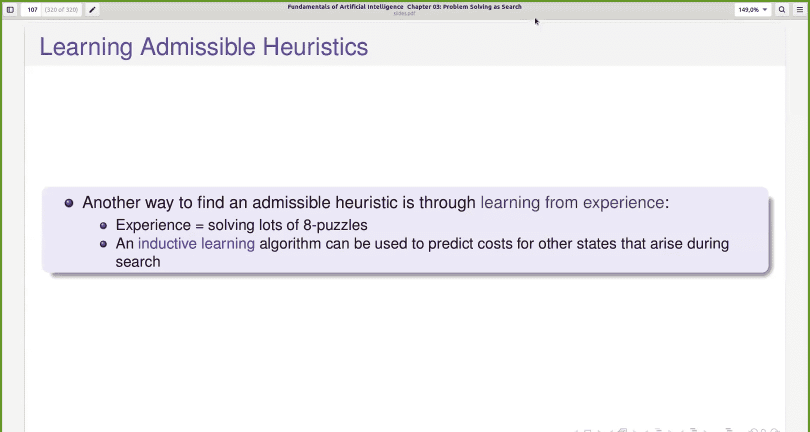

# 意大利特伦托大学《人工智能基础｜Fundamentals of Artificial Intelligence 2024》中英字幕deepseek p10 2024.09.30-CL09-1-CH03-AStarHeuristics.zh_en -BV1uUkwYTEmf_p10-

Okay， can you read well， yeah。Okay， so today。うふん。We continue the。

The narration about informrs strategy， so how to exploit domain knowledge or generaluristic knowledge about the domain to drive a search。

And we。Pressideent the leading。All the good of them。For informal search， which is a star。

The Star was incredibly popular algorithm in back in the 90s and is still one leading algorithm。

 many， many application where search is strictly necessary， in particular in planning。

 but not only that。And the interesting fact is that it's extremely simple conceptually。😊。

So let's go through。Okay， we have seen this time the， we have hinted the the best first search。 Okay。

 so the idea is。Taking into consideration how。Presumably， near。Is your nude。

Your candidate know be chosen to the gold。And the。Taking in into consideration this。

TheThis information， of course， you can only estimate this nearness to the goal， of course。

 But it should have a heuristic tool。The computer。Okay， assuming you have an idea。

 So we have made a simple idea。 Well， if you plan to drive through Rome。

You probably will and try to search。 You probably pick Roto as next destination in Boltano， right。

 because you have an idea where。Roome is south， which means that in a straight line distance。

 your roator is supposedly near to wrong than Btanana is。ok。呃。

So the point is that considering only distant to gold is not a good idea is we've seen as timer。

 So in， weve seen the best first search， which is simply pick。

ThePs the value of the P the the next as next no goal。

It his next node pictures the node is supposedly near to the goal。And this is not a good DN general。

 why， because you don't consider how expensive it is to reach that node， okay？

Which is sort of dual to what we have already seen in。

Uniform cost search in which instead we only pick the values node according to how difficult it is to achieve it。

And the idea of a star is simply to combine these two things。Oh。So。

Use to combine Uni cost strategy with a great research strategy。 So use as an evaluator。To。

 to in order to pick。The node， whose value F N is smaller， where F N is given by the sum。

Of the cost search so far to reaching the node N。Plus， estimated cost， and this is an exact。Value。

 okay， remember we every time it we。We can expand and node， we can compute its cost。Remember。

 remember also that。Ex I costta refs。To a node。Not to a state。Remember the distinction， No。

 the state is just the state of the world， regardless， regardless the way it reaches， node is。

Contains not only the the representation of the data。

 but also the information that you need to reach it in particular， and no。

The same state which is reached through two different paths。一思。Represent a different node。

 And remember that in the。U see yes， Sir， true。Every time you add to the frontier。

One node whose state is already there。 Okay， you take， you keep the one with lowest cost。

So you have only in different material， you have only one node。For every state， the one。

 the cheapest one。Okay。😊，Okay。Yeah。So。What does it mean F of n or the sum of the two？

It's represented the estimated total cost of the path through。Passing through n。Okay。

 they estimated the total cost of the path to the goal， which passes through the node end。Okay。

 is's an estimation， of course， because the last part cannot be computer exactly。But only heurically。

Are we there？Okay。So the idea of a star is incredibly seasonal， simple。

 It is expand first of the node diameter with the lowest the cost of the cheapest solution for。 Okay。

 so pick first of this the value。😊，The know who ask this。人明你们白要。Oh。

 so what is the good news about that？How to implement a star well。

This star can be implemented substantially exactly as a uniform cost search。Okay。

 the only difference。Is then the way you compute the score， so to say。Okay， so， so instead of。

Computing the only G N。 You compute G N plus H O S， H O N， Well， H O N is。

Its a heuristic noted that maybe computing this value may require some extra thought。Okay。

So you should have a way to compute HOSS， and we'll discuss this later how to compute H ofS。

Is this clear？做sstein学历。Oh。A star search where I， your book just says， look。Look。

 the algorithm is just U S with this different。 Okay， I just for for convenience， I。

 I wrote this here。 So is the very same as the algorithm of a uniform search。Apart from the name。

Of the fact that instead of using path course， you compute the path course plus the euristic course of that。

Ivic value， okay。So。啊。So I don't want to discuss any further because。

This algorithm is something that we have already seen。Okay。Okay， so let's see some example。

Consider which we highlight a different survey。Between the three techniques， okay。

So suppose we have this very， very simple example here。 So we have a source node here。

 We have a goal node here where we want to reach。Here we have some marks。

Which are labeled by the active cost of every step and see with different colors。

The different algorithm， according to different code。😊，Re from the possible part of。So。😊，あ。

If we go to from a uniform cost， okay， so we look we compute the states。According only to the。

They actually cause to be reached。 So without taking the to ratio the nearest the nearness。 sorry。

 to the goal。 Okay， then well， you see S， it takes okay， first。Choose 1， then8，3，1， it goes to B。

 Then it goes to C。 Then we will try to backtrack。 then go equals to。Today。嗯。

And then you go to the gym。 Okay， so this is uniform cost， okay。if you take instead。Gray coaster。

 Okay， so how near is the node。To every node to the goal。 And I suppose you have an estimation。 Okay。

 okay， you don't have an estimation over over here。 So it's written here。Okay。

 well you can pretend this is。Distance， okay， so you。Well， well， firstly you choose a， of course。

 because this is a necessary choice。 Okay， then suppose a has distance5。

Then you don't go this way because this。This is higher。 So uniform H equal  one。

Is the one who has the best coin。Okay， so H1， H2， H6， so he will pick H1。

But notice this will take into consideration， something which the extremely expensive to reach eight。

Okay， so a great research we go here。 and then when he's in E。

Here manda go to2 D and then here we go to it。And this will be quite a specy， right， because 1，8。

 so 9，10 will be of globally cost 12。Okay， so he's not。A good choice。Rather， instead。

 if you do a star。 So if consider both。Both schemen。Okay， so we first take S。A。Now the distance is5。

 so one to five is a six star。This choice here goes has two plus 6， which8， which is 8。 Okay。

 we have it here， okay。Not what we are need， we have。2 plus 6， which is 8。D has 4 plus 2， which is 6。

 And that's the interesting part。 This has G 9 plus  one， because you taking conclusion。

 the world coast of that。 So this time， you don't make the mistake。Okay， why？ Because this time。

This element here comes into play。So you realize， okay。

 you obtain a lot if you if you get very near to the objective if you pick E， but。

Unfortunately cost you a lot， a lot of effort to reach that to do that understand。 Okay， so instead。

 a better， a better compromise is to choose D。 and in D， this is the best choice。 Okay， after that。

 you， you， you get the goal overall。😊，It will takes you6 rather than 5。ok。Again。

 notice is that this is not。😡，So the fact that they take examples。

 and also their teaching assistant will take example from graphs。Is not。

We are not here to discuss a graph algorithms。 Okay， this is a journal。Issue， okay。So8 in general。

 you don't have a graphical representation。This is just for didactic convenience。Okay。

So is this clear the。Okay， so if you take。A start to the Romanian map example。 again。

 if you considering the。Euristic， which is。Tos line in distance。Okay， so we start from arad。Okay。

 okay， Aradada has an estimated distance of well is cost to zero， an estimated distance to 36，6。Okay。

So let's just expand all the success over。 We have a CB。 We have Timmi So R and ring India。

CBU has it cost to 140 to reach， but and has 253 distance。There are so overall， 293。The missile is a。

Nearer to reach， so this will be the one who will be chosen by uniform search。

 but has is more expensive to reach the goal is estimated more expensive to reach the goal from there。

The in， the wind is even shorter to reach， but has。Much supposedly much more much more distant from。

To the objective。 Okay， so we pick CBU as a choice。 Well， if you look at the map。

 it is you understand this problem the best choice。 So the natural step is to go to CB。Let's speak。

 okay， now more interesting。Now CBU has four successor。1 is Arit s。 Okay， so in principle you can。

Notice this an argument knows nothing， okay， so in principle， you should also go back。Well you say。

 okay， with a loop detection， you can do better， but you don't really need a local detection in a start because it will be cost。

You obviously love more。So。Ara， well， Arad going back to Arad is simply no choice because this is it only will have the cost of 280。

Not the coaster。It's not simply to distant from here。 iss the code contemporary。

 you have opened many choices。 Okay， so is the total cost to reach so。Not， this this is a different。

 this is a different around from before。Because is in Nadd。

 and here the difference between node and state， is in Nadd， whose at UCS Coast is 280。Okay。

 why because you have come going back。So it comes from a loop。Yeah， so it is of course not choices。

Then you have a fuck at us。Paga is potential good candidate。 Okay， so it takes little to reach it。

 but then is is quite near， reasonably near to the。To the goal， so he's for under 15。Or a there。

 you see quite clearly this no choice because okay。

 it takes a little less than to reach over less coast。

 the but is of cold is of course out of is very， very far， it gets farther。Okay， notice it。

 by the way， here you would have better choice。Rri or there rather than they。 So we never。The。

 we never choose it。Instead。One interesting candidate is Riminchair， wheelchair， okay？Which is。

Not a little farther from the goal than the fias。But it's definitely much near as a coast。Okay。

 to reach it。So。😡，Whereas ready search would have。Choseen Fs。Reme see example before。Instead。

 a startup chooses Riminnivi chair， why because it's a better compromise。Okay。

 its a better compromise because it takes 220。啊。To overall 23 to reach， but。Which。

 which is but significantly less than far， although it's a little less， a little farther to the。

 So the is the bestmikua is the best compromise。You see that。Nothing but even fancy here we get。Okay。

So。From Remikuviya， you have Potic Rova and again CB。Going back。 But， of course。

 now that CB is even is not again， is not the same， is the same state as before。

 but it's not the same node as before， right， because as acquired as a cost reach that which is further。

 Okay， because as if CB， go here and go back。 So its a nonsense path。 Okay， so CB。

Is is not a good choice。 You have a Kayo and PTtty。 Cayo takes quite a while to reach。And is also a。

NoQuite a distance。 So P taste is not nearest to reach and also near to the goal。

 So it's the now the。The choice is quite obvious， right from both all criterion will they say。

We pick， we pick this。 Okay， so you pick p testing but then be testing。Of course。

 now it reaches Bucharest。Why， so Bucharest is front it。 So is a gold0。 and the carry unique is。

Of course， near。 So the best choices， Bucharest and overall you have found。We found a bath。

 And this is an optimal。Okay。Well how can I say is's not in your path， but you can try。

 but there are not from many possible combinations。

 so you can easily try or check with the next theorems。Which would just certify that。Okay。

 but is the mechanism clear？This is clear and they should， I think this highlights also not all。

The idea which is quite simple， in my opinion。But also。

 it's important that you understand the distinction between node and state。Okay。

 state is something a priori。Regardless of the path that your reach node not only represent a state。

 but also the way keeps us of the information， which allows you to reach it so substantially。

And order would also keep represented the end of a path。我 temporary thing of the partial。Okay。

Cl to everybody here。Okay， so why is this the case， okay， just an exercise。

Modify the Romania map example as follows， drop the as from Fagaas to Bucharest and from Pestine to Bucharest。

Well first I suppose there is some road road work so that some road is interacted due to some reason。

 so you have to take some deviation， okay well which is quite standard。Okay， draw the a。

 add one arc from Orraea to diameter of length 215， okay。

Execute they start Ar from Ar to Buersest with such a new map， okay。Of course。

 you are free to execute and change or whatever you may like。Or， in general， try with the。

Try the solution with the different。Okay， now。In order to understand why this works in generalal。

We should introduce a couple of definitions。Of what are good and betterur。 So in general。

 not the good uistics， not all the heuristics are good。 Okay， so they must be meaningful。

 and they have to follow some。Recently weak properties。So， we say that。诶诶。A heuristic is admissible。

Also known as optimistic， I think I suggest you to remember the word optimistic because it gives you quite clearly the meaning of that。

If it never overestimates the cost to reaching an goal。

 So what does it mean that the H of n is always smaller equal than the h star of n。

 where h star is the actual cost。So。Well， optimistic means it's optimistic in the sense that you always give a smaller recall value。

With respect to the actual one。Okay， so this say this is admissible。嗯。Slightly。诶 ok。For instance。

 the， the straight line distance to to Bucharest is obviously。Optimistic， right？Well。By evening。

this is a fundamental property of Euclidean geometry， right？The straight line is the shortest path。

To reach which connects to points。Okay。Another definition is the notion of consistent heuristics。

Which is lightly。Stronger， but， very slightly。 Okay， H of is consistent， also known as monoonic。

If for every successor。And prime of end。Generated by any action which with the step cost to see。

 So forever success or such that the cost reach is successful and prime， such that。

The cost to reach it is some value， some value C A prime。

The heuristic of the estimationized is more or equal。

 than heuristics in N prime plus the cos to reach。What is the intuition of this？Okay。

 assuming that well you can easily see that。But if this is consistent。

 it also verifies this pain induction， okay， so this way。I want to stress the。

TheThe intrinsic meaning of that。Inja， okay， assume that。Okay， assume that H is。Optimistic， okay。

 so we only consider。Euristics， which are optimistic。Under this assumptionture。

What does it mean this cigarette？This means that progress we are progressively getting。

Near to a more realistic。Okay， so the more you formation you're quiet， the more you get to。

So the the more you think because we ratio actual distance。 So if I'm here and。

II want to go there and they pass through that。Okay， if I consider and analyze in detail。

The actual values， I'm getting to a more realistic。So， notice that。H of面。So this value here。Will be。

啊。There will be bigger or equal than this， but its still more equal than the are to cost because of this optimistic okay？

Right。So， you get。The more realistic value。 So the more you explore。

 the more you get actual distances， we all you compute actual distances。

The more you get near to the actual value。Over there。

The ideally heuristic will be the one which tells you exactly the distance。

That exact minimum distance， but of course it will be computational， expensive to compute。Okay。So。

Okay， remember the distinction between search， research and。Research and the graph search。

 So suppose you are doing research here。You say， we see。We show very easily actually that。

The fact that is optimistic guarantees you the。That a star search is optimum。Meaning。

 when you finish， you get the。You get the short spot。Again。

 shortest path maybe the most convenient execution。

 not you should not consider this as a short path algorithm， as in in。啊。Algorim the theory okay so。

So， suppose。Okay， so you have started， you have done a search。 Sose that you have。Currently。

 some non optimal my goal G2。In the큐。Well， remember。You may have more than one goal state。😡，并。

So this means you may have more than one going node。Okay， so suppose you in you。One goal。State。

 which is not so optimal， which is not optimal， meaning。

 meaning that there exists some goal here whose global cost will be more strictly smaller than G2。

Okay。😊，Now， suppose。Any node end。From， which is not yet expanded。Okay， so he's not。呃。

So is either the Q or is going to be expanded， okay？Which is。

 which is on the shortest path to an optmiology。Okay。There， what happening？

What is the total cost of G2？😡，Well the F estimation of G2。Well， G2 is a goal。 Okay。

 so he has no H is 0。 H G2 is 0。 Okay， so， so F G2 is G of G2。But then since by definition。

 G2 is subopimma， so it's not optimum， Okay， this means that the go to G2。The dark value G of G2 is。

s a stick smaller than geogal。Okay。😊，Well， like the initial factor is not talking but the fact is not talking on。

 okay。But then。F of n。Is but then this value here should be greater equal than F of N。

Because it's amissible。Okay， so I' let this。This is optimistic。Remember。

 F of N is estimated cost or reach a goal。Austin threatened。

And should always be strictly greater equal than so this is you can think this has to be a H star of n。

 right？This is the same at HSLLM。Right。Are we there？This is that the Ht remedy is the same as GeG。

Is the actual at cost？😡，Of an execution passing into end。 But we have saying by definition that N。

Bypo is under the minimum path to gene。Okay。So F O when is admissible。 So overall， F O G2。

Will be strictly greater than F of N。Which means that every state。

Every node in between the star to end will be pitch before。You2。少术党设力。

Our algorithm is that we select all the paths。From stock to G。Before selecting a Z node。

And noocus room mode。You see this？Which means that at the end， reach will return。

So G will be the first node well G or any node equivalent。😡，Of equivalent distance to that。 Okay。

 will be picked。Will be reached earlier than any suboptimal goal。

 So an optimal goal will be reached earlier than a submal goal， a subopmal goal goal， okay。Is the st。

This reasoning is quite clear。Okay。啊。Yeah， okay， so that's exactly what I've just said。

 like to start there。Okay， what with the graph version。

 it's slightly more complicated but we get the very same result here we need a slightly stronger hypothesis that is mortonic。

But you see that it's monotonity is quite intuitive， right？

So the fact that you say you get progressive mirror。So why is the keys， okay。Well。

 we have some properties here。 Okay， so first of all， well。

 if H of N is consistent and H of N is amissible， and this comes as a consequence of the by induction on the go。

Okay， something important， which is very similar to what I just say to you if H A is consistent。

 consistent means monoonic， whatever you want to call it。Okay， it's strictly is non decreasing。

I dont any。 Why is what， Okay， so mathematically speaking。This is easy to see。

 right because suppose I'm primed to be a success of him。Okay， so what is of N prime。

 so is the estimation of N prime is of course geoM prime plus H ofM prime by definition。Okay。

 but Gon and prime， okay。Is by definition of pathcode is G of N plus C of N A and Prime。Okay。

Plus H plus H of and Brian。But okay， if you take these two last element。Okay。

When you apply the monotononicity property， you see that these two elements are greater equal than this。

Okay， so N G is the same， so this is greater equal G of N plus H ofn， which is actually F of n。Okay。

 or if you prefer you， you can see it's in the opposite direction。Yes's。Okay。

So what is the intuition of this？As long as you go ahead， your estimation gets more realistic。So爱话。

Okay， the more， the more you get near。TheThe more you get near to the。It's the go。Okay。

 the more information you require。😊，And so， your age of N。Increases。Increases， well， you know。

 the H of M must be smaller equal than than the actual H star。 Okay， the actual cost of G。

But the more you get near， the social， the more information you require。And the more you are。😡。

Getting up。The more is increasing。Because these molecule is getting near to the accuracy solution。

 not is it。F of N prime is always。By definition finisher of admissibility of。

Of HON is always as more the actual cost。Okay。Are we there？Yes， please。😊，It cannot decrease because。

Well， because of this simply mathematical approach， okay， we are assuming that H is amissible。Okay。

We are assuming that H is sorry， we are assuming that H is admissible and H is a consistent or monotonic。

Okay。😊，This is a consequence of monotonicity， right you get。

 So mathematically this the obvious step here is more。

 There is dimensionism here more computer is obvious， Okay， but the point is the meaning of that so。

So if the answer is why there is this very simple。Mathematic argument， which says that。

 and that's it， okay。Now I'm trying to give you the intuition， Okay。

 so the intuition is that the more information you acquire。

 the more you get near to the actual value。Okay。So the more realistic is it your information。Okay。

Okay， so this as a consequence allows you to tell why the。😊，Sorry。Why the A star is。Is optimum。

 he optimum also in the graph version。So graph is our selection old N from the front tier。

So this is fundamentally， the third property， which is the fundamental property of graph。

It is graph star selection node and from the frontier only if the optimal path to n has been found。

So meaning only if and as a node。Is。啊。诶。Represents the minimum cost。Version of that state。 remember。

 no different from northern state。 Okay， so you can have more than one node。For every state。

 depending。 So you can enter the frontier。Progressive， different versions。Of a given state。

Notddes which are progressively better and better and better versions of the given state。 Okay。

 so first， you enter one， which has been obtained by。Path 10。 then you say， okay。

 there is a better path which is length 8 to reach it。 Okay， cool。 and on as so forth。

 But the point is one fundamental characteristic of a Ger search of a star that you expanded。Only。

When you ever reach the best， so when。When they know the N represent the best。

Pather to its own to the state it represents。Okay， and why is this， why is this？

This is an argumented by Ab， so supposed it is not the case。Okay。So if it's not the case。

 there should be a node and prime in the frontier of the upperno path to end， okay。是是30例。

This means there is。Oh。don't， you are not so the current path。😡，Which lives to is not。诶。Is not。

Does not consist on only。诶 on only诶。You haven't yet elaborated the current best path。

 so there is another better path， but if there is another better path。To return。The best。

This means that there should be some of those nodes in this path which which belong to the frontier。

Due to separation property， remember。So substantially。Okay， so this is different here， right。

 I guess， this is yourselves。Okay。Theres the node here， okay。

 the node here is because you have taken a path。There， okay。The point is， okay。

 if this was not the best。😡，The best。One， this means that there should be some better ones。Okay。

 which is not yet elaborated。😡，Okay， but since there is this path， which leads to the same state。

Okay， a different node with the same state。We。This， no matter what due to the separation population。

 they should pass to the frontier， so there should be currently one node in the frontier。

 which is the one in which will eventually lead it to the computers。And we there？Okay。

 so let's call this in prime。Okay。So。But since F is no decreasing along any path。 Okay。

 F of N prime would be more equal than F of N。 Yeah okay。So。The reason for that is that。

F for on prime。Would be near with this bowler than F ofn because this on this path。

 Okay so this will eventually choose this again， we are reasonably absurd。Okay。😊，Okay。

But since N prime is on the optimal path to end。😡，And probably will be also be strictly nearer。

 otherwise will be the same， okay？So this longer path will be better。ok。

 thinking better other wise we。We depict， okay。Are we there？Everybody。

So this means that F of M prime would be smaller than F of M。

 strictly smaller because otherwise we noted be。Optimum end should be an optimal part。Okay。

 but this will violate。😡，で。But if this were the case， empire wouldt be picked before。

And which is byserv is not the case。And with there， everybody。Yes。😊，Okay， so。Again。

 this proves that the graph search。In with this star， expands the non decreasing order of F。Okay。So。

So we have seen these three properties。 So overall。

 A star expand notes in non decreasing order of life， Okay， so。Expand， expand， expand progressively。

做。😡，And that's exactly the concept that we wanted to do very before， right。

 So as soon as we progress along the optimum path。H and hence F becomes progressively less optimistic and more realistic。

Over there。Okay， so。What is the intuition here？ok。So。😡，As we seen that H is consistent。

 then remember， if H is consistent is is consistent， this is also optimistic。 Okay。

 so regardless a trial or search。A star is optim。Optimal in the sense that he always finds the shorter path。

The most convenient bus， okay。Shortest is just a graphical representation of that。ok。

So substantially， the point is that。嗯。It tends to expand the the nodes by by size of F。

So it so if node to be the same value of F you first finds the value of error then。Then therefore。

 the looks for the nearest value of F。 So it's not。So substantially， it tends to expand the values。

InIn order the of the F。Or their value。 So what is your book called F con toolss， right。

 So so in the sense that if there are values， if there are states which have values which are identical or very near there are。

Computed together or very near each other okay？Okay， okay。

 so contour is a contour is a contour is conceptually a set of states which have the same f So if first if there's more one state with the same f you computes that in sequence and the only one years across the contour it passes to to the smallest other contour okay。

 so in this example that we have seen this is not the case okay。

 because there are all states are different values of F okay， but it may be the case。

Sometimes a search is difficult actually because the values are per near to each other。So， one。

Examples in which the values are like。Obviously。Great greater than each other are typically easy problems。

The hard the computational problem is then when the values are very， very near， there are many。

 many states with the very same big。 Okay， so you have to compute that contemporary。

In order so you have to exhaust the contl affair with the same effort before you pass it to the contourura of a strictly bigger affair。

But就5， okay。Is this clear？Okay， so。So substantially， suppose that C star。

Is the that the cost of the order？So is star response all knows such that athan is is more than C star。

Okay， because it goes progress in there。Okay。😊，Is time must expand some。

Or the node of the Go contour notice that there could be nodes。

With the same whose F value as the same value of。Of the God。Unfortunately， they are not the goals。

Okay， so it may be the case。 So if there are some nodes whose F value is the same as the minimum path as the best path。

 they could be expanded before the go。 Well， okay， that's fine。Okay。But for sure。

 and this is the fundamental property。You never expand。

And node whose F value is strictly greater than the actual cost。

And this tells you a lot of the pruning capacity of this algorithm。

And why these algorithmgons is very popular， because a priority。

 you know that you expand the only nodes whose F value will be。Will be。Great。

 will be strictly smaller or equal All the nodes whose F value is smaller or equal than than the actual cost。

Okay。Yes， please。What can she star。The cost。The yeah， the actual are of the actual optimal opt cost。

Yes， sorry， yeah。So。Yeah。I guess they following know depends the order you pick remember there also。

There is also a degree of freedom in this UCS style algorithm， which is。You， if you have goal。

 if you have nodes with the same value， regardless this path， which order do you pick。

 so actually in the order that you put them in。So in the queue this is a priority queue right so if you know from a priority queue sometimes you put nodes with the same value。

And in this case， you typically you pick the order the order in which are inserted them， okay。

 but the point is that the worst you pay。So。嗯。So the only useless step you may do。Okay。

 in the in the a star。Are those which allow you make you expand uselessly nodes with the same cost of the goal？

Well definitely most。Okay， so the only。And relevant on the steps you may do。Okay。

 because you understand that ideally， when you reach the contura Be with the song goal。

 you should immediately pick the goal， but you don't know which is the call what is not， right？

So the only。Degree of。Noise， let's say， over inefficiency or degree of nonoc。Overre。 Okay。

 doing is that you may A star may expand some nodes。Of the same cost。OrThe optimum path uselessly。

But this intrinsic part in every search algorithm thing to breakfast search， for instance， right？

Breakfas research， if you have。Many notes are the same you are guaranteed that you take。

 you pick the goal。In the number of step in in the minimum number of steps。

 But this does not mean that it is the first。The first node you get the same with the same distance。

 okay， so if there are many， many states。With the so with this And D。Okay。

 maybe the case that they are called go get is the last one of them。Okay。

So this is intrinsic is luck。ok。Did they ask her？Okay。So any other question about this？Okay。

 just to give you a graphical intuition of what's going on。If you look to UCS。

So graphic what you are， remember UCS is a graph search is is a blind search so you don't exploit any heuristic information。

 you're sort of expand all the directions。Is as if youre expanding in all direction， okay。

 until you bunch into the goal。Okay。If you are looking in a star instead。You are expanding。

Towards the direction。Of， of the gold。So to say， so this is also of a graphical intuition of what you're doing here。

Although。So and this is typically something that we humans do right so we are in or animals as well right so we we have a notion when we take some search which is also we are doing some planning or。

We are a solving problem。 We take into the coneration of the gold。

 We also take consider at the cost of the things， but we we tend to privilege those which go towards a goal。

Okay， unless you， you don't know where the goal is。This is a very nice book。

 I don't know whether you have ever heard it。😊，呃。The strange case of the dog at the midnight。

The Stone of Ca the Canu Chi Mad never heard iss a really beautiful girl in book is not a figure unlike the title may suggest is。

It's the story of an Asperger child。姑。And this generationrration is the story told from his own perspective。

So he's there the one who describes the book。Okay， hand the huge reason as an。

And this is very interestingly the way the problem solves。He had some particular adventures。

 and he has。To solve some problems。In particular， he has to reach some place he have never been at。

And the way he solves it is very interesting。 Okay， so here， because he is a person who has no。

 you knowledge。 So you can see this example as a。😊，As executed， an example of。

The difference of heuristic driven search with respect to blind search。Okay， substantially。

 it beats a sort of a spiral。Of until he bumps into it。 So he can recognize。

 so he can recognize the place he has been， but he has no clue where it is。

 And theres he cannot read the map。And not he's not able to extract。

Any information out of the map and what it does it just。You some spiraling。

And so that he's doing blind search rather than substantially。

 he's doing blind search because he cannot do uistic search。Okay。Okay。🤧。A star all steps。 So okay。

Okay， we make some hypothesises here。 Okay， a sort of implicit hypothesis is that every action。

Has a positive cost。So at least that maximumon cost。Okay。So there are no zero course actions， okay？

If all types course to exceed some finite epon and Bs find it。

 then there are only finite many nodes and such that Fn is more than C star， okay， that's obvious。

 right？Which means that the A star is complete。Because you will exhaust。Youre exhausted when you are。

When a star has visited all the node whose F course is strictly smaller。

Then is smaller equal sorry the actual coast of the gold than Europe bank。Okay， then you done。

So is study is also complete。Okay， so how good is this？It studies。As good， as good as as it's good。

 it's heuristic。So。嗯。Epison， suppose Ep is will define the relative error， so。

The difference between the you remember that a study is always particularly bigger than than age okay。

So okay， this implicit is star of n for a gradient okay。

 so let's star the relative error of h with respect to h star is given the usual way so h star minus h divided by h star okay and let's call it epon or delta whatever you want to call it if you can you can call this a different name so that is do not confusedfuse with the e of the previous slide。

So how many fake you take， okay？So MB so BH is sort of consider what is the effective branching factor。

So there are statistical ways， so to analyze， which says that。啊。

The search is as if you add an actual branching factor of B2 the apson。What action is the  error。

Okay。If you have a zero error， what does it mean if you have a zero error？

The age is equal to have started， yes。So you have some God some or a color or whatever。

 which always tells you the right choice。 So we always give you the right estimate。

 If you ideally had， you had a perfect。Aature。You always。 So then then is great because you。

 you always speak the best movie。 So you go straight。To the solution。 And， in fact。

 the branching factor will be one。Okay。Oh， remember， B to the0 is one。Is one。 Okay。

 so you go straight at the resolution。 So how many steps。

You take something well with a little over variety because you may have some multiple valuess of the same cost。

 whatever everon you may have to pick more or less randomly between。Things are with the same coast。

 but Sasachhi will lead you very straight。Do then。U to the cost。So if the heuristic is good。

 it may gives you dramatic importance。So the fact it is， as if you add a branch。

The branch is reduced from B to B to the epson， our epson is there。Ideally。Ideally， if you had。

If you have a zero  error， okay， then your branch file will be one。Remember this is all of。

 so you maybe have a constant model of some constant factor， okay？You see。😊，Yes， please。What。😮，the B。

 the the the number of steps to reach the goal。 we have already called this the all the all the analysis of our our searches。

 right， Remember， D is the the number of steps to reach the faster M is the maximum number of steps and B is the branch of factor。

 okay。How much memory memory where？And this is again。

 the main drawback of a star because no matter what， it's in the style of UCS。Is a UCS algorithm。

 right？Yes， please。😊，By。Well， this is standard so this is this is a standard mathematical differential error。

Right value。Approximate error value， divided right value。This is a standard definition error。

Eor is right value， minus approximate value。Divided the right the venue。No， okay， in general。

 this is absolute value， Okay， but we know， but here we expect the fat studies by definition greater record than age。

So the standard definition will be with the with absolute value here， okay， but。H， okay。

 well very very simple。 always when you make an error， you， you estimate an error。

 you make a percentage or with respect to the value so。If you measure。H。

In millimeters or you measure the18 kilometers。Okay， you have a 1 million factor。

If you wouldn't divide， if you。Would not so suppose you have an arrow。

 which is so H is one kilometer1 kilometer and so h3 is1 kilometer and H is0 to5 kilometers。Okay。

Okay， so this means that your the difference is0 do five kilometers， okay？

So this means if you divide it， this means that error is 0。5。Okay。But if you。

 if you didn't divide and they give you the same。The same， very same error， but you measure mes。Okay。

 this will be 1000 meters。Mus minus 500 meters， which will be 500 meters so in the first case you have an error of do5 in the second case you have one error of 500。

This is， I mean， this is not part of this。😡，Class， the standard definition of error is value。

 correct value， minus error eratic value。Eoneous values divided the correct value。

The typical definitioner is in。Absolute value。Okay。

 but we don't need it because we know that a statisticalistic degree greater than is a greater equal than age。

 okay？Okay， so how much memory， well， we have the same problem。We have this U S。

 no matter what we are。We need a very long frontier， so we get a worst case exponential amount。Here。

 instead， we have an advantage。That we don't be B to the D， but be epson B to the epson D。

 So the exp here is divided by is multiplied by epson。

 So hopefully this is much reduced if they're heuristic， So theyre heuristic。

 not only drastically improve the search time， but also drastically improves。

Potentially the amount of memory。Okay。Is it complete， Yes， is it option， yes？

Memory requirement is still a major problem also with a star。

 although mitigated by an external factor in the that。Okay。So no more B to the D。

 map B to the X on D。😡，you if I' me to the accident。不这理。

How much you prefer depends how you prefer what is the your preferred notation。Okay。So。诶。

I just to say something， just hint。One thing to mean sometimes we have a break。

 and then I get to a more interesting topic。 I just hint you I just want you to know they exist。

There are variation of that。 So people have conceived techniques for improving。A star。

And there are variation of eternal deepening。😊，Which you remember in which you don't have a memory of a blow up problems。

And here where the cutoff information is given by F okay。

 so you you sort of make chunks of values of F okay and you try to see if first you do the breadth of search up to a given value of F then you do a breadth of first up to a given value more bigger value of F and so forth。

 of course evaluate the substantially you evaluate the contours progress okay。

Here the the problem is coniving the the right increasing value of the earth。

The right is lots of bay for。 And then there are。Oh。G are techniques to to improve。

 There are memory bounded forms of MSA and that。 So they I just wanted to know。Compromise a solution。

Techniques， which。Try to compromise the efficiency of a star。

With the problem of memory and blow up have been perceived and there are。Good solutions。

 I don't want to get into this level of detail。A star。Is and was and was a major breakthrough。

 I remember when it came out。And and is still considered one of the leading is probably so A star is not an algorithm。

 it' a family of algorithm。Okay， and you still consider one。fundamental多ment啦。

Backbone of many otherss wherever you need informed search， okay。Okay， I suggest we have a break now。

And then I want to speak a little about what what does it mean to conceive a heuristic function。

 Let's it's okay if we resume at 10 to 11。We have a five minutes break， okay？好的。不要买来。Okay。Yes。Thank。

B。那么把这其看一下。哎有。没。Yeah。fish吧。有逼样。在。非常加又。不的。好。对。嗯。She。Okay。Th thing。佢边即诶公安俾你哋话嗯。Be。这对对。点点佢哋家。对。

你不沙咗你不沙咗佢佢咗啲啊 o，我唔。In发分。Okay， we to stopping them。诶 ok 诶。Very last topic of the， of the chapter。

I think。Should answer a question that some of you asking me， maybe you。Some of you ask， yeah。

 you see function， yeah， so some of you okay。The point is。

G sorry if I hammered a lot of this thing that we are not speaking about a graphical algorithm。

 but because I realized in the last years， this has caused some confusion in some students。

What is a euristic function。 Okay， well， nice soku this is based on default fault is that you have this a euristic fashion。

 What the hell is this a euristic function。Okay， well， apart in graphical algorithms。

 like a graph based algorithm， then you can do user Euclidean distance。 Okay。

 but that's not what you are looking for。 So you're not interested in solving。

In solvinglving a graph of problems， okay。So what is this？What is the best， Okay。

 remember that we want to have consistent heuristics okay？Well。We say， first。

 let's say some desire for some feature of those heuristics。We say that H1。

 And so if H1 is to are admissible。Heuristics。We said that h2 of n dominates h2 one。If H2 of M。

Is a great or equal？Of each one of and for everybody value of them。 So he's always。

More realistic than。Then是 So， so ideally， what is the idea。You use the function。

we know by definition that uistic function should be smaller quick than each star。

 so each star is the actual value， okay， you don't know， ideally should be as big as possible。

By maintaining the factors that are amissible， okay， so。Ideally。

 it should be the nearest as possible to the H star。😡，Val， okay， so the bigger。

 the better provided that you still are admissible。😡，Okay。So you dominate H 2。

 H2 dominates it1 It is always better than。 So this means that you do is always better than search because it' is always near to H star。

 Remember that the quality of a star algorithm depends strongly on how realistic H is。

The better the bigger H， the smaller is this epsilon。🤢，And so the exponential search。

 the blow up is reduced so the exponent of the search is reduced by an X factor。

 so the more the error the smaller is the search， but the drastically smaller is the search。Okay。あ。

Okay， well， first。Some obvious consideration is that if you have to admissible。Euristics。

Such that is not the case that none dominate the other。Okay。Then。

Taking a value which always cons the maximumim about the two is dominates each one。

Well this is quite obvious， right。 So I mean sorry if I say something that is absolutely obvious。

 but I think this is a necessary premise of what I'm going to say next。 Okay， so this is。

Each one two is alsomiss and each one two is doance both of them。Is it clear？Okay。No。

Let me try to figure out and let me some examples and try to forget what we want to say， so consider。

诶。The search problem of finding a solution to the entriess。 Okay， well。

 you may think these eight ties， which is trigger problem。 Yes， I agree。

 But if you give you a problem of 100100 or 1000 or 100 by 100， that's dramatically。Har problem。

 okay。So what is an admissible heuristic？Well， for instance， each one。The number of。

So the point is when Im trying to move。So。I try to figure out。

How near are So all I wasach from two to four moves。At every step， Okay。

 depending depending on the position of the blank value in this exercise， okay。

So if it's in the corner， I want to move 35， it' on one side， I have three moves。

 it's in the middle ofs。Okay。No。诶。I have three possible moves， for instance。 Okay， so one way of。

 if I wanted to solve this by a next star algorithm， I would。 I would like to say， which is my。Next。

Where you。What is the best of my three possible candidates or four possible candidates， Okay。

 I have to use some heuristic。Lets this one be one in such a heuristic。I evaluate。

Some are usually stick to that。Pos the state， the possible states。 Okay， so for instance。

 suppose the outcome of one move is this one。 Okay， so this is the gold state。Support for simplicity。

 we have only one question。啊。One possible。So suppose one of the。

Possible success or my current state is this one。How bad is is this is well。

 depends what how I evaluated。H one。I can say how very simple one is the number of the misplaced tiles。

So how many tiles are in the wrong place？Okay， the second is。AMore accurate。

 I would say one is the Manhattan distance。Over all sides of the view distance。

This does not only say how many misplaced are there。

 but how for each such tale tell you how far is it according to San crerion。

 Well the obvious criterion would be manat distance right see I move those in some direction。Okay。

 so let's see this。 So how much is a one one what。Okay， so one is placed out here。

 one is placed here。 I've one here。This is fine， I have one here and one here and one here。

 so overall I have six misplace styles。Okay， well， you understand these would be very na or very inaccurate。

But not distance。 Well， okay， so I。For each style。Okay， number one is。1，2，3，4。From from position。

 number two isn in the right place。Number number three is one，2，3。1，2，3。Number four is， where is it。

 number four is one，23 again。Number 5 is one distance。 Number 6 is already in the right place。

 Number 7 is 2。Yes。And number8 is one， yes， so this is more accurate。

Well notice that this is strictly more accurate than that because if it this is in the right place。

This is the contribution to this is zero。Okay， so it's it' more accurate what is the reason well。

 okay， you can calculate that it takes so if you're familiar with the game or that you take it 26。

AndMo to to get it。 So you see that。H2 dominates H1， but is still。😡，Not very good but。

Well both each1 chain are admissible， are obviously admissible。Okay。H2 of n dominates the one。😡，Yeah。

 because obviously this is。Is always more accurate nearer So he's always bigger both。

 So why can I say。This is better。Once I've shown that both are admissible， the bigger the better。

Okay。😊，Now， but can you figure out。I will okay， keep in Mal this example because I will see this as an instance of a more general criterion to get solutions。

 to get possible a message。Before doing that， also wish to make a point。

What's what is called the effective branching factor， which is a way。By which we actually calculate。

The quality of search， which is we have already anticipated， right。

 So effective branch factor B star。Is what we have called the beach to the Epson in previous case okay is the branching factor that a uniform tree of depth D would have in order to contain n plus one nodes so if you're three as explorer n nodes well n plus one simply before of completion。

I' glad they're there。The root， okay？嗯。Of course， B star is not an integer in general， Okay。

 unless you have but perfectly unless very particular cases is not an integer， Okay。

 but this is an estimation I say， okay。I took me N plus one steps and N plus steps。 Okay。

 let's add one because I I also consider the source。 Okay， what。

Which will be the equivalent uniform search train？Which will require me exactly that amount that tape。

So this in some ways says how。How many choices you on average ver I've made。

So to say in order to take n plus one steps to reach other。oh， notice that we have the adapt to D。

 okay， given the fact that distribution solution we found has a depth to D。At the end。

 this is the equivalent2。Solving this a question here。Okay。So for instance。

 if in order to reach a solution5， you took 52 steps。

 you can estimate is as if you had the branch on average of 1。92。

So this is a standard way of indicating how good you is your search engine， Okay。

 how smart where are your choices whenever okay。So if you get very， very near to one。

 this means that you always got the right choice。😡，Okay。

 if you are very near to the actual branching factor， this means that your heuristic was very bad。

Pso Unionian really improve your sort。So taking the example。Of。eight puzzles， okay。

 so this is an old experiment they're taking from Russian Norwig。So， they use the。

Solving those problems， Okay， so how many steps does require with an aid puzzle， okay。

It cannot dip search， there's a style search versus with the two heuristics。How much you gain from？

Probably your best possible。Form of blind search， iterative deep。Okay。

A start search with the simple use to consider the distance。

 the number of misplaces and the cost of H2。 And this is the number of steps it is required for finding solution。

 well， of course。The hardness of the problem depends how hard is the solution， okay？

If you start from a solution which you just required to move one to make one move。

 that's obviously trivial， okay， he finds this very quickly。If you take a very complicated one。

It takes much more， Okay， so depending on the heart the problem。You see that yes bra。

Growlows up very quickly， there are a number of steps。Ex this one is dramatically faster。

But H2 is very significantly faster， so it means nearly from one to two orders of magnitude faster。

At the end。So you see the difference。 So how you see the difference。Okay， apart from those numbers。

How do you see the difference？Well。The way you may estimate the difference。

Its just taking the effective energy factor。Actually taking this value here。Okay。啊。

There is a way to do that， okay。And you will find out that okay， notice that， of course。

 for different values， you don't have the very same value case of because sometimes you also they show luck。

 So you you don't have， So they are different problems with the main， although different depth。

 although different apps， they may require different moves。 So it's not exactly the same。

 But you see that。2 facts here。That's。This the branch effect is very regular， so to say， okay。

 so's apart from the very beginning， but。For very simple very simple problems typically have a very unnatural value。

 very regular values because it typically may the rear searchchar is not really so okay so sometimes you may find a very strange value so if you take examples which are very。

 very simple，Too simple。Okay， but you see that the values are very regular。

And you see that you have a very significant improvement of branching factor toodle from 2 to78 to 1 to the 42 to1 to the 24。

 25 to 26。So we have a very significant improvement。

 not is that the time improvement in the effective branch of factor。😊，Changes a lot。

Asing for one dot。44 to the A to the D to1 dot 263 makes a huge difference。Okay。

 two orders of magnitude is 24。Nearly nearly toward the automatically magnitude， okay？

So this just to say that this a standard way of evaluating weighting the quality。

 so it's a sort of passing the logo。It's very not much different to passing another to see the logarithm of the growth。

ok。But now， let's get to what is。More interesting。At all。

 So what is the standard attitude by which we compute heuristics， first of all。But obviously。

 one obvious way is。😡，Knowledge dependent。 So you know the problem and you estimate that。

 So in this case。Okay， you have the clear rules or the problems and you make some estimation。Well。

 for instance， in chess， okay， this is a different story。

 ch a distance role because it is at side elsemato， okay？应该。

Adversar research can be seen as an evolutional search。

 so how would you estimate how good is my move？Well。😊。

How many of you play chess know how to play chess。Let me know the basic rules。Okay。

 when I was a child， they taught you a very a fewuuristics。what now I call it heuristics。

And to give a sort of score to the all the pieces， so pounds were worth one。诶。Bishops and kns were。

 were warf free。Rooks were War four。U。WhatK infinite plus infinite， of course。

 And the queen was plot 9。 Okay， and you evaluated the quality of a move according to the upcoming terms of difference of scores。

Of or piece that you have。Okay。😊，So if you were able to eat a night you gain three。

 if you lose a night， you three， vision were considered or less more or less equivalent tonight。

 a queen was much more worthy it than。This is very， not very accurate。

 but it's very coarse grain one is's not very accurate because it depends on the flow of the games。

 if you are familiar with chess。 So， for instance， at the in initial steps， nights are very useful。

In typical rooks or not。Okay， ros， the the more you progress to。

To the game and the less dance is the is the the games So the more pieces up have been killed。 Okay。

 captured， actually， then the more。The more the bigger role bishops and。And the ros get。

And also the pumps in some situations nowadays， the people tends to consider score much more sophisticated scores。

 which takes into consideration the position of the pieces， for instance。

 nights in the center of the the board are much worthy very worthwhile because they take control of the vast area okay and these kinds of heuristics actually are used in actual programming in actual computational nights game players。

Okay。😊，So， the point is。You can develop heuristics from the knowledge of your program。 That's it dot。

 Okay， but is there a general attitude， a general characteristic。General way to boost a heuristics。

 yes。And the idea is to relax problems， to solve and， not to compute。Are youistic？

Try to solve a relaxed version of the。Search problem。For instance。You see the。The each puzzle。Okay。

So video is that so you can derive from the exact solution by releasing。Some of the cross trains。

Some of the rules or the cross lines that you have to fulfill。 So for instance。

 thinking the case of the relax8 puzzle okay。You say a tie can move from any tie to any other tie。

So what does it mean。So there are some roots in the game， okay。

 so you can only move one tile in an empty place。Okay。😊，So which substantially what does it mean。

 you can you can， you can move one tie only of one position。Firstt。And you can move。

 you can move a tile only to the empty。Square。Okay。

 suppose you release all these constraints you say， okay， I in principle， suppose by magic。

 I could move any any tile to every。To every position。Okay。😊，You want to step。If you saw how many。

 I would。How expensive would that be to find a solution？If I had these。

 if I were in this relaxed version of the problem。Well， exactly the number of misplaced styles。

We take a number of steps， which is actually the number of mis file。 So suppose I just could。

No matter what to take the ties off。Put them in the in the right place。 I want to push them。

Without making these strange formal of moves。 And then at the end， will be all great。

 My magic will be solution。 So it's like would break。 So it's like the。TheThe children solution。

 right， so he breaks the game， some children sometimes。Break the toy。

In order to find a solution with thought。So how do you do that you break the game so that you place that in the right place。

 okay？And thats actually the relaxed version of the problem。😊，So in this case， the first newuristic。

G you the solution is nothing else that a solution to the relaxed version of the problem。Okay。

🤧Suppose that。Instead， we have a weaker relaxation， you say。We can every move。

 every tile can move on one step。But the regard this fact anium。ok。😊，If so。

The solution would be simple， so they they。Myuristic H2 is nothing else than the numbers step I will take in this relaxed version of the problem。

You see。😊，What does it mean if we want to represent our system as a graph？

A relax version and adds ages。Okay， because ads moves which are not possible in the real case。

Bsing so。And if I had I just。I have a relaxed version， in the sense that。Every solution。

 the regional problem is also a solution to lack， but not each of。ok。😊，Which means that the cost。

Or the relaxation。Is obviously smaller， strict smaller equal the one of the original why。

 because I still have a solution。 So my original solution is still a solution that I explorer。

 but most likely I have other ones。With the intellectual state less steps。 Okay， so he's guaranteed。

To be small or equal。Right。This is guaranteed to be a more。 So this is amissible。

Guaranteee to be amissible。Okay。But Vi the Uistic is also an exco of the relax problem。

So this must obey to the triangle inequality。So the cost。

So why do we have a tri inequality because so the cost to reach a solution？

Is it's more weaker than the cost of making a given move plus the cost of reaching the solution for that move。

 and this is equal to the solution if this was a right this move was on the right direction。

If he's strictly greater， if it was not in the right direction。Okay。

 so no matter what this is motor equal。So， every。Maybe I should have said the before， but。

Some basic property in solving India。With Cota， is that every a move every。

Move verifies in the triangle inequality。Okay， so the cost to reach agola is more or equal。

Then then the sum of making a move and it plus the cost of reaching the goal from that outcome， okay？

It is very clear to everybody， right？ok。So those heuristics are consistent and thus they are admissible。

 okay。And that's the general attitude that we have in AI。You find it。诶。Good heuristic。

 just relax a problem。Well， of course， the more you relaxer， the cheapest is to compute it。

But the more you're an acceptpt that。The less realistic this is。 So there is always a trend off。

Between between how much you want to release and how much you。

So how how much you want to lose sort it means how much you want to save computationally to the benefit。

Of of having a precise a uistic。Okay。There was， there are some ways people。

I've tried to formalize this notion。Okay， so right。Typical attitude is。

Write down the rule of the game， game the broad science。Okay。

So write down the rules for the kind of constraintss。Of the game。All your problem。

Which is every action of the your problem is subject to。And try to automatically infer ways。

Of'comp them。 if you release some them of those ruless。Okay， so for instance。

 the eight puzzle actions。A tide can move from square A to square B。If two facts as whole。

 a is horizontally a vertical a to B。In Bayb， beesb， okay？So you see that。The very basic。Rules。

Of this program is just two simple roots。What do youWhat if you release them？😮，We can generate。Three。

 relax the promise， very remove it one or more。A tie can move from S square A to square B if it's adjacent to B。

 a tie can move from square A to S squared B if it's blank。A tie can move from square A to square B。

 no matter what。Okay。Now is that number A corresponds to eistic H2。

 whereas number C corresponds to eistic H1。Okay。One way of doing that in search。Is。

Exactly doing this。 So compute automatically。Euristics。by automatically。Dropping some。

 So once you have formalized， written terms of constraints， the actual rules you have try to。

Compute the number of moves。That you will take to give you a goal and relaxed version。

 and you can compute automatically relaxed versions of your problem。😊。

This is something that you do in planning。😊，1， a star in planning was very， very successful。

 I'm not really sure it's still a state of the art。 Nowadays。

 I keeping combined versions of that and the ST based version of。Acent based version of that。

 But a star versions were very， very popular for a long time。

 And these things still are still competitive。 And the trick there was actually to release。

Some of the constraints we may have in planning problems and this is something that we'll hint about when during the planning。

 when we see planning a few weeks from now， and you see much more detail on the course of Professor Rogerary if you are taking it。

Which as I already said， I strongly recommend you。There are techniques in which you release。

 you simply compute。The distance by solving very quickly， some very released version of that。😊。

And do you decide this according to this estimation？啊。Okay， other techniques， as usual， nowadays。

 use machine learning。 Okay， so now it is a whole flow of。Of。

Of a heuristic search is get heuristic by trying some network to compute it。Okay。

 and that's more or less one。More or less， the way that some measure。

Achiievements were achieve were obtained there for in chs ago and lots of many programs。

 So do heuristic sort one of the。Dealing arguments now in。

The really very successful techniques now in。Solving a problems。

 which requires dealing with the combinatory research。Not only。 Well， chess and go are very。

Movie attracting problems， right matter actual problems like。Everyday solution， scheduling， solving。

 driving a planning， a blah， blah are very often。Obtained by。

 by means of applying a star style algorithm using heuristics。

 which have been synthesized by means of machine learning techniques。

So this is a way of combining classic search and classic symbolic analysis。

 this is with the numerical neural。New approaches， Okay， so this is very。For instance， Deep blue。

 there was one major achievement in which the computer program I was able to defeat repeatedly Gary Kaspalo who was the world the champion or Czes used the technique like that。

B somebody， something else。Okay。And that's more or less it， I hope I gave you a good answer。

 so I mean， at least the main ideas behind it， this is very much problem dependent。Okay。

 and so you can， in order to find a good realisticistic， you should well。

 explore your knowledge of the problem。tryry with a relaxed version of the problem or do machine learning can solve。

Or train some machine learning device in order to find the best realistics for that， okay？Okay。

 thank you very much。 I see you on Friday on Wednesday we have a regular lab。😊，Okay。

