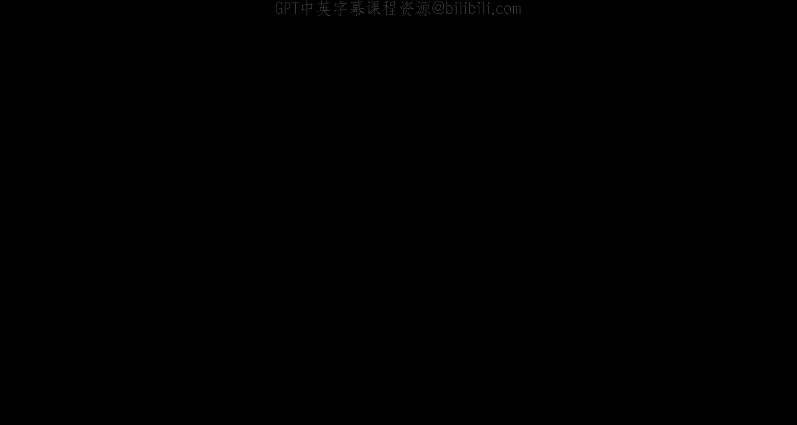
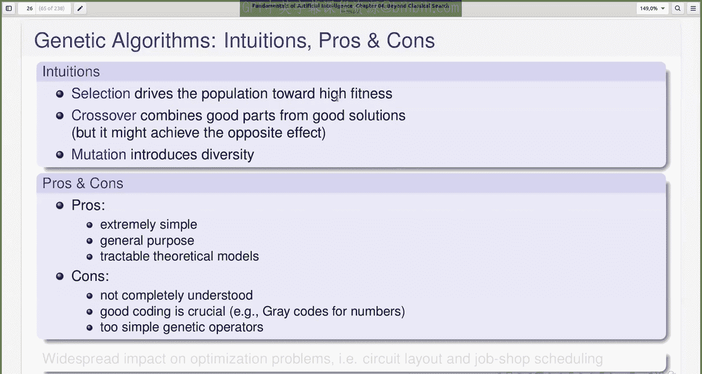
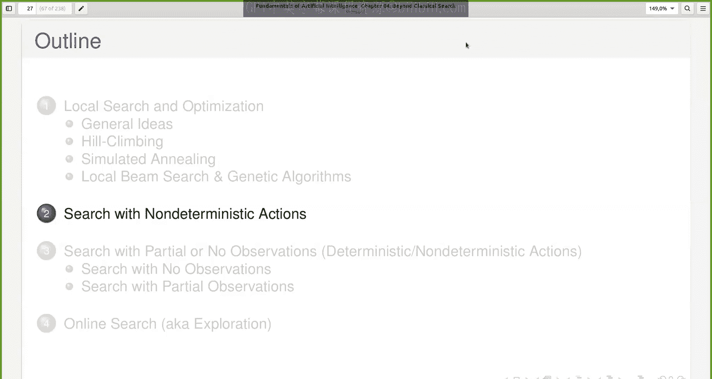

# 意大利特伦托大学《人工智能基础｜Fundamentals of Artificial Intelligence 2024》中英字幕deepseek p11 2024.10.04-CL10-1-CH04-LocalSearch.zh_en -BV1uUkwYTEmf_p11-

Okay。什么。嗯，啊，对。全国。Okay。Okay， so。Today， we start。A new topic。

Which is an extension of what we have seen so far。 So we。

Last time we ever seen what's called classic search。So various strategic assumptions。

That is a blind search and。And un blindd search。Today， we start extending this。

 this view to the new perspective， so to say。In particular， if you remember。

When we have started the previous chapter。 So research， we've made。

Some important restricting hypothesis。Which I ignore them that。The progress are fully observable。So。

声星噶。Allows you to know all the information you needed to take the right decisions。

So the science of access to all the information which are relevant for your problem。哦。

The actions are deterministic， so。The， given a status and given an action。

 this universally leads you to new status。The environment is completely known。

 so you know the rule of the game， you know where you are， you know the effects of the directions。

And this sort shows a sequence of actions。 Okay， so from。

From your current status say go you can imagine a solution with the sequence of action that you need to reach the place。

 okay？In this chapter。We progressively release。this assumption assumptions and we see how that。诶。

In particular， first， we analyze what does it mean to release the participant number four。

 so the idea of having a solution which progressively add actions to lead to some solution。

And this is。Leads us to a completely different form of search， which is local search。Then。

In the second part。We release the condition number two。

 so we see what happens when the actions are not deterministic。So what happens if。Given a state。

 given action you can have， I can be more than one state。保石不。

The third part then we see and this probably we are doing， I plan to get more or less here today。诶。

Then we'll try to release condition number one。 So what is that we don't have。

A full or complete observability of the environment。 Okay， so what happens if we don't。

 our sense cannot cover all the information we needed to decide the actions。And fourth。

 we release condition three。😊，Which is the most pre so we have a known environment。

 What are we going。So if you remember when you speak of search。

 we mean something that we do in our brain or in our FPU okay and then so we sort of a model of environment。

 but we don't so if we are trying to see what happens if we do some action instead of the other it's not that we actually try to do the moves it's just we do that in our brain okay。

What happens is that if we don't have an environment。

 we have to do what's called online search or exploration， okay。

 so we see the kind of search in which in order to explore the fact actually we have access to do it。

And possibly to attack。Come back。Like a sort of a real robot cleaning device does at the beginning when when you obb okay。

 so it just explores the environment in order to be a mapping inside of your own kitchen or。Daniel。

 okay。So， today， we start。Thus with the local search。 And as a side effect。

 that optimization do like local search。 So that's actually the point。 So we are here。

 So we release condition 4。 So this room is is not consider in general a sequence。 We just our。

The point is get into a goal， not how we reach it。😡，So。So far， what we have seen。

Is a systematic for search is a sort of systematic exploration of the search so we start from one point we add some actionss in we see then they possibly re attract and see with different strategies。

With or without taking consideration， the gold。啊。Do you want me to switch on the lights there？Yeah。

 okay。哦。Okay， better。What about he。 This is good。Okay， better。Okay。So。😡。

And the solution is considered not simply the gold state。But also the path to reach the Gulf state。

Okay。😊，For instance， the bother we have seen the idea of making a sequence of norms。

 which leads you to the final configuration。The point is that in many problems。The way。

You reach so the path about from which you reach the goal is relevant。You want to go。

 not this is the case。That typically many go。 So you don't know a priorityi。At least the goal states。

 okay， you know some characteristics of the goal。Okay。

 you are in goal if these features are this and this and this and this and then you have to find a state which matches it。

So the point is that the gold is not as priced explicitly as a list of states。Otherwise。

 you already have a solution。Okay， but a set of sist pressures describes some conditionss。Okay。

 so that if this condition are verified with the state， the state is a goal state。And the point here。

Is that you need， you need define this state regardless how you reach it。Okay。搞定搞说做什么。Possible state。

 possible the rules。So the solution is the problem， only the goal state itself。

 not the path how to reach it。Okay， so this is different from the perspective that we have seen so far。

For instance， if you think the problem of the end queens。Okay。Which is we see CSP problem。

 cause satisfaction problem。you notice that it's not the way the important is not the way the sequence of a moves by which you put the queens。

 but at the end， what is interesting for you is a configuration of queens such that they don't attach it to each one another okay。

啊。There are plenty many applications in that。The problem。This feels mourn in the。

Figure of con satisfaction problems， satisfiability problems。

 shadowuling automatic programming of wealth， optimization of telecommunication。As on as so forth。

 notice is that we have two kinds of sub problems in。these。When we want to reach a goal state。

 So So the decision problem and the optimization problem。

The session problem is when we want to find one state which matches some feature， the feature。

 the characteristic that by which we define it to be a goal。

To find a goal configuration which sates set of constraints。Like in Queens。

And then we may have optimization techniques。So find optimal configurations。

 So according to some measurement。Okay。So， for instance。The traveling says do you know what TSP is。

Do sensible be some problem？This piece find the immune cycle， which touches all。

All locations that you want to touch， okay。诶。Notice that there are relationship between the two because typically。

For every optimization problem you think can always be a decision problem， given a value。

So if given a value of your score so I say I want to find a solution which is at least for at most this value。

 this gold value okay， then you can check whether you can decide or not it or not and those it depends whether this measurement is discrete or continues so if it's fine at the infinite okay there are many variations。

Okay， in all these cases， what we can do。Is a completely different culture rather than building a progressively partial solution。

 okay？We start for a complete solution。To a complete state， sorry。

 and then we iteratively improve it towards the goal。Okay。😊，So we keep。

 we start from a complete state， and then we progressively improve it in the direction of the goal。

Note is that there is， again， there is a stronger。诶。

We have seen that from optimization problem we can be decision problems， but also in this case。

 you can see decision problem as an optimization problem in this sense。You can measure。

You introduce a sort of measure。Of the let me call it distance to La ghost state。Okay。

 and you can try to minimize this bit。This distance。 so you can make a move。

 which minimizes those distance。Okay， which means that you you can see an a decision problem as an optimization one in which when you reach zero。

The minimum， well， the minimum is when he reaches the area you absorb the problem。Okay。

 so this is why when we speak a look at search， typically optimizationization problem and decision problems are explained substantially together。

Okay， because they have a value， they're very， very yeah。啊。Perspective。

So you can think a decision problem by by means of a local search as a particular case of optimization problem。

ok。So as we say they is use a single current state and move it to some neighbor state。

 So you start from a state which will have some score which is not yet satisfactory and then you try to move to so neighbor states。

Notice that in doing this， you don't take the number so neighbor states for the typical scenario is for instance when you change the value of one variable okay。

 the state you have sub state variable a enable most often is you change a value of one single value value okay。

Or whatever。Notice。Thats every time you need keeping only one state。Okay。And you have to evaluate。

What are your neighbors and you decide according your criteriaiterion and what is your next？

State will be。 And in doing that， you don't remember what were your last states。Okay。

 so you don't keep track of how you reach the current state。It just go there。So this。

There's a clear advantage that you do very， very little memory。Okay， so substantially constant。

And in many applications。😊，They are very these techniques are very good to find a problems。

 solution to promise which are were out of the reach of any classic search technique。

You made scenarios。Also useful for optimizations。So you find the best state according to some objective function。

 but you can think this as minimization or when you speak optimization it can mean as a minimization or maximization depends a minimization problem that can be seen as a maximization when you invert the sign or the goal at which of axis so you can or invert as a more or equal with a greater equal okay so this substantially the same problem okay。

诶。Oh。And they don't typically fit。With the schema that we have seen so far。One。

 typical mehophara is an optimization problem we have seen in nature。In nature。

 the ven survival of the fittest， so what we have learned in biology since the 1 the 18th century is a form of optimization problem by some form local search。

 we see that genetic algorithms。Okay， sort of a progressive。Let me say online are the good of them。

By which the populations evolve and improve。Inse， in the direction of improving the survival of capabilities。

So it to be the fitness to survival。Myologies。Is full of example what。

Of a mechanism which can be seen as optimization algorithms。Yes， please。

Now there is we don't in local search， we don't keep track of the path。We optimize that。

 so we have a cost or a cost to every state。And you always look， you。呃You。

Progressively generate states， so your goal is to reach a state with the lowest lowest possible cost。

Or the highest possible revenues on the well， I tend naturally to think this in terms of minimization。

 Okay， so minimizing the cost material。Every state has its own post。

So we've see that we'll get to that okay。So a complete look at search technique techniques is something which is guaranteed to always find a solution if this exists。

We see that the most local search techniques are not complete。

And then optimal search is something which is guaranteed not only to find a solution。

 but also to find the optimal solution or one of the optimal solutions， Not that。诶。

When you have many possible goal you can have more optimal state。Okay。

 more states with the same value。Okay， so you find one of them。

So the same maximization minimization is good okay。

 you can pass from one to the other by just inverting the sign or just invert in a smaller repo with the greater array。

 okay。Okay， so far nothing particularly fancy， I would say， right？Okay。

 so if you think the in terms of look search of the end queen， so we make four greens here has。

Just for space。Okay。😊，So we consider incremental representation so we place a priorityi one in per upper column。

 okay， and we can define the cost of every configuration。

The number of queen pains of the same row column diagonal。

 So the the number of the queens which of queen pairs， sorry， which attack each other。

So this is a cost， okay， and you give a penalty。Give it a penalty。 Okay， so。Ideally。

 so the goal is to reach。AS with H equals 0。Okay， so we have no， no one box。 So you start。

that's the key point of local search you start from a complete situation。

 so it's not in the case that you add progressively one one queen at a time， as we did in locals in。

standard search。 Okay， we just start from。One， consider possible maybe be random。 Okay。

 first in this one。 So you you place。First column with the queen here， second column column here。

 third column we list be here and fourth column here， so suppose randomly。Okay， and that we notice。

We know this that we have a five possible conflicts。😡，Okay。Which means that we have a。A course。

 which is fine。So。What if we move？A queen from here to here。Well， this gets definitely much better。

 okay， because you break this， you break this and you break this， okay， so if you move this。😊。

So neighbor is make one to move， move one or the variable。

 change the value of one or the variable in this case， okay？😡，So if we move， take this variable here。

 which is the position this wing and you move it from position three to position four， okay。

 we get a score of two。😊，Well definitely much better okay then we notice that if we move this screen so we change the value of this variable from position two to position one when we get H equals0 so we found the solution so this was the case of look at search well example of course。

ALo search to solve a for problem。ok。Well， for instance， well。N Queens， where N could be1 million。

 if which was a very， very popular。Example of prob puzzle for AI people in in the 80s。

 and this was a this a case where。Lo search works dramatically better than a standard section。Okay。

 so。Substantially is able to solve that nearly nearly always even very。

 very big problems with little steps Okay， so for instance。

 this is a case where Luccus search works very， very well。Okay， let's see the main ideas。

 Another one， which local search is very successful is。😊，Is it TSP？Okay， for instance。

 this is a TP problem for。Some towns in Germany。Okay。You may have hundreds or hundreds node。

 noted that TPs are really hard。Okay， so it's so there are some NPR problems which in most practical education。

 not so hard， like we see SA proportion for disability。DP is typically very tough。😡，Okay。

 so it really， really takes forever to solve it with the standard search。

And it seems that the local search works very， very well。There is a very。

 very simple technique local search， where it's not easy to。

 It's not difficult to find one path here okay。One search path okay。

 but once you find one search path， one cycle here。

 what you can do and you consider the cost the total this is of an optimization problem is not a decision problem。

 but you can again convert it to a decision problem by just important I want a path which is more equal than 1000 kilometers okay。

So the cost is the the total cycle length， okay， and then you start for a complete one and then what you do is do swaps。

Okay， so if you have。嗯。If you have two pairs。Of state， you just swap them。Okay。

 so if this is connected first， if this point is the connected with spine， at this point。

 it is connected with this point， we just swap the connection。If connection。

 if it this improves things， so it take pairs， paths of connection and disrupt them。

And if this improves。And this is very， very good。Tns out to be in practice very， very good。

 So TP is another example where。Where look at search walks very well。Now let's see what， Okay。

 so this is just a high level idea， let's see more details what we mean by local search and what are they。

The ideas behind how does it work in practice？Okay， first of all， we have to understand。That。

The cost function。😮，Drows a sort of landscape。Depending on the value of the variables。 Okay。

 of course， the problem is that we have thousands0 variables。 so you have。Do put your imagination。

In the。诶。An image of the X axis with the S sound which。And the hyperplane of any possible dimensions。

 okay， which is not something that we can imagine our brain。

 but I ask you to make this a mental abstraction and to see this as generically representative only one line。

 but here actually have a landscape of hundreds of thousands of possible variables or sometimes discrete。

And then we have the Y axis。We should represent answer the。

Either the costing we were so you go downstairs or the revenue and then you go upstairs in this picture this we are speaking of a maximization。

 okay， so you want to get the highest possible value。Okay。😊，So like in function。

 so you have a study analysis， right？So you know how to study functions one variable。

 well probably you don't know much how to study complex function in n n variables。

 all the other things like gradientant and these sort of things， but however。

 so we know that you have maximum。So points where you earn。Where the value is， is maximum。 But also。

 you have some。Some other things which are showed that for instance you increase。

And then you flat and then you go up increase。Increasing along some directions。

 And this is called the shoulder。You may have a lock at maximum， okay。Lo opt。

 So something which you cannot progress。For the direction， but this is not your。

 So there is a So there is this hill here， which has a top。But unfortunately。

 is not the top that you want。Like you wear hiking mountain， you go the wrong path， okay。

 and you get it to the top of the hill。I was supposed to be on that one right right and you see that it far way higher than。

So。Then you have you can have a flat local maximum， flat maximum。Okay。😊。

But I want to concentrate on local maximo， because there are really。

The nightmare of the search of local search， so local optim are the real nightmare of local search。

Why because typically the big problem in doing for local search techniques is that you get stuck into local lock。

诶。You notice that some problems may have exponentially many look lot。

 and very often you get stuck on that， so you have to find techniques to get out of them。ok企。

Let's see the， the very first。And more intuitiveive techniques for。For forum。Look us。

Which is he climbing。What is in climbing， This is the very， very basic idea of local search。Okay。

 also known as a gravy algorithm， gray local start。So idea idea is that。

A move is performed only if the solution it produce is better than the current solution。

So you move to you are in state， you look to the neighbor your neighbor states and pick。One。

 which improves your score。Okay。😊，呃Well。InIn its version， so is more。Basic version。

 which is the steepest agendander version， you select the neighbor。

 which is the best score improvement。Okay。Yeah。And if you have more than one with the best score。

 you'll pick say randomly one of that。ok。Okay， you see that。This technique is。Quite short sighted。

 Okay， because maybe you get to to that to some local。

It may not lead you necessarily lead you to the local atimum。So Su actually。

 what is the point is what in numerical optimization Asia is called maximum the maximum gradient choice right so you move in the direction of the maximum increase。

我也拜 you。As if you you are hiking a mountain rather than taking a path to you just to say， okay。

 that's a mountain。 Okay， so what is the the steepest one， So if there are some。But is。

Very stronger high cast or supposedly strong high cast。

 whether they don't want to lose time and just take the steepest and if you're a friend of them so you should hate them because it is very。

 very tough to follow them， right？Okay， so that's great research。Well。

There are lots of variations of that。 Okay， and we see that in the next slide。呃。

We see that this is alone a stupid algorithm。Okay， but。

The interest of that is that it's typically used as a subroutine of other Earth as a subrtine of a more complex algorithm。

Okay， so where you notice。This is very basic， so you start from a node from a initial state。

order from initial state， okay？Give a problem and then you loop until you get a resolution so you take a neighbor so you pick the highest value successor correct where successor here is neighbor。

Okay， yeah， the can need， what a success means。One place that you can reach。From your current move。

 And now you are here， you are in really in a certain environment。 Okay， so you say， okay。

 from one state， I can reach another state。 A success is a state， which I can reach in another state。

From one action。Okay， for instance， I can do Gi step。Or doing whatever。

 So think your favorite problem and an action can be moving a queen。Upsster， okay。呃。

In the eight puzzle can be move move one place and give a score， okay。

 so do something which allows you which is amissible。Which you can reach in one step。

 so the the enables are those which can be reached by a current state by just one move。Okay。Okay。

 and so if neighbor value is。Is better than than Ki you then return the。The current state， okay。说一路。

You， every time picking there they expect。Okay， now。Consider again， the eight queen puzzles。Okay。

 you are at this configuration and you all trust the authors that this。

This course here and the number of attacks of conflicts。Which you have， if you move query。Okay。

 so you notice that here， for instance， you have many。 you have three attacks here。 you have1，1，2，3。

 here， there are three factorial attacks here。 So this is 3，2，6。Sorry for to have 12 attacks here。

No one to three factoria sorry， so you have six attacks here， you have two attacks here。

 you have one two attacks here， so okay， so you can easily compute that okay。Okay， so you have。Now。

 you have to to make a move。What is great research Well， you notice that in those possible scenarios。

 the possible moves that are that those which you notice the smallest scores here are those label with 12 I don't see any better one okay。

Okay， so you should make a move which so heat climbing will make you a move which will get the smallest number of attacks。

We choose one of the 12 one， for instance， in this case。You move this here。

Not is that you knew the the scenario will change this。

 not that necessarily these will be the best scenario， okay again。

 because you have changed the configuration， you have changed the number parts you have to recomp this course and then accordingly accordingly you will find it。

Okay。Again， your goal is to reach zero。So，意 should。Okay， you suppose you have  eight greens and。

And you have eight，17 scenarios， 17 attacks here to have a diagonal and5 horizontal。

Now you don't have a vertical one because micro structure， you have one paper column。Okay。😊，啊。

And then， you， you can go up try doing that and you， but and you end up into a local minimum。Okay。

 which is this one。We share apparently cool， but unfortunately yes one。One violation， which is。

 let me remember where where is it， okay， yeah this violation here。You see。

 and you cannot get better。So substantially decline in get to them。Reason good solution。

So to something， which is not far from a solution。What is。Not the solution。

 So you get the stuck there。So the typical problem with heat climbing is that you get stuck。

 so it can reach very very， very good in getting look at minimum。😊，有你 look look。Okay。

 so now we there you can if you fly。Dline as a stand loan algorithm。要是打个。啊。SoYes， please。Okay。Yes。

Which one， the number of attacks？The number of attacks so far well how many so this is these are 17 attack 12 diagonagonal attacks in 5 horizontal。

 so one one。3。😊，5。So one plus three plus one is five。When you're here， you have one， two， three。

You have a three factorial here。There are two ways of attacking。SoSo so this is three。 This is 1，2，3。

4，5，6。Factial 3 plus6。诶。Plus， then there are many diagonals， so plus three plus6 plus three。At。

 so is 17。 Okay， if you move， if you move a queen here， you'd have to and try that。

 I mean tie and count， okay。So I mean， they did that for you， okay。

 try and and see how this works okay。Is it fair？Okay。哦。

So the problem is that economy technique is incomplete。

 So it gets stuck into local optim or flat local opt demand。

Also sometimes to show that so those plays the plateaus where you may have。flatla look colour。

The plateau is typically flat places where in in。嗯。These some scenarios， right？So yeah。

 all those situations you can imagine is a multiple dimension where you get started。

 so you cannot progress anymore， okay？One light variation is that when you。

When you allowed zero improvement moves。 Okay， so if you don't have any progress。Progress。

No enable which allows you to improve， but can you are authorized to make solutions to make moves which have the same value。

So this allows you to move through flat places like for instance it allows you to exit from from shoulders。

 but the notice that may。Since you don't have a history。

So you don't keep track of where you have been， you couldn't principle a loop forever。😡。

So if these two positions here have the same score。I could do this forever。Or moves。

 some random moves。There are variation of data， which are called the taboo search。

Wch are forms of look at search or he climbing in which you take， you keep track on that。

At least of the last end moves。And you you ensure that you don't redo any sorry over the last N states。

 sorry， and you keep track on the fact that you don't。You don't。Redo。

You don't get back to one of those states。This does not prevent you if it looks， okay。

 because you can have a look over the longer than end， okay， but this improves things。Okay。

 and of course， there is an overhead， yeah， because you have to keep track and every time you check whether you have to make a check whether your current state is not part of the state。

Okay。啊。So， okay， for instance， withqui， it can improve a lot the techniques。However。

 there are variation of declining。啊。For instance， one is that you can randomly stochasticically search。

 you can run。In between uphill moves， you don't。Choose always the best one。

 but you choose them according with the probability， which is way proportional to the quality。

Of improvement。So a higher improvement has higher probability to get。To be chosen and the lowering。

Then the lower improvement， but it can also lower improvement can be chosen。This。It allowss you。呃。

Yes。Its a little lower to get to the top， but also finds better solution because at thent it don't go too straight the longest to them。

Longest。呃呃就 the local mini。Another one is。First choice。So you generate successful randomly。

Until you find one which has a better score。So， look。You check your neighbor。 Is your neighbor。

 improve the things。 Okay， I do that。 Otherwise， so I generate it randomly， If not。

 I drop it and look for my next one。 So why isn't this the case。 Sometimes there is。

A strong overhead， in particular， when you have a many successors， will move。

Sometimes it can be quite computationally heavy every time。

To compute all the possible move that you can do a compute the score for all the possible moves。

One of the most critical。Element of efficiency of a local search is how fast。

Is the computational of the scores of your successors， so sometimes this is a better choice。Okay。

 because you don't have to compute any successor and the score for end testors。Okay。😊。

And I will say that the most frequent one， at least in a topic in which I'm more competent。

 which is SAATT and CSP。Is randomly restart declining。Sustanship， you do。

 you combine heat climbing with techniques like random restart。

So you run a series of re climbing steps。And then from time to time。

 you do some completely random move。So either you restart。Completely， so I give you。And steps。

N steps to at most N steps to do a climbing to find a local solution。

 but then I keep your best move and and then I do a restart completely from my completely different。

Or。Other variation is that with very low probability。 So with very high probability。

 you make a he time move。With very low probability。You make a completely random move。

Or completely random of a start， Okay， so this is also very frequent and it allows you to escape from local media。

Okay， because those random moves are those which random can be sensitive worsen。

Because we have to figure out。That when you are here。Okay， in order。

 So if you are moving this direction in order to get it to the wrong。You it do the right here。

You have to do something that can worsen。Locally， the problem。If you want to jump from here to here。

 you have to some way， either we start from a different place。Or to make a move， which worsens。

Pemporly， your score。So you want to。So in this sense， hi climb is a short sighted， okay？

So it allows you to make the best and current move， but doesn't look too far ahead。Okay。😊，Yes。

 please。这。Yes。Well， not really， restart start may mean that you change。

 remember that the mover is a local mover， you move to enable。Whereas restart。

 you can jump from a completely different place the。Now。

 move move means I pass from a state to enable neighbor state。So well。

 actually the is the notion we enable data is the one which I can reach the mover from my current state。

 okay？Is it clear？So there are tons of variations of work。Of those algorithms。

And they very strongly depend on all the kind of problems that you are looking for in particular。

 there is a tradeor between the effectiveness。And the efficiency by which you can perform the single move because how many succession do you have。

 okay， can you efficiently compute all the scores for all your possible successors， Yes， no。

 depending on that you can have different kinds of different forms of performances okay。The question。

So they will。呃。I don't remember what you mean。Okay， now this is simply due to the fact that you。三单你睡。

It's computationally heavy to escalate， so sometimes you have many to。Okay。

 is compression too heavy of every step？To compute the first to compute all success because it's not obvious。

 So sometimes they need applying see the effects of applying some action Okay and also to compute the score or the H value following success okay。

Okay， sometimes you so。A very simple but very cheap operation。 to just do the followinging。

Pick one successor randomly， if this improves。I do that。If it doesn't prove it。

 I throw it away and check and look for another successor。

So I don't generate old successor and compute this score for each of them in choosing on time。Okay。

 like he climbing。And the degree of randomness is actually fact that I randomly generate the successors。

Okay。😊，Not I've seen you。 Yeah， There are plenty many variations of that。 Okay， So yes， please。

 Does it mean that the first has to keep track of the randomly selected successors so that it can know it reach optimal。

Like it runs through all the possible successors。 If none of them is better。

 it says I'm in depending again， first those are。Subotings typically our subotings are more complex algorithm。

 okay， so you。Yeah， so you say what what you do if you don't find any so you can do loop to the it where typically you have a maximum amount of trials okay。

 so just to escape effects。Ws sorry， okay。Again， those are just the main basic ingredients which are variously combined in searchaggon。

 we see something about that when we see proposition of and we see some algorithm from a look at searchaggon from SA。

But what I wanted to， okay， to speak about is that to。Techniques， which are very popular。Okay。

Which are simulating and nailing。And and genetic algorithm。

 but I think it's better that I take the into first。 Okay， so they will take me a while。

 so so let's have a break now and resume at 35 okay。感谢。I can。有实力。你。はいあのな終われまし。对你为他这个问题。ごな say。Oh。その。

Okay。我哋清。不。嗯。which。Thank you。你不问题。对。😊，Okay sure。Kevin。嗯。嗯有。Oh。Book。Yes。O闭。What。好。不一。Who was fighting？

我第二个。你学系点样啊。没法嘅。你的嗱。That's right。Yeah， I really like。ひです。そこが。结婚话公。Yeah。It stay。对。Yeah thing but。

咁都こ嘅声で。对 you。お。Yeah。し。1。就出来。咁本可。就是。嗯说话快一点。Okay。哎，6。So。对的。Not immunologthe。十全部。对。Sp chief。对不对。飞。

Keep present。で。咁 thing我哋家俾。Good。It成品低，我们那也不。You发。て今度。不属于代有的是。

To matter the reason action and do the chicken。行后， okay。Fale School California。She。Soend that I come。

啊发发图片都行。It that the complaint。我的是你定。好。A住个。系そ近这。呢度。Yes。你说啊。诶。十需 the last姓。Thank。Now，也上。他们打。Start。A。

你关挺不拿了。Yes。So。不 school naomega from。It。py guys if sorry。呢个份不嘅。ど年ドマました。Please。你。聞く。一路攞。呀这是我。

弄时过月啦红我都打佢多我操。Yes。Yeah。Yes。我把手机看但你。嗰度嘢几日见啊能日过费用。Noされ使。Build the I is no okay build a key。S都属于。Okayそ。

我就说肯定的嘛的。Okay to。不被。今年いや今年がだから。Hello。不什么丢了没我是。political people look in the popular majority simply the bizarre theological ofism just before man。

We love job。你要佢新等都得唔可。T。If each。I。Also machine learning from people learning matter majority。Okay。你。

But particular network。J you travel restaurants intan the Cap。The to through25 okay1 channel。

I can on the height of the machine and protein the channel， but time particular。百1列那90下啊嗯。我从他突然这里告诉我。

就算 personal我 my。我们。Ba， bankss brother started。Yeah了。Well己说。Do you关 jump。

What' next's in May what's next they their queen。He。If you put future the application。ち。

They ultimately them with body planning。诶我个你拜。就。俾攞啊死。是话时但啲。Go。两ぱ你先我那如为。不知道。Yes。Play。manいそ。

But obviously go strongly。た你。When say thisは国。Yeah。不知道。我 no not。Yes。See what want to say。C是啊3。钱。

Youた I公确ほら。Yeah。No。嗯。吧，要水空都没。呢个工能来个。小来。不好。谁用的管理费啊。那。有。这都没说使用风式。啊。因。有诶你都做系啲嘢，有有。脚佢打出水。你个没资。It。Very。

Oh my god we put up three minutes to get out benefits。とか？其实。屌你弄发过式。H。Yeah。A violent god you。这这个。Okay。

What。You。た。Oh。公时呢我想诶。有。三六班嗰人。1百。I是个大。Yes。Okay。你。You stop on medication case especially。I don't know。

Yeah。ここ that意思。I a lot。这个不你。It's based on young schools on the。那定。Youど。这下。你谢吧要。It choose right head。

よろし欢 the。嗯。我不。嗯。129分多。我不需。你呢个手。A神弃的。Okay。然后。然后。诶有。那。几到车好全冇上。Yeah。Yeah。Yeah。She's fine。Yeah。Yes。Okay。

your thing。Good fast。You said mistakes。我去。Okay。Yeah。Yeah。我对。嗯。6。Its。啊，晓。一。Okay。对。嗯。No。Oh。我自。But。

It feels。这个。And it3 stopped。Yeah。帮我啊。はい。Just a a。I report an answer to a question that people have asked me during the class some people asking me about the course of autoomata reason in the second semester。

 I'm not I wish not to speak about that now because I wish before I wish。

To to take the part of a class， which is related to logic。So a bull logic， first of the logic， CSP。

 to some extent and and a modern description logic。 Then at the end of the course。

 I for whoever wants， I may take one。I can't have a meet。

Whoever wants outside the hours and in which I can illustrate the course to anybody who is potentially interested okay。

On demand from your side。Okay。We said， let's go back to very popular forms of optimization。

 these are not specific AI。Okay， not in general， one， I forgot to say that one。

Specific that local search in Jra is not something that is specific of AI。

 but is very very popular in many industrial applications and in particular simulated annaing is one very popular one and it's funny simulated an nailing is funny because it's really really。

Not so intuitive to understand。Is based on some consideration about statistical mechanics and some。

Ay with the statistical mechanics。Has a complicated explanations in terms of complex statistical analysis。

But this is very popular works。And substantially video is that aspire to。Something which has been。

Some statistical mechanical models of some。Or some physical phenomenon like metals arene。

And in the space of。Something fancy， fancy mathematics， which is both modern state and distribution。

Pormalization of some thermodynamical behaviors， substantially。Well， in general。

How do you escape from local minima？😡，You escape from local minimum by doing trying get local moves。

 a bad moves。Movies that temporarily wns your status。So I allow you to。

To get out of a local minimum or maximum whatever it depends when you see this upside down。

 I tend to。Reason in terms of local minima because it's easier to make a metaphorical reasoning。Why。

What gravity。In gravity is。Something， which allows to。Go。To minimize the potential energy。 Okay， so。

 you know， in physics， So in。Everything try it everything。

Grvity is a sort of optimization techniques in the sense that always tries to minimize the potential energy or systems。

Okay， so the reason why you， you go down the ball。Goes down down wallss， okay？Water。

Fals down through and gets into local minima lake。Why do we have lakes in the mountains。

 there are local minia in the landscapes， water feeds there。Okay。So。あ。And typical。

 those moves are made random。 So there are almost a random walk。 So you， you move randomly and from。

By random you make randomly big bedrooms。The point is what is the right strategy to do better the moves？

And this is XOE。Explained by analogy with this physical mechanics， okay？

So you sometimes you start doing the heavy and the frequent。Random moves。

 but that you reduce progressively。They strength and their frequency。Okay。

 think the following metaphor analogy。Consider a bumpy surface。Okay。😊，And you want to。

Make get a ball into the deepest crice in a bump or face。What do you do？Have you seen this？Move。

Shake vigorously at the beginning。And then slowly decrease the intensity and the frequency of the shaking。

Fhaaking is something very。I a side move， is a bad move。

 right in technically because typically you are。Its something that lets you get out of a local minima。

And try to another one。所以。Shaking you something goes。In the opposite direction， the gravity。Okay。

 so you first shake vigorously and then you decrease。That's actually what。😡，Simulator andingda。

So initial you share。You shake hard， you say that with the height temperature and then。

You progressively shake less hard and you decrease the tempering。Well。

 you may be surprised that this technique is incredibly successful。It works very well。

 under this is justified by。Fancy mathematics based on the on statistical mechanics。 But Su。

 this works。So you have a sort of parameter with the analogy with the physics is called temperature。

Which says you have a sort of a schedule。In which you make this temperature progressively decrease。

 you start with a high temperature。And that this temperature decreases progressively。な to是よ。Okay。😊，あ。

你说喂。The temperature is proportional is related with the probability of picking a ba。

So the prohibit of picking the bedwover decreases exponentially。With the the badness of the move。

 Okay， so how bad is the move。 And we see what is that the energy gap。Negative energy gap。

 which produces the move， so how bad is the move and decreases as the temperature goes down。Okay。

 so initially。High temperature。 So strong shakes。Okay， so high probability of side moves。Okay。

 I'll about bed moves。And。So and also， the biggest， the gap。

Thenergy gap produces the lowest the probability is。To perform it。不是。😊。

So suppose the shadow lowers the slowly enough。Then it's mathematically guaranteed that we'll find a global meeting。

 so that's the reason why。For we analysis is popular is that it has been proved。That if again。

 the schedule is more enough， then is guaranteed to find a local global minimum。Why this。

The funny thing that this was proved and not for optimization。

Argonal but to to be the physical models of a metallological analysis of。Of of the McDonalla。

Sotification， yeah。OhOh。Of the quality of metals of producing higher quality metals。

And it was sort of the Beck product。This mathematical analyze was a sort of back product of this。

Of this study。 So how does this work， Okay， so。Okay， you have a schedule。

 so you a sort of program in which you can think that a function time in which the temperature decreases slowly asyically down to zero。

 but not asytically。Looks going on， sorry。哇，打死。Sorry。哦。But。Next。Okay， so。呃。goes down to as I say。

 it goes down to zero。So initially you have a problem sharing is a function on time of temperature。

Any you start from some initial state as usual okay。Then with the time increasing down to infinite。

You， the time step going in there now， then you set the current temperature。Okay。

 when T reaches zero， you have finished。诶。And it kind of the cost。Okay。🤧Next。

You pick randomly access。Which is very similar to it。TheThe question that you asked before， right？

And then you say。What is Delta mean？So， this。Is the next value。Minus the current value。Okay。😊。

So how this energy progresses， okay E here is metaphor of energy。

 so it this you are trying to minimize。Okay。So。Is if the。Okay， so if for the。Oh no， sorry。

 this is you are trying to maximizeim。No， sorry， if for the。Sorry。

 you're trying to maximize this case Okay， next values minus the current value。

 so you are progressing。Okay， you measure the progress。If。This if this improves， okay， great。

 take it。If it this an improvement。Take it。 So if that is the there， then， okay， you take it。

 and then you pass to the next state。If it not， so。呃。If this is not。An improvement。

 so if youn so worsen or is equal。What do you do？Then呢 you。

With the probability E to the deelta E minus divided by T。You keep it anyway。It's an doctor。

 you do nothing and go to the next step。So you keep the current value， so what does it mean？

The probability here。😡，So， you take a bad move。With the probability， so。This is negative value。

Thatta e is a negative value。Okay。😊，Okay， so equal the deta is。

 well notice this must be a negative value or as much as more equal than one， right。

 because it is a probability。Proablyま me。Mt be a value in between0 and one， right？Okay， so。

E to the de divided by T。Where delta e is smaller equal than0。

 is there a value which is in between 01？Okay， the bigger in absolute the value deta。😊。

This explanation is smaller is this value。Okay， so the big is the negative gap。

The bigger is the worsening。Okay， the least probability is the more unlikely this is peak。Okay。

With there。But also， this is mediated by the temperature。At the beginning。The temperature。嗯。😊。

Reduces this value。So increases the probability of being picked。So the higher the probability。

The higher the probability， the higher the temperature， the higher the probability to be picked。😊。

Okay。The lower is the temperature。The higher the lower the probaities being picked。

Remember the deta e is negative。You see this？So at the beginning you have higher probability。😊。

To be picked。But again， the probability dependsly or the negatively on the gap， says the more。

The more bad， the worse is the worse is。The move， the lower the probability to beed。

And the higher the temperature， the higher the probability be。You see this？

You may be surprised to see how big how well this works。So this is a。

It's very well known He works very， very well in many context。

And this is mostly due to the fact that it seems to be it's very good in in escaping local cinemama。

 which are the。Really， the the。The means。Problem or that with local optimization techniques is the main problem with all optimization techniques in general。

Okay。😊，Now get to another field， which is we are noticed that we are just scratching the surface of a simulated kneeing and genetic algorithms。

We could take。12 credit course only on submit meaning only and only on genetic algorithms on， okay。都。

But。😡，Let's see。Are the goals？Another municipal B is。Is genetic algorithms。

 but in order to understand genetic algorithm， we first started to speak about the local being search The funny thing of that is that if s an knee。

Is inspired from auto thermodynamics。Those techniques are inspired by biology biology。ok。Okay。

 the key idea of these two techniques is that we don't take one state。😡，What do you take K states？

In parallel， so what's called the population of the states。Okay。So we are so for instance。

 initially look repeat beine case data around them well。A population of states around them， okay。

And then。We take all the we consider so this is in principle how it works。

 okay and how local beams works。So we determine O success of the case states。Okay。

 if we have a one which is a goal， this is finished， then we are done。Otherwise。

You select the key best successor。😡，Of the success of the keydecesors。Okay， so we take a population。

 take all the offsprings。Or those。Of those。 And we you take the best outcomes program them。Okay。

I wish to start to realize that this is very different。That having key independent great researchers。

Okay。Because with the key independent researchers， you take the best successor。Of each。

If you take the key best successor from key best processordecessors。

 you may be the case that you take。A large amount from one particularly fit。Element。

It became more than one successor or one single element and zero successor of some others。Okay。😊。

What is the。This is not very popular， but it allows us to understand the most interesting ones。

 which are genetic algorithms。So what is the main problem is lack of diversity。😊，So， they typically。

1 to states。Thing to feed the same local here。So the point that some there are some。Some state。

 which tends to dominate so。More than one of these offsprings are are。

Come out generate or selector out of them。And at which they concentrate on the same hill。

On the same local minimum or local maximum local minimum， depending on what you want to。Think okay。

You also have some variation that you say that you can pick K successor randomly。

 but with the probability proportion to the same。To the quality。To a fitness。Okay。

Do you see any metaphor of this， any biological metaphor of this？This one particular kind of network。

There are two forms of natural selections。There are two forms of reproduction。

A sex law and a sex law。The aexual reproductleion。叫性格。Aex without。So like say， oh yes bacteria。Okay。

 bacteria， okay so。Bacterteria are different。 Okay。

 so they have on their own genetic and there are some which have some features。

 some others don't have any feature。嗯。And well they。They reproduce asexually。

 so they each have a given amount of succession。 but assume that in a given environment only。

A fixed amount can survive， so there is food4K。ok哦。In an equilibrium status， typically。These are。

A number。Ofvi which can survive。Okay， so because there is food， not food for k。For instance， or that。

The statistical probabilityal of surviving pre also is Saturday to you the number stabilizeized around the cave。

So the most fit to survival。A goals which。Which are more fit。

You also have a statistical component because you may be fit through survival。

 but you can be entirelylucky。Okay。So these are also a statistical together。Sceario， right。

 so the an animal which is very fit to survive， but is the the unlucky one。

 which meets a lion he's first when his infancy okay or whatever。Okay， so this is also statistical。

ButSo the successor of an organism。Poply the next generation according to his。F。Okay。

 with a random component， because of course， the survival has always a random component。Okay。

What is the bad news that that。Sometimes asexual。Asexual。

Reproduction is such that is not so good in adapting to changes。 Okay。

 so you find it on local medium， but when you something changes。

So you are good to maximize and feature。But when the things may evolve， then you are not so。

All all these population concentrate on some feature and sometimes you get exterminated because of some。

Because of some change or bed luck in some scenarios， okay。So。うん。😊，Instead。

Genetic angle were inspired by biological sexual。Reproduction。And and evolution。啊。

So you can see this as a variable look at this search。But the point is that you do that by combining。

To parents。Take a pair of parents。And combine them。So the quality of thespring is。

A result of the synerical combination of the characteristics of two elements。

 which are picked according to some criterion。喂。States， okay， like we look at the。

 states are represented as string sine alpha。So again， the idea is very similar。

 so initially you pick random states。You， again， you rate。All this population。

 according to some fitness located function。And then you take K parts pass。受是大实力。

Key a pound pairs meat。With the probability， which is increasing with their fitness。

 so you don't take the K best。But typically， you allow a random component。Okay， so that。

You simply make it this。The feedest are most likely to be selected。Well。

 what is the rationale I thinking in biology？The feed tester is the one who has。

The higher probability， the highest probability， the fiter you are to survive in the forest。

 the higher is your probability to arrive to survive at reproduction time。😊。

Until you are growth enough to the produce。Okay。Oh， notice that here we are not speaking of gender。

 so there's no gender here so there are。And there is there also no， no moreorgan。

 So in this sense that you can， you can the select the person can be。

Can be picked without can be in more than one meeting。Okay， so in this case。

 we can speak about parent one and parent2 okay without salvinni going getting a meeting to say about that。

 okay。So。Bridge fund bay。We。And then this simulates chromosonic。Making。Okay， for each pump B。

We can have a crossover point。 So we we take well， there are string， Okay， So the states are string。

 So you take a crossover point。So a pointing in between the states， and then you create。

 you split the things into， and then you whistle swap。You swap to the two states。Okay。😊，By crossing。

 so it's called a precussor， why is that is exactly what happens with your chromosome。

When you are during meeting in a sexual reproduction。If you look in biology。

 this is actually whats mean， so I don't know whether you have any background in biology。

 but this is actually what happens to your chromosome when too。In the case of sexual reproduction。

 okay？And then with the very low probability， you may have some random mutation of some chromosomes。

 which is also the case。And then。A the outcome good or are the outcome bad you don't know。

 but if the outcome will be bad， they will be selected will be they will be。Very heavily selected。

The one on which by chance of these two is are able to combine the best feature of the two parents。

等 they会俾。Better。Fitted and they will be selected according with a higher probability。

So this loop ends to when the state is fit enough or when you have a time out。And you are many， many。

 many， many variations of these techniques。 Okay， so as I mentioned before。

 this technique was inspired by sexual reproduction。诶Well。

Thevol the evolution evolutional spaces based on sexual approach。Okay， so this is the。

I to the code for。嗯。This is pseudo code for genetic algorithm。Well， okay。

We start again from a new population。 Okay， we have settled in region。

 and then we have a5 functions and that it gives a score to the survival score to every。Every state。

And then initial， okay， you could given your population， okay， you。

You start from a population sector recent randomly， and then you take the new population。诶。

You pick every element and you select pervis。And every loop here， you select a pair。Okay。

 you pick X and Y， according to some。To some fitness function， so every loop here you pick one。

And then you reproduce it， let's see later what it doesn't mean to reproduce。

And probability with a small probability， you make a mutation。

 so you make some random variation of some of the values of the state arguments。Okay。😊。

And then in this way， you have a selected。And a key new off springs， okay？

And you do that until you think that some individual is split enough or enough as a lapse so noted that this can be seen either as a decision technique。

Or as a optimization technique。So you find one solution again。

 a decision technique can be seen as a optimizationization techniques in which you set。A goal value。

 a good enough value， and you say。Try to optimize and be and stop when you reach this value or until you reach a time out typically。

Okay。Yes。Most of those。All those algorithms are what's called any time algorithm。

 have you ever heard about this expressionion？Any time algorithm so substantially our optimization techniques。

 most optimization techniques are any time techniques。

 so they start from a one value and they progressively produce better ones and the idea is that you stop when you have enough。

When you stop them， they produce the best one they have produced so far。Without certify。

 they cannot certify they are the best， but typically in practice， they produce good ones， okay？Okay。

 so how does the production work and the way we have seeing it？诶。We take two individuals。

You take some random opposition within the size of the string and then you you pick the subspring01 the sub stringring of the second。

Think of the first part of one the second part of the second。

Which is exactly what happens in your chromosome when you。You have a crossover in the chromosome。

Matches， okay？So to to show you with the inquiry。Okay。😊，Suppose you have these。This configuration。

 and according to some fitness function you give a score to them。

 which is typically will be inversely proportional to the number of hits of conflicts that you have with the Queens okay？

According to sign criterion， okay， so suppose you have okay， so what what do this number represent。

 they represent the position of the queen。诶。Bottom up， okay。So for instance， this number here。

 this is this one。 So this is a 3，2，7，5，2，4，1，1。Okay。So this this is this one， okay。

 so suppose this has this one has a 24 score， this has 23， this has 20 and this as 11 so。

Generate probability by normalizing those values。😡，Okay， normalization， you know。

 you make the sum and then you divide the divide each value by the sum of those values and then multiply by 100 okay。

Okay， so this means that this says the those are respectively 31， 29。

 26 and the 14% probably to be selected Okay， suppose in the first meeting。Okay。

 the first meeting you selected those two guys here， which are the ones with higher probability。

 Okay， and so you cross over time。Okay， so what what。So you randomly clickque position number three。

Thiss a separation， so between between three or four。Okay， and you， you take the first。

 given the you take this and this part here becomes the pre of01 and the suffix of the other in each axis。

 so you cross over them。They will have some score which I leave you to compute， if you wish。

And then according， and then according， it will have a different version of them。

 So we have four new offings。And then by some random choice， you may with a very low probability。

 decide。Do。Slightly changing one value so in this case。

 for instance this five is changing to one here you have no mutation here you have this seven is changing to two and this here you have in this case this one changing by7。

And then you go ahead selecting， giving the score， selecting and so on and so forth。

So what are the intuition here？Selection is what performs improvements， Okay。

 is the hiking yield climb part， so the one which guarantees the progression versus best。

Best population。The crossover first combined the good parts of each。😡，She。

It may achieve the opposite effect， but if so， the outcome will not very unlikely be selected in the next round。

And mutation introduce use device so you can make them jump from other other。

 So what are good in in the bads of this is the theyre quite simple。 their general purpose。

 and they have。There some stronger mathematics behind them， okay， well， again。

 this mathematics behind was a sort of byproduct。Is the mathematic that people try that needed to model the actual biological behavior and as a byproduct that they inventedvent or the genetic algorithms。

Okay。😊，Well， it's not completely 100% on this tool， it doesn't matter。呃。

There are some technical tricks。We have to cope with otherwise you get。😡，Very bad results。

For instance， when you have a numerical values。You should not use a standard encoding over integers。

😡，But you should use grade codes。 You know what the grade codes are。No， gray codes are a code， well。

 you know， integers have a standard coding， they use a lot of power to the down， right？

This has a drawback in this case。Because theres no uniformity。Between the heing distance。

And there is no proportion between the heingdi。Of the records and the distancetan in value。

Think about that。When you pass from7 to8。1，1， one。Sorry，0，1，1，121，0，0，0。You you change one。

 so the changing value is one， but you have。Okay， but you have a huge change in that。

In the he distance。Okay。Gray codes were invented in telecom communication。

And are kind of encodings which substantially represented there。Beside the movie a hypercue。 So 1，2。

3，4，5，6。 so that they are guaranteed that every successor。Perwise the success of distance line。

And length to success over the I mean distance at themost too， if I remember correctly。Okay。😊。

Sort substantial these a。More direct proportion between the heming distance。😡。

And the actual numerical distance of the valuesus。Okay， why is this important？Well。

 think that if you change it， what happens if you change it。1 bit。If we change one bit。

 the most significant bit in a 16 bit encoding， if you change the most significant bit。

You have a gap grammatic gap or。😊。

Default。好。I think itmused me by default。MySorry， now when you were looking this one。Like no no。

 guess no I was I wasn't with you yeah。But it wasn't mut before， right， no， no no。

 they don't think so， I hope not so I mean but don't think so Okay。

 they default all the glasses they started with the new way。I hope not so okay。

 so can anybody check the recording where I will check the report if not well look at the last year one and very different okay。

Okay， so please， if you see anything strange happening。

Please immediately raise your hand in business。Okay。So this is very， very popular many， many I。

What to say， okay。Which。And to the second topic。Okay， I think it's time for a second hour。

 if you don't mind， it will take you this 10 minutes so that we can start at3 okay。有是。Thank you。

发 don取。Sorry。I mean， I'm afraid I've lost the 30 seconds of audio。嗯。I hope no more than that。O。😔，嗯。

食 나와 나와。知道吗？哦。对。嗯。

