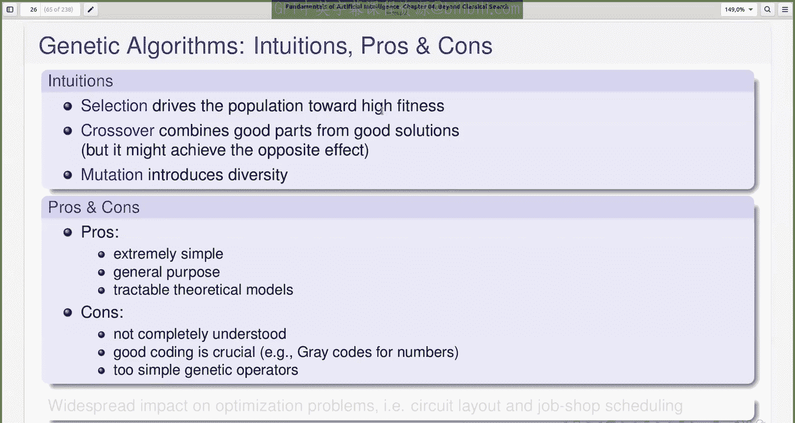
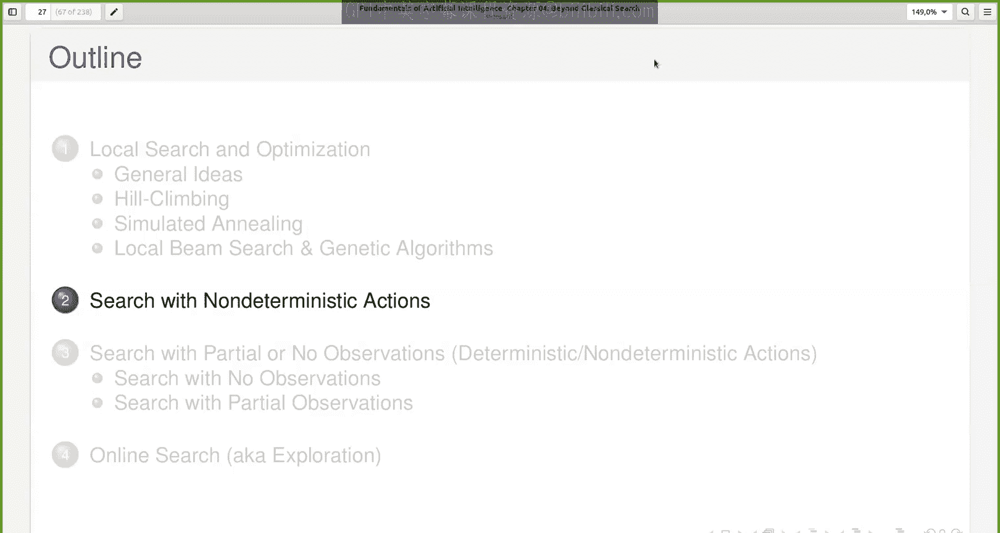

# 人工智能基础：4：局部搜索


在本节课中，我们将要学习一种新的搜索范式——局部搜索。我们将看到，当放弃对“解决方案必须是一个动作序列”这一假设时，搜索问题会如何演变，并探索其在解决优化和决策问题上的强大能力。

## 从经典搜索到局部搜索

上一节我们介绍了经典搜索，它基于几个关键假设：环境完全可观测、动作是确定性的、环境规则完全已知，并且解决方案是一个逐步构建的动作序列。

本节中，我们来看看当逐步放宽这些假设时会发生什么。首先，我们将放宽第四个假设，即不再要求解决方案必须是一个动作序列。这引导我们进入一种完全不同的搜索形式——**局部搜索**。

## 局部搜索的核心思想

在局部搜索中，我们只关心最终达到的目标状态，而不关心到达目标的具体路径。解决方案就是目标状态本身。

这种方法适用于许多问题，例如**N皇后问题**。重要的不是放置皇后的顺序，而是最终找到一个皇后互不攻击的配置。其他应用包括约束满足问题、可满足性问题、调度、自动编程和电信网络优化等。

在这些问题中，我们通常面临两类子问题：
*   **决策问题**：找到一个满足特定约束条件（即目标特征）的状态。
*   **优化问题**：找到一个根据某种度量标准（如成本或收益）最优的配置。

两者关系密切。任何优化问题都可以转化为决策问题（例如，“是否存在成本不高于X的解决方案？”）。同样，决策问题也可以看作一个优化问题，其中我们试图最小化当前状态与目标状态之间的“距离”。

## 局部搜索的工作原理

局部搜索从一个**完整的**（但可能不理想的）状态开始，然后通过迭代地改进它来逼近目标。

其工作流程如下：
1.  从某个初始状态（通常是随机生成的）开始。
2.  评估当前状态。
3.  考虑当前状态的“邻居”状态（例如，通过改变一个变量的值）。
4.  根据某种准则（如选择使评估结果改进最大的邻居）移动到下一个状态。
5.  重复步骤2-4，直到找到满意解或满足停止条件。

与系统性地探索搜索树的经典搜索不同，局部搜索通常**只跟踪当前状态**，不记录到达此状态的路径。这带来了巨大的内存优势（通常只需常量内存），并且对于许多经典搜索难以处理的大规模问题非常有效。

## 问题空间与局部最优

我们可以将目标函数（如成本或收益）想象成一个**地形景观**。在最大化问题中，我们试图登上最高的山峰；在最小化问题中，我们试图找到最深的谷底。

然而，这个地形中可能存在：
*   **全局最优**：整个地形中的最高点或最低点。
*   **局部最优**：某个局部区域的最高点或最低点，但从那里无法通过单步改进到达全局最优。
*   **平原地带**：函数值没有变化的区域。

**局部最优是局部搜索的主要挑战**，因为搜索过程很容易陷入其中而无法逃脱。

## 爬山算法：基础的局部搜索

接下来，我们看看最直观的局部搜索技术——**爬山算法**（也称为贪婪局部搜索）。

其核心思想是：只有当移动能产生比当前状态更好的解时，才执行该移动。在最简单的版本（最陡上升爬山法）中，我们总是选择能带来最大改进的邻居状态。

以下是算法的伪代码表示：
```
function HILL-CLIMBING(problem) returns a state
    current ← problem.INITIAL
    loop do
        neighbor ← a highest-valued successor of current
        if neighbor.VALUE ≤ current.VALUE then
            return current
        current ← neighbor
```

然而，爬山算法是“短视”的，很容易陷入局部最优。例如，在解决八皇后问题时，它可能快速收敛到一个只有一个冲突的配置，但无法通过单步改进消除这最后一个冲突。

## 爬山算法的变体

由于基础爬山算法的局限性，发展出了多种变体以提高其性能：

*   **随机重启爬山法**：多次运行爬山算法，每次从不同的随机初始状态开始。这是最常用且有效的变体之一。
*   **首选爬山法**：随机生成后继节点，直到找到一个优于当前状态的后继。这在评估所有后继成本很高时很有效。
*   **随机爬山法**：按一定概率随机选择后继，改进越大的后继被选中的概率越高，而非总是选择最好的。
*   **允许侧向移动的爬山法**：允许移动到与当前状态评估值相等的邻居，以穿越平原地带。但需注意防止无限循环。

## 模拟退火算法

模拟退火是一种受冶金学启发的、更高级的局部搜索算法。其核心思想是：在搜索初期，以较高的概率接受“坏”的移动（即使评估值变差），以便跳出局部最优；随着时间推移，逐渐降低接受坏移动的概率。

这类似于将系统“加热”然后缓慢“冷却”（退火）的过程。算法使用一个“温度”参数 `T` 来控制接受坏移动的概率。温度随时间根据一个“退火计划表”逐渐降低。

关键步骤在于选择移动：
1.  随机选择一个邻居。
2.  计算评估值的变化 ΔE = `neighbor.value - current.value`。
3.  如果 ΔE > 0（改进），则接受该移动。
4.  如果 ΔE ≤ 0（变差或不变），则以概率 **p = e^(ΔE / T)** 接受该移动。

在高温（T 大）时，即使是很差的移动也有相对较高的概率被接受，便于广泛探索。在低温（T 小）时，算法几乎只接受改进的移动，专注于局部开发。理论上，如果冷却足够慢，模拟退火能以概率1找到全局最优解。

## 局部束搜索与遗传算法

局部束搜索同时跟踪 `k` 个状态而不仅仅是一个。在每一步，它生成所有 `k` 个状态的后继，然后从所有后继中选择 `k` 个最好的。但这种方法可能导致缺乏多样性，所有状态很快聚集到同一个局部最优。

**遗传算法**是受生物进化启发的局部搜索算法。它维护一个状态（称为“个体”）的“种群”，并通过模拟自然选择（选择）、交叉（重组）和变异来进化出更好的解。

以下是遗传算法的工作流程：
1.  **初始化**：随机生成一个包含 `N` 个个体的种群。
2.  **评估**：计算每个个体的适应度（对应目标函数值）。
3.  **循环**直到满足终止条件：
    a.  **选择**：根据适应度（适应度越高，被选中的概率越大）从种群中选择一对“父代”个体。
    b.  **交叉**：以一定概率对选中的父代进行交叉操作，产生一个或两个“子代”个体。这通常通过在表示状态的字符串中随机选择一个点，并交换两侧部分来完成。
    c.  **变异**：以很小的概率随机改变子代中某个位置的值。
    d.  将新的子代加入新种群。
4.  **替换**：用新种群替代旧种群。
5.  返回进化过程中找到的最好个体。

**选择**操作类似于爬山，推动种群向更好的方向进化。**交叉**操作结合了两个父代的特征，可能产生兼具双方优点的子代。**变异**操作引入了随机性，有助于保持种群多样性和探索新区域。

在实现时需要注意编码方式。对于数值优化，使用**格雷码**而非标准二进制码通常更好，因为格雷码相邻数值的汉明距离为1，能更好地反映数值的邻近关系。

## 总结

本节课中我们一起学习了局部搜索这一强大的问题求解范式。我们了解到，当只关心目标状态而非路径时，可以采用从完整解开始并迭代改进的策略。我们探讨了基础的爬山算法及其容易陷入局部最优的缺点，并介绍了随机重启、首选选择等改进变体。接着，我们学习了模拟退火算法，它通过以概率接受坏移动来逃离局部最优。最后，我们了解了受生物进化启发的遗传算法，它通过维护一个种群，并利用选择、交叉和变异操作来并行地搜索解空间。







这些局部搜索技术虽然通常不能保证找到最优解（除了模拟退火在理想条件下），但在实践中对于许多大规模、复杂的优化和决策问题非常有效，是人工智能工具箱中的重要工具。