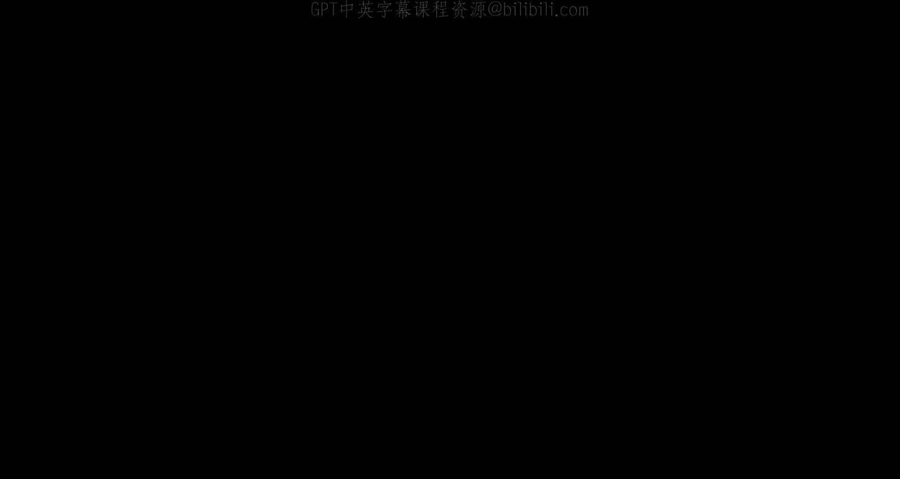
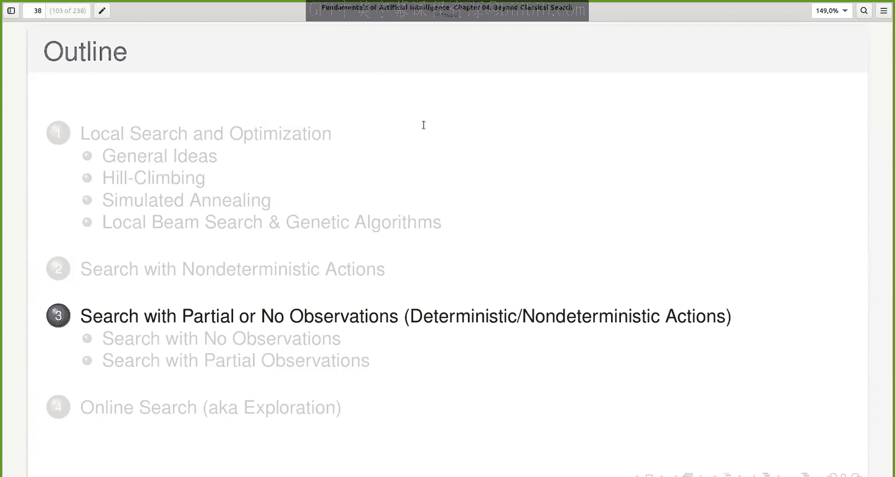

# 意大利特伦托大学《人工智能基础｜Fundamentals of Artificial Intelligence 2024》中英字幕deepseek p12 2024.10.04-CL10-2-CH04-SearchNondeterministic.zh_en -BV1uUkwYTEmf_p12-

对。😡，No， sorry for the inconience。I'm afraid we have lost 30 seconds of audio in the recording。

I hope he's only 30 seconds。We check I check。啊。Oh。However， I was simply chatting there。

 so I don't think there there's any。Importantportant content on that。Yes。Oh。

Pioically some technical problems and also you have a since the connection is broken。

 probably you have two recordings of this class。Okay， but you see number one number two， right。

 so it's not difficult to find it。Okay。So。Next step。So long for local search， if you remember。

 we were now we are。Doing our exc courses in reasoning， going beyond classical search。

 A second condition that we want to release is the fact having deterministic action。

 So get back to to searching the classic science。What happens if we have moves which are not deterministic？

Such that given a state and given an action， we can produce more than one possible candidate states。

 so this state is not deterministically asyed。Okay。If you think so far。

We had the scenario in which we have an environmental world。Was deterministic。And the bio was， okay。

 fullyservable and the agent knows the effects of every reaction。

Which means that if you are in an action in a state。And we do an action。We perfectly know what is it。

In which state we are， we are without doing any perception。Right。This is the effect of determination。

So we don't in principle， so if it is very simplifying。Assumption， we don't need a perception。

However。Kim。Enjo 막。However， if one of the above does not hold。

 so if one of this restrict partieses doesn't hold， we need the perception。Okay。

 some level of this section。Okay。诶。点长啊。Not is that in general。

 the future perspective is not necessary can be determined in advance。

Or there a future action will depend on future prospect。%， right。Okay， what happens？

We need something if we don't if we don't have the full control or the outcome of our actions。

 we need。Perception， and we need taking a plan which takes decisions， according to some perception。

So we need what is called a conditional plan。😊，Think about that is something that we do。

When you say plan， you don't always say we do this and we do this and we do this and we do this。

 and that's it。But we may say we do this and we do this。 If this happens， then we do this。 Otherwise。

 we do that。Okay。Noteice that if with if with this if。It may be the case that we。

 we choose to go backward in summer。Point to some point。That is， we already do something。

But you should know from。Basic。Theoretical computer science， just thinking of flow charts。

That when you have if conditions and we have。Condition， which can go back。你分。The gu toolss。 Okay。

 so you。The。They let you have。Looks。There is a very simple way to represent。

A loop backer with a go to if then go to a previous date， which is a loop。

 So a while a repeat or or a4。 Okay， so in conditional plan， you have if access or conditions。

 but it can have also loop。Stan you are synthesizing a strategy or what you can say。

 you can synthesize a program。Well， you know， you should know that。一分个渡。Is all you need？

To produce any。Any piece of any possible program。Then of course， you don't do good tooo。

 but use more sophisticated co creatureer loops。Okay， but these are all you need。So， substantially。

 you。You are。We're adding a conditional planes or a strategy。

 which is nothing else that a piece of soft。Is a piece of code。Any factor。

In plain in the world of conditional plannings。There's been a very strong intersection。

Between two fields planning。It is AI and program synthesis。

 It is software engineering or formal notification or auto。What the hell？Sorry。Soter synthesis。

Autooma software synthesis， which is a world field of computer science。

And there's a lot of contamination and a similarity。In similar。呃 developmentment there。🤧Okay。

So firsttan actually。We consider first the case on non deter。Okay， and we。We consider a to example。

 a variation of the vacuum cleaner。 So if you remember the vacuum cleaner was this。

Simplify the toy example， which are this vacuum cleaner with these two rooms。

 and it could be dirty or cleaned。 You have a three actions。 move left move right and suck。

 And the goal is to。That both and the A B are clean the sources have。In this representation。

 we have only eight possible states， you have the go states are seven eight not that it will count we say state seven state 8。

 but the actual information is。We are in A O B or A And B is clean and A is clean or the and B is clean。

 So this is the actual information between the okay。Okay， let's make a evaluation of that okay。Okay。

 well just recall that if the environment is observable， deter areministic and complete no。

You can simply solve the by search algorithm。So for instance， if initially is in one。

 then a sucker move right and the sucker leads to8 in the okay。

So a1 is the one in which everything is dirty， okay， so suck， move to right suck。It leaves you。

Allows you to reach a goal in this very simple case。 Okay， so this was the previous case。 now。

 suppose we wanted to find a variation of that， which is erratic。

 So if something goes wrong with that。 So is the。There is some malfunction， something strange in。

 so we have two sources of non deterministic things okay。

Sometimes if the square is the artis is so powerful in sucking that you can also suck the nearestroom。

Okay， sometimes depending on how this is placed。 Okay， so in if if a place is dirty。

 So it tree is not only square， but sometimes it can way clear also the other square。

 So for instance， if you。You're feeling one。And and do the sucking。

 then you can end up not only in state 5， which is the one in US， but also even in the instead 7。

 on which both are clean。Okay。But also， if you settle with a queen to square。

Sometimes there is probably dirty。 Some some dirt in the machine。 So sometimes。

This is direct but it deposits something on the carpet。 Okay， so we are you suck it。

 you suck with when you are in five， Okay， so for， if you suck when you are in five and you end up so logically you should。

Remain there。 there should be a sub loop， but in practice， you can dirty it。Okay。😊。

So suppose you have has this non deterministic behavior okay so due to malfunctions or something like that so what what does it have or simply unpredictable so you know that this may happen okay so you do a contingency plan。

So that in order to try to figure out not only a standard plan when everything goes correctly as you expect。

 but also to be sure make some checks that if something goes wrong or something non unexpected happens。

 then you should recover。So。🤧。Okay。So this means that you have to rebuild a more general notion of a transition model。

 remember transition model then when you have this predicate functional action which tells you which action can be executed from each state and result is which state is a consequence sequence of the current state in the current action。

No。You have that result should produce a set of possible states。Actually。

 what we see that in practice it typically produce。A partialial state。

Which represents certain of states in which for instance， some value of some variables isn't clear。

Some does not typically produce a list of dates， okay， but some representation。Tpically a partial。

 a partial state。A partial representation of the state， which leaves some value and unspecified。

 which means that it represented possible in many candidate states。Okay。😊，Okay。So so for instance。

 the result of year one state one and okay， you can end up in9 five because it cleans room A。

 but also may also clean both and which ends up in state7 and so on and so forth。

Aro is a comppicus plane。Also called a conditional plan or a strategy。

If you can contain nested the condition of future perceptioncept， so you need a perceptioncept。

So you need perceiving some feature。Of the state， you end up after action and depending on what you perceive。

You do something or something else。So you have if answers。Or master the if the ounces。Okay。

 now that when you have anpha as。So that the outcome forces you to go。

To a state which was previously in the path， what you have is a loop。Okay。😊，当是人歪了。Or repeat。

or for whatever。Okay， so for reason， if from state one we can act the following plane so remember one is both dirty。

Young A and both。So we say suck。If。State equal 5。 This means that you have a clean only number a。

Okay， then go right and suck。 Otherwise do nothing。 Why otherwise do nothing。

 Because simply if you are in。If you are in。诶。State 58， do you have clean， also the other one。😡。

Then you need to do nothing， you are done much earlier， okay。This can cause Lupin。

 and we see that later how to deal with that。Not these a this。This is a personal comment of mine。

You don't reason on the state。You don't say if for you are in state one。

You say if you make conditions about the variables that you have。

 so what will say is if boys dirty then write suck S， so this will be the actual claim。Okay。

So you don't raise your any state number because date in general are explanation of many。

You say make condition on on the value of the variables on the state variables or a combination thereof。

See。Okay。This leads to an interesting scenario。Where， search is no more at what's called in or。对。

But it's what is called， and。And or three。Okay。Which is。Frequenting some sophisticated problems。Okay。

 so get back to the determin environment。When you are doing a search in a deterministic environment。

 regardless of the strategy that we are adopting， we are doing choices， okay？

Which successor am I sporting， I do this or I do this， or I do this or I do this。😡，Okay。

 so you have a set of actions。Remember， successors are。Co sequenceequs of actions。Okay。

 so you do this action or you do this action or you do this action or you do this action consequly。

 you have this successor or this successor or this successor or this successor， okay。

And you pick them according to some strategies， So this again。

The world search that you're exploring is what is called an or。3。Or do， if you you， you use。

Gph search， okay， so if you go and exploreer， okay。

 but in the sense that every branch you produce is an alternative。

Either you go this way or you go this way or you go this way。Okay， I expand this action。

 I do this action or I do this action or with this other action。And then this。

Gets to another state where you again have a choice。

 I do this action or do a transaction action action。 So you have a three。

Or of an node in which every node represent a no this junction。Okay， so far。

A three or a dog if you are catching the mistakes thingss。In feministic environment。

 things are more complicated because， okay， yes， you have a no component so you say I do this action or this action or this action。

😊，But when I do this action。I should handle。More than one possible outcome of this action。

 So if this action has more than one possible outcome， then you have to bill。With all of them。😡。

So I needed to find a plane。 So if。I choose this action and this makes me either this state or this other scenario。

I should be able to be handle both。So I should be able to handle this state， but also matter。Also。

 this data should be able to handle this state， the end of this state， end of this other state。

I should be able to handle more than one possible state。

And this a end because I have to cope with both or three all of them。

So I have an end component of search。In which I have to to cope with。

All the possible outcomes of every single action return choose。At this name component。Okay。😊。

This is frequent。In some scenario， which is called the category of a peace space problems or battery problems which belonged to the polynomial hierarchy of。

Of complexity。So NPR problems are something which typically you have a north tree to solve。Okay。

 when you have a sigma  two， sigma 3， sigma4， sigma 4 or pi 1 pi 2 by3 depending whether you are handled before the first of the ends or the o。

 so we have an alternation of ends or you end up inhering sigma problems。Okay。

 where n is NA alternatives？In the north or in general， be space complete problems。

Which are much harder to handle than competition harder to handle than。Then simple MP Comp problem。

 simple。So。We have to cope with that。So Sutania did。So we have end notes。

 so the our search tree is a named or in which we have any time to choose one to take one of the two possible outcomes action。

 but for every outcome。State， you have to， to deal with all。The outcomes。Okay。So。

 end notes correspond to。So all node correspond to states where you choose ins so you have the alternative of action that you may choose。

Or and the notes correspond to action， so you have to deal with all the possible outcomes of the action。

Okay。The notes are either goal or design。Or loop or nodes。

 so you loop back to a state that you have already code well see how to deal with the loop。

A solution for an end search problem。Is a summer subary， which has。A go Nor T leaf。What do you mean。

 but at every。It leaf。But typically， we have only one leaf before。Yeah， but you have to see。

Every solution you will continue to explain which if you have a need then else。

 all possible branch of the if have will lead eventually to goal。

 no matter which path that we are sure that every possible branch of choices that you are taking will lead you to a goal to achieve to satisfy goal。

Okay， over there？好 leaf。For every or no， it specifies only one action。😡。

And includes all outcome branches of every and no。Okay。

 so a mode a solution when an end or3 is a sort of3 end three is an end3 in which for every or you select one and for every end that you select all。

Okay。Well， of course， notice that or three can be seen as a particular subcase of N or three in which every end has only one Afhan node。

Okay， well， and which is actually the notion of determineminies， you have only for every action。

 you have only one outcome。Okay， so。So consider as a part of。And enders 34 are the previous case。

 okay？So assume initially you one and you are， your goal is to7 8。 We see that a solution。

 We have already seen that a solution is。So could if well。You should say。You say state is equal5。

 but it should be better say if a B is clean。B is a dirty sorry， then go right and answer again。

Otherwise， do nothing。And this representing the graph by the solid arcs， let's see what happens here。

Youre in one them， so you have two possible moves that suck al right？Okay。😊，第是。Okay。

Then you have two possible outcomes。😡，One in which everything is clean。

And the other way it's not only you have clean only one， okay， in this case， in this case。

 you have already already reached a goal。Cool， so let's see what happens in the second case。

And in fact， you see that if if your state is not5， so if there is not 13 time， you have finished。

Okay， then you are。Youngest at5。 And then what you do is move right。

 But if you move right is a deterministic。Notice being in the non determinist environment does not mean that all actions are non deterministic。

It means that some action can be nonmin。In this case， you have a deter action so you are。😊。

In this case， you don't have an end here， right， so you just have one。Okay。

 if you are you end up into state  six， but in state  six。Okay， if you do suck。

 then you have to solve the problem。What happens if you do something different for instance。

 if you are here in five and decide to suck here， then you end up either instinct remains the same state in which you are envelope loop。

Okay， or you end up in to get back to the same problem as before initial problem。

 so you have again a loop。Similarly， if you have other choices， okay？Are we there？

So is it clear what a solution is， a solution is S say3 Do if a factorize node in which。

All leaves are gold。You have one outcome forever every or node。

 and you have covered all outcomes forever every and node。

An alternative way to graphically represent an end three， which I like is to see this as a。3D，3。

In which。Imagine as a 3D3， which， well， vertical line is just the3。And in them。Right。

So they said the X axis。Is it the。Is the or choice。Or then。

 let's say the end and in the beep so that the Z is the or。Okay。

 so you see you have an evolution every time you branch， you have an then， okay。

 you have many solutions here and then you have two alternatives。

So the outcome solution is a tree that you see in front。In which you have only one layer。

 you see only one layer， so only one combination decision you zero。Okay， you see this graphically？

Okay， similar scenarios like end trees。E other promise for reasonable mod logics， for instance。

 or sometimes also in forms of planning and others so whenever quantify the billion formula。Okay。

 so this is the way you can represent this， so。嗯。So we have an nanograph。

 so these are acursive representation of the depth first version， okay？

Is it three days so without a cash？So initially you are a state， okay。

 you are dealing with the state， so what does it mean to have this state it means that you in front of you have a no choice。

Okay。😊，So invoke or search or on the current state。What it does all serve to do。

 so it takes a state a problem in the current path。

 so you keep track of the current the current solution。E is a condition of plan。Or those fail。Okay。

 so。If you have a goal test here has any need turn then， okay， if a state is on path。

Then you can return failure。Okay， so we'll discuss what the failure means here， okay。

 so Su you if you have already encountered the state。诶。

The state that you are currently in the produce path， then this means that you have a cycle。

I return failure， we see what we mean by failure。ok。Then for every action in problem， expand。

 find the next state。Okay，Not that for and add and invoke and search on the set of result applying an action to a stateint。

Not is that the result here is not a result， but a result。Meaning that this is a set of states。Okay。

😊，So substantially for every action you do， you generate。The outcome of a plane。

 which comes from the handling of all the possible outcomes for all of them。

 and if only one of them is failure，Then then you fail， otherwise。

 if they're all different from failure。Their return。

 the current action that is performed the and the。Appended to the。

 to the rest of the client that you have a computer across。

This returns you are applying and you apply this， okay？Over there。

And search what does and the search does， you have a list of state。

And you have to certify that all of them leads you to apply。So what you do for every such state。

 you generate all search on that。And if。If only one of them is failure， then you return failure。Okay。

If this is not the key，Then what you have produced， you have a list of states。

And you have a producer， a single plan for every possible state。Okay。

 so what you write is a con or an S leaf and S whatever you want to represent it。

 So if you have a state  one， then you do plain one otherwise play one is the primary you have a computeros for state  one Otherwise。

 if you have a state two， then you apply a plane2 and so on， okay。

So you have a nest and most likely will have a conda。 So I multiple choices， right。

 So if you've done this， you do this。 If you do this， if you are this scenario， you do this。

 if you're in this scenario， you do this， okay。Typically， if you have more than one condition。

 you can realize this as case reaches okay， or any construct that you can allow you。Okay。Okay， so。

What happens with the cycles？This war with media defense。Noteice that when you declare a cycle。

 there's not a failure， it does not mean no solution。

It means there is a no psychic solution plane it must be reachable from the an early incarnation of the current state。

So substantially， you can discharge it across state， So yeah have sort of。

If you ever reach the state， so if you are here。Bh bh，h and then you get the up to here。

You don't really return。So it's not that you have a feeling。Okay， but simply the fact that you。

You should try some other branch。Okay。Because there is no way you can reach a goal from this side。

Okay。So Suia is complete， the is complete because if a state space is fighter。

 then every path matches reach a goal， either at the end or a loop state， okay？

You can add the explorer， so again， I say this is a tree。

 but you can add an explorer and from this dug in order not to repeat the same a。

 the same state again。Okay。Okay， this implices that first。

 but there are equivalent from both the breakfast or even a or sources this that first is the simplest  one per。

Okay。The key point is what is the issue of cycles？Okay。Sometimes you need having a cycles。Okay。

s not simply， but you have some part。So some end part okay。

 so you have then end and some it ends up in a cycle so you cannot avoid cycles。呃。

You can consider a second plan。So if you have a cycle。Can be considered a psychic solution。 Pro that。

Every leaf is a good state。It's a gold state， sorry。Again。

 loop states are all con leaves and the lift is reachable from every point in the plan。Why is this？

And they， what we see later why。Stan how do we express we can set labels。

So we can give a name a label to a given set and say， okay， and we can add there。Aable gus。Okay。嗯。ok。

Soaw or what。We typically do much better when we retranslate this。

 we write them as why do or do or loop with using some luus syntax。She。Okay。So why can we。Do that。

We can do that because if we assume that every outcome of deter deterministic action can actually occur。

So that eventually。Sooner or later， every possible。Outcome。Of an a can occur。

 so if we make this hypothesis。Then we are guaranteed that sooner or later well exit from a loop。

You see this， so suppose you have an E else， so you have an outcome。Of an action。

 which can be either this way or this way。 But going this way， I came back。To some extent。

 I come back to the beginning。 Okay， if I'm guaranteed that。Eventually。

It's always the case that sooner or later， I will end up into the other branch。Okay。

Then this guarantees me that sooner or later I will exit from the loop。So it we' not lu anything。

Is this assumption reasonable？Where in non deterministic case， yes。Okay。

Keep in mind this important distinction， known determining and observable。

Is different from deterministic partial settlementlomon。No determinity that's every solution。

Can happen。And I candle sell them， okay？The one is that every。The action is determinly。

 but I cannot know。I cannot see without come。This is different。But， it's easy to confuse them。

So one is something which happens。Which may happen。

So either two possibility may happen Queen we cannot relate to which one。

 but we know for sure that either can happen。With the let's say。

 we need no zero probability and the other say。Is due to the fact that we know that this we don't know that this cannot happen。

So something these two scenarios are very different。And sometimes in some situation。

 it is easy to confuse them。If。We can make， if we are actually doing with non determinism in the thing。

 we can make this assumption， so we can always assume that we always actually from a loop。Okay。

Meaning that if we are in this scenario， which。There exist at least one， I mean。

 we lift goals notes our goals， okay， and for every place we can， we have at least one chance。

Reriach goal。This means that since we are not looping forever。Soon or later。

 we'll exit from every loop。And then we'll reach eventually we'll reach this goal。

 So this considered badly plan。So you can think to this as a scenario in which every choice。

Ha some probability， you don't know。But you know， for sure that each probability is no zero。Okay。

You know， for sure that this may happen， so you are guaranteed that sooner or later。

After a finite amount of loopops。This will get out of that。In formalal verification。

 we call these fairness conditions。So something wherever you are。

 some condition will eventually happen， no later will eventually happen。We don't know when。

Whether but we know for sure that it' guaranteed that sooner or later will happen wherever we are。

Okay。So these are some implicit conditions that we we are doing。 So I make you an example that we。

A doing the form of fresh course。诶。Suppose well you are used to a very easy protocol of access to some common resources。

 which is the human protocol okay so suppose you are entering a public toilet。Okay。

 so it's a standard assumption that the queuing protocol is correct， right？Is a good one。 So we say。

 okay， you queue up until everybody actually has done they want it came before before you。

I used it and then you can enter。The question is， is it fair。Protocol， are you guaranteed？

That you will have access to the toilet with this protocol。Yes or no。Sorry。Sooner let it， yes。

 you say。Isn't this based on an implicit assumption that you make？

There's an implic assumption that you make。Then nobody ain'ts there stay there forever。

Which sounds reasonable， Okay， sounds reasonable pretty， but this is based。On any preit assumption。

Okay， which is this one so you that。Sooner or later。

 the fact that that all for rich people in front of you。Sooner or later。

 they will come out of the toilet。Okay。This is an assumption which is implicit and we makeake okay and is' reasonable in tactile use。

 but if you don't make this assumption， your protocol doesn't work if you give it to a model a formal verifier。

Okay， it gives the tall Q is the algorithm。And time， I might guarantee to assess， you would say no。

And this returned you a case where somebody a's us and it looks forever there。Okay。

 so there are some increased assumption。 and this is one increased assumption。一。

Anybody actually from the toilet okay to say so sooner or later any room determine so if you consider time as the time is locked okay every second。

At every second， it may happen that the person before you comes out or not。Okay。

 this is nonterministic scenario。Okay。But then you can really assume that the probability he or she comes up in the public toilet will come out。

Will be no0。Okay。😊，And so sooner or later， he will come out and then you can enter， okay。

 so that's actually the very similar reason。Lots of scenarios have implicit assumptions like that。

Okay。As I say， informification call then fairness conditionss， okay？But you are a。

Not that if under those implicit scenarios， this works。Okay。

 so condition pain was because you assume that。Inm practice of what you do。

 I will do that until this happens。😡，I will。 so I will。

Part of your plan is I will action the vacuum until this gets clean。

So you' assume where sometimes you may fail。But after a while， so if it's not broken。Okay。

 I'll get it clean。Okay。😊，We are。Okay。Okay， so just to as a， so suppose you have a variant of this。

 Okay， so。The movement， suppose the movement action can fail。 So suppose that the。

The result of moving right is， well， sometimes you are able to overrite。

 but sometimes you stay there， so maybe you have a slipnipery。Again。

 you assume that this is really non deterministic， it's not determin in the opposite sense and you don not know it。

 okay？So， so there's not the one right is  one，2。 Okay， so this gives you a。Lopy scenario， okay。

 so you are here you take right， okay， you can for a number of times， you can remain the same。

 but after a while， you assume that it will get。Do， you get it do base me。

And the assumption of really known department is， okay， not again， not。

Deterministic failure under unknown circumstances， you are guaranteed to achieve。

You are guaranteed this sooner later you get even we will go on。Okay。So for instance。Okay。

 how do you encode this？Okay， you can。You can give implicit labels to some states。Okay， I see。Suck。

 and then I give a label to the current statement。And then I say， right。

If I'm in state five or better if I'm in B， then back to then go to well1。Okay。😊，And shock。喂S。

This loop， we are computer scientists and we know how to do it， Okay， were right。

 suck while state equals5 do write suck。Okay， we know how， so this will be translated in。

You automatically in thisす。AndThis piece of code here， so we have a loop。

And the loopy scenario is guaranteed to be social under the assumption that we are really dealing with no determinism。

 so we are guaranteed that sooner or later each of the possible outcome of every action will be achieved。

So after a finite amount of steps， we'll get out of there， okay？Notice。

This is just a scratch for surface。 There is a wallet。So the field of the of planning。

Which is conditional planning。Which these this in practice。 And this is something that you see。

If you attended the second semester course by Professor Robert， you' is a good expert on this topic。

Okay， I think that's it for today。I apologize for the technical problem solve。 So I I。

 I'm afraid that the quality of the recording， in particular in the central Park of the。

The end of this part here will not so good， or you have we may have lost a few seconds over recording。

 but you may look at the last year recording and I did the same okay。

Thank you very much See you on Monday。

By。

