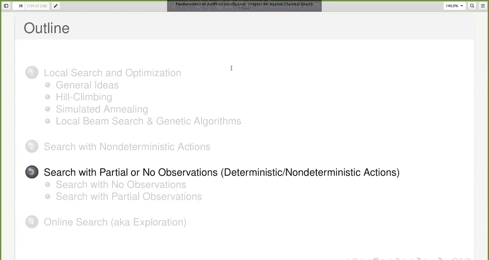

# 人工智能基础：4：非确定性搜索 🧭

在本节课中，我们将学习如何处理非确定性环境下的搜索问题。我们将探讨当智能体的行动结果不确定时，如何制定条件性计划，并介绍用于解决此类问题的“与或树”搜索方法。

---

## 概述

在经典的搜索问题中，我们假设环境是完全可观察的、确定性的，并且智能体完全了解每个行动的效果。这意味着，给定一个状态和执行一个行动，我们可以精确地知道下一个状态是什么。然而，现实世界往往并非如此确定。行动的结果可能无法完全预测，导致出现多种可能的结果状态。本节课，我们将放宽“行动是确定性的”这一假设，学习如何在非确定性环境中进行规划。

---

## 从确定性到非确定性

上一节我们介绍了局部搜索，现在我们继续探讨超越经典搜索的推理方法。我们想要放宽的第二个条件是行动的确定性。

回顾经典的确定性搜索场景：我们有一个环境，它是确定性的、完全可观察的，并且智能体知道每个行动的确切效果。这意味着，在一个状态下执行一个行动，我们无需感知就能完美地知道下一个状态。

然而，如果上述任何一个限制条件不成立，我们就需要感知。在非确定性环境中，未来的状态无法提前完全确定，未来的行动将取决于未来的感知结果。因此，我们需要一种能够根据感知做决策的计划，即**条件性计划**。

条件性计划类似于我们日常所说的“如果……那么……”语句。它不仅仅是“做A，然后做B，然后做C”的线性序列，而是“做A，然后做B；如果发生X，那么做C，否则做D”。这种计划中可能包含条件分支，甚至可能通过“转到”先前状态而形成循环。本质上，你是在合成一个策略或一段程序代码。

条件性规划领域与程序合成、形式化方法等计算机科学领域有很强的交叉。

---

## 一个非确定性示例：故障吸尘器 🧹

首先，我们考虑一个非确定性的例子，它是吸尘器世界的一个变体。

回忆一下经典的吸尘器问题：有两个房间A和B，吸尘器可以执行`左移`、`右移`和`吸尘`三个动作，目标是让两个房间都变干净。在确定性版本中，只有8种可能的状态，我们可以用简单的搜索算法解决。

现在，假设吸尘器出现故障，行为变得不确定：
1.  **过度吸尘**：当在一个脏房间吸尘时，它可能不仅清洁当前房间，还可能清洁相邻房间。
2.  **散布灰尘**：当在一个干净房间吸尘时，机器可能故障并弄脏该房间。

由于这种非确定性的行为，我们需要制定一个**应急计划**，以确保即使发生意外情况，也能最终达成目标。这意味着我们需要一个更通用的转移模型。

在非确定性模型中，给定一个状态和一个行动，`结果`函数不再返回单一状态，而是返回一个**可能状态的集合**。在实践中，这通常表示为一个**部分状态**，即某些状态变量的值未指定，代表了多个候选状态。

例如，在初始状态（两个房间都脏）执行`吸尘`动作，结果可能进入状态5（仅A干净），也可能直接进入状态7（两个房间都干净）。

---

## 条件性计划与与或树

条件性计划，也称为策略，可以包含基于未来感知结果的条件嵌套。你需要感知状态的一些特征，然后根据感知结果决定做什么。这就引入了`if-then-else`结构。当某个结果迫使你回到路径上的先前状态时，就会形成循环。

这导致了一个有趣的场景：搜索不再是在所谓的**或树**中进行，而是在**与或树**中进行。

*   **确定性环境（或树）**：在每一步，你从多个可能的行动（或分支）中选择一个。你探索的搜索树是一个“或”树，每个节点代表一个选择点。
*   **非确定性环境（与或树）**：情况更复杂。你仍然有“或”节点来选择行动。但是，当你选择一个非确定性行动时，你必须处理该行动所有可能的结果。这意味着你有一个“与”节点，必须应对所有可能的结果状态。

因此，与或树交替出现“或”节点（选择行动）和“与”节点（处理行动的所有结果）。

**与或树中的节点**：
*   **或节点**：对应状态，你需要从多个可选行动中选择一个。
*   **与节点**：对应行动，你需要处理该行动所有可能的结果状态。
*   **叶节点**：可以是目标状态、失败状态或循环状态。

**与或树的一个解**是一个子树，它满足：
1.  每个叶节点都是目标状态。
2.  对于每个或节点，解中只指定一个选择的行动。
3.  对于每个与节点，解中包含该行动所有结果分支的后续解。

这意味着，无论非确定性如何展开，该计划都能保证最终达到目标。

---

## 与或树搜索算法 🔍

我们可以用递归的深度优先方式来表示与或树搜索算法。

以下是算法的核心思路：

**或搜索（处理状态/或节点）**：
1.  如果当前状态满足目标，则返回一个空计划（成功）。
2.  如果当前状态已在当前路径上（出现循环），则返回`失败`（稍后讨论循环处理）。
3.  对于当前状态下每个可用的行动`a`：
    *   计算应用行动`a`到当前状态所产生的**所有可能结果状态的集合**（`results`）。
    *   调用**与搜索**来处理这个结果状态集合。
    *   如果与搜索返回的不是`失败`，则返回一个计划，形式为“执行行动`a`，然后执行与搜索返回的子计划”。
4.  如果所有行动都导致`失败`，则返回`失败`。

**与搜索（处理状态集合/与节点）**：
1.  对于结果状态集合中的每一个状态`s`：
    *   调用**或搜索**来处理状态`s`。
    *   如果对任何状态`s`的或搜索返回`失败`，则整个与搜索返回`失败`。
2.  如果对所有状态`s`的或搜索都成功，则返回一个**条件性计划**。这个计划通常是一个`case`语句：如果处于状态1，则执行计划1；如果处于状态2，则执行计划2；以此类推。

**关于循环的处理**：
在或搜索中检测到循环时返回`失败`，并不意味着问题无解。它意味着从当前路径的早期状态开始，没有找到不包含循环的解。算法会回溯并尝试其他分支。如果状态空间有限，算法是完备的。

---

## 循环与公平性假设 🔄

在非确定性规划中，循环可能是有意义的解决方案的一部分。例如，一个计划可能是“重复执行行动A，直到条件X成立”。这形成了一个循环。

我们可以将循环状态视为有效的叶节点，前提是：**从计划中的每一点出发，最终都能到达一个目标状态**。这依赖于一个关键的隐含假设——**公平性假设**。

**公平性假设**：在真正的非确定性环境中，我们假设每个行动**每一个可能的结果**都有非零的概率发生。因此，无论我们陷入某个循环多少次，只要存在一条能退出循环并到达目标的路径，那么“迟早”我们都会遇到那个结果，从而退出循环。

例如，考虑一个简单的协议：你排队等待使用公共厕所。这个协议“公平”吗？即，你是否保证最终能使用厕所？这依赖于一个隐含的假设：排在你前面的人**最终都会离开厕所**。如果没有这个假设（比如某人永远不出来），协议就会失败。这个“最终都会离开”就是公平性条件。

在吸尘器例子中，如果`右移`动作可能失败（有时会滑倒留在原地），一个可行的计划可能是：“当在房间A时，重复执行`右移`然后`吸尘`”。在公平性假设下，我们相信经过有限次尝试后，吸尘器最终会成功移动到房间B。

因此，在非确定性规划中，像 `while state == dirty do suck` 这样的循环结构是有效的解决方案，因为它们依赖于“迟早会成功”的公平性假设。

---

## 总结

本节课我们一起学习了非确定性环境下的搜索与规划：

1.  我们首先将问题从确定性环境扩展到非确定性环境，其中行动可能导致多个结果。
2.  我们引入了**条件性计划**的概念，它使用`if-then-else`和循环结构来应对不同的未来状态。
3.  为了解决非确定性搜索问题，我们介绍了**与或树**的概念，它交替包含选择行动的“或”节点和处理所有结果的“与”节点。
4.  我们探讨了用于求解与或树的递归搜索算法框架，包括`或搜索`和`与搜索`函数。
5.  最后，我们讨论了**循环**在解中的角色，以及使循环解有效的关键——**公平性假设**，即每个可能的结果最终都会发生。

理解非确定性搜索是处理现实世界不确定性问题的重要基础，它连接了人工智能规划、形式化验证和程序合成等多个领域。