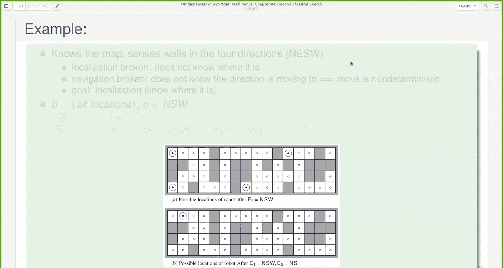

# 意大利特伦托大学《人工智能基础｜Fundamentals of Artificial Intelligence 2024》中英字幕deepseek p13 2024.10.07-CL11-1-CH04-SearchPartialNoObservations.zh_en -BV1uUkwYTEmf_p13-

Okay， so today we go ahead in our discussion of varieties of。A generaleneralized search。Okay。Oh。

And we deal with the search with the partial or no observability， Okay。

 either deter deterministic or non deterterministic case。

So if you remember the general schema of the beginning of this chapter。

 so the idea was that in the previous chapter the simple classical search。

 we had made some very strong assumptions， okay。In particular， toservability。

 deterministic environment， known environment and sequence of action as as solutions。

 And we are progressively。And in this chapter， we have released some some assumptions。 in particular。

 we have released condition 4 and 2 so far。 and now we are。

Looking what happens when we are releasing a very， very important。Reistintion。

 which is observability。 So what happens when we don't have our sensors do not have。

You don't have a sensor or you have only partial。They access to partial information of the environment。

Okay， if you remember。Last time嘛。When we have dealt with no deterministic actions。

 we have have say that the solution was having a conditional plan。Okay。

 meaning that your plan is actually a strategy or a program， if you think。

 which is maybe full of conditions， if this happens， so a plane looks like if this happens。

 then you you go this way otherwise and you go this way and this also cause loops okay。

 so while you you don't sense this factor while。The floor is dirty suck， Okay， and so must a forth。

 But in order to do those conditions， you need sensing because while。

Condition in order to realize this condition， you need the sensing， okay。

What happens if we don't have the flu science in？Okay， of only partial something。Okay， let's see。

 And this is exactly what the topic of today's class。ok。So remember what is partial observability。

 So partial observ is when the perception do not。Perceive the wall state。

I just recall that in general， we never perceived the war state。But in practice。

 what we need is perceiving all the information we need for our action。Okay。

 but suppose you don't have。ThatSo if you have only partial information。About this date。

This boils down to the fact that we could， in principle be in many possible states， Okay。

 so it introduces a degree of uncertainty。All the possible states， okay。So mean。

 so if for instance you have access to， you don't have access to a value of some Bo variable。Okay。

 so in case you don't know， you cannot sense whether the other room is dirty or clean。Okay。

 this automatically means that you don't know exactly where in which state you are。

But it can be either in state with the others the other room clean or in the state with the other room dirty。

 Okay， so you have the equivalent of two possible。Of two possible states。EJ， if you have。

If you don't have access to key。😡，Bullion variables。 Let's make a variable Bo for simplicity。 Okay。

 you have you have。Possibly you could be into2 to the K possible states。

And you don't know which state you are。😡，Okay， so you know， you are in either one of those states。😡。

But you don't know which one， okay？Which means。That consequence sequence。

 even if we have a deterministic actions。If you。Are in one of a man a set of possible states。

 and you apply some actions。 You still going to。You still have an uncertainty of the outcome。State。

 okay， even if there actually is deterministic。Okay， because if you are in location A。

 location A is clean， but you have no access to the information that you don't know whether the other number B。

 location B is clean or dirty。And to say， you move to be。Okay， so before the act of moving。

 before sensing， okay， may lead you to two possible con states。

The one in which you are there and then where A is clean and B is there the end and the one in with the second condition condition。

 but with a B clean。ok 想借啦。If you have an uncertainty on。On the current state， Okay。

 means that you are in one oversight of states。 Okay， and if you apply an action。

 no matter even if this action is deterministic。Theres really in again。

 in one site of the kind state， so you maintain some uncertainty， although you can improve things。

Over there。Okay。This comes to an important。To an important concept。Which is the notion of beef state。

Which is common to many fields of AI， Okay， so belief state。

Is represent the agent who current belief about his the state of the， the state of the world。 Okay。

 so is the agent current belief about the possible physical states maybe be technically speaking okay。

Given the previous knowledge， the previous states， the previous sequence of actions and blah bh bh。

ok。😊，So。You are。In one set of state。The fact it corresponds to as a mathematically speaking。

As a set of possible states。Okay。😊，So I don ph remember the meaning of physical means states of the environment。

 okay， even though maybe the environment is software and you're thinking about your agent is a chatable okay。

 so physics is not strictly in the science okay， so means in the environment。States and environment。

 So mathematically speaking， a belief state corresponds to a set。Of physical states。

 although in practice。The way you represent it is a sort of partial state。

So mean partial information about the state。Meaning that the the missing information allows you a wide range of possible candidate values which correspond to values of candidate states you are。

So this， again， to say。That in practice。You don't represent a belief data as a list of these states。

 rather as a partial information， a set of information， the cloud information。AndE， a site of values。

Of。The values of a subset of the state parliament， which is the most typical scenario， okay。

On this subset meaning that the remaining variables are unknown or you have partial information regarding the missing variables。

 which means that it opens you many alternative possibilities。Okay。So state one。

 I don't remember exactly what the states1 and2 are in a in our example， but if I remember correctly。

 this means that either you are in a and either one is dirty and B is dirty and b clean if I remember correctly if not to go back into the slides and see it okay。

Well， okay， sometimes a cyto state is just contains one single state， okay。And in this case。

 this we say that we have a clear a clear idea where we are and the exact state where we are Not that some to some extent。

 sometimes。诶。Thecer of other state is okay。So if our goal is having a。All rooms clean。To some extent。

 the information regarding the fact that we A or B can be irrelevant。Okay。

 if the important thing to decide some action is the fact that we are in A。

Regardless of the degree of regardless the fact that be is clean or dirty， then it's okay。 so yeah。

 I mean this it does not affect the fact that you can choose an action okay， or can do something。

Okay。In general， remember that we have。Out of N so what is the problem with the British state is that there are comminatorarily too many。

With the sense that we are dealing with2 to the end。If you have N physical states。

 we can have two to the end possible states， although typically the combinations are much less okay。

So it's through that in principle， for instance， if you think。The key of our。Of our vacuum cleaner。

 super vacuum cleaner， which has eight states。In principle， we have 228 possible combinations。

But the typical ones are the combination of those in which you have a missing information。

 so you don't have a state in which are you so。It's very uncommon that you then the stating which are in a and A is clean and B is dirty is considered together with the stating which are in B and B is clean and and A is clean。

 Okay， so so they typically they are group together according to the fact that some variable。

 they share some value， some variables and and then you have all the possible combination the remaining ones。

Okay， so the typical grouping of， which form belief states。I was there。Okay。Okay。Yeah。

 that's actually the point， so。Belief state is a mathematical notion。Absster and mathematical notion。

 just a set of state physical states in practice， the typical scenario is given by partialsha states。

😊，Okay， so meaning。States in which you have a partial information of them。

 so typically you know the values of some variables and you have some uncertainty。

 you don't know the values of some others。Okay。They said。We distinguish two cases。

Search without information at all。Okay， so we also called conformant search。

And then search you with the passion in observations。

 So suppose you don't have a sense in at in this next session， okay。AKf。

This is also called the conformance search or sensibleor less search。 Okay， so suppose。

You don't have sense。So what's the deal beside that。Videdia is that。You search。い the。

Space of the belief state。Okay。So notice that if once you have made this sort of abstraction of the set of physical states into set of video states。

In some way， this is。This abstract。呃。Search space is， first of all， pre observable。Because we。

We know how our belief state。So啊。Once for us， a belief state is a settled state。

 We know exactly in which belief state we are。Okay， so to say。

 and we know exactly what is the outcome of an action。So from starting from a belief state in which。

Which be we get to Hindu。Okay。So it's a sort of a deter error。

And is sort of deterministic because also the possible outcomes are just matter just moving in in in a set of states。

 Okay， so in another belief state。 So once we use an notion a belief state rather than a set。Then。

Physical state， then the outcome is。The fact， I believe。A deterministic and fully observable。Search。

Okay。So。😡，Of course， there's enough lach for that。What is。Your， what is the drawback of this。

Your opinion。They' are looking transparency。You have an installation built up in a number of states。

Okay， because the candidate states are much， much， much bigger。

Think about I don't know when whether you have ever bumped。

In the course of theoretical computer science。Do you know。

Have you ever heard about anything which is called the conversion of a non deterministic。

Finr state of tomato into a deterministic， F state of tomato。 Never heard。就是呃 fundamental。

Technique in theoretical cognitive science。 No， okay。It's a very， very simple principle。

 so you have a sort of。If you have a you can always transform。And non theterministic state machine。

Into a deterministic world， but with any exponential amount of states。Okay。

 and the video is that your new states are the the site。Of the original states。 So these are very。

Come on。Theoretical instrument to。To show that worst cases。

 you can determineize things but you pay for with。An exponential cost of that， okay？So。

 but once you have this， you can reason you have all the instruments to do this， Okay， so。

So consider consider the case that you have a senseless vacuum cleaner so same environment。

 the same scenario as before， but you have no sense of。 you have no clue。

Or whether anything is dirty is clean， where you are and whatever， okay。So。Okay。ISo I don't。

 so our vacuum doesn't know where it is， doesn't know whether it's dirty or clean。说以你学练。Yeah。

 is all the possible date， okay？Again， your booker represented a number of states that make things simpler。

 but in practice you are handling the three you have the three variables and you have the combination magnitude to three variables。

 okay？Okay， so。等你实力幼儿。In one of the possible eight combinations。

 now these the three binary variables， okay。哦。Okay， after the。suppose you move right。

What does after movie Oh you are theministic case。 Okay， so deterministic action case， Okay so。So。

 suppose the。The suppose the physical environment is determined okay， for a while。

What do you know after you have moved right？P French， which state you stay get like bike。Yeah， okay。

 And so what do you know about the the outcome state。

The outcome belief state or many belief states are you？No。Re be eyes。I know that I'm right。

 so I say the assumption is that a the physical environment is determined。So for the， it at least。

 no is it right。Okay， so by doing an action， it eliminates the uncertainty of one variable。

 which is the location。Okay， so after I。I move after the right。He has a degree on7， which is four。

Now， okay， because he knows if。But， whatever。Whatever， it knows。诶。It is on the right on location B。

 okay。Even though， well， remember， we assume that if you do right and youre in already B。

 you just stay there。Okay。Okay， so cool。 Now you have a reduced uncertainty。 You have four。States。

Now。What， what you you do suck。If you suck again， assume that you are deter。You know， after that。

 that number B will be clean。😡，You don't know whether it was a trip before。😡，Or not。

 but you know these will be clean。😡，So， after that。You get there are certain two states。

 your belief states reduce it to two states。Okay。Then what you can do， you can move left。Okay。😊。

If you move left， no matter what。ok。You are， You know that you are an A。And that to be is clean。

Yeah not clue whether A is green or dirty yet。But then， but you know that you are。

At least your position and then be。So what happens now， you can。🤧Suck。Okay。😊。

Which means that after that， you are have completely reduced all your degree on freedom。 Okay。

 so now you know exactly which state you are， regardless how you got there。You have reduced，So。

 substantially。This means。That。Your plan， the plan that you applied。 So you were。

 you had no idea where you were。 You had no idea the status of each of the location was clean or dirty。

But， but you understand that this was。A good plane， a conformant plane。 So to say a play。

 a universal plane。 So no matter your niche state。This plan ended up into a determin state。

 which was what you desire。 Okay， you are in a， you are in a and you are。You are in the。いいなあ。

And all the locations are clean。This is called a conformant plan。

A plan that no matter your initial state。Okay， no matter the fact that you know nothing about it。

 you have no sing， you are guaranteed that you end up in a given state。Because of every。

 every action allows you to。Reduce their7。About the states， typically。

 the typical scenario is that every action eliminates the certain about one variable。

So makes you end in a given value of the Bible， okay？You see。😊，So substantially。

 you notice that this was。Dactctor plane， so graphically。You start where you knew absolutely nothing。

Then you move right。You knew absolutely nothing about clean。

 but you have acquired this important information this correspond to four states， then you suck。

And then this means that number B is clean。We a quality this information。Then you move left。

 so say degrees of information， but now you know are U a， then you suck and you are perfectly state。

So in case of deterministic action。😊，Typically a conformant plane sometimes so the typical factor of a conformant plane is that to make some sequence of actions which lead you in a scenario where you know exactly where。

Where you are。 And then after that， you can behave like。

Standard deter learning if you are in the deterministic environment。Okay。😊。

So you have a sort of a starting up。Sequence of action， which whose goal is to。

Bring you into a certain state。And after that， this was determin。But this， of course。

 happens if you are in the deterministic。Environment。If not， that's not so easy。Okay。

So this was an example。 Let's make some more rigorous formulation。To distinguish again。

 I use the notation and terminology of from your book。嗯。We use the。The Ciix P。To mention that today。

To indicate the action in the physical states。 So action P result P gold test P step cost P refer to the physical system。

 okay。Now， remember， we are walking a sort of abstract system。To the beef。

In the belief say the system。So， you。When you reason in uncertainty0， you don't know。

You don't know lots of things。 So you， you know， you move in a space。

So your internal representation has it in which you move is a analysis space with the loss information with the same information that you。

With the partial information， sorry。Okay。And you are moving。

 trying to make your information progressively less partial。Okay。😊，Okay。In Ja。

 belief states can be seen as subset of。Of physical state， in general。Not all possible a subset。

 I read。The typical subset are those in which you have some each represented partials。Partial states。

 mean， you know something。 You know some value or some value variables。 you don't know some。Okay。

 which reduces a lot the number of candy breeds。Okay。But in principle。

In principle that to the impossible candidates， okay。Well， initial state in a conform plan。

 typically you don't know the your initial state。Or so in the most general case。

 where you know absolutely nothing。😡，About your initial state。 So substantial every possible。

 So your belief state， initial belief state represent。The wall is called the universeverse。嗯。

The new universe believe states so everything those which contains all possible states。

 so the no information state。Remember， all states means I have no information about the states。

Where yeah。W， okay。Okay， suppose that illegal actions have no effect。

 So I meaning that we you don't apply so。What is the effect of applying。

What are the actions that you can apply in。In a belief state， is the union， we can see the union。

Of the actions that you can apply to have a single。To every single state。Other the belief state。Okay。

 so the actions， so remember that in fundamental element of of our scenarios。

 the problem formulation is that we need heavy function。Let's call it actions。

 which says which action can be applicable in a macro state。

What are the the actions that I can apply to my？My good belief state。

 where is the union or the states which are represented。Okay。

 under this this assumption here that if you apply an action， which。You apply in action to a state。

 which is not。Where you cannot really apply it， okay， it just does nothing。Over with that so far。

 everybody。Okay。And then the transition model。What is the transition， What are the。Remember。

 transition model is the one which in the deterministic states。

 in the deterministic state is the matter between。Given a state and an action， it does a state。

 in a non deterministic case， given a state and an action， it moves you to a set of states。

 which some you can think as I belief states itself。诶。😊，What is。

A transition model for a belief state。 So what if you apply some action to a belief state B。

What depends whether the action is deterministic or non deterministic， of course， as before。

 in the case of deterministic case。😊，Is， we could that。The the belief state。

 the target belief states as the set states。Is the state of state S prime such that？

Pse S prime is the result of applying aation A to some of the states represented by the belief state。

Okay。😊，Again。🤧哼哼。😊，ok。呃。What is instead a no deterministic， okay。

 here you have something even more complicated because of every application to every single state。

can itself child produce a set of state？And the result is simply we reduce the union。😊。

The belief state is the union of the Poster。You know， the possible states。Which are the outcome？

Of applying this action to some of the states of the belief state。Okay。Which I think。

 apart from the mathematical。Forlish is quite intuitive， right？So remember。

 a belief state implies the means I mean one of those states but have a no clue which one。Okay。

 so this means that。If I apply， I mean once a known completely I if I'm in a partial state。

 I typically prefer a partial state belief state as。Its definition。 But if I partially known state。

 and I apply。Some action from these partially known states。

 I will end up into a partially known states， of course， which are the possible。

 and all the information I have is all the possibilities。

Is the union all the possibility in applying？Applying detection to one of the possibilities states it was okay。

Not that we have no notion of probability here。😡，So there are of course some problem some states which are more likely than others and of course there are some outcomes which are more likely than others。

 but we have no distinction， we are just considering all the possible combinations here。

 no probability involved。狗子儿。Okay。Okay， so this step。It's also called the prediction。

So I predict that since I'm in this belief state。So in this type of candidate， possible station I am。

I， I predict the set of states where I can go。Okay。We there， everybody。

Keep this in mind because I will use this the definition later on。O。hi。Okay。

 here there is something quite controversial， not controversial， something not controversial。

 so it's well known and well accepted， but that is something you have to pay attention。😊，Okay。

 now we have a problem， water the makes。😡，What makes a goal test for a belief state？

And this is Dicky。Okay， so I may， I'm in a scenario。I'm not completely sure。Where I am。

 But I know that I'm in one of those states， okay。How can I conclude that I may ever reached the Gulf State？

Well， in， there's only one possible way I can conclude if all possible states。Our goal state。

Which is， of course， pessimistic。Okay， because it may be the case that I reach a state much earlier than that。

 but I can know for sure that I have reach the goal。Only if no matter what。I。

I know for sure that all possible states are call states， are we there？Everybody。Okay。

 I trust the father， this is definition is quite。Pssimistic， as I understand， okay。

Because I sometimes said， yeah， I'm in the gold stage， but I don't know。

So if some of the states in my belief states are goals and some other are not。Okay。

 I cannot conclude that this I'm a gross state， but maybe the a of state I am is indeed a goal。

But didnt know it。So。Conformant search particular confirm line is。By definition。Very pessimistic。

Okay， because you have to be is con plane is something says that you must be sure。

You have a sort of universal plan which no matter where you are， he leads you to a goal。

You must be sure that you are winning， So you have to be over zeros。In in check， because you。

 you may not。Exclude the fact that you are not familiar， okay？

That's an intrinsic nature of the scenario， what's called coa planning。

So one of the fundamental application of confirm search is confirmal planning。For instance。嗯。

You are building a plan。For some space over。我骂死。😡，Okay。You have some plans。 So they have inside。

 So you have no sensing or very limited sensing。 Okay， or if even though you cannot repplan。

 So you have to plan some or you have some。Some planes to be。诶。E scenarios which you cannot reach。

 So I mean， sending an order to a rover to mass， it takes， I would say。Minutes。Okay。

 so you cannot count on that。 You cannot reply they cannot。

 So you have to make a sort of universal plan。Okay， so no matter what happens。 So it's like a blind。

That goes around， Okay， blind。 And he has to perform a universal plan。

 something with no matter what must work。Which， of course makes lots of use probably makes lots of useless actions。

Okay， but no matter what。Goes。Okay。Yes， please。オます。Well， all most of were states the beve state。

Deive state。Is a set of state。Meaning， okay， so in order to be in order to So you have a passion notion of your your current dollar。

 which may correspond to several states， your belief state， okay。To conclude that you are done。

So you have reach the goal。You have to be sure that all possible states。Your goal state。are。

Unl states。Okay。It's a social meaning。The fact is so you the typical center。嗯。Which is this？Okay。

Okay， Cor allegations are just it's part。Okay， you can run Santa Justina well has a。It was cracked。

No， I didn't know it was supposed to be today， okay， however。Okay， it works。Okay。😀Ha。嗯嗯嗯。Okay。Okay。

Now， that's strange。 So your， your cell phone rang it to sorry when I it。その感。you don't know。 Okay。

 and okay， that's probably wise。 So okay， this was because it was don。 I was。

 I was surprised that some other receiver in the in the delay with a delay， which was nonsense sense。

 Okay， recipient don't know， okay。はい。Okay， so I thought from the。Santa Justina We， who has。

Track then all trying twice。 But luckily， we are in， right， So now， So all the all the。

Effects and we are not touch directly away the effects。

 maybe your houses if if you in downtown a Albert Okay， apart from silly jokes。

 so let's go ahead here。So did they answer。So the point is you have some uncertainty or some variable。

 Okay， the typical scenario。 But regardless the possible values of those values of those variables。

 you are sure that you angle。Okay， so the example is。

Regardless of fact that you don't know whether you are in AOB， if you know that both are clean。

You have a mess of gold。Okay。So if your goal was between everything。ok。😊，Okay。Okay。

 so we don't make really assumption pathco。Here also we suppose that。

If the cost of anash is the same north state， suppose that the cost of an is the same north states the cost of the action is ined by the cost of these generalized ash。

 so this substantially are we don't consider low cost path cost in here。Or because simply want。Okay。

 let's make。Let's see some example about this。Okay。

 so suppose we have a sense of this vacuum cleaner。And remember， we have two versions of our。

Or in which the move right is deterministic。Okay so move if A moves to B， if you are in B。

 you stay in B， but you have the slippery version， so maybe the wheels slip a little so you are not guarantee that from A you actually you go to B。

In this case。Okay， somebody says phone again。Okay， please。

Please doing them on at the end of the of this class。 Okay， otherwise we。AYour was just late。Oh。

 that's surprising， okay。Okay， however， so you're dead now。Okay。Okay， soon。诶。

If you' earn in this scenario here right so you have substantially and you earn a state one or three meaning。

 you know that you are in a and you know that A is dirty。

 you have no clue whether B is dirty or clean okay。If you make the move of moving right。😡，Okay。

 and move right is the deterministic mover。 Then you end up into state to。

To inform meaning that you are in a B now， of course， and which is the actual effect of the action。

A is still dirty。 and you， you yet don't know whether B is clean or dirty。

 So you have substantially maintained the size of， in this case。

 you have maintained the size of of the belief state。What。Obviously。

 you have the interest of reducing as much as possible the uncertainty of the belief。

 So you have to reduce as much as possible the number。

The number of states or physical state represented by your belief state， okay？So。For instance。

 instead， if you have the zip case， you have vote four possible combinations。😊，Because， again。

If you pass from from before。Well， if you're not in the slippery case， you end up into state 2 or4。

 but not may be the case that you're slippery， so you remains that one of thing。Okay。

 so notice that even in case moment deterministic can be allowed， which is not。Surprising。

 if you remember in the non deterministic， even with full observability in the deterministic case。

 in the non deterministic case， you pass from one state to two， say in more than one possible state。

 So it's not surprising that you increase。Okay， so this is。The case of the sensor vacuum cleaner。

 this shows you the world possible be。Search space。In the case of no slippery。G， okay。呃。

So for instance， from you start from eight possible states， okay。And you。And you， if you move left。

 you reduce before， if you ghost if you suck you to two， if you move right again， you reduce to two。

 and then if you suck， you end up into one state， Okay， but also if you。嗯。

If you are in those scenario here and you move left， you end up having three states here。

 for instance， here you are。In this。Okay， so if for。

 if you suck from the original case that you have a very unpredictable wave。

 you have a very strange belief state here， okay？So you know， the point is。

 you know where not you are， you don't know where you are， but you know the place you are is clean。

Okay。😊，So you don't know whether A or B is clean。You know， the current places where you are is clean。

Okay， but you know you have no idea about the other。😊，八八主下边都叫过系要啊。Okay， so substantially。

 if you are here。You。And you move left。Okay。So。This means that。This state here。

Become you move from a。From the， the dirty case， your a dirty case。 you move left and you have。

You move from here to here， okay， from here， you move to this scenario here。

But those two states remain the same， cos into the same state。Guys， please。Is it delayed。

You another day， the students， okay。😊，That's very strange。Oh， maybe the your。

Ah because you're because of the signal。Okay， I don't think it's timing。 So I think that you receive。

 we receive a signal no。I think we are receiving a signal or is's not that your you are set at a given time at all you will receive a signal right。

 it's not that your your lab your cell phone is supposed to ring that。At that time。

 it's just that we receive a signal， yeah。That's strange。 Okay， however。Okay。

 so you see that we have this funny scenario here in which we have another number of belief states which。

Represented all the number of states。 But this is due to the fact that。The notion of。

So you don't know where you are and the suck。May呃。You may know that your place is clean。

 gives you the information that you're practically， even though when you don't know where。

Wherehi are， okay， and so leaves you with a stranger。Because we will estate， okay。

 you have three three binary binary variables， so your belief state will be a power of two will contain a power of two states。

 right？Not necessarily， because there are sort of。So the father， to you know。

So you know the information clean and the information provided by such。😊，Is not。😡。

Location A is cleaned， Location B is cleaned。But the location where you are is。That's clean。 Okay。

 which may bring you a。Strangeer scenarios， ladies。Okay， you see this？

So if you wanted to represent this。This， I would say you are for sure me。And。Okay， you are me。

 and may be the case。 both a clean and。诶。AndYou know that they cannot do leave both directly。

So this is the way that you can represent the state。Which is why？Why this， Because， you know。

 you run the you have run the vacuum cleaner once。 So for sure， you cannot have the dirt。

But we don't know which one。So the only information you have is you are A because you have moved left。

And one of the two must be。Msically， at least one of the two massive things。A clean or B clean。Okay。

But its not knowledge reach x， so altogether you have three possibilities。States。Okay。

Which tells you that even though are you are handling with the bullolean variable。

 the outcome is not simply a partial state， necessarily partial state。Think about this case。 Okay。

 it's not simply that， okay， every time you reduce some volume。There's a哪 like this。

So the outcome here is no。If you want to represent the outcome of this， you say， I'm mean a and。

A clean or be clean。Okay。So you see that this is less complicated。

 a little more complicated than just a。Every time dropping the value of a one variable。

What no more viable， okay？Okay。Yeah。Okay， I just exercise throughout the belief state space in case of erratic vacuum cleaners。

 sleeppery vacuum cleaners or the examples that we have seen this time。😊，Okay。

Just a few remarks about this operation。 So the effects of applying action。

 deter action or non deteristic action to belief states。Okay。

 so suppose that belief state is more equal than another belief state de prime。

Then the result of plane a is included equal into the result of the prime equal a。 Okay。

 so you sort of monotonity。Obviously， right。So。So well， if they are equal， okay。

 they are obviously equal if B is strictly contained in B prime。

 this means that it will be some state S， which is in B prime and not in B， okay。

 so it may be the case that you don't have the effects of this state S either the outcome。

Or maybe be the case that you have because it may remember that actions in Ja are not injects， okay？

So the outcome of some action and is not necessarily injected。 So the function result。

It's not necessarily injected。 Okay， so we can have two。

A the same action coming from two different states， which lead you to the very same state。Okay。对。

Another factor， important， important fact， if actions are deterministic in the physical state。

Then the number of belief states。the number of states correspond to the outcome wave of state is smaller equal than the original one。

 why because an action can provide you some information。Maybe equally if this was not irrelevant。

 for for reason， when the previous case， when you move the left to right。

But there are some action which reduce you the degrees of premium。 So if you move right， you have no。

For sure， you solve the problem of knowing where you are。So in general。

 acting can bring you some information。Yes。Okay。Another information is that the agent might achieve the goal earlier than gold test B。

 So gold test is， as we say， is， is a pessimistic genre， okay。

The reason is that you can consider test valid， if everything is。Achieve this is if all。

In fall the physical status correspondentence， do you believe state？2。Our goals test。 So I mean。

When you need to be sure。Or something。 Okay， then， of course。

 the need of being sure requires you sometimes some exercise， some overzealous。

To you to be over zeros， okay， so it requires you some extra for unnecessary for。Okay。Sorry。

How many times you have done a lot of useless work just to。Be sure that everything goes fine。Okay。

Some extra checks。What to say。Okay， so this say that we say that an action sequence is a remember we are speaking the action sequences here。

 right， okay， because we are reasoning the set of belief states。

A natural sequence is a solution for B if it leads to a goal state。😊，Well， a few。

Obvious factor is that。 okay， so mean。Sorry， I will say a solution for B。

 meaning you are in a state belief state B。And then you want to reach a goal。

Solution for B means you are in state belief if state B and then you want to reach those state and actually is a solution if you leads to goal。

Importantly， an action sequence is a solution for a belief state B。

Then its also to we belief state B， which is a subset of B。No no't no， I mean， I not to blame you。

 I mean this is a complete nonsense。So what's happening you is a completely no。

 so I'm not believing that people you cannot have heard that。Okay。呃。Okay。

 maybe can I ask you just to switch off your cell phones or during the class is's not， I mean。

 I don't care during the user class， but given the fact that this happening continuously。

 can I ask everybody to switch off your cell phones and then switch them on doing Ven。

 So when you start and we see the concert or the science。Okay。Okay， so。So is this statement clear。

 so this substantially says if we have a conforma plan which work for a belief in a given situation of uncertainty。

Of course， it will work also if you have more information。😡，Okay。Well。

 maybe you will find out that is maybe you could find a better one。If you have more information。

 okay， but for sure， a plane which works for less informative。

Belief state will work also for a more informative， remember， the bigger the bigger the set the set。

 the less informative it is。A subset， a belief state。

 which is a subset of another belief state is more informative than that set。Okay。Well， in general。

 and when you do believe reasoning， you can apply lots of pruning techniques and explore this kinds of informations。

 Okay， so for instance。Again， if a solution for B has been found， so you if you have a。

If you're seeing that。A solution for being has being found then you can， you know。

 for sure that every prime， every subset of it is solvable。Okay， so during the search。

But also are the Vichave awards， Okay， so this is not very much informative because typically you are looking for one possible solution。

 okay。But during need the search， you can explain the bit of apps。

So if you have analyzed a beliefate B prime and you have seen that from this B prime。

 there is no solution。Okay。So they have already discharged。😡，Remember， you're doing such。

And you are doing searching the belief state space。

So if you have realized that in the belief state starting from depri， you lead to no more。

 you have no solution。So substantially that search sub3 is inconistence。In your planning。

 so planning you are you started from a belief state and you see that， okay。

 I have no way of reaching your goal。Then every time you bump into a state， which is。

Less informative than be prime。Particularly then you know for sure that you will be have a solution。

If there is no path starting， no universal path。😡，The solution from be crime there， of course。

 will be no one starting from B。And this allows you to dramatically reduce。The search， okay。

 because these are pruning。Affect yourself。 So if you' are able to， do， to see to conclude that。

I mean。I believe state。So if I know there is no part of it， so suppose I have 10 variables， okay？

And I've analyzed the state in which a new value for four of them。Okay， and I know。

I was not able to find a solution out of that。Then any time I bump into a partial states in which that four variables are at the very same values。

 plus some other variables。Well， of course it's。You cannot find any。

And you sort of shout out of that to pay。So， if you know that。

If we switch on the the is a switch with the switch switches one and two on。

You cannot find any solution。Of course， there will be no regardless of the value of the other switches。

 Okay， you know for sure that you， you cannot have any solution if we switch on into our our own and number three is off。

Okay。Of course， you cannot have any more solution。 Okay， so this means that you can cut。

Ca in the search。 you can prune the search because you have no， no chance。

 And this drastically improves your performances in search。Okay， time to have a break。So let's okay。

ll resume at the 45， okay。好的。有。我你我你啲啲去。ば。对系也新该问。We should can't see their giving up。て。你都是要才。不是。嗯。嗯。

What。I see。Yes。对的。Oh。Yeah。对。不道。Okay。Yes。Okay。あ。哎。Oh。去呃了解那边那个。In the state North in the sense。

To try it or money。Com。我。So。So。对我。要问。知道。It's just。This huge。就是度还有也许多。等你们都能。O。然，这边跟我写说。Because。Yeah。

Let did at that。ちと前からと。じ给不吹た。Okay。아마졸죠ね。Which is why。So。对对对。And。我除了摆傻逼。G呃こ up。Sure。这个。Yeah。可以。😊。

We couldnt。好。No。そま。Okay。したけはたい。对。阿们焦了之谁啊win题。神你内容的是责不是出现。外说了就。W。No。对。😊，觉得。不ch。Yeah。Well， big eyes。

Please。Which of your cell phone， Okay， for the rest of the hour。 Okay。

 so that I don't want to see other。Are strange noise running during the class， okay。

 we are dinner enough。just。Recall this last example I received a couple of questions from some of you。

 so I just wanted to strengthen the fact。A universal plan started from a belief sorry。

 am a conformant solution。Peopleically playing， okay？A confirmer solution。

Which starting from a belief date leads you a goal。Is a sort of universal solution。Is something that。

If you apply this solution， this sequence of action to every single state in your belief state。😡。

Then it delete U plus solution。Good girl。😡，W。No你 them。Okay。Is this clear。

So performance search is something of like a universal search。Okay。

 so no matter which is the actual state you are， this leaves you a solution。ok。But what does it mean？

What does this mean， This means that if you。😡，You have no solution for B prime。

This means that we should be some states。Okay。Yes。So every， every moon。

So this means there cannot be a solution for a bigger。😡，One， the less comprehensive one。

 because remember the solution for is a universal solution。

If you don't have a solution starting from a smaller set of states， of course。

 you cannot have a solution starting for a bigger。Said the things， okay。Is it clear。

 So if I have no solution。No universal solution for given these three states。 I cannot have。

ASo invest a solution for these biggest set of states， which you those set of states。

 because I cannot have a solution for this subre or subset of that。 Okay， This is clear。Okay。够如。Okay。

Suppose instead， okay， here is the very bad case， we have no information whatsoever。Okay。

 so we have a， we have a planned。Like we have a planned some rover masss going into Pluto， okay。

 and we have no communication with that。 And so we have only。Plan。

 so he has to be able to to solve every possible scenario。 Okay。

 but what if we can have a partial observations。We have a partial sensing。

 so we have the science source do not have access to everything， but has access to a partial。

Information to sample of the information， typically some values the value of some variables。

 but not the value of some other value。Okay。And here things get computationally better。

 but a little bit more complicated。Okay。So better for the CPU was for you that you havet understand。

Okay， so be careful and pay attention to what I'm going to say now。Okay， so。

Remember that percept of us。Retains the perfect that you have in the given state。诶。Well， in China。

 if a science is not determined a function percent can return a set of possible passage。 Okay。

 remember。Percept here， in general。Cite means again。把生。Okay。So I。

Your book tends to reason in terms of a set theory， right。

 So sets of I since I coming from the world of Sa， I tend to reason in terms of passion for that。

 okay but。This is the very same thing。Okay。Okay。S interesting in the sense of the local sense of vacuum cleaner。

You can perceive dirty clean only the current position。Okay。😊，So for instance。

 perception in a state where you are in a， you have that a is dirty。

 but you cannot perceive the weather the other one， B is a cleaner dirty。

So youll say you are in a and a is do。Again。Notice that this is subtle。

Because you perceiveever dirty and clean。But the fact that a is dirty。

 you can infer from the fact that you are A。So you don't perceive A is there。A is dirty。你不 same了。

That a。So that you are in a and you perceive that your current location is dirty。

For which you canfer that a is dirty。Okay。😊，icallyThere is a sub distinctiont between them and this is actually why you had is a very strange scenario before in which you didn't know you know that your location was the。

 but you didn't know in which location you were。Okay。😊，Okay， so。So you have a partial。Of cability。

 So you know the value of some viable。You know。You know value this valuable， you know it。

Its sort of mixed information。 Okay， you know that some of those variables are there but yout row。

 which one， unless you， you do an influence with with this。Okay。So notice that in extreme case。

 percept。Always returnss the full site。Or no sense。

 so fully observ in sense of this pro is perception known， So you no not Okay。

 so it is an extreme case。 So both of the the full observable and the known observerserv is just a sum case of the the general case where you have a passion about it。

Okay， so far。Okay， one of the side effects。Of a partial sability。

Is that many different states can produce the samecept。Well， that's quite obvious， right？そ。诶。

Percept one is the okay， game， the state number one， a percent A is a D of dirty。Well， in fact。

 I means the lacking information。Is exactly what makes in the this。

Between the different where you are。Only in full observability， a state is universally determined。

But using a partial sur， this data to where you are is just partially determined， okay？

So you know some feature of the state where you are。

 but you don't know some feature of some other features。

 which means that it opens the information of the sun。

Whether you are in this state or this state or this other state。There are， everybody。

Get to everybody。Okay。Okay， so percept may correspond to many different。

 So we have defined So perceptor S here。 in this case， it does not mean。Tell you exactly a state。

 but a sort of candidate possible state。So substantial asset can tell you。A sort of belief state。

With flash information。We say well action， step cost and gold test are defined ex with the previous case。

 okay so action is the union or the possible outcomes or states or the outcome of the possible state belong to the belief state。

 step cost is always the same and gold test is the union which other the fact is true if and belief all the states or the belief states are。

ok。😊，No。Be careful to this class to this slide because it's a little complicated。Okay。

 but it's something which allows us to save a lot of computation。

So it's complicated in the sense that overall it's complicated， but if you pay attention。

 every single step is。Sstantially ret。Easy to understand， okay。So。So substantially。

 the act of applying actions and in。Partially observable states can be reduced to Su 3。Mainer steps。

 Okay， the first。Prediction。Predal observation and update。 Let's see what we are speaking about。

 So prediction。Is the very same as with sensor of this。Okay。

So you predict the belief state after you apply an action A， so you are in a belief state B。Okay。

Okay， and then you want to predict the result to applying an action A in the B case。Okay。

The result is the very same as the science of this case。Okay， so yeah。A general belief state。哦。

We call them pick。Okay， which is nothing as the deal the set of all possible status prime， such that。

As prime is the result of applying A in one of the states of B and in one of the states of B。 Okay。

 so this is B up is the belief state you will end up if you didn't have any sense， any sense of。

Which can be very big， as we say。With her。Can we do better than this？Well， yeah， you can do better。

 so this are a starting point， but they can refine this information。How， well。

 we know that we have at least have some partial information。Partia， partial information。

 partial sensing。Okay， so。Let's try to exploit。This。

And this is what is called observation prediction。 So what are the candidate。

Percept that we can have。And this is the fundamental question we have to answer。Okay。

 so suppose we are。 okay， we have this sort， we have computer， this universe。Relief state。

What are the possible sensing。 So we well notice We have a limited sncing。

 but we know that we are which kind of science we have。 Okay， we know that we can perceive this。

 these variable， and then we cannot perceive this other variable。Okay。So， in this sense。We can。

 and this is the main novelty we respect in the previous case， we can perceive。

The site of possible perfect that we can have。In the B case。What does it mean。

Given this belief state， be。We can build a set of possible partial。Such that。W。

For every possible states in be。So if I I know what other my needs。If I will end up in this state。

 I will perceive this。😡，If I would end up in this state， I will perceive this。

 if I would end up in this other state， I will perceive this。It是80了。Not isive in general。

 this number of。This site will be smaller。Then they be because of many。

Many distinct states in Bigapp will share the same effect。But by definition， we say that is partial。

Not that if we had a full observability， then we'll have one percept for every state so it will be non informative okay。

 so substantially all would be one will be useless。And in fact， we not need it。Okay。

If we had the sense or less， all these possible perception will be known。Okay。

But we are an intermediate state。So we have a set of possible per。Which is as bigger。The more。呃。

The more complete is the perception， the biggest is all。Okay。

Sustanly we partition the sets of stay of。Of the states in the beliefs that be according to the。

The water we could perceive there。Okay。Notice this is a mathematical formulation。

 then we'll see how to。We can do this。Okay， once we have for each of the B。

 are this in important information。Because every。From every perspective， we can。Project the big up。

 which， as we say， is very pessimistic， is very uncertain。 Okay。

 we can project the big up over the kind of observation。 So every so if we have this observation。

 our belief state will be this。 If we have this other observation， our mis state will be this。

 If we have this other。😊，This other observation will have this。Liten to。

And each of them will be significantly smaller than the。

The cup is the case where we would not have any sensing。But you can use this sensing in order to cut。

We know a priorityi， which we predict a priorityi。Will be。The belief state， if will sense this。Okay。

 so。And this exit the update。But。😡，Of the of the process。For every perceptioncept。

 or will have We have a partial asset。 Yeah okay。We determine the belief state B O。

That these are aesthetic strictly sub。Of a big that could have produced the perceptible。So， Bill。

Is the set of states？In the big， which are compatible with the percepto。

You are compliant with the receptor。The good news。Is that for instance in natural applications。

 we don't have to reason terms solve them。These very strange setwise operations。

We had to simply deal with logic。Okay， so it's just a conjunction of bo formula。

The operation that we are doing is just a conjunction of boenophobia。Okay。

 which so that we don't have。To compute automatically in this。Is this clear？So诉3理。The result。

Of a blind。Some action to a belief state。Is a set of possible belief state。Belief states。

 which each of them is much smaller typically than the universal biup state。One for possible signs。😡。

So we know we say， okay， so we have a set of B0 BO， sorry， so that's that there's that is update。

 predict BO。And O is such that O is one of the possible percent。So we say， okay， look。

 if we apply this action to B。For every possible perception that will have。

I have a recipient to compute the belief state。Then when I will， my robot will actually apply this。😡。

That actually， and will actually。See which asset set they have。 I know how to compute it。I know what。

 So at the end of the day， when I will have the actual observation。I can choose which view。

We will pick the right bill。Okay， which means that， I will pick the。I will pick a belief state。

 which is in general much smaller。Then the bigup beef state。A we there。

I know this is a little complicated but the rationality， I think， is rationalized is quite clear。

 right？😊，Not that this is a set of real estate， that's a point。

 not that the union of the bures is big up。😡，Okay。But then at the end of the day。

 when we know the observation。We we'll pick the right believe state。

Which will be in general much smaller than。Then the。The beup one。哎。

So this is why this is how we exploit。😡，TheThe dimension of the partial information that we have。

Okay。Yeah。😊，The sex is the point。BO in general is a subset， a typically much more is more subset。

Or the biapu one， so sensing， partial sensing。We。We reduce this information。

Notice that if science is deterministic， the Biza are all in joint， so each S。Belongs so。Do。

So the perception is part the same okay？So， S。As a result。

 we have a no deterministic belief state problem because it will depend。哦，呢。

On the belief or on the same thing。Okay， if we have these partial science， we will do this。

 Otherwise we will do this again， we get a combination。哦。We have the combination of。

What we have learned in a non deterriministic。Or the two main components that we have seen in the last two classes。

Non deterministic， which leads to。Conditional plans。Okay，Noown ofservability， which means。

Moving our state space from the physical state space to the belief state space。And in this case。

 we combined it two things。Okay， so we have planes which of if we are saying we are saying you this。

 then we do this， otherwise we do this。Okay。Yes。But let's see some examples。佢有啲快。That's first。First。

 assume we have a deteristic actions， okay。Look of scienceing vacuum clear。Okay。

 so something that we know the current state， but don we know whether the current location is clean or dirty。

 but we don't know about the other。Big up， okay， so we are in， suppose we are in this scenario here。

So we know that we are in a， we know that a is dirty， we have no clue whether B is dirt or clean。

Okay。😊，What shall we do， Okay， let's predict。What is our prediction？

On the fact that we are moving right。Well， that's easy。Okay。

 that's easy because this is nothing else。 the possible perceptioncept。They do may have。

ThePopo that we have is that we are in B and that's dirty and are we get to be。

And thus will be clean。Okay。So。What does the so this means the result。Of moving。

 of starting from this belief state 13 to move right。Is no more of the stated to3。Okay， to four。

 but is two。Is a set of two possible belief states。

Each one is deterministic and this belief state will depend on the fact that when I will there。

 I will sense clean or I will sense dirty。Which is more way more informative than love。

In the first case， so remember we didn not have any sensing okay， so for us。

No matter what we know that we'll be in 24， so well know that we'll have no clue whether the bee was dirty or clean。

Now， we are ready， instead。We have part， too。Belief states。

Each unit belief state and will reveal which one will have。When will hands。Because this will。

Because we have seen。That。When。We know that our sense of capability in the next step。

 will be able to let us conclude in which state we actually are。You see this？Is this example clear？

Let's see， some slightly。More complicated one。😡，啊。Same as before， but with the slippery engine， Okay。

 slippery wheels。Okay， let's try to predict B。Okay， the move writing pretty be well。Here the。

 the big copy is very， very。Uninformative， okay， so we say we can be neither 1，2，3，4。

 meaning the only thing that we know there is that a is dirty。Okay， but if we have no clue。

 well have no clue where we are and we'll have no clue where bees that are clean。Okay。

But so what are the possible perceptioncept in the cup。Okay， remember what is。

We perceive what perceive we can perceive where we are and what is the current location， okay？So。😡。

We can predict。 We predict， for sure。The possible sensing of in the next state will be。

 we have three possible candidate sensing。 So we'll see either that we are in B and that will be dirty or that will be in a and we will be dirty。

 and will be B will be clean。 Okay， so the former this corresponds to this one。To。

 to the first state。This a dirt will correspond to this possible two states here。

 so it's not the case why we haven't moved。And this is the case where we have moved but we have found this clean。

😊，And that's the good news that now， we know。That depending on which action， on which science will。

The possible outcome。Of oh there will be either this state， this， these belief states， which is。

Sorry， this unary belief state。Be careful， not to this date。This un belief state。Okay。

We have this binary native state here。😡，And we have this un state here。So。

Well have something we say is okay。诶。We move right。 and then if B is dirty， then。Replan for them。

Be the airplane plane。Start different from state here。If a is dirty。

 then build another plane started from the state。 we stayed here。 if B is clean， then。

Start the blame。Recurs the plan， starting with this belief that we are not that this is very informative。

 Okay， so it's much better。Then in the enemy format case。Because we will have a。P。

 which is customized。We have a conditional plan， here。

But every sub plane on every branch of the conditions will be customized on a much smaller belief set。

A much more more informative beliefs。Okay。啊 we are。Everybody。😊，So deform。

As a known determinist state problem， again， we have the end of search algorithmgons and the end of the solution is the conditional plan。

Okay。So for instance， for initial perceptor， a dirty， okay？What you can do Our plan is， okay， do a。

 okay。Suck will be a clean。Okay。Then， then， for instance， you can move right and then will will。

You say， okay。Noteice that again， we not have if be stated it will be six。😡。

We will if if we have a big clean or actually we can just say since we know that will this is the nose slipper one so we know will really be okay。

 so if clean then。You saw if 39 else， okay？So the actual plane would be sucker。Right。If dirty。

 then suck else do nothing， which is quite intuitive， right？上次再去语文度。You，So think about that。

You have no idea。So you are here and you have no idea so。You know what you are me。

You know you know that this is dirty， you have no idea what it be is。A plan is quite obvious， right。

 so move right and if it is dirty， then then do otherwise。Why is this better than the previous case？

😡，The previous case was。You are here。😡，Okay， you are here。Sorry， no， the previous case。

 so in the sensorensorless case， suppose that after movement， you know that you are in name。Okay。

 because you haven you' left the police does。Okay， why is this better than the second step。

 the second steps subplan on the previous case， remember。

 so you move somewhere so you know where you lay be。And then suck there。

 then move to the other one and suck， okay。Or suckck， move， suckck。One。

 because you do one actual less。In this case， okay？As I say， conformal planning。

 so census planning is very non optimal in general， okay。

 because it no matter what you have to do something。Here you can be more precise， okay。

 if it's needed。You说。Otherwise， you don't。Right。So this is much more。Much。More effective thing。Okay。

 so this。Fuck will cost you。Some electricity， right。So if you can save that or sometime some。嗯你。

A whatever your motion over4 is， right， So this， this will affect your efficiency。

 This is you can exploit the partial information that you have。To do this。Just notice that。

I forgot to say， in the， in this case。If。If you were in the full ofservability。

 then you will have that you have one BO for every for every possible state， right？

So that will reduce to the standard case， so you don't really need to do this complicated building here。

Because this will collapse to the standard search。Okay。Okay， so you see that he takess the。

Do this complicated step allows you to part to。To refine your belief state。

 according to the prediction of what。You you can science。And according to that， you will have to buy。

 you will be in the much smaller。Believef state。Okay。Oh，So what。

An agent will have to do with this and。 Okay， so we have seen the reasoning what an agent does in practice。

So you formulate first it formats as a belief。State search beats a search algorithm， okay？Well。

 typically we'll call it a plan。If you're attend by the way。

Professor Ro is a big expert in conform planning and in。I mean the。

Planning under partial observability。 So you will do the topic very much in in this case。

 So what happened in practice is that you don't really reason terms of。AS of states。 but you。

Reason times of bullolean formula。Okay， O CSP formula if you have a domains。

 but most often in terms of bo formula。You see that techniques。

For conform planning were very efficient way were used by using particular forms of bullet and formula which are called the order binary decision diagram。

 which will speak mention in in。In the section when we deal with the buller raising in this course。

Okay。So， substantially。The course of search， you build aal plan， a conditional plan on belief states。

Okay。And then you execute the solution。So notice that with respect to previous cases。

 you had the fact that first solutionhi is a conditional planning， not a action sequence。

 so this is a fundamental distinction between conformant planning and planning under partialservability。

Okay。You have conditions。On partial sensing and those each partial sensing allows you to drastically reduce the the set of states corresponding to a states or better。

Itows you to make the Bau belief state much more precise。Most typical case。

 you will add if the Bup state is a boon formula。You'll add another Boolean formula you can join。

 which will respect to the member of candidate solution， the candidate models it represents。

So everything which will do that will be in the Amai。Just the billionaire operations。

 So you add the formula。So when you execution the agent needs to maintain this belief state。

 so okay in actual execution you have to keep your belief state。

 so you have to keep some data structure which keeps track all your kind solution。I tell you。

 this is not a list of states。Okay， this will be typically。

A booleion formula or anything which can be seen as equivalent to a bo formula。Okay。

 so you have your current belief state， you and state。😡，So that from that， you can make。你拿走。

Produce some other information。 You can from that belief state， you can。See， what are the candidate？

😡，The candidate sensing， the candidate partial perceptions， and then on top of that you can execute。

Okay。So this is course also monitoring all filtering or state intervention。

 filtering because you reduce the candidate， so you filter your current belief state。To。

The candidate believe states that can be the outcomes of the possible sciences。Okay。She。Okay。

 so this is very similar to the case。The difference。Is that you do not do not。

Comput this for all possible Os。 but the all the observation is given by your。They are sensing。Okay。

 so you don't have to do this complicated partitioning， but just just to say。Its just the sensing。

 which tells you， okay， you have your current belief state， you compute the makeupup temporarily。

 then you compare your filter with with your actual sensing and you have your belief。Okay。😊。

So substantially given and B A and all， you have B prime is updated， the predictor B and O， okay。So。

 this is。呃 okay。Nice。This can be computational expensive， okay。

 because when your states become complicate the end of the3s。

 the formula representative set of states can grow up quite quickly。

Reasoning with this formula can be computationally demanding。

 So sometimes since this is something that you have to a robot has to。Do on the fly while。

So when you receive the the perception， then you have to compute to update your belief state。 Okay。

 let's make quite a request sometimes time。 So sometimes you may use approximate form of belief states。

So if you have a natural roll there， mass， okay？But sometimes it doesn't have the time to do these operations。

Can be logically demanding。 Okay， so you have to。Reason to。

Some approximate reason which sometimes are too a little pessimistic。

 but they require less time to be compute。Okay。😊，Okay， however。Details of that will be。

Will be explained by Professor Ro in his course and planning calls， okay？Okay。

 so this your book makes this simple example， again the length variation of the vacuum cleaner。

 so suppose you have a kindergar so you are in a place where you but the location is a kindergarten so theyre cheating around which completely。

Dirty on the fly。 So it's not that。In the previous case we assume that once your clean is clean forever。

 okay， but if are some， if you have some children going around。

 this is an action that you cannot make Okay， so if something is assumed that if something is clean and you are not sucking。

 then then in the in the meanwhile， some children can dirty it。Okay。

 so there is a non determinism on the fact that sometimes something clean can become dirty。Okay。啊。

Okay， so this is， again， non deterministic very similar to the previous case。

So if you have this scenario here as before。If you。If you， if you clean。

 then you can have this scenario here。 but notice that。You have one extra arc here。

So if your starting point was the other one was empty and since you were not actively cleaning number B。

Then there could be some children here， which makes this， which dirt is sweet。Okay， so again。

 you may have。So if， but now the possible outcome， Okay， the possible overaing is8 clean。

 So we have only one possible sensing。From which you can okay， so the state is very。

 you have only one belief state an outcome as an outcome of a sacking unit in a given place， okay？

But then when you are here。If you move right， you can have more than one scenario。Well， first of all。

 you have some extra element in which your number seven a can become a dirty game。Okay。😊。

So when you get dirty， so for instance， you can， what are the possible sensing that you can have there。

 okay， you can have blood dirty and be clean。But not isn the now be dirty。

Does not correspond to one single state， a unit set of state。

Because you don't know for sure that A is still twin because in the meantime。

 I'm a child can have a dirty。Okay。So you notice that this is。Something that's。So for instance。

 the update on the taking into consideration that one of the possible harm is be dirty， okay。

 the other possible sense is that be clean。Is that you have two6s， okay。No more， no more。 no more6。

 but only this time to 6。 So you can also have this scenario here。Okay， so this is。Okay。

 we made a very quick example here。Oh。No I don't have the time to see that time Okay。

 I leave this scenario exercises explain those in your book and if you don't if you understand nothing。

 if it is something that you don't understand they come from okay。But I have to leave it。 let you go。

 and power is waiting for you。 Okay， so see you on a Friday。 Okay， so Wednesday。

 you will not have a lab here you will have instead the professorfess Mchani class instead， okay。

Okay， see you on Friday。

