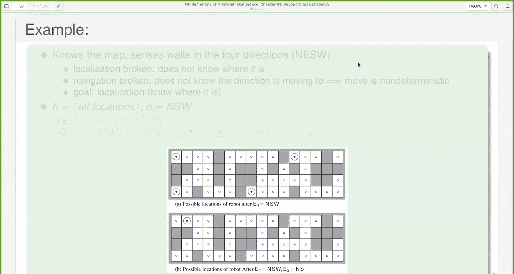

# 人工智能基础：4：部分可观测与不可观测搜索

在本节课中，我们将继续探讨广义搜索的变体，处理在**部分可观测**或**完全不可观测**环境下的搜索问题，包括确定性和非确定性情况。

## 概述

上一节我们讨论了非确定性动作，其解决方案是**条件规划**。本节中，我们来看看当放宽一个非常重要的假设——**可观测性**——时会发生什么。当智能体没有传感器，或只能获取环境的**部分信息**时，搜索问题将变得更加复杂。

## 部分可观测性

回忆一下，在部分可观测环境中，感知器无法感知世界的**完整状态**。实际上，我们永远无法感知完整状态，但通常我们需要感知足够的信息来指导行动。假设我们只能获取状态的**部分信息**，这本质上意味着我们可能处于许多**可能的状态**之中，从而引入了不确定性。

例如，如果你无法感知另一个房间是干净还是脏的，那么你就无法确切知道自己处于哪个具体状态。你可能是处于“另一个房间干净”的状态，也可能是处于“另一个房间脏”的状态。因此，你处于这两个可能状态中的**某一个**，但不知道具体是哪一个。

这引出了一个重要的概念：**信念状态**。

## 信念状态

信念状态代表了智能体基于先验知识、先前状态和动作序列等，对当前世界**可能物理状态**的信念。从数学上讲，一个信念状态对应一个**物理状态的集合**。

在实践中，我们通常不将信念状态表示为状态列表，而是表示为**部分状态**，即关于状态变量的**部分信息集合**。这意味着我们知道某些变量的值，而对其他变量存在不确定性，这对应了许多可能的候选状态。

*   **核心概念**：信念状态 `B` 是物理状态的一个集合 `{s1, s2, ..., sn}`，通常由部分已知的变量值所定义。

## 不可观测搜索（无感知搜索）

首先，我们区分两种情况：**完全无信息**的搜索（也称为**确证搜索**或**无感知搜索**），以及**有部分观测**的搜索。

### 确证搜索

假设智能体**没有传感器**。那么，我们将在**信念状态空间**中进行搜索。一旦我们使用信念状态（状态的集合）这个抽象概念，那么这个抽象的搜索空间对我们来说就是**完全可观测**且**确定性**的。我们知道自己在哪个信念状态中，并且知道执行一个动作后，会确定性地到达另一个信念状态。

当然，这种方法的代价是状态空间可能**指数级增长**。如果物理状态有 N 个，那么可能的信念状态（即所有状态子集）最多有 2^N 个。这类似于将非确定性有限自动机转换为确定性有限自动机时所付出的指数代价。

### 确证规划示例

考虑一个**无感知的吸尘器**，它不知道自己的位置，也不知道任何房间是否干净。初始信念状态包含所有 8 种可能的物理状态。

智能体可以执行一个动作序列（例如，右移 -> 吸尘 -> 左移 -> 吸尘）。即使开始时对状态一无所知，这个序列也能保证最终到达目标状态（例如，位置 A，且所有房间干净）。这样的规划称为**确证规划**——一个无论初始状态如何，都能保证达到目标的**通用规划**。

在确定性动作环境下，确证规划通常包含一个“启动”动作序列，其目的是将智能体带入一个**完全已知的状态**，之后便可以像在标准确定性环境中一样行动。

## 信念状态的形式化

我们使用下标 `P` 表示物理系统（如动作 `P`，结果 `P`，代价 `P`）。在信念状态系统中推理时，我们处理的是包含部分信息的状态空间。

*   **初始信念状态**：在确证规划中，通常是“无信息状态”，即包含所有可能物理状态的集合。
*   **可用动作**：在信念状态 `B` 中可用的动作，是 `B` 中每个物理状态可用动作的**并集**（假设对非法动作应用无效果）。
*   **转移模型**：将动作 `A` 应用于信念状态 `B` 的结果。
    *   **确定性物理动作**：结果信念状态是 `{ RESULT_P(s, A) 对于所有 s ∈ B }`。
    *   **非确定性物理动作**：结果信念状态是 `∪_{s ∈ B} RESULT_P(s, A)`，即所有可能结果状态的并集。
*   **目标测试**：对于信念状态 `B`，仅当 `B` 中的**每一个**物理状态都是目标状态时，`B` 才被视为目标状态。这是一个**悲观**但确保可靠性的定义。
*   **路径代价**：通常假设动作代价在不同状态下相同，因此信念状态搜索中的代价可以简化。

确证搜索本质上是悲观的，因为它要求规划必须适用于所有可能的初始情况，这可能导致执行许多不必要的动作以确保万无一失。

## 利用部分可观测性

现在，我们来看看有**部分感知**的情况。智能体的传感器可以获取部分信息，例如某些变量的值，但不是全部。

部分感知的一个副作用是，**许多不同的物理状态可能产生相同的感知信息**。感知函数 `Percept(s)` 返回的是一组可能的感知结果（在确定性感知下是一个特定感知）。

### 预测-观测-更新循环

在部分可观测环境下执行动作可以分解为三个步骤：

1.  **预测**：与无感知情况相同。计算执行动作 `A` 后“盲目”的信念状态 `b+ = PREDICT(b, A)`。这包含了所有可能的结果状态，信息量可能很大。
2.  **观测预测**：计算在预测的信念状态 `b+` 中，所有**可能出现的感知**的集合。即 `{ Percept(s) 对于所有 s ∈ b+ }`。由于许多状态可能共享相同的感知，这个集合通常比 `b+` 小。
3.  **更新**：对于每一个可能的感知 `o`，通过将 `b+` **过滤**为与感知 `o` 兼容的状态，来计算更新后的信念状态 `b_o`。即 `b_o = { s ∈ b+ | Percept(s) = o }`。

最终，执行动作 `A` 的结果不是一个单一的信念状态，而是一组可能的信念状态 `{ b_o }`，每个对应一种可能的后续感知。在实际执行时，智能体将观察到实际的感知 `o`，并据此确定自己处于哪个更精确的信念状态 `b_o` 中。

*   **核心概念**：`b_o = UPDATE(PREDICT(b, A), o)`。这通常通过逻辑合取操作来实现（例如，布尔公式的合取）。

### 示例与条件规划

通过利用部分观测，我们可以得到比单纯确证搜索更精确、更高效的信念状态。这使得解决方案表现为**条件规划**：即包含“如果感知到 X，则执行动作序列 Y；否则执行 Z”这样的分支结构。

每个分支下的子规划都是基于一个更小、信息更丰富的信念状态定制的，因此通常比通用的确证规划更优。

## 智能体执行与信念维护

在实际中，智能体首先通过信念状态搜索算法（通常使用布尔公式等逻辑形式表示信念状态）来构建一个**条件规划**。

执行时，智能体需要维护其当前的信念状态 `b`。每执行一个动作 `A` 并接收到实际感知 `o` 后，智能体就通过 **`b = UPDATE(PREDICT(b, A), o)`** 来更新其信念状态。这个过程也称为**状态估计**或**滤波**。

由于信念状态的逻辑推理可能计算量很大，在实际的实时系统中，有时会使用近似的、计算更高效的信念状态表示和更新方法。

## 总结

本节课中，我们一起学习了在**部分可观测**和**不可观测**环境下的搜索问题。

*   我们引入了**信念状态**的概念，将其定义为智能体认为可能处于的物理状态的集合。
*   在**无感知（确证）搜索**中，我们在信念状态空间中进行确定性搜索，但可能面临状态空间指数级膨胀的问题，其解决方案是适用于所有可能情况的通用规划。
*   在**部分可观测搜索**中，我们可以利用感知信息来细化信念状态。通过**预测-观测-更新**循环，智能体能获得更精确的信念状态，从而制定出更高效的**条件规划**。
*   最终，智能体通过在线维护和更新信念状态，并执行预先计算好的条件规划，来在不确定的环境中实现目标。

理解如何表示和更新信念状态，是构建能在复杂、不确定现实世界中运作的智能系统的关键一步。