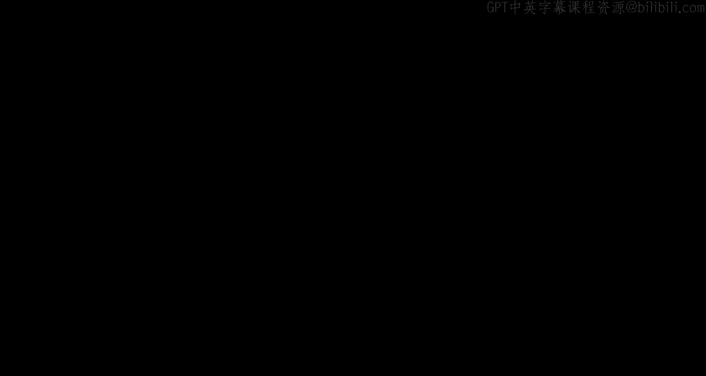
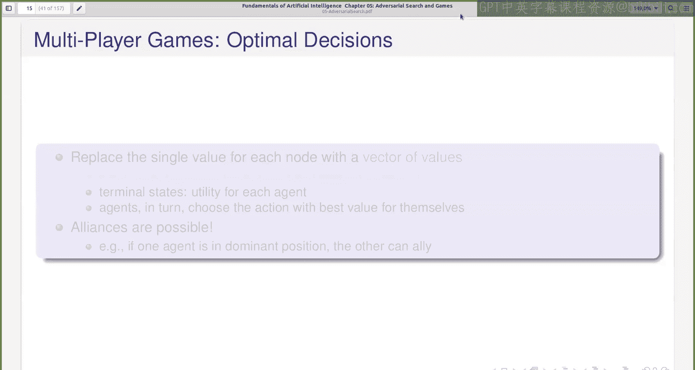

# 意大利特伦托大学《人工智能基础｜Fundamentals of Artificial Intelligence 2024》中英字幕deepseek p14 2024.10.11-CL12-1-CH04-OnlineSearch.zh_en -BV1uUkwYTEmf_p14-

Okay。So today we starting off again。So。Today we start a new topic。Which is aversarial search。

Which is a topic which goes beyond the eye。 So is you find a。A lott of material here。

 which it patches many other disciplines like economy， for instance。Anything， even warfare。Or games。

everything we has to deal with the confrontation of adversaries。诶。そう。What are we speaking about？

Mooty agent。 So again， we are going ahead in the direction of releasing the assumption of the basic chapter 3。

 Okay of the basic search。 And one of the assumptions was we are dealing with。

Single agents now what happens if we are dealing with multi agents and in particularly when the hardest part of that where the other agents are somewhere adversaries。

Remember。Adversory means that。They other the agent。Has its own goals。

 which are some way going into the opposite or in a theversararian direction with respect to our own goals。

 which there are goals which oppose our own goals。Again。

 remember some way the difference between the environment and having an adversity。

An environment is something which we soon behaves randomly。Okay， so it's not against us。

 it's not our friend， but it's not also our enemy， we are just considerable the possible scenarios。

 okay。嗯。And aor he is。Someone or somebody or something which oppo， which whose goals oppose。Ours。

 and this is the typical cases of games。Okay， we are going to the opposite direction， I want to win。

 he wants to win， okay。Or maybe more。W。We are not considered here cooperation Well we'll touch the issue of cooperation。

 okay but we are thinking of aversience， so we there are other people。

 other agents which behave in contrast to oppose our own goals。Why is this interesting， Well。

 this is very， very important in many， many scenarios and apart from the fact is' nice okay。

Typical games are well， good news is that these are typically easy to represent so they are。

The number of actions are typically restricted at least finite typically。

 and you have the precise rules。And even with a simple example， a simple problems。

 you may have dramatically high computationally hard problems。😊，Okay， so chess， for instance。

As an estimated average branching factor where apart from the beginning。

 from average measure around average of 35 possible moves。

 and there's an average number of nodes which is huge in the order of pain to the for or even。

Even more。啊。Well， you can see this as a metaphor power， but I would better say as a model。

Moel for important application domains。Competitive market， life science， sport， politics， warfare。

So every time you have to predict and to deal with some adversary。Okay， in commercial competition。

Whatever。 So it's not a it's not a you， which are。Fighting engaged in the environment， you to say。

But you are fighting in the figurative sense against other agent which whose goals are goals in the opposite direction of yours。

Okay。对。So， in jail。To distinguish search， standard search when you don't have any averary， so。

A solution is a heuristic method to get to a goal with。With the minimum cost。

 if you have an notion of cost。Okay。Eistic techniques can help you a lot。

 you can go value to go into the opt solutions。And you have some evaluation function which estimates the cost from a goal from the current state。

It cost from the start to goal， given the I know the remember a star。

 right to the sum of the path close to where。To reach and know the plus。Plus。

imate the euristic estimation from estimated cost from that in order to goal。Okay。

Well we have seen several models like planning， shadowing water。Games， instead， games， I mean。

 games with the， I saw certainary games are not included， okay？Also known as Versiah search。

 this lus strategy。He specifies not only a move in general， but every move。

 a move for every possible you are considered every possible reverse move。 So I。

 I'm playing the chess with him。 So suppose not only I have to think。To what is the my best move。

 but might I have also tried to predict what his reaction could be and what is reaction to my movie that I have moved as a reaction to his reaction also on as so on as ago of telecast。

Okay。啊。So， this is。This is also involves some utilities so it can evaluate the goodness of a game position。

Well， if you are familiar for this， we chase。Of course。

 there are configuration which are much better than others for you okay。

 so the one you have lost of five pieces and including the queen is much worse than the one in which you haven't and and so on。

So， there are many， many。exampleample from something very， very similar， very， very easy。

 which is a Tita to， which you will use as a very， very basic。And the sorry game， like a chs。

 which are more sophisticated。Checkers checkers is Dharma Italian。 Okay， Oello， if you don't know。

 you know Oello。It's also called as Ravai。You have discs。

 white and black disks every time you have you start from a four on the board。

 you have the same the chess board。Start from a four in the board and every time you add a new one so you are the white your vessel is the black or asseta okay and every time when you put your black white disc。

 then all black disc on the table on the board， which are included to your new white in the middle to some other white are reversed to white。

And so when he puts the blacker， blacker at the end of the game wins who has more。

 so I win if at the end of the game there are more white。This on the board and Viasa is very。

 very strategic。Game。The game on blah， blah。 So they are very computational。

Notice that these games are a level above， several levels above in complexity with respect to standard search。

Why， well， typically。Search， if for they。If the solution is polynomial with respect to the side of the original problem。

 typically search problems are NP。hofully join下。Okay。

 be complete if you have a polynomial weakness or the outcome。

I don't know how much familiar you are with the complexity theory， okay？Gams are much worse。

Because they included maletas。It's not simply that you find the best list of choices to get a solution。

 but you have to。Find the best choice， which leads the for all possible answers。

 replies to your your opponent so that for every， he does for every possible second level choices。

 So the and so on and so forth。 So he's on the in the。

If the group of this are called autominating for all exist problems。Okay。Which is what' is called。啊啊。

Quantified。Have you， has anybody of you ever heard about quantified Boolean formula， QBF。 Okay。

 this per。Of choices so you have to find the solutions of a problem like Fx exist Y for all W exist T and blah。

 blah blah blah， blah， Okay， this will tell and then a formula on all those variables this is computation much。

 much harder then standard Booleion solving So he passes it from N complete。To be space complete。

Which is much， much， much harder computational。Button theory also in practice。Okay。This is very。

 very， very， very complicated so very often you have， but you have to。

Re in terms of approximationism including heuristics。Okay。

 there are many many different forms of games。And this depends on many features that you may won't consider。

Well， the first obvious distinction is between deterministic and as stochastic。But I needs to again。

This with the rules， of course， from your perspective。

The outcome is not determinedmin because it will depend on your adsary move。

Given the fact that you depend on the mass move all the direction of my moves and the result of his or her moves are deter。

Okay， stochastic instead， they have a stochastic component。😊。

If you are playing a badgamon or monopoly or a Catan or whatever other game is your favorite game。

 you have a component of your choices combined with dice rolling。

Or calling the flipping or whatever else。In games typically die well， okay or。

If you' are playing poker， you also know what you get out of the neck。For the cops， okay。Okay。

 so you may have or not have a stochastic component， purely random。Componentト。Well。

 how many places where at one we are not proceeding here so it's interesting。

What's down to the insert， what if you have two games or more players？

There are some investors investorsors general game well。I will explain this later。

 what are the meaning of this one？And also this with the perfect information。

 can I always see the state？Or not。Also， okay， the distinction with this and versus stochastic so for instance。

 in a game， I not always see some。The state， so I don't see， for instance， the other player cards。

pocker。There is also some hidden information， not only that there's a random component in the fact I pick cards from the desk。

 but I don't know the cards of my opponent。And he or she doesn't know mine。So there are many。

 many features。So Ill let we start from considering this most common one， so deterministic。

 so the action of every player， the consequence of the action of every place is deterministic， okay。

Turn taking， so every game player plays a game alternative， so I play， then he plays。

 then I play and then he plays and so on。We consider two players。

 although we see how to general these to end players。

Z sum game again I will explain later what this means and the perfect information so I don't there is no hidden information。

Not there is a distinction between hidden information and some randomomic component so poker。

You have two kind of information that you don't see。The other player。Gos and what is on the deck。

But Pear or she has a。You don't。 Okay， so these consider hidden information instead of the other can be seen as a as a component of randomness。

 because you can out of the。If you knew all the other players， your cardss and all the other players。

 you couldn't know what。Cars are left。You can compute that。

 but of course you you don't know in which order So you can you don't know which are on the top of the deck。

 which has is a completely random component， okay。So you see that sometimes distinction between these and these distinction is not so。

The clear cut， okay。Okay， so what you want is to develop some strategies or。

So some policy that given a state。Allow you to decide the next action to take。Okay。Okay。

 so just to make this distinction so。So， you are。Perent information so recently checks to checkers go tell。

 So you know everything， okay。诶。You have a random complex of reason the game on Monpoly。

 Kaan or whatever you is your prefer prefer board games， Okay， imperfect information so you。

You don't know so battleship， Okay， Bava， okay， you know。

But I've never heard about a blind tto before， but this is this a version of the Pto where the players don't get what you。

You see which the other moves， so everybody makes this move， but you don't see it。

 I didn't know this game。And then obviously something that you combines both。Bridge pokes cablebble。

nuclear war， Okay， so everything remember that you are playing games。

 but these are typically very common。Very common。Issues also， for instance， in in in strategy。

 in warfare， in politics， in economical strategy， in strategic thinking， in in economics and so on。

Okay。We first consider the players case。And for simplicity， for convenience。

 we call them max and mean。And within 10 minutes， there maximum moves first， okay？

Max is the one who we call Max the one who moves first。Okay。😊，They make turns。

 so they they make turnss in playing。 So I play， then he plays and I play， then he plays and。

AtThe end of the game points out of reward to the win and the penalties are going to the loser of course。

😡，Okay。So a game can be generically be formalized as follows。So you have a fixed initial state。Okay。

Specify how the game is set up at the start。啊。Then。Well iss a turn。

 so something that decides that whose turn is it So a player of asset defines which player has to move the stage so you could this turn right。

 so say which is who is in turn to the playing。Actions， what are the legal actions that。

Can be taken at the given state。Well， imp say given the term。

 so the state automatically includes the notion of turn or deterministically derives in the turn okay。

 so its a part of this information。Reult again， is the transition model， as usual。 So what are the。

The action， the outcome escape from every possible move taken by the player in turn。

 okay if I move the queen from here to here， then the queen will be no more there and she will be there and if there is some piece in the target way then the piece is captured okay。

啊啊。The important is a terminal test， which is the very equivalent of goal test， okay？

Well not exactly equivalent because terminal text can be also unfavorable to you okay。

 so it can be the union of your goal and your adver goal okay。

 so you terminal test is some place where you say the game is over。

Other favorite to you to one player or favorite to other player。Okay， and then they use a utility。

The cost or payoff function。 So how， which is typically something very simple。Embasic。

 something which。And the the characteristic is that the the。

You think it should be monotonic with respect from a。嗯。From。Wner draw and loss。

Some games do not admit a job。Okay。So， but the only。

Specation is like the wind is greater than the utility is greater for wind。

With is better draw and draw is to be greater than for loss， okay？

That's quite obvious things that are in place。 Okay， so all for instance。

 you can add these voice down to some conventions， Not that they are not necessarily linear。

What they say， think it to a soccer， for instance。Soccer in a championship。

 you get to three points if you win one， if you draw and zero if you lose。

 which is not a linear so to say， right？ok。啊。Okay， as zero。Notice that the initial state。

 the set of action and the result check recursedively define the game train。

So all the possible combination of。诶。Starting。Starting from as the every state。

 choosing one of the legal moves and computed the new state coming from the application of action A to the state S。

 recursively defines the three， I would say a D， but you can consider this either as a D of all the possible possible states that you can have in a game。

Right， which can be typically huge。😡，Yes。So you can see that in notes states and arts election。

 again in our graphical representation， for instance， P toe has limited moves， pen to the 50s。

 not that big chess。And we believe a bigger not to mention Go who has。

The estimated number of moves in the United States in is a superior of the estimated number of atoms in the universe。

So it' something unbeli unbelievably。Okay， so just to see what game means so you can take a piece of the game。

 remember Ti you know detector right trace inya right。

 so you you start your add other across mark ans across min circle and then you have to some has to collect the one in a row So if。

M we suppose we are in the will tend to play to put in the perspective of max okay but of course the perspective mean is the one okay so the utility for max is that if mean gets through second row it gets minus1 if nothing happens you you got zero if you put three crosses in a row in a row。

You get the trust around， okay？Okay， so I don't think that I say anything particularly fancy yeah。

Okay。En general all games， so you have the independent utilities and。If you have more than one game。

 sometimes you are not necessarily enemies， or you make it maker alliances。

Sometimes or you can be indifferent。Or whatever hat。

One category and here I explain the meaning of a zero sum gain。

Is that the total payoff of all players is the same for each day in instance。So。

They anytime gain something。The others lose the sum of the the loss or the others is the the one the sums up to the my actual revenue。

 Okay， so the sum of the revenue losses of all。Competitors are constant。Yes， I win。 you lose。

So the sum is one。Okay， I when you withdraw， the sum is one and half。Is this soccer a zero sum？No。No。

 because if anybody wins his three。If you draw is is two。This sum is， okay。Well， you may find these。

Strange， but this is a。A very。In the games where we had draw。

Sometimes you are stimulated to look for drug and both could be interested in getting drug。Okay。

Which is okay， perfectly okay in the single perspective is not typically okay for the show。

 so if the game is also a show it's not good。Okay， so people looking at the game winning is much more spectacular than a draw。

Probably you worth。II don't remember which we are this introduced but you once a long time ago。

Soccer had the two points for wind， one for draw and zero for。For loss。Okay。😊。

I believe you are too young to remember that， do you？So you never。

 you never remember sorry I don't remember which year this was introduced， but okay。

 they introduced this just to stimulate people trying to win， okay。Because if。When you are a draw。

If you try， as if you attack you。You look if you're successful， you get a three。

 but then if you expose yourself and your enemy， your the vessel can't tax， then you lose zero。

 but if the loss， in this case in the loss is one and the gain is two so。

You are more stimulated to a attacker， to understand it seems attacking is more spectacular to the say。

So this stimulated the interest in the ti interest of a soccer okay？Okay， why is this so interesting。

 for instance in two games， when we are two players。And this is zero summa。

 We don't need keeping the track of two values。 You can keep the track of only one value。Okay。

 because the point is one。Maxxi is trying to minimize it。Mean to maximize this。😡。

Me needs time to minimize this。Okay， so just a mix it。So， the value of the。

the value for the other is given by the total sum of minus your own value。

 So you need keeping only one value。 so you can think this as in terms of a mean max。

So one player tries to maximize the other game tries to minimize。The school， okay？It是谁 are。

So this means that you can see optimum aversar search as Min Maxs。

Search Minac search is not frankly that AI people invented。 Okay。

 Minm search is something that is around from from a while and algorithm theory and deals with the denation of a minimum。

Our scenarios reach some。Actions leads you to decrease。

Decrease the value and summer actually tends to increase the value。Okay。

 so this is just some ge terms。No。There are general definitions。Now， the point is， what shall we do。

 So what are the main strategies that we can look for in case of the kinds of games。Okay， so。

The first is， as we say， let's try to see the case of two players and zero sumco。

Look for mini search。Okay， there is one。Strong assumption。Which。Is more subtle than it looks。

Which is。You assume that maximummin a very smart。So they are always able to get the best。

So youution from thepoint。Okay。So this does not mean that I assume I am a very smart and I always get to the best solution。

 but I also assume that my adversary is。And that he is willing to do that。Okay。

 so remember this assumption because this is important。Okay。

 let's put ourselves in the perspective of Max， the perspective of meaning is， of course do well。

Do that。So Maxs must find a contingent strategy， which specifies。Well， first of all。My move。

 Indonesia state。What。But my move in the state resulted from every possible outcome for。For day。

Theba。And then。Max moves in the state resulted from every possible response meaning in those of those moves and so on and so forth。

Updul and。Do you see any similarity？Or something that we have already encountered。

Similar is similar not the same， but similar to something that we have previously encountered。不。Not。

 that's not no， no， that's not， sorry。Conditional plan is a non deterministic search。Okay。

 so you order that termmin you serve to remember the outcome of an action from our is many possible outcomes。

So we see in the environment as a sort of advantage。

 so we have to consider the old possibility for all possible outcomes。

Which is some way there is a similarity with the games because we make a move and there's a consequent our move our and will play something so we can see this。

😊，The outcome of my move and his or her moves as a sort of undedemin behavior。

This is a fundamental difference between the two。The environment is not our adversary。😡。

In the nondeminity， we say， okay， we have to consider all possible outcomes。Okay。

 you know the our adory。We。Always do what he or she can。Do我。Thatth comes up。

He or she will always find the worst solution for us。Remember。

 we are assuming that she's very max smart and they always does。

And always do that the best choice for。He or her viewpoint。Okay。Instead。

 with non deterministic search。What we we assume that we have to consider all of them as if they were sort of random。

 right？So。The environment is neither our friend nor our enemy just act casually。Okay。

The adversarial is our enemy so to say that he always addressed the worst for us。

The worst suck for us。Okay。Clearcle， everybody。Okay， just the terminology。

 a single even move is is also could apply， okay or half move apply。

 So maybe you can consider a move as a block of two con move， my move and my address reply。ok。

Ever say there an analogy。Me mark with the end or。Okay。

So max playing the role of or so I can either do this move or this doing the move or this the move or this move。

 and I have to take into Ko all the possible。Answer， replies or my adversary。Okay。So if I。

 I play the queen and move the queen to this point of the board， then he might we can do this。

I have a choice of possible replies。 and I have。To make a。A good move。According。

 considering all replies。 Remember that all means the angle of all time。Okay。

So I have to take into consideration。He's or a number one or he's possible reply number two or he's possible and he's a reply number three and he's a player。

Number four and so forth。 Okay， so you see these Amanda。It's very similar to all and again。

The only difference is that。One is named， Okay， the sense that you。

 you can consider all of them as something can。Arbitrial core， instead in in adversary search。

 we should try to predict。The worst move that he can do。W she can do okay。So。

The optimal strategy is what is called a min Max is defined by a recursive。Definition。

Which is given by the recursive function。This is， so the minimum max。 So you return。The密码。

Min Maxax of S so this score。The value of the outcome is。The utility function。

 if S is a terminal test。你给你发出来一个。Okay。😊，Me Maxs， okay。If I'm playing， so again， I pretend to be Max。

 okay。If I'm playing。Then the min Max。Is。The maximum for all possible action play。

Of the minimum possible score。I will have I will obtain back。In this outcome state of the main。

Why mean impossible because of my advice So we we。Apply recursively。They do our strategy。

to the state， which is the outcome of my own move。Mean marks， you understand that。Okay。

 so the this is。Man Max， he will try to minimize， okay。So he will try to return the minimum possible。

Actual， okay。In fact， they。If they are S。Is mean。What is's going to do he or she will play by the minimum。

So the most favorable for him or her action。Such that he can predict。So that it will be which。

Which will cause the maximum outcome over Maya。没有。Actual answer to this place。 Okay， so he。

 above all the operation that he can do， he will select the one such that I will。

 my reaction will have the minimum cost。But of course of it， I should have the minimum cost。Okay。😊。

你 should do what。Do our reasoning， okay？Okay， let's see an example。Graphal example。Okay。

 conventionally， upper triangles are max nodes and downward triangles are min nodes。哦。

And the theium nodes show the utility value。For， for max， okay。Okay， so I'm here。

 I have to decide whether to play a one and the two and the three。So。

 and notice at the starting point， I know all it beliefs。

The recursive baseline is on the release I those values that you see here are the resultot of computing。

ok。At the beginning， I know goes up， so I know that the combination a1 and the reaction B1 will give an outcome of three and a1 with his reaction of B2 will give a 2 and so on。

Okay， so what if。I act as。Well， if I act as a one， I try to， I estimate to water。He or she。

 I pretend he is a man， a male。 Okay， what he is doing。 So if I act as， he will have a choice。叫你。

Here we choose between South， which you can call three。12 and 8。What is going to to choose。

And tell me？Well part of fact is is already written here， that is three of code， right。

 because he wants to minimize。Right。😊，So， if I I。I act a one， then。

By the asset will return something which worth the action B1， which with the cost three。

If instead I act a2， then my versor will have to choose between two， four and six。😊。

The obviously will pick too。Okay， so my。Actua。Action of level 2 will be 2。Then if I I choose a3。

 my advisorory will have to be to choose between 14，5 and 2。And of course， he will make two。Okay。

So at the end of the game。What am I going to choose？And choose number one， number a one。Okay。

Notice that for instance in general， this is not the one which so if this where and the environment is dead and these were random choices。

 this maybe will not well I didn't make the computation but。

This problem will not be the best choice because this is 23 overall， this is。Now。

 this would be again the best one， well not just a first chance， because on average。

 it will be 23 over three。And this will be 21 over three， so this is seven， this is more than7。

 so this will be the optional choice but this is just a chance okay， if we here we are the 100 okay。

 the best choice would be this one。Okay。😊，In an environment， But in adversary。

 I explore the fact that my adsary will， will do the。His own best interest。Okay。So don't， oh。

 I wish I would have a 14。Okay。But。Oh， sorry。But I， of course， I will not。Never obtained his14。

Because my advice is not so stupid to choose a4 team。Are you familiar。

 is anybody you familiar with Qtan？Co colononan Italian game。Only one。😮，Two， three four。

 but a few people。It's familiar， right？Well， this is okay， this is a nice game I like。😊。

At the beginning。 So it is a two step game。 At the beginning， you place your， your， you have two。

Villaages to place in a board。And the choice。Of any you order choose the place where placing the board and the key point is this kind of adversary search in the sense that the placing of the board。

It should be placed also keeping in consideration what the others will react。Okay。

 so not just the look oh put the so the earlier you make the first choice。

 the latter you make the second or second choice， okay and so you when in doing your choices。

 you should also consider that there are some choices that will never be left to you as a second choice。

Okay， because you try to balance， okay， so you want to。

 the idea choice is something which you balance。You诶。The as to some resources， Okay。

 you have two choices and then at the end of the game at the end of the book or the。

this first part of the game， should have。A position which allows you to access to all the fiber resources that you read。

 Okay， but the key point of that is that you cannot do a wish thinking。In the sense that I want。

 if I put one， which allows me to leave access to。Wood clam and wheat， okay。

And because I see there there are places where I could have access to stone and ships in the second move。

 but you have to consider。Whether you adversely will not。😡，Necessarily， let you， let your size。

Those those players。So you should try to balance to predict your first mover。

 also try to figure out what's most likely will be the most or your best。

 I should like to let you have assess， not the optimal set。

 but at least at decent intercepts to resources in the basic resources in your second move。Okay。

 I'm sorry for everybody who doesn't know the game， but it is a very nice game I will。

And there's a lot of something to do with this。ok。Okay。Okay， so you understand this。

 notice that this is a two layers， so this is an easy one。

 but you have to understand that this is played recursively， so the many， many， many layers。Okay。

 so this ws down reccurively。On that。Okay， and noted that this is based on this fundamental assumption。

But you assume that today。He'll make the best choice for you， the best choice for him。For him， right？

So overall， in this example， the best movies a one。Okay， so here is wow。Here is a very。

 very basic algorithm， or recursive algorithm。 This is nothing else that。

A basic pseudo code implemented the previous one in the obvious way。

 but I will use this because I will use this baseline for。For alphaphabetta search。

 which is an optimized version of this that we are seeing on Monday， okay。

 so mini Maxx decision states。So it returns you mean max and it returns alga max over all possible action that I can play over mean of the ricoical of a results of sleeping noted that this is play bottom up。

All this search here is played bottom up from the leaves to the root okay。

I believe you have enough experiences in。Recursive function to recognize a bottom up。Search。

Against the top down search。You notice that in order to do your step here， first you have to know。

Yeah， first， the computers are curive calls。And then out of the values return by their classicals。

 you have to compute the values。Okay。So this is a bottom up and that's actually what I see this is a global picture mathematical Mount is that everything here is computer bottom up。

Right。I assume you， well I'm pretty sure that computer sciences can recognize immediately a bottom up strategy in an inercursive function or with the Taa。

 but I'm not sure that all the others can。Okay， do you see。

 So if you look at the execution of this function， your first have to computer meaning value。

The acosive function。And then out of the value return of Americacur， you have to compute the values。

 Okay， so this is what is called the bottom up of static So it means that you start from release and propagate values upwards。

Is it clear to everybody？Sorry if this was obvious。

 but I just wanted to be sure this was obvious to everybody， even to non computer scientists。Okay。

诶 ok  this。Okay， mean value is a。Okay， let's start from max value， Max value just if the terminal。

 so if the state is deter， then it returns the utility otherwise well。You know。

 when you are computing a maximum value。One way to do that is you start a you're using accumulator or an accumulator value。

 you put it to the lower possible bound to something which is smaller than every possible value and then probably possible value you take the max the best。

Between the current value and the new value。Okay。😊，Right and the end that you're going to be。

Dualally， you do with the meme with the differences， you start from a value which is。

Bigger than all possible values。And then you loop and you update the values every time if you improve your current minimum。

 then if your recursors improve the current minimum take this one， otherwise you that one okay。

If thiss clear， I would say X right。 So this is very， very basic。As I say， this is very basic。

 but we will use this baseline for a more sophisticated algorithmic on that day。ok。What happens。呃。嗯。

Okay， I think that I take more than the time than I have， so we can stop here for today。Okay。

 and on Monday we we'll go ahead remember Monday and Wednesday class with me Friday with Pao。

 Labu with Pao。ok ， so需要问你。But in the。

