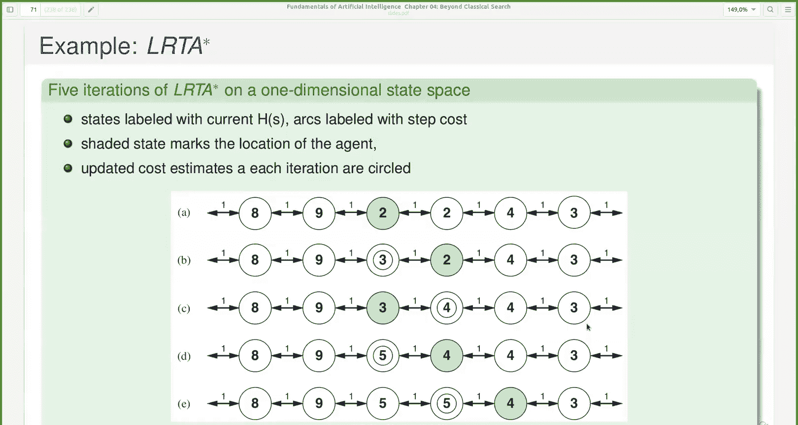

# 意大利特伦托大学《人工智能基础｜Fundamentals of Artificial Intelligence 2024》中英字幕deepseek p15 2024.10.11-CL12-2-CH05-AdversarialSearch.zh_en -BV1uUkwYTEmf_p15-

Okay， so today we conclude the our excs on。Sorry。呃。

On beyond the classical search and what we are going to explore to say is something about exploration or what is called。

Online search。Again， if you remember the。The fur of all this chapter。

Is release assumptions that we had in a previous chapter in classical search。

 And there is one which is left。Which is condition 3， so。

What happens when we have always shown so far that we have a known in？So we know yeah。

 we know the geography or we know the rules， we know the consequence of。Of an action， okay？

What what do we， if we haven't。And this is actually the topic of the last section of this chapter。

So in general， we have to make a distinction between the online and offline search So far that we have always seen spoken about offline search。

 What does it mean。You compute， you do search in your mind or in your CPU okay search is something that you do in virtually in your computationally speaking。

 okay and then you execute what you have the plan that you are the plan or the sequence of actions the sequence of activities that you have which is the outcome of the search。

So first， you compute a complete research， and then you execute。

So executing is not part of the search。😊，Okay， he it。Search is so far was something that you do。

Purely virtually。Okay。Okay， online search is something different。

We internal leave computation and action。You take an action who serve the outcome。

And observe the environments of the delta meaning， the environment result。

 and then you compute the next action， and then you repeat。So why is this the case？Well。

 this happened when you are in unknown domain， or domain which is evolving。

 so it becomes unknown or may become unknown。While you are executing。So the key point is that。

You cannot know。The results of your action notice that it is different from non deterterminism in non deterterminism。

 you know the possible outcome。 So the only difference is that it can be one more than one。Okay。

 but you know them？Okay， in this case， you don't know。笨。Okay。😊，So。So this is also called exploration。

 so it's like you are exploring a place。Okay， and you are trying to figure out。诶。And then the。

What to do， but。But also， every。The search deputy are。Done by your actual actions。

 So is only acting you can you can know what would the outcome of an action。啊。So for instance。

 a robot placed in a new building， right， its explore something。几。😊。

So you must explore in order to build a mental map in its CPU to know how to get from。Maybe。

 but one more clear example is a newborn maybe。Okay。

 a toddler a and learns the outcome of his or her actions。😊，Okay， so you， you very see notice this。

 right， So you be。Hes initially very uncoordinated and then he gets progressive coordination as long that he realizes the actual outcomes of his or her actions。

Sometimes this to also。呃。Use those in knowndeminacy domains。

So sometimes when you are nondeministic domains where you have plenty too many possible outcomes。

 you explored in order to make these deterministic。

Instead of trying to figure out a priorial possible accommodation， just do it and see what happens。は。

So， the key point。Of this online search is that it must be solved by executing action。

 not simply by simulating or not pretending you are doing action as we did with the offline search so far。

Okay， this is clear the scenario。Okay， so。So what。Again。

 we still have some working hypothesis in this scenario so。Suppose we have a deterministic。

A fully observable environment meaning。 So yeah， it's true that we are doing。Exploration。

 but once we get to a state， we， we can sense the full the full knowledge of that state。

 So we know the state where we are。Okay， so we know everything again。

We know everything of interest in of the state we are。Okay。胃诊处。In every state。

 it knows the kind of action that we can do。Okay， so again， we can assume that we have。

Function actions of S， whereas S is a state， which returns to the list of a possible action that you can do。

We know the cost when we know the cost of an action。Okay， so Su， when we are in Ne prime。

 we know how all this cost to be there， okay。So we know the cost of every action that you can perform and we have a goal test。

 so we know where we are we have reached the gold。What we don't have。Is。The functional result。

 remember one of the life material of common elements so far is that we are the functional result of SOA。

 which tells you the state in case of deterministic or the set of states in case of non deterministic。

As an outcome from applying a given action in given estate。We don't have it this time。

 so what shall we do when？So the only way we can。Qu acquire it is to actually do。

S and check and see the state where we are afterwards。Okay， what also？

The agent also has an admissible， remember， admissible means optimistic。Okay。

 a mix heuristic function that estimates the distance from the current state or the Gulf states。 So。

 for instance， you are you may be in maze， you can。You don't have a map。

 but you have a GPS which tells you the distance from where you are。Well。

Sometimes you want to see a scenario when you are walking in the woods。Okay。

 so you see for the shape of the mines and the mountains that you should go there more or less。

 but you don't know the path。Okay， download't know the trail。Yeah， I should go there。

Because I see the ship of the mountain， I know I part the car there or I see the hat is there。

 but where the hell with the trigo。Okay。So the objective is in general to reach the goal with meaning。

😡，Sorry， I should say minimum here。 you know the difference between minimum and minimum。You know？

Okay。Sometimes a minimum is useless as non no minimum。

 but that was slightly different distinction minimum means shortest is automatic notion， Okay。

 so given a way of measuring。Means the minimum one， Okay， the shortest one。 Okay。

 minimal your first duplicate was set。And then a fast。Do a。A minimal subset which verifies blah。

 blah， blah is is a subset such that if you drop。One。

 it does not if you drop one element you this doesn't verify this anymore。

 so typically minimum means minimal， but minimal does not necessarily mean Okay， in this case。

 they are used a synonym because you have no set。Cite an notion， okay。

 but sometimes when you in particular， when we will see bull reasoning。

 the distinction of minimal truth assignment， for instance。

 with respect to minimum truth assignment will be important。Okay。

 so where they reach the goal with minimum minimum cost， okay， in this case are synonyms。

 where cost is the total cost of travel path。Okay。Sometimes is important to use as a measure of the quality of online search。

 what is called competitive ratio。So special is duration。Of the cost。

Of online search with respect to the cost of the solution path is the search space is known。

 So the ratio of sort to say。Online search with respect to the cost of offline search。

 if only wenew there。The environment。Okay， and in fact。

 most of the algorithm are based on the fact of。Progressively building。

Sort of a map or a relation or result relation。In such a way that you can eventually if you eventually progressively apply offline search。

Okay， so far。Okay， let's see an example， Okay we。We see this very， very simple maze problem。

We have an agent here， which is in location 11。It must reach the goal G， which is in position33。

 for instance，Here's some moves which are up down left right。

But he doesn't know the fact of a result。lahh， He doesn't know that today agent that going up from11。

 at least for Eastern212。 So he doesn't know the outcome of his action until he gets there， okay。So。

 also， so。It does not also not only。😡，He doesn't know the outcome of a reaction。

 but he doesn't also know the reverse of the action that's made。So for reason。

 if he has moved from 11 to1，2， he doesn't know that。By going up， he doesn't know that going down。

 it gets back to one while。Okay。😊，This is the kind of information you don't have。

 so it's just you don't have。The result function of a given state and a given action。Okay。So。😡，P。

 he may know or he may not。有ど they。Location of the goal， but it doesn't know how to reach it。Okay。

For instance， you may be able to use some US， for instance， Manhattantan distance。Euristic， okay。

 which is， of course， optimistic because not necessary。

 So Martin Eastern heuristics says that is too distant2 from three， but he actually is。

Or distance because you have to take a different path， right？Okay， so far。No。Okay， the first。Sly。

 we have an intrinsic problem in online search。So we must face the dance。😡，So。So in principle。

 if you don't have reversible actions， so if you have some irreversible actions。

No matter what to you。You risk getting stuck into a demand。 So suppose you have a one way path。Okay。

 and this says the di。So then you angle that and you have no way of getting down。Okay。So。Oh。

A fundamental factor is that no argument is able to priority avoid the den if you have irreerssible actions。

So well， these a。An adversory argument。IThey to say that。For你阿咁。You can assume that。

Given your algorithm， there is the environment that it builds that exist some scenario which is getting to the danger。

So sometimes in the。那 last个。Fsibility or complexity。

 you think you think to an environment as an aversary， Okay。

 so if you are doing when you are doing worst case analysis。

 if you have if you have the scenario the environment would be so so nasty will find you a counterex。

 So for instance， So if you are in this scenario here and you want to reach a goal。

And if your argument goes up， you can beat the scenario number， you can beat the scenario number one。

 otherwise。诶一诶。Otherwise， be spot， okay， substantially。For every possible algorithm。

 you can build the scenario which ends you good at the end， that's quite intuitive。Tucked， okay。

 which means that in general。We should。Make it an extra assumption。

amp the city space is safely Exporable。So that that。

The same goes state is reachable for every reachable state。Okay， so。For instance。

 you have a addressible action， so you can always reach it， okay， so you don't sut。

 don't get into the tank。That's the point。Okay， so this is why we need this extra assumption。Okay。

Now see， what shall we do？😡，Well。More or less behave like a toddler or try to explore and see what happens and memorize what you have done。

S actuallyally， the agent。Explore so。Trice smooth。 And as long as he gets outcome。

Creates a maintain in a map of the environment。 What does it mean， Sutansha， you may create。

And maths。A data structure， whatever it is， which progressively， which mimics the result function。

 So you progressively beat the M like a result S of a。

Which in which you store the result of applying actual A from state S。Okay。

 and you update it as long as you go ahead。Okay。啊。Remember that the key point is that we have every time we move we have a fullservtro can perceive the state where we are。

哦。😮，And so this may be used to decide the next section， if a maps tells us something great。

 otherwise you should make an attempt。I wish you to stress a very important fact。

Which makes a huge difference with respect to all ofline search。Which is the following。

When doing search the online search， you can only expand the node that you're actually in。Right。

So think about all the strategy of a flying search we have thought。Okay。

 we don't have real notion of current。State。Or at least we have。

 we have it only in the first substantially， right， in all the other strategies of recent。Breakfast。

 US Easter R whatever。So， we。We expand the node and then we jump to a completely other node。

 which is not necessarily a successor of the current node。Okay， so remember。

 in particular take to breakfast search， we， we span in old。 we added the。

We are the states to the frontier and we get to the first line， the frontier。

 which can be very far away。We cannot do that， in known search。Okay， so we are here。Physically here。

 we are there before we cannot go back to there just to explore， al right。So， we， we should。

Every time we should， our move should start from the from starting from our current state。Okay。She。

So what this is either， we have to expand the notess in what's called local order。 So。

 so every time were exploring a successor or a predecessor of our current state。So the obvious。

 if you don't if we want to do a systematic search， the search is natural candidate。Of that， right。🤧。

Another。The point is that we need to backtrack physically。

 So backracking is not just popping some element from a data structure。Okay。

 we have to physically to go back。Right。诶。So we have to go back to the state from which the agent and most Ri entered the current state。

H he gets a problem。Because we should know which is such state。Remember that we are exping a graph。

 not the tree， so we can enter the same state from different。Locationations from the path。

So we must keep some data touch table， whatever。With the predecessor state of every or every state。

So substantially， we need an extra data structure， table， whatever， Okay， which we call unboxtract。

Given state。So which。Which considers the predecessor states of every state in which you have not yet meted。

Remember that after a while， you may have taken very strange path。Okay， so you can。

You may have different ways， different places right to by track。TwoBut track two， okay。

 so you need this information。And then only after that， you backrack physically。😊。

Which means byracking physical means to find a nation， which leaves you to such a state。ok。So。

 this is not。We less automatic。😡，Then image in the search， Okay， because in search， well we。

Everything， we have a data structure just from which just a push and pop。Elements， okay。

A Q and the Q N and Q。Okay， here is more complicated because we need a physical action to do that。

And also needs to。Remember that you don't have。A story。We don't have a fruit。

 We don't have a frontier。In the in a life search。Okay。So， here。

The schema from a the search agent just since。To me is not so neat， this is taken from your book。

 of course， since this is not so neatly explained your book， I've added some comments。May sad， you。

First of all。For those who have version number three of the book。Third edition。

 there is a slightly different in the two version， which is this line here。 Okay， so this is。

From the fourth edition and this nest， right， Okay， so if you have a third edition of the book。

 keep in mind that you have to other this。Tining structure here， but I'm get to that。Okay， so。

What is the point？呃。This is a schema by which you are。

This is a genetic representation of the problem。 Okay， so which is the current notion of the problem。

 And then you have just。Moved to the state aspirrine。Okay， just as a convention。

 you may find very frequently。The following notation， not only this book。

 but also in another context。The prime denotation。 So S S prime where S S prime is a success state of S。

Okay， we'll find it to and use it quite frequently， in particular， also in other courses。Okay。

 so you have just landed status prime and your science tells you。All the information as prime。

 So you know as prime。It may be the case that is an initial state， a prime is initial state。

 it may be the case that a prime is a new state or not you have already explored it。

 it may be the case that，A prime is the act of induction。

 but also is it may be the case that this prime is the result of my track。So many possible scenarios。

Okay。😊，And。You have the following information permanently。😊，So S and A are the previous state if。

And the actual A， which landeder allow you to land to aspir， if any。Okay。

 so there are new this interest state。And。And as。And this is considered to be nu if the state was result magF。

Okay， there is the result is a data structure， which is initially aimed。

 is initially aimed and you progressively back a。Increment。

 so un reachach with the new information as long as you explore the place。

And to un tried again is a table。😡，Mapping guest to a list of untried action， so。If you remember。

Remember the difference between I mentioned before death search and a backtracking search。In Bafur。

 US expand the end states。Of the successor。In a big tracking search。

 which is light variation under the search， you don't expand all your successor every time。

 but you keep track。To some extent， in some way。With some criteria already missing list pointers or whatever of the。

The successful that you have not yet explored。Okay， this is just a way to make this a specific。

Notice that maybe you don't even need in C scenario， you don't even need a list of un trieded。

 but just a pointer。😡，So if they are ordered， for instance， and you are a procus I in order。

 so you just take the index of the next one in line。For instance， okay。

So you need a so this is a generic case where you have a least data structure or try。

 but you can simply sometimes have just a criterion by which is you do that， okay。

And then unmb track is actually what we have mentioned before。

 so is a table mapping as to a list of states in which you have never back practiceed to explicit。

So how does it work Okay， so if you land well first the obvious of things so if you land it into a goal states。

 remember you know you can recognize the goal states so you have a criterion by which you can conclude that the state is goal great fantastic and there。

Okay， I can stop。Excellent。Oh。Okay， so now we have some scenarios。So E S prime is a new state。Okay。

 untried is something which for every state。For every state。

 you have a least associated list of possible action。Initially， this is null。Okay。

 so is's an array of a nu， so for every state， you have a nu list。Okay。

 so this means that and every time you get into a new state， you create this data structure。

So what you do， so if S is a new state， S prime is a new state。

So not in Enri means there is not yet a list of enrde associated to us。Okay， then。

You associate to the entry on as prime to the actions associated to the state as prime。Okay。

I'm saying that because the first time I read this arguments。

It took me a while to understand what will this mean man， How happy S ist untried。

 Where S is something that untried is is a table and map S to least on tried action。

 So this a list of un tried action。 So God doesn't mean。 So this is a little misleading。

 as you explained here， This means。Susstantiially contri is a data structure， which is initially。

Which are associated with a state a list of action。 But initially， every entry is none， okay。

Why because simply don't know the state， you know how to compute the states affirm action， okay。

 but you don't know what the actual states are at the beginning， okay。Is this real。Okay， now。

Let's go。 Okay， now let's see if S is not known。 What does it mean， So remember。

 S is the predecessor。 So the the state where you were coming from。What if E is not normal。

This means that。Neither this is initial。 So， so how happens the S is known S is known if。

If a prime is initial， so you don't have any predecessor or if it is a resultbacter。Okay。So。

If S is not in and is not a result of the tracking。 So you have just。

You are in apir because you made an action， a not called action from S。To a prime， okay？Then， okay。

Then。St that。因。You say that so you， you add the name2 result price。 So Prime say， okay， look。

 the result of every actual A。 remember that A is something that you have your。So， let's say。

 is a primer。And also。You are the S。To the front of unboxrack sp。Okay。Why the front。

Because it is a def as such。Luck in first out。Okay。Is the sphere？

So you added to the one So just Ive just moved from S to the prime。😡，好 ok。What does it mean first。

 I saw that the result of acting applying A to S gets to you to a prime。But I add also。

S to the list on the candidate place where to Barack， and this is the first in the list。To me， okay。

 why because by definition I'm doing it back depth for search， so is last in the first out strategy。

We there。Okay。不。Okay， if unmtri is empty。😡，What doest mean。If untried is empty， so you are a prime。

So， you have a。Already tried all actions。In from X prime， okay。Okay， sorry。

I had this at the very last moment， so I didn't have any place to put this comment。

 so I I this bit of sorry for that。So pretend this comment is easier as well。 Okay。

 I simply didn't have the room to do that。 Okay， so then you backtrack。 So you have。

 you have reached a place where you need to backrack。Here the the。あ。If batteryral sp is empty。

 so you have no more place to buy f。😡，So you stop。Okay， so it means your search is。

There's no choices。 You have already tried， not only all there success。 So you have。

 you have a tried to。All the next step from prime。 So all action frompir have been already tried。

 And also all the。All the effort to betract from a prime。 as me try， then zless。Stop it。😡，Okay。

Otherwise， okay， so。If you have a place the track。博不。Pop and but so。Takeick the。

Most recent placed the track。Okay。This will return a US state and find an action B。We should。

Itows you to reach。This place， this state。Promised Briang。Okay， by hypothesis。

 where our Iranian hypothesis， there is one。So make an action， which allows you to。

To get back to to back that。Please， okay。And then。And this is added to them。

This embargo fixed in the current version of your book。

 state as primary null because remember we consider null。A place where you have the factor， too。ok。

Otherwise。If you are not about tracking。So if your next state is your the current state。

 you do have a next action， okay， take the first action for untri。Okay， in other case。

Now you have an A which tells you either the action where to but right or the action where to go ahead。

Which is very similar to the assert， you remember， right？I think you。

If you have no success or your pop and you take bitre and otherwise you go ahead in either case。

 now your current state S prime becomes your all S。Okay。

 not that case that in the case wireless S prime is no。And then you return the action。

If you're at thumb the action。The agent will perform detection。Then we'll observe。The next state。

Okay。So S was the last date when they came A is the action that he has performed。

 will observe a new state as prime， update as prime and then。We go。This will start。Oh there。Okay。

 let's see an example。Okay。The problem in follow this example is that you should。

I have this in front in order， so try to go by memory。To this。 Okay。

 so it's better than you have print out of this or have。 So take the book on your left。

 And I see this line on the right or whatever because otherwise it's not so easy to follow， okay。So。

Okay， so you know， let's start， suppose you are here。Okay。Initially。

 all the functions that you have seen are empty。And also， you don't have a。

You don't have the last S and then you don't have the last action。Okay， so this initialcious thing。

So what you do beginning is a go state no， okay？Is a new state， yes。Okay， so take the actions of 11。

And。Which is right and upper。 Okay， so because from here。

YouYou can elaborate that the possible action are you can go up and go right and then。

And then you are to un try the onemar。So now En11 has two action rightened up。Okay。

Hes that no not no， okay。Sony， well， yes。Yeah， yeah， of course， as as is no initially。 Okay。

 so S is no。诶。So you skip this part。For this very particular case， you skip this part。Why。

 because youre， you initial state。Okay。Is untried anti no。 Okay， so you， you try， you， you pick one。

哦 okay so。Pick one， Well suppose you pick up。He are not inventeddent。

The order here depends on how your actions are。The order which returns to your actual function， okay？

Pick up。 Okay， so suppose your now your icon action is a now S。Is you store into1，12 S。

 and then your turn action A。Returning action A， you execute action A。

 so you execute app and then update as prime to view the outcome。Which is this one。Okay。

 now S prime is21，2， Okay，2，1， sorry， S is 1，1 and action A is up。Right。Okay。Go there no， okay。

Is it a new state， yes。So which actions So you have to update there and try the ones。 Okay。

 which action can you do here， Okay， you have two。Two walls here。

 So you have only one possible action here， which is down。So you have reached a day。But， you know。

 luckily， by our walking podcast all actions are reversible， so you always have an next。

 you can go back so that the di is not every one way the， okay？So， you。

You can escape by a reverse action。So。Is the S null， so is the old one nu no。

 is' not nu because this is a auto of proper action。So you update the information。Okay。

So as you stop。Because essay is one。 Okay， your deal result。Okay。

 so you know that applying the result of up one one gets you to do one。Okay。An amba。

So you add one one to a， which was original。 Okay， so empty。 Okay， so you add the。

11 to un backtracted to one。Okay。😊，Is untried to one empty no because it contains down。

So let's so you were turn it down。So a is return， so the action to do is down and the S is updated to one。

Okay， it is down。You have update now， execute a。嗯。You go back。Is it okay。

 so you have done some actually。Okay， is it goal state？Is it ghost state， no。Is， is it a new state。

 no。Okay。嗯。So， you don't need。Grating the list of un tried because you already have it so this test remember is again look assume you have in front of you your the code but this test here is just to perform to generate the list of one tried if it's a new state okay so you don't because you already haven't tried of one one。

Is S nu no because S was not is a decent in action， Okay， this result an action， Okay。

 so this in fact， you say that the result of moving down for two one is one。And then。2 one is。

 you add the2 one to the sort of Am。Okay。Now， is one tried 1，1 empty。 Remember， one untried1。

1 was up and right。Go back to previous slide。You have already popped up from there。

 so the next line is right。😡，Okay， so let's do write。So。St becomes11。

 do write as an action and then return a， not just so far we haven't done any backracking。

 we have just done moves。ok。😊，Okay， let's go ahead。Move right。We are here now。😡，Is again。

 is not test。 iss a new state。 Yes， so the list of untri is now updated of one，2 is updated。

 is filled with the right up left。Okay。ババババ。Right。ok。对。Is F mill no， so the source is not nu？Okay。

 so we say that we update that the result of moving right from11 is 12。

 and we are the one1 to the list of unbu tracker place from one2。Okay。😊，Okay。

 now is un tried untri want to empty。 No， because we have right up left there。 Okay， so we pick one。

Okay， let's make an unlucky choice。Okay， we are trying to describe。诶。

not actually worst case scenario， but a not so lucky scenario。 and we say， okay。

 one possible movie again to move left。Remember that。

You don't know that action is the reverse of the previous II action， okay？

Don't try to abstract yourself from the fact that you see this map。😡，The ro there does not know it。

Then not see what you see as an external observer。Okay， you don't realize that。

Going left for there is the reverse of going right from there from the source place。

So you don't realize that moving left is the reverse action of the。

Of the the action that you have adjust。Perform。Okay。So this is not a backtrackking step。

This is a move。Okay， so let's move left and then again， update S to1，2。 So this again。

 so so far I just moves。Number trackings。Okay， now we are here。This goldoteque no is a new state no。

Is it no no。So yesterday， the fact that left is one，2 and left Google left 1，2 is11。

 and you add two one， sorry。You add。嗯。You update1， one。You add so this is two one， right， Yes，2 one。

 You are the two one from the list of back。 He notice that now this is two elements because you you already have an element。

From previous round， okay？Is untried。1，1， empty。And this is the key point。Yes。Okay。Now。

 and that's the fundamental element， which distinguishes an action from arack。Step。Now。

And tried this， why because remember you have previous have tried this move from here and then you have tried this move from here。

So。Oh。So。😡，I's true。 But then untractable。1，1 is。I's not empty。 So you have one， too。Okay。

Since you have a adapt for search。So all data structure here are LiO， one last team first out。

Luckily， you take the last one， not the first one。 Otherwise， you should have to go after the game。

 Okay， these are the first search。😊，Okay。So what to do。Is you have。You see that the the。Ambbarack。

 but in21 is you pick one state， you pop one state from here for Ambarack to one。Okay。😊，And sorry。

1 to。 I who was confused by this 1，2。 Okay， it takes 1，2。 And then it。

It looks for an action which allows you to get to get into to there but my a。

 we know there is one which is。Which is right。Okay。

Is one of the actions that you are allowed to do and she selects be equal right。

 and then it moves right。What has done？Yeah， and that's the key point。

 And now we have finished Alexander the yoga， but just important to distinguish。

What you have done before for what we have done now now。We are actually doing back here。Okay。

 we have done a backrack， meaning the now S is no。Okay。

And then here you behave as if you don't have a successor， you don't have to update。

The result that result from 1，1 goes to one2 if you apply right。

 because you have already done it before。Right。And when you get here is not as a result of an action。

This is a back trackingracking step。Why， because the key point was the untried was empty。😡。

So you did the backrackking because Im tried it wasn't。Okay。Okay。

 I leave you by exercise to go ahead。And try to， to make a move。

 But it's important that you understand Not that。When you did this， okay。

 let me go back to this when you did this。This was not a back。😡，It was an inspiration。go here。

You didn't know。The di of going back。Go going down was the reverse of the going gap longitude。

Don't be misleded by the fact that you as an external observer， you see。The problem。

Robottic doesn't see the problem。Right。So in particular， the robot doesn't know。

That's moving from here to here。 is there a wealth。Of the actual moving from here to here。

Notice that it couldn't well this is a simified example。

 but it's not the case that necessarily you always have a reverse action from every action that you perform。

Okay， supposeupp you are driving in a town where。Where are every。Many or。Ro， streets are one way。

I happened to drive in years ago in San Francisco， and that's actually the case。Okay。

 so you don't have Susthi two ways of roads in downtown， okay？However。

 every place is reachable for every other place， where otherwise they will have key the measure。

 okay？😊，Okay， but。So。You could so when you are here， may be the case that you go back。

 you could have done some some action that allows you go back。Okay。So， if you。So imagine。

 imagine a Manhattan distance town， right， where everything is。Is one way。

 typically parallel lines opposite one ways， right？Okay， so when you're here。

 you do this in order to do。In order to go back， you have to do something like that。Okay。

So the key important fact that you have to understand。

That passing from here to here was not a big factor。But an exploration of a new action。Instead。

The act from here to here。 So the act that you know now from here to here， this is a big。

 and the reason is that you unt design。😡，Okay。Is the ser？May I know this。

This argument is not so straightforward。And like call。Okay， so just a few facts。About these。Okay。

呃 okay。Walks only if actually are always well this not exactly。I should better say if are reversible。

 although not necessarily with one single action。Reeversible here means in the broader sciences。

 So can could be more than。Made it quite more than one actions，So from one stage， if I actually。

 I go from here to here。Reeversible here means that not that it is one action which you go from here to but。

Whats me take most types。Well， actually， no， in this case， it actually means exactly irreversible。

 Sorry， I I say something wrong here。 Yeah， because we must have。We must have an action that pops。

From this。I here。There must be a bee here。😡，In do it here， sorry， he say something incorrect。ok。😊。

What is the complexity of this， Well， in worst case， the， the good news。😊。

Of these argument that you don't。Py too much。In the sense。

 they don't go blindly and we want to revisit it the same place several times because you are guaranteed that every。

Arrc that you perform， he visited only one only at the most twice。White atmost once， one as。

As an exploration， so you have actually doing this as an action。And one is a backtracking。

 so a is belong to unbacktrackable and backtracking of a。Of us okay， so at most。

 you never we do the same action twice substantially so well you do it twice。

 but one as a action as a action application and the other as a backista。Okay。Remember that。Again。

 in spectra in standard search。In the offline search， by tracking。

 it's just popping some data something from the data structure， okay。Here。

 backrack means actually getting back。Okay。Notice。Something which is intrinsically in the problem。

The agent can。Do take a longer walk。Even if it's close to a solution。

 So if you get back from here to here， okay， so suppose the okay， so let me make an example here。

So suppose your your initial goal is here and so initial step is here and the goal is here。

 you could go here go here and go， bh bh bh， bhh before getting to the here okay。

So if you do direction in the wrong direction， then you can go the raw the wrong path。

Their version of the iterative deepening。In which you substantially you up to a maximum length。

You can memorize the you need the nest element in which you need to memorizing the current path to that。

 but so you have to do undo steps just to go back to the origin。Dely。Forive increasing key。

 but this is one。Okay。Okay， let's have a break。We resume at 45。Oh。Oh。嗯。你你知。Yeah。Okay。そ。But。Explain。

Is it bond？咁住咯。If you look for a to。And you have a closer action Google for but you don't know。

That be said about。Does't so it's not automatic。Yeah。

 it was there So the first time you proverse an action okay it not it's not a about， it's not。

It's just good。Because not this。 So when you move here here， just， okay， first of all。

 it this your blank。 So the first one is a brain okay。Is b the exploration？No。

You don't know that going into。就。To want to11。Don't know that。Go。And each of these again expression。

😡，That's a million Okay， and in fact， here are your update date result of time to one okay because this a part of what you want。

Now， and they're not there。😡，Remember that you always update these data structure and try。

 So every time you just demonstrate it you be there up。

You please them try the industrial at least about。And this is never argument。Okay， so notice。

 you never add anyone trigger。Elements。B elements。 Okay， so this is sort of。This says， okay， look。

 the potential successors of this data are。Okay。And the sort there。

So an im of this is that untride is decreasing after you generated this is a decrease in size okay。

Okay， so it becomes a big fer when I tried design。Okay， okay， because you have tried。 So， you know。

 you already know， you understand state。 Yeah， you have already done。 Okay。

 already done all possible action of state like we you have already explored the successor。

So what you have to do is go back。But go back means means by fighting。

 So it's not the chance that it increases your your knowledge。

 it's just that you get a natural demand and。Yeah， okay， this is the difference。这个不系。Thank you。😊，啊。

哎的拜。O。😊，Okay， this is up。Okay， so long for so there are two paradiggans that fit naturally on online。

And those para are those which。Fulfill with the locality requirement that we have mentioned before。

 right， so we cannot jump from one to another。So every， so when we are in a state， we need。

The next state must be one neighbor state or a successsor if you prefer of that or a predecessor。

 so a neighborO。So one is a deficit search， of course。

 for the way I would say that more than probably。This calls a DF D search。

 but probably back trackingracking search would be。And better。Ward for that。A better expression。

 remember with the slight distinction between the search and backracking that we mentioned in the previous chapters right so if I were。

The author of this book I would call this online by tracking rather than online the search。

 but however， this is minor part。Okay， there's another part of the you which。Feats very naturally。

Which is。Online local search， remember， local search is something where you。

 you stay in a place and explore the neighbor states， the best candidate in neighbor states。

He climbing gets the way which gets you nearer to the or makes makes you point in the direction of improving the score or the。

The quality or the distance from the solution， whatever you want to call it。

 Then you have inter steps， random walks， random jumps， whatever。 Okay， but the idea is that。

Apart from jumps。You move it to neighborb or state。Whatever me or means in your program。Okay。

That's actually the point。😡，Remember， the basic element of localcus search is a heat climbing。Okay。

Remember， this means substantially choose the best move， neighbor move。

The best movie which makes you move to a neighbor place。Or better the choose the move。

 which allows you to move to the best neighbor。Okay。

According to deterministically with Randall Campll and with improability proportional to the improvement。

 whatever。🤧呃。Keep point out that search is local， which is what we really desire。

We need the storing one in our state。呃。Unfortunately， okay。

 the typical problem with this is we got stuck to local minima。

 this is an intrinsic problem with local search。Okay， what we cannot have here is around the rest of。

So remember one other way to get out。From。From local from a heat climbing easy make a random start。

 but heres not possible Okay we not to jump yeah okay。

No matter what we need moving to neighbor places。😡，Okay。So。The possible solution is it a random walk。

🤧。So you can remember around the walk something that you select randomly。

 not according to greediness， but according to pure chance。The neighborbuhr move。

One of the neighbor modes， but always restrictedd to neighbor modes， sorry。

 moves I mean neighborbu modes， moves， I mean moves which lead you to neighbor plagues。Okay。U。

Susstantially。You can escape from that by selecting where randomly one move。Possible。Possibly。

To some actions。Which have never been tried before。Okay。

If the space finite is guaranteed to to fulfill exploration。The bad news for that is that。

In generalal， this is very low。Very ineffective， very inefficient， sorry。

And to understand why this can be very ineffective， very inefficient， we see this very。

 very simple example here。Consider you are moving from this source to this goal。Yeah二。

And you make random models all。Well， from here， well you have only one bottom on move here， okay。No。

What's the point here？一 move。Notice that okay， again， we when we are looking at online search。

 you should not be misleded by the fact that you。Read there。See the problem。Okay， okay， so you say。

 oh， come on， but the obvious thing is going here。 Yes， but you are here。

You are here and your robot here doesn't see that。😡，So you see the problem， the robot doesn't。Okay。

So you say， okay， I'm here， what shall I do？Well， I have three moves here。

So with the highest probability， I have two chances out of three to go back。Okay。

 and only one out of three to go ahead。Okay， so。行。If you take the random process。

 okay with the higher probability， you'll choose an action， so two pros out of three you'll go back。

And with only one per week over 1。31 third probability， you go ahead。Okay。What does it mean。

 you see that this blows up。Expected。Number of steps you perform grow exponential。Okay。

 you got everybody。When you you are back here， you redo the same problem。

 not that it could even be the case that when you are here okay， at last I was able to go here。

 but then you go back back and back back back and back back up here， okay。Remember。

 you don't remember。😡，Things， okay， so in principle。

 you could very a4 Let's get to here and then I go go back down to the original episode。

 This is in general， very inefficient。As a pureer attitude， But combined with the with some strategy。

Can be good。 Okay， so around the world。Is interesting not to peray。

 but as what combined with something else combines with some meuristic reasoning， for instance。

And in the， indeed， the one popular。Techniques is。LRT star， so which can to some extent be seen as。

Online version。Online version of E star to some extent， okay。So the is that are the memory。

Add the memory to heat climbing， okay， so try to store some information。So。Again， that we。

Suppose you have some heuristic information how to reach。

How to reach the place and typically they are optimistic Okay， again。

 we assume theus hypothesis about a heuristic knowledge， heuristic function。

Which typically at the beginning， are very optimistic。Okay。Atro just little too optimistic typically。

 okay？But the key point is getting better and better as soon as you learn information。

So you start from very optimistic heuristic searcher， heuristic information。

 and then you update the information as long as you make moves。

To get more progressively more realistic。Okay。Sostan16。You store。A current best estimate。

Or to the cost to reach the Gulf from every state that you haven been visited。Initially。

stateThis estimation is initialized to HS， so HS is our very optimistic or potentially very optimistic euristic function。

Okay。Now， as long as the agent gets experience doing moving。

 you update those values and which provide a progressively better and better choice。Okay。Okay。

 so this is the vision idea。 So learning a real time A star， L RRT， A star， A star。But。Okay。

 so again， means。A map of environment。In the。In the fashion that we have seen So as a result。

 So you don't remember， you don't know result， but you progressively build。A map result， okay。Okay。

And then you choose that。A every time you you choose the best or apparently best move。

 according to the。Estimate the age。Capital H of S。Where， H of S。Initially is very unrealistic。

 very optimistic， is over optimistic and then gets progressively better and better so that's as long as you gain information as the agent gains information。

😊，Okay。So how does it improve the notion where simply？🤧呵。When you leave state S。

And reach state as prime。Okay。And， you can， you know。

 not only you update a result if this was the first time that you made this move。

 but you can also update your knowledge of your source problem。Okay。

 so once you have made a move from a from S to S prime， Okay， then you are there and you you。

 you see H S prime， then you can update so you realize the cost of moving from a C to S prime and then you can update。

The cost。You can update the cost of your source node。So you if you happen to get back to that state。

 you have the much better。Estimation。Of your coast。Remember that H is。

Always fulfill the triangular inequality， so it cannot worsen。So age。H of S。Is always updated。

 is always increased or equal the previous version。

 as long as every time that you update H ofS due to the triang error inequality that your age has to fulfill。

You you always。Increase this value， meaning make it more realistic。ok。Increass or equal， okay。

 principle can， it can also be equal， okay。So this is， let's say optimism and uncertainty。

 So when you have an action which are not tried so far， just to trust your heuristic。Okay。

So you are to lead you are supposed to lead to the goal according to the heuristic that is very realistic then you you learn by mistake the trial ands that's probably your H of S was too optimistic but then you gain progressively。

 more and more choice so that。啊。So that you get。A better estimator。

 So you realize what are the best moves for those we are not。 So the second。

 the second time you you move to HRRS。You have much more reliable。Idea of。Of the actual cost。

That actual from distance， right？Yes。So this is guaranteed to find a goal in any finite safely explore environment。

As a local search， but is also supposed to be much faster than blind blind narrow search。 Okay。

 so the voice， if you think that the previous example。 So if you go back。对 that。

The you immediately realize that you are going the wrong direction after a second attempt to you。

 you realize that in some way the distance improves in one direction than another。

It's very similar the just time to remember when the example we make with a star with the Romanian map okay。

Why you don't go back。You don't go back because your a star estimation season that isn't unconvenient。

 is a known advantage to go back。Not because all you' are looking back， oh。

 simply it is too responsive to go back。Okay， so as a consequence of a star。

Backck moves are immediately identified to as a very inexpensive because it will mean that you sum the sum the costs。

Okay， so you don't do that just because you seem that they are not convenient to do that。Right。😊。

Okay。Unless。You don't go back unless your euristic estimation was so wrong that you had no feasible path。

To go there。Okay， so again， if you are walking on the mountains。Okay。

 and you use equilibrium distance to choose direction。Of the path。 Okay， you see， okay。

 this path goes this direction。So I have to go there。I have two parts in front of me。

 I'm hiking okay， and you see， okay， I have two parts and one goes in that direction and the other goes in this other direction。

ok so。That's the place， so I will take this one。Okay， because this will minimize there。The distance。

 the Euclidean distancer from this place rather than go in this direction。 But unfortunately。

 this path only LED to。Observatory point。 Okay， you have a big jump over there， right。

 So you will have to backpackrack。Okay， so that's way where you really a cell to and the feel that you have to make fact。

 okay。Okay， so this is。Schema。Of the algorithm。Again， you take take again as the current agent。

 as the current state is prime and you have。🤧呃。A prime is the perceptioncept it impliesifies the current state and you keep track of the last state。

And the action that we led there。Ler if your is initial it。Okay。Again， you have the result table。

 and then you have an H which is table of the cost estimate the index by state， okay。

 which is initially。Anti。Okay。可。Again， gold if your cons state is a gold， then you're done， great。

 okay？So if H prime is a new state， which is not in H， again， you update date。

 so you initialized h of S prime。Do do the heuristic， do they typically very optimistic heuristic？

The one which sees you that you you say Euclidean distance in your trial。Okay。😊，啊。Okay， so。If， okay。

 now， if your source was not known。 Okay， so if you weren at the initial state。

 noted that here you are doing local search。 So we have no notion of backtracking。Okay。

 you're not doing systematic search。They're just moving around。Okay。If a prime is new。Okay， let say。

 well we update if S is non， so you if you come from a previous state， then you update a result。Okay。

And then呢， you also update。The source。The sources node heuristic value。Okay。

With the minimum value between all the actions that you could start from S of the LTR cost of SB as a result of SB H。

What is this coast here？Oh。🤧So， if。What is direct cost from going from SAE is actually what you have just seen。

 Okay， if S prime is。Undfined， then you return to HLs， okay。So if you don't know。

If you don't know which， what。Which state you go？From applying action A。Yes。So I mean。

 you don't have。You don't have it already into the result table。

You don't know so you have to keep it H ofS。Which immediately will take you out from the mean okay？

所有啊。U。Okay， so。诶。So you compute at our cost for all the possible outcome action from X， okay？嗯。Then。

If a is。Otherwise， the updating is with the way that you have seen。So。So if a， then we can decide a。

So this step here is the updated information on your source node。

 so every time you have moved from your source， you update the information from your source node。

So you'll have a better heuristic value if you happen to bump again into status。Then what you do。

 pick。😡，And action B now that you are in S prime， a pick action which minimizes the actual cost。

From B， from my corrusstate to the result。Result notice that if a result is no again。

 you take the H of us。Okay， so you。And so this the use is， let's see an example here。哦。Okay。

 so suppose the current， okay， consider this case， okay， this are quite complicated algorithm。

 So let's have only a linear progression okay。嗯。Suppose currently every state is labeled with the current value of H ofS。

Which initially， as known， can be quite。Quite the诶。Optimistic。You are here。Suppose you are here。

With double cycles represent the source， so the shadow one are your current state and the double cycle are your predecessor。

Not national。Okay。Okay， so you are currently here。So。which direction will you go。

Which direction are you going？You're going right， V scores two and v has scores 9。So you go， well。

 you don't know this， sorry， this has estimated the course too。This has estimated course nine。

 so you understand that this is not。Good well， you may to notice that this is a very bad estimation right because no matter what you have to pass through here。

 so if you want to proceed this direction you have to pass you have to spend one and then get it to a higher one so this is not realistic to be do。

Maybe be two， right， because it must be at least five， right？嗯。you want to go at that duration。Okay。

 you don't know it because as I say， your heuristic is very short sighted。And so you do， right。

What do you do now， You up a date。In doing that， this is。Updated， okay。

 so this updated with the value of 3。You this？Because now in order to go this direction。

 you have have two plus the step which by perform there。Okay， now you are here。

 and then you realize immediately that this。You have to go back to some extent， right。

 because this is a four， this a three so this。this move， the last move that you made。

 the estimation of the last move that you made was very unrealistic。Okay。😊，So you go back。Okay。😊。

You go back to section three and now what you do， you update number four to4。Okay。

Why you do that because you pass？This takes three plus one to get there， okay。

 so this is more realistic more realistic four。It's not yet optimum。

 but it's not yet realistic enough， but is more realistic than the previous one。Okay。Then。Then， okay。

 now you are here。You are here and say， okay， this， even with four again。

 this is better than the previous one because here I have sort of barriera， nine is very do。😡，Okay。

So no matter what you move right。😡，Move right。 And now。And now， yes。

 you move you can go ahead because this is takes4 and this is takes5。 Okay。

 sorry in passing Moon right， this is takes four plus one。And then you move right now。At last。

 you can move right because now you have。You have a comparative4。

 but many you have seen that this is。啊Wson。Was that no matter water should better for you to go。

 right。Even though， even though you are is not soul。

S so not so optimistic you have the more realistic and despite the more realisticism you see that anyway going right。

 it wasn't the right move。Okay， so you can proceed along with this direction。Okay。

 so the key note is that every time you make progressively more realistic the estimation to to the cost。

Okay。Is this Leia？Okay。So that's all for this chapter。What we are going to do now， I think。

 is make a second interval， even though a little earlier than expected。Okay。

 and then I will start introducing the topics of the next chapter。

Which are games just to keep remember that I will make another video so I will stop this video here as I do I always make a different separate videos for。

If during a class I pass from one chapter to another， I make two distinct video for the class Okay。

 remember that okay， so we can。Make a break here。 Let's we start at 25。ok。😊，By。那对。

