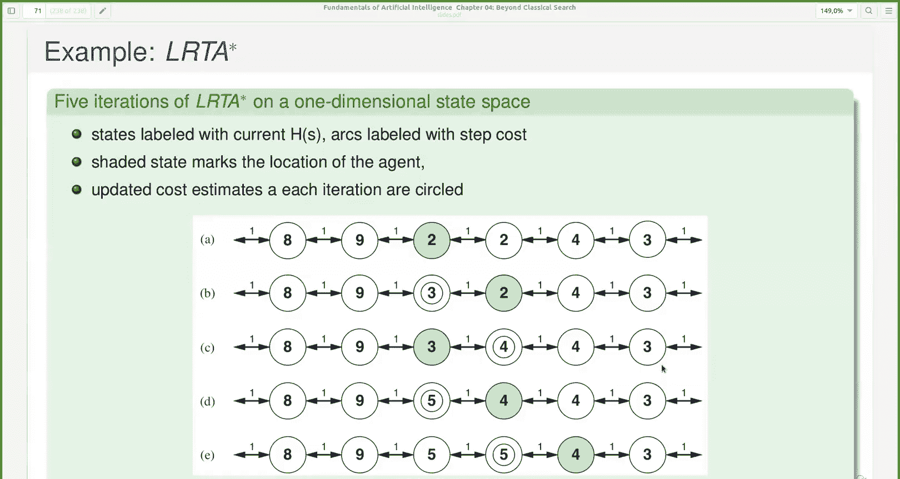

# 人工智能基础：第5章：在线搜索与探索 🧭

在本节课中，我们将要学习在线搜索（Online Search）的概念。在线搜索与之前学习的离线搜索（Offline Search）不同，它发生在智能体对环境的动态或结果未知的情况下。智能体必须通过实际执行动作来探索环境，并在此过程中逐步构建对环境的认知。

## 离线搜索与在线搜索的区别

上一节我们介绍了经典搜索的假设，本节中我们来看看当其中一个关键假设不成立时会发生什么。在经典搜索中，我们假设智能体完全了解环境，包括动作的结果。然而，在线搜索处理的是智能体**不知道**动作结果的情况。

*   **离线搜索**：智能体首先在“脑海”或CPU中完成完整的搜索计算，得到一个行动计划，然后才去执行这个计划。搜索和执行是分离的。
*   **在线搜索**：智能体将计算和行动交织在一起。它执行一个动作，观察环境的结果，然后基于这个新的观察结果计算下一个动作，如此反复。

在线搜索也被称为**探索**。一个典型的例子是：一个机器人被放置在一个未知的建筑物中，它必须通过移动来探索并构建内部地图。另一个例子是婴儿学习自己动作的结果。

## 在线搜索的基本设定与挑战

在线搜索虽然环境未知，但我们仍保留一些基本的工作假设：

1.  环境是**确定性的**和**完全可观察的**。这意味着智能体在任何一个状态，都能完全感知到该状态的所有相关信息。
2.  智能体知道在任何一个状态`S`下可以执行哪些动作，即拥有`ACTIONS(S)`函数。
3.  智能体知道每个动作的代价`c(S, A)`。
4.  智能体拥有一个目标测试函数`GOAL-TEST(S)`，可以判断是否到达目标。
5.  智能体拥有一个**可采纳的启发式函数**`h(S)`，用于估计从当前状态到目标的距离。例如，在一个迷宫中，你可能有一个GPS告诉你到目标的直线距离，但你不知道具体的路径。

**关键的不同点在于**：智能体**没有**结果函数`RESULT(S, A)`。获取此信息的唯一方法是实际执行动作`A`并观察结果。

在线搜索的目标通常是找到一条**总代价最小**的路径到达目标。衡量在线搜索算法性能的一个指标是**竞争比**，即在线搜索的路径代价与已知环境信息下离线搜索的最优路径代价之比。

### 一个核心挑战：死胡同与安全可探索性

在线搜索面临一个内在问题：如果环境中存在**不可逆的动作**（例如单行道），智能体可能会陷入死胡同而无法返回。

一个重要的结论是：没有任何算法能先验地避免所有可能的死胡同。因此，我们需要一个额外的假设：**状态空间是安全可探索的**。这意味着从任何可达状态，目标状态也是可达的，并且智能体不会被困住。

## 在线深度优先搜索算法 🔍

由于在线搜索中，智能体只能从**当前物理所在的状态**扩展节点（不能像离线搜索那样“跳转”到任意节点），因此深度优先搜索（DFS）或其变体成为自然的选择。

在线DFS的核心思想是：智能体像探索者一样行动，通过执行动作来探索，并记忆已经访问过的状态和尝试过的动作，逐步构建一个环境“地图”（即结果表`result`）。

与离线搜索的关键区别在于：
*   **回溯是物理性的**：回溯不仅仅是从数据结构中弹出元素，而是需要智能体**实际执行一系列动作**返回到之前的状态。
*   **需要额外的数据结构**：为了支持物理回溯，算法需要维护一个`unbacktracked`表，记录每个状态可以从哪些状态回溯回来。

以下是算法的核心数据结构与逻辑概述：

*   `result`: 一个表，存储已知的`(S, A) -> S‘`映射。
*   `unbacktracked`: 一个表，为每个状态`S‘`存储一个列表，记录那些已访问过`S‘`但尚未从`S‘`回溯回去的状态`S`。
*   `untried`: 一个表，为每个状态`S`存储一个尚未尝试过的动作列表。

算法从初始状态开始循环，每次迭代接收新的感知状态`S‘`（即执行上一个动作后的结果）。主要步骤包括：

1.  **目标检测**：如果`S‘`是目标，则成功终止。
2.  **状态记录**：如果`S‘`是新状态，则初始化其`untried`列表（包含所有可能动作）。
3.  **更新结果与回溯信息**：如果是从前驱状态`S`通过动作`A`到达`S‘`，则更新`result[S, A] = S‘`，并将`S`加入到`unbacktracked[S‘]`列表的**前端**（采用LIFO栈，实现深度优先）。
4.  **选择下一步**：
    *   如果当前状态`S‘`的`untried`列表**非空**，则从中取出第一个动作作为下一步。
    *   如果`untried`列表**为空**，则需要回溯：
        *   如果`unbacktracked[S‘]`也为空，说明搜索失败。
        *   否则，从`unbacktracked[S‘]`中弹出（LIFO）一个状态`S_back`，并找到一个动作`B`使得`result[S‘, B] = S_back`（根据安全可探索假设，这样的动作存在），然后执行动作`B`进行物理回溯。
5.  **执行与循环**：执行选定的动作，感知新状态，开始下一轮循环。

**算法复杂度**：在最坏情况下，每条边最多被遍历两次：一次作为探索性动作，一次作为回溯动作。

## 在线局部搜索与LRTA*算法 🧗

在线DFS是一种系统性的搜索。另一种自然的在线搜索范式是**在线局部搜索**，它不系统性地探索所有状态，而是基于当前局部信息做出“看似最好”的移动，类似于爬山法。

单纯的局部搜索（如随机游走）在线环境中可能效率极低，容易在局部来回震荡。为了改进，我们可以引入**学习**机制，这就是**学习实时A*算法**的核心思想。

LRTA*算法结合了启发式搜索和在线学习：
1.  **维护代价估计**：算法为每个访问过的状态`S`维护一个估计代价`H(S)`，表示从`S`到目标的最小代价估计。初始时，`H(S)`被设置为一个非常乐观的启发值`h(S)`（例如直线距离）。
2.  **基于估计行动**：在状态`S`，智能体选择能最小化`c(S, A) + H(RESULT(S, A))`的动作`A`执行。如果`RESULT(S, A)`未知，则用`h(RESULT(S, A))`代替`H`。
3.  **学习与更新**：当智能体从`S`执行动作`A`到达`S‘`后，它会用获得的新信息更新前驱状态`S`的估计值：
    `H(S) <- min_{A in ACTIONS(S)} [ c(S, A) + H(RESULT(S, A)) ]`
    这个更新遵循三角不等式，总是使`H(S)`**增加或保持不变**，从而使其从乐观估计变得更接近真实代价。
4.  **逐步优化**：通过不断执行动作和更新`H`值，智能体对环境的代价估计越来越准确，从而能够做出更好的决策，引导自己更高效地走向目标。

LRTA*保证了在有限、安全可探索的环境中能找到目标，并且通常比盲目的随机游走高效得多。

## 总结

本节课中我们一起学习了在线搜索的核心概念。我们首先明确了在线搜索与离线搜索的根本区别：在线搜索需要在未知环境中通过**实际执行动作**来探索和学习。我们探讨了在线搜索的基本设定和“安全可探索性”这一关键假设。

接着，我们详细分析了**在线深度优先搜索算法**，理解了它如何通过维护`result`、`untried`和`unbacktracked`等数据结构，以及进行**物理回溯**，来系统性地探索未知环境。

最后，我们介绍了**在线局部搜索**的思路以及更高效的**LRTA*算法**。LRTA*通过维护和不断更新每个状态的代价估计`H(S)`，将启发式搜索与在线学习相结合，使得智能体能够在探索过程中越来越“聪明”地选择路径，从而有效地在未知环境中找到目标。

在线搜索是智能体在现实世界（往往部分未知或动态变化）中运作的基础，是连接规划与执行的关键环节。