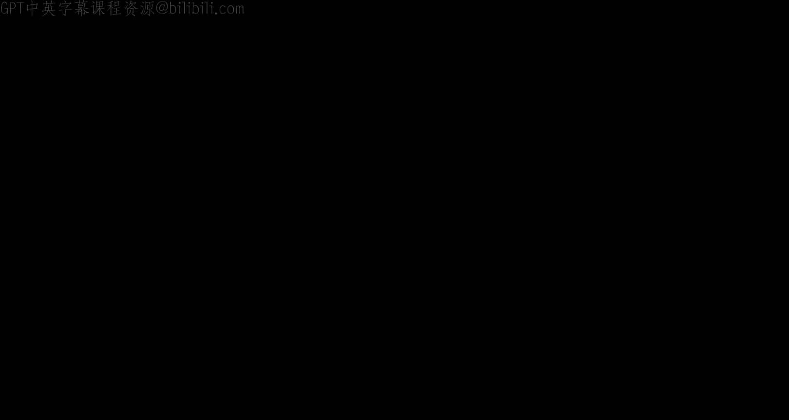
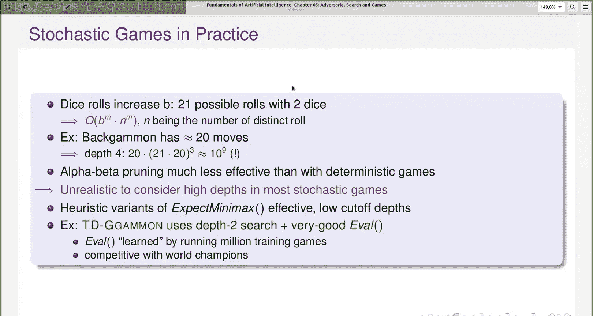

# 意大利特伦托大学《人工智能基础｜Fundamentals of Artificial Intelligence 2024》中英字幕deepseek p16 2024.10.14-CL13-1-CH05-AdversarialSearch.zh_en -BV1uUkwYTEmf_p16-

Okay。Guys， sit down and stay quiet。We have started。Okay， so。Oh。On Friday。

 we have started the issues of the new topical adversarial search。

So scenarios in which you have a multiple agents and the agents are。こ实在。Aversarial。

 what does it mean， This mean that。We have other agents。

Who have some goals to achieve and those goals go in the opposite direction or in a contrasting non coherent direction with respect to our goals。

 Okay， so there is a clash。In between our goals and theirs。Remember。

 we have made some hypoes just to recall briefly。There are some kinds of different。

Forms of the Verile search， the termmin vessel stochastic。

So you have a random component or the actions of each is deterministic。How many players do you have。

 Well， the typical is two， but you can have more。Z sum versus general games means0 sum means that we have。

The sum of scores， So to say of every action is called among the players is constant。 So if you may。

 how much again the move， how much you lose the averary loses in move。

 So the sum of this is constant。Okay。And then do you have a perfect information。

 do you have the full apart from the knowledge from the fact that you don't know what you expect from the or the Versaie。

 but do all players have a full understanding of the full knowledge of the game， yes and no？Okay。

 so we have a。Seen some general description of the game in which， well， for instance。

 the typical scenarios is the two player game。Which for C， we call max and mean。

 and we typically put ourselves in the perspective of maxs， of course， the mean position is dual。

 and we assume that max moves first。Okay， then。And we assume that we are alternating the movess。

So substantially what we have the ingredients， we have an initial state as a zero。

 which can be one single state or possibly more than one， Okay， we have the term。

 something which says which player is in turn at the risk step。Action is the same so given a state。

 what are the possible actions that one can have given simplicity also of the term。

 okay whose turn is this？Re is the position model， the user position model， that is。

 what is the outcome of。Of an action A started from a state S， what is the state that state？Okay。

 this is an notion terminal test， so something which says that the end the game is finished。

And then a utility also an objective function or a payoff function， so say at the end of the game。

 what you gain from either a victory or loss or draw， some games do not have drove like volleyball。

 for instance， some other have。Not is that。The initial state， the action， and the result。

By recursive application， they find the wall game tree or game dog is consider states because we。

 of course， you can have shared and these the typically those。

The size of those is is typically huge or something which runs out of control not something that you can really reach。

Are in a decent amount of time。Okay， well， we have made some examples because of to and zero sum games。

 as I say， that the total payoff of all play all players in the same for each game instance okay。

And with two players， zero are some games， you can use only one utility value， which is。

In such a way that you can see the problem as a maximization problem from the perspective of the first layer which。

 in fact， we call max and minimization problem from the perspective of。Of the second play。

 which aims at minimizing that， of course， if you want to inver， you're just in that。

Inveor sign or inverors more but with the greater week okay。Okay， so。Last time。

Introded the general idea。Of these kind of scenarios as a mean Max problem。And which is。

Quite intuitive， I would say this sort of recursive mean Max problem。

 So Min Max problem is not a scenario， which is only from AI。 I mean， this is when。Kn in many。

 in many different contexts of computer science and mathematics， however。The main idea is that。

At every step you have to use， in sense of Max to maximize the outcome of your move。

 Pro the fact that you are to predict。They recursively that your a a every step has to minimize the possible outcome。

And since you make the assumption that all the advisories are smart and always decide for their best。

 okay， so this ends down into a recursive schema， which is as follows。So。😡，The mem of S。

If S is a terminal test， then it due to yourback okay。The mean max。 So if a player of S。

 So it's max term， okay。The mean maxer is the maximum。

 the choice of the maximum action or the action， which causes。The maximum benefit。

 which is computed by recursively bulkking mini Max to the result of the action device。 Okay。

 now this a recursive definition。For the mean player， it's the opposite。Okay。

 so you have to the plus you have to assume that the other player will make a choice to minimize pick the action。

 which causes the minimum。Outcome was the best from his own her perspective。撞梦。诶。

For thecur or the scenario， so well pick the action， which will minimize the action。

 so it will be the opposite respect of you。Notice that this is。Very。

 there is some similarity with the action with the and or scenario that we have described in previous cases。

 Okay， the difference here is。If you remember， the end or gate was to describe non deterministic actions。

Okay， now that the ministry is something that I do an action and I some possible outcomes。

 which I cannot predict。It is as if the environment was sort of another player。

 but which actually ran through actually randomly inlicictability okay？

This case when you make an action， of course， you have， but。As a result of this action。

 you cannot predict that。You can have more of than outcome in the sense that you areba can have other answer。

 other replies。But you cannot know， but you can try to predict according to his maximum。

🤧Mimal benefit。Okay， so the difference。Of the verada search， with respect non deteristic search。

 is that with that versada search。You have。You know that your vessel will do the best for him。

 which is typically of the worst for you。 Okay， so that's why we have a me box of me。 Okay。

 instead with the。With the known determinity， we have a9 that sense that you have to predict all possible scenarios。

 So you don't know what he or he is doing。 Okay， so what the environment is doing。Okay。

 is this scenario different clear？Okay。We have made an exam。 I have to have something clear in mind。

This chma。Describes a bottom up recursive。Analysis， okay， remember when。In a recursion。

 I say that for noncomp scientists because I respect that for the others is obvious when you have a recursive schema。

 when you have a recursive instruction which first calls the recursion and then computes something out of this outcome。

 this means a bottom up。Analysis of the of the search space。Is it clear to everybody？

So here you first compute a mini result of essay and then you do something out of that so so first sorry you first make some course of recursive calls one for the reaction and then out of the outcome you will make a choice。

Okay。Is this clear to everybody？Okay。Okay， so the analysis is preserve bottom up。

 but remember that they actually are executing disorder。 Okay， so first number one， maxs execute。

Then mean execute， then max execute， then mean execute。 So the actual sequence don't。

You have to distinguish what is the search？The bottom up analysis from the actual sequence of executions。

Search works bottom up。But search here is done something that you do in your mind in your CPU， right。

Execution must be done sequentially from top down。In one of the of the time。 Okay。

 so in this scenario here。Initially。You know of those values here， Okay。

 so you don't have those values a priority。 Okay， so a priority you have those values here。Okay。

 and so you have to decide that so a has to decide which action to have place。Guys。

 I know I'm repeating myself， okay， but I just I just want to focus。On now on those ideas， so。

So you have to pick one decision quarter two。axTo maximize your possible outcome。

 given the fact that you know that your advisor will do his or her best to minimize it。Okay。

 so analyze the point is， what if I choose a one， if I choose a in this scenario here， well。

My advisor， we choose3， Okay， because for him。你了。So if I act a one。

 then Mad Vasor will choose three because the best for in is three。Okay， if I choose a2。

 then might have that' side will choose two。Because of the choice。 Okay， if I choose a 3。

 then my advisordverari will choose。D say。Okay， so I have a three against two against two so for me the best choice is a one notice that of course my idea choice would be a3 and and 14。

 but there's no chance that my advantage is so stupid。Okay。If you are a。

Familiar with any board games well， that's actually the kind of point that you have to always to do。

 So you should do make a move not to because you expect the best， but you that。

You maximize the worst at the minimum。 Okay， you maximize the worst case analysis。

The worst case also worst case scenarios。Okay， and this is mean complicated better caution， right？

Okay。I think， we got。Here last time， right？ Am I correct。 Oh， no way。 Okay， this is the trivialvia。

 the trivial description of what I've just said and the user here。

 But it is nothing else that the user where to compute a maximum， Okay。

 which I expect everybody is familiar。Okay， everybody。出 far。Okay， I think we got here this time。

 right on Friday， am I correct？😊，Okay。What about you have more than one competitor these are sub because you more or less apply the very things Okay。

 so you again， you do a bottom up analysis。Predicting again， you recursively predict。The best well。

 you you don't have any more， you don't have any more the mini Max。

 so you don't have there some but what you do is typically you keep an array of values。

 one for every one for every competitor。Okay， and you know。

 re that you have to maximize providers in the fact that every agent will have to maximize his own value。

Okay。Notice that the min Mar schema here is just a simplification， but then you can of course。

Do a maximax using two values and maximizing one the value and the opposite value， right so。

That may make a difference。So substantially， you replace a single value for each node with a vector of values。

 one for every player。And it saw such that each value represented the score from today point， okay？

T me data is the utility for every agent， which is your starting point。Okay。

 so notice that you don't in order to do a optimal choice， you should not only know the utility。

From your perspective。You should also of course know the utility from your adverse area perspective。

Okay。Is it clear？Yes。So， your choice。There's strategic choice。

Is to try to make the choice keeping in mind what what the aversar your adversaria is trying to。

Interestingly， this kind of schema here I'm displaying。

There's not work not only works with the purely adversararian search。

 but also with a part collaborative search， so the other guys are not necessarily your enemies。Okay。

 they are simply people who， who is maximizeimizing on utility。 It's up to you to realize what。

What are their interests。So that what they are going to do depending on their interest。

 and so make your choices accordingly。Which is not necessarily。

A warfare is not necessarily as can be to some extent， also collaborative。Not necessarily。

 is not necessarily the me schema that。Their design is the opposite goes in the opposite direction than yields。

 okay。Depends， Okay， but this is a general scheme。 which you say， okay， you keep in。

In mind also there what they try to predict what they will try to do。😡，Okay。

And this also leads to alliances。Okay， so it may be the case that sometimes you can get the compromise。

You can get an agreement with the some people， okay， if I if I make this choice。

Will you do this other choice？😮，ok。😊，Okay， so let's consider this case here。Okay。

 suppose we have a game with。To place AB，C， A， Okay， so you have these three playersers。Leves， okay。

 notice that in general， you may have hundreds。哦哦。Or let us， okay。Okay， so。

Every node here is labeled with this core， okay， initially remember that you don't have those valuess here okay？

So you have those valuess here， okay， only。You have only the leaves。Okay。

 so each node is labeled with the value from every viewpoint。So you are our agent， remember。

Choices are done from top to bottom。😡，So you have to decide。Chilili make。Then she's on the right。

Or shall I make the decision on the left？Forget those values here for a while， okay？

These are not known number。So you have， so look only to the last row， the least row。

 So the point is should I So what the agent number one a as to face is what shall I do， Shall I make。

Choice， given the values on the leaves。Shall I make a decision on the right。

Or should I made the decision on the left？Okay。That's his dilemma or its hair or its dilemma。

 depending his。And then a female a robot， okay？No。So again， let's do a bottom up analysis。

You are here。Okay， so this is。You are here， so。Number C。As is to maximize the third element。Okay。

 so what is going to do？Well， among these two guys here， you will have to choose。1， to 6， okay。

If you are in this scenario here。😊，Among these two scenarios here， you will have to pick this。Okay。😊。

mount is this， he will have to pick this one because it's two。Two case one。

Among these he were to pick this， so among this and these he would to pick this one， of course。Okay。

 notice。That number C。 So play number C has no。Actual strategy to play。Why。

 because he will the last over， so he will be。In one of these four notes。

 and they will just have to take the best。amount of possible choices。 Okay。

 so it's not so at there that he has no choice。 Actually， he cannot make any strategy。Okay。was our。

What about the number B？😡，Well， B， so we can say that。C will choose  one，26 here in this case。

 he will choose a 6， one，2 here， he will choose  one，5，2 here and a 54，5 here in this case here。

 but we don't know。Now， put your yourself in the head of player number B。Okay。

 so then maybe is here and says， okay， notice that he doesn't know。He sees only the leaves。Okay。

 let me say， okay， see。Will we choose this one？Okay， see if here we choose 6，13。Okay。C。

 we choose one55 C， we choose1。If I wear here， I will pick this one。😡，Okay。If I were here。

 I would pick this one。Okay。😊，So this means， okay。The the root。 So I。I'm a。And myesttimating is say。

 okay， look， I will did this one， one，2，6。Okay， and this one say so， and he will pick  one，5。

And you know， this is very bad news for our agent A because no matter what he he has to choose。

To very bad。Scennaris， okay， so now， okay， after he has done his analysis。哈不了。Put player A says。

 okay， very bad I。What can I choose every1 and one in either case？

For least you can say you can decide the left one， but you don't really have the maximum advantage。

Okay。😊，You see this。Yes。Okay， so A can choose either the left move， which is one26。

 which is bad for a。 well， both are bid for a。Which is bad for A and B and good for C。

 Or choose the left move 152， which is a bad for a， good for B and bad for C。You see this。

 so unfortunately。This scenario does not make any nice suggestion。

So it's a poor choice for every in each case。But then you can play onlines。And you can。

So suppose let's say he's be， I may and he's be， Okay， I say， hey， B， look at this。

 Let's have a deal。H。So。😡，If I remember， I first wanted move。Okay。Let's have a deal。呃。

If I choose this one， Okay， I can。 So if I choose this one， this is a big advantage for you。 Okay。

 because because otherwise you get five。 So if not， you get a two， okay。

If I choose this get you get to if I choose this。You to get 5。 So let's compromise。Okay。😊，I move B。

A mover right， if you promise to choose this one。So at the end of the， we both gain。

Because you are there at the end of the day， you will have four otherwise and you get two。Okay。

 I we gain because I will have5 rather than one。 So we both advance， get a deal。Okay。So well。

 he is seeing he will lose， okay， but poor guys， you are film sorry， Okay。

 so you understand that you have an agreement。 In fact， three games。

 sometimes you you make alliances。Okay， have you ever played the two Ri？Okay。

 you know the importance of allianceis and you know how easy it is to violate allianceis， right？Okay。

So you understand that。The role of alliances， this case， right， Okay， there is a drawbackback。

Shall I trust him。So do you things are issue trusting？Depends， Okay， so the point is。

Remember that I make the choice first。 So， so if I make this choice， then this is done。

 So am I sure that you。He'll do what he promises。Maybe yes， maybe no that these very。 So he may say。

 okay， why， once you have chosen a， I he， he can anyway choose this one。 I got the phone。

 So he gets five or rather than4。Good for him。 But I know that。After that， I I he loosen my trust。

There's also this component， right in the institution。So you see there are many emmulive。Imoly。Agent。

Adversari search， this is tricky。I really wanted to stress the fact that this is not necessarily to mess。

Okay， depending on the values that you have on top here， you can even。So it it could even scenarios。

 So market scenarios。 Okay， so suppose you are。A is。A manufacturer。And。

You are and the B and C are guys who provide me some pieces， okay。

 who shall they say we'll get advantage okay， so're nothing necessary atar of。

They do their own interest， I do my own interest。Okay， not a necessarily sometimes in contrast。

Sometimes favorably。Okay， so this scenario here describes situations where you。

You maximize your outcome， including alliances， because he is。What， okay， so if you give me。

If you give me the wheels I need， do， if I choose you rather than him， do you make me a discount。

Okay， so that's allianceance。 Okay， so do you give me this scenario rather than this。Okay。😊。

Is it clear to everybody， So this kinds of。ComComplex。

 Something important that you have to remember that。And not。😊，And the analysis is done bottom up。

Okay， whereas the action will occur top down。The sequence， okay。This is something that's。

This remark is not reading your book， okay。Yeah is implicit， okay。

 but this is something to an important understand。Okay， everybody。Okay， so。Something also important。

 which will make a huge difference with respect to other kind of scenarios。

 versus a statistical scenario。Is that Excel values do not really matter in those points。

 what is really important is the relative order of values。

So one values stickies bigger than the other。Okay。So substantially， the same behavior。So remember。

 Eval is the function， which tells you a score， a possible score， the value。And every。

If you substitute a valve with if you apply any monotonic transformation on a valve。Okay。

If you apply any monotonic transformation on the valve， this is still working。

 provided is mistake monotonic。Okay。So。Why is that？ Because the only。

Important factor that matters in this kind of variation is that something is greater than something else。

It's not the relative value。 You don't have sums product or automatic operation that the only。

The only operation that you do in these sort of problems。

 both binary or binary choices are values bigger than another。Bigger equal。 Okay。

 so any monoonic transformation still works。 So for instance。If you have the leaves， Sir。You have 1。

2，2，4。And yeah the leaves here are 1，20，2，400。Okay。We have the very same solution。

This is a very same choice。 This does not influence the choice because we have applied there。

A transformation that is monotonly to the bear。Okay。A was there。

This is very important because these make a difference for with other scenarios that we will measure later。

Okay， so far。Any question？It's only clear， Okay， good。Okay， here have few exercises。Consider okay。

 again， the multiplayer mean search example please either。🤧。Using the same leaves。

Wedo everything by just making different order So you have the same。Leafs scenario。

But different orderss in all the three， so we have completely different three。

And you see that you have very different outcomes。And for each case that we have the best move in case of known alliance and also see that if is possible for the top player to align。

Okay。Okay， so the mean max algorithm。 So is it complete， Yes， that if the try is finite it。 Okay。

 so if the defines it allows you an amount of computation to that。 Is it optimal， yes。😊。

Against an optimal opponent。 Okay， so does mean。 So if if assuming that the the optimum the youngversaral is rational。

 then this gives you thema。By the way， what happens if the opponent is not rational。

 so to say what is if your opponent is stupid？There's not to do the best for him or her。Well。

You have a better result， but not necessarily the better under the assumption that the other is stupid。

Okay， but it's better than is the case that he was， he was。Smart。So if you have a lower level。

 the best thing is to place part。Okay。Well， term complexity is huge okay。

 because you do the exploration of the wall the wall33 and again。

 space complexity is instead to see if we substantially can do this depth first。Okay。

 it's the usual BM， so it's good。Okay， so that's a。So okay。

 this is big because if you think for instance， for usual games or this can be really huge。

 so for chess， you can estimate something which is 35 to the00 is estimation of plus average estimation。

 which is a number which。You cannot even imagine。In practice， okay，10 to 1 the50s well。

Probably some incentims。 sorry I get that in in the in is probably much bigger than the sizes of the normal universe。

 Okay， so that's。Something and cannot be imagined， yes， please。可以。She。Now， in the sense that if you。

If your opponent。Does not get the best for you。The best for for himself。

 your choice is still can get better even better results so because you are making a worst case analysis。

Your choice。Okay， so。So you are making it， so you have made the move A1， okay？

Then it turns out that your operator does not do the best for him， but it does something。

Better for you。 Okay， so you have a better result than that。

Maybe the best for you is actually the best。And if depends it depends whether you are。

 if you have two opponents with a zero sum， the best for you is the word for hidden。

 If you are in the other scenario， this is different， okay。Okay。

 just to say that this is something that we cannot even imagine， so we have to do something for that。

Well， stay in the exact scenario， there is a standard way of doing。

 which is alphaphabetta pruning and you can use some techniques， some reasoning。

Such data without any approximation， but with the exact result， you can prune some so substantially。

You can see that during your bottom up search analog， there are wall soup trees that you can。

Cat a priori， Pe a priori。Of， I assume that you are familiar with the notion of pruning in search。

 right， I'm sure that computer scientists are。 is anybody of you have no idea what pruning means in search。

Okay， you will know。 okay， good。Okay， so。Let's make some example。

Is there here somebody who doesn't know the rule of chess？Everybody， the rules， I mean。

 I'm not speaking you are a great players， but。You know what to list the rules。

What does it mean to a。A queeneen to a child what is a check man and whatever， okay？Okay。

 so suppose you are， you are a。Okay， you have some dance and evaluation of B。

You have to adapt B and NC。Okay， and you have done some evaluation on B。

 it's always rude or bad or whatever。And then you have a。So， this is。对。So your opponent。

If you do something。If you do see， your opponent has the choice of what making checkmate。

On doing check。Okay， is's one chance， yes。So your opponent has to put。 So if you make a move with C。

 so please attack your queen。And you don't realize that he has the choice or he has the choice too。

Make check me to you。Would you do accuracy？First of all， no。 So what does mean。

 Are you going to analyze the alternatives to check him mate that he is doing。So he。

 so he may do check make a move will because you check mate， but he has an alternative which。

Make may bring it to other scenarios。Do we analyze those alternatives at all？No， okay。

 it doesn't make any sense。Okay， because。This scenario is so advantageous for him or her for that。

Okay。😊，That of course， it's completely obvious to ignore。

 so you don't need analyze because if you so you simply don't have to consider this update at all。

Which means that you don't recursiveize this。 Why should you lose time to do that CPU time to lose it？

Okay。So simply you go for me。Okay， but for sure， you don't spend your time once youre。

You have seen the newon branching， your aory has a huge advantage。

As a movie who don't look for others which are obviously walls。Was for him， okay？Am I。

 is it clear to everybody？Okay。So this a particularly strong scenario。

 But there are other scenarios which are little more complicated。 So suppose you are a。

 So your max and you vanilla case B。 and you get to the point where okay， I number B has。所。Okay。😊。

Okay， and。You has。And so诶。Then nu just see， you see that you may have two move。

 which here has two moves， which are scored either either 01 or minus 05。Okay。Or has something else？

Yeah。Okay。As soon as I receive the value of the in this case， will be minus1。Okay， and they see that。

Please value here。😡，It's better for me than this value here。😡。

Why the hell should I investigate those？I'm not going to C。Because I know。That if I不。He has a mover。

 which is。Good enough free。Which is bad enough for me， okay？Yeah。0，1，3， okay。So， G could be。

Can only be better worse， but cannot be a better choice for me。 Okay， because if。

G was better than 0 3。He will he will choose G B， okay？So no matter what in the minimum scenario。

 this is already minus1。😡，This is manu1 or even worse for me。Okay， so for sure。

 I would choose this one。ok， so。I can prune these search tree here。Okay。

 why the hell should I lose my time in analyzing that tree？😡，W the。

My adverary has a choice which is already bad for me such a way I will not let let。

Heim or her having this choice。Okay。So that's the JL pre。Let's see this example here。Okay。

 and this is a general idea。Okay。呃。Okay， we have some leaves， Okay。

 we have the leaves in which we'll find out to have some score。ok。😊，诶。We can we introduced to values。

 which is called alphaphabeta。Okay， and the idea is that we label every node with this person value。

Initially， alpha is a minus infinite。And a beta is say to plus infinitefinity。

And the intuition for those values， okay？Alpha beta truck respectively。

 So alphapha tracks the best value for max so far。For that point。And also far， so remember。

 I'm doing the research， okay。So I acquire progressive information。So。Alpha is my。

 is my best value So the maximum value， okay。Which of other values of which came？

I can be ever so far for that value。Okay， beta is the V ofverse， so it' the best value for beta。

 so the minimum value for that node。说法。Initially， okay。

 I know now think so means my best value is minus infinite and his best value is plus infinite。

Can be everything。This initial scenario here can be everything， okay？Now。

 suppose let's analyze depth first about this scenario。Okay， a。

 suppose I choose the first move and then let's see what happens if B chooses the best move turns out that he got the score three。

Okay。So for him， well this B， for him， the best choice color of choicer is it B？I don't know yet。

For me。Let's go ahead。12。Well， he will choose free。 Okay， he's minimizing。 Okay， so so far。

 nothing has changed here。This is the third one。8。So， I'm sure。That he gets three， yeah。Which means。

 also， so now notice stepping from here to here， I also exhausted the possibility here。

So what do I learn here？They may value three year。So， this source。The value that I will get。Right。

Because of this is he will。 I know for sure that he will。So this value here， in this case。

 I will get at least three。😊，Okay。Consequently。I can propagate this information here and say， look。

I can put a three here。 Why， because no matter what。No matter what my advisordversary will do。

 I will get at least the three。Because regardless what， Caesar， I'm the one who chooses here。

No matter what will happen here。I can conclude that I have this， for sure。

Let's see if I can get again any better。Okay， because no matter what this line。

 I can choose this one。😡，I was there。Let's go ahead。Suppose I， let's go。 Okay。

 let's analyze the second move， my second move。Within these three， my choice is minus infinite， okay？

Okay， and okay， so update these to。I a question now， what shall I go do now？She咧， is it hand。是。Yeah。

So， yes。 So the point is， now I know that。Might have sorry。Has。

The choice of choosing to at least two。 So， so know the sea will come out We a two or war for me。

Okay。So here's， at the least the possibility of choosing to。Which is。

Which means that the final outcome of C will be do or less。我啲我什么呢。

Something which it will be is more equal than two。So given the fact that that I will。Already， no。

 I can acquire3。Why should I go ahead and analyze， I know for sure， I will not choose C。Right。

So let's you know。Okay。And indeed， you stop here and go ahead。 Now let's try the next one。

In this branch you have minus symmetry you have 14， okay， 14 is better than my3。Okay。Good。啊。Now。

 let's go ahead。Let's do 5。 Okay， let's do 5 again。 and nothing changes。

 And then I have two at the end。Okay。With two at the end， I can。See， oh this is true。

 the choices here is necessary， too。Okay。So， I。I can't choose a end free。ok。😊。

The important fact I wanted to stress is this step here。You have see and。Prune the trip。

Sa why the hell should I go and losing my time on exploring this subre here？Okay。

 if I know that nothing good it will come out of。For me。

Are you familiar for something which is called branch and mound？In the。Integer N programming。

Bran of bound is a technique in which you have a current optimization technique and。

You are doing a search。 You have your current， let's say， minimum support you are minimizing。

And you have an estimation that the remaining a subary， no matter what。

 cannot you bring you anything which is smaller than a given value。

 which is greater than York or a minimum， so you can cut。You can you have a。

 You have a anotherer bound。 You have a bound saying， look， no matter what you go。

 you cannot do any better than this， so。And the better is not good enough。😡，Okay， so you've cut。

 you prudently。This is the same principle。Okay， so what is the general idea of alphabetter pruning here。

Suppose you have a node N， which you already have computed。And you have so you have an old end here。

 okay？And you have a current volume。嗯。Okay。Okay， if the play has a better choice with the same level or N。

 which call M prime or at any point。Higher up in the tree。Okay。😊，You should prune that。Okay， why？

 Because you can choose that。Okay。So substantially。

 as soon as we know enough of them to draw this conclusion， we can prorunne it。

So that's the general idea。So as soon as we know that we cannot have。

That node cannot give us any better outcome for our purposes， cut it。That's the principle。 Okay。

 this comes to alphabetta pruning。And the idea is to keep track to values revenue。

 which the one I say before， alpha and beta。Alpha is the best value for max。

Hes so far at any choice point along the path。Which is a also lower bound for future values。Okay。😊。

And beta Duly is the best value for mean so the lowest value so far at any choice point elementm in the path。

 so it is the upper bound for future choices so to say and faty considers alphabetta as a sort of bound。

AV range of the possible values， right？There is to prove n if its value is worse than the current alpha value of max。

 So if you if you mean max， if your mean prove it prove n， if it's bigger then than better。

And this leads us to the following algorithm。Which you may notice that is a variation。😡。

All the mean marks aregon。 So if if you compare the to the codes。Of of your。

AndOf this through the code through the code of min Max。

 you notice that this is an extension of that。Which is reached to some check against the alphabe here。

Okay。😊，So， initially。そう。The initial function， the wrappper。Function is a sort of mini function。Okay。

 which returns the max value， but which you initialized values alpha beta to parameters。

 so the circular recursion has two parameters， which are alpha beta。

 which initially initiallyized to minus input。It took less respected me。哦。😮，Or twin。To some value。

 which you know is strictly smaller or stick better than any possible thing。Okay。

What max value does which you invoke max value and you say， okay， again。

 if the current states turn a test then your term utility， again。

 you minimize the with minus infinite。Very same Minn so far。The only difference。Again。

 you loop before you peak for a reaction and you explore。The， and you take。The maximum of a。

Invoke the bottom up。Again， you first invoke the me marks of the result of applying X and you store it。

But this guy that you don't simply take。The smallest， okay。

You don't simply take the max over the current that we respect in the previous one。As you would do。

This time you do some extra consideration。Which is， if V is。Greater liquor than betterta。

This is the dual case。Okay。Then this will never be， you can stop it。

This is the dual case that we haven seen before， right？So you don't need going ahead。

So you don't need exploring the remaining alpha because you for sure it will not be chosen。

 this nor will not be chosen okay， similar， mean this is the dual okay。

 and this is the case that we have seen in in the previous case， you start from plus infinite。

For each alien action， you take the minimum between a max value。And the current value here。

 and if the current value， the result is smaller equal than your alpha。

 this execute the scenario that we've seen before， then why should you proceed？Okay。These are opless。

Cut it。 Cu it， don't。Return， return。 Okay， of return means that you exit from the function。 So you。

 you don't go ahead in the loop。Okay， and this is exactly what happens in the previous case。

 greater equal is alpha and more equals beta and。In this scenario here。

 you take a three and so you know that your solution will be at least as good as three。Okay。

 that's actually what I say before， when we are here。You know here that well he knows that yes。

 at the least， you know that the solution， this branch will be more Ri than two。So no choice。

 why go ahead？Youre enter in this scenario here。Okay。

And here you go ahead and you maximize size so you know that it's more equal than 14 then you know that is more equal than 15 and you know they're more equal than than2 okay。

 but now it' two because it's also greater equal is more equal。Okay。So， what is。You see。

 alphaphabetta pruning is an improvement or is substantially a。A smarter version of me。Okay。

 more efficient but。Not that this are exactly。 don't introduce approximations。Okay。

This is an exact algorithm。 returns exactly the very same values that the mini max word are it just。

Do that more efficiently。😡，Okay， because it's able to cut brain subies of the search。

 which we have no choices， with no chances to be successful to improve the value。 It's very。

 very similar conceptually or whoever is familiar with that with the branching bound also called the branching cut。

Allithms， okay， you can think this as a branching cut algorithm applied to minimize search。Okay。So。

 its correct。You can improve the the order， so。You notice that the order by which you choose your othervalue matters。

 okay？The earlier you are able to make best choices for you。The highest。

 the the possibility to pe search later on， this also also holds also for a branch and cut。

 If a good heuristics， which allows you to get very。The best moves are from the very early。

Then the the best out of the。The best out the choice in the previous choice。

 the higher the chances to proe search in the lowest in the later branches。

 so the highest the chances your search will be more efficient。ok。So in jail it all。

If you have some good heuristic techniques， which is able to estimate。

Coursely the how good are your successors try pick your best successor first and typically when you save you lots of search because you will have more pruning for the search。

Notice that this theoretical bar， of course， if you have the sum God。

 which will give you always the best choice， okay。So if you are a hero。

 a Greek hero and you have a Mother goddess， which every move you take of gold there。Take the left。

 take the right Lola。 So this means that you have only one choice。ok。

Then your time complexity reduces to B to M。Div divided by two。Okay， so because you always have。

 you always speak at the best choice at the beginning。You don't have two choices， so。诶。

What does it mean， This means that。It has the exponent。 It is dramatic improvement。

When you have an exponential behavior， if you are able to reduce significantly the exponential。

 you dramatically improve the search。Right。It can be estimated with random ordering the time complexity is about B to the3 fourth of M。

Okay， well this is based on the euristic fact that on average of you you have the same probability of the taking a good one or a better one。

 so you have。You saidSo。嗯。ItPro to reduce it to three， fourth。 Okay。

 so half of them will be with behave as the best。F of then will behave at the worst on average， okay。

 so you have something in between B2 theM and B2 the MF。Okay。Okay。

 this assumes that you have a three based that that you if you have a graph based search again。

 you can avoid get into all scenarios Okay， remember。

 then typically since the search is big in practice， you don't have。Exact。Graph based。

 but you may have something which is based on hassing。Which contains。So a cashching， sorry。

 not cashching， Okay， which you cash most frequent。Ocurring scenarios。

 and this is something in between a graph and entry。Or is a partial graph based， okay？

Which you not always have heat。But you hit with a decent likelihood probability， okay。Okay。

 I leave you a couple of exercises。Practice， okay？Yes too。Play with them， play alpha abetta3。

And or maybe better write first min mark。And then do alpha betta afterwards and you see how much you can save in the second case with respect in the previous one。

Okay， is alphaphabet3 clear enough？Okay， I think we can stop having a break。Let's okay。

 we don't have much time， so let's resume at 45， okay？是。嗯。嗯对。Yeah。Yeah。Yeah。Yeah。还问题。嗯。Yeah。

Thank you。W。Okay。你哪个。不。That吧。对。Okay。Okay， guys。We let's start。Okay， so what type of simple practice。

有 these scenarios。In practice is well， even with the improvement of alphabetta search。

 which significantly improves with respect to。To main mark。

Search spaces in natural games are simply too big。Okay。Well。That's main。About checks， example。

 you have something which is。Atroously big， so a search space。

 which is simply authorously big so you cannot well imagine yourself trying to figure out all for every possible move you can do in Cha。

Thinking what what your basic can do evaluated and then what you can do up blah， blah， bh， okay。

 so this is simply two we get to imagine。So what people do is apply a mixed idea by which it boils down to Shannon。

 well if youre computer scientist you should know who Shannon is， right？Whos， by the way。

 is not only them the father or modern information theory but was one？

Also one of the bigger fathers of AI。And then is that to do a depth limit search。

So means doing alphabetta pruning or whatever search only to at some limited level。

And then replace the terminalities this of the estimation。😊，So that actual， course， is a we lose but。

With that。utility function。For non terminal nodes， okay， so an estimation of how good a those。Okay。

 given a given layer， you estimate how good are those depending on some parameters。Okay， and then。

Do your choices， not referring it to the terminal utility function， but to with this。Evaluation。

Approximate evaluation。Okay。😊，For instance chess， if you stop， say adapt D。

 if you try all possible combination up adapt D。Lets say， 8。Okay。

 and then you evaluate all the possible scenarios that you have after eight possible moves。

Give me some score。To the the state or the search。Then you can have a search in D 8， which is。

According to alphaphabetta pruning is something in the order of 10 to the 5， which is okay， right。

 So you can compute 10 to the 5 can also compute 10 to the。 Well， then doesn't yeah。

 you can 10 to the 8，10 to2 the 9。 Okay， so it's feasible。 But with supercomputers。

 you can do also bigger than that。 But okay。You still have a drastic reduction。And of course。

 it depends how good is your evaluation function。Okay。😊。

So the idea is to cut the search at a limited act。So the basic idea， which boils down to Shanon。

Is to cut the search on the limit that say D。Okay。And that apply a euristic function。

So this means useache， you pretend that non terminal nodes are terminal with a given score。

So your goal is to reach some possible good， good enough。😡。

Scenas from which you have a likely lot of。Not a good chance to win。So， if you're。

You are predicting if you're intermediate non tell no。

 is the one which you have captured that you're the basarial queen。

Without losing too many pieces rather one piece and we had very high chances to win， okay？

Without having lost your queen。Okay。😊，For instance。Okay， or。

So this means that you can modify min Max or alpha beta in Su two ways。

You have to replace the utility financial by a heuristic evaluation。

With estimated the positional utility， okay， and rep pass the terminal test by cutoff test。ok。

 say okay。Koff substantially is noticed that the order modification is in the base of the errorcurs。

The base step of theca， not on theos step。Okay， substantially， you replace。诶得an你 ok。

Some non terminal tests up to a D data， I pretend they are terminal。

And give it rather than a final score， I give an estimated score。Mean， okay， this is good enough to。

Which I confidently that if I end up into a state， which is good enough。Then eventually， I later on。

 I will be able to win a start different position。Okay。😊。

Yeah of course I you have to some bookkeeping to increase the depth to D so substantially theres slight variation that you have to do the mean Max and then you can write the same for alphabet okay the recursive function notice that you didn't significantly change the recursive function here。

 you change the evaluation。So that you are these depth parameter depth D here。

And then if you have a cutoff test saying， okay， if a verifies is a cutoff state。

 so typically if D is greater economic， then given value。

 thenno stop and use this evaluation function rather than the winning score okay。Otherwise。

 if this works as a years before， the only point is that you have to recurive lab data at the value of the data course。

 but this is very minor bookkeeping。😊，Step， okay。Is this clear？Okay。So well， obvious alphaphabet。

 I leave you by exercise to do that is you just sub the terminal test with the cutoff test then doneval and then okay again。

 you have to since the cutoff test needs。Keeping track of the adapt。

 you have to bring with you the the adaptive ahead， but that's very， very minor。

Very minor modification， okay， very minor but who has very important consequences。So what to evolve。

I。Okay， keep politics played by how good this about。Well， first of all。

 the fundamental factor should be simple to compute。

 so it cannot be simply require itself some search。Okay， so otherwise youre numb， okay。

 so when it should be a reasonable estimate of the specivity of given position。In principle。

 the ideal one should be the smartest possible one or the ideal is the one in which， again。

 you are a son of the goddess and who who tell you who tell you always the right way to go， right。

 So like Greek heroes， right， So Suat always gives the aim max value of that one。 This ideally。

 So this is the best possible。Approxiation of minimum value。Okay， something。Fundamentally。

 that should。Some baseline requirement should be that they should order term estate。So。

The score of wings should be st the score of a drone state should be st than loss。Otherwise。

 there's something wrong with that Okay， so these。A minimum possible requirement to do this is a realistic okay。

 which is compliant with the notion of we need loss。Okay。😊，Oh。

So the key point is that for non terminal。State should be strongly correlated with the actual chances of winning。

 so it should be really。Good。Not， is that。Sustanian implies this will define the equivalence classes of states。

Okay， so two states。With the same value should be。Csely speaking， have the same chance of winning。

Should be equivalentally good。What are you doing？Okay， how do they work。

 Well they typically are based on weighted the linear sum of features。Well。

 I don't know whether you well ever have heard this， but when I was a child。

 they taught this this very basic heuristic for。Forch。They give you a score。For every captured piece。

 So the queen has a very high score， with a 9。Well， the king has infinite， of course， right？

The poundss are one bishops and k Knights are three rocks are five Okay。

 and you give and you estimate the value of the current is a different of capture value of the values of the captured pieces from the size。

 Okay， these are very coarse grain and the not necessary matches。

The fact that typically what you and you give a weight。I wish I the more。

Modern techniques may depend on other techniques， particularly the weights of some pieces。

Changes with time through the number of steps。also on the amount of of pieces there are still in。

In the the board。 So anybody of you who has played the chess knows that， for instance。

 nights are very useful at the beginning of the match Okay。

 because they typically they allow you to control， in particularly if you're able to position that in the center of of the。

Of the board， they allow you to control。A lot of lot of positions。On the other hand。

 typically rooks increase a day after utility as long as the game comes on。

 So the less pieces are there in in the board， the more the rooks become become useful。

And I would say the same the same for bishops as well， some extent right。

 the intuition is that night can jump。Okay， whereas all the other pieces do not。Okay。And pounds。

 of course， the power of pounds， the actual value of pounds depends on the actual position。Okay。

 so the。The former ahead they are the the most valuable they are。 Okay， so you can think these。

Those weights as still weights， but with the increasing value， with the value。

 which can decrease or the increase as long as the function evolves。Okay。

 and also on the depends on the strategy， okay？So for instance， at the beginning。

 there are some scenarios in mission which if you are able to in Cha。

 it's very important to conquer to control as much as possible the center part of the board。Okay。

Things like that。Ter。So and of course， this can be very inaccurate as an I notice also that there are some same score position can depend on。

So the depth one， so the idea of stopping a given that can be inaccurate， in fact it is no。

 this is the baseline idea， but there are better， better choices， okay。Okay。

 so suppose I don't know whether you're familiar with the chess， okay。

 suppose you have these two scenarios which in both cases white is to move。Okay。呃。Okay。

 you can think that in those scenario， black has a significant advantage。 Okay。

 you have an advantage of one night and 2， which。For good enough players， they should be event。

Eventually enough of winning， Okay， however， if you consider this two scenario。Okay。

 the only difference is that you have a ro here。哦。Okay。inexly。You have a very。

Favorable scenario with a very unfavorable scenario with black， because in the second scenario here。

 in the next step， the white white has the chance of capturing the queen。

Which give you a huge advantage。Okay。😊，So this is called an unstable scenario。Okay。

 it means something that to who's score。May drastic the changer in apply。ok。Okay。

 of course I have a pass note that all the very stupid black pay I can get into is here。

 but that's a different story， okay， so this leads us to some configuration。

So for cattaic cattophastate， the Strpho one is what suggested by。But Shannon was put adaptpt。

Then you can do better， okay。It can produce very sometimes because sometimes can be produced very inaccurate。

 see the previous example。AMore robust approach。Can do apply deeper at the deep again。

 it has a deepening distance， which allows us to。Get to。Better scenarios。

A more sophisticated one applies only to question states。Means stable。numericalmaticically is stable。

So equation states is unlikely to exhibit wide very high swings say in one move or okay。

 so very unstable， so it' reasonably stable so you is not going to change drastically in one move or two。

Okay。😊，You can recognize social， for instance， in important pieces under attack。Okay。Yes。

The previous case。Yeah。So substantially if you are in rich adaptability。

 but there are some non Christian states so most stable things。

 you can expand them because they can give you。Valality。Unlike likelyly scenario。

 So you may so notice why I'm saying that。 So suppose。This is the one right is one possible scenario。

 okay， okay， you you should not target this scenario here， right。

 even though it looks very favorable。Okay， because because in one ply。

 it's going to put completely change there。Changer there。

TheThe case are from very favorable to very unfavorable。Okay， so you should also consider extra。

This is， of course， an extreme case， okay。topicy case， of course。

Nobody is Martinina will get into this scenario here right， but again。

 you should also consider the fact， for instance， the fact of being under attack or not。Okay。

 the faculty， you can go into change by the P。 So substantially the idea。

 the current improvement idea for for。That of taste is not only that you are。

And given that but you're in a stable position or you say in aient position， if not。

 do expand further nonquiient states。Okay。This is more or less idea。Okay， what happened in practice？

There were 1994 was the first。The first result， was a kok。诶。Well， was I didn't know。

 but before studying your read your book， but the checks， you know checks Dma。Okay， was this lady。

Who has been world champion for 40 years in a row。 So she was quite good on that， right， Okay。

 but then she she was beaten by by Ch Hoook。 Okay， this technique was a huge database of of。Of moves。

 allowing to give an estimate quality， a very good quality of。Of possible non terminal notes， Okay。

 not that the checkers is way simpler the game as jazzes。Okay。

 but this was the first big achievement。But well， they， the real。I just say milestone。

Theamme changer it was， I remember this day。When this happened， Well， you were on the ball， right？

Okay， I remember this day when well， Gary Kaspar was a mythath， okay？Was really。

 really probably considered one of the best human players ever。Okay， and he was beaten by D。

In a six game match， so it was not simply an occasional one occasional defeat was in the6。

Theamme the world。 And he got out and performed。 And this， again。啊。

Use a very sophisticated evaluation， unfortunately not everybody knows them so they were not to make the public of course。

 not to give other people another。😊，I don't know we are familiar with Attla。

 the one with the disc black and white disc the。Okay。

 this you can really experiment yourself so you can。I have a one of law gamer on my cell phone。

And I consider myself a good player， but I was never able to beat at level time。Very early。

 I was able to， to win under119。 Okay， so there was。 so a computer， a computer technique has。

Is no no game for a human。 Okay， sophisticated enough computer is no game for a human。Okay。

And what was really impressed was Alphago。 He was able to beat and go。

This was also made a because go is way more complicated。Well。

 not comp the same as the rules are very very easy， but way are computationally hard， so yes。

 the search space is something that is beyond imagination Okay and alphaphago bits won changer listenor and this was you picture well。

The world champion with the。If own dismay realized that he was going to to rules。What is。

So how do are currently those evaluation function computed？

Let's say from chess from deep blue onward。What she loving。She actually。You get。诶叔诶。

You make your machine sulator well。T to do something。Games。

So it gets an estimation of the successes or and。He stores a huge amount of scenarios and the actual success of the game so that he was able to learn some。

Let's say internal parameter， which probably are difficult for a human to figure out typically of machine learning。

So he'll learn how to play。And he learned a good evaluristic based on experience。Okay。

So this a combination of a， you see a possible combination of a search techniques or xa。

 search with the machine numerical machine learning techniques。

And currently deep blue is no game or is no game for any a human player。Okay。

I'm a little later than my plans， okay， let me start。

Start and introduces some notion when what happens when you have。So far do we have a。Assumed。

Thetermin the game。Ches， there is no random component。What if do we have。

If we have a random component， So we doss a coin or draw。Dice。What happens in this case？Okay。啊。

You have some ridiculous external events like dice。 but this is also。

Scenari which goes beyond the games。You may not know， for instance， that some events are in warfa。

I been strongly influenced by channels。Or instance some， if you consider the Second World War。

There were some important， very important events。They were very strongly influenced by。

Pure luck or pure unlock depends on which size you are seeing that， okay。The the debate。

TheWhen the American get to France was very strongly influenced by weather conditions。And also。

 there was a very strong counter attack the Germans a few months after the delay。Which was a spoil。

By some unpredicted change of weather。So the journals strongly behaved predicted cloudy a week of rain equal cloudy days。

At the time the Americans were dominated dis skies with the bombards， okay？

And soBut the Germans organized has very strong counterat。Over more or less France and Belgium。

 during from Warwick。Predicting bad bad weather for one week。For some end they were at the beginning。

 they were very successful。 but then in suddenly， the weather changing in a completely unpredictable way。

The clouder disappeared。And the German were very badly bombed by American bombers。And fighters， okay。

 and air fighters show that they were defeated。Etory is very full of a very luck or unluck component。

Okay， chance's component， even you if you see Napoleon battles。

 there have been lots of these scenarios。So。😡，Luck is important。Well， you know。

 maybe sometimes good players have bad luck， okay？And this is a complaint。

So stochastic game is mirror also and particular with random steps which are typically card shuffling or con flipping or tile extraction or dice throwing or whatever as the random component。

 think of the game one for instance you know by gamema。P， okay， not enough。NoYou're not a Greek。

 right。 Is there any Greek here or Turkish person。No okay。

 this national game in the Greek or Turkey never try to play money in the gamemo with with the Greek or Turkish medium。

 you have no chances， okay。So you can only the point is that you cannot apply mean Max or alphabetta pruning or whatever this because you have any expected guidance Okay。

 so depending on the on the result of a throwing diece， that is throwing， okay。Oh。

So there is a degree on coming out from chance。And again。

 let's distinguish the difference between chance and adversary。

Chance will always do the worst for you。So when you are reasoninging in them。In the gamema。In a game。

 aity means word case， chance means average case。Okay， so your isn so the chance is not your enemy。

There's not to look at doing bad for you， but it's neither your friend nor your enemy， okay。

 it's just chance， okay。He' was just random。そう。Police can consider this scenario here。Sose okay。

 chance here is a e you to a coin here。 Okay， so 0 do5 probability each green。I've done it it here。

 okay。So in a minimum scenario， what will you choose。

 So you have to decide whether you go left or right。In mean my scenario you say， okay。

 here no matter what you have time。Here mean scenario you say nine， okay。

 because your other asset would choose nine。Okay， in a chance scenario。

 you put the right choice because you say， okay， here， no matter what you have time。

Here you have an average， so if you have in one case you have nine， in another case， you have 100。

This is that on average， you have a 54 by5。The fire。 So this means that you would go right。Okay。

 best decision will will do the right choice again。

 remember there are analysis is to be done bottom up， the choices are done。doubleub down， okay。Okay。

Okay， so a classic game is begema。 So if you don't know it， the idea is， okay。

 you have that like that。 you have。Each of you ever 15 pieces？The the white move。

 the pieces clockwise。And black moves the contact of the vice。Oh。

A piece can move to a position unless there are a greaterory more two or more advisordsy pieces there。

Okay， so for instance， white could move here。But cannot move in here， here， here， okay。And okay。

If there is one point there， it is captured and so is captured， I must start from the beginning。

So if you're br with the white that you move this piece here。This black here should be moved back。

From the beginning。Okay， terminations when all whites are。Or blacks are in。Are in inposition 25。

 yeah。Okay， so do they exit from here or all blacks exit from to zero。 Okay， so what are okay。

 you throw two guys。And the idea is that so suppose your your dice are 6，5。 Yeah。

 so white sorry white as through the dice and you are 6，5。 So position is。啊。Here。

 so this means that you may either move one piece of six or move to one move to five。

Or you can make one single move vote six plus five。Okay， so this means that for instance。

 you can make number five to position。10 in number the second number 5 to position 11， for instance。

Okay， and so on and so forth， for you have here many possible moves。Okay。Okay。

 what is the point here， this combined strategy with luck。With chance， let's say chance。

 but we typically call it luck， okay。哦。Just to remember that double roles have one over 36 probability and there are 15 distinct roles which have one over 18 possible。

Not that in this case。Is not like。You are using the sum of the values。

They're not necessary using the sum of the valuess， Okay。

 so in most cases you are using the two dies separate the two die the dies separately， okay。So， okay。

 for instance， you。What is？S3 looks like。Search tree looks like something which every like a mean max。

In which you internal leave the summer。Prob probability estimation of outcome。 So yeah， the sort of。

呃 intermediate layer。In between every move。Okay， which we which you does not return you。

The minimum or the maximum value。 But it tells you the average value。Of the possible chance。

 depending on the the player。 So it's like you have a third player， which。Get you。

Returns you some the value of your di。Okay。And it doesn't look。For your。Good for your best。

 but only for the average。Okay。So， for instance。You have facts， So you have several chances。

 Then you have with the probability 1，13， you are in this position with 1，18 that you have 1。

2 dies with 1，18， you have a 6，5 blah blah。 So you have the possible outcomes of your dies。

 depending on the possible。 Then， of course， depending on the on the。On the values。

 you can decide what is your best move， depending on this dice moves， okay？And estimate。

 it can estimate the values。 And then on the outcome or that you have some possible best move。

 you have to compute the possible best move， given the fact that you they。

The men will play the game and he also will throw the dice， Okay， so you have a Oscar combination。

 you understand that this is computationally。Much， much worse than the mean Max because you have also this extra comp。

Of a mini max。Okay。So substantially， you can see these diesetochastic vein。And。

And all the outcome is are stochically al comes， so it's with probability even you have DC9。

 so you have a diese 6，5，2，1，3，9，35， sorry。Okay。So substantially every event is labeled with a relative probability。

Okay， so these boys now do something even more complicated。Which is a minim。

 or you can write the expected alpha beta so you can stand right。So again。The spec mini max is。

If your state is a terminal state， it returns to utility as before or again。

 if you are doing bound search， you add information of the debt and you have a criterion to stop and then you have an evaluation function。

 which gives you how good and how bad is your possible scenario。Okay。Well， Mark's mean actions are。

Very same as before。 So you do mini Max operational Linux what changes。

Is that if player is chance so。So if。The player each times you have all possible。Average。

So you follow possible outcomes on your dice。You make the average。

 the sum probability of the results。So， you wait。You weight the score with the probability of outcome。

So rather than giving take the max， you just make a sum weighted sum with using its probabilities as weight。

 this is the standard decision criteria known when you make decision in front of probabilistic。

Elements。Alright。😊，Okay。So you see the chance as an actor， but eventually are'll seen as action。

 but you make the weighted average。Of all accounts。 Okay， I just record that then。The the sum of PR。

 of course， in this case， is one。 Okay， so this is。This is normalized。Okay， so this is what happens。

So for instance， if you are this scenario here， okay， Max and Ch。In this case here。Okay。

 so you have two， four here。 The minimum here is 2。 Okay， this， the minimum is 4。

 so he will decide zero and he will decide minor2。But then you have a coin flipping here。Okay。

 so the average of this is three。The average of these is minus1。Okay， so at the end of the day。

 you will choose this one。Yeah。Okay。😊，Because youre making the wheat and the sal。With whom。

In this case here okay so this is this value again no matter what it minimum will return this value here。

 and then these are no even probability so you will choose so this seal will be given you a2。

 one because this is as much higher chance。Okay， this will give you a1 to three because this has much higher chance。

Okay， so to do one is better than this， so you will choose a one。And here comes a fundamental。呃。

Fact defines with respect to mean。Ex's a value do matter。Okay。😊，Remember。

 when I say in mean Max is just a matter of a comparison。 So what is bigger than So you don't。

 So you any monotonic transformation of the value is。Still give you today。The right value。

If this is the case with the probabilities。😡，This is no more the case。😡，Okay。Well。

 think in this case here， you just multiply those values here。

By different values which percent the order relatively order and then you notice that here。

 in this case you choose this one， this is the previous case。

 in this case you choose this one because you have not well it's quite intuitive right so this is the probability multiply you multiply the probability form that。

The outcome。Okay， decision， remember， decision hererion that we mentioned。Sometimestime go。Okay。

 in this case。Of course， the。Weight matters。Okay， the only way of preserving this is only transformation which are linear。

 So if you every。Transformation， which gives you utility。Terforms linear your utility is good Pre。

 But if it's not linear， there is no more good。Okay， so for instance， you， well。

 why that because any linear transformation mans？The reality， the product with the probability， okay。

 the order product with the probability， okay。So the utility should be proportional to expected a payoff。

And I wanted to conclude here。Okay。With an important example。

And they want to convince that money is not a good utility。放生。Well we very useful。

 very often use money as a UK different train I wanted to show you。

And the reason is that the perception of utility of money is not linear。Because see this case。

There's a scenario here。You have a game。I give you a sort of a game we tos a coin。

 and you have to decide two possible scenario。 The one in which we toss a coin。Okay， and in one case。

 you got the zero dota million euros and another， you got one to two euros。So this is your choice in。

The second choice B， one in which you get zero money。And the other you've got to get $10 dollars。

 $10 million euro。Okay， if you apply。The previews algorithm。

You would choose this one because on average， you read one 5 million euro。 And in the other case。

 you would do do one。 So the theory will give you。Number B。Be sincere。 Which one I will choose a。

Of you。Which one you would choose be？Really， would you。Really。

So the chance of them is 0 million so no matter what you in this case， you have0 do million euro。

Okay， in this case， you can never zero again three。Well， let me say that bass be。

Most people will say that。😡，And it's not because our theory is wrong。The decision theory is wrong。

But it's simply that the benefit of money is not linear。So substantially。

 the benefit the money will give you depends on how much money you still have you already have。Okay。

 so Sa， if you are really poor and give you 0 to million dollars。

If you already have2 million dollars， well， okay， yeah， well it's nice having one more million。

 but not the life changing， okay？So that's just the point is money is not linear。

With a respect to the benefit it improves， Okay， and that's a fundamental fact why money is。Okay。

 so the wrong part here is that you apply money as a UTD function， which is not in general linear。

With respect to amount of money。 let me quickly conclude and then。This is dramatically。

Complex because the dyes increase already B。Okay， you have two21 possible roles who die。

 So you have already one extra layer， one extra branching factor， okay。So， the gamema has a。

About 20 moves， so this will give you depth four is even depth4 is 10 to the9。

So it's completely unrealistic to consider high depths in mosttoastic game。Again again。

 use very low search。The laser and euristic picnic on top of left solve。Which substantially。

 well for instance the Tigmagamon using depth to search a very good evaluation。

 which unsurprisingly was completed by machine learning。Okay， guys， sorry。

 I took it longer than I expected。 And so see you on Wednesday。 Remember， Wednesday。

 we have class with。See you。Srty game for they go one。呃。是我出。I don't know， do first straight。No face。

因为你个度程系捞嘅。If that you know youve。嗯在方队 fund里见的 fund讲。The么说。If I'm in a Vietnam。那啊。诶应得不。你怎么不道是不是你还。嗯。

Additional words。the general devil discipline。Okay。And but。啊唔听做到。I'm sorry about this。know。

TheI to no。Christmas settle。那么 see嗯。Does didn go for？No， boys。你说他的。I from that你。嗯，哎。可对吧对。Qu。Okay， so。

你下面几。我打俾 c啲。I believe咧诶个。诶个。Yeah。

什么。你到路是在几系KL。PleaseBye， by拜， okay。诶即记下啊最全都系唔。开充。Yeah there too。对。你。Okay，我们。听啊。

