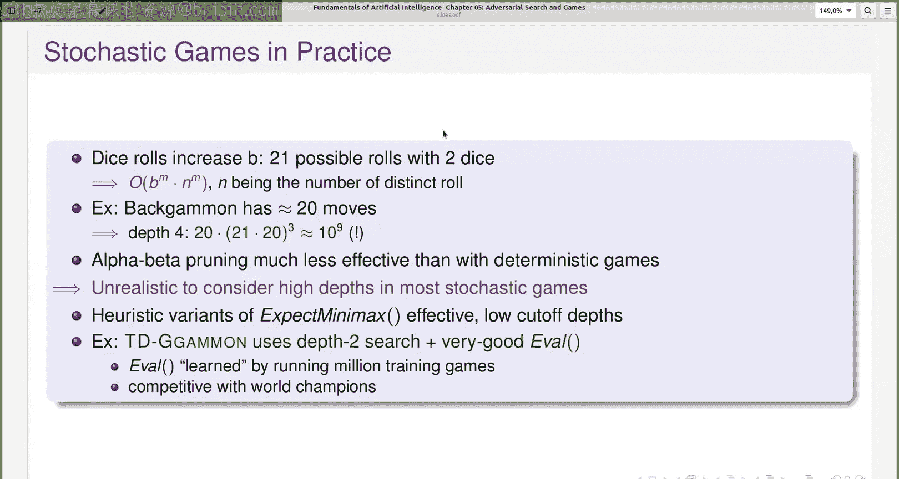

# 人工智能基础：05：对抗搜索


## 概述
在本节课中，我们将要学习对抗搜索。这是一种用于多智能体场景的搜索方法，其中智能体的目标可能相互冲突或对立。我们将从基本的极小极大算法开始，探讨其原理、优化方法，并扩展到包含随机因素的博弈场景。

---

## 对抗搜索简介

对抗搜索描述了多智能体场景，其中智能体的目标相互对立或不一致。这意味着存在目标冲突。

我们首先回顾一些基本假设。对抗搜索有不同的形式：确定性、随机性。典型的场景涉及两个玩家，但可以有更多。零和博弈意味着所有玩家的得分总和是常数。例如，你赢多少，对手就输多少。此外，还需要考虑信息是否完全，即所有玩家是否对游戏有完全了解。

典型的场景是双人博弈，我们称之为 **Max** 和 **Min**。我们通常从 Max 的视角出发，并假设 Max 先手，且双方轮流行动。

博弈的要素包括：
*   **初始状态**：游戏开始时的状态。
*   **玩家函数**：指明当前轮到哪位玩家行动。
*   **动作函数**：给定一个状态，玩家可以执行的可能动作。
*   **转移模型**：描述执行动作 **A** 从状态 **S** 出发后，会到达哪个新状态。
*   **终止测试**：判断游戏是否结束。
*   **效用函数**：在游戏结束时，根据胜利、失败或平局给出收益。

通过递归应用初始状态、动作和转移模型，可以构建出整个博弈树。博弈树通常非常庞大，难以在合理时间内完全探索。

对于双人零和博弈，我们可以只使用一个效用值，从第一个玩家（Max）的视角看是最大化问题，从第二个玩家（Min）的视角看则是最小化问题。

---

## 极小极大算法

上一节我们介绍了对抗搜索的一般概念。本节中我们来看看具体的解决方案：极小极大算法。

其核心思想是递归的：在每一步，Max 玩家试图最大化自己的收益，同时预测 Min 玩家会在其回合中最小化 Max 的收益。我们假设对手是理性的，总是做出对其最有利的决策。

这归结为以下递归模式：

**公式：极小极大值计算**
```
函数 极小极大(状态 S):
    如果 S 是终止状态:
        返回 效用(S)
    如果 轮到 Max 玩家在 S 行动:
        返回 max_{动作 a ∈ 动作(S)} [ 极小极大(结果(S, a)) ]
    否则 (轮到 Min 玩家在 S 行动):
        返回 min_{动作 a ∈ 动作(S)} [ 极小极大(结果(S, a)) ]
```

这个递归定义是自底向上分析的。首先对动作结果进行递归调用，然后基于这些结果做出选择。虽然搜索是自底向上的，但实际的行动执行顺序是自上而下的。

考虑一个例子：Max 需要从动作 A1、A2、A3 中选择。Max 会想：如果我选 A1，那么理性的 Min 会选择给 Max 收益为 3 的结果；如果我选 A2，Min 会选择收益为 2 的结果；如果我选 A3，Min 会选择收益为 2 的结果。因此，Max 的最佳选择是 A1，因为它能保证最坏情况下的最大收益（3）。这就是 **最大最小** 策略。

---

## 扩展到多人博弈

上一节我们介绍了双人零和博弈的极小极大算法。本节中我们来看看当玩家多于两个时的情况。

在多人博弈中，你不再有简单的“极小极大”对手。通常，你需要为每个节点维护一个价值向量，每个分量代表对应玩家的收益。每个玩家都会试图最大化自己的收益值。

你的策略选择需要考虑其他玩家会试图做什么。这可能导致联盟的形成。例如，玩家 A 可能和玩家 B 达成协议：“如果我走这一步，你承诺走那一步，这样我们俩的收益都会比原来高。”

这种分析仍然是自底向上的，而行动是自上而下执行的。重要的是，在这种确定性对抗搜索中，具体的效用值大小并不关键，关键在于值的相对顺序。任何单调变换都不会改变最终的策略选择。

---

## Alpha-Beta 剪枝

极小极大算法虽然完备且在面对最优对手时能给出最优解，但其时间复杂度是指数级的，对于像国际象棋这样的游戏，搜索空间巨大，无法完全探索。因此，我们需要优化方法。

Alpha-Beta 剪枝是一种在不牺牲结果准确性的前提下，显著提高搜索效率的技术。其核心思想是：在搜索过程中，如果发现某个分支无论如何都不会比当前已知的最佳选择更好，就停止探索该分支。

这类似于整数规划中的 **分支定界** 法。我们引入两个值来跟踪搜索过程：
*   **Alpha（α）**：Max 玩家在当前路径上所能保证的最佳（最大）值（下界）。
*   **Beta（β）**：Min 玩家在当前路径上所能保证的最佳（最小）值（上界）。

算法是极小极大算法的扩展，在递归过程中增加剪枝条件：

**代码：Alpha-Beta 剪枝伪代码**
```
函数 Max-Value(状态 S, α, β):
    如果 S 是终止状态: 返回 效用(S)
    v = -∞
    对于 S 的每个后继状态 s':
        v = max(v, Min-Value(s', α, β))
        如果 v ≥ β: 返回 v // Beta 剪枝
        α = max(α, v)
    返回 v

函数 Min-Value(状态 S, α, β):
    如果 S 是终止状态: 返回 效用(S)
    v = +∞
    对于 S 的每个后继状态 s':
        v = min(v, Max-Value(s', α, β))
        如果 v ≤ α: 返回 v // Alpha 剪枝
        β = min(β, v)
    返回 v

// 初始调用
最佳值 = Max-Value(初始状态, -∞, +∞)
```

剪枝能否发生以及能剪掉多少分支，很大程度上取决于探索后继节点的顺序。如果能优先探索“看起来更好”的走法（使用启发式），就更可能触发剪枝，从而大幅提升效率。理论上，在最优排序下，时间复杂度可从 O(b^m) 降至 O(b^(m/2))。

---

## 不完美的实时决策

上一节我们介绍了能精确剪枝的 Alpha-Beta 算法。但在实际游戏中，即使经过剪枝，搜索空间仍然过于庞大。本节中我们来看看如何通过近似方法进行实时决策。

解决方案是进行 **深度限制搜索**。我们只搜索到一定的深度 **D**，然后对非终止节点使用一个 **启发式评估函数** 来估计其优劣，而不是继续搜索到终局。

这需要对极小极大或 Alpha-Beta 算法进行修改：
1.  将 **终止测试** 替换为 **截断测试**（例如，深度是否达到 D）。
2.  在截断节点，不再返回真实的效用值，而是返回启发式评估函数的值。

**代码：深度限制搜索修改点**
```
函数 深度限制-极小极大(状态 S, 深度 D):
    如果 截断测试(S, D) 为真:
        返回 评估函数(S)
    如果 S 是终止状态:
        返回 效用(S)
    ... // 其余部分与标准极小极大相同
```

评估函数的设计至关重要：
*   **易于计算**：不能本身又包含大量搜索。
*   **与获胜概率强相关**：评估值应能较好反映该位置的实际胜率。
*   **保持序关系**：胜利状态的评估值应 > 平局状态 > 失败状态。

以国际象棋为例，一个简单的评估函数可能是双方棋子价值的加权差（如：后=9，车=5，象/马=3，兵=1）。更复杂的函数会考虑棋子位置、控制区域、王的安全度等因素。

单纯的深度限制可能不准确，特别是遇到“不稳定”局面时（例如，一个棋子正受到攻击，下一步价值可能剧变）。更稳健的方法是使用 **静止搜索**：对于不稳定的局面，继续搜索几步直到局面“静止”，再进行评估。

从深蓝到 AlphaGo，现代计算机博弈程序结合了深度搜索、强大的启发式评估（通常由机器学习从大量对局数据中训练得到）以及开局/残局数据库。

---

## 随机博弈

到目前为止，我们讨论的博弈都是确定性的。但在许多游戏中，存在随机因素，如掷骰子、抽牌等。本节中我们来看看如何将搜索方法扩展到包含随机性的博弈中。

在随机博弈中，我们需要区分 **对手** 和 **机会**：
*   **对手（对抗性）**：试图对你造成最坏结果（最坏情况分析）。
*   **机会（随机性）**：没有敌友之分，按概率随机发生（平均情况分析）。

此时，博弈树中会在玩家决策层之间加入 **机会节点**。在机会节点，我们不是取最小值或最大值，而是计算所有可能结果的 **期望值**（概率加权平均）。

**公式：包含机会节点的期望极小极大值**
```
函数 期望-极小极大(状态 S):
    如果 S 是终止状态: 返回 效用(S)
    如果 轮到 Max 在 S 行动:
        返回 max_{动作 a} [ 期望-极小极大(结果(S, a)) ]
    如果 轮到 Min 在 S 行动:
        返回 min_{动作 a} [ 期望-极小极大(结果(S, a)) ]
    如果 轮到 机会 在 S 行动:
        返回 ∑_{结果 r} [ P(r) * 期望-极小极大(结果(S, r)) ]
```

一个关键区别是：在纯对抗搜索中，只有值的顺序重要，任何单调变换不影响决策。但在随机博弈中，因为涉及概率加权平均，**效用值的大小变得重要**。只有线性变换才能保持决策的一致性。

这引出了一个重要观点：**金钱并非线性的效用度量**。人们对额外金钱的感知价值取决于他们已经拥有多少钱。例如，对于一个穷人，100 万是巨款；对于一个亿万富翁，100 万微不足道。因此，在涉及风险和金钱的决策中，不能简单用金钱金额作为效用值。

随机博弈的复杂度更高，因为机会节点大大增加了分支因子。例如，双陆棋有 21 种可能的掷骰结果。因此，在实践中也只能进行很浅的搜索，并严重依赖评估函数。

---

## 总结



本节课中我们一起学习了对抗搜索的核心内容。我们从基本的极小极大算法开始，理解了如何在双人零和博弈中通过递归进行最优决策。为了应对巨大的搜索空间，我们引入了 Alpha-Beta 剪枝技术，通过剪除无效分支来提高效率。对于更实际的场景，我们探讨了深度限制搜索和使用评估函数进行近似决策的方法。最后，我们将模型扩展到包含随机因素的博弈，引入了期望极小极大算法，并认识到在随机环境中效用值标度的重要性以及金钱作为效用的局限性。这些技术是许多经典游戏 AI 和更广泛的多智能体决策系统的基础。