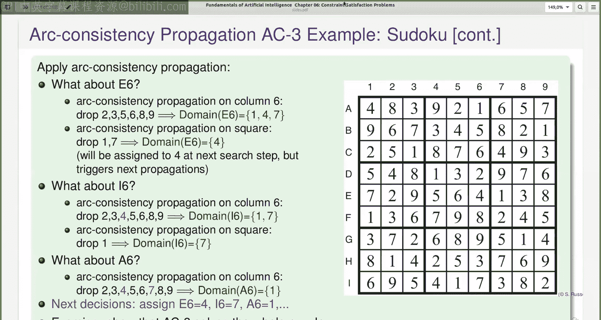

# 意大利特伦托大学《人工智能基础｜Fundamentals of Artificial Intelligence 2024》中英字幕deepseek p17 2024.10.28-CL14-1-CH06-CSPs.zh_en -BV1uUkwYTEmf_p17-

For sure， more reliable than me， okay。Okay， so constant satisfaction problem。

What are we speaking about again？Okay。Okay， if you go back to Cha 2， I presented this slide。

 which was the the kind of representation of a state in any system。

And remember when we have the atomic one， which a state is just a label to a state or numberda or an indexer or and every so it's not distinguishable or rather a apart of another fact that the state is different from another。

 okay， but just and then we have a factor representation。😊。

So in which a state is a list of values to some state variables。 Okay。

 and there's something more sophisticated， which is。sSo course。

 startinguttering which you also have a relationship functions， object and blah blah， blah。Okay。

And the more this increases。The expressive power。 Okay， so this is very low expressive。

 more expressive， even more expressive。😊，诶。Okay， so far， we have often in please assume。

 look at the states as a rule。 you pass it from one state to another state， Okay。

 without meaning you meaning what what a kind of state is。ECSP， instead。

 we use a factored representation of a state。Okay， we have some。Collection。Of variables。

 state variables。 and the state is nothing else that the set of values you give to to those variables。

 Okay， notice it's not seen you can have variables with different nature， Booleions。Bounded integers。

 blah blah， bh。ok。😊，So a state is defined by a set of variables， and they have a goal test。

 which is a set of constraints。Okay， which establish to whether your state is a goal or not， Okay。

 set constraints of such data if all such constraints are verified。Then your state is a gold state。

Okay。Yeah。Okay。And then。They said we identify a set of CSP search algorithm。

So CSP search algorithm are。Allgan， which take， unless。I mean。

Differently from what we have seen before in which we are the forms of blind search or we are driven。

 we didn't look inside the state。 Okay， we just had a state and we move from one state to another state。

 Okay， we have an notion of neighbor state， we have an notion of success or state， Okay。

 but we don't we don't look inside。The notion of state。 Okay。

 CSP algorithms take advantage of the structure of the state。

 in particular of the partial evaluations of all the states。

And the key point is that they look at general proposed heuristics。Rather than problem and specific。

 So AP can be。A lot of different things。 Okay， and you have sort of universal algorithms。To。

 to reason on top of them。 And then you encode your specific problem into SP。So。The main idea。

Behind that is to progressively eliminate candidate values of variables。ok。😊。

But we are going to see this。Okay， let's start from the basic definition of a CSP。 Okay。

 so a CSP con satisfaction problem is a tuple。X Dc。Containing a set of variables， x， x y x2 Xine。

Findine itvolible。A certain no empty domains， the 1， D2。

 then one for every variable otherwise linked。 Okay， so the one is the domain of x 1。

 the2 is the domain of x 2 and so of。Okay， find it。What will。Typically finite， but not necessary。

 And then a set of constraints。See once swim， which is it？

Which in some way specify which bar which are the combination of values， in which can be admitted。

Or not。😡，So every constraint can deal contemporary with one or more variables， okay。

 and they limit the amount of values which are identical。Okay。Every domain， D。Is a set。Of values。

 which can be admitted。Which can be allowed for the variable X。

 means the standard notion of domain Not that here we typically consider finite domains。

 although there are extensions of the CSP2。Infinite domains。Okay， what is a constraint， C。

A constraint can be seen well there are many， many possible different representation of the con。

 but the two components。Are a scope。So substantially the set of variables which are involved in this constraint。

 so I impose a constraint on this subset of the variables。Okay。

 x 1 minus x 2 should be smaller equal than 3 is a constraint。Okay。啊。

And then a relation which defines the value that such variable can take。

 so substantially you describe， you know that a relation is a subset of a given group of the CAtesian product of the scopes of the domain variables so that it tests in some way what are the amissible combination of value。

😊，Okay， so if I say。X minus y x1 minus x2 is smaller equivalent to。

 you restrict the values in sub x1 minus y2 is smaller equivalent okay。Okay。

 so you can express a relation several ways。呃。The stupidest way is enumerators precisely the list of pupils that are unmiss。

Okay。Sometime you do that for very small domains and very small scopes， okay。

 but that's not the way the standard way of doing okay。

 so typically you impose something in a different way。More frequently。

 you impose an abstract an abstract relation， which says in some declarative values。诶。

Establish the sets of possible two。Which are ofmissible two。 Okay。

 like x minus2 plastic3 is more equal than 5。For instance， okay？She。哦。Importantly， the NA relation。

Can tell you how to things。 First can tell you a way of testing if a twople values。

Is part or is verifies the constraint or not， okay。

For the example I made that you just have standard arithmetic say that x1 and minus is 2 plus x3 is more3 is a easyy way of testing。

The set of possible values because we know how to compute a minus plus model report okay？And also。

 it should be able to enumerate all the possible solutions。In来。finine the都 fine。If these are anymore。

Okay， so this is in general the very general definition。Which means that Miss CSSP。

 we need a language。To express constraints， to express problems， okay？

In particular to express relations because， well， in case of ourri， that's relatively easy。

 we have a。The language of arithmetic is one possible way ofsping arithme constraints。ok。那玩意啊。

Many others， which we can list in a few examples。Okay， so far this is very high level definition。

 let's go through something more interesting。Okay， given a state， what is a state？

The state is substantially an assignment of values to the variables so that every X is given a value。

V V I， okay， we typically use the indexes so that the domain。

 the domain is associated to every variable。We saying， okay， let me say give you some terminology。

We say that an assignment is complete。Also known as total， I typically prefer the special total but。

This is my personal taste。If you sign every value。The value of every Bible， okay？

So if an assignment assigns gives value to every variable， call it the total or complete。

On the other hand呃。We call it incomplete or as I typically prefer partial。If only a subset。

Or the variables is assigned， okay？Oh。In a silent。Which doesn't， which is compliant。呃。

Whichch is does not violate。Any constraint in the CSP is called consistent or legal Not that in case of partial assignment。

 may will be the case that is yet。Incomplete salt for Easter， if I say。

X minus y is more equal than 3。And I say x equal2。ok。Where。This is， this does not violate。

Simply because I don't ever yet assigned why。Okay。So but so far。

 a partialia sign so far does not violate。The assignment， okay， it doesn't violate any CSP。

You may violate it if are the somebody。😡，We save that。A total assignment。

Which satisfies all the crosstrain is a solution of the CSP。Okay。Over there。出发。Okay。

And aten is the be problem。Goci in find in finding， at least one solution。

The variation in which you may， you are asked to find a complete set of solutions。

 I mean all solutions。Yet one more variation is a constraint is the problem of constraint optimization problems。

 COP。Is optimization problem is a problem not only to find a solution。But they find a solution。

 which makes gives you a optimal amount value to some objective function over the solution。Okay。

 so if I give a。A cost function， which is some ari combination。Of the values of a or the variable a。

An optimal solution is a solution。See before。Which gives it the best value。

Of which which among all possible solution， returns the best value of those solutions。Okay。

 so I think that so far， I part。The form， the formatman of the Defia。

 I say the something which is nothing particularly fancy。I would say， right？

I don't think there is anything particularly strange to understand here， okay？Okay， fine。Okay。

 so one example of CP， you probably know。Suddaku， do you know， Sudahu。 So how many of you don't know。

S okay， all of you know of you know rules。So this is。This is a classic CSP program。 Okay， In fact。

 it will use to occur as an example very often。 So your is a problem which you have 81 variables。

 each square is a representative variable and the。😊，The index the indexes are X， I J。

 While conventionally， there are。The row index is from a to I and the column index is from one to nine。

嗯。😊，The values， the domain。Is 1 to 9， so you can。Attribute value from one to9 to every box。

And the costs are。Only over the same kind。And they are what is called all di。

 iss a standard constant。 It's all different。 So you give a list of variables and you say all those values。

 the values of those value must be different。ok ， in particular嘅咧。

The constraints are for every row that all values in the row must be different。

 All values in the column must be different， and all values in the square must be different。Okay。哦。

You can express this in this way， or you can express， which is quite compact。

 So substantially is 9 plus 9 plus 9。 So 27 all constraints。

Or you can impose as a along list of pairwise constraints in the form。X， I， J differ from X， J X。

 I prime J prime。 So expressing this as oh。As a set of binary constraints means。8，8 the。

8 times7 divided by two constraints， okay。So you have a openwise combination。Of values， okay。

So you have a long list of， you can see this either as all different constraints or as a huge list of binary difference constraints。

 okay， otherwise。So all。呃。A different cr for all squares belonging to the same rows。

 a different cos for all squares all pair of squares belonging to the same。

Corum end up to the same player， Okay， so far， I don't think anything particularly fancy。ok。

The solution is a total value assignment， which satisfies all those about。 Okay， in particular。

 for instance， this is， you can say that this is a solution。 Okay。

 I don't know how many of you have played Suku and good you， But this is a very interesting game。

 because it's a lot of strategic and marketing side。 And it' very interesting because we can。😊。

Use this。This example， this game， as an example of all the nice ideas that you can have。

 you can use to solve an arbitrarily complex of CSP problem。Another very， very popular CSP problem。

Is a map calling。Well， this is a。A metaphor of much more complicated， interesting problems。

 Of course。 So nobody spends really his on her life in coloring map。 Okay。

 but the key points So apart from anybody who works in this。诶。For map designing the company。

 but but the key point is this is that this is a fundamental problem because it's a metaphor of much more interesting problems like a look which is substantially value location problems。

Under the somemcompattibility pro。 So what is the point of this。So， suppose we have。

A map like we brought the example of of Australia。 So the main the main state。

 I think is's called of Australia。 So Western Australian， Northern  Territories， Queensland。

 Southern Australia， New South Wales， Victoria and Tasmania， Okay， abbreviated like that。

And you have a domain。For instance， you have a domain of calls， right it's a metaphorical。

 you call them calls， okay。And you say， you want'。And the goal is giving is color every state。

 but in such a way that adjacent regions cannot be painted the same color。ok。So for instance。

 Western Australia could not have the sink color of Northern Territor is known with southern Australia。

Okay。This is a very interesting problem。 is one of the。The first。

23 MP complete problems found by CAp in the 80s， which characterizes。

 which start characterize the notion of MP complete。 Okay， and it's very interesting because it's。

One of the typical problems that you use to prove MP hardness of some problem。哦。So for instance。

 one previous solution is this one， but you may find many others。With that。 Okay。

 so you see this as a solution。 Now in general。You have to think that map calling problem is goes beyond the of mapping。

 Okay， Per， because。We have an notion， so police you cannot have more and adjacentjut places。

 So in general is that you have a graph。And， and， and every graph represents。

The VR can represent an agency， every we know the representation a variable。

 and you cannot give the same value to two connected nodes。Okay。Okay， so。In你 fact。A CSP in general。😡。

And that's very important。Typically， very often， CSP can be represented in a graphical way。

As follows。OrAs a coastsline graph， or also called a coastsline network。You reach nodes。

Are the variabless of the problem？😡，And edges。Connect N two variables that participate in the constraint in this case。

 you for instance， if you have this pad you can easily represent these as a graph before these are just the abbrerationations。

 okay the Choniums。And then you notice you have one arc。If the。If two states have a border。

 a common border， okay。Substtanial image。Connects two variables， which participate the constraint。

Okay。Susstantially。Every constraint algorithm constraints of the algorithm looks at the graph and exploits the structure of the graph to drastic and improved performances。

For instance。You may immediately have noticed the Tasmania。Is an isolated state。

 so it does not really participate。To the search。 Okay， you can attribute to whatever value you make。

You may like it without effect。 And then we see that looking。And the structure。Of the graph。

 you can drastically improve the performance of the solution。Okay， so far。Okay。Okay。

 there are lots of。Volyant of CSPs。嗯。So the the first point you have to make a distinction。

 The first is with discrete variabless， which are the ones。WeWe are most interested。

 I have to make parentheses here。In a eye， the A were the CSP or C P。

Is an overloaded problem in this expression， sorry。

 which means that many people call them in a different use this expression with slightly different。

Tinology。 So meaning， So in general， there are people who use theP as everything， right， So even。

Such for me model theory is a CSP， we say that so even constraints of linear arithmetic the reals is a CSP。

 so everything which is set can be represented a set of constraints and the domain and a domain is a CSP。

Typically， what is。Most through the five days of the CSP community in。In the。AI， in particular。

 there is the CP conference and the CP constraint journal。

Most you refer to a discrete variable with discrete and finite values。Okay。So， first of all。

 the first distinction is between distinct discrete and the continuous variables。 Okay。

 so discrete variable， well with discrete domain。 and we have two categories。

 finite domains and infinite domains。So， if you have a。Doomain size D。

 So all variables have the same domain size D。 Then you have and you have n variables。 Okay。

 you have2 to the end candidate。 sorry， B to the end。Candidate assignment。Okay， candidate solutions。

 and then some of them will be solutions， some other will not。Some of them we violate oncoline。

 some of them will not， okay。There is a important subcase。Whi is是 bull良 bull logic。

Bulion satisfiability or proposition satisfiability set。

And we devote a whole chat that reason to think of that， which is a fundamental。

Tpic in artificial intelligence。 So substantially。Sft service are probably。

Either the most popular engines， reasoning engines in AI and in many other applications。

 So we developed a lot of。Timer to discuss them。ok。Well， of course， Sir。

So you could if solve these are finite domains， so you have a finite amount solution。

 although typically very huge so in principle you could even try to enumerate all but of course。

Unpractical。 Okay， so there are techniques search techniques ado or doing。

 And that's actually what we are going to speak about in these two chapters。

Then a completely different story is the evening domains，So in principle。

 you have an infinite number of complete assignments， so if you for instance。

 if your domain is embedded integers。You may have an evening domain。

Ping job shadowcheduling the variables with the start and。

And then time of some job are labeled with an integer number。And in principle， they are abandoneded。

You need a cons language， you need the language to represent a con。So， for instance。

 you can decide that the。The start more point of job one。Plus。

5 is smaller equal than the start job of of job 3。Meaning that。

The job 3 must start at least 5 second，5 time units after job 1。ok。

You may have what the most popular one with a inger or anything which can be reduced to un ingers are linear constraints。

Ding a constant over a inte is decidable。That's MP complete。Actually， is。

The increasing part is that it's hard， of course， the fact that this is a complete obvious right because it can easily verify a solution。

With unbound with the no linearar cons， is undecidable。Well， to convince that。

The problem of the fact that x to the n plus y to the n equals z to the n with n strictly greater n2 is what's called the thermo theorem。

Okay。Its very， very window， he was solve only a few years ago and mathematician for Saintt Louises ever wonder whether this is to prove that it is no solution apart from for and stick into okay so just to say this in general。

 you can formulate many of such problems which are not decided。And why， what because this is。

The space of social is in。And there is no way of making them find it sort。Ill is it way at least。

In the end， you have the reward of continuous variables。We typical of the Ris on their rationals。

Well， typical linear constraints over real rational variables are polynomial。Oh。

Is any view familiar with the simplex map， Have you seen it？ Yeah， okay， this is a way of solving it。

Okay， and no linearer constraintss is also solvable。

But is dramatically hard is doubly and exponential， for instance。

 by means so seem to algebra the composition。Notice that some of those problems have actually are not specific of A eye。

 Okay， so inner constraints。Are used in a large amount of problems。The simplex。

 do you know why the simplex was invented。Now we are using this for EI that why it was invented。Yeah。

 inspirational research， yes， but why was invented， what was the target problem。

Optimal diets for cows。I'm serious。I'm serious。You say。Has a huge army agency see。Okay。

 so there are the same。 There are 10 times the number of cow and the number of people。 Okay。

 they eat a lot of。Need there。 Okay， and well， finding the the， the optimal， finding the optimum。Dt。

 so find the optimal combination of the basic components for a diet like glass grass。

Whatever call whatever。 So such that every cow has the the good amount of lipids， proteins。

 carbohydrates and and with minimizing the cost。Of every component。我塞。毕经到这了。Problem。Okay， and。

In the 50s， so not only you were not born， but I wasn't born， people came him。

Caing out with this simple algorithm， which it was nowadays。

 it's probably the most used algorithm at all。So nothing to do with the you may notice Okay。

 this is sometimes use the call CSP， sometimes this is not。

 So if you typically go to constrain programming conferences。

 most people and you look at the tools which are label as constrain programming tools。

 you may think you may notice that they typically concentrate on find the domains and discrete variables。

 although。CSP is anumbr la term， which can be widely statement。

Notice that the very same problem can I have a very different。Ecoding in SSP representation SSP。So。

 for instance， consider。The example N queens。This is very popular。 Well。

 we have already described this， this problem。 Okay， you can think this as a formula SSP， right。

 So well one。First candidate is that to think this as a boolean problem。

Introd a binary variable for every location， every square。And you say， okay。

And which is true if a queen is there and it falls。If your queen is not there， Okay。

 and you have a lot of explicit to answer， like for all element。In all pairs。

 inner a row that you can have only those combinations。Okay。哦，我年。For for every pair or like。X， I， X。

 I， J and X， A K， you can have only one of those。 So only one of them is can be true， okay。

At the most one is it true， it's same for a column， same for a Naal and a one diagonal。

What is very meaning you没。Want to think， okay？You may have a better representation。诶。You say。

 so exploit in the fact that you cannot have more than you have exactly one queen in every column。

 for instance。Okay， so what you say is。You impose。One one variable for every column is for every row or for every column as you prefer okay。

 and you in which states the position of the queen in that role。Okay。So you say in row number one。

 the queen is in position two， in row number two， the position the queen is position four and so on。

 okay。And the impco strength are no threatening Q1 prime a Q prime， okay。So for the role， of course。

 you don't have。Posibility of I， because you have only one possible values。

 you can attribute the for column for every column， you can say that Q I is different from Q J。 Okay。

 so the value。So the position of the queen in Q number one。

 it must be different for the position of the queen in position two， okay？Well。

They down and upper diagonal can just pass that the position of Qi is different from position of QJ plus k plus k okay。

So statute cannot be in in the word diagonals and the word essay with minus， okay？

So this is said least representation。And it's much more efficient because instead of having n square variables。

 you have n variables。😊，Okay。And you have much more compact。Compact representation。

First fundamental rule of CSP。Finding a good ening in a goodP is fundamental for the efficiency of the solution of the problem。

This is really fundamental。Okay， so what are the kinds， Yes， please。Which one。呃。Oh， maybe yes。

 So Q I is different from。Yeah， I think so， yes。Yes， this is a typo here， Okay， we correct it， sorry。

Okay， the point is of constraints here。Okay， so which kind of constraint we have。

The first obvious these ones are well typically you can characterize constraints by the they a scope。

 so the number of variables they are involved， usually constraints are those which you involve only one vol。

So you can say southern Australia cannot be mapped in green， cannot not be covered in green。Okay。

医asing。Binary constraints involve pair variables。You can say that southern Australia is。

Can be should be different from well。Western Australia don't remember the the， yes。

 Western Australia， so they must be to in a different way。Okay， for instance。They are in general。

Summer。Bigger ones。Ivolve 3，4，5 in this case。哦。You need。

 if you wanted to give them a graphical representation， you need using hypergraphs。

 You know what hypergraphs are。Epergraphs are a extension of graphs in which the relations are not simply arcs。

 but collect groups of arcs， interconnecting groups of arcs， okay。So。You have。哦。You may have others。

 so。呃。So substantialtan I represent N。Any consequence？

We see an example of the crypto arithmetic example in the next slide。

And then there are global constraints。 They are very popular in the world of CSP。

Global constraints are constraints which involve an arbitrary number of elements。

 which a common structure regardless the amount of note of elements they have。

 one typical example we have already seen， which is all different constraints。All， all values can be。

Must have a different value all all variable must have a different value。 Okay。

 they are very popular， very frequently used and。唉。say one of is another global cons。

 only one exactly one of those constraintss must be true reasons， or at the most end。

 although at the most k of these n variables must be true。Or at least。

N of those variables or exactly n of those variables investig and so on。哦。Tpically。

Most CP server handle a specialized algorithm to deal with。But let's go from that。And those， okay。

 so far， we have seen only one fundamental category of constraints。

 which are called hard constraints。Means con that must be verified。😡，Okay。

 so if you want the solution， you must have them verify。

There is a broad category of constraints in CSP in optimizationization。

 which are called soft constraints。Wehich say， okay， I would rather。

These costs decide to be satisfied。Or I would rather a。Instead of solution it says。Vue A。

 rather than value B。Okay。😊，I would rather have。A cake rather than a fruit， okay。

So is price preferences。 They are generic called the。Soft constraints or preference con。

 but most often soft constraints。 Okay， and say something which is not strictly necessary。

 but you will try to give to have them satisfied as much as possible。Okay。

I'd rather have a Western Australian red than do a ring。

And sometimes often there are many ways of they dealing with them。

 but the typical way is to give them a score。A reward of a penalty。

To preferences to say and try to optimize the result。Okay， so if you give the cost。

A cost if a soft consent is not satisfied， Okay， and you try to minimize such cost。ok。

These are typical kind of problem that you may encounter。嗯。And this category。

Is as I said before is handed by tools which are constants optimization problems so COPs。Okay。

 just make a simple example of a C。Okay， this is kind of promise， which can you can find some。

Say magazine， like a lamanica or anything like that。 Okay， supposeupp you have。啊。

The following equation 2 plus 2 equals 4。 So what is the trick here， You have to substitute a digit。

Do you have elector？In such a way that the result is correct。Somemission in ariiththmatictic。Okay。

 so every。Distinct。Varariable is a distinct digit here。Okay。

 and you have to encode this in a problem in such a way that mathematically it touchs up。ok。Yeah。

You can find it in the demandlingistic or something like that。 Okay， Okay， so what do you have here。

You have variables。 So one for each letter。 Okay， plus some pleased variables， which are hidden here。

Which are the carries。the sum here， right？Let's say C1， C2， C3。Okay。Then you have a domain。

Or variables are。Are from 0 to to 9。 And the carries are from 0 to to 1。 Okay， in principle。

 you can think that the car is okay。You may have different level of sophistication of encoding。 Okay。

 you may know， so in principle carries can can be more than than one。

 but in notice that you have only one sum here。 So you the carries here can be only 01 in Chinaana with multiple information so you can have bigger carries。

Okay。诶。Then you can do something more sophisticated。 You can say that， for instance。

 F T and T have a domain which is not included the zero， Okay， because otherwise we use。

Less digit okay， so implicitly the T and T andF here are bigger。

You can add it and call these as a constraint or as a domain a。Sometimes in the formulation of SSP。

 you can simply。Take general domains and then add some constant which from the very beginning limit some drop some values from the constraints or from the beginning。

 drop them from from the the domains that's not so。Difficult。Okay。

 now let's write them as a constraint。So。O plus O， The first constraint is column Y。

 So let's add up with arithmetic。Oh， plus or。Is R。老师。Thank to the Curry one。Okay。😊。

Standard operation carry one can be either zero one。Depending whether you have a carry or not。

Here we have W plus W plus the cur1。Okay， is you plus thing。Times cabin2。

Here you have T plus T plus curry2。Equal10。Plus， carry3。ok。Equals1 plus square plus0， okay？诶。Who oh。

 sorry。plus5。F， well， F is the same as currently。You can also add the fact that the T and F are different from0。

 otherwise， you would represent this in different way。Alternatively， you， you can。

Say from the beginning that F is a range of F is from one to 9， and the range of D is one to 9 if。

Okay， well， you can play with it。Make a solution。But you you see that。1， this is one instance。

 So notice that。You may think that you have more than one solution。

 but the note is that the O here or co are here。Okay， so which makes are there？

Things more constraint。 Okay， you can play with it and notice that。7，1，4。

So this is a solution of the problem。I never tried this extensively。

 but I think this is the only one solution， but you can play with it， so notice。Well。

 these are the top， Okay， and note that is a sub with F1， T7， U2， w1，1 and R。8 okay， so this is。

 you can feed it to a C2P program and it solves that。Okay。😊，Okay。

 something much more interesting is job shop shadowcheding。诶。ok so。This is a billion dollar problem。

 okay， because optimizing this kind has a huge industrial impact。You have to shadow problems。

 So every。Dusk。Has to as a time required， okay。And。So every task takes sometimes and there are。

 of course some precedes constraints so you have to do this task before this other task Okay。

 and you may want to find the optimal combination of task。In such a way to minimize。

 to solve the problem。 and if this is an optimization。

 also to for instance to minimize the time span。Okay， so for instance。

 you may have domains for every task T， so the starting time from one task。Doomain can be。Well。

In principlema should be real or rational， but in practice， people tend to use integer domains。

 so suppose you have。O'clock。Okay， so everything can that。

A clock which gives the time and so all the possible starting times can occur at the fixed clicks of a clock so your value is an integer。

Or you can suppose this to be a bound integer， okay？So constraints are typically in the form of。

For if you want to say for instance， the task T comes before the task T prime。

 you said that the starting time of T plus the duration T should be more equal than the starting time of T prime。

Okay， so this means that。Tipran cannot start before he has finishedined。If you want to say。

That two task cannot be occurred， cannot be run conarily， but they can be running in whichever order。

You may have an no between。Between the president constraints。 Okay。

 so you can say that either he precedes the prime。Or T prime precedes the。And this brings。

An extra problem。Why。Because we have know。T二。You have a no here。A branch。A Booleion component， Okay。

 so this， for reason。P solving problem。Large amount of problems like this。Thisponoia。

Solving large amounts of problems like these isn't be complete。Okay， because of the other know。

 like they're a source of branching there。Right？Okay。Okay， here。

 just to say that it can be proved that every carry constraint CCB can be mapped into a binary constraint。

So why？The book says a way of doing that。Why are we saying that if you remember， for instance。

The Sudoku old beef can be mapped into binary constants。 Why I'm saying that， because。

In this narration，Let me make a point， we could have a 12 credit cards only on CSP only like many chapters of this course。

 okay。In this。Few classes that we devoted to SP。We assume all constraints without lots of generality that all constraints are either unary or binary constant。

Okay， which simplifies lots of the narration of the explanation of either。

 although there are specialized arguments for every kind of constraints that you can perceive。Okay。😊。

啊。Typically we call neighbors to variables we share by an con， okay。So if binary constraints has。

Invol a variable X X J。 Then we say that Xi is neighbor variable X J。 Not， which is very。

 this is very different from the notion Ne we have seen so far。So far。

 we have maintained neighbor states。Okay， be careful to this distinction。

 there's nothing to do with that。Nbor states are states from which you can easily pass from one to the other。

 Okay， typically one is a successor of the other。 You can get from one to the other。

 here are name Bible。 So let's say that variables which directly interfere with with each other。

 So which I whose value variable X。Has a direct directly interferes with the values of variable xj through sums specific constrain。

If I say x minus y， it's more equal than3。The value of Xi strongly in directly interfere us with the value of a Xj。

Over there。Good， to everybody。Okay， so there is a large amount of such problems。呃。

Task assignment program。 So who teach well， every time this university has to set up the timing。Okay。

 so timetable。That's to solar CSP。Okay， so who teaches in which class。Okay。

 which room every class is played， placed。In which time not every course is placed。Okay。

 is this a complex？诶 speak带嘅。Hardware configuration。 So when you design a circuit or or a cheaper。

Police in the components。 So every chip is made by senior blocks。 Okay， so you have a multiplier。

 we have another。 We have a shiper。 you have。Pieces of value， Okay， How do I place them。

 How do I root them。This is a very， very problem。 you have to locate。Object in please。Transportation。

 which bands goes where， Okay， How shall I organize the signing of materials， Amazon。

 think of Amazon has， they have to solve a huge CSP problem。Okay。Every factory。

 every building of the organization， the factory， the organization of the building of some new building is。

How do you I place a thing in such that they they are not then do not interfere or stulate each other。

 so that's lots of kinds of problems like that。So just to remember that some values。

Some promise involve real and rational value。Many ones involve combinatorics and logic。😡。

Every time you have a notion of or。Or， an notion of or is wise。 So an implication is an order wise。

 okay。Or an infiniteol leafa is an orange y or exor。Every time you have a logic。

 every time you have a negation， every time you have a no， you have a logic on board， okay。

 and typically this case up in the complexity。Every time many world require optimum solutions， Okay。

 so not only from solution， but you have to search for an optimal solution so they have。

CSP is an umbrella at that， which。Cbu us a large amount of problems。Okay。

 so I think we can have a break now。And okay。Let's assumeoom at 40， okay。嗯。Yes。Qu。So。Okay。But。没题嗯嗯。

换好的。对好。我们不不说了。Oh。Yeah。哎，那有几家有了。あアオベその。没什么。咁咪琴日诶你好。但你我 coming。诶お。明台应。グスでそのて。啊五六。你不就意思。Okay。在 the。

Something is interesting。That mean order constraints no different where。话。see。fact same。呃。Oh。No， no。

 no， order I and。Re in会。雨孙。P of course need。と nameと。Okay。Oh。The question site there。Okay。

 we when I order con， but the order con in example。Okay。We look at the in constraint。

In global constraint constraint， it could dev in vote direct tri sector Louisiana。那これ讲呢。Okay。

 that typical or different。All different， of course。

 trying enter equal about the I about an important personality in Ja Qa。Okay，Did become。All。

Deendend the time of the hard。I。Okay， you all different off what you do。E the Okay，Okay， okay。

 becoming in the global constraints and。Okay。Be a fast。あ no。这 same same一。C depends。Hello。Aora。

 typically comment theis is2%。I mean' thats。你嗰度表啊咯诶发数次啦啊嘛。It。Itpon。December。I mean for South。

你弄得咩什么诶第。诶其个好诶只你家吧，佢仲上啊佢之话。Pro mean mainly。Yeah。Okay， reallyll start。对。Okay。

 so the fundamental as I say the。You can have a 12 credit course on CP。 Okay， alone。

 I'm just giving you the the main ideas behind。 Okay， the main the fundamental about that。是暂神。

There are search arguments， but the notion of search is in some way quite different from the notion of search that we have seen so far。

呃。If you go back to what we have seen so far， our notion of search was that every time we pass from one state to any another state。

 a neighbor state。So state child state or whatever。 Okay。

 so from a complete state to another complete state。Okay。

So that's what typically is considered as a search in general terms with the CSP。

 we completely change a paradigm。Okay， we is in terms of partial states or incomplete states。Okay。

And we use constrained propagation， so the key point is that in every step we do and then do assignment to values of variables。

And we， every time we can try to deduce。Excuse me，Okay， and every time we restrict the domain。

 we can deduce some restriction of the domain or some other bias。

Until we get some deterministic choice。So。The key point of a CSP that is continuous interleaving two main steps。

Which is one is search。So picking one value。Decided to attribute。In a non deterministic way。

 one value to some variables， according to some some criterion。

And the other is constrained propagation， which is fundamental。

 and this element is completely new for us。Which okay， let's go up by step。

 So search as I say is to pick one valuableball assignment。Okay。And when needed。

 we can undo some assignment if we have exhausted the research and we have found that there is no way of proceeding along this line。

Okay， this called。But I want to stress this fact。 we don't move from complete state to a complete state。

Here， we just， we pass from a partialia state in which we have a sign。Partial partialial assignment。

 partial solution， partial， whatever。 Okay， so to some。

 we have assigned a way to a subset to some to some scenario in which we have added one， one more。

 And when we better track， we， we drop some， typically in a stick based manner。Yeah。Okay。😊。

So substantially， we try to be the progressively。A complete solution。 So a total solution。

It progress in incrementing a partial one。 So we first assign the node a to red。

 then we assign node x3 to blue， then we try to assign the node x 5 to yellow and so on and for okay until we find a consistent or we backtrack because we see that the current。

Partial assignment that we have found has no chance of progressing correctly。This is search。

But then we have a fundamental component， which is inference or constraint propag depending on。

This is sometimes so constrained people tend to call it constraint propagation。

 people coming for logic tends to call them ins。Susstentially the same element。 And the idea is that。

We use the constraints that we have to reduce given the current value of the assignment that you have a partial assignment to further reduce the domains。

Of they missing variables or the unassigned variables。

Until we have some deterministic choices and when we have empty domains， of course。

 we can we are forced to backrack。Okay。诶。So when that we have a。

And nodes which whose can values are reduced to emptyide， then it will be track。Importantly。

 when we have some variables。For which the domain contains only one variable， only one value。

 then we assign this deteristic。Okay。Okay， here is a ruler thumb of every。Sensible algorithm。

Try to do the deterministic steps first。If any， and only after that。Try do the nondemin sequences。

Okay。So this is a universal metter rule。Which drives you search。In every CSP。

 but it is also all in logic， it also only in festival logic， also in description logic。

In planninging in whatever。Do the types first。Do know the postpone know the termist step afterwards end up。

The very simple impression of this is given by this very simple graph。Okay。

If you have one little easy the choice。😡，If you can postpone the nondeministic choice。

 so you do a deterministic choice and then you do the two plus two or many。No deter choices。

You do one， and then and。You have one few last N steps。Okay， if you do。

 they know that a ministry choices first。The new app N plus N steps。Okay。So。Okay。

 imagine to apply this recursively down to the search3。

And you understand why the soccer the rule of do themin first。

Po do non determin type afterwards is a sort of meta rule that you may find practically in every search algorithm。

Okay。Okay。Cose time propagation is the new element。 So we haven't seen that before， right。

 because we didn't consider。So in previous cases， we move from a total for complete states to complete states now we tend to reason to move through partial states okay。

And this is fundamental。 And this can be used into。

Scenna so well apart from be performing initially as a proposed is that so typically the first before going throughP problem before start search。

 you do a contrain propagation， so try to see if there are some obvious if you if there is a way of reducing the domains but just。

Analyzing， but the first case， if you remember before in the case of the mathematical sum you could immediatelyfer a few thought。

 for instance， that the fact that the domain of the top variable was one， not zero to9， but one to9。

For instance， okay， or realize that the the value of you could drop one variable because you realize the two variables are were equal。

 So like poison the F and the last carry。Okay。Ths of that。But then， you need leave。

Search with crossline propagation， that is one of the fundamental characteristics of CSP programs。

You decide on variable， and then you can try to infer everything。

 every reduction in domain that you can before passing to the same to the next year。Choice， why that。

 because this cuts you a lot to the possibility of the possible alternative choices。Okay。

 so it prevents you to make stupid。Stupid choices。If assigning value A。ok。

Tells you that the new ride to some total， okay。Ts you immediately that you cannot assign the art writer to France because in neighbor。

Okay。So you immediately constantlyline propagate and you drop right from the domain of France。Okay。

 which means that you will not please the you not select right to branch the next part。

 which will immediately lead you to the violation constant of CB okay。Okay。

So you't it allows prevent you to do silly choices。With the next step。Okay。

 in order to and we devote to the first part of the search to explain crosstrain propagation because it is fundamental。

There are many ways of coastline propagation。And which are characterized by two components。

 how effective they are。And our fishing is to do that。

So how much how good are they to reduce effectiveness means how good are they to reduce as much as possible the domain？

Efficiency is how many steps does this take。Remember that in。In search。But not only in search。

 there is always this trade offer between effectiveness and efficiency。Okay。

 you always have to choose。Well， okay， the benefit。

 you have to make a compromise between the effectiveness of the results。

 so how good is the result you are guaranteed to obtain with respect to how expensive it is to perform the step。

It's not always the case that the most effective techniques are those reactor choose because of domain name。

Because costing。Too expensive。 So yeah。To balance。These two facts。Okay。

 let's analyze contrainign proagation in detail。So as I say。

 the con propagation is the user contrain to reduce given the current departure assignment to reduce the set of legal candidates very valuable and。

Narrows drastically the possible choices in your next step， your search search step， okay。嗯。

The key point is， to preserve。And propagate local consistency。 What does it mean？啊。Look okay。

 what does mean look， look sensation of Nbu， remember。

 we we call neighborB variables two variables which participated to the same constraint。Okay。

 single constraints which involve two or more variables lets assume two。

Costtrain each other the values。 So it means that if you， if I restrict to some extent。

 the value of one variable， this imposes。That is to each of the values of the other。Okay。

So once I have assigned one of variable in the binary constraint， this means that I should reduce。

It is likely that it can reduce the domains of the other and doing that is very， very important。

Because it saves me a lot of search。Certainly， from a lot of stupid steps， search steps。

 which are bound to fail。Okay。Okay， we see that we have several kinds of local consistency。

 one tri one， which is no the consistency。Alsoal that one consistency are consistency。

 also known as two consistency。 and then there are many others。 So bath consistency。

 which is three consistency angel a K consistency where you reason inductively on this number。

 and I'm going to explain you now what what what I mean okay。Okay， let's start from the obvious one。

 the easiest one， you know the consistency。Okay。The value of so the current domain of Xi is not consistent。

Okay， it all the values in the variable domain， not in the when I say variable domains。

 I mean the current reduced variable domain。Okay， so initially I buy a domain and then I progressively drop some candidate values from that because of previous information。

 So I see I typically CSP maintain a representation of the current domain of every variable。Okay。

 so I have a data structure telling you this value is illegal， this values cannot。Okay。Okay。

 so if all the remaining values of the viral domain satisfy all the unitary constant。Okay。

And we say that a global problem， CP is not the consistent or one consistent。

 if every variable is not the consistent。What that is。When you have humanal science。

 let's satisfy them。Okay， from the beginning。 So that's。Propaate。

 they value from the beginning and that's user the the and if the result is。

Is still consistent then ahead。Okay， that's。This is called node consistency propagation and substantially what you do is that you remove all values from the domain。

From the domain of every variable， which violate some ur constraint。Okay， so for instance。

 if you have the contraint that some variable should be different。From some value。 So for instance。

 Western Australia should be different from green。Then the domain from West Australiauslia is reduced from red green blue to red red blue。

Okay， similar， if you have a unique request saying w is equal to green。Then this is。

 then you move and obviously the domain is are used to green。

Not that you can have more sophisticated values if I say that the domain is one to men。Okay。

 and I have a unit cons that the value of x is in between two and6。

I drop all the values from I drop one in 789 from the sorry 01 and 789 for the value and so on so it may have arbitrary complex uric constraints。

把出当里。This is a minor point， okay， so just to say， okay， when I have a Uni intelligence。

Run and all the consistency propagation from the beginning。 I get read on them。

 and then I start the search。Okay。So even coastta are， well， okay。

 something that you do a priorityi from the beginning and that's it。Okay， so far。

 that's the easy part。Okay。AFa instead the definition is what is arc consistency。In bioicals， okay。

We say that an node Xi is unconsistent with respect to another node X J。If， so the。

What does mean Xci mean the current domain of Xi is our consistentent。Okay。

If for every value of a current value of Xi in the current domain。That exists a value。Of X J。

Whi is compatible with all bi constraints。Which full of my wasn。Which means substantially。

 whatever every value， I can in a second moment find a value。Of Xj。Okay。

 so I I should not drop some values。If it's not the case， if it's not as consistent。

If there is some value。Of X J of Xi， which is incompive for。 There is exist no proper value。

On the neighbor state on the neighbor state variable Xj， I should drop it， Okay。

 because I I have no chance。Over signing this value。According to this， So， for instance， if I。

If my neighbor is assigned sign red。Okay。And my， my current domain， I have right。I should drop it。

I not our consistent because the very rate is not compatible， there cannot be any solution。

In my search， in my CSP in which I assign this right， so I should drop for it。Okay。Is this clear？

I think so right。So。We say that CSP are consistent if every variable is not consistent with every other variables。

 Okay， so substantially there is no values inside。The know do wecha。

Incompatible without the name of value。Right， clear to everybody。Okay。

 and here comes a very basic algorithm， which is forward checking。Thorral checking。Looks。

Sustanti looks to the assigned variables。So the value， which are in assigned， Okay， and。

Remove the value of the enables， which are incompatible with the value of the assignment。

So I looked to if Italy is a sign right。Drops red from France， Switzerland。

 Austria and Slovenia and Slovenia，And some are in about digitalvaika as well， okay？They are。

Notice something very important。This is the simplest form of coastline propagation tool。

The simplest and cheapst。There is a fundamental limitation。So if actually loses a value。

You don't take a look to the， you don't update the constraints of the neighbors of Acts。

In this very simple form， you don't do that。So if Italy is a sign right。

And you drop right from France。Okay， maybe。The fact that you dropped the red from France could have。

Consequences of the of the domain that Switzerland。Or a bedroom。Can be signed。

 but you don't in forward checking， you don't do that。 You don't do any update。

 So for checking deals solely with the constraints between assigned variables and unassignedable。

They don't deal the constraints of unassigned variable， which lose by values。You you say， okay。

So this， as a result， that ensures that arts。From assigned to un assigneded variables are consistent。

But only one direction， okay？Well， it will apart the other directions of this。

 but because of this assigned。 So it guarantees the consistency of the artrcs between assigned and unassignable。

 but it does not guarantees。guarantee啲で。Art consistency of other arts between。

So forward checking does not guarantee that the result。A for our checking is。Is our consistent？Okay。

What these。Why people use it for what checking， why because it's very cheap。Dplement， okay。

So this leads to an obvious algorithm。Look to the sign of variable。

 Look at the neighbor to all the sign of Every time you sign a variable。

 look to its neighbor and and drop the values， which are incompatible with this assign。Okay， very。

 very cheap。Yeah。Okay。In general， we would like to something more sophisticated。

We would like our consistency propagation also to from unassigned variable to unassigned variable。

Okay。So。By a consistent propation， we mean remove all values from the domain of every variable。

 which are not are consistentistent with those of some other variables。Okay。If I drop some value。So。

 for instance。Suppose again， they take the example I assigned Italy to write。ok。And they say， okay。

 this means that France is a process， drops right from her values。But。Does this affect。Belium， well。

 suppose that the bedroomg had already dropped green。 So suppose we have three values。

FromIt's value because you have assigned a green to Holland。Okay。Then bedroomgium。

 So if you drop the right value from France。Then， you should drop。One candidate， also from Belgium。

Okay。So it's not only that you you。So， the fact。嗯。Okay。

 so this is because bedroom already had the one one candidate value， which doesn't have anymore。

 We see an example later on。Okay， so substantial idea is that and every time x loses a value。

You recheck the neighbors of X。Okay， so this and you do that a fixed point until you have have exhausted audit checks。

Okay， so the result of our consistent propagation is that the wall graph is ourconsist。

What is the better news of that， I that much much more？Expensive to do。

So there is we're no algorithm to do this， which is AC3。呃。

We are going to see this and this has a complexity which is all of the size of the number of constant time the domain to the cube。

Okay， this is worst case complexity。 This is much better in general。 Okay。

 there is another variant that， which。Runs better， but in this case is worse， which so we cannot。

So what is the point here that we can interleave search with。

Constrained propagation or use them as a proper system。

So which one you want to use for checking or AC？The answer is depends how much you want to concentrate your effort on search and how much you want to concentrate on propagation。

 there is a thophil by。Okay， probably if you do harder。More expressive forms of consent propagation。

 then it reduces the numbers search types， but every search type costs much more。

These are sort of1 different things。And there are many， many strategies by we are interleaved。Okay。

 let's see some examples。Forward checking， the simplest form at all。Again， remember。

 you propagate information from assigned to an assigned variable only。Okay。

Notice even if the remainder of the domain。You reduce a domain to a variable to one。

 this is not an assigned variable。😡，Okay， so you don't propag for which actually you don't for the propagate values。

Let's see an example。 So this is， suppose you started from this scenario here。 Okay。

 so you signed the Western Australia to red and Queensland to green。Okay。So initially。

 you have all the five states。 you have three values。Then you assigned Western Australia to red。

 so this means that in northern territories in southern Australia。Okay。

You drop by follow propagation， you drop the right here。And then if you assign a Queensland to green。

 Okay， you further drop a green from another territory in southern Australia and。

I don't remember what is the economy and the state economy is another West。 Well well no。

 go back into slide see。 I don't remember an S you do okay。Do you notice anything from this scenario？

Can this problem once you have assigned this to， can this problem ever be solved？No。

 because we have only one value left on Iran。When you left from another territory Central Australia。

 but then you cannot apply Bluebo。The point is that for a propagation here。Doesn't realize that。

 So as a result of this。Of this propagation for checking。

 you have that other territories in southern Australia are both restricted to blue。

 which is incompatible， but you don't realize that。What you realize immediately after if you assign。

 if you decide to assign another territory to group。Okay。If you sign another territory to blue。

 then you will propagate。Drop the before we check the blue herena。

 you'll find an empty and empty state setup of sleep okay？But so far。

 For C is not able to review this inconsistency。Okay。So in this case。

 all can we be concluded on anything think no。Why didn't see this because x when x loses a value。

 the neighbor of x are not equal。Okay， in this case when。When this， these two。

 the N and SAA are no more are consistent。Okay， but you don't rejectche list of values。

If you do forward checking。The Guony Oza frommatachech is very cheap。😡，So that you can say， okay。

 but if you do smart enough。You restrict then you youll obviously。Pick one of these two as an nexter。

So that one further run of for， checking immediately re the persistence。Okay， so again。

What is the best， choiceyce。Depenence。The板s呃啊。On the kind of domain or many characteristics。

 But is this example clear。ok。Let's see 수do库。Same thing can。For simplicity， think of all difference。

 okay， we are reason in terms of binary terms， okay， but binary constraints。

 well think of Subba as a long list of binary。Okay。😊，So。

I don't know how good as local players you are， okay， but okay so。I give you some hint。What about Es。

Not here。Okay， let's see。 by forward checking。On the column section。You drop the value， two， three，5。

 six， eight， nine。Okay， so by this set of constraints， you remain with one，4，7。Candidates。

But if you want check on the square。You drop also one and seven。Okay。

So this is restricted to four now。Okay。Not if you don't assign for。😡，M now。Okay。

 you will do that in the next search time。But now you have rust the domain of a6 to4。Okay。

 now and let's see the difference。Consider， I。6。Do exactly the same reasoning。One。

 if you drop from the column， you drop all the values， etc cea，1，4， and 7。

You also dropped one from the square。So you can do nothing。 So now you are。You domain。47。

What about A6s？Again， one for sal， but there is no such value in this square。 So you do nothing。Okay。

 so。This says。Doomain one element domain， this is two elements domain。

 this is a three elements domain， but can you see anything？

If this should be deter termmin right before。Which means that this one should deterministically apply to seven。

So that this should be determination applied to one， assigned to one。

The full word checking does not allow you to do that。Okay。You can say， well， that's not a big deal。

Okay， next time if I do a heuristic search search choice Martin enough。

 I will pick an assign for to this one， which will immediately propagate。

This is so next search choice， I will assign Simon to this and next search step。

 I will assign one to this。Okay。So there is a thread of。Between these two。You see。See this。そ。

If your usedD decision is smart enough， you will assign a6 to4 and then we'll propagate no。

 is that as smart argument we have immediately propagated that。做 like。And here comes A C 3。

The one which guarantees complete。Complete consistency。Is more expensive， but。But it's。

Its guarantees our consistency and what's the trick here？Okay， again， it takes a C P， Bma， you keep。

 you keep a queue。Actually。呵。Again， sorry。Our book calls Q everything。 Okay。

 we probably will call this a stack。 Or if you prefer L L I， F O Q， Okay。

 it depends on the terminology you want to call it Su is what we usually call it a stack。Okay。

 keep a stack。 So why stack is not empty。Pick one， Pick the most recent inserted。Okay。😊。

And then you revise， so it makes Xi are consistent with respect respect Xj， so drop the vgs of Xi。

 which are not consistent， so for which it exists no Xj。Value okay。

 and this is done by a very simple very simple routine， right， so you take。

And and and what is very important。 you return Boolean。

You return a bullion saying if you have actually drop to something or not。

That's important information， because if you have dropped something value， this means that。The na。

On this way， this variables could be affected。Should be revised， if not。Okay， so okay。

 the obvious way you scan all them。啊。You scan all the values for that and what is more important if you delete one value。

 you set this to through otherwise， you keep it false。So why is this important。

 so if a advisor has think some success？Okay， so if you ever actually reduced。The domain of Xi。Then呢。

You have possible candy situation， so if the size of the B is0， then you can return falses。Okay。

So your嗯。Then if， for every neighbor。Of the X， K。Different for all X I， which are not Xj。

 because XJ you have already considered， you should add X K X I to Q。Aob them。

The this is stack so the。You do the sort of this revision is done at that first， to say。Okay。

 we' just stick a basement。Okay， and you re do that until you have you have no more element。

 you have modify no more element。😊，You're not so stupid of every time you do that you do for all。

 this is driven by those which are actually being computed， so typically it works very well。

Very efficiently。Because it's driven。 so only if。You have actually changes some value。

Then you reenter all these neighbors to them。都在。Okay。So example。Same example as before。

You are in this scenario here as before， okay， so we have a sign West Australia to red and Queensland to green。

And now， okay， if you are trying to revise the southern Australia with respect to NSV。Okay。诶。

All the values are compatible。 Okay， you should not revise southern Australia。Why。

 because you still have the value， the right value here。Okay。😊。

So there is no needed to update so you must not update。I see。Okay， you do other revisions。

And then you do try to do the opposite。Should I revise sub SWY with respect to S。Okay。

 and this is novel。 Okay， something that we haven't done before。Okay， well。Can we assign that？

 So given the fact that the essay can be assigned the only blue。Can it steal？Be assigned the blue。

Of course not， because will this must be deterministally assigned to blue and so this means that this we can drop the blue from NSW。

Okay， so suppose we are unlocking the order way， well， of course。

A3 can be can have a lucky detection or a fast detection or theres no， depending how how。

On the order by which you pick the neighbors， okay？So。If you， instead。Revise V from now。

 if you revise V to NV， well， now you you can you can drop red。Okay。诶。

You can drop for reason the right value。Okay， because this is the more compatible。

Notice that if you have done this check before。Okay。

 we wouldn't have updated that because if we could flu right here who will have done in blue。

 So this's just chain。 It depends on the order by which。You do that。

 but at the end still since we reach a fixed point。At the end， the result will be identical。

 sometimes it will be faster or bit lower depending on the order by which we be enables。Okay。

 and here at the end， you get to do a key， a key1。By which you will advise essay。

We respect to empty0。But to say。Which now has only blue。Is empty。

It cannot is incompatible with the blue of。 Singaporean。 So these are too competitive so。

Arctic consistency propagation detects failure much earlier than forward checking。You see。Well。

 you may say， well， okay， but in the next choice for what I will have detected the very same。 Yeah。

 Okay， depends。It depends the played offer between search and propagation。Okay。

 I want you to remark your。You to have very clear。One distinction， not yet this is not in the book。

 this a comment of mine， a remark I wrote because I noticed in the past that the student did not have clear this distinction。

There is a fundamental difference between。A variable which is assigned an assigned variable。

 which is assigned a value V。😡，And an unassigned variableleyball whose domain is reduced to a single taboo。

Okay， they are fundamentally different。喂。Because with B。X I is not yet a sign of A J will be done。

 This will be done of the next search step， okay。Although it's very likely that in the next search step。

 this will be assigned。Okay， and not necessarily the case that next step in media sign because you may have more than one。

 you know？Scennari okay。So。With the forward checking。A forces the domain of excite。

Of all innocent neighbor。The tool to be checked。Whereas the scenario scenario B does not。

That's a fundamental difference， okay？Don't mislead these two scenarios。It's very。

 very easy to misleading this school possible。Jesus。Right。They are very， very different。

With the arc consistented propagation， both A and B forced checking the domain of exc。P very Xj。

 So that's the fundamental risk。Disttinction。Okay。So keep always when you are solving see。CB。

And I tell you solve this with the forward checking。Keep in mind this distinction。Okay。

So for instance。Compare the difference with。We have already seen this very same scenario。

With the forward checking only， what happens with Ac3。Gofully left。Okay。

 same before our consistency tells you propagation tells you that a6。She be。But now， okay。

 so long the domain is reduced to four， okay， domain is reduced to four。

 but now the fundamental difference applies now。What happens do I see。

Our consistent propagation not only assigns the value in black as in the previous case。But always。

 looks。At the domain of the neighbors。So when you assign when you ever reduce it。E6。But one element。

 you put this in the queue。😡，Which means that they not the next round。

You will also propagate the value。You look propagate value， and also， you reduce。The value here。

 So here， not only you will drop 2，3，5， or 6，8，9， but you always also will be drop number value 4。

Okay。😊，Which means now you。the column you reduce to 17 and since you drop one from oh sorry。

 this one。You will reduce to47。 but also you， But then you will drop also one。 and then。

You will determine this the deteracy value。 But since you have eliminated this， you add this。

Essentially have reduced domain， you add this tobeQ， so youll reanaze all the needs。

 well you will analyze also of these neighbors here。

 but in particular you will re you will restrict the domain of this one。And the next step here。

Not only you side two， three， five， six， eight， nine， but also four and seven。Okay。So again。

 in next decision， you take one。Okay。So in next decisions， you'll go through and the are also to one。

 Okay， so substantially， you have already。 So the important fact is not only that the next step it will assign those。

 because this will happen also with the follow checking。 But now these are one that will influence。

They basically on the other values。Okay， in this case。The exercise， well。

 you shall not do all of that， but when you go ahead with some， you may realize that。By。ACT。

 so for our consistent propagation， solve this in。Without any deminimacy choice。Okay。

 I'm slower than I hoped for。 So I see you on on Wednesday and。

Stay tuned because I may communicate a possible switch。是。啊。무섭에た 어。Several fascinating。

I that's use it。我边那个屌到西出那边呢。咁啊 sorry你都送个咩 c c唱唔唱 check。

Yeah。

