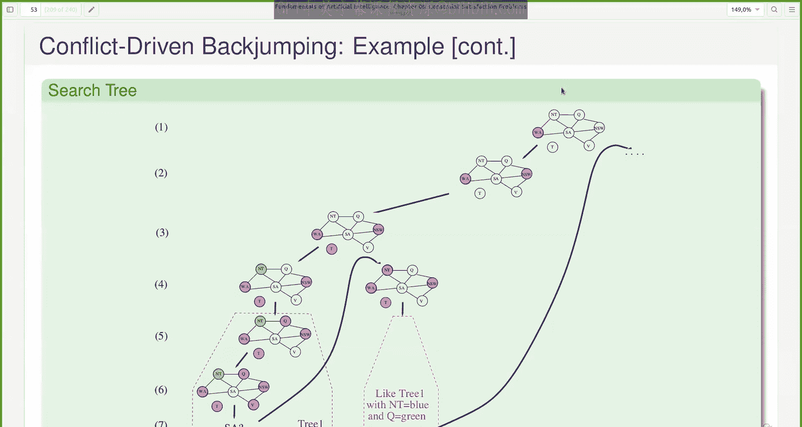

# 意大利特伦托大学《人工智能基础｜Fundamentals of Artificial Intelligence 2024》中英字幕deepseek p18 2024.10.30-CL15-1-CH06-CSPSearch.zh_en -BV1uUkwYTEmf_p18-

Okay， last time we have introduced a SP， we have seen several partss， sorry。Okay， and。😀。

If we show substantially CSP。There are two main components of an algorithm force of CSP。

 one is search， which means choosing variables， notice not a fundamental difference is you are not choosing a state。

Okay。You are choosing。Pickking one variable and assign it。A a value。 Okay。

 so this is the main which this has consequences。 and then you choose another value of picking another value as so as。

ok。A fundamental component of。So you reason by building progressively partial assignment。Okay。

 until you either you you find。You violate a cons or you。You you find a solution。

 which is a total assignment， which。Is compliant with all satisfi all the costs， okay？

The fundamental component。Is a。Consistency propagators are based on propagandators。

 So the idea is that once you。You alternate to search that means notdely picking variables。

With a propagation， a value propagation， also consistency propagation。 it has many different names。

 depending what on the subclass of CSP you are speaking about。What is the deal propagator。

 so value propagation is something that。😊，Given one update of the partialsha state。 So for reason。

 typically， you assign a value。 Okay， you reduce the range of some other value。According。

 so you drop up values which are no more compatible with the current assignment。

And this has very different strengths。We are seeing this substantially two ways seeing this。

 One is so far is the most straightforward is for our checking For our checking is a form of。

Proagation， which goes from assigned valuable to neighbor an assigned body。Okay。

 so this means that if an assign is a variable is assigned a value， then all its neighbor variables。

R reduced。Reduce their domain according by dropping the values which are incompatible with the with Simon。

 Remember that neighbors here， neighbor variables means which which participate to。

Two variables I may or if they participated to at least one construct。Okay。

This is the simplest possible form， is' called for word checking。😊，This is very fast， okay。

 you just have to just a look at the successors of your neighbor states。

Other states of which you have participate in that update accordingly， however。

 this has a disadvantage。These are咩。Is not so powerful because for instance， if your。😡，If a variable。

 so it doesn't consider the relationship， the neighbor relationship between assigned variables。

 unassigned variables。Okay， mean if an assigned variable gets a range reduced by some portal checking step。

 but then it may be the case that some of its neighbors should be。

Should have values which are incompatible。 So the result is not globally art consistent。ok。😊。

We have our consistency propagation instead， we have seen the last time the remain algorithm A Okay。

 which is here。 So the AC3， there are many variations of this algorithm AC3。

Not only reduce the range of of the neighbor of a sign。

 but then recursively reduce the neighbors of the neighbors。

 So Su every time you are reduced a variable is reduced range is put okay in a skill okay。Oh。

And and then you sorry， every Iraq is is put in the and so it should be all these neighbors are all the relation with this name or the are in thecu and then you are。

And then呢。You go ahead until you have finished the process。 This is much more powerful that reduces。

 is' much more effective。 So it reduces the domain much more effective， but is much more expensive。

Okay， well， the user turned off between efficiency and effectiveness。 Okay。

 so we we made an example last time。呃。We see this with this Su you just with a follow check。

 you just assign this value。 but in the next decision， if you。

If you use smart ideas to pick the next decision， then you will youll do， but you。

If you use full propagation， you may see that you can feel deterministically all those values。Okay。

 not is that both forward checking in the Arch propagation。Implement a determins。Okay。

 so you assign valuess， which should be assigned。Okay， so notice is no alternative to sign that。

The point how powerful are to detected those forms of our consistency。

Last time I made this distinct results if Im repeat it myself。

 but I wanted to really carve this stone， okay。An in distinction is from。

 I say that because this is a typical mistake you may make。Okay。

A variable which is assigned a given value is something different to a variable which is not assigned。

 but who has is domain reduced to the single code？Okay， why is this different well。

 because it's not yet side？Most likely we'll be assigned to the next search steps。Okay。

 but it's not necessarily showing， but I think if you have many of that。Okay。

 the fundamental different is that the former。Three girls forward checking， the second doesn't。Okay。

So。Yeah。With a photo checking A forces checking the domain of X size。Dont assign me。 Okay to the old。

To the all the neighbors， okay。With it be， it doesn't。Yes， it possibleYeah， of course， of course。

Can help。Okay。😊，With our consistent propagation， this is that happens， okay。Okay， as usual。

 the trade off between efficiency and effectiveness。Okay。Okay， I think we got here this time， right？

Im mind， okay， so。You can generalize this the notion of。

Of no consistency of art consistency in general too。K consistency， in particular， part consistency。

 Okay， is one layer more。 And this says that。A two variable set。

Is path consistent with respect threat to a third variable？Exme， if for all possible。

 value assignment to the pair。Which are consistency with the constraints on those variable。

 there is an assignment of XM that satisfies the constraints on X， XM and X Xj。Okay。

 for whoever is familiar with Sudoku， how many of you have ever played Sudoku in your life。 Okay。

 you probably are familiar with the fact that sometimes， for instance， you have two squares。

 you don't have a。You don't have know the value deterministically。

 but you know that you have two values which can be shared between the two。Okay。😊，So， so those two。

 those two square must be one and two both， okay， other than one and two， well。

 marking this is no because then you can exclude from all the neighbors。Vue。

 the value one and two as if you had assigned that one of them to one another。2。

 you can do this with three squares。 if you have the three values， four square。

 if you have four values and so on and forth。 Okay， I believe that many of you have。

Many who have played this dog are familiar with the district， okay。

 this is nothing else that past consist or in general cake consistency。Proagation， okay。This is exit。

Okay， so。In general， there is generalized to to analyze。 if you check。In general。

 can that SP is key consistency。 If for every set of K -1 variables and for a consistent assignment to those variables。

 a consistent value can always be assigned to any other key case variables。Okay。😊，So in general。

 one consistency node the consistency， two consistencyencies are consistency， three consistency。

 path consistency and then well in general，4K greater than3。

 they don't have a specific than need just decide same three consistently four consistently5 consistency that on。

 okay？Dxi is targeted for thick consistency。Okay， what's the problem， this K consistency。

 the computational cost of K consistency。Grows exponential with the K。Okay， so this is。So。

 in general。In search， there is always the of how powerful is propagation。

 how effective is propagation， and how expensive in with respect to how effective。Okay。

 so for instance。Co this scenario， so again we have three values this column。

 can we say something about that one？Well， okay， that's actually the example I made。

With like G code rather than Sudoku。Must agree。It must be green。 Yes， why。

 Because no matter those must be either right or blue。 Okay， so one must be red。

 the other must be blue or which aversea。 Okay， so it mean means no matter that。

Right and blue are not consistent with any possible assignment of these two values。Okay。

10 out consistency。Propaation reveal this。Dont look into。嗯。Well， no， remember。

 a just looks at the value， the single value。 So you look， okay， for right here。

 assignment right assignment here， well， okay， I have list two values for do assignment here。 Yes。

 I want to list the values the same here。 So a theres nothing here in this case。Okay。

 AC3 does not really reveal this。What about can path consistency propagation ability yeah。

 in this case， yes， because you say okay， every two possible combination。For these two variable。

 okay， either blue， red and or red， blue， no matter what those two elements should be dropped。Okay。

 and then this generalized to three consistency four so four consistency five consistency and so on and so forth。

Okay， is this clear。Okay， this allows also to detect the interesting facts because if you have in this scenario。

Can we say anything？But this is inconsistent， so he has no possible solution， right？Okay。

Can our propagation reveal it。No， it cannot。Okay， well you may say that yeah， you cannot。

 but as soon as as you are making some search step and the try。

 not determineistic to assign one value， then by our consistent propagation， you will release it。ok。

Canme path consistently propagally。Yes， for the very similar reason as before， right？Okay。

Is clear the difference。Which one to use Well， again。Often， combining smart searchuristic。

 you don't really need。So one may think， okay， at least I use path consistency， Okay。

 Al consistency propagation。 So at least use AC3， well not necessarily so because。

It's true that you don't reveal many things， but probably with the good you in few search type you may get to the same result。

 So again， how much you want to to devote to spend on search and how much you want to do。Spend on。

Propa value propagation， it depends。Typically on the application。 Okay。

 there are procedures which will typically procedure allow you to， to make different choices。 Okay。

 so have a different degree of aggressiveness and value propagation。Okay。

 now we get to speak to search instead。Okay， and we are speaking with backtracking search。啊。ok。

We started speaking about the simplest for， which is plain back effect search， which is again I。汗堡。

You on the point， on the difference with respect to certain we have seen so far。So far。

 search meant passed from one state to another state。Okay。Neighbor state。

 whatever neighbor means a successor。Here， instead， the we reason we pass from a。Partial assignment。

 which is， let's call it a partial state。To some more precise。Okay， so because we define。

 we set some variable， and so we make this narrower。You may think this as a form of belief state。

 much okay， this is out of context to say， okay， from a partial assignment to a little less partial assignment。

A more refineable assign and then of course， when you have you have no more choices。

 you have to but your meaning of。Undo some assignment。So the idea。

 the fundamental idea is the first fundamental idea is that you pick one variable at a time。😊，Okay。

 and assign the value。So suppose you fix an order。😡，This is not okay。

 this is not what people do Okay， you don't fix an order a priorityi。

 but for simplicity let's start with the fixing an order and so we give an order improve variable and then we fix them accordingly This is the。

Simplest and stupidest algorithm that you can think about let's。Think about that。嗯。So of course。

 valuable sum commutative， so the result of assigning W A to red and N T to green is the same as assign sign and T to green and W A to red okay。

Does't matter So doesn't matter the order。Okay， maybe may suggest you some information in different order。

 but maybe this process can be faster or lower， but the outcome is the same。Okay。So they year。

 so we can consider an assignment to every step， okay？

Fundamental consency programming reason on partial sound。

 and this is something that well see in particular also on a particular subcase of a CSP which is SAAT。

 so proposition sat， which will devote。A few classes to it later on， okay。So this is the fuel point。

😡，The key point is also that you check constraints as long as you proceed。

 so you don't wait to have a total assignment to check religious resolution not， okay。

 but it may be the case that a partial assignment。Can violate some constraints so that you have no。

Possibly further expand it， Okay， but also。By checking cos is not。

You pick only values which do not conflict with previous science， okay。

So substantially every time you introduce a new variable， then automatically it these rest。

The domain of neighbor variables and the neighbor of neighbor variables。

 depending on how aggressive is your form of value propagation。Okay。😊。

Which drastically reduces the kind of。The number of candidates。Okay， because if you assign again。

 if you assign Italy to red， okay， then this automatically reduces the possibility so。

The ranges of other value that you can assign to France okay。

 you cannot assign right to France okay if you explore this fact you don't lose time in assign right to France and checking that this is consistent eventually okay。

然 know。So you pick only values which do not conflict the previous assignment。But then。

It so you do a sort of incremental goal test， meaning that you check the。

 the temporal in consist because even。A partial assignment can violate some。Okay。

 so if you do this incrementally， as long as you detect such inconsistly。

 this saves you a huge sub of search。Which you have by further。Extending that assignment。

 So if a partial assignment， so you detect that France and France。

 Italy and France to write a cannot。Cannot be okay。

 and this immediate automatically drops or the possible combination which are exponential in which both France and editor are right。

Okay， but this is even what is better than that。So if you assign E to red。And。You assign。Belium。

Bedroom to。Let's say to green。Okay， bad is immediately above both France。 Okay。

 so this means that France can only be blue。Okay。Then you automatically。

 if you do you automatically drop any possible assignment in which France is either green or either red。

ok。So this is what is called incremental goal test， so you check it。

And if you decide and if you are even able to， to check in incons。

 you have assigned both bedroom and。Bedium and okay， Italy to right。

 the bedroomg to green and Germany to blue。These are apparently consistent。

 but if you do arc consistent propagation， you need a review that this is inconsistent。Okay， why。

 because it violates the fatt， makes the domain of France empty。Okay。

Which means he's a sort of gold test。😡，Because it's a sort of all the。

 the three constraints which involve France with Italy， Germany and Belgium respectively， okay？2。

At least one of them it will be violated， so you plot this information and you are you you be so you know。

You know that you cannot go ahead and this saves you a huge amount of search。Oh there。

And so that you prone at。So舒坦是令。B search is nothing that a VFS， standard VFS。

With the two above improvements。😡，Mo it toable thoughts。Okay， so for instance。

 I'm calling again our example of the region of Australia。 So you can here。

 you can decide to go right the green blue。Okay， so suppose in the first branch。

 you can decide to have this green。And the second branch you may decide to have this。

This is Queensland。 Okay， Queensland， either red or blue and so on， okay。So。

So by tracking search is in a way very， so this is a plane by tracking search， Okay。

 so the simplest form of one。Of better research。Which is actually not an algorithm。

 but a f algorithm， depending on some subrs or how you implement some subrs， okay？So， okay， you take。

The recursive function。 Okay， you can take。A CSP and you incrementally build an assignment， Okay。

 assume everything is passed by a reference here。In general。

We make the assumption when we see these pseudo codes that everything is passed by reference unless specified otherwise。

Okay， so what you say， if the cur or the other enter occurs we call。

 if the current assignment is complete。And this means that you haven't failed。

 so if you're reached this point， it means that you have found no contradiction， okay。

 that means that you are done I can return assignment， wait great， CSP。

 you have found a solution to that。To their assign to the CSP， okay。Okay， here。

 and this is the first procedure， which is a pick one and assigned variable。Okay， not again。

 this procedure is。One fundamental component。 Okay， depending on which the criterion you adopt。

 this may the efficiency may may vary， very significantly。 Okay。

 so you pick some variable according to some criterion。And then for each value。

In order domain values， again， you have some criterion by which you order the domain values。Okay。😊。

You do the following。If the values is consistent with the current assignment。

 okay then and again the checking of the consistency is another element。

 then you add a vara equal value to assignment。And then， you infer。Okay。

You infer a list of possible value restrictions。 Okay and again。Infer also called value propagation。

Is what we have called value propagation and here fundamentally is how aggressive it is can you do that just for plain for checking okay。

 less aggressive， more efficient but less effective。You can do as AC3。More more aggressive， more。

More reduction， more effective in reducing the domain， more。But they're more expansive。Okay。

 then if you have the inferences。 So if。If you have a failure， so if as a result on the inferences。

 you obtain the fat that some domains empty。Okay。So if this is not the case。

 so if you don't find a failure。Then you can add this inference。

 so you can accommodate the CP with those inferences， substantially what you do is you drop some。

 you reduce some constraints to them。The。哎，那大夫。And then you were recursed in Bo。

So you update the CSP according to those inferences， so you reduce the domains of this。

 and then you invoke her recursively。The function of the resulting CP。Okay。😊，And then what happens。

The recurs recursive invocation will tell you some result if the result is different from failure。

 then you get the result because。You ever solved the problem。Okay， if it's not the case。

 then you backtrack， what does it mean backtrack， you remove the inference that you have performed from the CSP。

Any you want to， if instead。The influence had well。Causing a failure。

Then you remove the very equal value for the assignment， and then you go ahead。Okay。

So you may want to notice that。This is not an algorithm， but a family algorithm。

 depending on how you implement which strategy algorithm that you use for the single sub things that you are using。

 okay？So。Okay， well， first of all， well， first of all， one fundamental fact。

This is sort of universal， regardless of efficiency， so efficiency。

 depending how you implemented the efficiency， the single type can be more or less efficient。

But this。This is another， which works for。CSP， which encode shadowing。

CP with encode time nurse thermal location， which encodes timetable class and table or whatever problem。

 So it's not a search algorithm for single。Problem， this is sort a universal problem。

And then it's up to you to encode。Your universal problem into SCSP in the best way。

 this is sort of universal algorithm。So you if you have a CP， so you have a package， a CSP package。

 there are many of them， you can use it for whatever CSP problem you may like。 Okay。

 you just find the best encoding need to a standard CSP language like can need the equal。

Something similar and then you run the very same tool for very， very different possible。Problems。

Okay， so that's the fundamental element。 We see something similar with the Sa proposition of liability。

Okay。Notice that you keep a similar representation state so you update the of substantially you have a smart data structure by updating the information regarding this step。

The key point is that， again， this is sort of you can have many different implementation of this algorithm。

 depending how marked or how aggressive are the single part。

So that can assign variable is a fundamental， the strategy that used you use to pick next value value is fundamental in success。

 when you see some examples for that。Again。Or the domain values。Again。

 in which order should you should you try these values， Okay。

 and then if probably this most important one， specific constraint propagator。

 they are called propagators in NSP。 so specific constraint propagator may。

Drartically improve the performance of。Of the world I help。Efficiently。

 and effectively can do a value propagator may drastically affect the global performance of the CSP。

Okay， also， there is any issue regarding where should we backrack。To avoid the user search。

 can you improve to this extent， so in the idea you have seen you backtrack to the most recent open branching point。

De for search。Is this the best strategy。Can we do better？Well。

 people have shown that you can do dramatically better than that。

Or can we avoid repeating the same failure in or similar failures in the future？

That's fundamental element of search。 let's go step by step。Okay， first。

Which variable should you choose？Oh okay， we could do pick on random or just following a given initial ordering。

 but that's would not be effective。In jail。There are some rules thumb。

 some very general strategies to do this。 One is the MR。 There is a fundamental， which is。呃。

Choose first the most constrained variables or what's called fail first。

So choose the variable with the fewest legal values。Okay， so who's。Doomain is。

Smallest size or domain small。 in particular， if you have some。Vremon， whose domain is one？😡，B it。Oh。

So this has two facts， effect has no legal values use。

Then you mirror a selected to solve this failure isn there， so it allows you to。

To detect the failure。 So when you， you realize that one variable has an empty domain then that you。

You drop， actually。Again。Some steps you have to decide。You must decide where to implement some steps。

Shall we implement these as a part of of。P about peakheuristic， or shall we implement。

These were in as a propagator。So when you propagate a domain， your less than the domain is empty。

What should they do？ Well begin you should fail。So in practice。

 many most tools review the em of domain。In the propagator phase， which allows you。Do。

To do useless other propagations。Okay。However， there is a tiny distinction between those two。ok。

Fundamental factor。Is that effects has one legal venue。It is should be。Okay。

And this follows the fundamental。AR of thumb of search。Which is。When。Pick first deter choices。

P postpone as long as possible， nor deter deterministic ones。Okay。

 and I think that I already told you about this last time， right。

 a fundamental rule of thumb of search， which applies substantially the facto in every search component and in particular Ncomp or NP hardware programs。

Okay。So。So consider the following example， again， the usual stuff， okay？So， we start。Okay， initially。

 we don't。 Okay， we have no， no choices， okay。Okay， so we， we don't have。Initially， we can be。

Whatever we like， because all have three， three values。 Okay。

 but once you have applied W A to Western Australia red。We have two states whose domain is to。

We assume here， sorry， we assume here forward checking， we have forward checking that okay？Well。

 formal check is the。😊，The minimum possible by propagation。 Okay。

 in will you say the minimum in inductality is that the。

You can always assume the in that we do at least the forward checking。Okay， so by forward checking。

 we know for sure that this has two， these two guys here have two values left。

 so we will pick one of those two。Okay， so suppose you you take Northern territories and you sign supposed to green okay。

 then now we have that southern Australia has only one value。

Left and so we deterministally assign it to blue。Okay， by MRO。Okay。No， what an next。What is next？

Don't look transparency as usual。Yeah。😊，Queensland Queensland right because now Queensland has so yeah these one values left two values left。

 two values left， three values left so next one is Queensland and so on Okay notice is something important that the combination when you assign use this technique and so you assign it you make deterministic assignment。

 may be the case that some of these neighbor as a consequence of a value for checking。

 they become deterministic as well。Okay， which in this case so in the next step you do four more checking and you reduce the size of two。

 three， three， sorry to one， two，2， three respectively， and so this means that this becomes。

This becomes a deterministic aside。Okay， but then afterwards， this becomes aistic assign。

 this becomes a deteristic assign， okay。So this is a sort of chain。

Of a decision co and union propagation， if you apply unconsist。

 you just run do that in directlyly on propagation。Okay。Okay。

 variable section so the MRO I think is quite intuitive， right？Okay。

 so what happens if you have more than one with one variable with the same value with the same size of reduced domain？

Okay。Another is a degree peak the variable so。Another heuristic is the degree。

 so pick the variable that is involved in the largest number of constraints on other assign variables。

Okay。So。If you are a。In case so as a type this typical uses typebreaker。 Okay。

 so you have many or eventually when they all all have the same values。 Okay。

 so what is the point So try。The more constrained is a variable， the more critical is your choice。

 so the best thing is to choose its value at from the beginning。😡，Okay。

So idea is that the more the higher the branch， the higher the number of constraints these variables involved。

 the more effective it will be for checking in the constraint。But because the more。

Other very variables also will have their domain reduced。Is clear啊。Okay， cool。So。So， the if。

Fabul issue with possible creation of future deter choices， okay？

They typically uses tiebreaker in combination with ArRu。

 so when ARu cannot tell you exactly which one to choose or gives you a why gives you more than one possible choice。

 use the degree you seek as a tiewriterer。Okay， so again。

I think you have they have noticed this before and looking at your example。

 this was an obvious choice。What is it southern Australia？Why。

 because Southern Australia is involved in one， two， three， four， five constraints。Okay。

 so initially all have three domains， so Emma vote tells you nothing。Okay。

 I'll give you no information， but this is one obvious candidate。Which is southern。

So EmmaV tells you nothing， but a degree heuristic tells you that you should assign that。上庄水也都都外交。

For Eastern blue。ButThen， ha ha， then。Things get much easier。 Okay， so now again。

 all the other the all those。Regions have two range two。Okay。But there is， again。

 by the degree heistics。These two guys are privileged because they insist on to well， sorry， one。

 two， three。Are more constrained so to sort participate in more constraints， Okay。

 so the obviously the candidates are one of those three。Okay。😊，For instance。

 you take anotherterritors which can be assigned either to red or green。

 supposeuppose you're assigned to green， and then you have a deteracy choice。

Why because now Queensland as a determinist， but then what was it Western Australia。

Now is I don't remember what and what the name of this is Okay。

 this was again a deterministic and this was again deterministic and this was again deterministic So now notice that from now on everything is deterministic Yeah。

 okay also you even here you can you can assign this deterministic so you have。

Sometimes notice that you have more than one ten choice perform weighham this may happen in any order。

Okay。Okay。Okay。So you have several， Okay， so this， there are many， many。

 now we have a chain of themin choices。Okay。What about the。Values。Okay， what about the value。

 so once you have picked the variable what about the values of that so at least constrain value SC risk is another very popular one。

 which says that you pick the value that rules out the fewest choices in the neighbor variables okay。

Okay。The possibility is very let's。Try to see if we are since our goal is try to satisfy this。

 So let's try to cut the。Iam。The least amount of possible combinations。Okay。

So typically combination is M plus degree youistic for choosing the variable and then SES for。

Before air picking the value。诶。Okay， so for instance， suppose you start。 well。

 this is not a good idea。 but okay， M rule will not tell you this。 Okay， but just to show。Well。

 if you want to pick your example， you， you keep your examples small。

 sometimes you have to make some choices， which are not And。

 So this is just done to illustrate to the the LCs。 Okay， because with such a small example。

 you will not have a situation where Ss will apply， but suppose you。You have only。

You pick according to some criterion， you have picked this， okay？You decide Western Australia。

 So which okay， cool。 then you decide， as you said， we decide this one。Okay。

 then you suppose you decide Queen then， which value you assign？Where。诶。

This would this is better we say that this is better on this。 It is a better choice。

 according to other。 Why， because this allows one possible candidate value for southern Australia。

 this leaves nothing so。You will try so since if you apply this。

 then you will be forced to backfrack for the next choice。Then you do that directly。

And and and go there。 Yes， please。 it makes sense to eliminate the choices that are previous Yeah。

 depends on this called the look ahead。 Okay， and this is something extra step you can perform in order to。

 to cut a priority and possible choices。 Again， this depends on how aggressive is value propagation。

In this case， yeah， okay。Again， look ahead the techniques are。

Even more sophisticated decision in which they try to see。And just the workers follow， they say。

 okay， what if what would be happen if I assigned this variable to red， okay。

 so in their mind that they do a quick fast analysis and say， okay， if I send is red。

 I will make cause this conflict or I will reduce and then you do again。

 they trade off how expensive is to compute。TheThe picking euristic with the spec too。

Do a less smart heuristic。And let instead value propagation work。

So you may decide to perform more steps。😡，But such that each step requires less time。Okay。

 or do less steps， so smarter steps， but in which each one requires more。I咩。

Theres a constant tradeoff in search， bulloleion search， CSP planning。

 all these the search based that theres a continuous trade off between those attitudes。

Smarter and more expensive steps with respect to dumber but fast steps， okay。

The standard trade of on that。And there is no universal answer to this okay。

 depending on the kind of problem， depending on interest。

 depending on smart how smartly you can implement some decision blah blah this。Workalks。

 one works better than the other， but is this clear。 So not that these are。

Where in the universal then depending on your single example。

 you you may decide which heuristic typically ECP have many command line parameters or setting parameters they say which allow you to choose which heuristic to apply which technique to apply if you want stronger propagation or less stronger propagation。

 whatever。In such a way that since you know your problem。

 you may decide which one you think suits you more。Okay。Is this clear？ok 诶 ok  so。By the way。

 in this case， you'll decide essay to do。Okay， now。The key element is search is interleaved。

 so we have seen search， we have seen propagation well。Let's combine them together。Okay。

 this is quite。喂啲意思 short。So the key point is that after every choice。

 so you sign a value and then youfer new domain reduction on the other variables。

This allows you to detect the soil。As I say， forward checking is the minimum that you do Okay。

 that's quite obvious。 Everybody does。 So if even though if you have never thought to to study artificial intelligence or algorithm or computer science at all。

 And but you even my my mother who played the Sudoku， Okay。

 knows that auto when he assigns a value that reduces the domains or the neighbor or the neighbor locations。

 right or whatever。 So this is quite obvious。To do great。So。

This says it allows detect inconistency earlier， reduce of the search space。

And may produce unitary domains， which， again， fall deterministic。These are also called ins。Okay。

Again。There's always this tradeoff between efficiency and effect。

 how aggressive is your value propagation。How aggressive is the inference of value propagation。

 also known as the value propagation we expected to serve。As I say， there are two main。

Steps in practice。Choices， forward checking。Is cheaper。

It ensures that there are consistency only of pairs in the form assigned to un assign variables。

But not in general， the all consistency of all the graph of， this is very important to understand。

Okay。😊，A3 or。Any。Variation of the roads。Okay。Is more expensive。😡，A。

It shows there are consistency of all valuable pairs。

Notice that if you decide to use anything like Arcoys or AC3。Combined with a search， as we say。

 all those techniques can be either used as a prepro or as interlink step。

 but if you decide to use as a propagator interlibve with a search， you do some as marked variable。

 a variation which is called NA。Oh， I actually don't remember what this economy is for。嗯。

So after you have assigned signed X， okay。If you remember， they started with older or pairs。A board。

 okay， all all constraints on board。 why should you。You know。

 the only variation that you have has been performed with respect the last time you have performed Ex me is everything which you regards。

The volume of X。So instead of starting with all from all the pairs。

 you start only to the constraints which involve the X。Okay。This is， again。

 much more effective than for wall checking， but also more responsive。Okay。

 so let's see some example。Again， four queens。Initially， well。

 you decide to play to put a queen there。And then you， you do by forward checking。Immediately。

 remove。All those types from here。 So which means that substantially you， you drop。

All those domains vary from the domain。ok。So， oh， these are organized by columns。 So this value is。

The possible values of a variable in economy， okay？Okay。Okay。

 so this is for instance x2 now has only three and four values。Okay， so for instance。

 so this means that next step you may decide to assign the3 to one。

 and then this means that you propagate this， but then you fail。Okay， so you have to make f。

Suppose then， okay。You try the O X 224。 and after trying。Put this in two。 Okay， so you， you。

 you put this in two。 Okay， then you have this propagation here。Okay， so you suppose you。

You have tried， you are here。 you tried also x2 in four。 and then you。

 you see that you have a single failure， okay。Then let's see what happens if I send the x2 in the position2。

 I un propagate sorry I follow check and find out this domain restrict。

 so it means that this leads you only one possible value of x2， which is here。

 this leaves you only one possible value for x3 as well。

And then this leaves you only one possible value for explore。Okay， so this is。Quite诶 c， okay。ok。

Let's go。To some， something， which is。Very difficult， but very effective。

Which is smart neck tracking。呃。This was a game changer。

 So what we are going to do a conflict dream about tracking。

 So when it was invented was a complete game changer in the sign that the performances of all contemporary tools increased by orders of orders of magnitude。

 So this was what has really changed the。The domain and the community。

But it is not so easy to understand， so pay attention。Okay。

This is standard chronological aing so what we have seeing so far right and remember this is Shat based。

Do so the is that。So when what happens when you fail？Okay， when you fail。

 you backtrack to the most recent open decision point。Okay。

 so it's the most recent decision on the tenesis that they have taken， which still has some。

St value to thrive。Open to try。Okay。Right。And then once you do that， you saw here right here。

 you can jump up here and try different value。Okay。I will。

 I want you to convince this next slide that this is incredibly ineffective， inefficient。Okay。

 because you waste， you do a lot， a lot， a lot of useless search。Okay， if you do this。

And they want you to。Look at this this example， again， the Queensland blah。

 blah this graph is not so easy to follow。 So when you study， I suggest you to have。

Version of the slider with this picture and a version of the slider the next one so that you can go step by step。

 Okay， but unfortunately I cannot speed to the screen into。Okay。So嗯嗰。See that， again， the。

Assume that okay I make some simplified assumption here so what I'm going to do this example is very stupid okay。

 it does not follow the rules that I've shown you before。

But the key point is that I want to show an example。AS to give you the explain the thing with a very。

 very small example。 Okay， so you may say ama if I use as matter， you receive it does not happen。

 I agree if I detect as soon as possible earlier， the incons is not not happen。True。

 but then I can produce a much a bigger example than in which this happened regardless what you say。

 okay， so if I do something this example， which is actually taken by your book so you can look at there。

 but if you may object that some of the steps that they can do here are not the smartest one。

This is true， but this is just to make an example which you will fit in a slide or half on a page on a book。

 okay？Given this premise， let's see what happens here。So suppose。Initially， I start with， okay。

 I suppose I decide。Very stupid approach， which means I assign variable in the fixed order。Again。

 this is again the smart Euristic I just mentioned， but again。

 please letting me do this to explain this result okay。So， I pick。Western Australia first。 Okay。

 so I have no cost answer。 So the range is is also suppose I pick A R。 Okay， cool。

 I assign this to R。Then for some strange reason， I will decide to assign an N not a Southwest。

 I don't remember what' the dironomy is for， but NSW。And that's the cyto sound is right。Okay。

Anything to say about that？I sent this one to write， and I sent this one to write。

Do you notice anything？Okay， let's paint this by red and do notice anything。

This becomes inconsistent。能送个不。Okay， why。Because， yeah， but。Those you have three。Elements。

 which are which a click substantially。 So they are all all。Border with the other。

And you have two values left for value。Which is， of course， unsolvable。But then。

 but you cannot see that。 So there is no unless so you have a three。Let's say。

For consistency check you don't really and if even if you have a four consistency check I can produce bigger problem where these arise right Okay。

 so don't think okay， but you have done a very stupid thing。

Keep in mind that you are when you associate SP， you have a。Hundred000 or millions variables。 Okay。

 so you don't have any graph you order that's obviously obviously wrong， right， Okay。

 so it something really big with very different to。

And what you see here are just something that starts。

 so if you don't have a proper algorithm to detect this。

 that you have no chance that you detect these scenarios， okay？对意。😡，No。Okay。

 so you have made initially very bad choices， but a choice， but you don't realize it。

And try to go ahead。Okay， so for instance， you say and this is another very silly thing that you do with Tasmania。

 right？Okay。And then you say another territory to well， another territory now this time， okay。

 all those have a range of three， so you decided to leave them right， for instance。Then。

 suppose you pick。You pick another territory。 and so you have two values here。 You pick them green。

Okay。😊，Then， for instance。You pick a Queensland blue。Then again， sorry。

 I don't remember the name of this the sorry， Victoria， yeah， Victoria， do you remember what this is？

ExSo。New New South Wales。 Okay， thank you。 Okay， so， you are signed Victoria to blue。And then， ha。

And then， but then you realize。That Southern Australia has an to domain， so have to you failed。

So what's the point here？Okay， if you do， C ga tracking。So， okay， so you。Go up here。 Okay。

 so let's try different value for Victoria。 So Victoria here had two possible values。 blue or green。

 So let's try， try another value。But again， you， you fail again。Okay。

 even if you're assigned V to green instead of Victoria to green instead of blue。ok， you飞。

TheThe here is empty。Okay， so。Let's go jump higher。 Okay， so let's go here。 Okay， so if Im。Oh not。

 this was deterministic。 So， okay， so let's try hear。 but okay， I jump one。I kept one one line here。

 one obvious one。 So I don't go to this step here because this I had no other choice for this。 Okay。

 so let's try。Okay， here， instead of a sign blue， the green， I sign this blue。Okay。

 but then I will deterministic assign Queensla to blue。Okay， so what happens。

The very same thing happens with just blue and green ined。All the remaining steps， okay？You see this？

Okay， you should try with the map and the call us， okay。

 I understand that is this is not so immediate to follow。Okay。

 I will the next slide that we show you a slide which gives you an overall picture of that。Okay。

 so ha， okay， I've failed。 So I have no choice here。 Once I assigned these three guys here to read。

I had， I had no choices。 So both of these two choices LED me to a failure。 So let's try to undo this。

But the guys， here is another problem， does menu is completely irrelevant。Tsmania had the north。

No role in this。There this failure， okay， there's an island。Okay。Pit Tasmaniaia to blue。

 and then you have the very same sub as before because Tasmania was completely irrelevant。

 had a new role in the the failure。 and then you can try again Tasmania to green because the big f tries。

And again， yeah the very seems ofya。咩。At the very end of all this。You buttract U。

 and then you sign and N SW2。To some other value to either or blue and green。O last。Okay。

 and then you can go ahead。So you have a spent a lot， a lot of completely useless search。

On the remaining values。Okay。This was due to some elements。

 the first factor that this Tasmania here had the no role。Okay。

 so once you you didn' not realize when I'm but trackingking that where Tasmania had Su， no role。

InThat so you tried all， you made a three substantially identical subies。

For every each of the three video of Tasmania， which is was completely un random。

 And then here you have the two symmetric scenarios again that gave you wrong。What卧是。

The point was that you demon。Deect the actual source of problems。The sovereign of。Inconsistency。

 which is the fact that。Western Australia to Ra and。New new Southway Southway， wish， right， is。😊。

Incomarible leads to and inconsistency。Okay， and this is the word picture of what happened， okay？

So here you started。 we were rather than write。 now you cannot proceed here。This is inconsistent。

 this is hopeless。 Once you are here， this is hopeless。 But then you try， for instance。

 assigned to Tasmania， but again， Tasmania is irrelevant。

 and then you you assigned to anti green A Q。 but then you had in this case， you failure。

 this other case。 So when you assigned both V to true and V2 V2 blue or V to green， you had both。

Fade， but then if you back here and instead of assign sign in N T2 to green， you N to blue。

You have the very same subreo， here。We only。With the values on T and Q switching。Okay， but then okay。

 you， let's be tracking and you try it， you have the same three。

Nearly identical sub with the only difference is that asmania has three different colors， but again。

 you have the very same sub3。Okay， so you see that it was so in in a， but this is not okay。

 but how stupid is that？Well， no， this is just a plain application of the chronological attack algorithm so def search。

Okay。Without thinking， without looking at what this means and with。

Choices which are not as rule about principle。They work， okay， you say， a。

 but I could use method choices。In a small problem is， yes， when you have one million variables。

并且 that happened。S都요。Sorry。嗯。Okay。So have 20 minutes left， Okay， is this clear is the problem？

The problem we are， okay， how do we solve it？Okay， and。

The first fact is to introduce an notion which is fundamental in SSP， which is the notion of no good。

I a good is a super assignment， so a partial assignment， which cannot be part of any solution。Okay。😊。

The sources in Boolean satability， we call this accounting set。However， okay， so for instance。

 that's actually the W AA equals R and NSW equals R R。Altogether。

 no matter what lead you to no solution。No matter how you respond。

 try to respond the honor of assigned， okay？Okay。So if I may， so in general。

 I Im not able to detect a priority， So it would be not so easy to detect a priority， you say okay。

 but for consistency in this case we're going to detect， okay。

I can show you example in which you have scenarios like this in which you have you will need a0 consistency and detection to realize it okay。

Simply。No good， generating no goods happened。😡，Okay， and the point is， how。The point is。

 how you realize that you have。Once you fail， how you realize that you have done it in the good？

And how to remain。 So imagine that you are driving。 Okay， forget。嗯。啊。Forget GPS。Okay， I don't know。

 well， I know that you are。Native digital generation， which for which is say， okay。

 let's let's use GPS。 Okay， but try to mention you are doing you are traveling in a place where you don't know which you don't know and you have a map or you don't even have a map。

Okay， so suppose you are walking hiking in the mountains。Okay。

 and you get to a point where clearly you。We get to good point well。Thely nowhere so。啊。

What shall I do？ What shall I do。We have two by track。You got lost in the bad time okay。

 what you can do， okay， well， you could in principle do the following week。

 go back to the most recent branching point and do the art。Take the other branch。

 But it may be the case that it leads to you the the mistake you had done much earlier。Okay。

 so if you do that， you can take hours。Okay。In order to get right place， if you not。

 you can take a look around， oh， look， look at the shape of this mat and we have entered in this valley。

 Okay， look there are the rocks there so that is' not possible that any trail pass through those rocks so you should have started earlier than that Okay。

 so probably even if you take the other the most recent path that we we should go in a place where we don't want to go we don't we want to go through that hill and not this hill that so you do some reason and decide that at the least you should。

Backrackrack to not to the last branch point， but the second last or third last or fourth last。

 say up but probably when we had that fork， we should have turn right instead of left。Okay。

So this would maybe you don't get the exact solution at the very first point。

 but you probably do much， much better than doing the last me point。The last four algorithm， okay？

Okay。So， that's actually what a。Intelligent but f。Can try to do。 And in order to do this。

 you need some。Explanation or also called the conflict site here， the terminology is not。

Uniform in the or solid you may find people using the word explanation in slightly different way or people calling that conflict setting so conflict setting that is something even is slightly different but。

Okay， let's try to see what we are speaking。So given a variable an assignment to a variable XA。

So we say that a conflict set or an explanation is a set of value assignment which caused the reduction of the domain of DJ via for checking。

Given some variable， now we have some values。Now our domain。Of variable X is rest。Okay。

 you want to find a minimum set of value assignment， which caused the reduction of the domain DJ the。

And notice that typically this will contain the amount of variable。

Which is equivalent to the number of missing values。哇。Okay。

 onevol cause that net the reduction of one value。Tically okay。Okay。

Notice that if in particular Xj is as an empty domain。

 this is a complete explanation of why this of the inconsistency。

Assign this value and this value is this value by forward checking cost you there。

Cause you the inconsistency before we're checking。W there。Naughty that。

Those variables in the conflict set。Are not necessarily picked， they may be themselves。

 the results are the very easy choice。This is from the night。Okay。😊，So the idea is exactly with that。

So for instance。Okay， you have to do。So the domain。

 the domain of Queensland was reduced to olive blue here checking because of assigning NSV to R and Nt2G。

 which are bordering it with the Queensland， so which forced be。To be used to that。Notice again。

 that some of those assignment。😡，Can be。The result of deterministics were forced。Okay。

Note is that the conflict set of an empty domain part is in the good。Okay。十月份。

If some value assignment cause a variable to be empty。By for check and then。

This automatic variable is no good， are we there？The point is。

 let's try to infer the good out of that， But then the good， which is significant。Okay， if I stopped。

So if I start from an MP assignment。Okay， and I apply and try to figure out。

What are the decisions which cause that so the。The conflict site， I have a good。

But this may not necessarily be useful good。Why， because some of those variables can be assignment。

 it may have been forced。So I will try to。Produce progressive a better one， how。This way。

When youWhen a branch fails。So when empty domain， for reason。

 you cause an empty domain for a variable X。You。Okay。

 the general idea is that you and you identifying a good。

 which caused the failure of deterministic idea for war checking。😡，Okay， okay， step number one。

 I haven't yet explained how to do that， but suppose I have some magic technique which allows you to do that。

If so。I can pop all elements until I pop， so I go back the stack。😡。

And pop all elements for the stack， until they pop。The most recent less silent element in good。

So I break vinegar good。And then I assign that to that body a different assignment。

The key point is that this popping can be much higher than the most recent。Branching points。

Maybe the case， the most rich em point was completely relevant。As in the case that we have seen。

 right， because of the the。Because no good was generated much higher。In the search。Okay， so。

And the interchan right， I wanted to understand that if you are able to。

 So the key point here is step number one。 So this is quite obvious right。

 So once you have a find the good， this is quite obvious。 So you haven't identified that。

Was not competitive。嗯。This the good。This is no good。

 then obviously you have to un do at least one good。

 so since you are reasoning the first you are popping and pop until you pop one element of the no good。

Are we there。Okay， so is this clear apart from the fact that we don't know how to compute number one。

 step number one yet？This is very important to understand。Okay。

 is it also clear that if you are able by magic to find it in a good。

 then this typically may allow you to jump much higher？

Because of the the last branching group may have not be irrelevant only the last and the second last and the third launch and last two could be completely irrelevant once。

 okay？Okay， they say this leaves how to complete number one。How to identify the good？Okay。

You start from an mission the good。And you progressively refine it。So taking the conflict set。

 the CI of empty domain。Xi， okay， so that this is something that you have， right。

 so you see what caused the most recent elements， which allowed you。

And then you backward substitute inside the conflict sector， every deterministic assignment。

With its respective of the site。So you say， okay， so this is the conflict side， but look。

 some of these elements were not a decision。They were just forced。But if they were false。

You want that。What force of them？ So you substitute。The factor with the causes。

 the list of the causes。 Okay， so if you have an element which was deterist。

 you take it out because this。Did not really contribute because it was itself an effect。

 And then you substitute with the potential cause。 and you go ahead in this process until you have。😡。

Elements， you and actually no good which。We're not。

You don't have any more L assignment which was forced by the force。

 So this means at the end you have a conflict set。Or set of decisions that you have taken previously taken decision known。

Nondeminist decision， which combined together led you to a failure。

And then so you once you have found this function that， you can pop until the most recent decision。

 which led you。To the wrong place。Is this clear idea， not so much。So think about the trail example。

 right？So。Well， it's just a distinguishing between branching branchings and just force steps so you don't undo so you don't think okay I shouldn't go straight into pressure since I had no other choice so you have to undo to go back in your reasoning。

On actual decisions， on actual places where you had you took one decision between one or two or or more choices。

 Okay， so much you identify。The latest decision， which actually LED you decision。

 not deterministic type。 That's a fundamental。This is which led you to fail。

Because the terroristministic step， you cannot why you don't consider theistic step because you cannot undo it the tenistic step。

 okay， because the step was forced。Okay。So once you have a determin type youre no good。

 you have to substitute with its causes because simply you cannot undo that。Yes， please。是。Yes。对。

Must be because it was be chosen because you had only one choice，77。The causes， yeah， the causes。

Yeah。So。Yeah。好。Yeah。Yeah， the first of all， the most recent one year choose。

 you change it the most recent， let me show you an example。Well， actually。

 the same example as before， okay？😊，So overall， this idea is that you identify the most recent decision which caused the failure due to the war checking by undoing suship。

 you un do for checking step。Or this say， this is the main idea。 There are many。

 many different variations of these techniques， heuristic。To perform this。 So this a general。

 the general idea。Okay， let's see how this works in our example。

We are in the very same scenario as the previous case。Okay。

But then we try to figure out something so。Okay， so we have a perform soft wheel。

 So our country is empty。 Okay， a sal。So who calls the。Who caused。啊 ok  sorry。

I forgot to say something important。There's the next information here。🤧As long， okay。

 you have to slightly modify the data structure， the information you keep when you are doing conflictly directly by tracking with respect to to。

To stand by chronological tracking is that every time you you would。Sorry。Every。Every time。

You reduce the domain of some variable。You keep track of the assignment， which caused it。Some。😡。

Here are okay。 Everything is fine。 But then when you have a。So when you assign W equal R。

 this means that n equals reduce to be green， okay。Okay。

 you slightly modify for checking in such a way that it keeps you remembers when it drops one value。

From the domain， you just。Anser， this reduction。With则。With the assignment， which causes it。Okay。😊。

In this case， you keep track of the conflict。Okay， so when you sign a WA， then you say， okay。

 I reduce this one。Then I， I will reduce。 I will remember that this。

 So when I Queensland blue was the result of signing an S view to red and N to to green， okay。

Similarly， V， which was reduced to blue， okay was result of assigning NSW to red and finally notice that it is not done every time you introduce assignment and you add the value。

 okay。So at the end， when you。When you have done a WR and T green and Q2B。

 you have the MP domain of essay， but you know that this was the reason。Okay。

Because every time you made this， you have added this and when you add this。

 then you have a reduced the essay domain and then you have added this assignment to this list。Okay。

Okay。So when you assign the N to green， where is it， you further add， so you reduce。

 you drop the green from essay， you added N to green to this and so on。Okay。

 so you are currently you have this scenario and you have some data structure which keeps track of this。

Over there。Good， now。我就跟你说O， so。M T， what is the cause of I is this truthth assignment。

 is this assignment here？Okay， but cute B。Okay， was unfortunately。

 this is not this is not interesting。Why is not so this is。This isnt the good。

But there's not an interesting world。Why， because we cannot， so if you pop a Q equal B。

 then you have no other choice that we writing Q equal be here okay。

 because B was theministic assignment。Okay， so， but who callss the Q equal be。

Q equal B was causedd by N SW equal R and the nt equals green。So substitute this with this and of。

 I didn't say and of course， remove duplicates。ok。So you saw to do this with this。

 but this was already there。Okay。So now we have and all those elements here。

Now they were all assigned non deterministically。So we jump higher now。 Well。

 we don't have yet solved our problem， but we it' allowed。Its two three here。And then， assign。N T2 B。

ok。And these says。Lot of steps。You haven't yet solved the problem， but now in this propagation。

 you add the more information。😡，And next step， that you'll be able to jump higher。

So this has saved lots of users search on the value of B。Which was unre。What that is now， Okay。

 next step。Now， you have done sorry， the same process， but with the。M T equal B， okay。怎么回事啊？And第一回避。

Okay， again， you propagate this and this and this， then you usually do the same process。

What happens Okay， again， the failure here is given by these three values the same as before with these two values inverted Okay if I remember correctly。

 yes。Okay， again， this queens equal green is deterministic。

 so you substitute this as NS with Nt equal B。Okay。And now， and now。We呃。诶。诶。Okay， here here。 Okay。

 here is the point we keep on。Now， N equal B is no more。Is no more。A decision。Is deterministic。

 Why is this the case？Because we have already explored。 remember。

 we started with the N T equal a B double choice of B green。

 but we have already explored the green part。So now this step here became deterministic。Okay。

 so we have learned。Now， and that's the fundamental step in which we couldn't do in the previous step。

 But now we can do。 We now see that n equals B is determin is deterministic now。

 So we sub this to N T with the W R A equal R， which we have already on bond。ok。And now， at last。

 we get W A equals R。And NSV equals R， which is echo what allows us to be track up to here。

 Notice that we completely ski Tasmania。Why is this the case？Because doesn't mean you had no role。

他说你我是男人的。😡，Okay， you can assign the wage。 So does'smania。

The se of Tasmania did not cause any reduction。In the。In any value reduction no the other。Okay。

 so this。Had no role。In this。Okay， so in two steps， we have saved a huge amount of steps。 Okay。

 so this is the the global picture of what happened。The first。Allowed us to jump up to here。

And this was substantially due to realizing that B， the Simon of V had no role。It wasn't relevant。

So the fact that here we assigned the V to blue was completely irrelevant， in fact V does not occur。

In the in the conflict。 And so this allows only to jump up to here。

But then then very next step and the fundamental fact， okay。

 I want you to stress the fact that that passes it from the first to the second。顶点。

Before Nt had the two choices。But once you have a seen that assigning a。Green。Le no choice。Okay。

 and then we you backtrack to that。 Now B has a determin it becomes a deterministic assignment。Okay。

 so you have dropped by bed tracking， we have dropped one value from here。

So N T2 B becomes a deterministic assignment， so we skip it。Okay， so what happened here。

We have saved a huge amount of search。Okay。Okay， I need to go now， I will continue on Monday。

Thank you very much。Pro。嗯。

嗯。