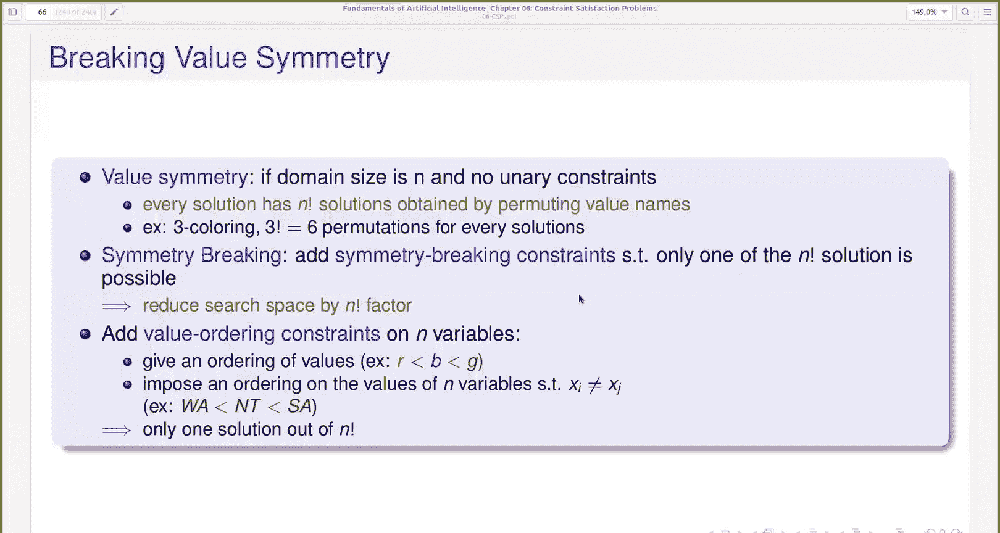

# 意大利特伦托大学《人工智能基础｜Fundamentals of Artificial Intelligence 2024》中英字幕deepseek p19 2024.11.04-CL16-1-CH06-CSPLocalSearchStructured.zh_en -BV1uUkwYTEmf_p19-

Hello。Okay。Oh first of all sorry for him。Start a few minutes late， but I just forgot my。

 Your plug in my office。Okay， so today we first conclude the chapter。About CSP with the。

Two very last sub topicsic that I want to cover。And then we start doing with the logic last and the logical reason。

 which is one of the major parts of our。Of our course。嗯。

Last time we have weve seen several ways of doing a search。In CSPs。

 were seeing the the role of inference and what's called value propagation in EP and the combination of a search。

 backpackpack search and。And。propagation。And then we have seen the smarter forms of of a search。

 So no simply chronological black frack， but conflict directed， black frack。

Which was a really measure。🤧Okay。诶。Rerovvement I would say that it was definitely an sorry。

Again changer in the whole efficiency of a CSP threatening and this also in particular so for such reasoning。

 we'll see in next chapter。嗯。And that's more less it， so。

Confid driven backracking was something which allowed the order of magnitude improvement in performances in CSPs。

诶。Okay， let's conclude in the chapter。Covering couple subtop， first， we see local search in CSP。

 how to use something similar to look search that we have seen in。In the。

In search and to apply to CSP and this is very， very briefly。

Very brief and then I see how we can explore the structure of CSP to improve dramatically performances。

Okay， a few awards about the look at search first。Well， okay， so look a search the notion of。

How to stand the local search recipes， but into the straightforward forward and。

I recall what the deal local search is you jump from a state to。A neighbor state， okay。

 where a neighbor is something relatively similar， something some state in which you can access with a simple step。

And the obvious candidate neighbor states in CSP are states in which you flip。

 you change the value1 variableley。Okay。So， substantially。

The idea is your reason on the total assignment， for reason started from a random choice or some heuristic choice。

 and then you move， you make。you select the neighbor states， the best the neighbor states。

 according to some strategy， where a neighbor state is a state which differs for one variable so substantially you flip。

 you change the value one variable at the time and just you move the sideways。Okay。啊。呃，数30。

What was the intuition about you you typically give a penalty to constraints。 So what is the score。

 if you remember。Look at search。And that sort of landscape， okay？

So the idea was you have a sort of a penalty， which is the。

 which represented the distance from a goal state。Okay， and you。

 you wanted to minimize distance or to maximizing。Remember。

 maximization minimization is always do in local stuff， Okay， in this case。

 we can think this as a minimization problem。We， we kind of give。Some be。To constraints。

 to violate the constraints， so if your total truth assignment violates given constraints。

 then you give a given penalty。To it， Okay， maybe one to all constraintss。

 or you give a different cons different penalties， according to the the。The penalty， okay。So。

The intuition is， you want。You want to reach a state of penalty 0。 So a state。Or an assignment。

 a solution where all constraints are satisfied。Okay。

So the intuition is substantially give penalties to constraints。So， how do。Cool， okay。

 so this boils down to sort of mean conflict heuristic。For instance。

 in which you can for instance implement climbing technique。Which。For instance， typically， you can。

Take a conflict viable。 So a variable which occurs in some conflict， in some violated conflict。Okay。

 so if you have a given state， you have some value assignment， okay， which violates some constraints。

You pick one。One variable， which of course is in violate the constrain。Okay， and change its value。

 and you pick。For instance you can randomly select one of them， I pick all variables。

 which according to crossts。And pick one of them。And then in a heat climbing perspective， you select。

The value， that results in a minimum number of conflicts with the other violence。Okay。

 so you pick variable x5。 Okay， and then pick the value which。Viols the mean amount of counsels。😡。

Okay。😊，Then， of course， you can also。Select not necessarily。

 You can select the more variabless according to some other criterion。 Okay。

 so it can be so all those techniques are different degree of aggressives。Okay。

 so you may simply pick one random variable and then assign the value in a greedy way。

Or you can even decide your variable according to San gradienty， when the variable。

 which is mostly causes most violations。Okay。😊，Of course， you can have。

A whole amount of strategies here。 Okay， you can give different values to constraints。

 so you can change the amount the the， the relative weight of constraints depend how often this occurs in cont。

 So the more often occurs the higher score you give it。

So then you try to force your assignment to buy to satisfy it， okay？And so on。 so， again。

Susstantially， the wall。Amount to overcome of。Techniques that we have。

 we have seen in stochastic research can be applied。

To CSP with the simple intuition that the notion of near state or neighbor state is。

A data in which you， you change the way you somebody。😡，因为 you up like all day。

Or the techniques that we have seen in local search。Okay， depending with the different strategies。

 okay。So the key point is that everything that we have seen in stochastic local search。

 like he climbing around the walk， simulating and kneeling。

geneticeneical algorithms and tabbu toti apply in EC CSP as well， and we see they also apply in SA。

Okay， so I will not insist on that because I will say nothing particularly new。All that。 Okay。

 so for instance， it when know that。At the time where Nque was a very popular topic benchmark in AI。

 Stocaastic Lucass were able to solve a huge amount。

 very huge problems from Christian and Queen province。

 which were completely out of the reach of many other province。What was interesting for that？

Among the 90s， early 90s， there was a burst in no stochasticical research for SA and CSP because in many problems。

 they turned out to be incredibly more effective than search techniques。

And this were mostly due to problems which have。A high chance of were very， very big。But had the。

We clearly satisfiable。So they obviously were obviously it was substantially known a prior。

 they were satisfiable， but they were so big it was very very。Hard to find a solution。 Okay。

 wasing planning， many planning problems。Planning encode as imp。 So we see that。

What planning is and how we can encode this into SA。

 This is something that we see in the next chapters， Okay， and you'll see with the professor already。

 if you take the course。They often turn out to be really， really huge problem。Uuge win problem okay。

 so on those problems， but most typically have they are obviously satisfiable。

 but the problem is to find an actual solution and they were very， very very good to find。

An example was very， very popular puzzle。In the 90s， the N Queens。诶。Turn out to solve some puzzle。

 which were completely out of the reach of a search。Of a standard search in ECSP。So substantially。

 mean conflict is。Can boil down to this very simple scenario。

 which is nothing as that writing in pseudo code what we have just said。Which is okay， so we have。

CSP， we have a maximum amount of steps。 Oh， I forgot to say。As with the local search。

Sttoca ca techniques do not guarantee you。To terminate。

And they're never able to tell you if a problem is unsolvable。Okay， they， they can only return you。

 this a solution or。I couldn't find one solution the maximum amount of time， okay。

 so to this time they are said to be incomplete techniques。Okay。😊。

So what imposes for maximum of steps。😡，Or if you prefer， you can impose a time out。

So you can give 1000 seconds or 10000 seconds and whatever you want to pause and any block。

Block the technique when you exceed。 So either you tell me before or or you block。So substantially。

 you have supposed you have these parameter macro steps。Okay， so initially。

 you un it with a complete assignment for the CSP， is random one or something which is suggested by some heuristics。

Maybe taking a look to the structure of the problem。You could apply， for instance。

 the techniques like the heuristics are similar to those that we have seen in the previous example in the previous section。

And then you go ahead at every steps until either you exceed the next step or you find a solution or you。

Or are you。Exceed time out。Okay。Okay， if so you have a current solution。

 so if a current solution is a solution， then record current and you're done great， Okay。

 so like is this is the equivalent of the goal test part of the in look assert that we were seen in previous chapters。

 okay。Is he author。You pick。A conflict variable。 Okay， here。

 what does it mean conflict variable variable， which occurs in in some conflict in in some conflict。

 which are not satisfied。Okay。😊，Of course， this may depend on some characteristics。 So for instance。

 if you have a constraint， which is。You can also consider the fact that it's atrain occur positively or negatively in a constraint。

 So if you have something that's a。2 x minus2 y greater equal than5。 and this is violated。Okay。

 so I say greater people， then you take the negating one because the positive one can only。

Then only could positively to that。 So there are， of course。

 some domain dependent variations of this choice。So you pick you one one bar， least them randomly。

And then。And then you choose the value， which maximizes the conflict。Okay。

Maxim it okay minimizes the number of conflicts violate the conflicts， okay？And then。

 and then you you pick the Bible。 So you notice that this is， this is not a technique。 This is。

 this is not a solution technique。 This is a piece of solution prediction， Ex like E client。

 is a sub routineine。Of a more general algorithm。 Okay， so substantially this a heat trend technique。

You see this？Yeah。Do you see the。The straighted relationship between this technique and heat climbing So essentially it goes down。

At it bumps into a local minimum， okay？This is the counterpart of e that which you can interlieve with all the techniques with some random random picking your variables。

 taboo search and so on so forth， okay， just to give you an idea。Again。

 if you can see that other there。The8 queen of province。要唔。So you， you may。Notice， for instance。

 and this okay， suppose you start you are a given point， you are in this scenario here。Okay， well。

 you notice that you have。A conflict a scenario here。 Okay， so you have a conflict here。

And well nothing else。 So you can try， is it the only conflict you have， I would say yes， Okay。

 so you should try to change a value。So which one you could try。Okay， well， of course。

 you should pick one of those one of those two because those are the one which are conflict， okay？

Okay， so who？This is the you compute the straw you will have if you move。TheThe queen up there。

 you notice the best position， the best candidate are those two。Okay。

 so because they they will cause only one conflict， if you put here， you have one conflict。

 if you put here， you have one conflict。If you put it here。

 you have two conflicts because you have this move and this move。

This country here and so on so you move， for instance， this in position here， okay？

But if you move the position here now you're get in conflict here and you typically don't redo the last dawn。

😊，Well， an implicit assumption that you hear that you never。And do。

 you never selected the last pick in the variable。ok。😊，Otherwise。

 you you could collapse to move into one， right， So if I move queen number8 in the position and the next move。

 I move again， queen number8 in another position I could have done the same movement in one movement only okay。

Okay， and now you can， you decide notice that you pick this queen here。

Which is the conflict Queen is this one。 But now you realize。That there is a zero weight。

 a zero penalty solution here。Which means a solution。

 and then you move it here and you notice that at the end of you have a solution in this case。

You see this？So this is an example of how what you， what you can do。 Of course。

 we are speaking of hundred0 variables， okay。But this is the general idea in which you see the notion of exactly and then inter leave。

With all there， With all， you know。For of。With all you know for stochastic lo research。

 so I don't want to repeat everything that we have seen there， okay。Okay。So long for， okay。

 I don't want to say much about look research because this is just take everything we have taken the sto in the general description of stochastic research and move it here。

Nothing else。Instead， there is something interesting in inio plotting structure in constantline satfiability problem and this is very。

 very important because it may drastically improve drastically the performances if some situations apply。

ok企。The point is where first， there is one abuser。Fucked。😡，Which is called divide and conquer。😡，Okay。

 so I think that you have already seen the notion of divide and conquer in in algorithms。

 the D is take。Can I take a， can I divide them into some independent some problems？If so。

 and if your the complexity of your problem is worse than linear。Okay， and you can divide the。

A problem into end independence of problems。带呢油。You get to be the van， okay。Right。So， well。

If you take the example that we have seen， there was an obvious candidate here because notice is that we have a two a independent CSP problem。

 one3 one。Which is assigning Tasmania。 Tasmania is an islander。

So it's assign values in a trivial independence or problem。ok。So when applicable。

 the idea is to partition SP into independentP。Okay。And the is okay。

 apart from the problems where this is eye catching， okay， so okay。

 if you have a very small problems that least is eye catching that you can group but in general。

 when you have a million variables is's not so eye catching。Okay， but luckily， that is。

An OS or strongly connected component in the costine graph。

Is anybody of you who doesn't know what is a strongly connected component in a graph？No。

 everybody knows， okay， cool。Okay， so going to example actually。

A subgraph in which all notes are related to each other， okay。Good news。

 there is a linear algorithm which detects st connected components。This tar algorithm to end。

 which probably you have seen which is a variation of depth research。

And so by running a linear algorithm， you can identify。S connected components， substantially subpro。

If any， well， the typical case， you don't have such scenarios， okay but。If you have。

 so this is an obvious thing to do when you have a CSP。😡，So a prepostity。

 try to see if you can divide it from scratching to any stimulus subpro。And if you can do that。Why。

 okay。そ。Why this beneficial， Well， Remember that。The complexity。Of CSP is worst case D to the end。

 where D is the。The size of domain and and number of variables is the worst case here。

 But if you divided then into。Into N divided by CCSP with C variables each， for instance。

 then you have that you pass from D to the N to N divided by C times D to the C。C椅子C。Is divided by。

There's the number， Okay， so the size of the partition province。就是大学 you divide的。

So since the problem， the complexity of the problem is。Doomain times the the size of the problem。

If you are able to divide into sub problems， then each problem is exponential in the much reduced number of variables。

So this is dramatically smaller。Okay， so if you have， well， just give you a。

Simler idea is a joke somewhere。If you ever a so， let's say buy。You have a three color problem。

And you have a 200。Glundervol， okay。And you are able to divide intosome promise。😡。

Of 100 variable each。Suppose okay， so you pass from 3 to the2002， two times3 to the 100。Okay。

 and if you divideise them into one problem 150 and then one problem 50。

 So you have three through 150。Plus，3 to the 50。Which is， which is。Dramatical is minor。

I assume this is clear to everybody。So divided and conquering。😡，Is an obvious thing to do。A priority。

 Try to see， Try to see the partition。Please。Okay， so in this case， for instance。

 if you don' have any quantity。D equal 2 and the C equal 20。 Then you pass from2 to the 80。

Which is about 1024 to four times 2 to the 20， which is about 4 to1026。Okay。

 if you assume your computer can do 10 million steps per second， you pass from 4 billion years to 0。

4 seconds。Just to clarify what we are speaking about。 So this is an obvious thing to do。Yeah。

 you may object， okay， look but it you must be an idiot not to realize this a priorityi， right？

So probability if the problem。Can be partitioned into two or n problems。

 this means that you have not encoded this properly or you haven't realized something other that。

Well， this is not really accurate。 so you cannot assume that if you are not an idiot you this does not happen。

Simply because remember that sometimes many problems derive from some automatic encoding there。

Awesome problem， so you have the some automatic encoder， picks a problem， and codes it。Okay。

So which and you don't have so it would be an idiot if you don't realize this this tiny problem like that。

 Okay， I agree， okay， but if you have a problem which derives from some fancy。

A location problems of100000 or million elements。 Okay。

 and you just have an automatic encoder to do that。Okay。

 sometimes you may generate these sort of things。 but of course。

 you have no way of realizing this unless you have an do algorithm which in the text that。Okay。

 so if you ever。Happen to implement some encoder of something into M。😡，SP problemP problem。Remember。

 always do this check。It's very cheap。 Its a tar and argon。

 though you can use any variation of that you may want。

Try to see if can decompose the pro transform problem。 This dramatically includes the performances。

Are you there。Okay， so this， this say， okay， I'll give this by assumed。 Eric。 So from now on。

 welicit assume。That's every。CSP cannot be further composed， so because we assume have already done。

if if ok。Oh。Okay， there is another。Consideration， that is not in your book。

 but you may be of interest for you。Sometimes。啊。It may the case that you don't have this scenario。😡。

But by assigning a few values， you bump into this scenario。

This is not in your book so but this comes from practice。

 so so I just tell you what I'm speaking about。 S your graph。As a sum， let me say Ab。Okay。

 so as a decent structure。A huge graph here。A huge graph here， subgraph here。

Which is really end the year， but a tiny small subgraph subset of nodes here and a small subset of nodes here。

Okay， and then this boils down to。So once you have assigned those values here， this reduces to。To。

Independent CSP。Sometimes identifying these mo sets。

And try enumerating all those combination of those values here。

So every assignment of this is theycompose this into two big， much， much smaller of problems。

There are heuristics which are able to identify the。Okay。

 and we so for every combination of value of these new sub subgroup。

 you are able to drastically reduce to split the problems to much and smaller province。Okay。

 sometimes this happens。 So taking a look to the structure of your problem is advantageous。

But it is a general way of doing this。哦。Which is this one？What happens if your graph of your。

If a graph of your CSP is a3。Or that is， if it doesn't have， it has no loops。Okay。

 there is an easy theorem， which says that if a constantsine graph has no loops。😊。

Then the CSP can be solved into all of N。D to the square time， in worst case。

So instead at B to the N， you pass from B to the N。😡，Do n times this square。

From explanation to Portinoia。Expon to putctic。Well。

 not really quite sorry to to linear because well， let's assume that D is a constant right so you say D is the maximum domain。

sizeize of the domain。 Okay， so D to the squared， the factor is a constant。

So you pass from exponential to Li。How is this possible？😮，Well。Okay。Think about that。 if it's3。

If you have a tree， you have a very few dependencies。

 we have a sort of direction of propagation of values。Okay， so。

And this can be easily seen by this very simple algorithm。😊，ok。If these are three。

Be variable as a root。I assume everybody knows what the treat is。Yeah， okay。

 so pick one variable as a root。For instance notice that you can really use any。

 any variable here as a root， right， So you can think B and then those A C。

 D are are the childrenren blah， blah， whatever。 big one。Remember。That。啊。

Sstanti correspond to another partial order。 So okay。

 use this means also just take a total order transform a partial order in a total order， okay。OK是就是。

So， choose a routector。And order the root from root to order the variable from root to lease。

So should does impose a total order out of a partial order。Okay， you know。

 you can always arbitrarily do that if if you start from a partial order， okay？Are we there。Okay。

So in this example here。We may， for instance decide to take A as root to So A as only one child。

 which is B， okay， then B has two children， C and D。

 so let's consider C is the first take C first and D second。Okay。😊。

And then D has two leaves which are C has no leaves， a D has two leaves。

 which are E andF and take E before us。Not this works with any arbitrary order provided that the order is compliant to the tree structure。

 so every parent comes before。Comes immediately before at the children。Okay。A we there。Okay， so。

Then you do the following。😡，Sing。From the bottom。Upward， so substantially started from right to left。

May apply me are consistent of the pan of x over Xj。Okay， so substantially drop from the parent。

So consider bottom to right So right to left， the bottom to bottom up。

 compare parent with the children。And。drop。Pwise， drop the values of the parent or the domain of the parent。

 which are not compatible with are consistent with the values of the song。For the chillli child。

 okay。So let's see this example here。ok。Well， these are not pilot， so go ahead。Okay。

 then you have the， you have this， this value here。 Okay， so what is the part So you start from this。

 What is the parent of F is D。Okay， so make the domino of the are consistent with the value of F how okay。

 red is compatible， green is compatible， blue is not compatible， so I drop D。Okay， E。

The father is the okay， all are all compatible， Okay， because for red， okay。

 you can choose each one for green。 Yeah， you have green， but you also have blue， Okay。

 so no need to do further rapid that。Okay， D， the priority is B。Okay， well， there is no。

 remember that you have dropped the blue here。Green is compatible red， Okay。

 and blue is is compatible with。 So you don't need to do any update。C， the pan of C is B。

 C is only green。Okay， okay， so suppose I mean， suppose that this is the current state of the venue。

 okay？诶。Now， you， okay， you have to update me。ok。Yeah have today B， okay， B， green is not compatible。

 but blue is compatible。 Okay， so it remains blue。 Now you pass from B to a。

R is perfectly compatible with blue， but blue is no more compatible with with blue， okay。

 so you dark blue。So at the end of the day， you have a pass from this domain。

We start in domain to restart in domain， So this is the first step。ok。At this point， if you have。🤧呵。

If you have no empty domain， okay， if you have an empty domain。

 you can conclude that this tree was incompatible， impossible， okay？If is another keys。

What you can do， you can assign， starting from point。啊。You assign a value of B。

So you go ahead that you start from a top down this time and you assign the value of the child comp with the value of the parent。

Can you always do yes， because you have already made the value of the part consistent with the value of the song。

Okay。😊，So for instance， you could start。First， you consider this pair。 Okay， so may assign okay。

 initially， you can assign the whatever value you wanted from the father。 Okay。

 so assign the B to blue here。 Then you can assign this to green。 This is you can free assign each。

One of each。One of those if you have assigned this green， then you have assigned this blue。

 if you have assigned this red， you can assign in check whichever of these okay。

 and this can be assigned a blue， but this is compatible because we haven't assigned a blue here。

By guarantee， okay。You see this？I see some perplexed faces。I。The last step， okay。In the first round。

 okay， we have made。All the values of all nodes or all the parent node compatible with the values or are consistent with the values of the songs。

Okay。Okay， and if this process leads you to a a non empty domain， Okay。

 notice if you have an empty domain， you can conclude this as no solution。Okay。

 if this is not the case， what you can do。You start from left to right。Okay。

 and every time you assign a value tool。You know， the compatible with the value of its parents。

 So you， you will start assigning parents。Toward son。 So Sa。

 you started from the root down to the children。Okay， down to， down to the leaves。En of。

Why you can always do that。You can always do that because in the previous step。

You have made the value of the planets are consistent。With the value of the children。Okay。

 so you know that there is always a value achievement， which。

For every value or the father that you sent to the father。

 you assign a value or you can always access the value to the children。Are there。Good。Okay。

 so this is a very simple example， but you can simply apply in a different way， okay？With there。

You know if this so。 Look at how many steps。Well， this is linear， right？

So you have n steps and every time you have you have the two just to select the one value of the variables same for the next step。

 okay， yes， please。Yeah。はい。No know， I mean， this is a starting point。This is starting point。

 So suppose this good have。😡，对。Yeah。I don know， okay， this is an a Okay。

 remember that you can have unity constraints also on board and the U。So suppose the， I mean。

 suppose this is the domain of the domain of a is red blue。 the domain of B is green blue。

 The domain of C is all the green。 Okay， now this is just an example， okay。🤧In general， you can have。

Remember没sp jail。Makeking no assumption about the actual domain of it。

SP does not assume that every variable has the same image。Okay， typically there are subrsite。

Every domain or every library typically a subset of some common domain。So typically for instance。

 we assume that we have already， given a pass in which we have already propagated them。

 we have already done know the propagation， if you remember。Previousview last class。

 When you have a node a no constraint。We give a person， then we reduce the values。So in this example。

 we assume this is the starting domain。😡，Okay， we have a reduced。

 I believe they they mean this is an example because they wanted to pick this small， right。

 but you can make an arbitrary big one。はい、その。No， we don't have a for a while。

 but we don't have all the food colors。What if well。Well， we we treat this as the cause。

 Well remember that we may have。So if we had all the three colorss for each。

 So you say that it would be implicly consistent。 I don't think so。 Well， let me。

 you notice that you may have an arbitrary amount of of songs。

So you are so what is exactly with the question， sorry。Yeah， yeah。The same thing。But好的。Yes。

In this case， if we were， this trivially consistent， okay？In this case。

 but this is a very simple problem。Okay， I mean， I believe they chose this restriction on the domain simply to make。

To keep the examples small， right？But remember that also those techniques result。Okay。

 this technical solve CSP is not simply a technique to solve a problem。

 but very often is's a sub routine。To solve a sub problem or result or previous simplifications。Okay。

Yeah， for instance， for instance， but we'll see a general application of this。 So in general here。

 we have a domain with we have a problem with already some domains of variables。

 which can be restricted。 Okay， In fact， we just wait a couple of nights。 and we'll get to that okay。

So is this clear？Yeah， of course if read all values in the room between okay。

 so step number two would have no effect in this case， okay。

 Elizabeth tiny problems a problem okay again， one of the problems that people who have to read to write a book has or to put them in the slide that you have to fit to make a very small problems。

 right？So sometimes soon。They may look a little artificial as a problems because simply you have to to keep that small。

😊，Okay， so。So， this is the。This is the algorithm。 So this is nothing else that well I've just said just written at the su code Okay。

 so if any is the number of variable and initial assignment is named and the root is any variable。

 then you make a topological sort of that。 Okay， yeah。

 you should know what a topological sort is transform a partial or total order Okay。

 so just make an order language which is compliant with with the father son father children or parent children。

Relation， okay， arbitrary。Arbitrarily salt then you start from J from a down to2。

 you make r consistent the part of your J with xj。Okay， if it cannot may be consistent。Again。

 you could have a father and a song， which is the book blue， both only forced to be blue。

Then you can return on failure， okay？And then so you may， you have in this type， you reduce。

To reduce the domain of nodes。 And then once you have reduced the domain of node， you can。

For I going to one to N。 Oh， I forgot to say okay。Okay。

 I forgot to say what what you can do with the route。

 of course with the route you can assign freely assign again mean any variable because you had a set an empty set of parents okay。

 so obviously this you can assign an arbitrary value to it okay。🤧Okay。

即 for I going for one doing you。You set an ecosystem value from the eye。一。Okay。

 if there need no such consistent， you can return that side， okay？Okay。诶。hy。Is this interesting。

 This is extremely interesting for a completely different reason。

 So it's very rare that you are in this situation。Okay， that you produce a problem in this situation。

Okay。But。This technique is very useful as a sub thing。😡，Because after some simplification。😊。

You can end up into a sub problem， which has this feature。

Or you can try to reduce the problem to such a way that all the resulting sub problemsm。

Have this feature。Okay。And which is very， very similar to the scenario Ive already described there。

Okay， so suppose the scenariora describes that is like that。

 And suppose the two blocks on the left and the right are trees。Okay。Then， so if I'm able to。

Identify。A subset。Of nodes， or subset of variables such that once I've assigned them。

 all the problems drastic reduces either into two independent problems like that or into sub3 into three like problems。

We in three lack Pro。Then I have drama to improve the performances。Okay。

And this is what is called cutet conditioning。🤧。In the technique。

Suppose you are able to identify a small cycle subset， a cutet。

That is a set of variables so that random man on the graph is a three。So once you drop them。😡。

The resultard is a tree。Okay， first of all。Nowing。The problem is that finding as small as psychoap is NP PR。

Okay， but the good news is that typically there are very fast approximated versions。

 so very fast techniques which find maybe ca， which are not so minimal， not guaranteed to be minimal。

 but they are decent。😊，Okay。😊，Okay， so suppose that you find that a acid。Then， okay。

 suppose S is accepted， then for every persistent assignment S。Of the the set of variable， okay。

You remove from the domain or the remaining variable any values that are in very inconsistent with the assignment of us。

 Okay， so you simplify so substantially you。You make our consistent。

 You check the consistency of the of the neighbor nodes or the cutt and then。

What you have as a result。Is three。Okay。Then you can apply the twostructure CSP algorithm。

So suppose that C， I will show you an example in the nextus slide， okay。So， if C is a casst。

Is the size of of the classic S。Then， the run time is。You have to enumerate。

Or the possible combination of the values of the or the consistent。

 possible combination of the of the ca， so which is。Be to the sea。Okay。

 which is and this part is D to the C， okay？And for each substitute assignment。

 you have to solve the。A three like。CSB。Okay， whose size is n minus C。Yeah。Okay。

So you reduce the problem from B to the C to n minus C to D square。

So you have a s which passes from a B to the N， so exponential in the number of in the size of the problem。

To something which is respondenter in the size of the cutet。大型石山， which is里年。

In the size of the remaining part。Okay。So if you're able to identify this cap。

 let this boils down to something very， very。Much， much simpler， okay。Okay， take a try。

Try some number。 Okay， again。 so suppose you。You again， this is3 to the 300， okay。

And suppose your catet is 20。Okay， this boil down， too。3 to the 20。打应胜。300-20。Times this square。

 okay。Times of three square。Okay， you immediately realize how dramatically smaller is this number with respect to this number here。

Okay， so。Let's see。😊，Okay， well， first get back to the our original problem， right， Remember this。😊。

Theres an obvious concept， yeah。Southern Australia。

Remember how complicated implicive I was if you got the wrong choice？

But then you identify the cut sense。Okay。Is it not， is that for every value you give？😊，The casst。人。

You reduce everything too。 Well， this is not even a tree is just a line。 Okay， Okay， so you see。

 you once you have applied this， the solution comes really like that。Well， you may object or come on。

 but I can make only， so this would reduce to three times。The value of。

So this case would be three to the one times the something which is linear in the remaining part。

 but when one may even say， okay， but I don't need to do this three times， okay。

I just so those three are irrelevant。Okay， why the distinction of blue or right， the green？

Should be relevant。 And this is what we are going to explain in the next slides。Cmeter breaking。

Another fundamental fact。 But if this。对啊。ok。Suppose。Do this。Solve for the three coding problem。

Well first， do that by general way。Pretendly you don't notice this particular structure。

And they try to identify a catet here。 But I think it's quite obvious。Okay， and solve it。By。

That's the condition。And you may realize how dramatically faster is if you realize。Is that okay。Yes。

You see this？One may object but come on， if you use the euristic that you ever shown me at the beginning。

 I would have immediately identified those values。First up。So， this would be。

Something that would I would have got for free anyway， this is not completely song。

It is so with the tri problems title。But you may hand up to have CA setss。

 which are not so strongly interconnected， but they are cat sets。

So each of them is connected only to A3 variables。So it cuts that of say 20 variables。

The fat that it is a caps is not the fact that each of them is particularly highly connected。Okay。

 but the fact that that those groups， all as a whole is。

Is has a huge amount of is connected to everything else。 Okay。

 so dobe misled up the fact that everything that we've shown here is based on now。Doy problems， okay？

So in general， it's not the case that how the euristic that we have seen in previous sections will automatically identify any way a CA set。

We are not so lucky。 Okay， in general， this does not hold。Okay。

 so domainamine mis by the fact that we are dealing only with。Toy problems in our example。Okay。

You can try。 You can build your own problem。You can try with a Sudoku problem if you wish and try to see what's going on。

Okay， the lock is a little more complicated to see。Okay。

Graph color is graphra color is a very nice tool for humans to understand CSP， right。

 Because this allows you to， to have a eye catching idea what's going on。Okay。Last but not least。

Symmetries。Very， very important in search。We have。An issue of value symbol。哦。So suppose， okay。

 suppose we have a domain size。And， and no unit strength， okay。So， every solution。

This means that every solution。海石。And factorial。Equivalent solutions。

By just permutating the solution， the values。You it。Well。So， the point is。呃。Okay， these is black。

 These are blue。Okay， and sorry， can I borrow you， and this is， well， this is orange， okay。

But the fact that I call this blue and this I call this black and I call this orange is just something。

I have decided I call this call this orange， I call this call blue and called this black。Okay。

Over there。So。Take these three steps here。Are there any difference between them？It's just because I。

I' decided I attribute this a given pigment。Okay， this and this this。

 but I could have called this green， I could have called these blue， and I could call this red， okay。

So， these。So every solution I propose。Has n factorial。A turn solution。

 which just just make a permutation of the values。Assume me I don't have any unit complaint， okay？So。

 for instance。🤧。When I。When Ive in free coloring。I have six。3 factor also six possible dynamics。

You may object。 Okay， but this is not really problem because I saw them means finding one solution。

 Okay， so well， who cares。Okay， the problem is that。When you do search。

You have some partial solution， you have some partial value assignment， so you assignment。

 let's say this one to be green， this one to be red， and maybe I have no solution or menu。Okay。

 if you get back， remember when there was。Okay， let me。Go back to the last class。Okay， consider this。

Remember that this problem has no solution。You guys， okay， remember， because no matter water。

 we have these three， we have only two two colorss left there for pre is like the game of the child。

 right？Of the trash， okay。But then。If I had assigned these both to blue。😡。

And would have this very same program。Okay， if I had the that then boughted to green。

 I would have had the same problem。You see。😊，So the problem with symmetry is not。

I's not only on the fact that you have in factorial solutions。

The key point is that typically you find one solution so no matter what you want。

 but the problem is that。There are some combinations which is the fact that you can add arbitrary。

Equivalent。No goods。So scenario which don't lead you to no problem， no solution。

 but you can try all the possible combination of time。Suppose you have an go with the caveva animal。

😡，ok。So it's not so obvious too。Real that then you may redo So the point is that you may redo the same search of this。

A huge component set with the various with a very semantic problem， some problem。

So you find out that this seem consistent。😡，And then you reduce， and then you try blue， blue。

 and you then again， you find a huge。Inconsistent subse， a useless search。Okay。

 we just just a permutation of the colorss。Okay。😊，And again another now a three here。

Without realize that we have a redone of the same failure。😡，The same user as search。

Just flipping right with blue or green。You see this？This is symmetry。Smetery is。

When no nine are in search。Okay， because it makes you。

Lose a huge amount of time if forces you to do a huge amount of searches。In呢。If you don't。

If you don't realize then。Okay。What can you do with search？

You can do what's called symmetry breaking。Introduce some symmetry breaking constraints that the only one of M factorial solution is possible。

So tension it reduces the source page by an n factorial factor， how do you do that？You should impose。

One value ordering。😡，In ordering on the values。 So for instance。

 you impose that red comes before blue and blue can before green。Okay。

And you impose a order on the variable， on the first end variable， such that X。Different from Xj。

So for instance， if you have three values。You both that the value of。诶。

Wales is smaller than the value N and is smaller than southern Australia。You can impose up to to end。

 So substantially why you can do that。Because you simply。Cool。I call a red the first value I assign。

I call blue。The second value I assign， which is really different from the first value I sign。

I call green the third value I assign different from the first two values I assigned。Okay。

So notice that you don't need the polling MRI， green， blue， or one， two， three or whatt。Okay。

 so if there is a completed。Symmetry between the values。 let's call number one。

 the first value assign。The first are distinct value assigned the call。Number two。

 the second distinct value of assign。 Let's go3 the third distinct value I assign。Okay。In this way。

 you save a lot。Again， if you are designing tools or designing and codings or applying designing tools for a search with the using CSP。

Detecting and identifying symmetries is a fundamental， it dramatically reduces the search。Okay。So要。

We had the personal experience of order magnitude gaps。 Yes， please。 Just something。

 It like the and on the first point is。This is like one of the variables togetherNo。

 I don't get the point if main size So that's one and on the last point is on N variables not those ones like the one like first line and on the which one here first line is like if the main first line of slide。

 okay， size n and that's one after N is N is the okay， what weve called D sorry in previous slides。

 so okay， yeah， sorry。Yeah， yeah， yeah， yeah， you're right。I should have more properly called U D。

 Yeah， you're right if you wanted to send me an email and I can correct it。 No， I mean。

 there's not wrong about Yeah， is of the notation。 Yeah， you're right。 Okay， so B。

Let's see good it did， okay。Over there。So remember it。 So what's the problem where sometimes is。

The difficulty in a symmetry breaking is identifying a symmetry。Very often okay。

 it's not so obvious that there are symmetries， but if you are able to identify symmetries。

 then you should do something for that because this allows you to dramatically reduce the search。So。

When you are encoding a problem as an AI person， take a look to symmetry。Okay。

 because it may really be the case that you can dramatically and improve the performances if you exploit symmetry reduction that we have experience in your real life this。

OfOr magnitude faster by just adding a few tricky constraints like those。Okay。

There's a wall literature to sub literature tour of detecting and。

Detecting symmetries in SA and CSP and planning and in related problems。 Okay， because the hard part。

Is identifying symmetryries once you identify it relatively easy to。To solve them， the way to them。

Okay。Okay。Okay， so so long for CSP。I wanted to take the remaining part to introduce Lee to introduce a little about a bulloleing logic。

 which will be bulloleing reasoning will be the next chapter。Okay， and we dev it to logical reason。

 so bullet reason first first orderological reason in second， quite some classes。For now， Okay。

 so I just will conclude the CSP。 I will have I will make it to separate recordings， okay。

And then we have an interval， okay， so we should resume at 55。Okay。😊，系い。🎼嗯。

