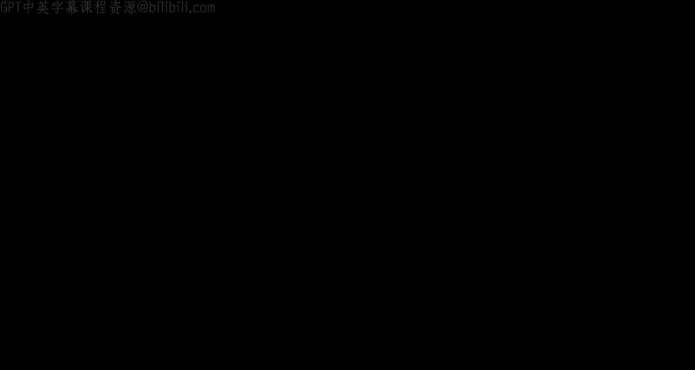
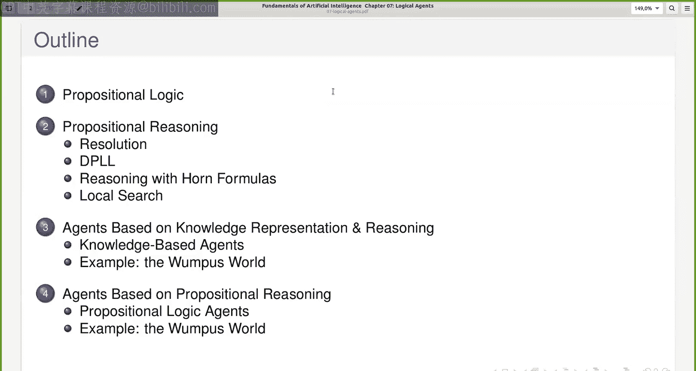
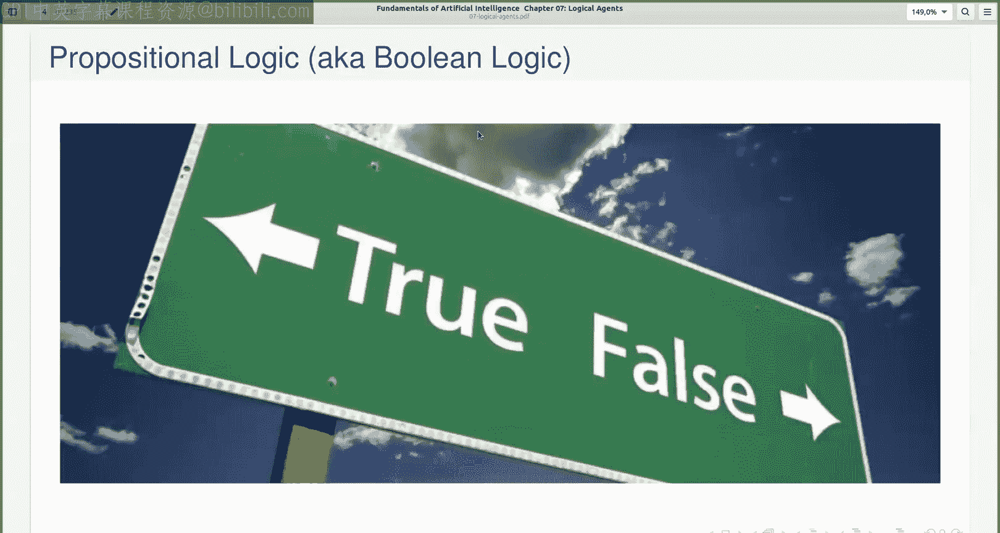
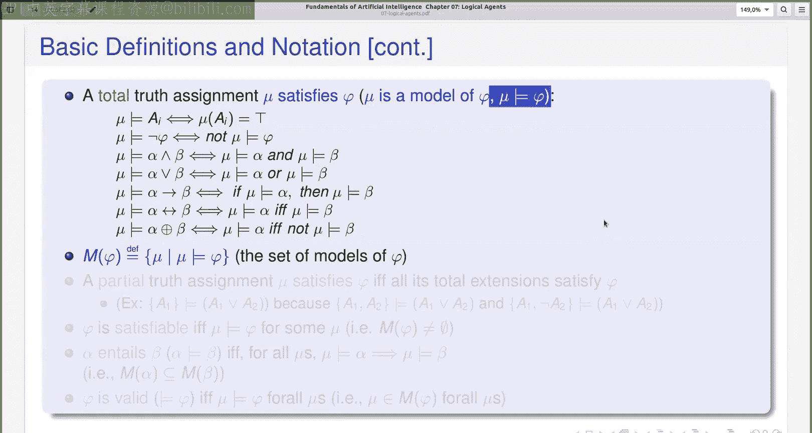

# 意大利特伦托大学《人工智能基础｜Fundamentals of Artificial Intelligence 2024》中英字幕deepseek p20 2024.11.04-CL16-2-CH07-BooleanLogic.zh_en -BV1uUkwYTEmf_p20-

Okay。So。At last， we start discussing about logic。Of。

Is there anybody here who has never studied explicitly propositional logic before？Okay。

 so I think I can go quite quickly， but I do want to go through anyway because I want to be under that everything is known。

 but I can go。Quite fast on that。So， let me give a sort of。🤧H。A center of compact。

a couple of the main fact about a bullan logic or propositional logic so proper logic propositional logic also known as bull logic is the logic of plain two or folds so nothing nothing else so everything you can all values that can be give to of folds。

Okay， let's I want you to do some terminous syns， although maybe you already know it because I want to be sure that we agree each other when I explain。

Okay， so。Well a proliferationfor formula or boolean formula or sentence is given by the following ingredients。

The symbols true and false。Here through top and bottom， are formulas are。To value constant。

Propositional atoms， I will use capitalized letters possibly with indexes to state our formulas and then every boan combination of a boolean formula is a boolean formula。

 where a boolean combination is given by the following operators negations and or implication where left implication。

 if and only if in this symbol this nextO。Or exhaustive or。Exclsive or okay？So for instance。

 not a one implies a2 and a three and a leaf， not a one so a2 or not a4 is a bo E Boion formula okay。

So nothing but get a fancyzy。We call atoms of phi given a formula phi。

 so substantially is given a Boolean form is given by the true or false constants， boolean atoms。

 and other transit closure you can build by using the Boolean operators。W， that's quite false。

I call the atoms of Phi。Give us the set of atoms which occur in fire， Okay， somewhere。Okay。

 another important on the finisher is the notionional lit。😊，Lita is either a propositional atoms。

 which is called a positive lital or a negative or atoms or negative liter。

 which is the negation of an atom。Okay。Oh。Which is called negatively lit wrong。

I will use the following convention that if a little is already negative lit by the negation of its lit。

Mean it's atom rather than not not。 Okay， so Suatcisha。

 I will automatically implicit to drop a double nest negation in front of an of an atom。 Okay。

 nothing particularly fancy will say。We call a closer any disjunction of the literals。 Okay。

 so a1 over。Remember， lit is either a value or atom sation， and we call a cube， its conjunction。Okay。

 that con。 not is that。A closest negation of the cube。

 which if they apply the mor rules is a close negation in the cube in which that。ok企。

I believe you should already know truth the meaning of boolean operators。

 so substantially if alpha and beta have the following values。

 then not toggles the value through false is the false to true and is true if an only both or true and false otherwise。

 or is true one of them is true， false if both are false。Implication。

The implication is true when alpha is false and when beta is true and false if alpha is true and beta is false。

Okay。😊，Cl， everybody。Left implication is nothing as the synthetic sugar to say in implication left right。

 okay， so alpha left implication bracket is the same as mat plus alpha。Okay。

If and only if is equivalentence， also known as equivalentence is is true if both have the if they have the same of values。

 alphabet the truthth value， so true true both are if they are both false or differ both true。

 they are false， if they have a different too value。Okay。So is the neation or different relief？Okay。

 if it's true if they have a difference with value， pulse if they have a different value。

If they the same value， okay。Okay， English， this means A and Bs and A if B。

 sometimes you may find a logic as a correspondent A if B means that B implies A。

 A when B is A is left implied by B， A， whenever B is left implied by B， if A， then B。

 Can we see as A implies B， A implies B， A forces B， A requires B。ok， you may find many of them。A。

 if and only if B means say a precisely when B or A if and only if B or a is equivalent to B。

A or B or both A unless B， okay。Either A or B， but not both。Okay。

 remember that the English is onbis on the notion of A and of or， okay？However。

Let me say something about。About the meaning of implication because this sometimes creates misleadings。

 okay， so when people is asked to give a logical representation of some expression。

In especially in the English or not whatever。The use of implication sometimes causes some。

Perplexities or some mistake。 So let me warningn you in advance or something。A implies B。

Sometimes can be countering to this，Alphaine plus beta means that okay。

 alpha is called the andent and or the prime andmb is called the consequent or the conclusion， okay。

Again， if alphaA holds， then better holds。But not bit of。 Okay， so a chological mistake is。

To attribute to given implicit bi left implication when。Okay if for you。 So if alpha holds。

 then beta holds。 But this does not mean that if beta holds alpha must hold， okay。That's fund the。

And the other。Typical。Error or mistake that we do in interpretation on implication。

Is that alpha implies beta does not require causation or relevance between alpha in beta。

 but they are just a logical relationship， a truth value relationship between them okay。So。S。

Let's assume I。I give the standard interpretation of five of the Tokyo， Japan or whatever。

 and they assume that you know that Tokyo is the capital of Japan， Okay， okay， if I say。5 is odd。

 implies Tokyo is the capital。Of Japan。Okay。They seem completely unrelated the facts。Okay。

But this does not mean there is a causation or relation between it。Since five years old is。Through。

In the standard notion or interpretation of five and of the。

And Tokyo is the capital of Japan is true in the standard and notion of whatan interpretation of Japan and Tokyo and the world of Japan and Tokyo okay。

 means true implies true， which is which is indeed true。Okay。

But this does not mean there is any relationship between the two things。

Is just the fact that a truth value is related to this truth value。Okay。Are we there。

So this scientist understand understand interpretation is too。

 even though we understand there is no relationship between the fact that F is and the capital of Japan。

 right？Okay。Yeah。Another thing that sometimes is misleading is that an implication is true every time the antecedent is falses。

5ive is even implies the same is marked。Is true regardless how smart is sand。

 So if you don't know Sam。Okay， you can conclude this under the standard interpretation of okay。Why。

Because sun is even， is false。And false implies something else is always true。Okay。😊。

5 is even in plus Tokyo is in Italy。It's true。This happened。So well， this maybe sound quite odd。

 right， but puzzling。But the point is that。Five years even is false。

 So false implies something else included things that are blatantly false themselves。

 Remember that false implies false is true。ok。So don't mean it's late by the。

Logical meaning of implication means。According to the truth table。To causation。

 don't associate causation or relationship between the things or actual dependence of the two things。

Okay。Is it clear this may be quite a misleading， okay， so if you don't think too that。

 if you don't think think that in the proper term。Another fact。Is that alpha n beta？They should not。

 You should not assume simplicityity and a temporal precedence of alpha with respect matter。

Theres a logical im， okay？Sometimes it's the opposite。Implication is you to represent necessity。

So the grass is wet， the implant must have rained。Okay。The grass is wet after it rained， okay。

So we tend the psychological to think that when you say。

Alpha implies beta to think that alpha is is something which just happened before beta。

It terms more temporal。 No， it may also require necesscitation in order Al2 to happen。

 we must have happened。For instance， okay。So， overall， the。出て。

The takeaway part of the of this slide is that dotamine misled by。令。Common natural language。

Use of implication that we sometimes do。Logic is something like a natural language is something else。

And this holds particularly for you guys that you studying artificial intelligence where you have both to deal with logic and to deal with natural language。

 okay， regardless whether English or something else or some other language， okay。Beware of this。

This is a typical source of problems when you are。You want to model something in terms of the logic。

ok。😊，Any question about that？No。Okay， there are a bunch of properties of Boat。

 which I assume you are familiar with。And or and if a leaf and so are commutative。

 so you can embed them。No or they are regardless of order。

And or and infiniteol leaves and so are exhaustative。 Okay。

 and this is why you can think of them as also an operators。 Okay。

 sometimes we use end ehenol leaf and Xor as an operators rather than binary apparatus。

 simply because the fact that they are asosciative so substantially。

 it doesn't matter when whether how you you put the parenthesis on。 Okay。

 so you can do without parenthesis。Okay， sometimes you even find them as a pras operators， okay？

And the implication and the left implication are neither commmutative nor associative。

 So alpha plus beta is very different from mattin place alpha and alpha plus betain plus gamma is not alpha equal matin place gamma。

 okay。😊，So this is very very different。And the reason why a difference is obviously in the next slide。

 because there are lots of。Equivals between those operators。 So these operators are very redundant。

You can express everything with negation and end alone or negation or alone。Okay。

 but this is very convenient to use them。we have some obvious equivalents where double negation can always be dropped。

 you should know the Morgan rules so they are the fact。Ens and or are dual。

 So the negation of Al beta is the dual。 So the neation of alpha beta is or of not alpha and of beta in which of S。

 So n and R is are dual。 Okay， so you can utilizeize them。Okay， so， so all these four。

Gos strange happen， okay。Okay， here we have something which you should always keep in mind because you lose several times alpha implies beta is the same as not alpha or beta。

This may sound obvious to you， Iop it is。But you should always have this in mind because sometimes it's very。

 very important。 So seeing implications。As thesejunctions。Itows you to understand many。

 many things in logic。 So when you think that something is complicated to reason with the。

Look at the implication as disjunctions and that this will make immediately your probably clear are。

Okay， so perform automatically this substitution and you and this will。

Allow you to solve the many problems in much easier way。 We'll see several examples of that in our。

Okay。Well， negating implication is the po。The end of the the implicant with the de of the implicate and the left implication。

 remember that the left implication is just nothing else but a right implication which the author。

Another important factor is that ehenol leaves are just the end of the two implication。

 the left on the right is just a crunching of the two implication， okay。A。

 if and only if B is the same as A implies B and B implies a。

And core is nothing yet that the negation of a byimplication。Okay， if you notice。

Those equations here， you notice that or can be written in terms of and does not。

The implication can be written as a no or not。 So as end a not。 that implication is the。

The the opposite。 So again， can be written as I note。

By implication can be written as two at the end of two implications。

 so it can be written as and a not。And exor similarly as a negational application salt。

Everything can be defined in terms of and and not okay。

 so you can see that all the implication left or left and right implication by implication co can be seen just as synthetic sugar for more complicated expression which whose only elements are ends and not。

You can write everything， every billionoleion formula in times but however。

 since there are many of there。😊，Those who brain to have a need meaning。Okay。

 so typically we use all of that。I think nothing particularly face so far， right？Okay， okay。

 leave you by exercise to do some transformations。Now。

 something which I suspected that not all of you ever seen。

Because this is typically something which is targeted for automatic reasoning。

Is the representation internal representation of a formulaia？Well， the typical， well。

 you may not have a thought of that， but typically when you represent an expression like the paleantess answer andor。

 you have an implicit representation as a tree。Where。Internal nodes。

 roots and internal nodes are just labeled with the boolean operators and leaves our boolean atoms。

Okay。😊，But the when you are using it。😡，You are implementing or are designing a tool to reason on logic。

嗯。You don't use threes。😡，You use dogss。Dect Icycled graphs。Why， because you want to fuck out。😡，Fer。

Equivalent subsions。And this is dramatically important in automatic reason in when you are implementing some device which uses logic。

 which reasons about logic， about logical expression。错。ok。

Why is the case because dog representation can be exponentially smaller。Then three representation。

 in particular when the ethanol leaves and hence exs are involved。Okay。

 consider this very simple example here。You have a chain of three by implications。A1 implies a2。

 if only if a3， sorry， A1 if only if2， if A3， if only if its one。Now。

 try to represent these expanded as implications， okay？The main operator here。

Means expanding this as a name to implication， left and right implication。Okay。

 and then we have to expand this。Recursively。Okay。You notice。

That you have two copies of a one in place a2 here。

You have and you have two copies of each implications。They duplicated the copies。

If here you add another ethanol leaf。You may have four copies。If you add another if leaf。

 you may have8 copies。All that。So why is the case Because substantially when you have。

 if you say Phi 1 if only Phi 2 and you represent this as Phi 1 implies Phi 2 and Phi 2 implies plus Phi1。

You automatically duplicate Phi1 ifhi2。But then if you further expand Phi1 and each5hi1 andhi2。

 then you make it four times， if you further expand its components。

 you have eight times so if they contain infinite needs of course。😊。

You make them they make eight copies of that。16 copies of them。32 copies of them。Okay。

 you may not realize but your when you have ethan leaves and the same oxre， remember， sos are。

Sos are the negation of regional leaves。Okay， and also when we have another。

Coststock reaches is very frequent reaches and ifthannails。You have an encoding if then else。Consts。

If Ihi1， then2 other factor， the condition of Phi1 is repeated bias。

Can be written as Phi1 implies Phi2 and。Not phasehi one implies phasehi 3。Okay， you。

 the duplication of phase one。And again， you can if it safe contains Arthur e and an acid then it it blows up。

 can blow up with size。Okay， so。If you represented this formula， there's a three representation。

You see。😊，Ass a huge size。 But what you should do instead is to represent internally。

 So when you have a。You are building a tool。She representing Ta as a dog。So that you can share。

The same sophoia， in particularly， you share the same at， but then you can rebuild recurible。

You notice that every formula can be rewritten this way， expandeded and they kept。lier啥意思？if you use。

En dog representation。But well see some interesting example of formula。

 which immediately blow up very quickly if you don't use a dos。

So if you are implementing some automata resume device or any expression which deals with logic。

Remember， use dagger representation。Okay。Any question about that。How do you do that， Okay。

 there is there are algorithm， which are called hash counsel。 So how to。

Transformment expression passing and especially stored in Pra。

 there are some organs which are called a hash causinging， which substantially work a bottom up。

Bottom up instruction and cash in the has table， the components in terms of the triplets operator and sub formula。

 sub formula。And I wanted to go through the detail of that， but there's one known algorithm。

 which allows you to do that。Okay。Clear to everything， everybody。Okay。So on for the syntax。

 let's go to the semantics and you may find some tricky things here。A total of assignment。

Is something which is a function which assigns a truth value to lower atoms of a formula。Okay。

But very interestingly of wool logic， you may have partial of the science。

A positive assignment is something which assign a subset。Of the atoms per tooooth value。 Well。

 we have already seen this in CSP， right， So that the partial value assigned。Okay。😊，Okay。😊。

And here is okay， totalta to the assignment。If we consider the suppose that the word could be represented。

 you could represented in a computer every information of the world， quite optimistic but suppose it。

 and since we are in a computer you are represented everything as bits。

 this means that every state of the world could be represented by a U Bluetruth assignment。

To2 billion variables。 So beats are bull variables。 Okay。

 so essentially you could have a huge tooth assignment。Which should represent the state of the war。

Much more interestingly， you represent Tasan of the relevant part of the world you are。

You're representing in your problem， representation of your problem。 Okay， so you are a problem。

 You are representing this in your computer。 This means that your computer stores the statue of the world as a set of words。

Okay， of bit words。Okay， which is a tough assignment。

AToth by your assignment to do to the bits of the words。

 which your computer uses to memorize the any information。Okay。Okay。Very importantly。

A partial assignment。Implicitly。Represent where a partial assignment in which a K atoms are not assigning a tooth value yet。

Implicitly representative。Two to decay， total truth assignment。

 which can obtain by expanding by assigning the remaining。An assignment they use。Is this ser？If K。

 if assign， if you have n variable， you assign n minus k to then， okay。

 you leave k variables assigned。This means that tick small you have it。

A partial assignment represents is a sort of temporary representation of a two to the N an assignment。

Do theth Simon， we just respondeded。This is a fundamental indha reason India。Okay。Okay。

 let me introduce a notation here which will very frequently use。

I using twoth assignment as a function is very inconient。 Okay， what typically we do。

 We represent this as sectorable lits， What a conjunction of litals。 What do we mean。

Instead of saying a muA 1 is two and muA2 is to false and blah blah， blah。

 I just say a1 and knotaughty2。So Po the literal represent the atom to be assigned to true。

Negatively to represent the atom assigned to falses。Okay。

Notice that sometimes another alternative representation is not as a set of lits， but as a cube。

 a conjunction of lits。 Okay， so a one and a naughty tube。Me。

 a two assignment represent as a formula， a1 and not a2 means that a1 is assigned to true and a2 is assigned to falses。

Interestingly， notice that Altth assignment， which Al assignment。

 which can verify this formula assign a one and assign a to the default。

 so this is perfectly consistent with the the two notation are perfectly consistent。切。Okay。Clear。

okay ， I。Conclude something about the semantics saying。The standard semantics。

 So you said the two assignment satisfies a formula。诶 we give诶。Inductive definition。Of that。If okay。

 new satisfies a1， if a new A1 is true。Okay。And we are this satisfaction as。With this symbol， yeah。

 in。New satisfy anatomy if makes it true， of course， new satisfy negation， if it doesn't satisfy you。

 notice that this expression here holds only if we are speaking or total of assignment。

We satisfied the end if it satisfies both a alpha matter。

He satisfied the or if you satisfy at at least one of the elements。

It satisfies the implication if if we satisfy the implicant， then we also satisfied the implicate。

It satisfies by implication if it both satisfies， either satisfies both or it doesn't satisfy or it satisfies neither。

Okay， and he satisfies the Xor， if and only， if he satisfy only one of them， one in one and one。

One and only one of them， okay？I think you already knew this， right？Okay。

 I call M of Phi the set to a total assignment， which is satisfy by。Okay。Okay。

 I conclude here because then when so this I believe is something that you should most of you already know。

More or less， Okay， okay， now we are entering something more tricky。

When we speak about a partial assignment we needri I will record it on Friday， Okay。

 so see you on Friday on Wednesday you'll have a underland。嗯。你不 go。慢点。Vista。Well nowisfies a new。啊。

 o ok 香当啦板即系。一到。

