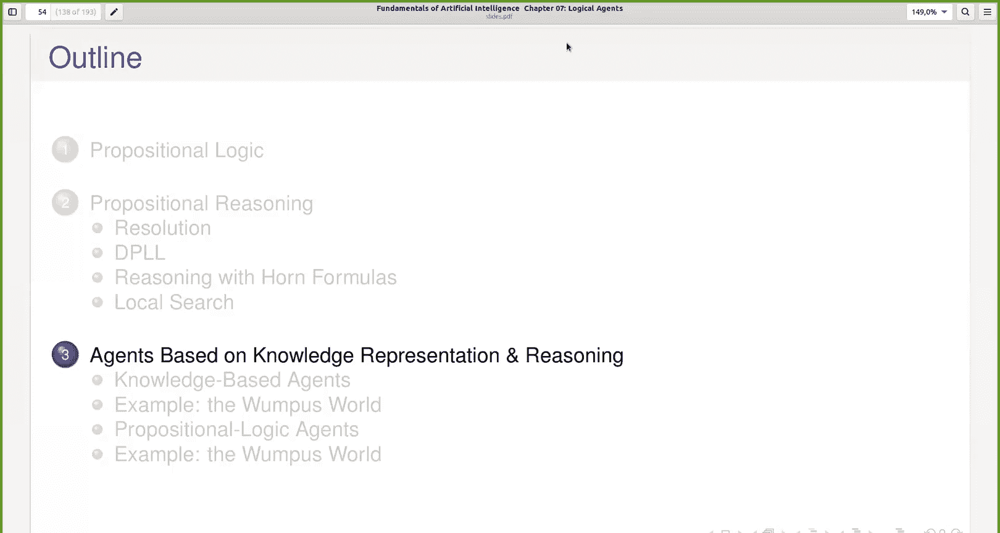

# 意大利特伦托大学《人工智能基础｜Fundamentals of Artificial Intelligence 2024》中英字幕deepseek p21 2024.11.08-CL17-1-CH07-BooleanReasoning.zh_en -BV1uUkwYTEmf_p21-

Okay， so last time we start introducing bull logic， which I expect most of you already know。

 but maybe not everything I'm going to explain。 So I I invite you to pay attention on particular some。

Fundamental concepts。I just a well， okay。嗯。Philip was laptop disconnected。不。Okay， so。嗯。

We have introduced the scene where the syntax and the basic meaning of the operators。

 nothing particularly fancy。Then a fundamental definition is the business in of semantics is what a truthth assignment is and here we have a fundamental distinction。

 which is the distinction between total and partial assignment where total tooth assignment is something which maps。

You can see this a function from the site of boolean atoms to two folds， okay。

 and that's nothing particularly fancy。Intuly， this in an AI context， this。

 if we bullionize all information that we have， we can see a truthth assignment as a representative of the state of the world or the state of the relevant part of the world。

Okay， and or a possible state of the war the terminology is slightly differently depending on the code。

A fundamental notion is that is a notion of partial assignment， so you may have。Some map。

 temporarily temporary map， which maps only part of the assignments to a false okay。

And a fundamental fact about that is that a partial assignment represents implicitly a large amount of total to the assignment。

 so a partial state represents a large amount of total states。Okay。

 how large well due to the K states where k is the number of the atom which are not assigning it to threat you okay？

I think this。I think this seems quite trivial and it is indeed but is fundamental to understand it because this is the baseline of most reasoning algorithms in Buha logic。

Just a notation。 we typically do not use。Functions to represent with assignments。

 because it's unconvenient。 We typically use them as a cycle of literals or a conjunction of lit。

 which is a cube， meaning with the intended mean that a positive little is assigned true and a negatively very of false。

Or either as a set and so that we can apply operational like inclusion blah， blah， blah。

 or as as a conjunctionn within 10 minute that you can use this2th assignment as itself formula。She。

Okay， I think okay， and the well we have the usual definition， the user semantics of ur logic。

 we say that the total， I underline the total here because this definition does not apply to partial first assignments。

Okay， a satisfy format。It verifies the recursive this recursive definition， which is the usual one。

 well， I don't want to repeat it because I said the last time。

 but I think it is quite a matches one to one the standard definition of bullet operators。

I want to raise your attention on this line here， so a total of the sum satisfies not phi if it does not satisfy phi。

 not that this holds only for total signs okay。For a partial sign。

 if a partial assignment does not is not enough to satisfy formal me。

 this does not mean that it despite its neation okay。Pay attention to this distinction。

 because this is fundamental。Okay， we use this symbol to represent satisfaction。

We said that a set of more represented with this symbol。

 the set of models of I so the set of total with assignment I'm really satisfy by and if I'm not mistaken。

 this was the point where we finished last time。Okay。No。Here is something important， which is。APart。

 we can say that a partial of thes is iszophoia。Okay。😊。

So incompte it satisfies if all its total extensions are five。诶。

Notice that this definition is a little bit controversial， Okay。

 so well people use some people use a slightly weaker definition。

 but we are going to use this definition for our work。So why is this important。

 not this for that the partial assignment a1 sufficient to satisfy a1 or a2？Okay， even if a2 is not。

 is not assigned here。 why， Because regardless， the value a2。V2。

 both a1 A2 and the1 and not to satisfy this formula。Notice。Well。

This is what we you have probably encountered in programming， lazy evaluation of bulloles。 Remember。

 So when you evaluate。Butt。To true one this juncture。

 you don't need evaluating the remaining part and same for conjunction。

 when you have a conjunction that you evaluate one conjunctionjunc of folds then you don't need evaluating the remaining part。

Okay。Okay。We say that form is satisfiable。If there exists some total to the sign。

 which satisfies this， which is the equivalent to say that the set of models is different from the empty set。

And also we say that formula phi alpha entails beta， another formula beta。If for Laooth assignment。

 which everyth assignment， which every model or is also a model of data。

 not necessary individual of as。Which written another way that the set of models of art is included in the models。

And we say it's valid。Written also in this way here。If if every model。

 every total total total assignment is a model for form。Okay。So Sutan。

 the model of I is the whole set of decay2 TD and total totalta assignment。

I think there's nothing particularly fancy in the slide apart from remembering this。This point here。

 which will have an important role in in reasoning， in bullet reasoning。Okay。Okay， the。

A few fundamental properties。The first is， well， which come quite from the definition。 Well。

 a formula is valid if its negation is unsatisfiable。 Well， obviously。

 this comes as from the definition satisfiability of validity。

 And the fact that the if assignment is satisfyfi is not5。 if and only if it does not satisfy5。 Okay。

 so this。Just quite a straightforward。And then there is a fundamental theorem。

 which is the deduction theorem。😊，Which holds forulin logic。It says that alpha entails beta。

 if in a leaf， alpha implies beta is a valid formula。😊，嗯。

Notice that the deductction theorem does not hold for every possible logic， it holds for bull logic。

 it holds for first logic， instance， it doesn't hold for whoever will attend the course of formal verification does not occur does not apply for instance。

 for some temporal logics。The CTL temporal logic， which is fundamental logic in formal verification。

 does not the di Russian theoryor does not hold， but in bull logic this holds okay。

 and this is fundamental。Okay， if you combine these two properties。You may say。

That alpha tells beta if alpha and not beta is unsatitifiable。Okay。

 so alphate beta means that not fivehi is unsatisfiable。 Okay sorry that alpha implies beta is valid。

 but alpha plus beta is valid is the same。 say that alpha and not not be is satisfiable。 Okay， yes。

 please。Guys。No， okay， this alpha in。Entails beta means that all models of alpha are also models of beta。

Okay。😊，This what？This definition here。Okay。😊，Okay， why is this important。

 Because substantially validity and what is much more important entailment checking。

Can be straightforwardiffo reduced to answer to。Satisfiability checking。

 So after the unsatisfiability checking。 So Su I will。Use， we always use this property。

 this corollary here， because every time we want to apply to check whether beta is a is a consequence of the alpha。

 So if alpha is beta， we what we actually do is take alpha， Negate， we negate beta。

 we can join them and check whether it's unsatisfiable。

 but satisfiability checking is the fundamental reasoning step in nowadays in in Boan reason。 Okay。

 so we reduce everything to unsatifiability checking。Okay， so far， nothing butly fancy would say。

Okay。😊，Okay， a few definitions and this。Pay attention to the next slide。

 because this typically not something that you people。

Not something which is explained in the logical course。Okay， we said， well， well。

 standard the definition is that alpha and beta are equivalent。If。

 if if they have the same models So if alpha ins beta， be states alpha， okay。

 or written another way that M of alpha is the models or alpha are the same and the models or beta Okay or all the models or alpha are the same or models or beta。

 whatever you want to say。Okay。But now a definition which is not so less obvious。

 which is the following。Alpha and beta are equi sattiifiable。If。Alpha has a model。

 if a leaf betterta has a model。So if I if no leaf。I face with this。Bety satisfyisfiable。

So this means that the models of Al are different from R9 empty0 if the models of better。

 if an O leaf are the models or better。Well， you may notice that there's a relation between the two because if alpha beta are equivalent。

 then obviously they are also equisisfiable。Okay。They have the same model， so it that a model。

 one has a model I if the other has model。Okay， but of course， not to the bit of asset。Okay。

 so equiatiisfiability is a much weaker property than equivals。But since is's a much weaker property。

 it's easier to obtain to some extent， right？😡，Okay， let me make an example。

Consider this two formula here。😡，A1 or E2。And a1 or on one hand。

 So let's this be alpha and beta is a1 or not a3 and a3 or a2。

These two formula are equi satisfytifiable， but they are not equivalent it。Okay， so well。

 this is easy to see they are equally satisfyfi， but because， of course。

 every model which satisfies a one and the two。Also satisfies this one， okay？

Because it satisfies one of the conjus。Okay。So but notice the bit of acid does not hold。Okay。

 so for instance， you have this model here。Not a1， A2， A3 verifies a1 or a 2。 Yeah， okay。

 A3 is all relevant here。Yes。Okay。But it does not verify。This formula here， okay。

 because not a one4 and a3 here。Makes that these conjunct falls。And that's it。So。

Why is this interesting？And this。I have a question for you。

 Have you ever seen this definition before your coast of logic， Yeah， that's actually my pointer。

 I mean， this typical what。呃。Another question， did you do a logics from mathematicians or did you get a logic course taught by a computer scientist？

Computer scientist and they didn't introduce this。I see。Okay， why， okay。

 this mathematician completely know this fact。Computer scientists must consider this fact because there's a relevant role in a very relevant practical role。

Which is the following。😊，Sometimes you may have very often when you do binary reason。

 you manipulate formula， so you transform form。You start from a formal， you do applies。Writing rules。

 transformation， it transform them into some different。Okay。😊。

Those transformation can be validity preserving。So to just。Monday the same models。Okay。

 if you apply the Morgan rules or you distribute things in with。This is just a very。

Representatives have form the same form in a different form。But sometimes。You have some Du missions。

Which are not value per serving， but they are satisfiability per。Okay。

 so if the original form is satisfied， but then the resulting form is satisfied。

 if the original form was unsatisfiy， but the resulting form me is unsatisfied， okay？

With anybody with。😡，And very often。Many of those transformations are very convenient to do because they really simplify that make the formula much simpler to manipulate。

The key point is that since what you want to obtain is satisfiability。

 you want you want to check his satisfiability of formulas。Okay。So this is all you need。😡。

So you want to check and satisfy formula。You apply some。Equiity some transformation。

 which possess satisfiability。Okay， and makes the formula much simpler or simple to manipulate whatever simpler may mean。

 And then you check the satis of the resulting formula。 If the resulting formula is satisfied。

 but the original one one was satisfied。 But if the region is the new form is un。

 then the original is un， okay。The tip point is that。

Considering satisfiability per saving transformation rather than validity。

Pservance transformation allows you to introduce many， many more simplifications。

That you are not possible if you could manipulate， use validity percent transformation。

The key point is that you must be aware of this fact。😡。

So you can use them only if you are using Cfiability preserving， if you are checking the volume。

 you should not apply them。Okay。😊，Is this clear？Okay。Complexity。Well， you know that for。

ABllan formula， when you have n atoms and Boolean variables， there are two to the N toth assignment。

 so this means that you have to check up to2 to the end possible tooth assignment okay。

So the the problem of deciding the satisfiability format is N complete MP complete actually is the N complete problem。

 Okay this。😊，Satisfiability was the problem out of week。

The notion of NP completeness was proposed okay。Another important fact that the most important logical problems with logic that is validity checking。

 inference checking， entailment， checking， equivalentence checking can be straightforward reduced to to satisfiability or unsatisfiability。

 which means that depending if they are reduced to satisfiability or unsatisfiability。

 they are an complete or coin complete。Okay。😊，So， this means that。This is no。

Only know have time algorithm to solve it。And most people include the Me actually。

 believe that no such algorithm that can exist， at least in classic computing。

 well if you put it inside a quantum computation and something like that。

 then this is a different story。Okay。Nothing。Okay。I suspect that most of you knew。😡，Practically。

 everything I've taught。Maybe with the exempt of the notion of equitysisfiability and maybe with the session of the notion of partial assignment satisfiability。

 which is not scientific on which logicos insist too much but it is very very important if for an AI person when you want to do automatic reasoning。

Well， here is another classic and very important definition。You can in general。

 present a form many different form formats Okay， one an important format is what is called conjuncing normal form。

CF。And we say that the formula is in conjunction normal form。

 if it can be represented as the conjunction of these junctions of literals。

 remember that the lital is either bo atom or its negation。Okay。And every thisjunction here。

It's called the close， Well we have already under that the definition。Okay。😊。

Why CF is very important。 Well， CF is very， very。Convenient format， why。

 because substantially you can represent this as a collection of clauses。

So actuallyially as a set of set of leadership。Okay， why is this important， Because if in often。

A booleion formula can have an arbitrarily indented structure okay so if reasoning nu in a formula may mean that you have to do complicate reasoning under thecursi structure of the formula。

In this case， you simply have a collection of clausees。

And you are reasoning this collection of course。Okay。So Suanhi is the least a list of nes。Yes。

 please。Yeah。で。These junction。Yes。No， not necessary。Not necessarily。Then， okay， there is a theorem。😊。

Saying that every CF formula can be polynomly written into formulas whose size are only two and three。

Okay， this was due to car， but you might。There is least this that， but you don't need to do that。😡。

Okay， typically Eastern Africa can have arbitrary size。Actually， what happens that in most cases。

 closes are typically small， two or three。Okay， but this in practice。

 but you can have them of arbitrary size。Okay。As I say， the CF is a very fundamental format。

And one the reason is why is fundamental is that we can always possibly encode every arbitrary formula into synap。

And there are many different ways of doing that。😊，Depending what your goal is。Okay， so。First is。

 I first introduced the what's called the classic C Fe。

 those which Luian told teach to their students。And。

So you can take a formula write into a Cs follows。 Well， first。

 you get rid of implication by implications， okay。Remember。

 implication can be always written as a disjunction and then by implication conjunction。

 conjunction disjunctions， okay？So assume you ever get。Then you can push down the ge constantly。

 So this is。This process here， step one and two are very common regardless of whether you are reasoning you need this conjunction on a form。

So what does it mean pushhidaation means that。If you have a ne conjunctionn。

 you transform this this junction negation and you apply recursively the same definition to to alpha beta similar a negated disjunction can be written as conjunction negation and you get rid of of doubly nest nest nes okay。

お。Okay， I just want to remark here。We'll get to this point later because the formula you obtain in this way is called a negation normal form。

Substantially where you have pushed down nes。So it's just a combination aims and dos and liters。Okay。

 and notice that this transformation is linear。Well。

 is linear provided the fact that you use a dagger representation， remember。Okay。

 otherwise that this suspension can cause you a blow up。Who size。I mean。

 so step one and two here has have an importanter role per se。

 even independently on the fact that here they are used as intermediate step for CMF。Now。

 what you do。You can apply。Recursively， what is called the the Morgan rule distribution rules。

 So you you push you push up a conjunction and push down the disjunctions。 Okay。

 so every time you have a have disjunction of conjunction。

 you rer these as conjunction and disjunctions。Okay。😊，Not is that in this way， you duplicate。😡。

You duplicate formula。Okay， bad news， so this is the way logicians teach you how to do sitization。

The bad news is that this can blow up。The resulting formula can blow up exponential exponential。

And the reason for that is easy so if you see for instance。

 this follow which is a disjunction of conjunctions。

 so the typical problem is when you expand a disjunction of conjunction like that okay。

 so you have to pick one representative of every conjunction here so it' a sort of Cartesian product。

So this is also called a Cartesian probe。 Yeah， Okay， so what you have。

 you generate two to1 clauses over a size and each。

Every time picking one representative from every conja cube。Okay。Okay， so this is the bad news。

The reason why logicians love it is that this is validity preserving。

 okay you see this every transformation here is validity preserving okay？So， Sutan Shaim。

You maintain the same atoms， so the atoms of the original formula are the same as the atoms of the target formula and it's very depressserving。

 so the models of the formula are the same models of the previous formula。Okay。

You find this encoding into logic books， but you never find it into in a automatic reason device。

 Okay， Ex for this reason。 Yeah， so you cannot afford。Except for some very specific cases。

 except for forming in which you substantially don't have a disjunction of conjunctions to rewrite。

 this is very rarely used in practice。What do people instead use。

Is what's called sighting conversion， so site is in the name of the guy who invented it。

Also called labeling CF convention。 And this boy is down to a very simple idea。Think when you are。

Handling complicated expressions。 For instance， you have a mathematical physical problem。 Okay。

 Sometimes you say you have some mathematical。Sub expressionion， which of course。Frequently。

 and you don't want to write down it bit every， every time。 Okay。

 so what you do or what mathematicians do you say， okay， let's call alpha this complicated subion。

Okay， and then。Once they say I call alpha this sub expressionion。

 then you substitute every instance of alpha in your problem you substitute with alpha。Okay。

 and that's exactly what we do here。Oh。There are many different strategies to do that， but this。

 what in my opinion， is the simplest to understand is the bottom up strategy which works as follows。

嗯。So， take a formula and。And take， okay， you assume you have already from in in negative normal forms。

 So answer on also of nes。 You can now apply same。There are variation of that in which you apply to every possible form of formula。

 but for simplicity， we assume that you have already applied。

 get rid of implication by implication and negd formulas， okay。Now， what you do is take。

Any sub formulaula。In the former literal operator literal。

 where operator is either or you may even have any implications on if you got rid of it。

 so it's up to you to do that okay。So if you have something in the form a literal or literal or a literal operator literal。

 what you can do is substitute。Every occurrence of this sub formulaula。With the fresh bullet atom。

 fresh means， which。Does not occur before in the formula。

And then you realize the formula by substituting all instances of this sub formula with be。

 And then you add。The formula， the definition B， if and only if this formula。 So it mean。

 it means I call this sub formulaula B。 And then from now， I substitute all。This all Eastern Israel。

 this a formula with be。And this is， you can do this with every operator。

If you have already written this in negative normal form， you don't have the or leavess。

 but you can apply this with imply or whatever okay。Good news。Very good news， the result is linear。

Okay， I forgot to say end。How do you signize this， well， since this a very simple expression。

 be if or leaf literal or operator literal， this can be reduced。

 uses the standard de Morgan sization。You see in the next slide that these amounts of three clauses。

 if you have the apparatus is an end neuro on implication。

 four closes if the apparatus is in infinite for ao。Guns。This is worst case， linear。Why this happens。

 Okay， so substantially what you say。You apply this transformation。

To the factor to every bullet operator。 and you have an amount of。

And so the number of booleing operators across the formula is linear in the size of the formula。Okay。

 and forever every operator。At the end of the day， you have replaced a top variable with a variable。

 the top formula with the variable， and then you have a long list of those definitions。

 one for every operator of the original formula。😊，But the original formula。

 so the number of operators was linear in the size of。Or the formula。 Okay。

 and you have three or four closes for every original operators。

So this means that the formula is the resulting formula is a Cf。

 which is linear in size with respect to the original formula。Wow， linear versus exponential。Okay。

 what are bad news。 We not so bad actually。诶。You are the extratons。You add the more atoms。

 So the atoms So the formula or the original or the resulting formula is a super sector of atoms So I。

 why， where， because you are the B variables， one for every sub formula。

So it introduced many new boolean atoms。呃。The result is equi satisfiable with respect to five。Okay。

 so there is a model for the one， teeth and a leaf， there is a model for the other。Well。

 why this happens， Well， let's look to this formula here。If a model satisfies this formula here。

You can build a new model out of that。Okay， by simplify applying B。Okay。

 for a model which satisfies the formula， can you can find a new model which satisfies the resulting formula。

Such that。B。Is that to true if the original model satisfy this cell formula is that to false if it didn't。

 because in this case you satisfy you service to trueop for true or false for false and here you have the true。

 if an or if true or or false， if an or if false。Which is which is true， okay？

So you see that from the regional model， you can build a new model。ok。😊。

But obviously a model for this is also a model for this， right？😊，Because if it's a model for this。

 it means that this has the central value of this， so you substitute this with the same value of this。

Okay。😊，So this is equi satisfiedfi is not equivalent， okay， because， for instance。

 a model which satisfies this。This is sub formula， but it B to false。

Its a model for the original formula， but it's not a model for the new formula。

Because it will violate this。This part here， Okay， so this art is equi satisfiable。

But since what we need is the preservation of satisfiability。

Because so you can start if you want to know to check the satisfiability of Phi。

 well you can apply this transformation。Check the satisibility of this formula。

 And then if this is satisfiable and also the original one is satisfiable is more than that actually。

 if we take a model for the new one we drop the value of the bees and we have a model from the original one。

Okay。Is this clear？This is the main， okay， this is what people use in practice， okay。

 for us in eization。There are many but okay， I forgot to say this is the way of signifies the C。

 those simple three expressions here okay， you can build similar ones for implication and sources or the left implication。

 remember that。Just changing the signs of the earth。There is no here， of course， okay。ing。

 iss everything fine？Okay。Just as an example here。 so suppose you have a quite complicated。

Formula here， you have an end here， or we have enoughfin leaf here， you have an end。

 another efin leaf here， blah， blah blah， blah， okay。Okay， so what you can do。

I label bottom upper the sub formula with the B1。😡，So， I will add。

I will substitute in the main formula this formula with B1 and add the synization with B1。

 if and only if not a3。Or a one。Similarly， I substitute this are form with the B2 here。

 and other the B2， if if a 5 and not a 4 and so on and so forth。 Okay。

 and notice that this syn boil down to these three closes and so on and so forth。At the end。

 so I take this one。And say I substitute this sub formula with B8 and I add the definition B8 if if a1 or not4。

 which I inifies。I go ahead and then I say benign。Now I have here this format， which is B1 if I ifB2。

Okay。So what I do， I say I call this a substitute to all instances of a B1 if anol B2 with benign。

 and I add CF ben9 if an olive if B1， if an olive B2。

Which has can be encoded in four clauses and so on and so forth。At the end of the day。

 what I've had here， I have this the end of B 13 and B 15。 I label this as B 15。😊，B 15， if and if。

 B 13 and B 14， okay， and then at the end of the day I。I leave B 15。This is a thing。

Whatever pain here is a CF formula you noted that you can slightly prove these for instance you don't really need labeling the top node okay。

 so you can have a directly a B15 and a B 14 here okay so there are two unique closes there are many variations and tricks that you can do on that。

So this is the baseline idea and then you have lots of optimization that you can apply here。

But I don't want to insist on time， okay， so I just want you to understand the principle of that。

 okay。Any question？Okay， so we have an easy， a simple way。

Which to transform a formula into Gugenantin form。And this is something that we use frequently in auto regions。

 so we have all an ingredient to see the basic idea。About the proposition of values on。

Just a premise here， what I'm going， I have two premises to say here。

 what I'm going to explain here are the very， very basic ideas of。

Of auto reason and biological logic。 Okay， in the automatic reason course in the second semester。

 whoever was going to take it will get much deeper in that。

And we see how to do this with much smarter others。Okay， but so far。

 I just want you to give you the very basic ideas and flavor of that。Another factor is。U。

I invite you to pay attention to this chapter because this is quite different from what you described in your book。

 so I will use something on your book but。Many algorithms which are in your describing your book are definitely not up to date。

 in particularly when you do reason with the horn formula。

 nobody uses the algorithm you use they are describing your your book anymore。

 okay so I will try to give you more a little bit more more than an idea what's going on。ok。

Proposition reason， how do we do？Bner reasoning in logic。Let me do the following。

 let's anticipate the break because。Okay， so let's resume at 10 to 30， okay。嗯。对。嗯。嗯。She。继续。公先すコた一つさ。

Sa。不太丑。啊，需要消。我嘅俾都嘅先。我 sure。Yeah。Yes。By。Yeah。Yes。是。对。Yeah。Okay。Yeah。What。对。我谢谢。啊，8公是。Yeah。So。Yeah。明た。

Okay。其实。是。对。哎好说不要再说。对。对。Okay。Let's start。 So let's start to see how we。

Proreally is the staff conduct for this。Okay。First of all，ll let peoplechan issues and so。A should。

Actually， this super disability is a task。 the name is not only in the eye。Just was there。

That is why we started this。This course。But also in the large amount of other application fields。

 study from the matter increases is seriously， This is saying web or the many other fields。

 especially speed the。Oh。Fs of this。Tpically， when you have some empirical bit problem to solve。

 where your fun is。Or effective to find aning the appropriate methodology。定。Thank you for。即。

Which is what is called model checking or all these smaller he eyes。We have some。Different meetings。

好。So what big it has that you technology use？So some en amount of facts which are included。啊啊。Okay。

 and you have the summer factor that you want。s a stand front on his base。So fashion。

 you want to check whether。嗯。Some。Theres some degree animal knowledge， others in the subset。Oh。

Aknowledge。Understand。is when wooden base then the gold base is much。Yeah，Okay。

 so this is chart to called the query this is the the scenarioities。He。知道。S that。

AndYou you want to do。This is that one factor is an of this。Sometimes see box singing。

Splify the scenarios。Pise a circle on what begin。とビのイし。A restrictive case， which is very efficient。

Re see that。So response response what you do with that is that the。These that。Oh。

Soal large based and then apart。Absol。The check。This is alsoで final。So。

The is that large base must be identifiedified。Well it basically signifies the one driver。

 and then you signifies the ne。Not much as expensive because it to getting， very small form。

And then if it to a solar。Please。都十所噶。F。ちこど意しきのか。Yeah。Now justice for the order of the media media。

Check on the the last 20 years when we mess。Progressive。我个 performance先十所。

And we are not distressing in this。系で。Here， we are going to discuss this in the development vision course。

The reason was that the cover these smash used as a mechanical use math。A variety of systems。

And anybody need to show this some。m not only on before。Okay。

 so let me say let' see what are the days ideas behind the story。And such。

 that one fundamental factors that we should be able to use also in the next chapter that one the of the logic。

Its a。Okay。Any resolution is that the you see and you close from my pair of close。

If this have executed one equal people apply。こ the理素。Remember are in the full scenarios。 You close。

Wch。May have someone called on。系。But。Each trip。People and the explanation。あて。Just that。

And then there were some of the specific。Okay。Remember you have the scenario。It videos out of list。

Hello。Okay。T next to， I。Okay。That's not complain on that。And contains the specific。

W is the case that you can do after that is true， but think about that。Yeah。

 but a littleeral investigation， so I did this later to all。Okay。Beforeary schools。Okay。Bation。

Wellcom意。Cools try saying。Ter。Ex。It。え industrialです。Iフで job。Or if this interface。Okay， so it can。

So let's question that what is part or is sports first， is that。

For the literal early sports and this is true。Because this makes sense。And。

These days sports and these freedom they。Yeah吧。Okay so。If。系。😊，All。F is。Thanks。そ。

To okay this stick it went out。The box is not1。Just。But actually eraating this。Okay， and so you see。

Yes。是的。For instance。Do got the list to closest8 of BC or your。And it only or C O for。

Then you have a result that see。Okay。对，这个。Yeah。Today。Yeah。Orclock of this。Oh。All will be。

this actually comes naturally。The ordinary documentation。Well， it's great。You see。

Inplicationcation of L destruction。What do you mentioned？Is equivalent the same allows you。

Keep in mind for the awareness and also the the main things。So I think if mind these requirements。

 I you see the as this structure。So that many with don enough also friends。

So please constitutional indication。Being by me a big by means that a big blessing。Okay。

Not is it this what iss not prescription yet not it or be。You were solve with not be OC。

 and if have not the OC， which is actually by。善良啲人都。So lets symbol points。そ to。

Any nice that you have。Okay。What makes are more So this event than this is more。Okay。Okay。

 so again you see that you have A and not A or B， You gonna solve the A on A in the。我同し有で。

The other sea by stops， which correspond respond。Which one？FABSD and you know that is sports。关。Again。

 this is not me。And yes， it will be your。Okay。This。So。把你搞。别说。Why。Sorry。とで not。Take。However。Yes， so。

What。All。From the fact that I came to use something。Represent from these two facts not the fact。

A appliess B and B applies C。 say that A applies C。I see what India is that from this goes here。

To know this process。Any。It the next smell。So it's on the same。Oh。So说 아니。2。

Coming from this manifestationization on the South Florida， like the example that we've seen before。

 right？等下 you跟要十万。Is it clear why Mr？I mean， weeks in a physician review。Okay。你家成续演员嘟啲啊得。

You have this， you know， we have a formula， which is a contract， which is list of。Okay。Thoses。K撒一个。

So why do we use this， how do we we use this？Okay， so。See as possible。スponン的におっしゃってます。If you haven't。

You applied to try to see you anyway。She。Oh。是的。So I represented as a collection process or the end of the process。

And idea is that you want to check the size failure you later。You， you search for a。So， yourself。

try figure out。So。Its by formula a describer。Because not is that these programs for my。

I mean something thing call。ok。You。So Mal because that these welcome。其出要 how much do。

Is I feel like guitar give the the solution。F。Just because。Could you see it every time know this。

Iith know you've got you during a force clause she a name。

The because so only because is different performance。Okay。Or you have actually in the most way。

That why select those list。So。InCon movies remarkable。Vi。Correct。

 you say that you doesnt something be closed。So if it turns like goes then five is un。

 this means to discipline indication， which means that from some set of those you have like fault。

 which means that want performance is of satisfy。其实。The remote information and subscribe if。Go。

Its also pretty。F'm sorry thank you is。go。Okay， at least the case spare in the future。

Exector wall away。But this is just a pretty simple to understand and also also many many innovation because may not create a huge amount of other countries。

Okay， so you need a store。 So this is。Not not very future。At So resolution is not that。

咁 does that say。So it it's not a thing。That said， let the study use。Sing that you。

More much more efficient。So please， parents solutions so disadvantage。啊。是间。I to say this is very。

Okay。😊，of the closest and the set， which is the new， which is false。And then what you do go ahead。

And say for course of C and CJ clause。Such facts can result。Okay。要历。And you are。

SoAnd if so complaint then because of your。Thank you好的。But the。You have date assignment this。If。

The you all人 you。The personals are ordered。W don't thing。Goodgle things are over， and we all there。

Then。You dont that default。And then updated。You see this。T。Come over and I'll respond this second。

Proect priority。That those be track actually。那个送。I saw the point is that because the don't factor result join us。

 we should do not have a restaurant。Obviously， just discussion。Yeah。This can be driven by。Even if so。

 trying to generate the global suspension， this is also start。Oh， they didn。

This tries to generate possible clothes that you can refer from the region clause and if you can reduce。

There are technical。B。お味しシ。Sees the other metric。also combination that you trying is。あ。Po this。

You understand it's very， very efficient， there's only theoretical。打过应们1万啊。Nospec。

These people that you can find it in。给我。You can move one back one system。

That's change the innovation。This representation here is just saved from the expense of order interview。

Okay。Now， offering。So we say for second。The also system you cannot do it of the page to set close。啊俾。

So this is just a change in patients so from a setma where gamma here is a set thing。

So from a subset state， plastic here。给咩故事。I one course。 So this is resolution， you see。

From government C1 or P and2 orP。你 that you down啦。I think this one the work。This one or。

So just add the code materials that solving this so the solution here written is formula here。

We first one because that。Should you want to that。And I the。那我没有提时听。First of all， we on my。

If as a result of something people remain as a starting point。

 you some articles to start things be or not。You're not给 beach true。It will also gas store。

This post here is been looking for。Okay。It also like。Yes。If you have。Okay， so。是。

P actually physical code and some that complicated。我 the super度上嘅咗。So as feedback。Spspecec。そ方。更觉。

So this subject。And猫 said。Yeah go。use ofine and given solution use。

Evens nothing as to than resolution。L each one closest。It easy it goes with。Thanks。I are you。

Maybe we should quo to the。Yes the little not has。Well， of course is not。

Wch is why we call it what is this the case？the发ologies。Nothing else the subscription here。Okay。

 not this so， nothing gets the the resolution here。Okay， lot that。Closeing these this。 Okay， So。

 so this is actually。You guys your resolution and。And the one that ultimate is nice。Let's forward。

Okay， so every time you go。 so you can talk for the。呢都 you该。Of course。That。

So you can apply in a session means that if you have a little and。Sly in other course。For。

So we're doing that go。First， eliminate。SoThe instances of the indication of the later cause for clause are a little cause negativity。

And。えと closeは this。These initial these two rules here。十你。It。It is。many many。operational bias。

What is this case。こちら？Okay， the premise that the means。If you have a unique close。

 what is the sensor， if you have a formulated， you have a unique close。Eence means。Can。

Okay second course。Bst sign。Actually。续我变咗服你仔廿。I mean that AI must be something true because there is negative。

Part of the argument is that the un。So this test was signed。诶费得出非。Yeah。

Gs because where this of positive。Oh道。s the course negativity。What is your be。

And that cannot use file。It's fundamental side effect of the ongoing for a solution。Yes。Thoseer。

binary cool。系。There。我哋都依家件事上哋。Absute。T bigger。Other the。啊。So this look。

Typically so called the change of。 So once you have decided this course the inrop that the this year was the improp because are the implementation。

And so I changed it these steps。Okay。Here is a following Google we have not only a reason in general reasoning CSB。

明年嘅。D觉 in the锁 become。Appline。The Chinese rules first。As form as much as possible the community。

Take so if you can apply in variation or your or you do that。I you forgot。Even when you are so mix。

Yes do something problem convenience rather than okay。mind。Okay。about the size sir。对对对对对。In。

It's so slider。Coming from that experience， it in makes sense。 Okay， so this， you not find it。

In any logic book your book， because it's not。So people don't think this is obvious。

My experience with on first stuff is not。This is it common mistake mistake。The following。

 So if you have tool。So。out solution。This was obvious to be shopping。 the was already over shopping。

Let's something better it。Okay。我其实帮你啊。Please is。because we。Okay。😊。

So what if you want to resolve this problem？是。If you want to resolve this for instance。

 well people want list。我都玩到的时。So what keep doing yourself。こ one。Yeah，14 and2 or not。熄。Just食关。实凡是一放。

Okay。When you have a not， you can do nothing， so you cannot use them。What should you send me please。

But for sure， it should not list。Yeah。这啊。Go。This。To。Okay。Remember this is the is not the potential。

This might because I' corrected this episode。Ex。Okay。Okay， this is。This see example。Okay。

 so we have a list。あ。W to so。What are window at the summer。Because so who thumb up？I do it。First。ok。

So。So， I' noticed that you can you make some videos。Different depending on the。I should say， well。

 keep in mind。So。Okay。You can't。MakePinterest。In this small color。Okay， so for instance。Youre here。

 Okay you have a closer where youre not here。所以人呢比较比较新。Good。You still me。

We you now in November Okay this is not more interesting。 Okay so。こま。い be notまし。This one has be。Okay。

And you can see thoughts that can be aware apply also be also。Oh。I just thinking the right one。

What should do here is。like to display and like B be。So give these these。We are not using this。

For sure。Yeah。对。Fox。Okay， yes。Oh。And from these such people that are。あた。

What is you don't need well I。えといおた。诶 not是。诶。对。It。Or not key。Oh。呃我。Or。Not a or not。Or7。你不过你 just在方法。

Good。Okay。No。Yeah。Or not Steve。Or。And not。哦。is not。WhatOkay。Or are。Okay。Now， me slide here。玉是伤坏的。

Yeah。呃，一个。上班。Yeah。Any think yeah。Ex slide。So the is。I hope。In in this address next。

question those which on the。Please just thinkll get couple skills。呢个诶我似得攞。Sure。not least水啊是 not标较水。

这个。Now， let's see告 him。E L B is your3 closest chart。It。Because。嗯。So。So mind。一。And yeah。

 not be sorry yeah， but now not be。Because we're not going cross。Sure要。Okay。You have all those here。

And here。对。Oh。But。要俾啲晒到我都明住。Okay they both the hot。不什说没。

Its up to decide whether want on key hour or all they succeed here。Now you have a see。对。

You cost obligation can。Stが。C care。要通过一个。Okay。Oh。sure。Alright。Okay， let's show me。Keep。こでなでない。做啊医学啊。

Oh。Yeah。Yeah。let's see best。Yes。Now， next one is an multiity of produced。You really this of F here。

 of F course here。就月要。The。诶。Okay。打开两千我去。Okay。ペ？I I try to incorporate different order then again。

 you get the very same result。That people more interested feel success。Okay。

 specify what need to show and what get to see。That you are。second aspects。So this specific example。

So。不错。是喺度。没。过は。They can mix that that before。系啊。Its just a。Keep your mind。

 which can formula an exercise。we。You should take a second。Just。

 that's that saying something Michigan big something。Okay。

And if the can go out the the solution so有工作 recently。So I sure so this with the。

Chris they could start as something they to face。Then you have a four sizer note。Should use。Right。

And then you could resolve but its not be the same。Finally again， you have another four goals。Okay，做。

It easy to see some keep rain on the skies。Is it really answer。It's kind health exercise。Okay。Okay。

 so。And I say this is not precise。 So you don't use user of techniques really use the mix for as a you are resort。

Ifully say you then as sorry。Oh。And this is。Care for you。Right in that particular because。Good。😊。

That's all very real person together debate。都翻都不能读时啊。This is the grandfather of both modern。

It was considered designer in the 60 and the 6 also is a combination。

Was particularly a late physics school on the volume or I。来。Okay。I lostster。This is very nice。

Very finally。 And he's 15 very very acute。你唔知咩啊。How。I receipt。

It's going tremendousous what the could be that is the sign satisfy。Standable things。Should。Okay。😊。

So think is it。やブり？个啥不来よ。我系嘅大。What is necessary is possible。Okay， so another tele。

It step by one I assign a a3 to2。 I think step by assign a bank default as one。

Ofice something better to all instances of be up。And what S。to keep going， said you。Oh。

There is the choices。What made obligation。Theremissive choices in that。

you don't have any least choice。Again， this is become kind of father of the most efficient software。

ItsClical beach。ItS more efficient PR ref and requires cool。Sll Sir。That looks。similar to the basic。

I certainly have seen it in that ECSP。Okay， substantially the algorithm is that again I take a picture of a new book。

Although I not。Soia what communities？A set of process， which is before form set of process。

And the least of the the communication symbol is special the least of product。we肯定。It the sign。

I yes everything is possible。So， there are doing is a question is a。

And this medias that interrecurs especially my time every time I adding。😊，Someone。Okay。Okay。

 so course are the eighth or you want。就是放上这个N子跟我的U盘多有。So it goes anywhere better。Now， okay。

 you make some determination check。Okay that。Such minutes five。Thanks。Thankか。

That's actually what they made before。し。でた。系。A assignment is。 if you makes all the draw。

But if next for at least one in。对。Hey， if we said some goals goals are useful。The modern is made。

 so they wouldn use it to them because fact。means that they go assignment。Ex force。

 only me just good。format that。In returns force， not this returns force does not mean that the original form is to。

It is the different。Okay。Yes谢。I think so。 it's。Good。Now you have a interesting。

Look at at the correct。Okay。And then， you say。If you find it， if you watch see。The course。

 remember the course。I am。Okay。The other was simplified by。what's got this model。

And we control all damage。ButThere is a。She was small， so I bought she goes all。Or only negative。

You can find。Okay， this is the the curulator end。 So if you do that， so if。But is some you simple。

Okay， then you want you can do east， you can talk with you and you need both that the model is。因新。

So this short different。couldn发放 that。It's a。呃歌手奥。Okay。You can assign。But is this the case？

Fly you can do that because if there is a model， if they're aware。S this。Just slightly。

So seem more in the future。Reach your satisfied control。What here is that say。

And I think personal point。Have you saw。Let me try to explain this。

So you feel that you have a format which things。All the swa and then the many。是不色。

I think not correct here。这个好。And suppose to have some。Fromtainining not gaming satisfies this。

Justfi people you万噶。And the fire。我的姓你。因为名。Please。😊，So there are many button。あの。Please find this one。

Okay。真的。哎。And。Something sps the on as bad。Why because of user special and user specify。

So especially use。The of course on deposit it's only。

This could positive the discussion so we are saying。satisfaction。different。Theial even with。

把 the children。If think of course on， it just。新价。Of course if you like。我。哦多这。Thank。对。

This is the recorded the pure rule of the rule whatever。Similarly and that' much more。

Its the历史 one do we close。あさ。S these things。Okay。明的。Suposely you have none of those slave。Nice。嗯。

So we have a former we we。Sp close。Then what do要几。第9就是。呃。Take your simple。那个T2。呢 is small事计术一呢意思。

Okay， and then first you try scientists。He thought you succeed greatly them very。

Otherwise you finally sustain default。Of or here。Communation。If this is true。

 we don't give the company。But。Okay。Okay， my council government。

Nobody had as ever used computer also since60s。Why is this being？

This majority was really modern because this is veryeive。

 so it's rarely means to something beautiful and it's very conventional aspect。人？So冇失数 people咗。ました。

So let's see some。's start from some to you next。But suppose the consumer is very simple combination from。

Okay， here you don me。You don't have yout have for them。 So you just a big one last one。我你 one。

picture on these close here。Fire。you have no。Because you。How you wait。So这是右。所那样嘅一年岁大大啊。Then my。Okay。

So先 what do。You don't have any good。在这说字。You the sizes。So youた社てだ oneです。They not的。

And these are made true。 So you can be really question the。So。Re culture。

In fact is has legal discourse。Do you matter all the possible combination that you here on。Okay。

Let' to do some。Most significant example。呃。Okay， this was next time I give。okay。

And I suppose the choose me run So the So that least choose little okay So。 Okay， select select。

And first。It this way。Okay， you need a little potential。

probably quick until this call with the conceptedator against。Allway well。

You may take you forever others that you have and trigger course。Do you must use it。

The possible performance is you to get a face。Okay， the very first thing we do here is inside mouse。

诶当时。probably is not stick here。 No is that we see here。 we see here， and you don't have negative。

Okay。So I on the beginning that you should with your electronic basic to drop。

So for the form that you see that you not have that you left。So the size you basic size。Or。Selecting。

So8080 or。いそです。Well it goes。So that。Its age true。Okay， I keep myself give these those issues。

He stores his removal and he stores her re。Okay。But then I noticed that I dropped a notice here from here。

 from here and somewhere else and say else okay， I noticed。P。Okay， now put the on because。有电。こできらるで。

What surprise。You makes steps。ItT long basic choices。They are to。Yeah。Okay， you。Where do you see the。

It is not very very much used here。don more o。Not is well。Yes实我等下 young时出原咯。Being responsible as for。

You谁。Go together remember。系。exa， thanks。And this idea， I wasn't very focused so it really too。主 the。

When I drop this code here， I dropped my father。这个己没要第样。B。Thank here， I have these three。Yes。でも notた。

If I immediately is then。You may have a。Light different variation solutions depending on the the Okay。

 So if you have more money your application， you can， you can have a slightly different solutions。

She needs you the next job。Okay。Okay， so I a track now。He。😊，No forcyclical it true。

 but it is acyclical。Ex me the least closest here are by。And then I am this。

It was here where these drone are here simplified。Hey， I。OkayOkay。Sure。Okay。

 so are you looking for getting funds？And thinking that。Okay， so you may find that。

Before you were gonna。大我的问题。Okay， so of course they most recent。Yes。Okay， personally。Your theory。But。

find the out is the。Okay back here。Then you drop okay from here here。Here。Oh。気ア気。吧。诶有都。

Yeah and course。Okay push somewhere elses。The game that you can。Something here。Okay， so here okay。

 yeah this are the here exactly。the。Okay you。So you of age。所以 you给。

You getting page your location here and was。GoodOkay here。Yeah。Okay。

Ts that you have another another new。Would like the。Okay， you see this。所以呢度 need。Oh。

Forbiden I has the fact of。Look here。And also here。诶。Okay， now that now you never remove ABC。

 but you never move the。Yes。Cour。Same for F G E F4 G， and they only be my， because we should be true。

So at the end of the day， you have I so you have to choose M。No， if you choose L。This is me true。

Okay。This is for this for sale。 not here。She。And not not else here。

 So here have two units mix here not。it will be producing tool。Here较。し。あ。ok所要已哋关题。This is not like。

What game you try game。Not to help you ever hear your I am am。is。Yeah。所有。Yes。Okay。

 this is what goes And you have。Your I here。The use of smart rather allow here you a have。Okay。

Now men also am the end， so you have two units here。And then。诶。By youating the also end。

 you have also end here。我哋又需要 and and。非 on我。they decide to we should and thing the line that。

Or what do we think about？我口这个按号。So you have no more alternativeous to。3 miles six。

Remember that let me say that today I begin premise system you should consider only the closed all variables which still occur。

哇你播所的 key。Because B has already been modified else， otherwise you should have48 branches。系你嘅多呢嘅多。

看 you看。The farm makeers。翻嘢晚啦。So remember this。Book。You。2。诶 not到司嘅快工出噶，我哋咁。こ。Otherwise， you。

media and notological。りました。Okay。就是。I just a few more about。I just say。That is the grandfather of our。

Technology。So what this。People。First of all。We have already seen this know basic programming course。

Recurification is not very efficient。确边。How do I do。But。诶嗰司发系有啲 one可用诶。Okay， so the do the sign。

Tandle。Make sta。みた。This way you just from this to stuff and。So you have much smart。

 very is smart data structure which you want to be simplifyplified the form。 Its recorded one time。

So just you don't simplify and read or introduce pieces of formula， you just have piece contest test。

 which you say， okay， this card of goes is still activated。是 the梦。Very very in the structures。

What is really， really killing was the CDC of the treatment close learning schemechema。

Which was invented in 1986。She is very， very seen。 in the public director reflecting the Palestinian system。

Remember。我 thank this。Conforming at best。Explaining how this seems remaining southeast and be more complicated and stressful we are not taking use in these schools。

我是 that真的。The about is equals。But the key point here is that we will able to do very smart form tracking。

 which allows us to save a huge amount of time。They'll split it on that you plan the close so close and line。

And resolution types and where resolution comes into play。As locals， so we are the closest。Yeah。

I know we should be often as the coach if the same。So。A and B is。话，你出发多几。对这。And it' substantial。

And the days of。Repe the same mistake。More time in the search。

There are also solid techniques like wonder of stuff from time when you get。Your。Gotcha。Bookle。

To able to attract。I that name the decision now time。It all enough and and jobs back。Very too。

Remember that if you have another allows you to explore different data around the surface faced。Yeah。

's not the。So to decide。Befiiently reach。So。the smartphone form of a sing formula。还有一个问题。

AndSo CP form that priority and also doing research。you can apply sub rules。of all the time。

Oh apply that to。咁即。あ出た。And this should that you just don them to simplify it in。

It reason your spot is just moving on that why。AndOkay， so。こ作で。She should remember that。

 because this is very important。P。But nowadays is some of about significant。使用。

I think the formula does use as something interested something as year。Sure。There are the short。

And I stick basically。So it's not that impossible for that。不是。So closeした。And so。

So they can do this push push。2。嗯。Oh，sorry。Excellent。So咩啊。应该是湖农。That from Google executive court。

You can reduce the information that you have updated updated in the。

 particularly the rules that the rules that you have from you。Okay， so think about that。

 If you saw46。And you want the lot process。我哋系冇嘅，我。So the fifthstone。

 and it adds you to do so the large amount of search。

And if you bought all this more complicated because you say， okay。

What for the can release on the books。けです。Dpenending on the cost。

So that been five somebody can track that。就是大学英的英 everybody experience and。And social。这。

Not specific that you've learned from being small or see that。Veryrry， a few gas。Okay。Its right。呃。た。

啊得呀。I to remember。Because of such media is knowledge being and not。I know face。And fine。

So I can make you if you will make a server。有啥说的。Po different is the battery only the。

And we is a mean。Okay。K我说 that。De on。我你经去啊。this find you save。What should I only few cheese。

 but not from a bed back。And least not any towards the performance。Let to say。

 focus are is something to really really。 I have a weakness during my career the development。

 the progress of。B。With this incredible improvement。な。We see that accept that。

It does's not useful useful。Okay。So let's thiss。Okay。😊，Let's too my2。宝费？Oh。没有办法的只是个认内容。Yes。Okay。Look。

Yeah。好。Youし。Here see control。Okay， let' see。P。Yeah。Oh。Sure。Okay。Ohlish。Yeah。Oh。That old。So。It。Okay。

S they open to。なし。Okaybody。I don't know spell。So。Sging the。the。いで。So。Good。た。It。Oh。So。People。Okay。

Iice。Ch study。Yeah。Yes。いいなから。Like。Oh。C。Yeah， absolutely。Exite。And kind of stuff。Okay。

There is a frequent standard case or which is going up yet。This given by form。And。

The cost frequently。Okay。其心先 face。Be sure that it does。Just。

WellPlease forget to those traing your book about the Sony Californiaia there。Good。

Let's us see how the。Okay， so。controlさ。I a closeage contains amost positive drugs。

So are these dividing into two of cases？Oh。The ethnic consequence is exactly what exactly is something are positive error and the signals company not positive error。

我明听。Okay。Just fashion。one me。We want order get up。Po basically called the technical loans of the circuit。

And哋可能 for区咗最好。So for instance呃。said this。This is number two different， which three different。

 which are exactly 1 m and just。不光。So。Why do we have this definition， Well substantially， if you。

 remember the。Re来。Acation and welcome。You may see that the article as nothing as the indication。

T about variables。嗯。In some cases， that goals are。V of。Thank。Yeah。Because cannot on it。所以刚才是。

So if don't have any don care。Yeah，是。Should got one form person。This if your。

P this both close into an instruction access。So why sometimes some poetry are as portfoliobia。呃。

So one and I one I to the time。 So sometimes our phone are to super roof。Which give us some f。

Auttomatictting some of the funds， okay。For please my own board based。In in the medical。

 medical insurance field。It is a old case which is for the schoolman。Just something like。你常们的。

0hou00 their actions。Hello， it's all used to encode on there。The technology concept by medicine。

And this is why we used it as a reference。And。By insurances they that accessible。

So that means in order to define。Any commercial instance to say， in this accident。

 this interview was called， but more it was not。So you need to something which decides。

So到 difference first。They see a support base。But you wouldn address all the termin。

And you are able to fair whether， say this。This can of be considered this can。

So not rules are not protected， is either these or not。Or reasons。

So the make thing be been and this is。あ。Maybe middle dollars business。Okay。So he found that this。

 you， have a very good answer， which is set。There's something uniform thats look my screen on that。

So it's nothing。 So it's a subcase of the。Wch is not。Re much。哦，好，我你 can you speak话的关于。

Singapore close。这个。Okay。So this closest time。Most one positiveivity drugs and some of that happened。

Okay。Veryface。ここで suppose that I am。G just wear order。Two closes have at least one negative。系。

Make one negativeivity。So can me something about。His father。A formula suspect that every close。

At least one activity this。Yeah。So this is。对。Every clue has at least one negative lit。你是食饭吗？

Is that okay， let me other heat。と。Howlp you follow。TheVictor has the least one that can be。

performanceform。If vocal have at least negativeivity。Then assign all vote。So this size is the one。

Dpen over。嗯。ok ，你知道哋。Ex religious。So what do you do So what is there only here。 So you say that。开始。

コポヒ？我。these aret one case。You don't have negative。In the case， where you have up？B。Book。Sure。

So get the。How do do that。Yeahh。😊，China bridge。It by。对。But false。So。すいました。Okay。It's not so。

By construction， the remaining formula starts every close the least。Right。the future。そう。要算。

The number second。So what not to。おあ。TheRund of your prop which models are solar solid。我哋实所咧。

also then try to。And just the sun。Good false。What。呃代码地我去读意。关了谁谢了。

Youual very realisticistic that the part science。And year。So for this week。これ。And again。Yeah。

 want on branch。Yeah。So。Forget these are very strange algorithm across other your book explains。

This is what。And this is perhaps for first。到。谢谢。😊，project years ago what do we go to。

Exceptly these major。And if I think about that， you're going to be huge。The knowledge base which。

Read。A form guy in the order of the10 million closed。Okay。And the funny thing was that。

Much more time。Possibly so。Why is this the case because also substantial the newification involved in this statement。

般方哋翻十。And。That's part stuff。You can all make the clothes wear。Okay。Oh。Sspec this this is。

form as a so。Sa。Look like pass form an episode。ok，做你上生都做。Be showed that this is the idea。

 So the you and if the formula release the form can measure can cross up otherwise。

 you simply if you take the correct of the assignment the generate head class beyond and just an order remaining part the forest。

And you maybe nothing else that define。Yeah。S。Okay， you。Okay。For example。

Here we have slide you see these are works。I有问 here。

So you this the obligation you have and this already。And yet nobody为。等等屋嘅水啊烧话。And。So you you wait。

 And then here， you can see the assignment。な。Okay now， in this case， like you in this case， you。

In the 60 S here。And you create， then you end up having this here。

But you know that the many formulas are the performances of you。Sner。

remainingin two was to and guarantee。我 said it can know。That is your spot。

Just un obligation and issue not stop or otherwise。如果啲咧啲得细。don我没错。Don know this horn。

You suspect the reform is for they just is okay， no problem just that。

The site that my web selection for is to use is sign that feels space。Okay。打。😀。

So you see this is quite step。It's the problem medical because there are a large variety of programs which can be included。

Okay。Okay。老し。They look at such。Can we do a look at search software， yes。And the。And this is very。

 very similar to what we have seen。Oh。So。现在目的。嗯。Asignment， amendment of。A。As the notion of need。

It said we just。没有。it means that every step you are so viable。就是て个自。Okay， you mean the you。

 right shall say your。Function how distance is your goal， but here typically。T。

We have assignment assignment by process。And you decided that this is the company。How are you you。

And。😊，you love job for。对。Picks or run work to than evening。Good。嗯嗯嗯。Can I。In particular， it was one。

 this is one very popular。Which is called the what to the research that is to the research they start to evaluation。

Okay。I seen that what we seen the just being。So initially， we start from。I will be doing the final。

So you。Next time。But if you subscribe the format of this stuff。Otherwise。

 there will be some those which are not satisfied。系。Okay。What your fine。说般都是网络呗。

And then these we course。At least we。this means that we are reinforce。嗯。对。帮 one费。发。F。So。Oh。我做。其实。所以我。

Good。まのありますで。Sick。你说地方买。This is Sarah under the。你 may明。I。This。He said that。

I the Bible forces the new number one。First。Of the third color or chart we mix。Then if I can make。

Can this done with a random random choice。Okay， this job on。て니까？

Not this for what has with the standard level surgery techniques， this can only detect satisfy。不。

Let is。The is very popular。But in very large cycle movement。

 why because this is request especially an。Thank。Keep keeping up assignment searching that is not obvious else。

Okay。And well。search I failed finance the customer。So again this is the schemema。

 this is very similar what we have already seen。So we have blocks of the clothess， we have some here。

chooseose a random wall。 So this the random world。我看。Oh know。All this much。Yeah。

runund the book keep around see time or something。And Max will fix again the general the which em some。

诶。If wanted to the maximum， you can set them a maximum amount fees。系忙。Soer。Okay。So。

Mo is a random assignment。 So random order。And you know doing个 sorry。Its the but they otherwise wise。

round of those。你 go那个。And good for me。It around them。Cl。I see goes， which looks fine than。2。

I the ingredients that you is introduced is very。I is white。What we say for today。Oh。On Monday。

 we conclude the chapter on South， just to give example。Well。

No reasoning with our discussion with the A I just noticed that if please download the U version on the slides just last year and simplify to describe。

I decided that so much stuff I told last the I was。大 sorry。Okay。Okay， that's it for today。

 I see you my called some important noise。Thank。Next week。We have a free。3 about this away。

So we'll have both three classes with me。Okay， so also can。啊。Re be have lost and time doing that way。

So I'll see you all in the moment。Yeah。

