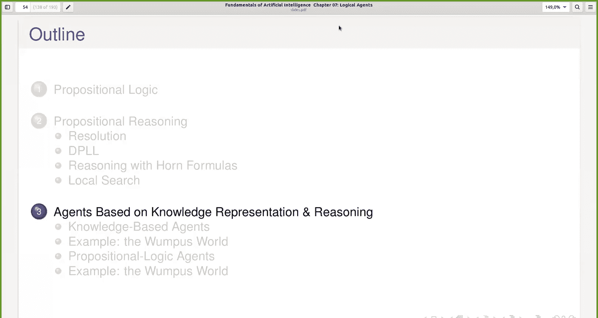

# 人工智能基础：7：布尔推理

## 概述

在本节课中，我们将要学习布尔逻辑推理的基础知识。我们将从真值指派、公式满足性等核心概念开始，逐步深入到命题逻辑的推理方法，特别是归结法和DPLL算法。课程将重点解释如何将复杂的逻辑问题转化为可计算的满足性问题，并介绍现代自动推理中使用的关键技术。

## 真值指派与满足性

上一节我们介绍了布尔逻辑的语法和基本运算符。本节中，我们来看看其语义的核心——真值指派。

一个**全真值指派**是一个从布尔原子集合到真值集合 `{True, False}` 的函数。在人工智能的上下文中，如果我们把所有信息都布尔化，一个真值指派可以看作是世界（或相关部分）状态的一种表示。

一个**部分真值指派**只将部分原子映射到真值。关于部分指派的一个基本事实是：一个部分指派隐式地代表了大量的全指派。具体来说，它代表了 `2^k` 个全指派，其中 `k` 是未被赋值的原子数量。这个看似简单的概念是大多数布尔逻辑推理算法的基础。

在表示上，我们通常不使用函数，而是使用文字序列、文字的合取（称为立方体）或集合来表示真值指派。例如，一个指派可以表示为 `{a1, ¬a2}` 或 `a1 ∧ ¬a2`，其含义是原子 `a1` 为真，`a2` 为假。

### 公式的满足性

我们说一个**全真值指派** `τ` 满足公式 `φ`（记作 `τ ⊨ φ`），如果它满足递归定义的标准布尔运算符语义。需要特别注意：`τ ⊨ ¬φ` 当且仅当 `τ` 不满足 `φ`。这个定义**仅适用于全指派**。对于一个部分指派，如果它不足以满足公式 `φ`，这**并不**意味着它满足 `¬φ`。这个区别至关重要。

我们用 `M(φ)` 表示公式 `φ` 的模型集合，即所有满足 `φ` 的全真值指派的集合。

### 部分指派的满足性

我们可以说一个**部分真值指派** `μ` **强满足**公式 `φ`（记作 `μ ⊨ φ`），如果它的所有全扩展都满足 `φ`。这个定义在逻辑学中略有争议，但我们将采用此定义。

为什么这很重要？考虑公式 `a1 ∨ a2`。部分指派 `{a1}` 强满足该公式，因为无论 `a2` 取何值，`a1` 为真都足以使整个析取式为真。这类似于编程语言中的**短路求值**（惰性求值）。

## 可满足性、有效性及蕴涵

基于满足性，我们定义几个核心概念：

*   **可满足性**：公式 `φ` 是可满足的，如果存在某个全真值指派 `τ` 满足 `φ`。这等价于 `M(φ) ≠ ∅`。
*   **蕴涵**：公式 `α` 蕴涵公式 `β`（记作 `α ⊨ β`），如果 `α` 的每一个模型也是 `β` 的模型。用集合表示为 `M(α) ⊆ M(β)`。
*   **有效性**：公式 `φ` 是有效的（记作 `⊨ φ`），如果它的每个全真值指派都是其模型，即 `M(φ)` 是所有可能指派的集合。

### 基本性质与演绎定理

以下是几个基本性质：

1.  一个公式是有效的，当且仅当其否定是不可满足的。
2.  **演绎定理**：对于布尔逻辑，`α ⊨ β` 当且仅当公式 `α → β` 是有效的。这个定理并非对所有逻辑都成立（例如某些时序逻辑），但在布尔逻辑和谓词逻辑中成立。

结合这两个性质，我们可以得出一个关键推论：`α ⊨ β` 当且仅当 `α ∧ ¬β` 是不可满足的。

这个推论极其重要，因为它意味着**有效性检查和蕴涵检查都可以直接归约为（不可）满足性检查**。在现代布尔推理中，满足性检查是核心步骤，我们将所有推理问题都转化为对某个公式进行（不可）满足性检查。

## 等价性与可满足性保持

我们通常说两个公式 `α` 和 `β` 是**等价的**，如果它们具有相同的模型集合，即 `M(α) = M(β)`。

一个较弱但同样有用的概念是**可满足性等价**：`α` 和 `β` 是可满足性等价的，当且仅当 `α` 是可满足的 iff `β` 是可满足的。显然，如果两个公式等价，那么它们必然可满足性等价，但反之则不成立。

以下是可满足性等价但不等价的一个例子：
*   `α = a1 ∨ a2`
*   `β = (a1 ∨ ¬a3) ∧ (a3 ∨ a2)`

为什么这个概念在计算机科学中比在纯数学中更受重视？因为在自动推理中，我们经常对公式进行变换。有些变换是**有效性保持**的（保持模型不变），例如应用德摩根律。但有些变换仅仅是**可满足性保持**的：如果原公式可满足，则变换后的公式也可满足；如果原公式不可满足，则变换后的公式也不可满足。

由于我们进行推理的最终目标通常是检查可满足性，因此我们可以自由地使用可满足性保持的变换来简化公式，即使它们会改变模型的集合。这允许我们引入更多、更有效的简化手段，从而极大地提升推理效率。关键在于，我们必须清楚所使用的变换是哪种类型。

## 计算复杂性与合取范式

对于包含 `n` 个布尔变量的公式，存在 `2^n` 个可能的真值指派。因此，判定布尔公式可满足性的问题是 **NP 完全**的。事实上，可满足性问题（SAT）是第一个被证明的 NP 完全问题。有效性检查、蕴涵检查和等价性检查都可以多项式时间归约为（不可）满足性检查，因此它们分别是 co-NP 完全和 NP 完全的。这意味着，在经典计算框架下，普遍认为不存在解决所有实例的多项式时间算法。

### 合取范式

一个非常重要的公式表示形式是**合取范式**。一个公式是 CNF，如果它可以表示为一系列子句的合取，其中每个子句是文字的析取。

CNF 之所以重要，是因为它将任意复杂结构的公式转化为一个**子句的集合**。这使得推理可以集中在处理这些子句上，而无需考虑公式原始的递归结构，从而简化了算法设计。

将任意公式转化为 CNF 的标准逻辑学方法是应用德摩根律和分配律。然而，这种方法在最坏情况下可能导致公式大小**指数级膨胀**（例如，当处理析取式的合取时，会产生笛卡尔积式的展开）。这种转化是有效性保持的，但由于效率问题，在实践中很少直接使用。

### 线性时间转化：Tseitin 编码

实践中广泛使用的是 **Tseitin 编码**（或称标记法）。其核心思想是引入新的布尔变量来标记复杂的子公式。

以下是自底向上的策略：
1.  假设公式已化为否定范式（即否定符号只出现在原子前）。
2.  对于每个形如 `(文字 运算符 文字)` 的子公式，引入一个**新的**布尔变量 `b` 来代表它。
3.  在原公式中，用 `b` 替换该子公式的所有出现。
4.  添加一个定义子句：`b ↔ (文字 运算符 文字)`。这个双蕴含可以很容易地转化为少量（3或4个）CNF 子句。

对公式中的每个运算符重复此过程。这种方法的优点是：
*   **线性复杂度**：产生的 CNF 公式大小相对于原公式是线性的。
*   **可满足性等价**：新公式与原公式是可满足性等价的（但不等价）。
*   **引入新变量**：代价是引入了额外的布尔变量。

由于我们通常只关心可满足性，Tseitin 编码是实践中将公式转化为 CNF 的首选方法。

## 命题推理：归结法

现在，我们来看看如何进行实际的布尔推理。一个最基本、最重要的算法是**归结法**。

归结法的基本规则是：给定两个子句 `C1 = P ∨ A` 和 `C2 = ¬P ∨ B`，其中 `P` 是一个文字，`A` 和 `B` 是文字析取式，我们可以推导出**归结式** `A ∨ B`。

从语义上看，这对应着简单的逻辑推理。例如，从 `A` 和 `¬A ∨ B`，通过归结可以得到 `B`，这正好是假言推理 `(A ∧ (A → B)) → B`。

如何使用归结法进行推理？我们从一个 CNF 公式（即子句集合 `S`）开始。为了证明 `S` 是不可满足的，我们反复应用归结规则，从 `S` 中的子句推导新的子句，并将新子句加入集合。如果最终我们推导出了**空子句**（记为 `□` 或 `False`），则证明 `S` 是不可满足的。因为空子句代表矛盾，说明从 `S` 可以推出逻辑假。

然而，纯粹的归结法效率不高，因为它可能生成大量无关的子句。现代求解器使用更高效的算法。

## 现代 SAT 求解基础：DPLL 算法

DPLL 算法是大多数现代 SAT 求解器的理论基础。它本质上是一种深度优先搜索算法，结合了单元传播和纯文字消除等简化规则。

以下是 DPLL 算法的核心框架：

1.  **简化**：反复应用单元传播和纯文字消除，简化子句集合。
    *   **单元传播**：如果一个子句是单元子句（只有一个文字 `L`），那么 `L` 必须为真。我们将 `L` 设为真，并简化所有包含 `L` 或 `¬L` 的子句。
    *   **纯文字消除**：如果一个文字 `L` 在所有子句中都以同一极性出现（总是正或总是负），那么可以安全地将其设为真（如果总是正）或假（如果总是负），而不会影响可满足性。
2.  **判断**：
    *   如果子句集合为空，则找到可满足赋值。
    *   如果子句集合包含空子句，则当前分支不可满足，需要回溯。
3.  **决策**：如果无法再简化，则选择一个未赋值的变量（决策变量），为其假设一个真值（例如 True），并递归调用 DPLL。如果递归调用返回不可满足，则回溯并尝试另一个赋值（例如 False）。

DPLL 算法通过聪明的分支决策启发式、子句学习（记录导致冲突的原因以避免重复搜索）和非时序回溯等技术，已经变得极其高效，能够处理包含数百万子句的问题。

### 一个特例：Horn 子句

Horn 子句是至多含有一个正文字的子句。例如：`¬A ∨ ¬B ∨ C`（等价于 `A ∧ B → C`）或 `¬A ∨ ¬B`（等价于 `A ∧ B → False`）。

对于只由 Horn 子句构成的公式，存在一个非常高效的多项式时间算法来判断可满足性。算法很简单：
1.  将所有变量初始化为假。
2.  反复寻找一个前提（负文字）都已满足的 Horn 子句，则将其结论（正文字）设为真。
3.  如果推导出矛盾（某个变量同时被要求为真和假），则公式不可满足；否则，最终得到的赋值就是一个模型。

这个算法比通用的 DPLL 简单得多，效率也高得多。

## 总结

本节课中我们一起学习了布尔推理的核心内容。我们从真值指派和满足性的基本定义出发，理解了可满足性、有效性和蕴涵之间的关系，并认识到将推理问题归约为可满足性检查的重要性。我们学习了两种将公式转化为合取范式的方法，并理解了为什么 Tseitin 编码在实践中更受欢迎。最后，我们探讨了命题推理的基本算法：归结法和作为现代 SAT 求解器基石的 DPLL 算法框架，以及 Horn 子句这一可高效处理的特例。这些概念是自动推理和许多人工智能应用的基础。