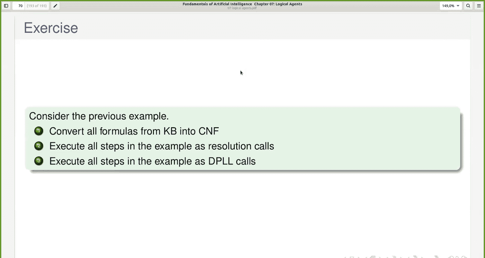
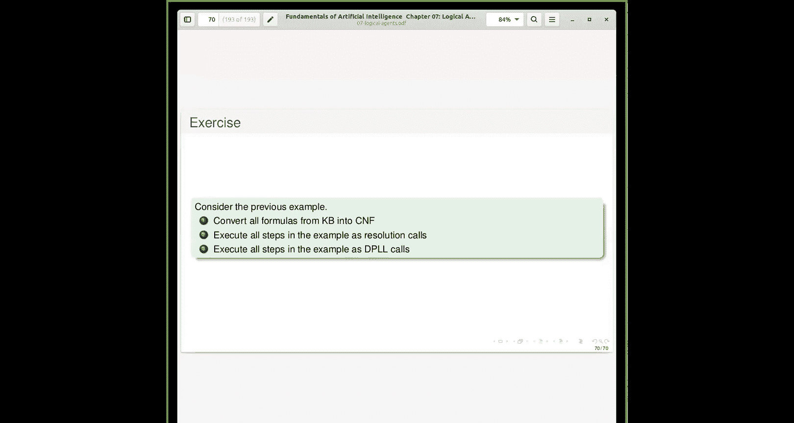

# 意大利特伦托大学《人工智能基础｜Fundamentals of Artificial Intelligence 2024》中英字幕deepseek p22 2024.11.11-CL18-1-CH07-BooleanLogicAgents.zh_en -BV1uUkwYTEmf_p22-

Okay， today， we first conclude the。Our discussion of propositional logic involved。

Saying something about some general stuff about agents we。Who have logical reasonable capabilities。

 Okay， and why this is relevant。In the。Many contexts。

So its a way a link to of this chapter on what the context of this chapter。

2 concept that we have seen in previous chapters。 So to chapterpel two words of the three。🤧Yeah。Okay。

 so。Well， okay， this is just a quote but this is just to emphasize the fact that nowadays AI。Yeah。

 it has。T two many phases。The first phase is， until the late。90s was everything symbolic。Okay。😊。

Reasoning， automatic reasoning， knowledge representational reasoning， planning。

Everything should be held symbolically。Now we have witnessed the boom of。Neural AI， okay。

Nero also deep learning， machine learning， deep learning。Most recently， generative AI。

Lgu larger language models。Nowadays， the researcher。He's trying to merge into things。Okay。

 so we need the both。Everybody realizes that we need both。Okay， and we need the incorporating， so。

One， one point is， how can we incorporate。Reasoning in。In agent context， why this is。Rather。Okay。

 so there's a whole field of AI。Itch is no representation and reasoning。嗯。Sstantially。

 which is dedicated to represent knowledge and。So that computer system can do that and use it。😡。

To infer new knowledge。And to use it incomp task， this means also reasoning on the result of acting。

To some extent， okay， about a reason about the environment。

 reasoning about the effects of acting in environment， of acquiring knowledge and so on。Fish。

And this is。Called the knowledge based system Age。The key point is that such an agent maintains a knowledge base。

Okay， so。Some。You have some way of representing knowledge， typically in a say， logical form。

Or something which can be reduced to logical form， Okay。

 or compact ways or representing logical form， okay。Fush。

And and this is called a genetically a knowledge base。 And this represent substantial。

The representation of the award for the agent。 So or the relevant part of the world。For the agent。

And this is representing in some formal language， former here should be intended as known ambiguous。

Natural language is not a formal language， because we know that。You learn from natural age courses。

 the natural language is intrinsically ambiguous。Okay， well think。

How many times you don't understand to each other when you speak with somebody， okay。

 simply because you interpret， you misinterpret something。Okay。

For formal language is something whose semantics clearly is clearly stated， okay， for instance。

 logic。Or languages which are based on logic。Or automata。Regular expressions。

 something which has a form mathematical reason definition。ok。And then。

You also collect So there is a general knowledge， and then some collection of the facts representing in the same knowledge。

 which which you which are believed by the agent or acquired。By also by experience by the agent。

 okay？And initially， this contains only what's called the background knowledge。 So what's a sort of。

Or either knowledge。Ar wire knowledge or knowledge was given to the agent from the beginning or something it has learned in acquiring previous experience and then。

Progressively acquire the knowledge by it。By first， acquire sensing。

 So acquire knowledge and then doing reasoning about sensing。Okay。What is reasoning well？Sstantially。

 the baseline notion of reasoning is entailment。So you entail something logically from something you acquire。

 which means previous knowledge and the facts that you acquire by sensing。Or by。Remember。

 sensing in the journal there okay can also be message you receive。

 you're exchanging with other agents or。Information that you want。Okay。So。Sstantially。

 so what you need is you need an in engine。Inference engine is something that is able to infer and new。

And among of fact， you feel also some。Choices of the right action that you should do in order to achieve some goals。

 and this is what we will see in planning。There is a strong relationship between planning and logical reasoning。

Okay， although they are technical to different things and they use different techniques and there are technical different problems。

 okay， there is a strong relationship between the two。ok。So as to start。

 you need an infinite engine in which you acquire it。And what is very， very。

 very important and it different and makes this different from a。

Problem solving specific problem solving。Is that。And an engine。

 influence engine is sort of a domain independent。Okay， so。

Lo reasoning reason doesn't know anything about your actual problem you are solving。

It's the fact that you encode。Your domain， your specific domain。

 your specific problem into some formal language。CSP， booleion logic， first order the logic。

 description logics， model logic， tinyalomata。Whatever， some formal language。

And then this engine is able to reason on those formal aspects。😡，So， is it the。

The domain specific information is。Handle in the encoding of the problem。Okay。切。Yeah。So。😡。

What do we need by reasoning？Reason is a formalipination of the symbols。

Represent a collection of belief to to produce representation of new ones。 Okay。

 so we use a symbolic。 We mean the language to infer some。

Symbolic form of symbolic reason to some new expression。According to some fixed seman。

 given semantics。Dically， logic。Or anything which can be reduced to logic。哦多物啊。冇多 real time or多冇梗系啦。

ok。One fundamental step is logical entailment。Logical deduction。Okay。呃。So for you well。

 this very simple， this is something that even Aristotle ancient Greek philosopher realized。

 so suppose you know that you know that a patient， given a patient is allergic to a given medication。

And you know。 And so this。Something that you acquire by sensing or my experience， Okay。

 so a doctor acquire and you know that anybody allergic to medication M is also allergic to medication and prime。

Then。You can eat fair。That patient that is alleric also to employ。Okay， so。As a consequencesequent。

 a doctor knows that he or she should not。Prescribe medicine men prime to patient act。 Okay。

 so this is a trivial toy example to see how we。Make an deduction step。 This is a deduction step。

 Okay， but actually， we do much more sophisticated deduction steps， okay。😊。

The interesting part of the deduction step is that。If。They。Expressions that you are inferring。啊啊。

Really represent your reality。Also， what you reduce biological reasoning also represented all in the real world。

Okay， if an expression is a faithful representation of what facts in the real world。

 then what you fare out of them。Okay。ItAlso holds in the real War。 Why， because。Log rules。

Are compliant with the semantics。All expressions。Okay。😊，This is Sia。

Its very similar to the mathematical step that you do implicitly。😊，Okay， so anm accountant。诶。

If you report that you have these expenses and these incomes。Okay， and you know。

And you trust the fact that those numbers represent exactly the kind of incomes that you have had and the kind of expenses that you have。

Okay。😊，After doing the sums and subtractions。An accountant believe is。

Faithfully believes that the actual number that you have as a result is actual the amount of money yes in the cash。

Okay。😊，This is very similar。W， because mathematics and logic are based on semantics are compliant with the semantics。

Okay。So。😡，The kind of queryium you may have should I prescribe a medicine and prim to X。

 and the assay is no。Because of the patient that is allergic to miig and pride。And also。

 this is basically logical enment reason。 Okay， there are other forms。Well。

 it used to be last part of this course， whether we have seen at the beginning of this course this year。

 okay， so probabilistic re。😊，Sometimes， you don't know this by。You cannot be 100% sure of the fact。

 but you have an estimation of probability of fact。

 and you can say entail some facts with a reasonable probability with 95% of probability。Okay。

And also other forms of reasoning， which we are not covering in this course。

 is what is called adaptive reasoning。That is diagnosis， given only the behavior and the betterta。

Give me some outcome。Try to figure out what would be the cause of。For this reason。 Okay。

 so given knowledge and some something。Which which occurred。

Try to figure out what is the extra reason that caused this。 This is diagnosis。

 doctors do try to do that every time。It's a sort of reverse deduction。Okay。

Abducttive reasoning is also a form of set of observation and the general rule。

 so physicists do that。Okay， the typical attitude in science is doing the executive step。

 you make a lots of observation trying to figure out the general rule out of that。😊，Okay。

 but unfortunately， we are not coing that in schools， okay so。Okay。

So a logical agent is something some。Agent， which combines some domain knowledge。

With the current perceptions。In such of that， P fair some aspect of reality that he cannot assess。

Remember remember in general， we。We are not in you cannot assume full observability or we are。

 so our science cannot access to all possible information， even on demand。Okay。

 so you can try to new fair。Some what you don't know out of logical reasoning。

 and if if you cannot for sure you try to do that out of probabilistic reason。Right。😊，Okay。Okay。

 so knowledge base should be able to represent states and action so have a。

A way of representing its own action and the state of the war。Acquire new perceptions。

Upbeate the internal representation of the award。Did you and this girl infer or did you some new facts from other facts。

 and that's fundamental thing。And reduce use also so you deuce hidden properties so the patient is allergic also to medication and prime and then unfair fair appropriate action or not action。

 do not prescribe and prime out of that。Okay。Okay， so let me you this example。 Well， again。

 one of the side effect of the fact that that we reverse the order of the chapter test is that you have already meet me this example。

Before， I just， let me tell。What this environment is， this is a sort of a simple video game。Okay。

 you have this game， so this is how I here and whose goal。Wheres to retrieve some bag of gold。诶。

He can move in one step in horizontally or vertically， but he cannot see。Beyond the in the next。

In the next square， okay。Is sort of as if there is some painting in in the middle。 He can pass read。

 but not， not see through it。 Okay， and there are。Two very dangerous things。There are some pit here。

 So if you feel， so if you enter in a pit， you you fall down and you die。

And also there is this monster who is the wmbus and if you enter there， he kills him。

Or eats you or whatever very bad， very bad things you can do that。So， there are。Luckily。

There is some sign of the present of this kind of dangers。 So if you have a peak。

 that is sort of breezeing the nearby so you can feel the breeze。But you don't know which block。

The police comes from。And luckily， the w push stingches like hell， okay。诶 saw。Stinks， sorry。

 like hell。 So you， you， you feel the tension。Be， okay， so you have to try to figure out what to do。

Okay， okay， so this just okay， if they are the fact that if you if well。

 the examples in your book is a little more complicated than I do， I just take a part of that。 Okay。

 so you can our hero is also is aarrow to kill our the w boost blah， blah， bh。Okay。

Let's see only for us is just we only cover the part of moving around without avoiding the dangers Okay。

 so what you can do is so forget the performance measure here。

 the threat is just you turn up down and move over these and shoot well is not very important for us and the science so you feel the stage。

 you you the breeze and that's all you need。Okay， so we have a。

We are using a restricted version of this game。Okay， so。Okay， suppose you are in the situation。

 let's see this at the high level， regardless of the kind of reasoning we are performing just a a。

I' just addressing your intuition reasoning regardless of which kind of formalism we are using。Okay。

 okay。So we know the rules of the environment， what we have seen before， Okay。

 and we know our hero is the im position of one here。And he perceives no stage and no breeze。Okay。

 I say， okay， I call it okay， if there is no pit or no woman there。From that。

 you can perceive that both one and two and2 and1 are。Are free of whom。 Who's a free of it。 Okay。

 so okay， so he can move up or down， freely。Okay。😊，Okay， so。Let's go up。

Suppose our hair goes up and then he perceiveds nothing saw no ws around。Btery。

 he perceives a breeze。Okay， so what happens if you perceive the breeze？Okay。

What can it deduce if a breezes？Thank个。There is a beat。

There is a pity one of the three elements here， but he knows there is no pity here。😡，Okay。

Previous experience from which you can infer to some extent。That。There is a pit。

 I have free one or to do。 Not that I represent。 I willingly represent this in natural language here in English。

 Okay， no logic so far。Okay， sorry so I'm just referring to your common senseism， Okay。

 of human beings so these is the perceiveiv a very easy so there it must be。Some。嗯。

Some pit here here。 So this。Its a very dangerous situation。There is no no boost， okay。

 so theres no boost in through one。Okay。So what would you do now if you wear our hair？Yes。😊。

Go back can check。Okay， yes， in fact， this is what our U era does。He goes down， so good back salt。

This is a dangerous situation， so。I have a。Its risk special。

 let's try try to see it in another direction。Notice that he remembers his stored somewhere that either here or here or both I not sorry。

Here or here without the either。In principle couldnt be two of that。Okay。😊，So he's an ore。

 not an exclusive or， Okay， okay， so I go back。And I。I'm going in this position here，1，2。

 and I perceive no breeze。And they could see this thing。Okay， what can infer it。What can I。

The news out of that。Yes。Onで。あ。Is I going down，There's no。There's not lost。

OfThe master there was no no no breeze before。And there is。Okay， let'ss okay。

 let's take it one of the timeme，'s about the beat first。About pits first。

 That's the reason about pit。 Can there be a pit here。No， no， because we cannot have a pit here。

 So what is the pit。But。啊。Yeah， so he did use the pties there。Okay。So well， he says， okay。

 these two are a safe。But now there is an extra point。 oh， I feelest stined。Okay， so for the got it。

 so。The first thought。Combining with the previous knowledge by。Duction。

 you say this was a bit here or here， but I know that it is not a bit here， so it must be here。😡。

And also， I know。There must be a wus here here。ok， so ok啊 sorry。诶。是。Theres no whous。

 there must be a wimpus here， that can be a wimpus here。😡，No， because previously。

 I know that there is no wus in either here， so the wus family must be here。Okay， so overall。😊。

Have have a clear picture。Combined my previous knowledge bike。😡，Autooma is not in that。

Here is not a plain de， is it？😡，I took an oar at this junction， and I cut on a branch of the oar。

So I did a very basic form of。Propositional reason。In doing that。

 So if you have no capability of performing logic， you cannot。Solve this problem。Okay。

 well this is a toy problem， of course， but the point is that even in this very very you need the logic。

So you need to know that if I know A or B， and I know not B。😡，I need at least， I have a。Okay。Which。

 by the way， is a form。Resolution。Doive me the resolution， step。Okay。So I know。

 and then I can safely go up。Going here， okay。And then know， okay， I go ahead。

 This not the part of winters from。 Okay， and okay， you can go aheadh， blah，lah， I don't。 this not。

Ms。That when I was here。诶。You could also produce a probabilistic。Reasoning， okay。So and then again。

 go back to the example that you were supposed to see at the end of this course。

If you are in a situation in which you feel。In which you feel breeze both in one，2 and in2，1。

There is no 100% of action solved。What can I do， Well， One is， okay。

 go home and that the nothing which could probably be the safest thing。 But the guys in here。

 so I cannot do。 right， so， so， so he must take the the best choices。 And we have already seen。

Then that。The best choice is going in one to the Nigeria extreme。Okay， well。

 we have seen the computation at the end。 I remember。 now this， I believe is also intuitive， right。

So given the fact that you have a low choice of having your pizza。So in order。

 so you have a very high chance。 So this having a bit here would cover both cases in order to have both scenario。

 you should have。At least there are two pits， which is more unlikely that I one。Okay。

 so in general is even though you cannot。Perform is not easy to perform this X computation。

 remember it was very complicated reason， but your intuition tells you at the least that this has this square has much higher probability of than between than each other okay。

对啊。Okay。Okay， so。Let's restrict。 Okay， there are many。

 many knowledge base any forms or many knowledge base， depending how sophisticated is they。

They representation engine。And how sophisticated is the reasoning engine？Okay， if you are able to。

Okay， let's restrict to logic for a while。If you are， you can have the very basic form。

 which is youre able to do bulloleing reason or even simpler， only horn bullole reason。

 remember horn， only very， very basic。Rules。Okay， this is very cheaper， but not very much expressive。

Then you can have a bulletha logic。You are good in performing by logic。well， this's good。Okay， well。

Look， when I say you are good in a。Are we good in doing bully logic。Do you think。

We are good in performing very basic bull logic， but if a。

AT person can solve a problem by hand with a paper and pencil or some non boomer equivalent to。

Let's say。定。12，15 variables by hand。 Okay， so if you go to 20 variables。

Even a train the person cannot。Okay， so we are not really good at performing good logic in the science。

We are good in performing very basic tasking bullet logic， okay？

But then you can have something much more sophisticated， you can have a first order logic。

 We'll see that in we started to see this today， you can have more sophisticated。

 You can have a more model logic。😊，In which we can handle also notional， like possibility must。

 this must necessarily happen。 or this possibly happen or knowledge like。I know that She knows， that。

 She knows。Okay， so I can infer that if I know she knows and I know that she knows that， she know。

 what can I infer。Okay， so that's in games in Moy agent。

 you should also try to infer whats the other in order to predict what is the other agent。No， no。

 well do you should also try to predict what the other agent know what you believe they know。

And this is quite sophisticated， this is model logic。Or temporal logic。

Logic in which you add information about the evolution of time， you introduced the notion of steps。

The next step this will happen or eventually this will happen or it will always happen。

 or it will never happen or this eventually will happen until there this other thing will happen。

Okay， this is temporal logics。Okay。This is something that will encounter in the formal verification course。

We'll say something about the scriptural logic。Reasoning about roles and concept。A mother is。

A female person who has at least one child。You can represent complicated expressionspirations， like。

The mother of at least three engineers。Okay，Okay， and you can try to。

To user whether a person with some characteristic also is carrying the character can be。

Can belong to this other concept。Okay， this is fundamental in classificationification。ontologies。

Biness。Theres a wall a field of AI， which is the part of knowledge of representation。Okay。

 so let's see the simplest possible form are boolean logic。 Well。

 bull logic is typically addressed as the。The simplest form of， of logic， well。

They say that horn logic is probably the simplest one。 Okay， but however， this is。

The first known trivia， the simplest known trivial logic。Okay， so。So in general。

 you can have a logic agent， so。Something we should。In order to reason， in order to deuce uses logic。

😡，Some logical language as a big。呃。Formalism and use logical deduction to infer something Not that it is not necessarily so。

 so it can be planning agents very similar， but plains is well can be seen as of。

T may be formalizing logic， but he learning has taken different slightly different directions。Okay。

So the idea is that you represent a knowledge base as a set of propositional formula。😊。

And you represent perception in action as a proposition of atoms or collection of propositional atoms。

😊，And which mean in practice， since we tend the to cizer to use always a conjunctioning normal a form when we reason in terms of Bu reasoning。

 this means that we collect all of them as a set of clauses。

And then you perform propositionally reason inference France。

There are many techniques for entailment model check， but in practice everything。

 nowadays everything is done in one way。Cd a。Or better I call an incremental sub solar nowadays。

 as I mentioned， such solar are incremental in the sense that they have a push pop into interface。

So we can push， push some formula， sold， pop that formula， push some other。So you can face push。

 push， push， push， push。The knowledge base and then you push the query alpha。

 the negation of query alpha， sorry， solved， pop the query alpha。

 push the query of not better solved and so on and so forth， reasonably increment。Okay。Well。

 this is something that's。May look obvious。But， it took。For reason， he took ancient Greek philosophy。

And the philosophers in Ja sists to understand。Which is。So。Logic is a representation of the war。Okay。

And you represent a chor， you represent some sentences which represent some aspect of the real world。

What is the linking between sentences？And。And real world is the semantics。Okay。

 the semantics tells you that you associate。Do every， every。Object some to fight， okay。

 thisumbboular logic more generally can represent map some entities into some objects。

 some function to some real world function and so on。The interesting part of that。

Is that if you have done things properly。So if you have some deduction rules。

Which are compliant with the semantics。Okay。Then you are guaranteed that。 And if you have。

If you have some sentences which faithfully represent。The aspect of the war。

Then everything which you are able to entail。😡，Okay。

 in from those is a cris in which actually happens。In in the real world。Why that due to semantics。

 the fact that logical attainment is compliant with the semantics。So everything， remember。

 everything that you deduce。Okay， is compliant with the all possible models。

Or theyre your knowledge base。Okay， so this is must be compliant， so this will match。

ThisWith other this anequ consequence in the real world。Okay。

 so it's very same point that we trust mathematics。Okay， when you do calculation。

 so you are trying to figure out how much money you have left in cash。

An account And you know exactly how much。Money， you have a put and how much money， you know。

For sure how much money you had before。Okay， in cash， you know how much money we are taking out。

 you know， you know， for sure the amount of money you're putting in and you might you make sums and differences。

And you trust。That。😡，The result of of。Of your arithmetic computation is actually the amount of money that you have in cash。

Okay， the cashier， Okay， why， because you know that mathematic is compliant with the semantic of entities。

Numbers are actually。You are compliant， the fact that you take， if you。

If we take out 10 euros of the cashche。At an euro bank note out of the cash。

 then the total amount of euro that you have in the cash is the total amount year before-10。Okay。

 so this minus state is compliant with the reality， is compliant via semantics with the reality。😊。

Okay。Okay。Question。Was this obvious to you？Probably， yes。But just me。

 let me tell you that it took hundreds of years to to philosopher to understand this。

So this is something that we give implic it。😡，ok。Behind that。Is the fact that。We。

Have a deduction rule， which are provably compliant with the semantics。Okay。If you did。

 so that's why so I cannot say you， I deduce this out of that。 I cannot impose you some。Rule。However。

 I cannot say， so if I what you don't know first of the logic yet。

 So I cannot impose you some fancy rule。ok。This rule must be compliant with the semantics。

 otherwise everything crashes。😊，Oh， I forgot to say。Bah logic。

The inference rules that we have seen are compliant with some so cool logic of course。

 so everything which can be deduced。By， by the rules are。

Everything which is can be deuced is compliant with the semantic so if alpha entails beta。

 semantically means all the models of alpha are sub of the models of beta， okay， this means。

 but all the rules by which you can deduce this are compliant with this fact。O。Okay。

So generic sentences represent configuration of the agent okay。And you very easy。

 you could start in new configurations。So the new configuration represents the spec of the word that can actually fall for the。

😊，From the aspect of the old configuration of okay。So I know this may sound obvious to you。

 but this is not， and this is the very fundamental the fact that you can have。This dion。

Is the very basic。啊。Is the very foundation。Why we can do abstract reasoning。😡，Okay。

Because we trust that behind our abstract reason， there is a cement which guarantees that these maps automatically into concrete fat。

Provide that we have done things properly。Okay。ok。😊。

Now let's move over to see the previous example in terms of the fourmon that we have seen。

Wumpus word， okay， so we are in the same case as before。Okay， our here is here。Okay， what do we need。

 We need Boolean atoms first。 Suppose we have。Sulan ats saying， okay， P is P I J。

 We have one PI J A saying the meaning this is a peak imposition I J。There is a WIJ means theres a。

There a， there is a vos position IJ。ok。😊，Oh。Well， there is an implicit fact that PJ Bo was A J and is。

Is falses out of the range I J。 Okay， so we implic assume that they those variables for in for indexes outside the square are are increasingly falses。

Okay， so let's first step。Formalize in bullan logic， our knowledge。We have an entity knowledge。

We have an entity knowledge here saying， for instance， that。You feel breeze。

If a pizza isn't in a neighbor place。How do we formalize this fact？Where。

We can say that there is a breeze in IJ， in position Ij。Okay。If an a leaf。

Either there is a P in a position I J minus1 or there is a P in position I plus1 J。

 or there is a P in I position I J plus1， or there's a p in J minus1 J。

We formalize this in the general case， also the border， also with the border node。🤢，By。

Because we exploit this with this implic assumption so we don't need the writing adult roots for border lines saying simply say okay。

 they are impive false， so for instance here they will be ones which will be automatically false so this fundamental step。

We are formalized our knowledge， in terms of。Abua s， Oh， I forgot to say。呃。

I will represent a no Cf formula that because otherwise the Cf will be I don't have enough space。

 But then， of course， the result of this will be the synization of result of synifies in this form。

 But we know how to signize， right。Okay， very similar thing with the stench with the rooss。

 There a statench in SJ only at least one。Of the reserve input at least in one of those。Oh。

Not a easy no， not an exor。 Okay， you can have more than one peak。In principle。

 you could have more than one wus。You can have a next action saying there is only one wus there。Okay。

 we define not this definition that we say this is okay， IJ is okay， if and， if not。

 there is no wus in AJ and there is no pit in IJ。Okay。Notice that this is what he call a definition。

😡，You don't really need okay。😡，Sometimes we you don't really need these okay atoms， Okay。

 are just what you call synal sugar， okay， it just convenience。Rather than bringing you around。

This expression here， we just give it a name。Re call it name。 recall call this subion， okay。

Very similar to what we do with sites in synization。Okay， forget the Ger。诶。诶。Initially， we know。

That in one one， there is no wmbus and no pit。So there is no no p no one， no vus no one。

 And here we can already perform our first logic inference automatically。Okay， from this。

We know that okay， all one is okay。How do we do that Well， if you look at the syntheization of those。

 you see that immediately that you unique propagate。Theteministic of this information。

This information is the tentistic propagation。If you arrive this unCF， you notice that。

Out of this formula and of these two atoms， by Uni propagation， you immediately hurt us。

Theterministic step。Okay， so initial scenario。Okay， what happens now。 So initially， we have this。

 Okay， this is part of the our knowledge。Which you have already seen and so this is the relevant part for this scenario of knowledge。

 we know there is no petting one， we know the breeze you have breeze in one only if we have a pit。

 we know there is a stench， if and only if we have a wound pu in either， we know it's okay。

 it's okay if we don't have a wound pu and we don't have a pit there。We are in one one。Okay。

 let's perceive。And by perception。We perceive no stage and no breeze in y1。

 so they mean not S11 and not Sb1。Okay。By again， we came infer out of that。Okay。

By an ne of these two。We can say that the end of the negation holds yeah。Okay。

 so we can perceive and you can perceive that no roommb is wrong one， no whommb is2 one。

 no no ptting one two and no pi to one。Check it。Rerite these sentence here in CNF。

Add these atoms here， apply un propagation， and you see this you'll infer those。Okay。

So this is something that you infer automatically and then you infer this and out of that。

 you infer that okay12 and okay to one。So you have added some new facts。

 the facts here are literal substantially。😊，And you have infer you which of course you added to your knowledge base。

No。Okay， let's go ahead， now I can perform a move。Okay， so I moved to one and I peel cele breezes。

 so。I know now that in21， I B to1， and I perceive no stage。Oh。What shall I do， Okay， if I beat one。

Okay， P is I already know that P11， if you remember these folds。Okay， so out of them。

 I can infer that P31 or P22。And this is an information I infer a new clothes， which is not a unit。

 it's not a fact。😊，Is a close， isn't something that I add the knowledge of available。

Doesn't tell me a real factor， me an alternative effect。So its not。So， I infer that。

There is a pit in either3 one or in22 Okay， the further that a perceived no stage that's easy because with the standard negation we have I already know there is no whous here so I already get there is no whoies to two and two three in three one okay so I can add。

These atoms here。But。I have heard this one。Okay， this goes which I add and。Let's see if I。Okay。

 let's go back and go right。And now I perceive no breeze in1，2。Okay。I perceived no breeze in one。

 too。And they you see the stage you want too， Okay， now。哦。I know。 This is fault。Okay。😊，呃。

So obviously no breeze in one to， okay，11 is again false。From this， I infer not P2，2， not P1，3。Okay。

But now I did use something which is I immediately de use， but now I had before not P31 or P22。

For which I canfer B B31。Again， everything but unit propagation。You can check it。嗯。

Rerite this the all code as a closest in class form。 and you immediately see that this。

Infer deter by unit propagation。Okay， again， instead， you perceive this change。

From which you seems you or is it？Okay， you okay， you persist attention you want to。

 This means that one of those must be true， but you know for sure people get that W11 was false and you already knew that W22 is also is false。

 Where's it here。Okay。😊，So， you can move there。That。W 1，3 is。This is V213 and W。

And whobu in Tutu is false。From that， you can infer。Out of this。That。To2 is okay。

 and now you are free。Two more into to do。You know， for sure。By applying resolution attention， well。

 un propagation retention， but you can see。Acor to such solar。 Well， actually。

 really trivial course to such solar。 Okay， Unifer。The information。

 the fundamental information that you need to go ahead， which is。😊，To go。2， you can go shift there。

 and then you go ahead。Okay。I give you by exercise。She。To convert to old formula from from Cf。Okay。😊。

You can execute those steps in the example as a resolution called。

And you can execute those steps in the example as DPL calls。Hint。If you try to do as resolution call。

Please follow the suggestion I giving you。Always try to resolve with the un or unity that first。

 don't try to to。Resolve bigger clothes， because otherwise you you get a huge amount of bigger clothes which feeling fill your your sheet of paper or your electronica device without any real alpha contribution。

 So try to。Remember the trick that always。诶。You apply resolution always to small clauses to clothes。

 which are as small as possible。 So that such a way to produce。Ces which are as small as possible。

Okay， that's it for Boolean reasoning。As I say， we just as far as the techniques infer to performable reasoning。

 we just scratch the surface。We are。Doing such more sophisticated introducing much more sophisticated devices and techniques also from a representation viewpoint。

In the automatic reasoning calls whoever is interested for。Okay。

 so we can have a break now and then I'll start to using the first order the logic。Let's zoom at45。是。

Yeah嗯嗯嗯。

好。