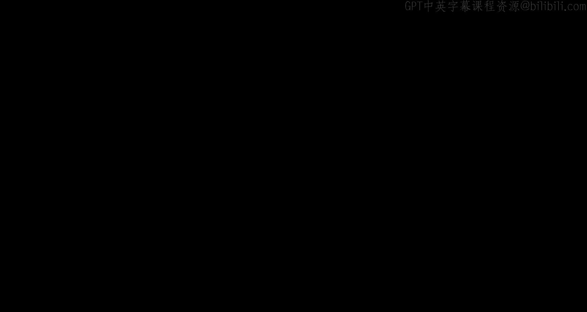
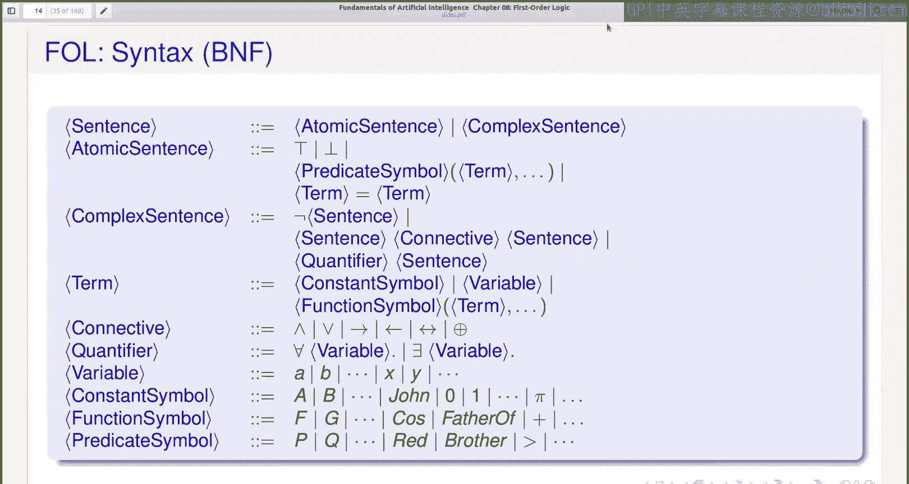

# 意大利特伦托大学《人工智能基础｜Fundamentals of Artificial Intelligence 2024》中英字幕deepseek p23 2024.11.11-CL18-2-CH08-FirstOrderLogic.zh_en -BV1uUkwYTEmf_p23-

Okay。哦。Okay。As usual， youll have a tour recording for today， one for every chapter。Okay， guys。

 please sit down let we start。Okay， so。Now， we start a new topic。Stly related to the previous one。

Which is we deal with the first orderal logic and then reasoning in first orderal logic。Question。

 how many of you have seen first orology before？Some of you， okay， but not well a few of you。

 but okay， so probably you' find a few things that you already know well， good for you。

 but I think that most of you haven't。Okay， so。I will start giving you some general ideas and then we'll go through the logic。

So the idea is that first I give very high level ideas， then I will go get to the details of logic。

 meaning the syntax and semantics of the first of logic。And then we see again。

 the usage of first logic in the context of an AI or agent。E agent。So okay， if you remember。

 remember this slide。Just to recall it， a fundamental element in the representation of knowledge is the way we represent a state。

We have three possible representation。The simplest form that we saw was the atomic。 Okay。

 so every state has one name。Okay， this state and this state。

 and the only thing that we could do is for comparing states was this data is different from this other state。

This is very basic， but not very much useful。And then much more popular was the socal factor representation。

 where the state is represented a set of a collection of values of some state of variables。

We well examples that are constant sat problems， CSP or also bo logic as we seen right so in one case the domain is。

Arbitrary finite domain in the second is0 to。Te falses， however。Thisel that was。

 And then we have hinted the fact that you can have some more information。

What's called the structure information， so in which you can include object。We can have。

Features about this or properties or object function over objects。

 and you can say something more sophisticated， you can quantify over object。And in particular。

 we can represent a relationship between objects。That's what' is called the structure。

And this is more。All this representation increase depressive power。

Today we make the first case the first example of a structure representation with the firstideology。

Well， if you get back to provision logic。Proposition logic is good for many， for many extent。

 So its it's a formal language food so is a clear。Semantics is declarative。

Lorge and the inference are separate。 You don't have to。诶。

To design a different reasoning engine for every domain， you just have。

To encode this domain in logic， and then we have fixed reason algorithm for still Sa so a such disorder。

 typically for such。For for universal language， you have lots of information so you can allow for partial information for negations fornc for these junctions。

 so unlike for instance databases。Is composition， you can build arbitrary。

 compose arbitrary expression out of he expression。

And the meaning of provision logic is context independent。

So you the meaning all logic once you give precise the semanities two or forces is independent on the context。

 like， for instance， the natural language。The main limitation is that is apress， Okay。

 you can only represent things which are true or falses。Okay， so I can say。At this point。

 there is black， okay， as one single atomic file。Which should represent the this pointer。

 The fact that this point is black， but。This key bag is black。Needs a different notion。

 a different atom。This wallet is black。嗯。Also gives another atom。 And if I say this mouses is well。

 mostly blue。 Okay， again， is， is another atom set。 So I have the two。

Let's say express price for instance， even a very basic notion like。Basic property object。I need。

One atomic act for every pair of object property， which is very unpractical。 And also。

 I cannot write a generalize。Concept， so I cannot。 So if I want to say that these object are or black。

Okay， I have to list them explicitly。 I say this part is black and this a key box is black。

 and this wallet is black and so on and so forth。 So very low as priceive， okay。嗯。So。So substantial。

 for instance， if you go back to the。The Mumpus case， I cannot say in one sentence。

 pits cause breezes in urgent spells， but I have to write an explicit。

Not only I have to write in specific auto， but also I have to write a sp formula for all square。

I have to write an poem of the sense of D square， all the borders of D square b， and blah bh。

 blah blah so。Is very， very unractical for many。For many applications， okay？啊。Before introducing。

First of the logic， I would to say what logic is。A logic in general。

 you may find that slightly different definitions， but you can think of logic as a triple。

 a tribal where you need fundamentally， you need a language。

So a logical language is for a class of sentences， which for all。Collections。Of。Of symbols， So war。

 a way of building war of symbols。Which of this guy by former grammar。哦。

Have you ever encountered the notion of drama or language before？So you know， for instance。

 what is a bakuna form is it represents grammars。Okay， anything like that。Okay。

And then what is very important is a semantics。 And that connects to what we say before。 So a way。

A form specification of how to assign meaning in the real world。Okay。To every sentence。

So the fundamental fact of the M。Of the logic is that who expression。Every scientist。

 you can attribute the meaning in the real world。 And that's actually what。

It allows us to make the assumption that we've seen before on logical reason agents， remember？

And then。So long before this is just to as a representation。

So this holds for representing facts by formal language。

 and then we needed doing something with that， which is in fair new sentences。Out of other sentences。

 according to some inference rules。So any more generally。

 any inference system which is not an necessarily inference rule， it can also be an algorithm。Okay。

Okay。呃。Yeah， a set of form delibvation rules over L， either rules or for an algorithm。

 sometimes you can represent directly as an algorithm without writing your spacing rules。Okay。

 so this is all we need， this is a general definition logic。There are many， many logics around。

 This is just a tiny collection， but。WellWe have already seen propositional logic PL。

 we are going to see a first logic where we can represent objective。 we can represent relations。

 We can represent function。 You can can quantify over them。We have model logics， model logics logic。

 which we can have will touch domain in the last part of this course， but。

A lodging which you can add the notion of necessity or possibility。Or the notional knowledge， aging。

呃。Agent A knows that。 Age， B knows that。You can do reasoning of fact what he knows and what a person knows and what he doesn't。

Description logic， which are useful to represent the infer concept。The facts， so。

Groups of entities substantial any reason to clarify whether any some entity is is part or not of of this concept or say if a concept is a sub concept of some other concept。

Okay。A。Temper logic。Or for every modern description logic， there are also very Boolean version。

 population version of historical versions。Temper logic is something which you are the time。

 So better evolution。So whereas logic typically represent a comb also。

Represent the states of the war。Temp logic represents the evolution。Of of state of the world。

So represent the notion like next step this happens this fact hold or eventually this fact will hold or necessarily in this next step within this fact whole or forever this fact whole or sometimes this fact hold or whatever okay。

 and you do again reason in the top of that。Then there are other of many other aylilologic。

 probabilistic logic satisfy media model theory， which is a subcase。

First of the logic and whatever else。Okay。Again。Logic is a structure。First the logical structure。

 So we include object。Which have attributes and relationship between other objects。So。We。

We know we assume that the world contains objects， so people house as numberss theories。

But also particular， Jim Maron， Robert Sebastianni， Blue， which can be Abbatcra object。

 concrete objects， basketball games war。We can have a relationship。For instance humor relationship。

 relationship means which regard only one element。Black。是。The Russian black being black。

Is a unary or preddicate for something which divides a property。Of one one instance。

 which applies to this object， but also to this object， and also to this object。

 but also to this object。Black。Being black they're called un predicateates。Okay。诶。But also。

 a binary relationship。Brothers。Okay。And others， okay。Owns of course， after comes between the blah。

 blah， but also functions。Father of。Best friend of these is also an implicit。Okay。

 at the end of this， one more when and of and also surprisingly， it can also quantify object。

You can say， or have a limited form of quantification。 You can say things like。

For all objects or for some object or exist one object， such that。So you can say all men are equal。

Or some person are left handed。Okay， you can represent the cost of。Okay， this aid， let's oh yes。

 please。Nation。A function。 Yeah， a function is sub case of relationship。 But the point is， okay。

 if you wait， I will get。I give you web。You can think as a function as a particular form of relationship or binary relation in which to every object that corresponds only one object。

Well， I mean， this is not short。The notion relation with function is a mathematical， the notion。

 not a logic notion， okay， but however， if you wait if a patient if you wait a couple of slides will answer to your question more properly okay。

Okay， so syntax and semantics， as usual， let's start for the syntax。Okay， what we need。

 we need some constant， constant object， which represent object。 Okay。

 so King John to University of Preto， some some word or some symbol， Okay。

 which you represent with intended means， which has。Represent some object as a concrete object。

 abstract object， general object or a particular object， Roberto Sebastianni， whatever， Okay。

 the number two University of Torontoto， Jim Morrison， whatever okay。Then you have predcate symbols。

 which can be unary， binary， anary。😡，Who is this main。Is a unary prediiccate？

Brother is a minor app predicate。Dung brothers， well she we say brothers。

 sometimes people use to brothers。Sometimes you brother often to mention function and brothers to mention relationship。

 whatever， there's no universal agreement in the convention to say that。Okay。诶。All different。

 which you can Okay， notice this also predicate。 Okay。

 Great particularly greater than is a binary prediiccate。 All different is generic and predicate。😊。

And so on。 So what is the point。They may have the different artists。😊，It's pretty greater than one。

 so one two three， Barla。Synthetically can be either prefis or inf。Well。

 infis are typically only binary prediiccate prefix in which you say。Name。

 name the prediccate parenthsesis list of arguments。

Sometimes you write the parentynthesis element argument predicate argument close parentthesis。

 this is just a syntical sugar， the fact that infi a predicate exists is just a form of a synical sugar。

 you could even write a strictly greater parentynthesis element one comma element two close parentthesis some logician do。

Okay， these is just。Simplyly， as I say， the system or you fix a binary pre is just a synthetic sugar。

Okay。因为。Finial symbols。呃。A squarety left leg， mother of。They may have the different art again，1，2，3。

 and also they can be a perfect source So for instance square of element is。As one element。

 but sometimes that you have an in， so plus is a function。Okay。

 what is the intuition then I will give you an ex semantic in couple of few slides。

 but what is the intuition relationship is something。Is the mathematical notion or relation。

 so Santa is identifies a subset of the Carteessan product of the domains or the elements， okay。

 so identifies Santa which is either true or false。Andless you说。呃。Brothers， these two guys， Well。

 you guess no， but maybe you're not brothers， right， Okay， so so brothers。欠唔谦。So he's faults， okay。

Let's say。呃。The student mate classmates with two guys is true。Okay。

So something which is added to identify a relations。Remember。

 a relation is a subcase of a Cartesian product or the farm and says whether this pair belongs to a human relation。

 this pair of people。Does not belong to the relation brothers。Okay。

 but it belongs to the relation classmates。Okay。😊，Okay。

 function is something that maps some correction object into some other object。

 So mother of maps a person into another person with his or her mother。Okay。

 that's a fundamental distinction。Then we have valuable symbols。Which。

Representing least a higher level object。You also have the user propositional connects。😡。

Not end or implication， left implication， if ans or sometimes with the very same meaning of the propositional logic。

Okay。😊，There， there is a special predcate。Infi spatial predict， which is equality。Okay。

Is a predicate， okay， say。Binary predicate， we says that if two things are equal or not， okay。

 and there is there are impact。And is sometimes somebody uses also this predicate here。

Such that A different from B。Is just a shortcut or simply true for not a equal to B。Okay。But not。

 this is the deepest moment。Okay， yes， please。Chs。That's actually what I said。 Okay。

 well see the semantics。 So synally， they look very similar。But we see the same。

 but the implicit meaning you anticipate。Is that a function represents a function。

 not a functional relation or something which takes some elements in the domain and the reton and element in the domain。

Okay。Whereas a relation is something which are represented。

 you can think a map of from elements in the domain to two falses。

 so this pair of elements belong to a given relation， yes no。作。Other those two guys brothers， no。

 because the pair of these two guys does not belong to their relationship brothers。

 whereas whereas if I apply the predicate， yes， predicate brothers。

 okay except the prediiccate classmates。Okay， the answer is yes。ok。😊，Okay。Its clear。

 but I will see that in the formally。 What I just say informally， I will say that formally。

Quantifier us。 And that's the fundamental。Element， you can say quantify over logics。 Okay。

 for all and existing。I prefer for my personal test， so this is the standard name is exist。

I personally prefer for some。For some reason that I will explain you later。For some X pure X， Okay。

 but I will say later why。And then， okay， you have some information symbols parentesis come as blah。

 blah， blah， okay。Okay。Some logicians。We'll tell you that there exists is no constant。

Because the implicitole assume that constants are zero function symbols。B okay， up to you。 I again。

 this is not very convenient， in my opinion that。It's convenient to add constant。Similar。

 we have a propositions likeking real logic。You can have a proposition symbols。

And you can think them as a zero predicates symbol。Okay， same as before。Okay。

 this says tells you something that propositional logic is a subcase of first order logic。

 so everything you can represent in first order precate in a propositional logic you can represent in first order。

 of course， not a visual asset。Okay， so first of logic is deeply more expressive。

Then then a predicate logic。 if then preial logic。Okay， an important terminology。

The word the singular at tour。Represent Sir。A set of predicate function and constant symbols that we use。

You can add the propositions also within1 meaning or0 prior the case。 Okay。

 so when we say signulator2 do we mean a set of。Predicator as a function comes that we don't include equality in the signal or in the Senate by convention。

Equality is considered sort of universal predicate。So if you say the signature of the theory。

 you don't imp know equality because you assume is' already there。N the theory， okay？

So at the least now our cop well。😡，Not every logician agree on that。

 but the point is in our context of for every use that we do， we always assume we have and in AI。

 you always assume the user logic that you make in AI，You always assume the qualities on board。Okay。

啊。Okay， so how do， okay， since these are the ingredients。Like a flour or sugar and milk。

 Let's beat the cake。The first important definition is what is the term is。So a constant is a term。

A Vleyball is a term。And any application of a function。To sum of any function to n term is a term。

 not acurive definition。Okay。😊，So King John is a term， X is a chain term。

 the left leg of reach out is a term。That star。 well， this is product， a symbol of product。 Okay。

 that times log of 2。Is a term。 Well， this may be sound strange。 Okay。

 but notice that you have one ur function， which is no good。Who is a constant。Dedge is viable。

And times sold asterisks。Okay， is a binary in fixed binary function。

 So it's the application of a binary function two terms。

 and the second term is the application application of the un function of the log per constant。

Symbol， okay。Yeah。Where。They may sound awkward to see but you will say。Oh， come on。

 this sort of medical expression， not the logic。This is a logical representation of something。

In which if we give a particular interpretation。Can be map one to one to arimetic to mathematics。😡。

Provide that you give a standard interpretation to some symbols。Okay。

So I know that seeing an mathematicalri expression like this may disturb。

As a logical a can disturb somebody， okay？But this is， you can， well get to that。 but this is。

We can interpret this as an arithmetic expression， provided we give a particular interpretation with symbols。

Which will reci later。What the key point of terms。They den the objects。The real world， okay， so。

This identifies Kim Jonng， okay。is okay， your book makes along the saga， for example。

 taken from the Robin Hood de saga， okay？X with the node self which represent an object。

 The left leg of rich is representing the object， which is the left angle of pass rules。

 the name is Richard， and this is a number Okay， represent a number。

 So if we provided we give an interpretation of。In that that， there's a real number。

We interpret the log 2 as the the logarithal function and the interpret2 as the number two。

 This will this will represent a proper number， which is the product of the value that times log 2。

 okay。Okay， the ideal terms they represent object in the real world。ok。😊，Now， formula， well。

 in order to define formula or sentences， we first have to say what an atomic formula is。

 And then we have to be in the more complex one。 An atomic formula is either well。

The Atomic constant the true falses， if youre still there。

Which is typically we never occurring a formula， they are just to use the typical as an intermediate。

😡，Element when you do formal transformations， because you can always get rid of them。

Sever through and the sound finger， this is the sound finger。 Okay。

 fourth and the sound thing force and so on and forth。Yeah， but proposition， again， remember。

 proposition logic is a subcase of first or。Another form is a predicate applied to term where predicates assume to be an anradicate。

 and you apply n terms where terms are defined as above。There is an implicit other。

Other form which using the equal and is term1， equal term2。Okay。So， for the instance。

 you can say that。The length of the left leg over each other is little greater than the length of left right of King Jonng。

What does it mean？😮，诶。Length is a fashion which mapps some object into measurement。

Assuming the left leg is the interpretation demon。And this， if we interpret this in the obvious way。

 so this is the length property， this is the length left leg of somebody and this is Richard and John。

 this says that a pre decay， which is true if the left leg of or Richard is longer than the left leg or John。

 okay。Okay。And this pretty atomic function denote the fact。So。

Things which are either true or false in general in logic formula。

 they not things which are either true or false under given。

Scenaario given interpretation of the world， Okay， whereas terms in identify object。Okay。

Out of atomic。Sentences， we can build known atomic sentences， or formulas， how well first， obviously。

 by applying arbitrary boolean connects。the very same we do in Budha logic。

Not alpha alpha beta well the usual boolean operators， okay？

With the very same meaning that Ibo logic。And then， we can apply。We can introduce。Oh。Quify us。

For all x point alpha。Exist X alpha。Well， where typically。X occurs free。In in the alpha。Well。

 you can you can have also a situation where Al doesn't occur， But if so， this will be meaningless。

So the full axis would be， okay？Let me make some example to clarify。😊，For all why。

Italian Y implies President Marella why。ok。Assuming that Italian means being Italian and president means the Republic president and the constantsant Matorella represent Sergegge Matorella。

 who is the president of Italian Republic。Okay， this is。Matorella is the president of all Italians。

 So it means for all Italians， for all wise。Fwise。If why isn't Italian Italian， then。

Matorella is the president of Hawaii。Okay。Do you to everybody。Oh。

This says XX for all Y president X Y implies for all Y X president X Y。This means that。

If exist x such that for y x is the president of Y。 So if it exists a president of everybody。

Then everybody has a par。You see this？Not that these two formulas are very active。😡，Each other。

 I will get to that as an example。For all x a P of x and the Q of x。

 if leaf for all x P of x and for all x a  Q of x。呃If呃。All elements verify property X and Y， P and Q。

 then P ifly， if all elements verify a property P and all elements verify property Q。Yeah。Okay。😊。

For aha， this is interesting。 Okay， for all X。X greater equal than 0 and x is more equal than pi impliesly s of x greater equal than X。

 If you give interpretation of this as the constant0 and and pi respectively and sign as the mathematical symbol sign and as more equal greater equals。

 the usual meaning you have a mathematic。 you have a property of the sign can use this to represent the property of the sign。

You see this？But the sign is positive in 0 by。明白。Okay。

 so these are things that you can use apparently。 Not that this implicitly notice that this is pressure like that。

Assumes simplicity some implicit meaning of of this predicate。Of this function of this concept。Okay。

Okay， a few definition yet when we includes a term formula is grand。If no variable occurs in it。Okay。

 so if you don't have any， any variable in the currently in the formula， then for reason。

 two is more greaterer Ri than one is a ground。 So you don't have any variable。Okay。

 let me say about who tells me that you haven't used the symbol2 and1 to represent the variable well。

 assuming I typically give you a list of when should say， okay。

 given these symbols represent variables， given the fact that these symbols represent constant given the fact that these symbols represent。

Function of pre， then we have this expression。 Okay， if to tell， typically。

 you have some naming conventions。 So I will typically use X。

 Y for variables and other symbols for constants。We say that a formula is closed instead。

 if all variables which occur in the。If any。Are quantified。So以。

So for all x exist Y X is greater than y。Okay， is closed in the sense that every variable which occur in this case。

 X and Y have occurred under the scope of a quantifier。You see。😊，Obviously。

 grant formats are closed in the format， but not mutual as。

What's the implicit meaning of a ground formula or a closed formula？

A closed form is something that we can given the interpretation of the predicate。

 you can say that it is true or false。If I say。So。Suppose you're giving interpretation was slightly greater than。

As。The standard the standard notion of greater， okay？If I say x greater than y。

Or even X stick gridline2。You cannot say whether x is true or false because it depends on what x is。

 it variable。But if I say4 all x。Excist y， such that X is degree greater than y。Okay。

If you are the in the regard， you can say yes。If you're on the positive internet， yes answer is no。

 okay， but you can always say that because for every number， it always is a model number。ok。

And the line， once you give a fixed interpretation to the pre function symbols。Okay。

 so you see close formula R。Something which you can conclude is are two or false if once you have given interpretation to the predicates and function and constant which occur there。

 okay。Okay， so。If you are familiar with the Baos our form。

 this is a formal way of representing what Ive just said before， right but this is just。

A linguistic in the formula way of saying。Whatever I said before。Okay。

 I think I can close it to you for today。 I see。 remember， Wednesday， we are taking class。 So I no。

 no lab。 I will give the class。 Okay， so see you on Wednesday。😊，啊。对。O嗯。我。

