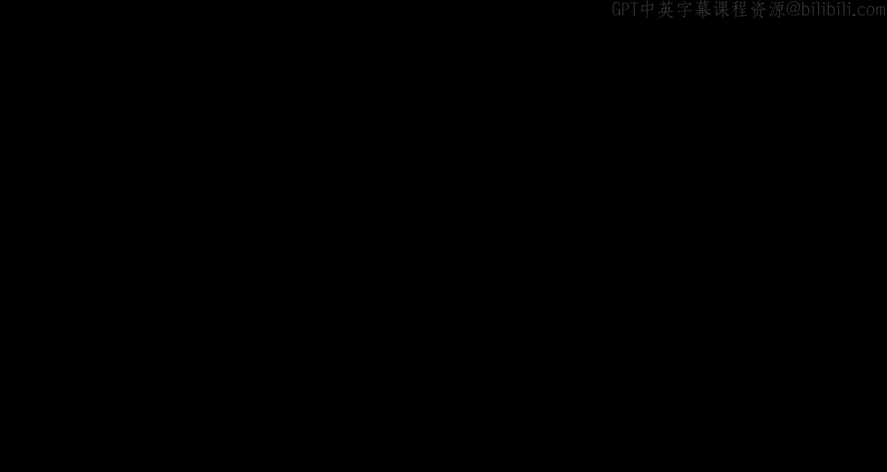
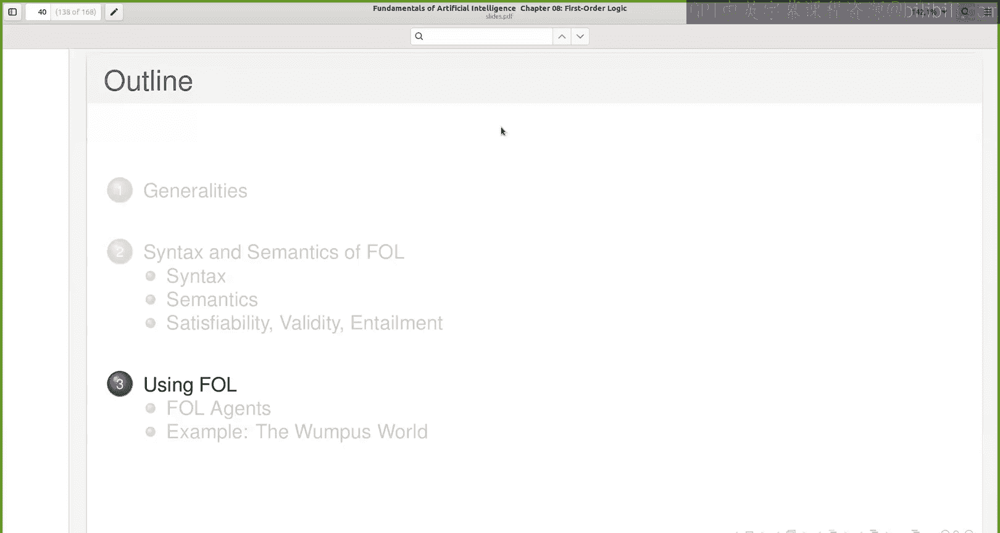

# 意大利特伦托大学《人工智能基础｜Fundamentals of Artificial Intelligence 2024》中英字幕deepseek p24 2024.11.13-CL19-1-CH08-FirstOrderLogic.zh_en -BV1uUkwYTEmf_p24-

Okay， we stuck。Okay， so last time we started。Introducing first logicic。And so far。

 we have substantially introduced the syntax。Ofly I've given some basic ideas about it and then we have introduced the syntax。

Apart from the grammar that I have shown here。Fundamentally， we have the notion of terms。

Terms is neither a constant variable or any function applied to any term。

 so this is the recursive definition。Then we have an atomic。Forula。

 which is potentially prediccate applied to some terms。

And the difference from terms and and formula is that a term represents an object。Okay。

The mother of King Richarda or King Richard or whatever。Or the number three， okay？

What are the logarithm over three times x okay？Whereas a predicate。States something。

 some property amount some terms。 Okay， so is something which is represent either a truth value。

 something which is a fact。It may be either true or false depending on this interpretation。

 as we are going to explain here。Before going starting speaking about the semantics。

And then of course， everything can be， atomic formula can be composed with the user of wooden operators with the very。

 very same meaning and propositional logic。And then。An extra that you would have。Is our quantifiers。

Okay， so we have40x。Bx property of x and exist x。Or。For some X P Dx。

 So this means that the P of X holds for all possible instances。Of the term， and。

Or a PX holds for some of those instances。 will get discussed this in detail format。

 But before saying that。I want introduce yet another syntactic definition。Which is very。

 very important in。In the first order the logic， in sorry， in the first order reason。

Which is the notion of polarity。Which I'm not sure that anybody who has taken a course before has seen。

 so have you ever seen the notion of polarity of a sub formulaula？No。

 even those we have taken logic and this is a notion which is often overlooked in a logic course。

 so pay attention， please。是30。Every。Every formula has some formula ci it。Okay。And we say that in the。

The for every instance of a sub formula， we can say that it is occurs positively， negatively。

 all with both polarity， positive and negative polarity。And substantially。The intuition of polarity。

Is the number of destination in。Modular 2。And whose scope this sub formula course。

 let me explain in detail， so this has a recurive definition which says that a formula occurs course positive in okay。

 so of course。Every form is a sub form of itself， so it's occurs positively。

If negation toggs the polarity， Okay， so if Taiwan occurs， not Taiwan occurs positively。

 if I then occurs negatively in I M。 So negation invents polarity。And then door。

Please sound the polite。Or the formula if Iran and Phi2 or Franno42 occur positively in Fran。

 then Pan and Ihi2 occur positively in Phi and do a little negatively。 Okay。

 so substantially end andor preserve the polarity of formula。A little tricky is5hi1place factor2。

If I， if an implication occurs positively in Phi， then Phi1 occurs negatively and Phi2 occurs occurs positively。

Okay。If if negative。You have the V of answer。 Well， this may sound strange。

 but this is not if you think， if you remember。That Phi1 implies5hi 2。

Is the same as not Phi1 or Phi2？😡，Okay， and then you splize this to definition。You have it。

 You see that。Okay。Oh， that's the strange part。If I one if I2， of course。

 regardless the polarity in Taiwan。😡，Then both by one， if I to occur both positively negatively fine。

 So it duplicates the polarity。 Why is this the case， Well。

 this should not be stranger because if you remember。

That Phi1 if Phi2 is the same as Phi1 implies Phi 2 and Phi2 implies Phi1。Okay。So that you。

Is it just a shortcut for this end of du implication in the opposite direction， okay。

 which means that you then you can recursively apply there。Le of definition， okay。U。

They say for soil， remember that soil is nothing gathered than in neation or e leaf。Okay， so again。

 so importantly， regardless of their polar。If and all leaves and sos duplicate automatically polario all day sub formulaula。

Okay。😊，25s month they plant。Okay， so if for all x if I1 or X x4 occurs positive。

 then P1 occurs positive if I en else， okay so。Quntifier。 So what is the role of polar。

 So why this recursive definition。 So if you think about that。If you try to expand。

 if you see the formula as。You get rid of implications。Okay。😊。

So you transform an implication in the nodes and by implication endals。Okay。

 you not do that substantially。The polarity is nothing else than the number of nest nes。

Modular2 under the whose scope。The formula， the sub formulaula course。Well。

You know that double negation eliminate each other。So polarity tells you。

A positive polarity test that the satisfaction of a sub formula contributes positively to the satisfaction of the main formula。

Okay。So the more model satisfy a sub formulaia， a quality sub formula。

 the more model will satisfy the the top formula。Okay。😊，Which of answer if a formula goes negatively？

The more more they satisfy the formula， the sub formula， the less more they will satisfy。

We satisfy the sub。You can think an analog goes notion in the sign of a mathematical expression。

Consider well arimetical expression， Okay， consider an arimetical expression with the minus plus divided divisions and bla。

 okay， but considerably plus a minus for CPC okay。And algebraic expression with only pluses and minuses。

Okay。😊，You have the sub expressionions。😡，Then。If you look at the sub expressionions。

And you increase the value of a subsion。If the subspec occurs。

On the scope of an even number of negations。Then you increase will increase the value of the global formula。

Okay， rather if it will occur under the scope of another number of negations。It will decrease。

 increasing that， it will decrease the value。Of the global expression。 Okay， this is very similar。

 except that rather than value， when you speak of value， we mean twofolds。Okay。

Increase the chance of set or being through， increases substantially the set of models。

Or decreases the set of comp。 Okay， so substantially， a positive sub formula。

 the satisfaction of positive sub formula contributes positively to the satisfaction of of a global formula。

😊，In each of that。A we there。Well use polarities very。

 very important automatism mathematicale logicians who are not very much interested in that。

 so in many logical course you will not find this notion， but it's very very important automatism。ok。

So long for the syntax of firsttoology， let's speak about the semantics。Oh。ok。The basin element of。

 okay， there is one premise that I want to say that the terminology。

You may encounter in different books you may body little Okay。

 so you may find the notion of model interpretation。With this light。Different meanings， okay？

I will I am adopting the notion of your book。Okay， substantially， when you have a sentence。

The point is to establish whether this can be made true or maybe may false according to some interpretation through some intrinsic meaning that you give to the symbols。

Okay。Okay， substantially， the baseline element of a semantics is what is called the model。

 which is given by the combination of a domain of an interpretation。 What what do I mean。

The domain is。A sector of elements。Which we are imp in mapping our object a set of objects。

In first order the logic。Although he's saying it seems obvious。

The domain is guaranteed to be non empty。😡，Mathematically and speaking。

 we assume that domain is not empty， Okay， so it contains at the least one element。Regardless， okay。

Yes。Okay， and the domain contains some object and some relation and function over time， okay。

 the domain， you may think a domain is an arbitraryr domain like that of mathematics， okay。

 that of numbers， that of people， that of whatever so you can associate object to symbols to object in your in your head。

An interpretation。Refs。So associate。The symbols of scientists do something。

On the on the domain and in particular。It associate variable to objects， maps。Varable to object。

 constant and symbols to objects。😡，Predicate symbols to relationship between object。Okay。

And functions equal go to functional relations。Okay。Okay。So substantially。

 anatomic ratings be the1 at the end。Is true in an interpretation if and a leaf the object refer to by T and Tn and in the relational P。

Okay。So啊。The sentence brother。Oh。Brother， King John， the King Richard。Okay。Is true。If the object。

In the domain。by to which you refer by the constant the terms of King John and he。

Verify their relation of matter。Okay。Okay。Okay， let's say， okay， this is an inclusion。

 So this is the high level， this intuitive level。 Let's go a little bit more formal。

 So a model M is a pair domain interpretation。Where domain D is a non empty set of object。

 which are called domain elements， not surprisinglyurpris。

And the interesting part is an interpretation I is a map of notice that he is not supposed to be injective。

 so you can have several objects which are mapped into the same object several sorry symbols which can be mapped into the same object。

Okay， such that you map a constant symbol to the elements。We are a fairer。

We use as the denotation is a square bracket with the index of the interpretation， okay。

 so a constantta symbol is map into a particular object which we refer with this symbol in the domain。

So for instance， in our interpretation we use in our example， King Richard。

He is referred to reach of the lion her。ok。Prendicate symbols。

As associate the symbol of predicate are mapping into domain relation with the same aity associated with the pre symbols。

So in general， a KR prediiccate P of blah， blah， blah is mapped into a subset。POA of D2 decay。

 remember that a relation is a subset。A KRA relation of the domain D is a subset or D to decay。

This a definition of， the mathematical definition of the notion of relation， okay？Now。

 nothing to do with logic here to just plain mathematics。😡，ok。Stanly。

 the set of object couples satisfy the preddiiccate of this word， so they predicated brothers。Okay。

 is mapping to the notion of brother or if you prefer into all the pairs of pears or animals or whatever。

 which are brothers。Okay。😊，哦。And function symbols are associated to domain function。Okay。

 so a carry function F is mapping into a domain function， which is as FD。

 which is a function from D to the K to D。We assume that F is total。

 So every value set of values has a corresponding。I is mapped into the same into some value。Okay。

 okay， this in general， this is the notation。We a the。Okay， so this is the baseline So the。The basic。

 let's say ingredients of all this amountities。Out of that。

 we can understand this to assign domain values to variables， to terms and two values to formula。

Vleys are about into do elements。The difference is that this may vary。

 this domain volume may vary depending on some features its not fixed。

Now we have a recursive definition of how to map a term。A term F of P1， T K。

Is marked by the potential I into some value， which you call f of t1 to1 to I。

Which is the result returned by applying the domain function of F to DI into which F is mattered to the values of DI。

D P1 I D K I， which are obtained by applying recursively。The interpretation into the terms。

Written F1， T K， I is F to the I applied to the1， I， T K I。Okay， this looks awkward。Mathematically。

 but this is quite intuitiveutive， okay？If me father， mother。

 father are interpreted as the usual meaning as myself， father， mother， mother， father me。

Ist there as my but。Okay。Okay。Another example is plus。And minus and times。

Are considered to be a binary function in fixed binary functions。Okay， and 0，1，2，3。

4 are interpreted as the user numbers。Okay。Then， depression。T -1 times 2 plus 2。

Is recursively interpreter。 Okay， notice V application or the functional times。To two terms。

 which are the same as the application of the function minus to two cost at 31。

 And this application of the the function plus 0 and 2。 Nothing to do with the automatic。

 This is logic。Is it。They are interpreted as arithmetic， usually interpreted as arithtic。

This is logic。😡，Okay。So， this is a the。How do you interpret it， assuming this interpretation。

 I interpreted this as three and this is one， I interpreted this as subtraction。

 so I interpreted this as the number two。Ass the application of superion to three and one。

 which is number two。Same。I apply and we interpret these as a zero2。 I interpret these as a sum。Okay。

 so I interpret these as the sum was 02， which is2。So overall。

 this interpreted to be two and this interpreted to be two。Since I interpret this to be the product。

They seem to be the product。And I apply I the product function， sorry。

 so I apply the product function to the value to and2 and I is the value4 okay。是。

D me misled by the fact that this looks very similar to azebra here。Expression， this is logic。

 and and this the interpretation， I give it to it。Which。Makes this look。

Be interpreted as an arithe expression。Okay。Clear。Okay， once I've。Once I have defined。

An interpretable term， I can define interpretation of formula。Particular of atomic formula。

 B of Diant。Is true。 So the point is， remember that I maps formulas predicated into。Relations。

 which means that I maps。I pray and I thought I found that into toothpa you。True or false。

 depending whether they belong or not the。Do the relation， so。

An atomic formula a P T1 T K is two in a given the potential eye。

If the object into which the terms you want to K are mapped by I， comply with the relation。

 verify the relation into which P is mapped。So B of the one TI is to even leaf。Theter to the value。

 domain values in which this is mapped into。Belong to， to the relation。

 which is the interpretation of being。Okay， this looks again， Luc。Awkward or compate。

 but this is very intuitive。Again， me， mother， father， married。Uninterpreted as usual， Okay。

 with the usual meaning， then married mother mother me， father me。

I interpret that well my case is a tool。Okay， some people maybe。For some other people。

 this is not true， okay， make case it is。Okay。Is it clear？哦。Other example。

 same interpretation before， but also I have the strictly greater than， which is this symbol。

 which is interpret as an arith operator， a strictly greater than， okay？Then the expression 4 minus0。

 stickly greater than  one plus 2 is interpreted as true。Okay， why what again。

 because this is interpreted to before the number four as before。

 this interpreted number three as before。Okay， and since this interpreter as the strictly greater than predicator relation relation。

 sorry。Okay， this element， this， this element， so four。

The elements 4 and the elements 3 belong to the relations between greater them。

Or verify the relations to be greater that。 Okay， so this。This is interpretation。Similar， okay。

 as I say that we have a sort of universal predicated， which is common to every context。

 which is the equal predicate。And。The1 equal to2 is2 in the high。If and only。

 if the terms you want to are marked into the same domain element。😡，Okay。啊。

The1 equal T 2 I is through if if TI is the same as the element at a。For instance。

 if a mother is interpret as usual， Richard John or brother， then mother Richard。

 equal mother or John is interpret as true because。Is。Richard John A brothers， okay？Again。

 if we have a plus minus an interpreter as usual，4 minus1 equal 1 plus 2 is interpreted as2。

Which is which first ER primary school achievement will tell you if youve type this as。

An algebraic expression， if interprets in logic， you have to do the semantic step。Okay。

 and interpretesis in the quality predicate， so this is interpret this interpretory and the three pairs belongs to the relationary quality relation。

Okay。So now this is logic。😡，Mps， interesting。Allows you through interpretation。

 allows you to represent lots of very different things。

I don't tell you what is the interpretation of the Boolean operator because they are in in the very same way as impropositional logic。

ok。And now， okay。So so long， Okay， so well， this is an example from your book。

So the domain is represented by these people。 There are Richard and John。

 Richard is the Richard the Liononarta， John is his every John， every。Ay brother， John Lackland。

They are respectivelyly brothers。 each has a left lane and currently is John is the king。

 and he has a crown on， on his a， okay。哦。So you see from the saman that this is true。Well。

 the funny thing about this example is that。I don't know whether you have not ever noticed that。

 but reach of the lion hurt。Was also depicted as the good。The good guy。

 whereas John Leckland was always in the picture as as the bad guy Okay， think to Robby。

 well I'm speaking for those probably only from Western people who have been told the story of Robin Hood。

 okay but funny enough Richard the Le was substantially crusader who massacred a lot of people whereas John the Leckland was the guy who coned the first constitution in the war in history。

 Okay， so well that's funny。The funny thing， funny thing。Thinks of novel with respect to history。

Okay， this aid。呃。This is an important remark。Remember that the assumption that F is total。Well。

With it means that you should provide an output， a domain for every application or every function to have the object。

Okay， so what these。The left， the leg of a crown。Where。Okay， so the。

People have solved this in two ways。First， the international in a universalology， which is called。

 he says。Which applies to everything which doesn't have any sense。Okay。😊，Actually。

 there is a much more sophisticated and much more effective version of that。😊。

Which is the notion of salt。A。Sorwordts are very similar to the notion of type you have in programming。

 okay， so the possibility of defining the types of domains for every predicate。

 existing domains for every prediiccate and every function and predcate relationship。

Sorry to have a constant variable function and predicate and and to have。

A precise domain includes domain of functions and adding a precise domain of every precate。

In a coherent way， they are called sorted logic， they are sub branch。

 a very important sub branch of aor logic， but we are。

We are not considering them here because they are much more sophisticated。

 but I just want to tell you that this can be solved。Okay。

It the much just smart way than just say no。ok。And now comes the most interesting part of first logic。

哦。I have a question for you。For those who have taken courses so far， logic courses so far。

 have you ever encountered everything here？No， not everything。Not everything， okay。Okay。

Now let's get you to the most interesting part。😡，诶。Fors and exist。 quantifyify us。Okay， forex。

Alpha x， blah， blah， blah。ok。The meaning as forex。Something on X happened。Holds， okay， so。

 for instance， forral X， king of X implies person X。 All kings are persons。ok。😊，Well。

 this gives a rust notion of King because the Lion King probably will not agree on that， but however。

诶。Okay， so substantially Fex， alpha X， blah， blah， blah。Is through in a given model。If and only if。

Alpha is true in M for every possible domain value is instrumented into。Okay， so and of course。

 it depends on the semans of the expression alpha。So if you say for all x。

 a king of x implies personal x means that。Every the object。You map X into。Sustanial。

 either it's not a king or it's a person。😡，ok。Okay， I give you。An intuition of a for。

 because this allows us to understand lots of things。 You may think of for all as a。

A huge conjunction of the possibly infinite many。Instanciations of a formula。

 all for every possiblesian instants of X in alpha。 So for all like this。

Expression here can be seen as the end。As an ney。Of King John implies person John and the King of Richard implies the person Richard and the king of crown implies person crown and the king of left or Lego of John imp person by person left Lego John and the King of left Lego left Lego John is the person left Lego left Le of John and so and so forth。

 okay。The very important factor is that you have is an infinite end。😡，Okay。

 and as such it behaves as an end， if you remember that a fraud all is implicit and infinite to end。

 this will allow you to understand lots of many other things。By me intuitions。Okay。😊，Yes。Is it clear。

 okay， the interview means is that。It's very， very。Oh， by the way， notice that is。

This means that the first aology is extremely expressing because it allows you to say in one tiny sentence。

Something which involves a substantial and infinite amount of sentences。

 you need an infinite amount of sentences in propositional logic to encode this。This notion。

 this very simple notion here。You see this？Okay， let's consider the duo。Okay， sorry。

 I forgot to say something。In general， for all x P of x does not have much。

Lots of applications stand alone because there is not。

It's hard to find a property alone which holds for all possible objects。That you have in mind。Okay。😊。

So， the typical。If you think to when you implic the user universal universal quantification is used several times。

20， all all men are equal。 Okay， All men are equal is。Is a universal quantification， okay。All the。诶。

It's always the case that something imp assumes that in no possible state this happens。Okay。Well。

 typically you want to restrict。The domain。So all elements of a given sub domainomain verify a given property。

So at the end there is any tri a way to this， so a typical pattern in which you say。Forral X。

Be of action in plus， blah， blah， blah。Where pure exs the domain。The domain you want to say， Okay。

 so the typical。I would say that 99% of the。呃Fn。Its the session are in the form for all X。

Prediiccate on an x or combination predcate on x implies something the actual property that you want to。

To state。We then intend a meaning that all。Element of x。

 which belonged to the category of design implemented by P of x。A sub verify the property alpha。Okay。

 so prox king of x， blah， blah， blah， prox integer， or x implies the property of the integers。

 you can also say more of them for all x for all y P integer of x and the integer of y implies some property on x and y。

Okay。Clear。So， typically。Fs are implicitly associated。猪 summer啊。Property。Which rest their domain。

Okay， beware， to make a mistake。You should not write Phlx， king of X and Perax。

This means everyone is both a king and a person， which is not the case I'm not。Okay。诶。

This means that for x king of x implies personal x means everyone who is king is also a person。

 not that4 ofp substantially。Everybody， we every element， which does not match。The first predicate。

Make automatically remember， force implies something is always true。Okay， Charlie makes a。

Vifies this， okay， so makes the formula true， Okay， so it does not affect the formula。Is it clear？ok。

诶。An important factor here。嗯。I forgot to say in your book。

Beware a little of the notation using your book because。I。

Painended to use what is the universal notation， which says for all。For all X atic。

 are emphasis on the formula。You want to specify， okay。Beware。 So all write。

 for x or I inter of x implies alphapha blah， blah， blah。Your book is time to write。

To implicitly associate the for all to the predicate。Wch the domain。 So for all X P of x。

 So you will write this without the parentagees。Associating， I think this is a dangerous attitude。

 because sometimes you don't simply have。This implication。

 this element here is not simply one simple im but can be more can be something more sophisticated can be itself the result of some of some formula okay。

 so I would suggest to use the full parenthses and I assume of the exam that you you use the full parenthsesis okay。

Okay。A fundamental property for all， distributes within， but not with or。Okay。

 so forex P of x and Q of x is equivalent to forex P of x and forex Q of x。For instance。

 everybody is a king and is a person is the same of saying that everybody is a king and everybody is a person。

Okay。Well， there's an easy way to remember this。And here comes if you remember that for all is implicit an infinite end。

And list goods with。And are a societyci and distributed with each other， Okay。

 so for us distribute ends。ok。Remember， for。if it ends。They are not equivalent。😡，都。

This does not repeat distributed with the or。For legs or。Q of x。

Is not equivalent to forex P of x or forexq of x。So the first one is much weaker。😡，Then the second。

Okay。Everybody is a kinger or is a peasant。😡，Is much weaker as scientists。

As everybody is a king or everybody is a peasant。Okay。This says that's one of these full sentences。😡。

Es true。Okay， these days。For some value， this can be true and for some other value， this one is true。

Okay。So substantially in general， the Fex P of x or Fx Q of x entails， so it is stronger。

Then for le a P of x or P and multi of each of x。So， obviously。Thisentt because if this is true。

If this is too obvious this is true as well， but not the V of。

 because it may be the case that some elements verify this， some elements verify this overall。

Every element verifies one of them， but not they're not all on one side on the other side， okay？

Is this free啊。Okay。诶。Is iss this clear universal quantification clear overall？Any question？Okay。

 let's go to the dual element。Exist。Xis X alpha。Okay， I forgot to say something here。X ver。

 typically。Of course not enough， Of course enough。 So the point is。

You typically assume that when you quantify this of course enough， if not so。

Susstanial theities are relevant。Okay。Is。As if they are not。

 so you can eliminate for also from for P forx P where P or something where X。

does not occur in P is equivalent to the P of， okay？

For le alpha where x does not co alpha is the same as alpha。you can drop the fullex。Okay。

 why I'm saying that you say， well， but you are idiot if you do that。 Well， not necessarily so。

 So suppose you have forx， P of X and。Thank you of why。Okay。

 you can realize these as a forral aer pure aer。And Q or Y， okay， because you apply， you apply this。

 but then you have a for Q Y， which is irrelevant。Okay。

 so that you can drop in the floor that's kind of the second one。Is this clear？

Sha I write on the board。对。Role X。E of x and。Do of the why。Okay。

 you can write this plane as for all x be of x。And for all X。Do or why。Okay。

 but the note is that for Q of Y is irrelevant， so you can drop the for from the second term。对。Okay。

 so these is essentially the cases where it may happen that you you can drop a for Alex。

 so it's not because anybody who rule that is stupid， okay。

 but because they might derive themselves from some applications of or some transformations， okay。

Okay， so far。Good。Exist， exist is the dual of Thr。诶。And again。

 we assume implicit that x of course in the alpha even though。

 and if not substantially exist x alpha is。Is the same mobile mobile phone？OhOkay。

 this pronouns either as exist x such date or for some X， blah， blah， blah。

This is the reason why I prefer for some。In the lit tour， everybody says exceed tax。

I always prefer pressing like as for some， why because you don't translate in English with a complicated such text。

If I say。诶。Xist X is such X is a king and X is a。I can realize this for some x， x is a king and x de。

 so I don't need such that。Okay， this way and if you are using this if you're saying that。

if you try to pronounce in English， complicatedlicate expression， which are for Earl and next sister。

 you may notice the difference。After why this really becomes really heavy in writing of this in English。

 Okay， but this is my personal text。 I mean， you can I use either。Okay。

 so this says exercise king of X and epiX which translate into natural language， there is an。

This is an evil king。Meaning， there is somebody who is both E and King。Okay， syntically。

 X text alpha of x is true in the M if。Alpha2 is M for some possible domain value is map。

 So it exists at least one possible instance。Possible element into which x can be mapped into。

Such that。You this is。Results。Okay， you may not notice that。😡，Exist X b of x。Well， typically。

 it's not very informative per se， okay。あ。Okay， let me wait， let me get to that。Doualli。

You can think existt as a norm。And if this junction。Of the。

Of the formula instanttaniateated in the possible with all the possible instantiation of of x。

So you can say that。King Richard and Eddie Richard。Or King John and A John。

Or King crownown and Aey crownown。 Or left leg jo and A left leg John， okay。Okay。

 since we know from Robin Hood， the derek sister John， John who was a king was a area。Okay。

This is true because we have at least one who aren' on properly sensational that。Okay。

 this does not apply again， according to the interpretation in given by Robin Hood， okay。And crown。

 every crown is new and new of course。Nothing relevant on so forth， okay。诶。So again， if you think。

 why I tell that again， if you think as。Exist。As implicitly infinite odds。

Then it allows you to understand logic of things。As we see， we'll see later。Again， dual。

 we want to receive the domain， so exceed tax something well is typically trivial。ok。

Exist an instance， and no object such that is this typical very non informative。 Okay。

 so you want to restrict this。 is I exist a king， exist a number。

 exist something or exist to numbers， exist and。A person exists a professor exists a politician。

 okay or whatever you may mean。How do you do that with end。Aistax P of x and x。

 so the typical scenario with existta is that this is associated with existax。

 and then some predicator restricting the domain of x。

And the actual centers that you want to say about those。So exist the king of x and blah， blah， blah。

 exist x integralteger X and blah， blah， blah。Okay， exist。X。

 such that real X and the derivative of of X itself。Is a known theorem mathematics。

 and this number is E。ok。Is the number eight， which is by the way in fact irration Na， okay？Again。

 beware， typical a mistake。😡，Do not use implication rather instead of end。 This is an end。

 So axis x king of x implies every X。Means that someone is not a king and or is evil。

 which is no sense， okay？Instead， exist as king of x and the other X。

 it means exist some king which is M。So literally says someone is king can deserve。

 but the implicit meaning here is some king is evil。Okay。Dally with the。Universal quantification。

Exist， distributes with or， but not with ends。Why that exactly the same reason I told you before because an exist xlah blalah is an implicit if it or of its sensations。

So in all these to with， but more events， okay。So we're not commutes with them， sorry。

Somebody is a king or is a night。 Okay， so this says that。For instance。

 the X text P of x or Q of x is equivalent to say exist x p of x or X x  Q of x。

They say somebody is a king or isite is the same as saying that somebody is a king or somebody is kn。

Okay， the visual asset with and this not equivalent。

Xist x P of x and Q of x is not a equivalent for Xax P of x and the P of x Q of x。

Somebody is a king and is evil is much stronger than somebody is a king and somebody is evil。Okay。😊。

This is we have at least one king and this this is we have a sub。

We have at least something which is both。Typically， kings are not are not。So for this。

 the FSAP exists， a kingo of X and peasant of X。ok。

Its not the same the same exist x king of x and exists x percent of x。

Because the first is typically wrong， okay。You are either a peasant or a king。Okay。😊，Instead。

 for sure， theres and for sure there is least peasant。 Okay， so the second is true instead。

Is that okay。So。😡，Exist end is slightly stronger than end the end of exist。Okay。😊，对呀。Everythinging。

Okay， let's make some examples。Okay， so brother are siblings。For X and Y， brothers， X。

 O Y and siblings X and Y， okay？哦。Okay， so this defines the fact that the relation。

Definines the fact that a relation brother is is。strongerron than the racial siblings， Okay。

 we don't have any Italian water for siblings。 Okay。

 know what sibling means in English is't the same as。Either system brother。 Okay。

 so is the having the same having the same parents， regardless of the fact that you are both a man。

 both brothers， both a man， both a woman or whatever。 Okay， we don't have any any worldwide Italian。

 for instance。You can say the sibling is symmetric。So for all X Y， sx X Y， if only if a siblings Yx。

Not in this case， we don't need the restricting。The domain， so we don't need saying for allx Y。

 person X and person Y implies because this the jurisdiction is already in place jurisdiction of siblings and brothers。

Okay， so youer it in some way the rest， the domain restrict of the predicates。

One's mother is once a female parent。For all X and Y， mother X Y， if for female X and parent X Y。

Okay。U。Note is that this is a typical pattern in which you define some prediccate terms of other known predicates。

So you define mother。In terms of the parent。Pradicate and a restriction， which is a female again。

 you need in this case you don't need the restriction in the fs because you inherit the domain from the predicates。

Okay， something more sophisticated here。You define the first cousin。Okay。First， causing X1 x2。

 And that's interesting because you need in the definition， you need an existation quant。

How do you define？A cousining。Okay。诶。You need some intermediate。Element。

 which is first coussing x1 x2。If andol leaf exist。就。😡，Element。Let's going to part one and part two。

ok。😊，Siblings， P1， P2， so such a data， they are siblings。And if want is the parent of x1。

 and P do is the pattern of x2， okay。懂。Right， noted that in this case apparent here。诶 is。

Is a relation。Okay， it's a binary relation。 It's clear。 notice that。You need an existential quant。

 because you need it。Third element。To define the variable in order to define the elements represented by exx2。

And in order order to define。The relation between x1 x2。You need some other elements。

 if at the notion of causing。😡，Depends on other elements so the fact that we have at least one common parent。

 at least respective to parents which are sibling。Okay。

 so sometimes you need existential quantification to define something。Well， dogs are mammals。

 so this typical implication like that is to define the subcases。Okay。

 so D defines the some subcatego of the sum。Or sound think。Okay。

 a special subcase is equality equality， we know is a predicate。And who has a sort of a given to。

Beware of equality。😡，So equality is a special prediccate such that term1 equalsta 2 is through under interpretation。

 if and only of T1 entity do refer the same object， and this is the very surprising thing。

Beware of remember that。 Beware of the of the symbols， which look。

To which you tend to give an implic interpretation。1 equal to 2。What you say is wrong。Well。

 it can be satisfiable。 It is satisfiable。Why， because it depends all the interpretation you give to this symbol and to this symbol。

Okay。Well， the symbol in times the symbol is okay， but this symbol。

This symbol this one is satisfied why， why， Because well。

 what if I interpret this to be this symbol here to be this pointer and this symbol here to be again this pointer。

Okay， in the logic， we typically say we give a standard interpretation of numbers。Okay。

 which means okay， we simply assume that all of the constant and the predates and function we use in mathematics has a standard interpretation。

 which is the one in which we are taught in school。Or university。ok。

I just want to recall you something that logic or there is the firstor logic。

Was originally conceived。As metamatamatics， so the old philosopher called it metamatamatic。

So a sort of the form of。A sort of language and interpretational aging。

On top of which to reason a mathematical fact。Okay。😊，So how to deduce theorems？😡，Okay， so。Again。

 so we have a standard interpretation， so typically we implicitly assume。

A standard interpretation of mathematical symbols。Okay。

 but remember that we have this increased assumption。

This is satisfiable if you don't have this assumption。😡，ok。Instead。

 this is valid regardless the interpretation， okay， because we have two expression which are。

Synthetically identical， so automatically they wind up into the same object。

 So regardless the fact the two represents this pointer。To equal to is is， is valid。

Even this is interpreted outside of the standard interpretation of mathematics， okay？Okay。

 notice that， for instance。Equality allows us to， to do some something interesting。

If we wanted to define a sibling in terms of parent。We had to use and negotiate the quality。😡。

S for x and y， sibling x and y， if anol leaf x different from y。

 so not x equal y and exist P1 and P2。 So that P1 different from P2。And parent P 1 x， parent P 2 x。

 Par P1 y， Par P to Y。 So they have both。Barent one and balance2。Okay。A there。

We need this because otherwise， if we don't specify that P1 and P2 are different and that x and y are different。

Okay， I should say that I'm a sibling myself， which is no nonsense， but also。Brothers in Lo。

So they really also match the definition rather low if P1 equal P2。

 this will mean that they have one。One parent in commona。

 which is the Def brothers or sibling in law。Okay， which is not the same of as the siblings。ok。

A we there？So sometimes we need specifying equalequalities and very often definition definition use different。

 so we have to specify that when we are quantifying over object。

 we are quantifying over different objectistic objects okay so sometimes we need most negd equation in definitions。

Okay。😊，Okay。嗯。Let's have a break， sorry。And went two the file let's okay。

 it's okay that we resume to 45， okay。But。怎看。你他退出去了。O。Yes。什么。Yes。I believe关。不。好し。Yeah。即行谢。Yeah。啊。How。

Yeah。She。系ello。Yes。跟那个是频有。all the channel。This to be本当に doing can。Some用可能。没たて事。个那个家当保底工具呢是。い。Yeah。

Yeah。But。这这。是。嗯。本表 notばで。你过嚟唔过嚟噶。まま。Go。ok so go嘅 one咗 one。Oh about。系。There个 cheat by啲。や不你我点挂车问我。

Congra you。You' only seen your major photo。I know， like I said， multiple of。尽规大特都知得十万佢。They。Kitchen。

没有。嗯。Be don一 touch。我 many do mean which she。We jobとか。Okay we looking to you。Ws me。That was。No。

 pressure your， brush on。诶。Yeah。啊，对。But。Oh。对对对。这个8的。等问但。Okay。

 we proceed the class with some examples。Okay， so these are some example what you can model。So。

 for instance。No one is her own sibling。It's very simple。So a sibling is not reflexive。 So is for X。

 not a sibling X and Y。 So it means everybody。Is not。 Remember that no。No one means forex， not。

When you say never， no one， none or something else， it is like saying it for all not， for all X。

 not something。😡，Okay。啊。Sisters are female brothers are male。

Meaning a sister's X Y meaning means female X and female Y， and brothers X。

 Y are male lies male X and male Y。Every married person has noticed that this is substantially。Okay。

 there are some expression which typically give a definition some procate。

And some other we you dis some properties。So this is property of us。

 this does not define sister or brothers， okay。But this is。And typically。

 definition are with ethanol leaves， okay？😊，You say， predicate on。Argument， if and leaf。

Combin formula describes in terms of previously defined pred。It's typically definition。

 then you may add the properties like you say， okay， look。

 sisters are all female and brothers are male。Every married person has a spouse again。

 this a property， say person X and married X implies exist to Ypo X and Y。

 So this is some way property of married。诶。Notice okay in English， okay。

 we have the very same sentence which maps in two different sentences。

 which maps into the same expression， but the tendency here is that just to show that sometimes we have many different ways in natural language trade is the very same thing。

Sometimes with every blah， blah， or sometimes we use the plural。Married people。

 implicity meaning every old man， there is an implicit old married people here， okay？

So beware of a natural language。Neatural language is a very ambiguous。

 it not only is not injected in this case， but it sometimes is not completely clear。

 does not have is not always。Able， it's not always easy to encode the formula。🤢，An expression。

 an English expression in the formula。To give you an example of that。

 the first year I taught in this course。I give you some exercises。

G me some Italian English sentences and try and ask the students to say， okay， please encode them。

And the outcome was that very often students were able to find。Expression。

 which I didn't think about that。 And these were just due to that。

The father in the English was intrinsically misleading。And in general， the very first year。

 I I tend to。To put is also an exam exercise。Okay， let's try to encode for。

And then I tend to avoid them because it's really， really difficult to think in English。

 an English scientist which have act。😊，Completely a non trivial English scientist。

 which is completely unambiguous from the logic department and is completely clear point。

So if I will give you， it will be for formula for expression， I am very， very sure of。Okay。

 notice the difference。Only married people have exposes is very different from married people have exposes。

Okay。Only married people I suppose， this means that perhaps， if we have a spouse。

 you must be married。Okay。Then people cannot be married to these siblings means suppose XY implies not the siblings X Y。

Which also is the same or writing slix X Y implies not suppose X Y。

 because remember that a implies not B is the same or saying B implies not A。Okay。

 think it in terms of orwe， okay？Again， not everybody has apo。

Can be seen as not everybody has suppose。So not everybody has a pose， so not for all X。

 person X implies exist as of X Y。But the common sense will tell you also。

That not everybody as a spouse means that there is somebody who doesn't have a spouse with the same。

 okay。And a common interpretation of English。We tell you that， right。Which。Exxi tax。

 person X and not。Sorry。we're saying。This is the same or same exist X， person X and not。Exist wise。

 suppose。X， Y。So it exists as some person such that for each who doesn't have a spouse。Okay。😊。

Or everybody has a mother。4 x， person X exist Y mother of Yx。Everybody has a mother and only one， oh。

 this interesting。Because saying unity means that you have to use a more complicated expression。

Folex， fast X means。Excist Y， Mo X and Y， and does not exist， dead。Which is different from y。

 which is positive of x。Okay， you have to say unity a unity means that all the others are equal。

So Le is no different one。You see。😊，So slight variation of the English sentence is a very different meaning and a very different logic formula representing that。

😊，Okay， what is the good news of logic respect to language？

Is that once you have understood the logic？So once you have understood the semantics。

Everybody who has been taught logic give the very same interpretation to all sentences。Okay。

Even though说嗯。Even with the people with a different culture， with the different attitudes， blah。

 blah， blah， which D will give a different interpretation to net language。

Sentences will give the very same interpretation to a logic formula。

Provided they have a background knowledge of that。Okay。😊，Okay， some properties of quantifiers again。

 first of all， there is a plateletho of different variance notation that you may encounter in the literature so when you nest quantifiers。

So。Sometimes with quantifier， you may have for all X， parentthsesis， for all quantifier or。

You can simply there is no ambiguity。 You can write for X for y dot F。 I typically use dot。Okay。

Which is the same。 somebody user factorize the quantifier with the comma for all x， Gmma Y alpha。

Other just write for X， Y alphapha， which is the last one is fine。

 provided that you assume implicit that variables have only one name sorry。

 variable names have only one。Cor。Okay， because X Y could build the name of a variable， okay？😡。

So once you assume that this is one character， this makes sense。Otherwise， you use a comment。

 So you may find this several。Different notations。Okay。A few facts， as I anticipated。

 effects does not occur in Phi。Froll x phi is equivalent to phi， and so same is exist x phi。

 so substantially the X axis is irrelevant。For all X types。

Are meaningful only if X appear inside X inside the formula。Otherwise。They are relevant， okay。

Fs can be inverted in order。For all X Y， P of X Y is the same a Y x， a P of x， Y。

So it doesn't matter so if the quantifier is the same。

You can invert the order university quantified variable。First instance， for all X。

 Y X is more than y is the same as the for all Y X X is smaller than y。Okay。

 it doesn't matter which one you quantify first。The very same or exist。

So you can commute invert the order of variables provided they are quantified in the same way。

You can invert quantify the axis and quantify foroles variable and exist to variable Why because parole and are ns and you can invert and computeants at will exist are os and you can invert the order of o。

 the or of os is you can really combine as you like okay ends events you can really combine them as you like because of associated sourceivity of ends。

And the commutivity of lines and doors， right？What you cannot do。Is inver the order existing roads。

Exist x for all y。Is not B of X， Y， is not equivalent to4 Y， exist X， P O Y， X O Y。

They are not equivalent。ok。So for all x y X x farther of x y is much weaker than X x for O y farther of x y。

Okay， the first day is everybody has a father。And this I say exists the father of everybody。Okay。

 in the common in the common interpretation of father， the first one is reasonable， of unknown。

 not always known， but the second one is is is false unless you give the father a sort of metaphysic interpretation God or whatever。

 okay， so in the sense of physical father， so in the sense of biological father if I give the interpretation of father as a biological father。

 thats then these are obviously。Not to。Not a。Not equivalent。 So， in fact。The first。

There is an sort of universal father means that everybody has a father， okay。

 but the fact that everybody is a father does not mean that there is a universal father， okay。Right。

Is it okay to everybody， could if this were a theorem。

 you could consider this as the an attempted to prove the existence of God， right？

If you give the metaphysic interpretation or the father， say everybody has a father watching， well。

 this is reasonable， this entails that the father the exist the God， okay？😊。

So the eighth proof of existence of God。Okay， again， one important remark。

Volleyable names are in relevant。Okay。For all X P of x is the same as for all Y P O Y。Provided。

 there is no name conflict。For all x exist Y P of X， Y。

Is not the same of for a wide existing YP orYY。Internal one ways。Okay。😊。

So this is this is something which makes sense is。So of there says exist the why of P O Y Y。Okay。😊。

So you see， and then why does not occur this anymore。Notice that the exist quantifiers。

Rule out the dependency of a variable。 So if you have something like。Or all X。B of X， Y。

This becomes a property on why。Okay， because why are course free here。If I cant tell you an analogy。

 it's like intervals。Okay， so you can say。F of x， Y defined from the integralte for 01。 sorry。

 F of Y the integralte of。F of x， Y， X。You can think of inla as sort of quantification， right？需要。

The integrated variables remains inside there。The integration。See， okay。So， means that。诶。

A quantified so。When you have especially quantifier of volume bh， blah blah。

This expression does not depend anymore on that variable。Okay。Is this clearer？

It's very similar to the integration。哦。Respective， right。Yeah。Okay。

 from you have probably already understood this from the semantic states。For all N， exist our dual。

So for all x alpha is the semiotic exist of alpha。😊。

And not for all X alpha is the same exist X alpha and blah， blah blah， or the possible combination。

 Okay， so in general， exist and for all are not both necessary。

You could write for total logic using olive fors on the only。

And the on exist using ins of quantified formula。 but typically this。

This is more convenient that you use them， also more intuitive， more readable to use them。

 you may notice that in logic， there is not a redundancy。Beno logic。

 you need only answer not to represent everything， although it's very very convenient you use all the symbols。

😡，Similarly， here， there is a redundancy， so for all in exist are redundant。Because I do one， okay？

But you could use only one but use both， like in mathematics， Okay。

 so a strictly greater than is navigationation is more equal then。Okay， but use both。

Because because of convenience。Thank。Thanks on。Okay， so for for all type。

For all eggs likes X ice cream iss cr to say not exist X， not likes X cream。

So when I say everybody likes ice cream， it's a equivalent to say that there is nobody who doesn't like ice cream。

And this is noted that this is subtle because this is typically something that。

When you write this in natural language。The double negation loses a little this strength。In Italian。

 there is a rhetorical form which is called littlete， which is a double negation， which is should be。

In principle， logic should be the same as the sentence， but instead iss a sort of weakened。

I'm not antifast。Is not。Is a littlete Italiantania， right？Okay。

 and I guess I guess I like I suggest you the logical implication of this sentence， okay？Oh。Okay。

Also beware of a negative quantifiers。 So when you say for Rolex， remember the rest version of that。

When you say for all x be of x implies alpha。Okay， ne it。 you say not exist x。

 not P of x implies alpha， but not P of x implies alpha means P of x and not alpha。Okay。

So not for Rox， P of x plus alphata is a essentially exercise P of x and not alphata。

 so this tells you。Why， when you are restricted the domain， it is not yet another。Proof。That。

When you quantify。That you want to restrict that the for the for all。Quntifier。

 you use the an implication。Okay， whenever you want to restrict an existent， what if I use an end。

 and this is a clear justification。So they may be surprised how it happens that you will do different。

Compmentary operator， because remember that an implication， a gate implication is the。

It can be written in this fall，This should match you the previous reason why you use end with existence and the implication with the frauds。

Right？When they say， for instance， not all kings are able。Is the same as sum kings is not evil。

 so say not for all x， not for all x king of x implies have x is the same as x is x king of x and not evil x。

I。You see this？😀呵。Okay， this is unsurprised again， since for exist R。And and also over any feet。

If you remember this expression， this allowed。Okay， this allows you to。Understand the many。

 many things about quantifiers。Okay， to get for free。三吗。Some properties or quantifiers。

Without the memorizing time。Okay， I wish to conclude this part。

By giving some fundamental macro properties of formula out of all those semanal definitions。

Eachhich are the following， okay。We say that the mobile D I satisfyfi。If it's interpretation。

 maps fly into true。Okay。😊，And we call M of5， the set model。

 which satisfies that notice that unlike with the bo logic， M of5 can be infinite。

I didn't mention that before， but the domain。Of some in crbche can be infinite。

 think of the integer domain， for instance。Okay。😊，诶。

We say the Phi is satisfiedfi but ifs exist as some model which satisfies or in written another way。

 the set of models is not empty。We say that alpha entails beta written again as alpha en beta。

 if a form models。All models within tell alpha also is beta so all models of for alpha are also models for beta right。

Okay， or read another way that the models of alpha is a subset of the mod for metata。

We say that pi is valid if all models。😡，Are all possible pair of all this ver I belong to M of Phi。

Okay。So every possible interpretation， every possible domain， every possible interpretation。

 map makes the formula true。😊，We say that alpha beta equivalent。

 if alpha is beta betta tells alpha or written another way， if they share the same models。

 as with the bull logic， substantially equivalent formula are different ways to represent the very same set of models。

😊，Okay。Or sometimes we represent a set of formula rather than con well。

We say that a set of formula is satisifiable with implicit， so unless otherwise specified。

 we implicitly consider a set of formula as its conjunction of its formula。

So meaning that if we say that a set of form is satisfiable。

 if the conjunctionn of its form is satisfiable， so it means okay。

 so there is an interpretation that gives。Which mapps everybody。Okay。Again。

 we say that a set of formula and taste a format if the conjunctionju of this format does fine。Okay。

 and gama is valid， if only even this conjunction is valid。Okay， let's see if you are already asleep。

Can I say that a formula， a set of formula is satisfiable elements if and only。

 all its elements are satisfiable？No， why。错。い分です。对。Beware。

A set of formula is satisfiable but does not mean that each is not equivalent to say that each form is satisfiable individually。

 okay？Because。Faly satisfy means there is a model which satertfies all of them。

Saying that all our formula are satisifiable。Does not mean I'll satisfy by there is exist some model which is satisfy all of them is different from saying that each of them has a model which satisfies it。

 which is， again， a variation， a meta variant of this four exist exist for all。

Putation that we have seen so far， so don't make the mistake or say， okay。

 a set of form is satisfiable， if only through this sediment is satisfiable。No。Okay。Yeah to。Okay。

 we have some fundamental properties， which are the very same properties as in Boolean logic。We say。

A property is valid， if final， if not fine， it nes unsatisfiable。

 which is the very same reason before。 if you see this days all models are are satisfied。

 this says or there is no model which satisfies ne that obviously this is。O。

I suspect that I received the MS I connected， which suggests me that maybe we have lost some part of the speech in the recording。

Okay， I can redo the class， okay。😊，Okay， again， there the audio， which is not。

Theres a problem with the audio。 We'll take a look to the last year with the very senior。Again。

 we have a deduction theorem。This is very， very important。

 this says that alpha in beta if only if alpha implies beta is valid。Okay。

Which leads us to a fundamental corollary that alpha test beta， if and only if alpha implies。

 and the not beta is unsatitisfiable。And this is very， very important because again。

 this tells us a way to reduce entailment to satisfiability or unsatisfiability。

 So when we want to entail this， we typically do this。So。😡。

Valility and entment checking can be straightforward reduced to unsatisfiy baby checking。Okay。

 so everything is like a bo logic， unfortunately not。😡，Okay， so here well。 we have a well， let me。第了。

A few things， okay。Those are， I would say， intuitively。哈哈。😊，Why are those satisfiedis， Okay。

 this is obvious， right？Where are those satisfied？All access are greater equivalent zero。

Is it satisfiable？Yes， is satisfy for instance in the domain of in the domain of access， remember。

 satisfy means that exists an interpretation to the symbols。

 including not all including the variables， both including those symbols here。For instance。

 the natural number these holds。ok。😊，诶。不。Oh。Those are intrinsically unsatitisfiable， okay。

 P of x and not p of x， not x equals to x for x for the yq of x Y in place not Q A B。

Where aB are sorry I forgot to say where AB are constant values well this says Q of x x are always true for X Y。

 and this says that for some instances A and B are not okay， so this is obviously not。

This is obviously valid。😡，Okay。Okay， so these， I believe this is just okay。This is valid。

 this entailment， and that's again valid。This is intrinsically unsatisfiyable。

 but since this is invalid and this is the same this rare okay。

Once taking written2 is satisfiable why。Beware of these kind of issues。One is greater than two。

I could interpret this symbol as me， this symbol as my brother and this symbol as being a brother of。

Okay， depends on your interpretation， satisfy means I give interpretation to the symbols。Okay。Right。

 is it clear。诶。I leave you some exercises。To tourism， I wanted to get to some point。

 so I conclude the session。Can I enumerate models。For each number of universe elements and from one to infinite。

 remember that you have possibly infinite number of interpretations。

For each K we predicate P K in the sentence for every possible K or relational n object。

 for every constant symbols see in the sentence， for everyone， each one n object C is map to。

 blah blah。In jail， this is。Not feasible， but notice that this is not feasible。

 even if you have a finite domain， if you have a function on top of that， because you have F of X。😡。

So if you have F1， for instance， think of a domain which has only the successor。And the symbol zero。

Okay， easy。There have two symbols。Okay， I have the term is0。But I have the term successor zero。

 I have a successor or a successor successor of0， which is by the way， zero，1，2， three，4，5， six。

la okay， so I have a infinitefin element。So I can have even denumerations of possible instant of sentences。

 okay？This leads us to some。Very bad result。Which is known to touring and church touring。

 says that entailment， which is validity unsfi， is only semi decideidable。的地址。

You can't if this is the gamma entail some formula， this can be checked in finite time。

 F time means that you can take a geological error running on your computer in some sentences， okay。

 but。E principleper can be sold。But， you cannot。Ex no argument which is guaranteed to check in finite time that。

Gamma does not entail for。Should actually because close of it。

The possible counter examplesamp are possibly ine， so you should enumerate all of them and this is an inf。

Which is excellent。The horrible part of historical logic。Is only semi decideidable。Okay。

So you are not， you don't have a first order of your improver， which guarantees you to find out。

A solution。To entailment or or。Or to a property query， you cant just run it and hope。Okay。

 that's it for today。We'll see you on Friday。Thank you very much。

