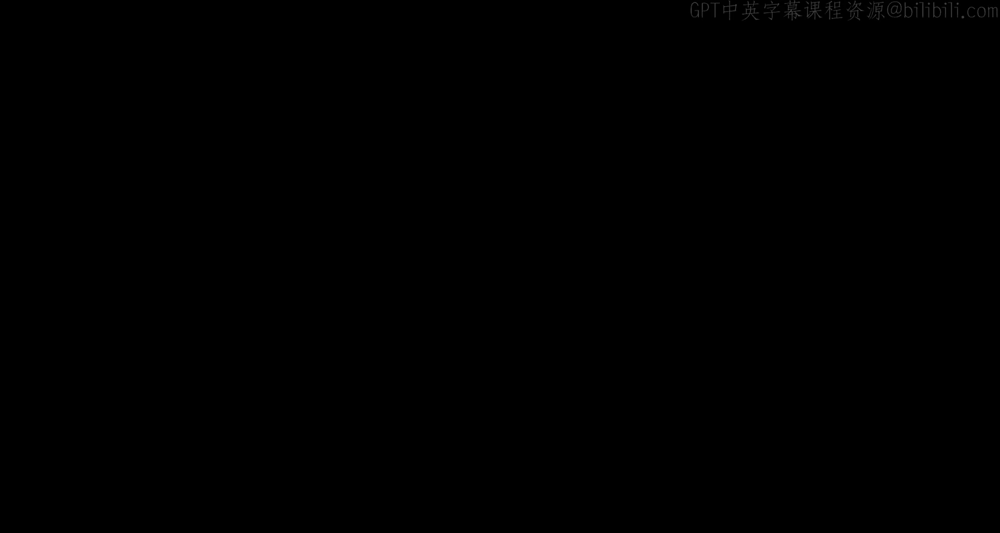
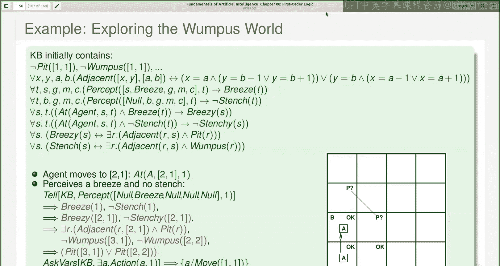

# 意大利特伦托大学《人工智能基础｜Fundamentals of Artificial Intelligence 2024》中英字幕deepseek p25 2024.11.15-CL20-1-CH08-FirstOrderLogic.zh_en -BV1uUkwYTEmf_p25-

Okay， so today we just conclude this chapter and then we started doing some actual reasoning first logic。

We concluded just giving an idea how to you can pass from propositional logic。

To first of the logic in the knowledge base agent。 So to be the。An agent。

Who has reasoning capability investor logic？We don't yet see how you do this reasoning。 Okay。

 this is the actual topic of the next。Chumpter。Okay， but we for。For now。

 we assume you have that the agent has these reasoning capabilities and then see how you can use it。

诶。In general。Again， we can be knowledge based。 So the idea is the very same of fall。

Of knowledge based agent， so。诶。You have a knowledge base， B。

 which this time is is not a collection of Boolean sentences， rather is a collection of first orders。

The big advantage of that is that this allows to。Make Max more compact。

Because remember that a first order scientist can be much， much more general。Then a Bu sentence。

 Okay， so you need the。So any first logic scientist can have。

Up to infinite possible instantiations we have seen last time that， okay。So we assume， for instance。

 we have used the notation of your book。 You have some metaraiccate， which functionality。

 which allows to assert scientist meaning to add an。A sentence to the knowledge base。

 So tell the knowledge that King John， So that John is a king。

 or you can tell the knowledge added to the knowledge base， the fact that Richard is a person。

And then， you can。So this a fact。 and typical facts are objects ground objects。 Okay， so this。

 these are contingent facts。 So John is a king， Richard is a person。

 And then there are some general statement， which are typical universally quantified formula。

 which are for all X。 king X implies person X。Okay， every king is a person。Okay。

So and we can ask queries or goal to the knowledge base Well for instance we can ask a very simple goal。

 which is nothing else thats something that is already in the knowledge base so which mainly so is John King and this would simply make a this is just a retal of some fact that you already know but then you can ask。

😊，Some more sophisticated。Questions。Which is， is John a Carlson？Well。

 note that person John is not part yet of the on the larger race。 However， you can reduce it。

This is a query， Okay， so it's not simply a lookup， a database lookup。

 This is something that you do a deduction because in。By doing。By knowing that John is a king。 Okay。

 and applying this general rule， you can entail。That John is a person。 Okay， so if your。

The agent has a first order logic reasoning capabilities in first order logic。

 then you can instantiate this very general rule here to the particularism case Okay。

 is it like the Aristotle's model response。All main are or main are you。Oh。

Orment mortal Soates is man， So Soates is mortal okay。Okay。

 and also you can ask some existential questions。Like footし that。Is there a person。Exist X。

 such that person X。Is there a person。And the answer will in general is yes， because。Because John。

John is a person， Okay， according to the deduction of this soul from person， John。

You canfer that exists at least a person， okay。I mean， not that when I say we can deduce that。

 I just refer to your intuition what can be deducible okay the way。

On how we can actually deduce that we'll see in the next chapter。So。

So substantially ask knowledge based Al will return through only if the knowledge base is is alpha。

 There are other queries that you can answer。 for instance， Well， one kind of。Again。

 I use the notation of your book， ask bars。You can ask for valuable values。 So not only for。

So when you are asking some existential question， you can ask not only if it's true or false。

 but also to find you a thema which matches the existential query。So for instance， if you ask Va。

 exist a person X。Okay， then you can infer that you can have。 you have two possible answers。

 That is X is a John。Can be seen as an X。 It can be translate to John。Okay。😊，Yes。

 because we have already seen that you can deduce John。

 we can deduce that John is a person and then X a Richarder because we already know as a fact that the Richard is a person Okay。

 so what if we can。So the query can what is called the binding a binding list。

 so what is a binding list， so a list of substitutions。Okay。

 at is a subit which substitute the variable with the term。Okay。

 which such that do match some existential query。You see that again。

 I'm just referring to your personal intuition， we'll see how to actually do that in the the next chapter。

Okay。Well， this is typical， although not strictly restricted to。To horn clothes。

 So originallyig when this is deterministically。When the fact that a variable can be substituted with by some constant or some constant ground term can be deterministically derived。

 so to say。But for instance， if I say。King John or King Richard。ok。And I ask and I ask exist king X。

 the answer is true， right？But the point is， I cannot ask askvas。Okay， because we don't know。

So you that you cannot return X John。Because we know that one of those is true。

 but we don't know which one。In this case， you not return anything like Xgen or x binding Xgen or X reach。

 okay， because we don't know it。Remember。啊。We can have a。Exteristential queries， which are true。

Even if we don't know。A possible sensation existence of the variable。You see this？

We know that that something exist， but we not know。Which。It is。Okay。😊，Over there。Okay。Okay。

 let's see some examples that well sometimes use in as an example， one is the family relationships。

 okay。So suppose we have some binary predicate symbols which sort of defined some relationship like parent。

 sibling， brother， sister， child， daughter， son， suppose， wife， husband， grandparent， grandchild。

 causing out uncle， okay， with the meaning within1 meaning they have in English， okay。And then。

 we may have。Some function， not this are relationship， Min relationship。 instead。

 functionable mother or father are functions that say some person you associate another individual。

 which is the mother or father， respectively。Okay。😊，Okay， so we can have some knowledge base。

 so we can formalize progressive predicate。 So we can say， okay， so。😊，What is a matter。

 So suppose we have a notion of female and。Okay， we can define that mother， not this definition。

The functional mother。For all x and y， X equal mother Y， if and only leaf。

 X is a female and X and y are apparent in relation。 So x is apparent to y。

Note that mother is a function。😡，Bent is a relation。Because you have two parents。Okay。

 you cannot have a balance of X。Because pilotative action does not identify one precise person because you have two persons。

Okay， so you don't know which one is this then you can define for this generation brothers like maleex and sibling X Y。

 so suppose remember sibling is the brothers who the sisterhood in one the genderless version of a brother and sister okay。

We don't have such an award in Italian。Our grandfather is okay， interestingly， for。

 when we want to define grandpa parent， we need some extra element。

So we need some existentially quantified variable。Well， because if I want to define x and Y。

 it so the the relation or grandfather relation， there is some intermediate element you need to consider。

 which is the。The son of the the grandparent， which is the the parent of the。 So Grand X。

 Y says that existence that such that a parent ex dead and parent died Y。Okay。诶。

But then you can define a sibling itself。For instance， a s x。

 Y such that x is different from y and exist P1 and P2。

 such that P1 different from P2 and part P1 x and part P1 Y and part P 2 X and parent P 2 Y。

 So they have two。Two parents。 Okay， so there are two person， two person are siblings。

 If they have two parents in common， which are different。Okay， and sounness a four， okay。

So for the instance， you could do queries。Like from action number four。

 so these are typically called actions。Okay。诶。Quantify the general rules， so。

Rules in the form for all x and y blah， blah， blah are typically called action。

 and very often there are other set to define the new to define predicates in terms of other predicates or to assert properties of some predicates。

Okay。So for this you can， then you can ask to queries， okay so。For instance。

 you can say that sibling issymmetric。C X for all X Y， C X Y is fairly for sibling Yx。Okay。

Okay you can do lots of query and you can infer this out of A4 well。

 you notice is that if you rer this so substantially due to the fact that the different is a symmetric and you can in end can be commuted okay。

Okay。Another domain that we is very， very。 okay， So this is an example。

 But this instead is not only an example， but something which is very important is piano formalization of arithtic。

So pianoo was a famous mathematician and formalized me wrote the very basic。

Elements of arimetic in terms of maxximatic。A set of actionsxioms for which you could video everything。

This is a well known result。Okay， so what do you do。 So for instance， you need。

I usually predicate seems， which is not number， not one number。Okay。

Whi is characterizes the elements so the domain that we are speaking about。

 then we need one constant symbol0 and one usually predcate function symbol， which is s。

 which is the successor， so we can define all the set of network numbers in terms of the constant0 and the successor meaning plus one。

Okay。ok。And we can out of that。 So out of these primitive symbols。

 we can define as a synthetic sugar。We can define more sophisticated symbols like plus star， blah。

 blah， or also constant symbol， other constant symbols， one， two， three， four， five， blah， blah blah。

How do you do that？Well， substantially， you can define Well I I see well， let me see。one step。

So what we can assert， so what are the foundations of that？Zero is a natural number。Okay。😊，44 x。If。

If x is a natural number， then S of x is a natural number。Okay。

 notice that these two axoms by induction define the domain of mathdynamicdynamics。😡，Which is0，1，2，3。

 four， fivehh，lah， okay， or if you prefer zero S of zero S of x or zero， S of S of S or zero。

 S of x of S of S of S of S or three0 and so and so forth， okay。Then， you understand that。

You can introduce use。Those are symbols。Other cost are symbols as a。Shortcut。

Of more complicated terms can def one to be S 0。 We can call two S1 So one。

 So S O S to 0 and so on and so forth。 And then you introduce the date S notation to with using only。

Atam digit to represent arbitrary inte number positive inte numbers， okay。诶。

Another axiom is to say that effects is not one number。

Then0 is not the successor of0 is not the successor of any natural number。

So there is no natural number。 So ver x。Pro natural number x S of x is not 0 cannot be 0。 Okay。

 so it is not circular。 So0 cannot be。We end。And then you can show some properties。So for that。

 the subor is injective。Okay， if x are different from y， then giving x and y a natural number。

 if x is different from y， then S of x is different from S or Y。Okay。

Which does assume that the successor is injected。Now start。

 you can start defining it the symbol plus。By induction。You can say， look。For every natural number。

0 plus x is x。And then you define for every pair of never number， X and Y。

S of x plus y is the successor of x plus y。This allows you to define inductively the plus。Okay。诶。

Well， out of that， you can。You can for reason， do additionions。You can say that the four plus five。

So once you have defined what4 and fly5 and 9 is， you can。Theyduce that 4 plus 5 equals 9。

Or beta S of S of F of S of 0 plus S of S or S S S S of 0 equal S of S S， S O 9 times0，9 times。 Okay。

 yeah just apply those exams。 You can deuce。 so you can。Did use rather than calculate。Okay。

 so what you have done， you have a formalized arithmetic in terms of logic。

This was a very famous so for instance， you can query things if you have a proper automatic reasoning algorithm behind that。

 you can say that forx and y x plus y equals y plus x， or that four plus5 equals9。Okay。Well。

You probably see that it's not very practical。😡，Okay。

 so if I want to show that1 million plus1 million is mixed to millions。Okay。

 I will need having2 million inference steps in order to reach it。Okay。

 so this is not to be very convenient but very practical， Okay， but however。

 this is fundamental because you say that。Logic can be formalized in terms of sorry。

 sorry automatictic can be formalized in terms of logic。

What actually do know talking about the reasoning？😡，Is。

So what actually you do on a matter reason when you need dealing with the numbers？

Well do you associate？You combine logic with arithme。😡。

And this is what is called satfiability model of theories。

Which is a whole branch of automa reasoning， which is fundamental。

 and this is one of the main topics of the course of auto reason。Okay。Okay。

 Ill leave you some exercises here for about theship the kinship is the fe domain。

 try to add the action to find out predic of functions like a brother seized in child， whatever。

So add the sum grand atma or its negation to the logia base and try to solve the sum query by enment。

 okay， this is something when you have either by some obvious entailments or wait for the next chapter。

Similarly， about the piano reform domain， try to add the aom defining other predicative functionss like as more equal or a multiplication or power。

There is。AF， which is called the ackerman function。

 which generalizes the main arimetical parameters like plus plus times exponiation， blah。

 blah with an index so。Plus is ackerman1， so it gives a parameter which defines the level of induction over the of the kind of operation that you are reasoning。

 so it's sort of a generalralization of plus multiplication exponunciation and blah blah， blah。

So try to solve somequeries like。They plus， well， I suggest you to make small ones with small numbers。

 otherwise you get something which is very， very big。Okay， so what is the takeover of that？

That you can do in logic。 You can formalize lots of very interesting stuff。 Okay， it is very。

 very general。Is very， very powerful， very expressive。

 And there are fundamental facts like a pianooidrithmetic。

 which allows you to formalize very lots of。Real world problem， in particular， if you associate。

If if you enter in the arena， something called the theories。

 I just anticipate that then which are something which allow you to give。Specific。

Interpretation to some symbols。Like glass minus is more equal。And okay。

 you can associate some reasoning algorithms。Alcle time。

Then you can combine this reason argument with the logic。😡，Okay。

 and dramatic increase the power of autoism and this is actually what satisfiability model theory is。

呃Okay。Let me。Close the chapter with the our making the first or logic variant。

Of the Wmpus well remember the Wus world is very strange simplified the video game where there is a hero who has to move in this area。

Okay。We， we have to deal with agents。 So we can also formalize the fact that we perceive。

 So suppose we we we can perceive some facts。 Okay。

 so let's add some binary predicate some pest in which we have an array of。Values。Of of a single。

Tts that we can perceive。And then okay， here is a new。T， we can also formalize the notion of a step。

When we do， for instance in plaining， I'm not attaching this。

 but not touching this in this course but。In planning， you can formalize thevol， something。

 the planning of some events。But yeah， I think one。Parameter to predicate， which is time So step but。

 which you increase step by step。 So some。Giving event at step T is a condition to something else at step T minus1。

Okay， so you can。You can。Model， industrial the logic， also the evolution of a system through biosts。

Okay， so remember that we can perceive some stch， we can perceive some breeze。

 we can we can perceive some glitter， some bumper else we perceive a scream。

 this is not much interest for us。 the only two relevant now a reduced example is we can perceive a stature you can perceive breeze。

 remember。So means that。Perception here is just a。诶。

Is implement as a constant and so the parameter per set that can be other for reason。

 the second element of this array can be breeze or nullled。Breeze the cost and breeze if。

 if this means that。The perceptioncept with breeze is true means that I perceived a breezecept b nu blah。

 blah means that I haven't perceived perceived a breeze。

This true means that I haven't perceived the beliefs， okay？And so on for everything else。So。

 for instance。Per， so I can add some action in my knowledge base to associate some per to some understanding of reality。

Okay， some fact about reality。 So for instance， I can say for all values， blah blah， blah。

I perceive percept a blood breeze means that a step tip。I feel a breeze。A state of the firates。

 Instead， if this is nu。I can infer that it is not bring， there's no breeze at the step team。

 So I add this aximatization to。To match my perception。

 to enact the state of the world in knowledge of the world， Okay， meaning that it my percept。

T me breeze。 I came fair and that knowledge based the fact that current step， I feel a breeze。Okay。😊。

Okay。I have invite so I can accize my environments。 So， for instance， I can。

Represent every square as a pair of as a therma。A thermal pair of integer。 Okay， so this is just。

 you can see this is a function F of the two integers okay。IIf so。

 I can formalize the notion of agency。 or I assume here that I have already formalized the basic mathematical operations so。

This means that our automaticta reason device has nose spanrithmetic， for instance。Okay， well。

 much more。Realistically knows how toism in national。Okay。

 so I can formalize the fat to the adjuency。As a bun practical edges， meaning for all X， for all Y。

 for all A or B。X and B is adjacent to to A A X and Y is adjacent to A B。Iffin。Either X equal a。

And y so x， so notice is no here。Okay， x equal a and y equal B minus1 or or y equal B plus1。

Or y equal B and x equal a minus1 or x equal a plus1。Okay， what is the fundamental difference？嗯。

With respect to the previous boole formalization。I need here。 one formula。To represent all the。

Adiency instances。Of all squares， if you remember。In the Boolean case。

 I had to write 16 different such actions， one for every。1 for every square。

And if I had the a matrix of 100 for 100， so I mean，4 by four is not very realistic for a video game。

 if I had the 1000 times 1000。This means that would have needed writing1 million。I did see actions。

Which would not to be very realistic， right？Okay， video。So in one action。

 you represent all possible addition instances of squares。

Add an a relationship between scarces for those classs。Okay， that's a fundamental fact。 Why。

 because you have the for all here。That sexes the point。😡，You have a for。So this is a general rule。

 which holds for all possible squares。Okay， so you understand the huge power of the stone logic。

Expressive power， He is much， much more expressive than good logic。Okay。

 it allows you to represent in one。In one of scientists。

 up to1 million instances or billions or living infinite instances。Okay。😊，Okay。

 so we have a position predicate。Which says。E， which is agent is at state， is in location S at FP。

For instance， at the agent1，1 at step 1， okay。And then we say， well。

 we formalize that the position is unique， so for Rox as one as to a T。If at you are at step T。

 you are at X 1 and in step T， you are access to。 this means that S1 is。Is S2。Okay。So substantially。

 this says that you have a unique position。So you may have a predicate who boost。So for this essay。

 the boomus is inposition 31 okay and sign P is a predicate pizza we have a inposition 31 as anticipated that this is a slight variation with respect a light simplification we respect to the formalization that your book proposes。

 I've simplified it a little。Okay， yes， that's it。 So the。For the wimpus。

 this hero wrote that womus is a constant to set upper womus to okay。I made this much simpler。

And weve seen the vus。Does not move。 is' like a pit。

 So you can consider this as just an obstacle with's there。 So the wus is not。嗯。Is does not move。

 so I can just adjust closer this as a P。 so is something which is study there。

Your book makes dis formalization because it emit makes an example more complicated。

 it admits also that the power here can throw a bow and kill the wopus so after that the wooopus is the more there bla blah。

 blah。This is not of interest for us， okay？Okay。啊。Yeah， that's actually the point。 So we。

 if you want to keep them and put then we in the interview in。 but I leave you。

 But if you are interested， you can look the more sophisticated formalization of of your book。Okay。

 so you can。 I am。I make this as an example。 I see how you can formalize complex environment。 Okay。

 and you can， okay， you can formalize a complex environment using first logic。

 in that this makes the the encoding much， much more sophisticated。Then。

 in much more compact than with the propositional logic。Okay， so for instance。

 you can say that if you legend at step T， you are in location S and you feel a breeze。

 that means that S is breezy。What does it means， Well， you may say， well， this is stupid。

 this is obvious。Oh。🤢，Remember something。One of the drawback of writing of formalizing stuff。

Is that you。Must formalize all your stuff。YouVery often。

 you if you want to write and formalize a description in terms of logic。

You have to formalize something。Which is obvious to you。

But this completely known to the fear improver of the Auto reasoning device。

 which we will have to do the reason。In particular。

 breeze is something which relates to step so in this moment breeze team I'm feeling a breeze。

In this very moment， but it does not associate to a position。Me， sir， I'm cold now。

If you want a society breeze to a position， you have to combine the fact that you are in a given position。

 a given entity， so in order to society B to S， okay， you need the act。

Combined with with the act predicate。Over there。So you can say， okay， if I'm at step T。

 I'm in a location S and I feel a breeze， this means this is breezy。

 If at step T I don't feel a breeze， this means the location S is not bree。😊，Okay。

 because Breeezy is a property of the location。😊，Breeze is a property of the step。

So you have very often when you formalize， you have to add lot of。

Very boring actions just to connect to make very obvious parts which interlea will connect something。

ok。Which is not very much something very interesting， but you have to do that otherwise。

 your tool has no way of inferring。So for instance。

 and also you have to infer information about the peaks and the w boost or the repeat。

 So if Z if S for all less。If S is breezy， there means and that's the important fact that there is a location which is adjacent to s and there is a P。

Okay， similarly， if it is strange， then there must be one location。

 which is adjacent with a current location where the push is there。Okay。Okay。

 you can describe also something about evolution of time。

 So I so if you have an arrow and t plus one and you still have an arrow。

 if you' actually is not to shoot it。 Okay， well this is not of interest。

 but this is important when you are formalizing things in planning。 so you have to as we see。

 you have to add action， which say that if you don't do something which changes your status of some variable。

 this variable maintains its state after after the action。

 So this is something that happens quite frequently in planning。

And then you can have some actions like turn left to right left。 go forward， shoot， grab and clean。

 But also， you assume that the position is you are looking in this direction。 So if you want to move。

 you just turn and then go forward。Okay。You can have a simple reflection， like for all T every step。

 if you see。Okay， so you have some actions。Fffects action， which suggests you。Something to do。

If you are some conditions。So if there' is a gold in your place， grab it。If one location is okay。

So if your nearby location is okay， go there。ok。Okay， remember， okay。

 is is the means that there is no， you are sure there's no one personal and no people there。Okay。

And then， you can。In this scenario， you can ask us so exist an action。

 which is best action at the given step。 Yes， it is。 and we can grab。Go the gold。Looking。Well。

 this again， I've made some simplification with this example。 So rather than say。You are going there。

So want to do that， you should turn and move forward。I just simplify as I move there。O。Well。

 if you are designing a robot。You cannot say there， okay， because you have some acwes。

And you should know where the where is the your direction， I'm looking there if I need to go there。

 I should turn， you should give the robot the instruction of turning。And go ahead。Okay。

 so if you are formalizing and giving instructions to some agent。

Remember that you have to fill in a lot of very boring and obvious or very basic things。

To make this work， which probably are absolutely obvious to you。

 but it is not obvious for the agent unless you formalize it explicitly。Okay。

So let's see how the previous example by fifth logic is that。Again。For the performance deductions。

 just rely on your intuitions。 Okay， we haven't seen yet how to do。Inrans。不。

These inferences are simple enough so that they can be input。Okay。

 even though you don't have in your mind an extra algorithm to how to do that。Okay， so so。

For instance， your knowledge base initially contains some of the information that we have already seen in definition of an agency。

 the fact that the percent of breeze and strange。The transformation of breeze and and。

 and from a step to， to。To location。The fact that it's breezy。

 then there must be a betting nearby and it is staing there must be a wus around and the fact that it's okay。

 if and you have not pizza and not womus， okay？So initially， step is zero。You are in in location 1，1。

And you perceive with no tension of breeze， okay。So you tell， remember。

 tell is this meta prediccate in which you are the knowledge base。

 something that you perceive or you have acquired in some way。

 So you can upload your knowledge base Stan。 Look， I perceive。 but no， no， no， no， no， at step is 0。

And I'm at position step zero， I'm in position11。傻。Out of that。Well， you see that with。

 I can perceive first that a step is zero。Is no。 well， is there is no breeze and no stage。

A step is zero， okay？Well， you see okay， you see apply apply well I assume that you you understand how to map this infer this out of this okay。

 I rely on your intuition here again we see this formally how to do that in next chapter。From that。

 from those actions here。You can see that step location War1 and is not breezy and is not a staing。

For which we know since we can we know what a means， you know that all the as， so if this is not。

 a place is not breeze， is not substantially。We know。The the。

Remember that those actions work also in negative。So if this is false。Okay， if s is a false。

The br is force is me。Not the exist R addition to R S and P R。Okay。

 so it means that for which means is for all。Adjects location， there is no pit。Not be told。Okay。

 so for which you can infer not pit one， two and not pit to one and not wound push one two and not won push to one。

Okay， which means from this that is okay1 and okay2。Which means that if you。Yeah。

 this no shall the best action。Okay。Which can suggestiate you the fact that you can either move to one two or move to one。

 okay， so you return。This operation move to some one or2 location。 you have 12 tenities。

 both both these elements are okay。Our best moves。 Okay， so let's speak one。Okay。Suppose that you。

 you have a move a tool to one。And now， as you go see can move on， you。

 you know that you are into one。 So you know that at a to1。And there， if you remember。

 you perceive a breeze， but you perceive in nostenia。So。You can add。

The fact that you perceive a breeze， but you perceive no stage here。Okay。😊，Okay。

 but if you perceive a breeze， where is it。This means that okay， from this。

 you can infer that step one is breezy and is not a staing。 Okay。

 so you say the location 21 is breezy and location 21 is not a sta， okay okay。From which， okay。诶。

You infer that， as before that not wus in one and not wus in into 2。 And that's okay。

 very same as before。 But the interesting part that now you infer。

An existentially quantified sub formula。Which is exist R。Edus。啊，短呢。And feet are。

If you remember the Boolean case before。In that case， we inferred an or。You say the pit in the。

Beat in1，3 in 3，1 or beat in22。Remember， no， that he sad。We say exist to adjujectts to21。

 note that the two adjuts are only do possible sensational adjus are only 3，1 and 22。And big R。

 So we have。A first order。Logic and coding。In terms of exist existential quantification。😊。

Of the previous action， remember， an existation quantification is nothing else than a disjunction。😊。

In general， up to infinite possible diss， but now we have all two possible candidates。Okay。

 because a is referred to the edge squares of these two square here is only to play two squares。

 okay？So， let's go ahead。Yeah。Okay。By inference。Of the notionional agency say。

 we can't infer Pta 31 or Pta 32， which is actually the very same。Okay， since we have only four。

 we can infer this。Okay， so since we have no answer here， no possibility， no safe。

 So the only okay position you have to go back。 So the only nearby position is the first one。

 So they are not okay。So Askva is going here， which is the only good one。 and then go here。Yes。

So you move one， one and then suppose you move to one， two， and then I let you go ahead with example。

 okay。Is okay？Okay， so what what is the takeout， So why is this interesting。

 You know that it's more common so。😡，Compare the encoding we have done in firstor logic here with the to the one that we have done in Pro logic。

Well， this is more difficult to understand， probably okay。Less intuitive。

But if you had to write this， remember that in the provision Lo， you say for every parallel square。

 we add an action like that， okay， so if you have to write。Then coding explicitly。

 listing all possible instances。You have a huge。So you have 15 instances of many of those。

Of those axs。 Okay， so if you have。But not huge， but a large database。

If you imagine this to be a 1000 times 1000。Square border instead of4 by4， you mean that you have a。

One million instance of action for every action that you have formalized will allow you here you have one。

So it's way more compact。Why， because。In the logic。You map the notion that we ever made implicit。😡。

When I say in bull logic， I said for every square， let's do this。

 This for every square is sort of meta consideration is a niche sentence。

 mean meaning instruction for you， human or for you formalizer， say。

Add one such action forever for each。 So this for each is a meta。Sameence， okay。

 so it means that you have to other 1 million aoms， Okay， well 16 in this case， okay。Instead。

 I formalize in logic that for all。For old Square。So my scientist contains this for all square。

 meaning I encode one。Action instead over 16 over a million。W。Okay。

This is the power of a first logic。And related。Derrivation like a satfiability model theories。

 for instance， okay。Okay， so long for this chapter。Let's have a break now， they resume at 40。

And then we started reasoning in logic， okay。Just to recall that I will stop the recording and I will make a new recording or we'll have two videos for today's class okay？

Yeah。

In just a one second。