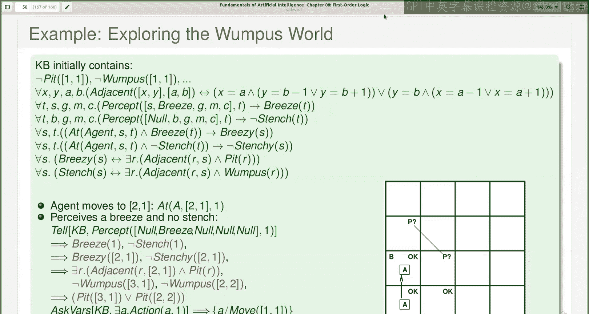

# 人工智能基础：第8章：一阶逻辑


在本章中，我们将学习一阶逻辑，并了解如何将其应用于知识库智能体。我们将看到一阶逻辑如何比命题逻辑更强大、更简洁地表示知识，并通过一些具体例子来理解其应用。

## 从命题逻辑到一阶逻辑知识库智能体

上一章我们介绍了命题逻辑。本节中，我们来看看如何将基于命题逻辑的知识库智能体，升级为基于一阶逻辑的智能体。

其核心思想与基于知识的智能体相同。你拥有一个知识库 **KB**。但这次，**KB** 不是布尔语句的集合，而是一阶语句的集合。这样做的一大优势是，知识表示可以更加紧凑。因为一个一阶语句可以比一个布尔语句通用得多。一个一阶逻辑语句可以拥有**无限多个**可能的实例化。

我们假设智能体具备一阶逻辑的推理能力（具体推理方法将在下一章学习）。知识库可以通过类似 `TELL` 的操作来添加语句。例如：
*   `TELL(KB, King(John))`：告诉知识库“约翰是国王”。
*   `TELL(KB, Person(Richard))`：告诉知识库“理查德是人”。

这些是事实，通常是关于具体对象（常元）的断言。此外，还有一些通用陈述，通常是全称量词公式，例如：
*   `∀x King(x) ⇒ Person(x)`：每个国王都是人。

然后，我们可以向知识库提问或设定目标。例如：
*   `ASK(KB, King(John))`：询问“约翰是国王吗？”。这只是对已知事实的查询。
*   `ASK(KB, Person(John))`：询问“约翰是人吗？”。这需要进行演绎推理，因为知识库中并没有直接存储 `Person(John)`。但通过已知的 `King(John)` 和通用规则 `∀x King(x) ⇒ Person(x)`，我们可以**推出** `Person(John)`。这类似于亚里士多德的三段论：所有人都会死，苏格拉底是人，所以苏格拉底会死。
*   `ASK(KB, ∃x Person(x))`：询问“存在一个人吗？”。答案通常是“是”，因为根据推导出的 `Person(John)`，我们可以推断至少存在一个人。

当询问存在性问题时，我们不仅可以问真假，还可以要求找出满足查询的变量值（即绑定列表）。绑定列表是一个**替换**列表，将变量替换为项，以匹配存在性查询。例如：
*   `ASKVARS(KB, Person(x))` 可能返回绑定 `{x/John}` 和 `{x/Richard}`。

需要注意的是，这种确定性的值返回通常适用于**霍恩子句**。对于析取式，情况则不同。例如，如果知识库包含 `King(John) ∨ King(Richard)`，那么 `ASK(KB, ∃x King(x))` 的答案是“真”。但 `ASKVARS(KB, King(x))` 不会返回任何绑定，因为我们不知道具体是约翰还是理查德。我们知道存在某个国王，但不知道具体是谁。

## 示例领域：家族关系

现在，我们来看一个具体的例子：如何用一阶逻辑表示家族关系。

假设我们有一些二元谓词符号来表示关系，如 `Parent`（父母）、`Sibling`（兄弟姐妹）、`Brother`（兄弟）、`Sister`（姐妹）等。同时，我们还可以有函数符号，如 `mother`（母亲）、`father`（父亲），它们将一个人映射到其（唯一的）母亲或父亲。

我们可以构建一个知识库，用公理来形式化这些谓词。公理通常是全称量词形式的规则，用于根据其他谓词定义新谓词或断言某些谓词的性质。

以下是部分公理示例：

*   **定义母亲函数**：`∀x ∀y (x = mother(y) ⇔ (Female(x) ∧ Parent(x, y)))`
    *   注意：`mother` 是函数（返回唯一个体），而 `Parent` 是关系（一个人有两个父母）。
*   **定义兄弟关系**：`∀x ∀y (Brother(x, y) ⇔ (Male(x) ∧ Sibling(x, y)))`
*   **定义祖父母关系**：`∀x ∀y (Grandparent(x, y) ⇔ ∃z (Parent(x, z) ∧ Parent(z, y)))`
    *   这里需要一个存在量词来引入中间代（父母）。
*   **定义兄弟姐妹关系**：`∀x ∀y (Sibling(x, y) ⇔ (x ≠ y ∧ ∃p1 ∃p2 (p1 ≠ p2 ∧ Parent(p1, x) ∧ Parent(p1, y) ∧ Parent(p2, x) ∧ Parent(p2, y))))`
    *   两个人是兄弟姐妹，当且仅当他们有两个不同的共同父母。

定义了这些公理后，我们就可以进行查询，例如 `Sibling(John, Richard)` 是否为真，或者利用公理4推断出 `Sibling` 关系是对称的（即 `∀x ∀y (Sibling(x, y) ⇒ Sibling(y, x))`）。

## 示例领域：皮亚诺算术形式化

另一个极其重要的例子是皮亚诺算术的形式化。这不仅仅是示例，它展示了如何用一组公理来形式化算术的基本元素。

我们需要以下初始符号：
*   一个一元谓词：`NatNum(x)`（x是自然数）
*   一个常元符号：`0`
*   一个一元函数符号：`S(x)`（后继函数，即 x+1）

利用这些初始符号，我们可以通过归纳定义整个自然数域：`{0, S(0), S(S(0)), ...}`。其他符号（如1, 2, +, *）可以作为“语法糖”来定义。

以下是部分皮亚诺公理：

1.  `NatNum(0)`：0是自然数。
2.  `∀x (NatNum(x) ⇒ NatNum(S(x)))`：如果x是自然数，则x的后继也是自然数。
3.  `∀x (S(x) ≠ 0)`：0不是任何自然数的后继。
4.  `∀x ∀y ((NatNum(x) ∧ NatNum(y) ∧ x ≠ y) ⇒ S(x) ≠ S(y))`：后继函数是单射的。

我们可以用归纳法定义加法：
*   `∀x (Plus(0, x) = x)`
*   `∀x ∀y (Plus(S(x), y) = S(Plus(x, y)))`

基于这些公理，我们可以进行推理，例如证明 `Plus(4, 5) = 9`。虽然这种方法在证明大规模计算时不实用（需要极多推理步骤），但它从**根本上**表明了算术可以在逻辑中被形式化。

在实际的自动推理中，我们通常将逻辑与专门的算术理论（如线性算术）结合起来，这构成了**可满足性模理论**（SMT）这一重要领域，它能极大地增强推理能力。

## 一阶逻辑版 Wumpus 世界

最后，我们回顾一下 Wumpus 世界，看看如何用一阶逻辑对其进行更紧凑的形式化。

在命题逻辑版本中，我们需要为每个方格、每个时间步单独编写公理。对于一个4x4的网格，这已经需要很多语句。对于一个1000x1000的网格，则需要数百万条语句，这非常不现实。

一阶逻辑的强大之处在于，它可以使用**量词**来概括这些模式。例如，定义“相邻”关系：

```first-order-logic
∀x ∀y ∀a ∀b (Adjacent([x, y], [a, b]) ⇔
    ( (x = a ∧ y = b-1) ∨
      (x = a ∧ y = b+1) ∨
      (y = b ∧ x = a-1) ∨
      (y = b ∧ x = a+1) )
)
```

**仅用这一条语句**，我们就定义了所有方格之间所有可能的相邻关系实例。这正是因为 `∀`（全称量词）允许我们表达适用于所有方格的通用规则。

我们还可以形式化智能体的感知、位置、时间演变以及行动效果。例如：
*   将感知与位置关联：`∀t ∀s (At(Agent, s, t) ∧ Percept([Breeze], t) ⇒ Breezy(s))`
*   定义“安全”位置：`∀s (OK(s) ⇔ ¬Pit(s) ∧ ¬Wumpus(s))`
*   描述行动规则：`∀t (At(Agent, s, t) ∧ Gold(s) ⇒ BestAction(Grab, t))`

通过这种形式化，我们可以像在命题逻辑中一样进行推理，但知识库的编码却**极其紧凑**。在命题逻辑中，“对于每个方格……”是一种**元语言**指令，要求我们人工添加无数条具体语句。而在一阶逻辑中，“对于所有方格……”本身就是一条**逻辑语句**，由推理机自动处理。这是一阶逻辑表达能力的核心优势。

## 总结



在本章中，我们一起学习了一阶逻辑的基本概念及其在知识表示中的应用。我们看到，通过引入**对象**、**关系**、**函数**和**量词**，一阶逻辑能够以非常紧凑的方式表达复杂的知识，远超命题逻辑的能力。我们探讨了家族关系和皮亚诺算术这两个形式化示例，并重新审视了Wumpus世界，对比了一阶逻辑编码与命题逻辑编码在简洁性上的巨大差异。一阶逻辑的这种强大表达能力，为将其与专门领域理论（如算术）结合，构建更强大的自动推理系统（如SMT求解器）奠定了基础。在接下来的章节中，我们将深入探讨如何在一阶逻辑中进行实际的自动推理。